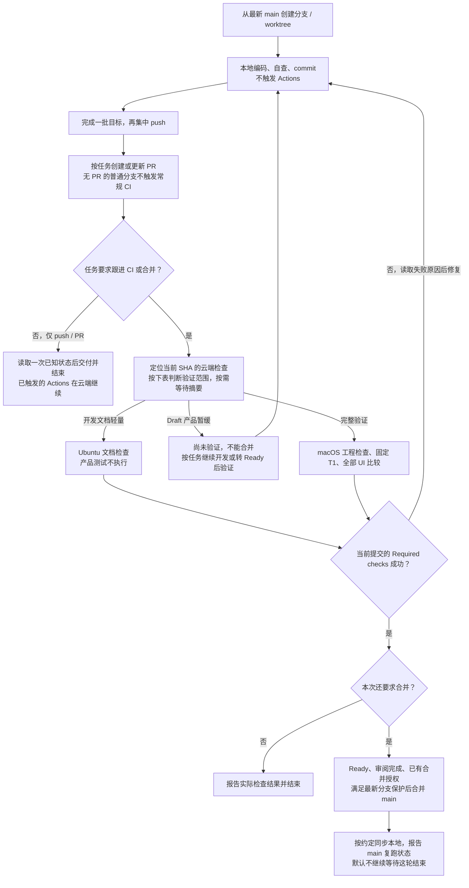

<!--
[INPUT]: 用户任务和既有提交/合并授权、当前工作区、仓库工作流与测试合同。
[OUTPUT]: 以任务终点表、流程图和CI分流表约束集中推送与按需等待；仅push/PR默认交付后结束，明确跟进/合并才等待，未验证草稿不能合并。
[POS]: .agents/skills/boai-dev-workflow/SKILL.md，仓库开发侧共享流程，不是产品员工技能。
[PROTOCOL]: 一旦本文件变化，必须同步更新Header，并上浮检查所属目录.folder.md。
-->
# BOAI 开发与云端 CI

按用户要求推进到本地改动、PR 或 main；只要求分析/落文档时交付对应成果。推送和合并沿用会话已有授权，技能加载本身不扩大任务范围，也不要求重复确认。所有 Agent 共用本文件；客户端不自动发现项目技能时，直接读取本路径。

## 任务终点：推送不等于等待 CI

先按当前任务及会话中仍有效的目标确定交付终点。**仅要求 commit/push（含“git cp”）或创建/更新 PR 时，默认不等待云端检查完成。** Actions 在云端独立运行，结束 Agent 当前轮次不会取消它。若此前已明确要求修到 CI 通过或完成合并，后续一次 push 仍属于该目标，不能据此提前结束。

| 用户要求 | Agent 完成到哪一步 | 是否等待 CI |
| --- | --- | --- |
| 修改代码/文档，未要求提交 | 交付本地改动及实际验证边界 | 否 |
| commit/push、git cp | 确认实际提交与推送结果，给出分支、SHA；有 PR/运行时给出链接及已知状态 | 否；最多读取一次状态快照 |
| 创建/更新 PR | 交付 PR 链接、当前 SHA 及检查状态；未知/尚未出现的运行如实说明 | 否；不等运行出现或结束 |
| 看一下 CI 状态 | 查询当前状态并报告阶段/失败摘要 | 否；一次查询不扩展为持续监控或自动修复 |
| 跟进 CI、修到检查通过 | 跟进指定提交，按任务范围修复并验证，报告真实结果或阻塞原因 | 是；跟进到约定结果 |
| 合并 main | 等当前 PR 提交满足检查、审阅与保护后，在既有授权内合并并确认结果 | 是；合并后默认只报告 main 新一轮状态，明确要求 main 也通过时继续跟进 |

默认交付时报告“推送成功；CI 排队/运行中/失败/尚未查询”，不能把推送成功写成检查通过。不要因 CI 触发就自动进入 `gh run watch`、`gh pr checks --watch`、sleep/轮询循环、后台监控 Agent 或自动合并。后续用户说“查看 CI”或“修复这个运行”时，按原分支和当前 SHA 接续。

## 流程速览



日常节奏是“本地完成一批 → 集中推送 → 按任务终点交付”。需要跟进时再读取云端结果、修复后推送；仅落文档时可以在本地改动阶段交付。

## 开始开发

1. 读取仓库 [AGENTS.md](../../../AGENTS.md)、所属功能规格和目录地图，查看当前分支、`git status`、远端。以当前 [.github/workflows/tests.yml](../../../.github/workflows/tests.yml)、[T1 清单](../../../tests/e2e/test-tiers.json)、[UI 合同](../../../tests/e2e/baselines/contract.json)为准，不把历史运行的 SHA、数量或成绩当新任务资格。
2. 从最新 `origin/main` 创建功能分支。用户日常在主目录运行 `pnpm dev`，独立工作优先使用 worktree，保留主目录当前分支和未提交工作；已有合适功能分支可继续使用。`main` 用于同步已合并提交。
3. 按原功能补实现和必要测试。桌面流程复用 `tests/e2e/features/`、`steps/`、`support/` 的 playwright-bdd；文档归 `ai-docs/`，更新受影响 Header 和 `.folder.md`。新增功能补对应覆盖，原有核心场景、业务断言和历史专项失败保持可追踪。

本地用于编码和日常 `pnpm dev` 开发。自动产品验证默认交给 GitHub Actions：不要因完成开发而自动启动本机 CI、产品测试、构建或带 GUI 的 Electron/Playwright 验证；用户明确授权本机验证时才按其范围执行。本机自动 CI 服务保持停用，云端不可用时报告原因和未验证项，不自动恢复本机服务或改用 self-hosted runner。Skill元数据、文档链接和Git差异等轻量校验可在本地完成。

## 提交与 PR

- 按可验证的小目标集中推送：先完成这一批实现、必要测试和自查，再一次 push。中间步骤可以本地 commit；不为每次编辑、临时日志或单条断言反复 push/dispatch。用户明确要求中途同步时沿其要求执行。
- 在任务要求提交时，仅提交本任务文件并 push 功能分支，然后创建目标为 `main` 的 PR；未准备审阅时使用 Draft，已有 PR 继续更新原分支。只 push 尚无 PR 的普通功能分支不触发普通 CI。

### 哪些操作触发 Actions

下表针对正式 `Offline tests` 工作流；专项诊断按各自入口执行。

| 操作 | 启动 Actions？ | 后续行为 |
| --- | --- | --- |
| 本地保存、commit，或查看云端状态/日志 | 否 | 继续本地开发或读取已有结果 |
| push 普通功能分支，尚无 PR | 否 | 需要交付 PR 时再创建 |
| 创建/重新打开面向 main 的 PR、push 更新该 PR、切换 Ready/Draft | 是 | 按下面的完整差异规则分流 |
| 添加/移除 `ci:full` 标签 | 否 | 下一次新提交触发时按当前标签判断；保留标签则每次新提交完整验证 |
| Actions 手动执行 `Offline tests`，选择明确分支 | 是 | 强制完整验证；适合 Draft 阶段立即验收 |
| 合并到 main，产生 main push | 是 | main 独立按本次完整差异分流，报告这一轮实际状态 |

### 触发后跑哪些检查

CI 先在 Ubuntu 获取完整 Git 差异；PR 看相对 base 的**整个 PR 差异**，不是只看最后一次 commit。以下按优先级从上往下匹配第一项：

| 优先级与条件 | 验证范围 | `Required checks` 与合并资格 |
| --- | --- | --- |
| 1. 手动执行，或完整差异为空/无法确定 | 完整产品 CI | 工程、T1、UI 和独立证据核验均通过后才成功 |
| 2. PR 带 `ci:full` 标签 | 完整产品 CI，含 Draft/文档 PR | 同上；标签本身不触发运行 |
| 3. 全部改动在开发文档白名单 | Ubuntu：差异格式、Header、Skill 名称/描述；桌面与 UI 任务 skipped | 检查通过可取得文档资格，合并仍需 Ready、审阅及分支保护 |
| 4. Draft 产品 PR，且未修改 CI 机制 | Ubuntu：差异格式；桌面与 UI 任务暂缓 | **明确失败：尚未验证，不能合并**；转 Ready 后完整验证 |
| 5. 其余情况：Ready 产品 PR、main 产品 push、CI 机制改动等 | 完整产品 CI，即使 CI 机制改动在 Draft 中也执行 | 当前提交实际通过后取得产品验证资格，仍须满足其余合并条件 |

开发文档白名单仅包括根 `README.md`/`AGENTS.md`/`CLAUDE.md`、各级 `.folder.md`、`.agents/` 和 `ai-docs/` 内 Markdown。产品中的按钮文字、提示词、随应用分发的文档等不因“只改文字”而取得轻量资格；例如仅改本 Skill 可轻量，改产品设置页文字在 Ready 时仍完整验证。CI 机制包括 `.github/`、`scripts/ci-*`、`tests/ci-*`。

完整产品 CI 在 macOS 执行依赖安装、类型、UI 规则、构建、模块、评估数据、固定 T1 和全部 UI 比较；Ubuntu 汇总独立核验原始报告与逐场景证据。当前 T1 为 32 项、UI 为 18 项，后续随版本化清单调整。`Required checks` 始终运行并独立重算范围：文档成功只说明文档检查通过；Draft 暂缓的红灯表示产品测试尚未执行，不能据此声称产品用例失败。不要用 `paths-ignore` 或 skip-ci 消息绕过必需工作流。

### 并发与验证边界

- 同一PR的新有效运行取消过时运行；main已启动的验证保留到结束，避免连续合并导致main长期没有完整结果。
- 离线核心 CI 的结果不代替真实模型业务评估、尚未纳入的专项或发布/升级验收；T2/T3 沿原分层执行，旧失败逐项迁移，不通过删除用例或跳过失败降低门禁。

## 专项诊断与 Hooks

- 新增专项云端诊断默认使用`workflow_dispatch`，复用现有入口并明确用例/源码范围；工作流须已存在默认分支才能手动派发，尚未接入时可用`ci:full`复用正式验证。不要为逐次试错反复新增`push`诊断工作流。确有持续自动诊断需求时，在方案中写清分支/路径和并发取消策略；临时诊断不提供正式合并资格。
- 派发前确认同一源码和范围没有仍在运行的同类任务；读取已有日志后形成下一批修复，再集中推送。产品失败先定位原因；仅有明确基础设施暂态证据时有限重跑，原失败保留，未知回执先查询，不能靠重复执行碰绿色。
- 约束的共享入口是`AGENTS.md`、本Skill和服务端workflow。客户端或Git hooks可做轻量提醒，不承担必需门禁；不在提交/推送hook中安装依赖、构建、启动产品测试、自动push或派发Actions。无需配置用户全局hooks或绑定Codex/Claude/Pi某一客户端。

## 跟进云端进度与失败

仅在任务要求查看、跟进或合并时使用本节；单纯推送按上面的任务终点交付。在仓库目录使用 `gh`；缺少该客户端时使用同一仓库的 GitHub PR/Actions 页面，无需某个特定 Agent 的专属工具。

```bash
gh pr view <PR号> --json url,headRefOid,baseRefOid,mergeStateStatus,statusCheckRollup
gh pr checks <PR号>
gh run view <运行ID> --json headSha,status,conclusion,jobs,url
gh run view <运行ID> --log-failed
```

- 确需持续跟进时，优先使用环境已有的完成通知或工具挂起/恢复等待；没有事件通知时使用单个等待进程并收敛重复输出，避免模型每几秒查询相同状态。等待期间按环境要求简短报告进度，不反复读取完整日志或另派 Agent 空等。任务完成、被取消或源码被新提交替代时结束旧等待，核对新 SHA 后再接续。
- 查询优先读取状态、当前步骤和失败摘要；只为诊断具体问题读取相应步骤日志/必要原件，不把整份成功日志反复送入上下文。云端耗时本身不等于模型持续消耗 token，重点减少反复唤醒模型、重复查询和大量日志。
- 向用户报告实际文档/产品范围、当前阶段和 PR/运行链接；区分 queued、in_progress、cancelled、failure 和 success。日志暂不可读时只报告已知步骤，不能推测场景已通过。
- 在修复/跟进任务范围内，失败时读取实际失败步骤、原始报告和适用的截图/trace，定位后修复同一分支，再 push 新提交。仅要求推送或查看状态时报告失败，不自动扩大为修复任务。基础设施暂态失败有证据时可在原授权内有界重跑，保留原失败；不要循环重跑直到碰巧变绿。
- 原有断言、超时、重试、像素阈值和 mask 继续按合同执行；不能靠新增 skip、削减断言、放宽比较或关闭保护让 PR 通过。报告实际通过、跳过、失败和未执行数量，轻量文档结果不能写成32/18产品测试通过。

## UI 基准变更

UI 不符先判断是实际回归还是预期设计变更。回归修产品；新增功能补场景和必要的新基准；预期界面改版从独立候选流程生成原件，查看旧图/新图/diff，确认符合需求后显式接受相应 case，再随 PR 审阅。环境迁移按合同完成全量迁移，不混用本机与云端档案。

普通 CI 只读比较，不能自动更新或接受基准。具体候选、审阅和接受步骤在需要时读取 [06-UI回归基准与PR门禁](../../../ai-docs/spec/22.开发自动化与持续测试/06-UI回归基准与PR门禁.md)，复用现有入口，不另写覆盖 PNG 的捷径。

## 合并与本地同步

1. 合并前重新读取 PR 当前 head、base 和检查状态，确认原定审阅完成、分支满足 main 的最新严格保护，且当前 head 的 `Required checks` 实际成功。当前保护绑定 GitHub Actions app 15368；主分支或 PR 有新提交时重新取得对应检查资格。候选采集成功、单项测试或旧 SHA 的绿灯不代替它。
2. 在已有合并授权内完成普通 merge，保留提交历史，并绑定已核验的 head：

   ```bash
   gh pr merge <PR号> --merge --match-head-commit <已通过检查的head-SHA>
   ```

   不用 `--admin`、force push 或修改保护绕过检查。回执不明时先查询 PR 是否已合并及实际 merge commit。
3. 确认远端 main 已包含实际合并提交。需要同步本地主目录时，先确认该工作区在 `main` 且干净，再 `git fetch origin`、`git merge --ff-only origin/main`。有用户修改或分叉时保留现场，处理实际差异，不覆盖或重置用户工作。
4. 合并到 main 的 push 会自动触发另一轮云端 CI。最终分别报告 PR 检查结果、合并提交、本地同步/待 push 状态以及 main 复跑链接和实际状态；main 仍运行时明确标为进行中。默认在确认合并及约定同步后结束；任务明确要求 main 这一轮也通过时继续跟进。

完成标准取决于用户要求的阶段：本地任务交付改动及验证边界；PR 交付给出链接和当前检查状态；合并任务确认远端真实合并及约定的本地同步。创建 Tag、发布 Release 和桌面升级属于独立任务。
