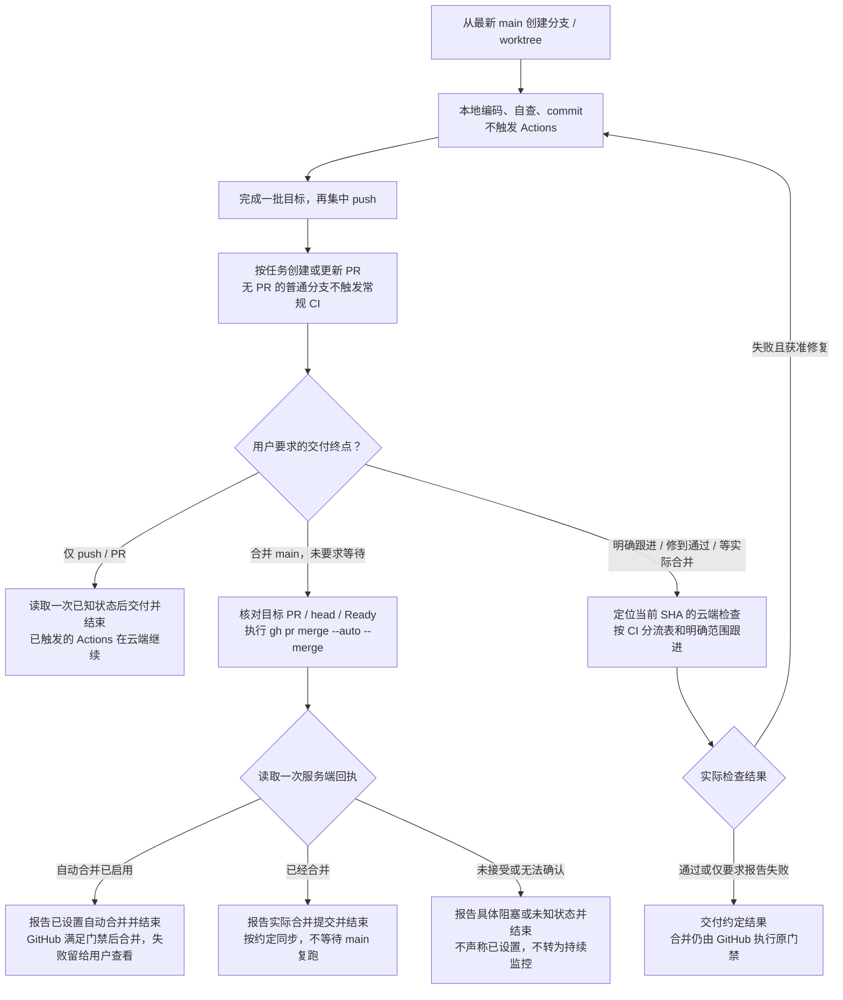

<!--
[OUTPUT]: 2026-10-27官方候选一次完整采集并离线生成差异，普通CI比较与独立审阅门禁保持。
[OUTPUT]: 2026-10-27普通UI两台macOS分片并行；完整合同、身份及逐片原件统一门禁。
[OUTPUT]: 2026-10-27仅PR打开/源码同步/重开触发；Draft/Ready不重复跑同SHA，main复验和原完整门禁保持。
[OUTPUT]: 2026-10-26UI功能交付前说明影响/覆盖并主动准备候选；ui-review轻量附件区分视觉待审阅与执行失败，原门禁及生效边界保持。
[OUTPUT]: 2026-10-24按用户要求移除日常固定使用pnpm dev的约束；运行方式不预设，独立worktree及main仅同步已合并提交的规则保持。
[OUTPUT]: 纠正测试范围：仅 GitHub CI 跑 UI，本地 Vitest/BDD/评估及依赖完整保留。
[INPUT]: 用户任务和既有提交/合并授权、当前工作区、仓库工作流与测试合同。
[OUTPUT]: 现行 Actions 只跑 UI；本地 Vitest/BDD/评估完整保留。以任务终点表、流程图和CI分流表约束集中推送；合并main默认设置GitHub自动合并并核对回执后结束，仅明确持续跟进才等待，失败由用户查看，原门禁保持。
[POS]: .agents/skills/boai-dev-workflow/SKILL.md，仓库开发侧共享流程，不是产品员工技能。
[PROTOCOL]: 一旦本文件变化，必须同步更新Header，并上浮检查所属目录.folder.md。
-->
# BOAI 开发与云端 CI

按用户要求推进到本地改动、PR 或 main；只要求分析/落文档时交付对应成果。推送和合并沿用会话已有授权，技能加载本身不扩大任务范围，也不要求重复确认。所有 Agent 共用本文件；客户端不自动发现项目技能时，直接读取本路径。

## 任务终点：提交及自动合并默认不等待 CI

先按当前任务及会话中仍有效的目标确定交付终点。**commit/push（含“git cp”）、创建/更新 PR，以及“合 PR 到 main”，默认都不等待云端检查完成。** 要求合并时，在已有授权内设置 GitHub 自动合并，确认服务端已接受后结束本轮。Actions 和自动合并在 GitHub 独立运行，结束 Agent 或关闭本机不影响它们；CI 失败则 PR 保持未合并，由用户自行查看。

只有用户明确要求“持续跟进”“修到检查通过”“等到实际合并”或“main 复跑也通过”时才等待或修复。此前仍有效的明确跟进目标不会因一次 push 自动结束；用户随后要求交给 GitHub 后结束时，以最新要求为准。

| 用户要求 | Agent 完成到哪一步 | 是否等待 CI |
| --- | --- | --- |
| 修改代码/文档，未要求提交 | 交付本地改动及实际验证边界 | 否 |
| commit/push、git cp | 确认实际提交与推送结果，给出分支、SHA；有 PR/运行时给出链接及已知状态 | 否；最多读取一次状态快照 |
| 创建/更新 PR | 交付 PR 链接、当前 SHA 及检查状态；未知/尚未出现的运行如实说明 | 否；不等运行出现或结束 |
| 看一下 CI 状态 | 查询当前状态并报告阶段/失败摘要 | 否；一次查询不扩展为持续监控或自动修复 |
| 跟进 CI、修到检查通过 | 跟进指定提交，按任务范围修复并验证，报告真实结果或阻塞原因 | 是；跟进到约定结果 |
| 合 PR 到 main、合并 main | 核对目标 PR/head，设置自动合并并读回确认；已即时合并则报告实际结果 | 否；确认服务端接受后结束，失败由用户查看 |
| 明确等到实际合并、main 复跑也通过 | 跟进到约定的实际合并或 main 检查结果，按约定同步本地 | 是；仅在明确要求的范围内跟进，修复仍按任务授权 |

默认交付时报告“推送成功”或“已设置自动合并”，并附 PR、SHA 和已知 CI 状态；不能把它们写成“检查通过”或“已合并”。不要因 CI 触发或普通合并请求自动进入 `gh run watch`、`gh pr checks --watch`、sleep/轮询循环、后台监控 Agent、重跑或修复。仅要求 push/创建 PR 时不擅自启用自动合并；后续用户说“查看 CI”或“修复这个运行”时，按原分支和当前 SHA 接续。

## 流程速览



日常节奏是“本地完成一批 → 集中推送 → 按任务设置自动合并或交付 PR → 结束本轮”。等待云端期间可在另一个分支继续开发；只有明确要求跟进时再读取结果、按授权修复后推送。仅落文档时在本地改动阶段交付。

## 开始开发

1. 读取仓库 [AGENTS.md](../../../AGENTS.md)、所属功能规格和目录地图，查看当前分支、`git status`、远端。以当前 [.github/workflows/tests.yml](../../../.github/workflows/tests.yml)、[UI 合同](../../../tests/e2e/baselines/contract.json)为准，不把历史运行的 SHA、数量或成绩当新任务资格。
2. 从最新 `origin/main` 创建功能分支。独立工作优先使用 worktree，保留主目录当前分支和未提交工作；已有合适功能分支可继续使用。`main` 用于同步已合并提交。
3. 按原功能补实现和必要测试。桌面流程复用 `tests/e2e/features/`、`steps/`、`support/` 的 playwright-bdd；文档归 `ai-docs/`，更新受影响 Header 和 `.folder.md`。新增界面功能按需要补 UI 覆盖；保留现有本地测试与 UI 断言。

本地用于编码。自动产品验证默认交给 GitHub Actions：不要因完成开发而自动启动本机 CI、产品测试、构建或带 GUI 的 Electron/Playwright 验证；用户明确授权本机验证时才按其范围执行。本机自动 CI 服务保持停用，云端不可用时报告原因和未验证项，不自动恢复本机服务或改用 self-hosted runner。Skill元数据、文档链接和Git差异等轻量校验可在本地完成。

## 提交与 PR

- 按可验证的小目标集中推送：先完成这一批实现、必要测试和自查，再一次 push。中间步骤可以本地 commit；不为每次编辑、临时日志或单条断言反复 push/dispatch。用户明确要求中途同步时沿其要求执行。
- 在任务要求提交时，仅提交本任务文件并 push 功能分支，然后创建目标为 `main` 的 PR；未准备审阅时使用 Draft，已有 PR 继续更新原分支。只 push 尚无 PR 的普通功能分支不触发普通 CI。

### UI 测试与触发规则

2026-10-23 用户澄清：**仅 GitHub Actions 只跑 UI；本地 Vitest、单元/集成测试、BDD 和评估代码保留。** 不得把缩减云端门禁理解成删除本地测试或依赖。`pnpm test` 仍运行 Vitest，`pnpm test:electron` 为本地完整 BDD，`pnpm test:ui` 为 UI 回归。

| 操作 | Actions 行为 |
| --- | --- |
| 本地保存/commit，或无 PR 的功能分支 push | 不触发 |
| 面向 main 的 PR 创建/源码更新/重开 | 执行 UI regression 和 Required checks |
| 仅 Ready/Draft 状态切换 | 不重复触发；已有同 SHA 检查继续作为门禁，Draft 仍由 GitHub 禁止合并 |
| main push 或手动运行 UI tests | 执行同一 UI 流程 |
| ci:full 标签变化 | 不影响当前流程，不触发 |

`UI regression` 使用两台独立 macOS runner，各安装依赖、构建并执行固定9项，合计原18项。每台保持单worker，避免桌面焦点互扰。`Required checks` 名称不变，始终运行，独立重算两片完整合同并核对 UI 任务、当前 SHA、源码/构建输入/环境、原始报告、全部截图/trace；缺片、重复片或跨提交均拒绝。它不等待任何工程或模型测试；UI 失败、取消、缺场景或缺原件仍拒绝通过。Draft 的合并限制由 GitHub 原生状态负责，不再额外设置范围判定任务。

同一 PR 的新运行取消旧运行，main 已开始的运行保留。UI 结果只说明界面交互/布局/视觉检查通过，不代表真实模型质量或发布验收。

## 专项诊断与 Hooks

- GitHub Actions 仅维护 UI 工作流及手动 UI 基线候选；非 UI 诊断和完整测试保留本地。历史 workflow 原文归 `scripts/diagnostics/workflows/`，不因整合旧分支重新启用。新增云端非 UI 流程须有用户另行明确要求。
- 派发前确认同一源码和范围没有仍在运行的同类任务；读取已有日志后形成下一批修复，再集中推送。产品失败先定位原因；仅有明确基础设施暂态证据时有限重跑，原失败保留，未知回执先查询，不能靠重复执行碰绿色。
- 约束的共享入口是`AGENTS.md`、本Skill和服务端workflow。客户端或Git hooks可做轻量提醒，不承担必需门禁；不在提交/推送hook中安装依赖、构建、启动产品测试、自动push或派发Actions。无需配置用户全局hooks或绑定Codex/Claude/Pi某一客户端。

## 跟进云端进度与失败

仅在任务要求查看或明确跟进时使用本节；普通合并请求按下节设置自动合并后结束，单纯推送按上面的任务终点交付。在仓库目录使用 `gh`；缺少该客户端时使用同一仓库的 GitHub PR/Actions 页面，无需某个特定 Agent 的专属工具。

```bash
gh pr view <PR号> --json url,headRefOid,baseRefOid,mergeStateStatus,statusCheckRollup
gh pr checks <PR号>
gh run view <运行ID> --json headSha,status,conclusion,jobs,url
gh run view <运行ID> --log-failed
```

- 确需持续跟进时，优先使用环境已有的完成通知或工具挂起/恢复等待；没有事件通知时使用单个等待进程并收敛重复输出，避免模型每几秒查询相同状态。等待期间按环境要求简短报告进度，不反复读取完整日志或另派 Agent 空等。任务完成、被取消或源码被新提交替代时结束旧等待，核对新 SHA 后再接续。
- 查询优先读取状态、当前步骤和失败摘要；只为诊断具体问题读取相应步骤日志/必要原件，不把整份成功日志反复送入上下文。云端耗时本身不等于模型持续消耗 token，重点减少反复唤醒模型、重复查询和大量日志。
- 向用户报告实际文档/产品范围、当前阶段和 PR/运行链接；区分 queued、in_progress、cancelled、failure 和 success。日志暂不可读时只报告已知步骤，不能推测场景已通过。
- 在明确修复任务范围内，失败时读取实际失败步骤、原始报告和适用的截图/trace，定位后修复同一分支，再 push 新提交。仅要求推送、设置自动合并或查看状态时报告已知失败，不自动扩大为修复任务；自动合并已接受后不为等待结果继续查询。基础设施暂态失败有证据时可在修复授权内有界重跑，保留原失败；不要循环重跑直到碰巧变绿。
- 原有断言、超时、重试、像素阈值和 mask 继续按合同执行；不能靠新增 skip、削减断言、放宽比较或关闭保护让 PR 通过。报告实际通过、跳过、失败和未执行数量，轻量文档结果不能写成UI 测试通过。

## UI 基准变更

UI功能交付前应在PR描述说明需求、预计影响的case、实际差异及新增状态覆盖；不要等到用户要求合并时才发现预期截图没有更新。未登记的新页面不能拿现有18项通过代替验收。

普通CI和独立候选运行增加Actions摘要及`ui-review`轻量附件，解压后打开`index.html`查看旧/新/diff。已有Playwright HTML、日志和trace仍在原完整附件。报告中的“视觉差异，待审阅”不等于已批准或检查成功，原UI job及Required checks仍会阻止合并；混合行为/布局/环境错误和材料缺失保持失败。

UI 不符先判断是实际回归还是预期设计变更。回归修产品；新增功能补场景和必要的新基准；预期界面改版从独立候选流程生成原件，查看旧图/新图/diff，确认符合需求后显式接受相应 case，再随 PR 审阅。环境迁移按合同完成全量迁移，不混用本机与云端档案。

明确授权的UI开发包含准备候选和按既有流程更新受影响基线；提交/推送仍以当前任务授权为准。实现者的预期说明不能代替真实独立审阅。原件hash核验不证明设计审阅已发生，主观质量与重大取舍仍须审阅，不让模型分数或声明自动放行。仅问合并状态时仍按任务终点处理，不自行扩大为修复/采集任务。

官方候选只完整采集一次18项行为/布局与截图，再用同批PNG生成旧/新/diff；comparison明确为not-run，不提供普通比较资格。接受后仍须新提交的普通CI通过。

普通 CI 只读比较，不能自动更新或接受基准。具体候选、审阅和接受步骤在需要时读取 [06-UI回归基准与PR门禁](../../../ai-docs/spec/22.开发自动化与持续测试/06-UI回归基准与PR门禁.md)，复用现有入口，不另写覆盖 PNG 的捷径。

CI改动在本地不影响GitHub，推送后新触发的PR运行验证该版本；合入main后供后续分支同步采用。旧run的Re-run保持原SHA/ref，不用它验证新脚本。反馈改进不会自动接受原有截图差异，也不改变合并保护。

## 自动合并与本地同步

默认将“合 PR 到 main”执行到 **GitHub 已接受自动合并请求**，不要求 Agent 在线等到 CI 结束。仓库允许自动合并后，每个获准合并的 PR 仍需单独启用；不会自动合并所有 PR。

1. 读取目标 PR 的仓库、`baseRefName`、当前 head、Draft 和检查状态，确认目标是 `6owen/boai-agent` 的 `main`，改动范围及原定审阅已完成。可用：

   ```bash
   gh pr view <PR号> --repo 6owen/boai-agent --json url,state,baseRefName,headRefOid,isDraft,autoMergeRequest,mergeStateStatus,statusCheckRollup
   ```

   准备合并的 Draft 在已有授权内转 Ready；产品草稿暂缓不构成通过。**不以 CI 已通过作为设置自动合并的前提**；后续是否满足必需检查、审阅和最新分支保护，由 GitHub 在实际合并前执行。当前 `Required checks` 绑定 GitHub Actions app 15368，旧 SHA 的绿灯、候选采集或单项检查不代替当前资格。
2. 执行用户约定的默认命令，保留 merge 提交历史：

   ```bash
   gh pr merge <PR号> --repo 6owen/boai-agent --auto --merge
   ```

   Agent 执行时追加 `--match-head-commit <刚读取的head-SHA>`，避免请求期间 PR head 已变化却操作了另一提交。该参数核对本次命令发出时的 head，不会永久冻结 PR；后续新提交仍由 GitHub 按当前保护重新检查。命令及查询字段见 [gh pr merge](https://cli.github.com/manual/gh_pr_merge) 和 [gh pr view](https://cli.github.com/manual/gh_pr_view)。
3. 命令返回后只读一次服务端回执：

   ```bash
   gh pr view <PR号> --repo 6owen/boai-agent --json url,state,headRefOid,autoMergeRequest,mergedAt,mergeCommit
   ```

   - `state=OPEN` 且 `autoMergeRequest` 非空：报告“已设置自动合并”，给出 PR 链接、当前 SHA 和已知检查状态，**立即结束本轮**。CI 失败、冲突或其他条件未满足时 PR 保持未合并，由用户查看；不启动轮询、后台 Agent、自动重跑或修复。
   - `state=MERGED`：条件已满足并即时合并，报告实际 merge commit；按已有约定处理本地同步，不等待 main 的新一轮 CI。
   - 命令报错、回执为空或查询失败：报告具体原因或“设置结果尚未确认”，不声称设置成功、不盲目重复写入，也不回退为持续监控。仓库自动合并开关未开启、权限不足或 Draft 等阻塞按实际情况说明。

   不能使用 `--admin`、force push 或修改保护绕过检查；后续只有用户明确要求跟进或修复时才继续。
4. 自动合并尚在等待时，不声称远端或本地 main 已更新，也不为本地同步而持续等待。实际合并后，若任务约定同步本地，先核对远端 main 包含合并提交，并确认目标工作区在 `main` 且干净，再 `git fetch origin`、`git merge --ff-only origin/main`。保留用户日常开发分支、未提交工作和分叉现场，不自动切换或重置。
5. 合并到 main 的 push 会自动触发另一轮云端 CI。默认不等待或后台监控该轮；已查询则如实报告状态，明确要求 main 这一轮也通过时才继续跟进。

完成标准取决于用户要求的阶段：本地任务交付改动及验证边界；PR 交付给出链接和当前检查状态；默认合并任务交付已确认的自动合并请求或实际即时合并结果。只有明确等待实际合并的任务才以远端真实合并及约定同步为终点。创建 Tag、发布 Release 和桌面升级属于独立任务。
