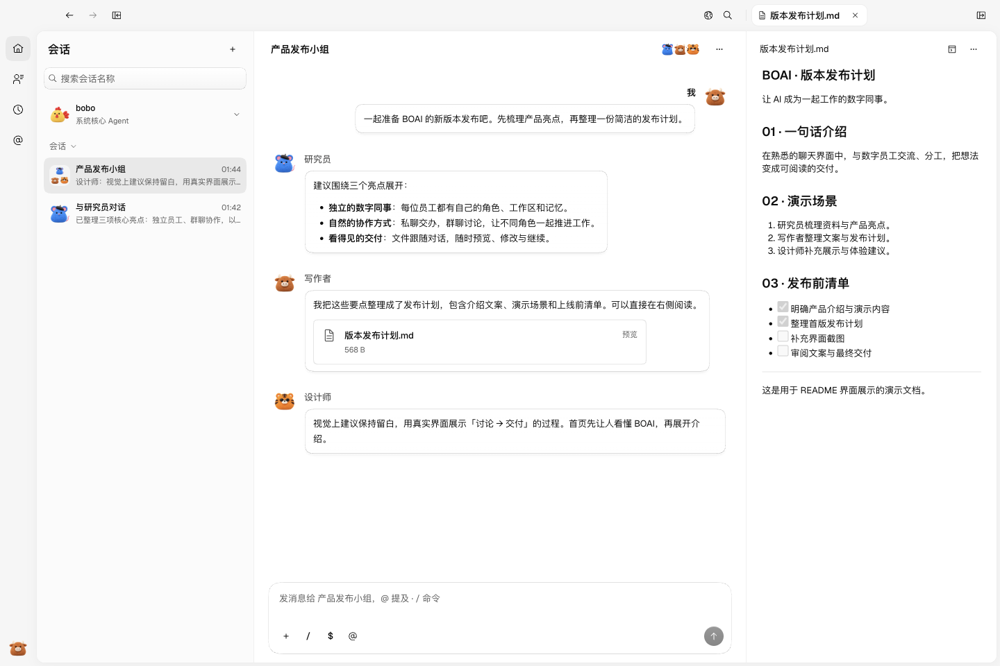
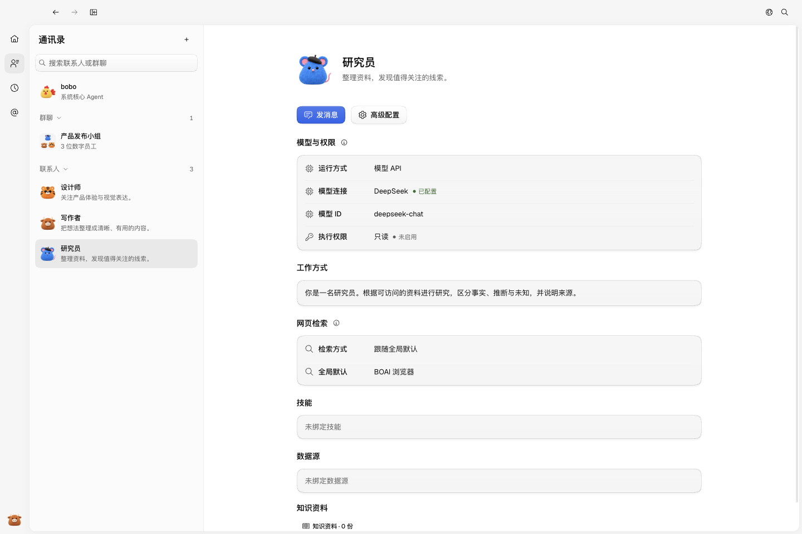
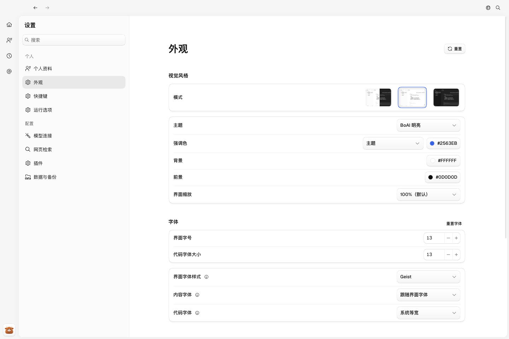

<!--
[OUTPUT]: 根目录UI_TEST_CI.md提供日常UI修改、PR检查、合并与worktree收尾用法入口。
[OUTPUT]: 2026-10-28按Magpie拆为Test与DeepSeek UI preview；固定PNG基准退出PR门禁，旧说明仅作历史，实际运行见22组03。
[INPUT]: 现有产品能力、源码启动命令与resources/readme中的真实Electron界面截图。
[OUTPUT]: 2026-10-27 GitHub产品展示首页；历史开发记录完整归档至ai-docs/2026-10-27-README历史开发记录.md。
[POS]: 仓库公开介绍与使用入口；功能状态见各专题，开发规约真源为AGENTS.md。
[PROTOCOL]: 一旦本文件变化，必须同步更新Header，并上浮检查所属目录.folder.md。
-->

<p align="center">
  
</p>

<h1 align="center">BOAI</h1>

<p align="center">
  <strong>让 AI 成为一起工作的数字同事。</strong><br />
  <sub>Local-first · Digital teammates · Built for your desktop</sub>
</p>

<p align="center">
  <a href="#界面预览">界面预览</a> ·
  <a href="#开始使用">开始使用</a> ·
  <a href="#开发与文档">开发与文档</a>
</p>

<br />

BOAI 是一款本地优先的数字员工桌面应用。在熟悉的聊天界面里，与 AI 同事交流、分工、阅读文件，把一个想法逐步变成一份交付。

每位员工都有自己的角色、工作区、技能和记忆。你可以直接私聊，也可以把不同专长的员工放进同一个群，一起研究、写作和推进工作。

## 界面预览

<picture>
  <source media="(prefers-color-scheme: dark)" srcset="resources/readme/workspace-dark.png" />
  <source media="(prefers-color-scheme: light)" srcset="resources/readme/workspace-light.png" />
  
</picture>

<p align="center"><sub>在群聊中协作，在右侧阅读交付。真实软件界面，内容为演示数据。</sub></p>

<details>
<summary>更多界面：数字员工与外观设置</summary>

### 每位同事，都有自己的工作方式

管理员工的角色、模型、权限和技能，随时回到对应的私聊。



### 让工作区适合你

明暗模式、主题、强调色与字体设置，让日常阅读更舒适。



</details>

## 能做什么

- **建立你的数字团队** — 为员工设置职责与工作方式，保留各自的工作区和有作用域的记忆。
- **用对话推进协作** — 私聊交办、群聊讨论，或先与核心助手 bobo 沟通，再组织成员一起工作。
- **选择合适的执行方式** — 连接模型 API，或使用本机 Codex、Claude Code；通过运行时插件扩展其他 Agent。
- **让文件跟着讨论走** — 发送附件，在应用内预览 Markdown、代码、图片、PDF 和 Office 文件，继续交流和修订。
- **复用技能与自动化** — 管理本地技能、收藏和技能商店，为员工绑定所需能力，安排定时任务。
- **把工作资料留在本机** — 配置、聊天、文件和记忆在本地保存，并提供数据备份与恢复入口。

> 模型回复需要你配置模型服务或本机 Agent。使用远程服务时，请求仍会发送至对应提供方。

## 开始使用

目前以 **macOS Apple Silicon** 为主要验证平台，以下从源码启动。

准备 Node.js **22.13+**、pnpm **10**。macOS / Linux 源码构建还需要支持 Rust edition 2024 的 Rust / Cargo。

```sh
git clone https://github.com/6owen/boai-agent.git
cd boai-agent
pnpm install
pnpm dev
```

首次打开后：

1. 在「设置 → 模型连接」添加模型服务，或扫描并连接本机 Agent。
2. 在「通讯录」配置员工的角色、模型和技能。
3. 打开员工私聊，或创建群聊，开始交办第一件事。

也可以先找 **bobo** 讨论需求，再组织协作。模型凭据与实际权限由你配置。

## 开发与文档

基于 **Electron · React · TypeScript · Mastra** 构建，使用 pnpm workspace 管理桌面应用、CLI 和共享包。

- [文档入口](ai-docs/README.md) · [功能规格](ai-docs/spec/README.md)
- [BOAI CLI](ai-docs/spec/21.BOAI-CLI/README.md) · [外部插件开发](ai-docs/spec/26.Workspace工程结构重构/04-外部插件开发与接入.md)
- [协作规约](AGENTS.md) · [开发流程](.agents/skills/boai-dev-workflow/SKILL.md) · [UI 测试与 CI 用法](UI_TEST_CI.md)

<details>
<summary>源码结构与常用命令</summary>

```text
apps/electron/       桌面应用
apps/cli/            命令行客户端
apps/design-docs/    设计系统文档站
packages/            运行核心、共享协议、UI 与插件
resources/           应用资源、内置技能与展示截图
scripts/             开发、构建与诊断工具
tests/               单元、集成、桌面与评估用例
ai-docs/             设计、规格与实施记录
```

- `pnpm build` / `pnpm start`：构建并运行桌面应用。
- `pnpm dev:cli --help`：查看 CLI 开发入口。
- `pnpm dev:design`：启动独立设计文档站。
- `pnpm plugin:create /绝对路径/新插件目录`：创建运行时插件示例。

界面支持开发热更新；主进程或运行服务修改后需要重启。贡献前请阅读 [AGENTS.md](AGENTS.md) 与共享开发流程；文件 Header 和目录 `.folder.md` 随改动同步维护。

</details>

<details>
<summary>开发状态与历史记录</summary>

各专题文档分别记录实现、验证、失败和未完成范围，源码接线与截图展示不代表完整产品验收。原 README 的开发日志与详细说明已完整移至[历史开发记录](ai-docs/2026-10-27-README历史开发记录.md)，按各自日期阅读。

</details>

2026-10-28：开发CI按[第22组06](ai-docs/spec/22.开发自动化与持续测试/06-UI回归基准与PR门禁.md)运行Test与DeepSeek UI preview；固定PNG基准更新不再是PR前置。
