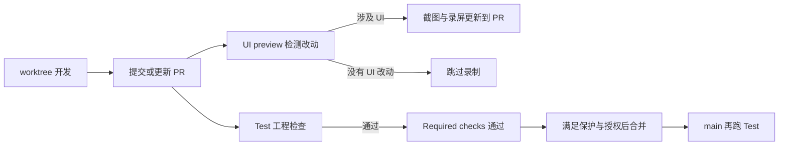

<!--
[INPUT]: BOAI共享开发skill、GitHub Test/UI preview工作流及任务worktree收尾规则。
[OUTPUT]: 日常开发、UI修改、PR检查、合并与清理的使用说明。
[POS]: 仓库根目录面向使用者的CI说明；执行依据为AGENTS、开发skill及实际workflow。
[PROTOCOL]: 流程变化时同步开发skill、第22组06、本文件与根目录.folder.md。
-->
# UI 测试与 CI 用法

BOAI 沿 Magpie 使用两条 GitHub Actions：**Test 检查工程是否通过，UI preview 展示本次界面改动**。开发 Agent 统一读取 [开发 skill](.agents/skills/boai-dev-workflow/SKILL.md)，这里说明日常怎么用。

## 日常开发怎么走

1. **在独立 worktree 开发。** Agent 按任务修改、做必要的本地验证，使用独立依赖目录并复用 pnpm store；需要看效果时在该 worktree 启动预览。
2. **提交并创建或更新 PR。** PR 打开、重新打开或推送新提交后，GitHub 自动检查。只向尚无 PR 的功能分支 push，不会自动触发这两条流程。
3. **Test 与 UI preview 分别执行。** Test 检查代码；UI preview 根据改动范围决定是否录制，并把预览更新到 PR 描述。
4. **按本次授权合并。** 普通交付启用正常自动合并；明确只修改、只测试或不合并时按该要求执行。当前必须通过的 `Required checks` 只汇总工程 Test。
5. **实际合并后同步 main，完成任务后回收 worktree。** main 收到合并提交还会再跑一次 Test，PR 通过与 main 这次复跑的结果分别查看。

## GitHub 上会跑什么

| 流程 | 执行内容 | 触发与合并关系 |
| --- | --- | --- |
| **Test** | macOS runner、Node 22、pnpm 缓存；安装依赖后依次运行 `pnpm typecheck`、`pnpm lint:ui`、`pnpm build`、`pnpm test` | PR、main push 或手动触发；失败会使 `Required checks` 失败并阻止正常合并 |
| **UI preview** | `detect` 检测 → `record` 构建真实 Electron 应用并截图录屏 → `publish` 更新 PR 描述中的预览区域 | PR 打开、更新、重开或添加 `ui-preview` 标签时触发，也可手动指定 PR；当前不属于必须通过的合并检查 |

纯文档和后端 PR 也跑完整 Test；未命中 UI 路径时，UI preview 的 `record`、`publish` 显示 `skipped` 属于正常结果。UI 路径检测覆盖 renderer、共享 UI/tokens、图标及相关构建配置；必要时用 `ui-preview` 标签强制录制。

同一 PR 的新提交会取消尚未结束的旧 Test/UI preview，改跑最新提交。main 的 Test 不因后续 main 提交自动取消。

## 修改 UI 时要更新基准吗

**日常 PR 不需要更新截图基准。** 正常修改界面后提交，UI preview 直接生成该 PR 当前界面的截图和视频；旧的 candidate、accept、update 与固定 PNG 差异门禁已经退出自动 CI。

旧本地 UI 测试源码、PNG 和辅助工具仍可按需使用。它们的存在不表示 PR 还需要走旧基准更新流程，也不要为了通过 CI 把有意修改的界面改回旧图。

## DeepSeek 在这里做什么

- 读取 PR 的 diff、标题、描述、相关源码和真实页面的 DOM 文本，规划打开哪些页面、执行哪些操作、在哪里截图。
- 操作失败时根据现场信息尝试修正，并把操作错误保留在预览记录中。
- 对 PR 描述与代码不一致的情况给出提示；提示会出现在预览说明中。

**当前没有“DeepSeek 判断界面好看、没有多改，才允许合并”的门禁。** 它没有读取截图进行审美评分；描述与代码不符的提示也不阻止合并。工程测试未覆盖到的多余或不好看的 UI 改动，仍可能通过 Test。自动合并目前也不等待 UI preview 完成或成功。

预览脚本另有已知密钥的文本泄漏检查；命中后拒绝发布本次媒体。这是脚本检查，与 DeepSeek 的页面操作规划分开。

## 哪里看结果，失败时怎么处理

打开 [仓库 Actions](https://github.com/6owen/boai-agent/actions)，或在 PR 的 Checks 看当前提交的运行；截图、视频和操作说明看 PR 描述中的 UI preview 区域。

| 看到的状态 | 应该怎么理解、怎么处理 |
| --- | --- |
| Test / Required checks 失败 | 打开第一处失败步骤，按错误定位并修复，再提交同一 PR；先看原因，不盲目重跑 |
| UI preview 检测通过、录制跳过 | 通常是没有 UI 改动；按需加 `ui-preview` 标签 |
| UI preview 录制或发布失败 | 查看该步骤日志和 PR 预览说明；有部分媒体不等于操作全部成功，当前也不会单独阻止合并 |
| 旧运行 cancelled，新运行进行中 | 同一 PR 的新提交已接替旧运行，查看最新 SHA 对应结果 |
| 自动合并已启用 | 表示等待条件满足，尚不等于已合并；以 PR 的 `MERGED` 和合并提交为准 |
| PR 通过后 main 又出现 Test | 合并后的主分支复跑；不能用 PR 的绿色替代这次运行的结果 |

`setup-node` 的步骤耗时包含 pnpm 缓存恢复，不全是安装 Node。总耗时还包括依赖安装、构建和全量测试，应按 Actions 的各步骤计时定位。

## DeepSeek 配置放哪里

云端读取 GitHub 仓库的 **`ui-preview` environment**：

| 类型 | 名称 | 用途 |
| --- | --- | --- |
| Secret | `DEEPSEEK_API_KEY` | 模型调用密钥 |
| Variable | `DEEPSEEK_BASE_URL` | API 地址；未设置时使用 workflow 中的默认值 |
| Variable | `PLAN_MODEL` | 规划模型；当前默认 `deepseek-flash` |

本机 `.env.ui-preview` 用于本地配置，保持 Git 忽略，不能提交密钥。GitHub 不会自动读取本机文件；需要使用云端 environment 中的配置。录制任务运行 PR 代码并使用模型密钥；发布任务拥有写权限，但不运行 PR 代码，沿 Magpie 分离。

## 任务完成后的 worktree 收尾

按 [AGENTS.md](AGENTS.md) 的“worktree 不遗留”规则，包含 subagent 派生的 `.claude/worktrees/agent-*`：

- 已实际合并：确认最终提交已合入 main，再删除任务 worktree 和本地任务分支。
- 尚未合并或不合并：先提交本任务需要保留的改动，打 `archive/<worktree名>` 标签并核对最终提交，再删除 worktree 和本地分支。同名归档加唯一后缀，不覆盖旧档；等待自动合并的 PR 可保留远程分支继续检查。
- 已核实专用的 cargo target 一并删除；共享 target、pnpm store 和共享符号链接目标保留。tag 不保存未提交或 ignored 数据，需要保留的数据先迁出，密钥不入 Git。
- 删除前确认本任务进程已退出、工作目录已移出；编排会话负责子 worktree。待裁决、有冲突等确需保留的目录，最终回复必须写明路径和原因。

## 维护入口

- [开发 skill](.agents/skills/boai-dev-workflow/SKILL.md)：所有开发 Agent 共用的执行规则。
- [Test workflow](.github/workflows/test.yml) / [UI preview workflow](.github/workflows/ui-preview.yml)：实际触发和执行配置。
- [UI preview 源码说明](.github/ui-preview/README.md)：Magpie 来源、必要适配与本地命令。
- [第22组06](ai-docs/spec/22.开发自动化与持续测试/06-UI回归基准与PR门禁.md)：现行流程合同；[第22组03](ai-docs/spec/22.开发自动化与持续测试/03-实施步骤与验收.md)记录历史执行、失败与验证结果。
