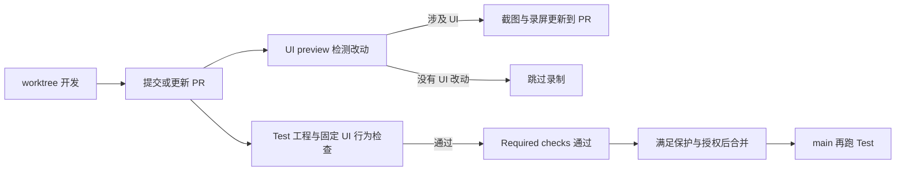

<!--
[OUTPUT]: 2026-11-13 Test接固定三项UI行为；录制完成度、源码SHA和当前PR核对，部分媒体保持失败。
[OUTPUT]: 2026-11-10新增boai-agent-dev-skills统一入口，梳理实际dev/build/验证/打包/bumpp/tag/Release/Git/worktree命令；无参数release:build仍属未实现方案。
[OUTPUT]: 2026-10-29提供git cpf显式快速合并、暂存范围、管理员保护恢复与中断恢复说明。
[INPUT]: BOAI共享开发skill、GitHub Test/UI preview工作流及任务worktree收尾规则。
[OUTPUT]: 日常开发、PR检查、原生视频附件配置、合并与清理的使用说明。
[POS]: 仓库根目录面向使用者的CI说明；执行依据为AGENTS、开发skill及实际workflow。
[PROTOCOL]: 流程变化时同步开发skill、第22组06、本文件与根目录.folder.md。
-->
# UI 测试与 CI 用法

BOAI 沿 Magpie 使用两条 GitHub Actions：**Test 检查工程和固定 UI 行为，UI preview 展示本次界面改动及录制完成度**。开发 Agent 先读 [开发与构建统一技能](.agents/skills/boai-agent-dev-skills/SKILL.md)，Git/CI细则见 [开发交付技能](.agents/skills/boai-dev-workflow/SKILL.md)，这里说明日常怎么用。

## 日常开发怎么走

1. **在独立 worktree 开发。** Agent 按任务修改、做必要的本地验证，使用独立依赖目录并复用 pnpm store；需要看效果时在该 worktree 启动预览。
2. **提交并创建或更新 PR。** PR 打开、重新打开或推送新提交后，GitHub 自动检查。只向尚无 PR 的功能分支 push，不会自动触发这两条流程。
3. **Test 与 UI preview 分别执行。** Test 检查代码；UI preview 根据改动范围决定是否录制，并把预览更新到 PR 描述。
4. **按本次授权合并。** 普通交付启用正常自动合并；明确只修改、只测试或不合并时按该要求执行。当前必须通过的 `Required checks` 只汇总工程 Test。
5. **实际合并后同步 main，完成任务后回收 worktree。** main 收到合并提交还会再跑一次 Test，PR 通过与 main 这次复跑的结果分别查看。

## 需要立即合并：git cpf

本机每个clone安装一次，安装在该仓库的Git配置/公共Git目录，所有worktree共用，不修改全局alias：

```bash
node scripts/git-cpf.mjs --install
git add -- path/to/file1 path/to/file2
git cpf "fix: 修复说明"
```

已经commit的内容直接执行 `git cpf`。命令提交已暂存文件，推送当前功能分支（在main上则推到`cpf/<提交号>`），创建或复用PR，并按精确head立即合并到main。它不等待CI，也不先同步main到PR来触发一轮重复检查；未暂存文件保持原样。普通`git cp`及默认自动合并流程保持。

需要`git`、Node和已登录的`gh`，账号须有仓库管理员权限。若GitHub对管理员也强制检查，命令只临时关闭`enforce_admins`，合并成功、失败或可捕获中断后恢复并核对；其他保护不变。真实合并冲突、GitHub Ruleset等额外限制仍可拒绝合并，不通过删规则或改写main历史绕过。

网络故障、断电或`kill -9`可能让自动恢复未完成，恢复记录保留在Git公共目录的`boai/cpf-protection.json`。恢复时执行：

```bash
git cpf --restore-protection
```

恢复失败会明确报错并阻止下一次合并。命令不会关闭Actions或伪造绿色检查；PR/main仍可能后台跑检查。直接合并不代表测试通过，也不自动发布、重启应用或部署。



## GitHub 上会跑什么

| 流程 | 执行内容 | 触发与合并关系 |
| --- | --- | --- |
| **Test** | macOS runner、Node 22、pnpm 缓存；安装依赖后依次运行 `pnpm typecheck`、`pnpm lint:ui`、`pnpm build`、`pnpm test:ui:behavior`、`pnpm test` | PR、main push 或手动触发；工程或固定 UI 行为失败会使 `Required checks` 失败并阻止正常合并 |
| **UI preview** | `detect` 检测 → `record` 构建真实 Electron 应用并截图录屏 → `publish` 更新 PR 描述中的预览区域 | PR 打开、更新、重开或添加 `ui-preview` 标签时触发，也可手动指定 PR；当前不属于必须通过的合并检查 |

纯文档和后端 PR 也跑完整 Test；未命中 UI 路径时，UI preview 的 `record`、`publish` 显示 `skipped` 属于正常结果。UI 路径检测覆盖 renderer、共享 UI/tokens、官方文件浏览器组件/样式、图标及相关构建配置；必要时用 `ui-preview` 标签强制录制。

同一 PR 的新提交会取消尚未结束的旧 Test/UI preview，改跑最新提交。main 的 Test 不因后续 main 提交自动取消。

## 固定 UI 行为验证

`Test` 通过原 Electron BDD 验证三项真实行为：会话草稿在页面/会话往返后保持隔离、明暗设置经 UI 保存并在重启后保持、工具开始页切换任务/知识资料且原聊天草稿保留。使用隔离数据和原离线夹具，零外部模型调用。

`pnpm build` 后可执行 `pnpm test:ui:behavior`；这条命令会启动 Electron。Agent 本机检查仍遵守本次 E2E/焦点约束。只需检查选场时运行 `pnpm test:bddgen` 和 `pnpm exec playwright test --grep @ui-behavior --list`，不会启动窗口。

`.local/ui-behavior/` 保存原始 `playwright.json`、`summary.json`、截图和 trace；云端上传为 `ui-behavior` artifact。固定三项缺失、重复、跳过、重试、全局错误和进程非零退出均失败。截图仅留证，不进行 PNG 比较。新功能的专门验收继续按修改补充，不把这三项当作全产品覆盖。

## PR 录制结果

预览固定区块显示源码提交及“完整／部分完成／失败／无需录制”和实际完成场景数。只有全部计划场景和步骤成功、截图存在，才标录制完整；任何未完成操作会使录制失败，已有媒体保留供定位。录制完整不代表需求全部通过，功能断言仍看 Test。

发布前核对报告的完整 source SHA，并在写 PR 前再次核对当前 head 和开放状态。旧提交或已关闭 PR 不再更新正文；当前提交不再含 UI 改动时清除旧预览。媒体按开放 PR 的提交保留，避免旧发布覆盖新正文或删掉新正文引用的图片；关闭 PR 的媒体在后续发布清理。

## 修改 UI 时要更新基准吗

**日常 PR 不需要更新截图基准。** 正常修改界面后提交，UI preview 直接生成该 PR 当前界面的截图和视频；旧的 candidate、accept、update 与固定 PNG 差异门禁已经退出自动 CI。

旧本地 UI 测试源码、PNG 和辅助工具仍可按需使用。它们的存在不表示 PR 还需要走旧基准更新流程，也不要为了通过 CI 把有意修改的界面改回旧图。

## DeepSeek 在这里做什么

- 读取 PR 的 diff、标题、描述、相关源码和真实页面的 DOM 文本，规划打开哪些页面、执行哪些操作、在哪里截图。
- 操作失败时根据现场信息尝试修正，并把操作错误保留在预览记录中。
- 对 PR 描述与代码不一致的情况给出提示；提示会出现在预览说明中。

**当前没有“DeepSeek 判断界面好看、没有多改，才允许合并”的门禁。** 它没有读取截图进行审美评分；描述与代码不符的提示也不阻止合并。工程测试未覆盖到的多余或不好看的 UI 改动，仍可能通过 Test。自动合并目前也不等待 UI preview 完成或成功。

预览脚本另有已知密钥的文本泄漏检查；命中后拒绝发布本次媒体。这是脚本检查，与 DeepSeek 的页面操作规划分开。

## 哪里看结果，失败时怎么处理

打开 [仓库 Actions](https://github.com/6owen/boai-agent/actions)，或在 PR 的 Checks 看当前提交的运行；截图、视频和操作说明看 PR 描述中的 UI preview 区域。

| 看到的状态 | 应该怎么理解、怎么处理 |
| --- | --- |
| Test / Required checks 失败 | 打开第一处失败步骤，按错误定位并修复，再提交同一 PR；先看原因，不盲目重跑 |
| UI preview 检测通过、录制跳过 | 通常是没有 UI 改动；按需加 `ui-preview` 标签 |
| UI preview 部分完成、录制或发布失败 | 查看完成场景数、错误及原件；已有媒体保留供定位，录制/发布返回失败；该工作流仍不单独阻止合并 |
| 旧运行 cancelled，新运行进行中 | 同一 PR 的新提交已接替旧运行，查看最新 SHA 对应结果 |
| 自动合并已启用 | 表示等待条件满足，尚不等于已合并；以 PR 的 `MERGED` 和合并提交为准 |
| PR 通过后 main 又出现 Test | 合并后的主分支复跑；不能用 PR 的绿色替代这次运行的结果 |

`setup-node` 的步骤耗时包含 pnpm 缓存恢复，不全是安装 Node。总耗时还包括依赖安装、构建和全量测试，应按 Actions 的各步骤计时定位。

## DeepSeek 配置放哪里

云端读取 GitHub 仓库的 **`ui-preview` environment**：

| 类型 | 名称 | 用途 |
| --- | --- | --- |
| Secret | `DEEPSEEK_API_KEY` | 模型调用密钥 |
| Variable | `DEEPSEEK_BASE_URL` | API 地址；未设置时使用 workflow 中的默认值 |
| Variable | `PLAN_MODEL` | 规划模型；当前默认 `deepseek-flash` |

本机 `.env.ui-preview` 用于本地配置，保持 Git 忽略，不能提交密钥。GitHub 不会自动读取本机文件；需要使用云端 environment 中的配置。录制任务运行 PR 代码并使用模型密钥；发布任务拥有写权限，但不运行 PR 代码，沿 Magpie 分离。

## PR 视频在线播放

录屏以 GitHub 视频附件独立显示在 PR 描述中，可直接播放、暂停和拖动；原始 mp4 下载仍保留。截图继续由 `ui-previews` 分支提供，不需要启用 Pages。

在单独的 **`ui-preview-publish` environment** 配置 **`UI_PREVIEW_UPLOAD_TOKEN`**，使用能向本仓库上传附件的专用 OAuth/PAT 凭据。GitHub 当前不允许 Actions 默认令牌上传视频附件；不要把上传凭据放进运行 PR 代码的 `ui-preview` 环境或仓库级 secret。发布任务固定 GitHub CLI 版本并核对下载校验和。

凭据缺失、视频超出 GitHub 附件大小限制或上传失败时，发布步骤失败，PR 显示警告、已有截图与下载链接，不会显示假的播放入口。只有截图时不需要上传令牌。新流程合入 main 后才用于自动 PR 预览；配置完成与实际云端上传通过分开核验。

## 任务完成后的 worktree 收尾

按 [AGENTS.md](AGENTS.md) 的“worktree 不遗留”规则，包含 subagent 派生的 `.claude/worktrees/agent-*`：

- 已实际合并：确认最终提交已合入 main，再删除任务 worktree 和本地任务分支。
- 尚未合并或不合并：先提交本任务需要保留的改动，打 `archive/<worktree名>` 标签并核对最终提交，再删除 worktree 和本地分支。同名归档加唯一后缀，不覆盖旧档；等待自动合并的 PR 可保留远程分支继续检查。
- 已核实专用的 cargo target 一并删除；共享 target、pnpm store 和共享符号链接目标保留。tag 不保存未提交或 ignored 数据，需要保留的数据先迁出，密钥不入 Git。
- 删除前确认本任务进程已退出、工作目录已移出；编排会话负责子 worktree。待裁决、有冲突等确需保留的目录，最终回复必须写明路径和原因。

## 维护入口

- [开发 skill](.agents/skills/boai-dev-workflow/SKILL.md)：所有开发 Agent 共用的执行规则。
- [Test workflow](.github/workflows/test.yml) / [UI preview workflow](.github/workflows/ui-preview.yml)：实际触发和执行配置。
- [UI preview 源码说明](.github/ui-preview/README.md)：Magpie 来源、必要适配与本地命令。
- [第22组06](ai-docs/spec/22.开发自动化与持续测试/06-UI回归基准与PR门禁.md)：现行流程合同；[第22组03](ai-docs/spec/22.开发自动化与持续测试/03-实施步骤与验收.md)记录历史执行、失败与验证结果。
