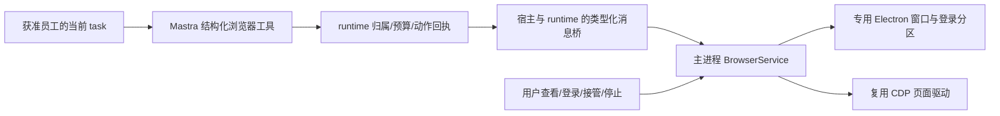

<!--
[INPUT]: 第 11 组用户确认的原版迁移规格入口、本机旧 boai-app 的 Electron 浏览器、CDP、Agent 工具/权限/远程桥接/界面/测试源码，以及当前 BoAI Agent 的 Mastra task 工厂、独立 runtime 进程、构建和 BR1 规格。
[OUTPUT]: 原版单工具/持久登录路线的后续覆盖声明；旧浏览器真实架构、可复用资产、共享登录与取消/授权缺口、接入当前多员工任务的建议路线和运行验收范围；只读分析，不代表已迁移或验证运行。
[POS]: ai-docs 中的旧项目浏览器迁移分析；承接用户先接 Browser、先分析旧实现的要求。
[PROTOCOL]: 一旦本文件变化，必须同步更新 Header，并上浮检查所属目录 .folder.md。
-->

# boai-app 浏览器实现与迁移分析

日期：2026-10-01。分析对象为本机 `boai-app` 工作树；结论来自源码与现有测试阅读。本次没有启动应用、执行浏览器动作、运行测试、安装依赖或修改产品代码。

2026-10-02 用户要求尽量照抄旧实现，已建立 [第 11 组实现规格](./spec/11.浏览器能力迁移/README.md)。当前采用保留 browser_tool 命令入口、确定性逐动作校验并拒绝模型批执行；登录沿旧持久体验但改员工×会话隔离。本篇拆多个工具/先临时登录的建议据此调整，原缺口分析仍有效；本组尚未实施。

## 1. 结论与推荐方向

**旧项目已经有可见浏览器和真实自动操作底座，值得复用。建议保留 Electron 浏览器/CDP 核心，让当前 Mastra 员工通过受控工具使用它。** 首批只做本地，不需要先做 MCP，也不必先安装另一个浏览器 provider 启动第二套 Chromium。

这属于“Mastra 驱动员工 + BoAI 自有 Browser adapter”。它不是安装官方 `@mastra/agent-browser` 后自动获得旧窗口。旧代码使用 Electron `webContents.debugger`，没有提供可直接填入 AgentBrowser `cdpUrl` 的外部 WebSocket endpoint。

上一份 [Browser/Computer 调研](./2026-10-01-Browser与Computer员工能力调研.md)与 [BR1 历史选型](./spec/5.Mastra能力扩展/04-Browser浏览器能力.md)以独立 AgentBrowser 为首批建议，尚未纳入本次旧代码。**本次优先建议复用旧底座；BR1 的授权、来源、文件、取消和备份要求仍适用。** 这是待实施建议，尚未锁定或验证迁移方案；Computer 和 MCP 留到后续。

## 2. 旧项目实际实现了什么

| 层 | 源码入口 | 已有能力与真实边界 |
| --- | --- | --- |
| 浏览器宿主 | [browser-pane-manager.ts](/Users/wangwenbo/Desktop/demo/boai/boai-app/apps/electron/src/main/browser-pane-manager.ts:363) | 独立 BrowserWindow，内部 BrowserView 组合页面、工具栏和视觉层；并非现成嵌入当前 IM 右侧的 WebContentsView |
| 页面驱动 | [browser-cdp.ts](/Users/wangwenbo/Desktop/demo/boai/boai-app/apps/electron/src/main/browser-cdp.ts:93) | Electron debugger 连接 CDP；AX/accessibility 快照、元素 ref、输入/点击和页面信息等底层动作 |
| 工具协议 | [browser-tool-types.ts](/Users/wangwenbo/Desktop/demo/boai/boai-app/packages/shared/src/agent/browser-tool-types.ts:82)、[runtime](/Users/wangwenbo/Desktop/demo/boai/boai-app/packages/shared/src/agent/browser-tool-runtime.ts:622) | BrowserPaneFns 隔离具体宿主；模型入口主要是 `browser_tool(command)` 字符串，支持批命令 |
| 实际 Agent 路径 | [tool-defs.ts](/Users/wangwenbo/Desktop/demo/boai/boai-app/packages/session-tools-core/src/tool-defs.ts:598)、[pi-agent.ts](/Users/wangwenbo/Desktop/demo/boai/boai-app/packages/shared/src/agent/pi-agent.ts:1492) | Pi 直接执行共享 runtime；`mcp__session__` 是工具命名前缀，不代表浏览器必须作为外置 MCP 插件 |
| 用户界面 | [browser-toolbar.tsx](/Users/wangwenbo/Desktop/demo/boai/boai-app/apps/electron/src/renderer/browser-toolbar.tsx:1)、[BrowserControls](/Users/wangwenbo/Desktop/demo/boai/boai-app/packages/ui/src/components/ui/BrowserControls.tsx:41) | 地址栏、返回/前进、刷新/停止加载、隐藏/关闭窗口；主界面有窗口徽标和回到相关会话入口 |
| 状态与构建 | [browser-pane atoms](/Users/wangwenbo/Desktop/demo/boai/boai-app/apps/electron/src/renderer/atoms/browser-pane.ts:43)、[vite.config.ts](/Users/wangwenbo/Desktop/demo/boai/boai-app/apps/electron/vite.config.ts:48) | IPC 状态同步、移除 tombstone；工具栏/空态是独立 HTML 入口并有专用 preload |
| 远程兼容 | [RemoteBrowserPaneManager](/Users/wangwenbo/Desktop/demo/boai/boai-app/packages/server-core/src/sessions/RemoteBrowserPaneManager.ts:98) | 远程 server 经桌面客户端执行；首批本地迁移无需搬入这套 WS 兼容架构 |

工具覆盖导航、快照/查找、ref 点击/填表/选择、坐标点击/拖动、输入/滚动/按键、截图/标注/区域截图、console/network、等待与下载记录，还包含 upload、evaluate 和系统剪贴板。能力丰富，但不能将整套工具统一视为只读。

旧 runtime 是确定性浏览器调用，没有额外隐含 LLM。员工继续用当前已配置模型决定动作；本地浏览器路径没有额外云浏览器服务 Key。搜索引擎服务仍是独立选择，拥有 Browser 不等于拥有结构化搜索 API。

## 3. 不能直接照搬的边界

### 登录共享与多员工归属

旧代码固定 `BROWSER_PANE_SESSION_PARTITION = 'persist:browser-pane'`，所有实例从该 partition 创建，包括弹出页面。因此不同窗口、workspace 和聊天会话共享持久 Cookie/网站登录。`ownerSessionId`、`boundSessionId` 或界面 workspace 筛选只能说明归属，**不隔离浏览器登录资料**。[固定分区](/Users/wangwenbo/Desktop/demo/boai/boai-app/apps/electron/src/main/browser-pane-manager.ts:125)、[实例创建](/Users/wangwenbo/Desktop/demo/boai/boai-app/apps/electron/src/main/browser-pane-manager.ts:375)。

迁移建议沿 BR1 明确“员工 × 会话”的私有浏览器作用域，再绑定当前 Work/run 的执行权。先采用临时登录资料；需要持久登录时单独提供明确设置与清除功能。同群多个员工也不能仅凭 conversationId 共用可操作实例。员工文件 workspace 独立不会自动使 Cookie 独立；登录分区也不能混入普通文件挂载或业务备份。

旧本地 [handlers/browser.ts](/Users/wangwenbo/Desktop/demo/boai/boai-app/apps/electron/src/main/handlers/browser.ts:121)的动作主要依赖 instanceId，部分入口忽略上下文，列表/广播也覆盖全部实例；renderer 筛选不是授权。解绑后的窗口还能被同 workspace 其他 session 接管。远程 dispatcher 虽有部分 owner/动作校验，其限制不能自动推及本地路径。新宿主桥必须自己核对员工、会话、Work/run、实例及授权版本，不能将任意 instanceId 作为操作资格。

### 工具默认授权

旧 `browserToolEnabled` 默认 true，工具定义 `safeMode: 'allow'`；权限层把整个浏览器工具判为 always-allowed，safe/ask 都可绕过动作审批。[storage.ts](/Users/wangwenbo/Desktop/demo/boai/boai-app/packages/shared/src/config/storage.ts:126)、[mode-manager.ts](/Users/wangwenbo/Desktop/demo/boai/boai-app/packages/shared/src/agent/mode-manager.ts:1775)、[权限测试](/Users/wangwenbo/Desktop/demo/boai/boai-app/packages/shared/src/agent/__tests__/browser-tools-permissions.test.ts:20)。

当前方案保留“产品内置、员工显式启用、任务按需启动”三层。只给获准 task 挂工具，chat/判断/记忆维护不获得浏览器。点击或按键可能提交业务，不能只按名称认定只读。首批不暴露任意 evaluate、任意本地路径 upload 和系统剪贴板；后续上传必须沿现有材料/成果授权，而非接受模型提供的裸路径。

另有浏览器原生权限层：旧 Session 自动允许媒体、定位、clipboard-read 等，[权限 allowlist](/Users/wangwenbo/Desktop/demo/boai/boai-app/apps/electron/src/main/browser-pane-manager.ts:3251)也不能原样继承。网站权限应按当前 scope 和实际用户授权处理；网页自身请求不是员工能力授权。

### 停止、接管与未知结果

旧工具栏 STOP 只停止页面加载；release 只解除会话控制和视觉状态。旧 destroy 是 best-effort 销毁并移除实例，没有等待所有在途 CDP 动作退出的完整握手；共享接口没有 AbortSignal、当前工作身份和持久动作回执。[STOP](/Users/wangwenbo/Desktop/demo/boai/boai-app/apps/electron/src/main/browser-pane-manager.ts:786)、[release](/Users/wangwenbo/Desktop/demo/boai/boai-app/apps/electron/src/main/browser-pane-manager.ts:2808)、[destroy](/Users/wangwenbo/Desktop/demo/boai/boai-app/apps/electron/src/main/browser-pane-manager.ts:524)。

旧窗口普通关闭被转为隐藏，焦点 INTERACTED 事件仅切换 renderer 当前窗口；都不等于停止任务或完成用户接管。[关闭处理](/Users/wangwenbo/Desktop/demo/boai/boai-app/apps/electron/src/main/browser-pane-manager.ts:3307)、[焦点处理](/Users/wangwenbo/Desktop/demo/boai/boai-app/apps/electron/src/main/browser-pane-manager.ts:3558)。旧导航 timeout 结束等待也不保证加载已停止。

远程超时、关闭和解绑还存在只 reject 或吞错误/立即报告 released 的路径。不能以它们证明网站操作未发生，也不能沿“reconnect and retry”提示重做整次提交。

当前迁移要增加操作门禁、执行代际、真实完成/关闭确认：接管先阻止新自动操作并等在途动作退出；继续时重新 snapshot。停止 task 后，实际动作未退出前不释放占用。已开始的提交/上传失联保持 unknown，先核对而不自动重试。界面不能先删除徽标再把浏览器算作已关闭；旧 [BrowserTabStrip](/Users/wangwenbo/Desktop/demo/boai/boai-app/apps/electron/src/renderer/components/browser/BrowserTabStrip.tsx:202)目前有这种乐观删除。

### 单次动作、来源和图片

旧批命令顺序执行，导航后停止以避免旧 ref；如果后续动作失败，前面的操作不会回滚，但缺少逐动作持久副作用回执。建议模型入口改为结构化、一次一个动作的 Mastra 工具；保留底层解析/驱动中有价值的逻辑，CLI parser 只作可选内部调试用途。

`@eN` 是页面操作目标，不是来源引用。网页信息进入成果或记忆前，应登记实际 URL、标题、获取时间、正文/截图证据及员工/会话授权范围；网页内容不能自行增加权限。下载列表也不等于已交付，下载须进入受管范围并明确发布成果。

shared 工具工厂能返回图片内容，但实际 Pi 路径把截图落盘后返回 `image-preview` 文本。Mastra 迁移必须验证真实图片输入，不能把路径文本当作模型已看图。[旧截图工厂](/Users/wangwenbo/Desktop/demo/boai/boai-app/packages/shared/src/agent/browser-tools.ts:263)、[Pi 截图路径](/Users/wangwenbo/Desktop/demo/boai/boai-app/packages/shared/src/agent/pi-agent.ts:1508)。

## 4. 接到当前项目的推荐架构

当前 [main.ts](/Users/wangwenbo/Desktop/demo/boai/boai-agent/src/main/main.ts:110)通过 utilityProcess 启动 [worker.ts](/Users/wangwenbo/Desktop/demo/boai/boai-agent/src/runtime/worker.ts:14)。Electron 窗口/CDP 管理归主进程；员工 task/Work、权限和预算归 runtime。不能将 BrowserWindow 代码直接导入 worker，也不能向网页 renderer 暴露 BoAI 业务桥接。

首批在 [task 装配](/Users/wangwenbo/Desktop/demo/boai/boai-agent/src/runtime/adapters/mastra/agent-factory.ts:94)接 `createTool` 包装后的动作，通过受控桥调用宿主。现有 [prepareStep](/Users/wangwenbo/Desktop/demo/boai/boai-agent/src/runtime/adapters/mastra/engine.ts:115)继续记录浏览后模型步骤的原工作预算；工具返回、网页动作成功与最终业务交付分别核实。当前 Stage dispose 只销毁 workspace，必须另接浏览器租约释放与真实退出，不能假设已自动覆盖。

已装 Mastra 的 [MastraBrowser 基类](/Users/wangwenbo/Desktop/demo/boai/boai-agent/node_modules/@mastra/core/dist/browser/browser.d.ts:340)支持自定义 provider/getTools；后续需要统一 `Agent.browser` 入口时可封装自有 Electron provider。此时需实现生命周期/页面状态契约并只返回获准工具，不同时开放原始和包装后两套接口。首批不为挂上这一属性而额外迁移 Studio screencast 或 thread 管理。

界面可复用地址栏、导航、可见窗口和关联会话入口。当前 IM 需要显示实际操作员工及当前任务归属，沿已有详情/任务入口提供查看、接管和停止；不照搬旧项目全局活跃窗口作为工具选择依据。工具栏/空态 HTML、preload 与构建入口需一同迁移；旧 Jotai、i18n、包别名和 Lucide UI 应换成当前工程已有范式。迁入源码时保留旧仓库 LICENSE/NOTICE 和必要出处。

## 5. 建议执行顺序与成功标准

| 步骤 | 建议范围 | 可以验收的结果 |
| --- | --- | --- |
| 1：浏览器底座 | 精简窗口/CDP、按作用域分区、受控消息桥、真实关闭确认 | 打包应用能打开专用窗口；两个员工/会话登录状态不串；关一个不影响另一个 |
| 2：员工读取网页 | 员工开关，task 专用导航/快照/查找/截图，有界正文与来源，当前预算/取消 | 员工读取指定公开页并在当前成果引用真实来源；普通聊天不启动浏览器；停止无迟到发布 |
| 3：受控交互 | 人工登录/接管与明确动作授权，再增加点击/输入/下载；上传另接文件授权 | 操作目标/内容改变使旧授权失效；接管后不继续旧动作；失联提交不盲重放；下载明确发布 |

第一步不开放任意脚本、全局剪贴板、任意路径上传、远程 WS 代理、自动录制或用户日常浏览器资料。已授权范围内的常规读取无需每步打断；新增授权只针对缺失的任务范围或实际外部副作用。浏览器请求/重定向/弹窗与本地资源边界也必须验证，不能把 sandbox:true 或初始 URL 校验称为完整网络隔离。

旧 repo 已有 BrowserPaneManager/CDP、session release、广播、工具权限/开关、远程协议及 renderer tombstone 测试。它们是迁移参考，不是本轮测试通过证据；全局共享登录和 always-allowed 的旧断言应按新意图改写。当前仓库模块/事务用 Vitest，真实 Electron 流程沿 playwright-bdd：至少验证作用域 Cookie 隔离、重定向/弹窗、人工接管、慢操作/下载中停止、外部动作未知回执、重启不重放，以及打包后工具栏/preload 路径与截图模型输入。

当前完成状态：**仅源码分析与迁移建议；Browser 尚未接入当前员工，也未通过真实浏览器或模型验收。**
