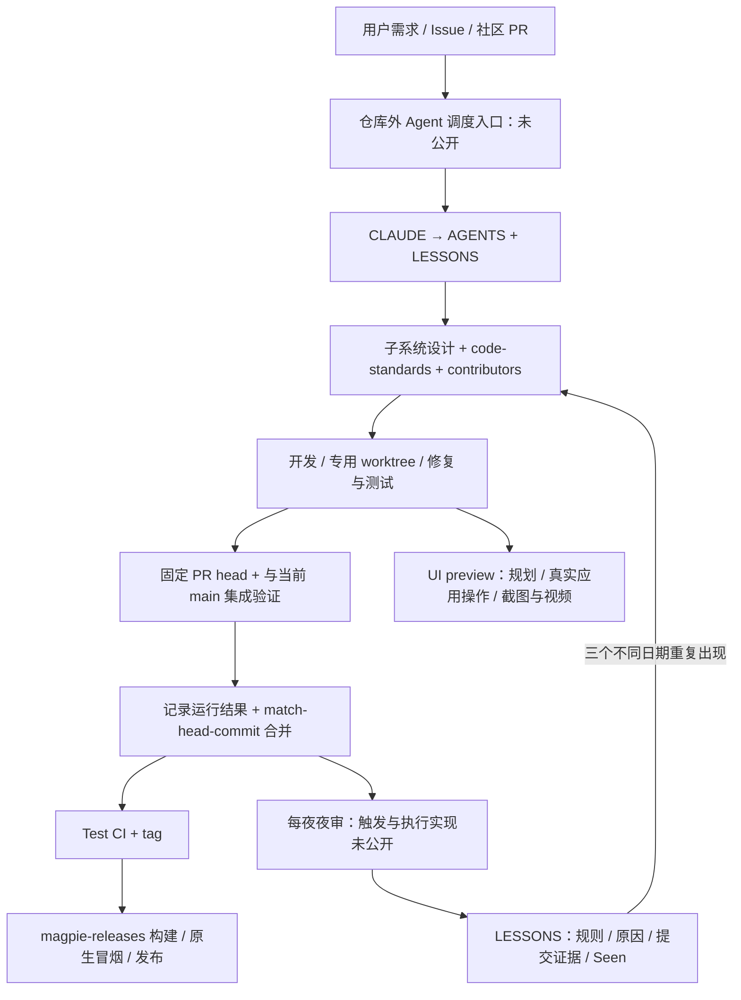
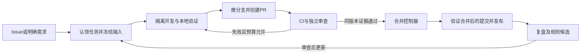

<!--
[INPUT]: 用户对 yetone/magpie 与 wquguru 的 X 分析链接的调研请求；2026-10-13读取的 GitHub 公开源码/API；Magpie 固定 main 2d721f7f3db9759e295da1aae8735ac538b993b4 与 magpie-releases 固定 main 4db8cffe0c20f34a96ee690b809aa687c60b607a。
[OUTPUT]: AI开发、审查、合并、夜审、界面证据与发布的固定源码研究；公开有效门禁、PR样本、X长文对照及BOAI可复用能力/分阶段落地建议；§15补充真实前端浏览器断言、API夹具/VM、像素基线、原生边界和未实跑限制，事实与推断分开。仅研究，不实现或运行开发/远程工作流，不改变既有认证。
[POS]: ai-docs 中的外部项目开发自动化研究报告，不改变 BOAI 现行开发或验收合同。
[PROTOCOL]: 一旦本文件变化，必须同步更新本 Header，并上浮检查所属目录 ai-docs/.folder.md；固定来源、读取时刻、事实/推断及未验证范围分别保留。
-->

# Magpie 的 AI 开发自动化：公开机制与可迁移设计

研究日期：2026-10-13。Magpie 源码固定于 [`2d721f7f3db9759e295da1aae8735ac538b993b4`](https://github.com/yetone/magpie/tree/2d721f7f3db9759e295da1aae8735ac538b993b4)；发布仓库固定于 [`4db8cffe0c20f34a96ee690b809aa687c60b607a`](https://github.com/yetone/magpie-releases/tree/4db8cffe0c20f34a96ee690b809aa687c60b607a)。只静态阅读公开代码、文档和公开 API，没有安装依赖、执行 Magpie、接触真实凭据或触发远程操作。

## 1. 首先分清：Agent 执行全流程，与仓库公开了一套无人调度系统

项目的自述很明确：代码编写、审查、合并和发布由 Agent 执行，每晚复查当天提交，记录返工、误合和验证薄弱之处。这足以确认项目主动采用 Agent 开发流程，但自述没有给出运行这些 Agent 的调度器、定时任务、完整提示词或模型角色配置。[来源：LESSONS.md 开头](https://github.com/yetone/magpie/blob/2d721f7f3db9759e295da1aae8735ac538b993b4/LESSONS.md#L1-L45)

固定版本的 `.github/workflows` 只有 `test.yml`、`ui-preview.yml`、`release.yml`、`docker.yml`。没有公开的 Issue 认领/自动编码/自动提交 PR/自动审查与合并/每夜夜审工作流。根目录也没有 `.agents/`、`.claude/`、`.codex/` 开发编排目录，公开 `build/` 是构建、开发重载、图标和测试分片工具。因此可以复用它的开发纪律与部分自动化设施，不能声称 clone 仓库即可启动同样的完整自动开发系统。[来源：固定仓库树](https://github.com/yetone/magpie/tree/2d721f7f3db9759e295da1aae8735ac538b993b4)、[工作流目录](https://github.com/yetone/magpie/tree/2d721f7f3db9759e295da1aae8735ac538b993b4/.github/workflows)、[build 目录](https://github.com/yetone/magpie/tree/2d721f7f3db9759e295da1aae8735ac538b993b4/build)

**较可靠的解释是：仓库外的 Agent 会话执行仓库内的开发 SOP，GitHub Actions 承担测试、可视证据和交付。** “仓库外”是按公开实现范围作出的推断；可能是本机 Agent、私有服务、人工唤起或混合方式，当前材料不能决定是哪一种。尤其不能从 `merged_by: yetone` 推断点击合并的是人，也不能从评论的措辞或秒级间隔证明是 AI。

## 2. 公开系统的分层结构



图中 “开发/审查/夜审/合并” 主要由文档规定，“Test/UI preview/构建发布” 有公开可执行代码。两类不能混为同一层的强制保证。

| 层 | 公开构件 | 实际作用 | 当前无法从公开代码证明的部分 |
| --- | --- | --- | --- |
| Agent 入口 | `CLAUDE.md`、`AGENTS.md` | 让 Agent 先读约束、教训和当前子系统路径 | 是否每次加载、外部 system prompt、开发模型与审查模型的关系 |
| 工程合同 | `docs/code-standards.md`、`docs/subsystems/` | 明确什么算修复、应该验证哪些状态和平台、PR 必须说明什么 | 文档要求是否每次执行、是否存在绕过、是否有独立证据校验 |
| 贡献治理 | `docs/contributors.md` | 先查潜在伤害，按风险停审，部分决策留维护者 | 规则分类的自动实现与维护者审批通道 |
| 反馈记忆 | `LESSONS.md` | 从实际返工中提炼规则，重复出现后提升为标准 | 夜审触发、去重/计数程序、完整运行记录 |
| 自动验证 | `.github/workflows/test.yml` | 格式、vet、测试、race、平台专项、CLI 构建 | GUI 全量/双浏览器与真实供应商验证不是该 CI 的硬检查 |
| 可视证据 | `.github/ui-preview/` | 真实构建 PR head，生成操作截图/视频并回填 PR | 自动判定效果符合要求、与 base 对照、阻止不合格 PR 合并 |
| 交付 | 两仓库 release 工作流 | tag 触发多平台构建、签名/公证及资产发布 | 公开代码没有强制 tag 前 CI 绿或 tag 是 main 祖先 |

## 3. AGENTS 是导航与运行路径纠错器，并非完整编排器

`CLAUDE.md` 只有对 `AGENTS.md` 与 `LESSONS.md` 的引用；真正的规范继续路由到 `docs/code-standards.md`、`docs/contributors.md` 和 `docs/subsystems/README.md`。它的作用是给每次有限上下文的 Agent 一个可重复的入口。[来源：CLAUDE.md](https://github.com/yetone/magpie/blob/2d721f7f3db9759e295da1aae8735ac538b993b4/CLAUDE.md)、[AGENTS.md](https://github.com/yetone/magpie/blob/2d721f7f3db9759e295da1aae8735ac538b993b4/AGENTS.md#L1-L25)

值得借鉴的细节是 AGENTS 后半段并不堆砌泛泛的编码要求，而是主动纠正一个高频误判：很多订阅能力已从 built-in 移交到社区 OpenCode 插件；改 built-in、只测 built-in，会完全遗漏实际使用插件的用户。文档要求先看迁移状态，找到实际处理请求的插件、宿主、GUI 或迁移路径，必要时跨仓库修复、发布插件、提高最低版本。这个入口把“AI 看起来修好了”拉回“用户实际运行的是哪条链路”。[来源：AGENTS 迁移与执行路径](https://github.com/yetone/magpie/blob/2d721f7f3db9759e295da1aae8735ac538b993b4/AGENTS.md#L27-L99)

子系统文档也要求 PR 写清触发条件、前后行为、状态/接口/兼容/失败变化，审查者沿调用者和状态转换核对，不能只读 diff。它明确说作者的语义说明不是自动证明的兼容判定，文档更新不能代替运行证据。[来源：子系统维护与审查](https://github.com/yetone/magpie/blob/2d721f7f3db9759e295da1aae8735ac538b993b4/docs/subsystems/README.md#L18-L42)

但这些文件没有定义“哪个事件启动开发、如何给 Issue 加锁、调用什么模型、几名 reviewer、重试几次、成本预算、怎样自动创建 PR”。Magpie 产品自身的模型路由、订阅切换、Codex auto-review 等能力也不能当成其开发流水线的模型调度配置。

## 4. 修 bug 的关键不是生成补丁，而是证明补丁修的是那个 bug

其验收合同有六组要求，分别覆盖可证伪、环境、总体工程、GUI、实际供应商和产品规范：[来源：code-standards 验收合同](https://github.com/yetone/magpie/blob/2d721f7f3db9759e295da1aae8735ac538b993b4/docs/code-standards.md#L31-L93)

1. **先证明测试能抓住 bug。** 保留新测试，将旧实现放回去，必须得到行为层面的失败；编译失败或 skip 不算。恢复补丁后再通过。审查者还可以主动破坏被保证的条件，确认测试会报错。
2. **隔离测试环境。** 临时 home，固定依赖/构建缓存，避免改真实 Agent 配置、登录资料和正在运行的网关。
3. **整体工程检查。** 格式、vet、build、全套 Go 测试，以及 Linux/Windows 的检查；cross-build 不等于原生运行。
4. **GUI 多维回归。** Chromium/WebKit、语言、窄宽度、共享 selector/布局/API 所影响的相关页面；合适的改动需要全套而非只跑本页。
5. **能做时检查真实使用。** 真实供应商输入、回复、配置格式、真实平台；没有试的必须明说，不能以离线 fixture 提升为真实可用。
6. **遵守明确产品决策。** 国际化、菜单、滚动行为等也进入审查边界。

“旧实现应失败”的意义是把测试变成证伪工具：AI 同时写实现与测试时，测试很容易复述实现、默认成功，或者测试一条实际不会被调用的辅助路径。旧码 red check 能排除部分此类伪修复，主动破坏多个条件则进一步检查测试对保证的敏感度。它仍不能证明覆盖所有真实场景。

修复还要检查兄弟路径及所有依赖旧行为的地方。例如 built-in/plugin、不同 Agent、多个平台、复制/移动的分支、相同错误谓词的调用者。这里的“兄弟扫查”是以真实返工经验为依据的审查策略，并无公开 AST/搜索自动化实现。[来源：改动规则](https://github.com/yetone/magpie/blob/2d721f7f3db9759e295da1aae8735ac538b993b4/docs/code-standards.md#L8-L29)

### 环境隔离也有实际实现

`internal/testenv` 将 HOME、USERPROFILE、XDG、APPDATA 等位置统一指向临时目录，清除 Agent 的环境变量和系统代理，给 keychain 工具与 Agent CLI 放失败的替身，并检查这些程序和目录确实解析到隔离区。与仅写一句“请在 sandbox 中测试”相比，它把常见误触真实配置的路径纳入程序保护。[来源：testenv](https://github.com/yetone/magpie/blob/2d721f7f3db9759e295da1aae8735ac538b993b4/internal/testenv/testenv.go#L1-L200)

这是正常测试的环境隔离，不是能抵御恶意 PR 的操作系统安全边界：任意被运行的代码仍可以直接访问绝对路径或联网。社区 PR 的风险筛查与隔离执行环境仍是另一层问题。

## 5. 自动合并的公开核心是审查协议、版本绑定与权限，而非 CI 一绿就 merge

合并合同要求：拉取 PR head，先与当前 main 在本地合并，跑集成后的验收，记录审过的 SHA 与实际运行内容，再用 `gh pr merge --match-head-commit <reviewed sha>` 合并。PR 在审查后有新 push 时，这个 head 条件会让合并失败，需要重新审查新 head。Draft 也需先改为可审查状态。[来源：合并合同](https://github.com/yetone/magpie/blob/2d721f7f3db9759e295da1aae8735ac538b993b4/docs/code-standards.md#L95-L105)

这个命令是一个实用的竞争条件控制：避免审的是 A、合的是 B。但它只绑定 PR head；若 review 后 main 又变动，单靠该参数不能证明最新集成结果仍然通过。公开合同要求与当时 current main 集成；未公开一个对 base SHA 也做强制核验、冲突重测、串行 merge queue 的控制器。

**不能将文档中的合并命令误写成仓库已有自动合并程序。** 当前 `.github` 没有调用此命令的 workflow，也没有实现依据 reviewer 结果创建 GitHub approval/决定 merge 的脚本。[来源：工作流目录](https://github.com/yetone/magpie/tree/2d721f7f3db9759e295da1aae8735ac538b993b4/.github/workflows)

### 社区 PR 明确保留人的决策边界

修改 `.github`、发布、Dockerfile、site；增加网络传输或非必要凭据访问；增加依赖、运行时拼接代码等，都会让审查暂停到维护者查看。恶意或低质量贡献者的封禁由 Agent 建议、维护者决定，Agent 不自行决定一切。这与“普通开发动作可以由 Agent 执行”并不冲突，但限制了“所有来源的变更都无需人处理”的说法。[来源：贡献治理](https://github.com/yetone/magpie/blob/2d721f7f3db9759e295da1aae8735ac538b993b4/docs/contributors.md#L1-L62)

### 此刻公开 GitHub 规则也没有替代 SOP

2026-10-13 的公开 API 读取中，main 的有效规则只显示禁止删除与禁止 non-fast-forward；branch 标记 protected，但 legacy protection 未启用，required status checks 的 enforcement 为 off，contexts 为空。没有查到强制 PR/required checks 规则。因此不能从 protected=true 推断“没有 CI 绿或 reviewer 通过便技术上无法合并”。这只描述该时刻公开可见规则，不排除仓库外私有权限控制。[来源：有效规则 API](https://api.github.com/repos/yetone/magpie/rules/branches/main)、[branch API](https://api.github.com/repos/yetone/magpie/branches/main)

## 6. 并行开发：worktree 纪律已公开，任务控制器未公开

LESSONS 记录多个会话共用一个 checkout/index，导致一个会话提交了另一个会话暂存的文件，提交标题与内容错配、另一个提交成为空提交。后续规则是每个会话使用自己的 worktree，提交后检查自己的文件列表。它还指出两个会话可能同时修同一个失败，仅看 git log 不够，开工前应在 Issue 表示认领。[来源：并行重复修复](https://github.com/yetone/magpie/blob/2d721f7f3db9759e295da1aae8735ac538b993b4/LESSONS.md#L330-L344)、[worktree 教训](https://github.com/yetone/magpie/blob/2d721f7f3db9759e295da1aae8735ac538b993b4/LESSONS.md#L403-L411)

这证明实际流程面对多会话协调问题，也给出可采用的隔离策略。公开实现仍没有任务唯一键、事务认领、租约、同 Issue 的幂等 PR 创建、退出后回收、预算或调度公平性。Issue 留言是协作约定，不能代替机器互斥锁。

## 7. 夜审闭环：经验成为下一次任务的输入

LESSONS 定义了一种具体反馈循环：回看已合并的真实提交，找出后续返工、误合、弱验证；写成规则、原因和提交/PR 证据；以不同日期累计 Seen；至少三天重复出现后，移入稳定 code-standards。于是下次 Agent 会通过入口重新读到这些经验。[来源：循环说明](https://github.com/yetone/magpie/blob/2d721f7f3db9759e295da1aae8735ac538b993b4/LESSONS.md#L1-L45)、[已提升规则](https://github.com/yetone/magpie/blob/2d721f7f3db9759e295da1aae8735ac538b993b4/LESSONS.md#L413-L480)

它的价值不只在于有一份“复盘文档”，而在于形成四个约束：复盘对象来自实际合并、保留可追溯证据、短期经验有重复门槛、稳定规则进入每次开发和审查的入口。这里优化的是开发协议及验证策略，不是公开的模型训练或自动调参系统。

但 Seen 是 Markdown 中的记录，夜审触发和计数程序未公开。没有 evidence schema、去重算法、谁可以提升规则、规则导致的验证时间/成本、规则更改前后质量指标。因此不能证明它是定时自动执行、更不能证明提升规则后被所有任务强制采用。

项目保留了不理想的真实结果：早期高频发布带来同日/次日返工，多个红测试被忽略、CI 被下一次 push 取消、仅验证报告中一条路径、多会话暂存竞争等。规则是这些问题的产物，而非它们从此消失的证明。[来源：LESSONS 统计与失败记录](https://github.com/yetone/magpie/blob/2d721f7f3db9759e295da1aae8735ac538b993b4/LESSONS.md#L11-L45)、[CI 与发布教训](https://github.com/yetone/magpie/blob/2d721f7f3db9759e295da1aae8735ac538b993b4/LESSONS.md#L304-L410)

## 8. CI 真正强制了什么

`test.yml` 在 main push、PR 与手动 dispatch 时执行。PR 新提交会取消旧 run，main 的进行中 run 保留，以免持续 push 导致一直没有绿 run 可供发布参考；`fail-fast: false` 保留其他平台的成绩。Test token 只有 contents read。[来源：Test 触发/并发/权限](https://github.com/yetone/magpie/blob/2d721f7f3db9759e295da1aae8735ac538b993b4/.github/workflows/test.yml#L1-L25)

主要工作包括：

- Linux/macOS 的 Go 全套、gateway/redact race；gateway race 二进制按名称分片为独立进程，每个进程隔离自己的 home，任一分片失败则整体失败。
- Linux 的格式检查、真实 Bun plugin 专项；所有平台 vet。
- Windows 编译完整测试并执行选定原生行为测试：MCP、usage cache、update 文件替换、session moves、dsh 配置、VS Code 检测等。Windows 不运行完整 suite，这在源码注释中有说明。
- Linux/Android 无 GUI 版本构建、site/installer 检查。

[来源：Test 工作流](https://github.com/yetone/magpie/blob/2d721f7f3db9759e295da1aae8735ac538b993b4/.github/workflows/test.yml#L27-L177)、[race-shards](https://github.com/yetone/magpie/blob/2d721f7f3db9759e295da1aae8735ac538b993b4/build/race-shards.sh#L1-L31)

`docker.yml` 对 main/tag 和相关 Docker PR 构建原生 Linux amd64/arm64 镜像，启动容器检查 gateway、终端命令、非法模型错误和持久配置写入。PR 只构建测试，main/tag 才推 GHCR digest；后续 merge job 合并的是镜像 manifest，生成版本/edge tag 与 provenance，**不是合并 GitHub PR**。[来源：Docker 工作流](https://github.com/yetone/magpie/blob/2d721f7f3db9759e295da1aae8735ac538b993b4/.github/workflows/docker.yml#L1-L154)

此 CI 没有验证作者是否做过旧码失败实验、是否跑 Chromium/WebKit GUI 回归、真实供应商是否成功、review 是否独立、被审 SHA 与准备合并的 SHA 是否相同。code-standards 明说 GUI suite 在本地跑。Test 绿与所有验收满足是不同的声明。[来源：GUI 验收的本地范围](https://github.com/yetone/magpie/blob/2d721f7f3db9759e295da1aae8735ac538b993b4/docs/code-standards.md#L60-L90)

固定仓库树中有 1886 个 `_test.go` 文件、663 个 `internal/gui/tests/*.test.cjs` 文件、10 个子系统 Markdown。这个数量仅说明已有大量可重复验证材料，不能从文件数推断覆盖率、稳定性或当前全部通过。[来源：固定仓库树 API](https://api.github.com/repos/yetone/magpie/git/trees/2d721f7f3db9759e295da1aae8735ac538b993b4?recursive=1)

## 9. 一个真正公开的 AI 闭环：PR 自动界面预览

这部分比“让模型生成截图”具体得多，完整链路已公开：检测 UI diff → 固定 PR head → 构建真实应用 → 临时 home 与业务种子数据 → 读取页面结构 → AI 规划 → Playwright 操作 → 有限错误纠正 → 截图/视频 → 按 SHA 发布 → 更新 PR 描述。[来源：UI preview README](https://github.com/yetone/magpie/blob/2d721f7f3db9759e295da1aae8735ac538b993b4/.github/ui-preview/README.md#L1-L33)

### 触发与可信边界

`pull_request_target` 的 opened/synchronize/reopened/labeled 和手动 PR 编号触发；匹配 GUI assets/GUI Go 实现或 `ui-preview` label。每个 PR 同组，更新时取消旧 run。detect/publish 用默认分支的脚本；record checkout 固定 PR SHA 并运行其代码。record 的 token 只读、不保留 git 凭据；publish 拥有写权限，但不运行 PR 源码。[来源：三 job 工作流](https://github.com/yetone/magpie/blob/2d721f7f3db9759e295da1aae8735ac538b993b4/.github/workflows/ui-preview.yml#L1-L152)

### 模型拿到什么、能做什么

`record.mjs` 默认模型为 `deepseek-flash`，可由 `PLAN_MODEL` 改写；JSON 输出，单次最多 16000 tokens，调用超时 240 秒，非 JSON 回复最多尝试三次。输入包括截断到 150k 字符的 diff、6k 的 PR 描述、真实页面可见 DOM outline、改动相关 JavaScript 与两层调用者上下文（最多约 24k）。[来源：模型调用](https://github.com/yetone/magpie/blob/2d721f7f3db9759e295da1aae8735ac538b993b4/.github/ui-preview/record.mjs#L31-L183)、[规划输入](https://github.com/yetone/magpie/blob/2d721f7f3db9759e295da1aae8735ac538b993b4/.github/ui-preview/record.mjs#L425-L466)

提示词要求按 diff 判断改动，而不是信 PR 标题/描述；指出描述不符和沙盒缺失数据；字幕说明动作和观察点，让 reviewer 从真实画面判断结果。动作仅支持 click/hover/type/press/scroll/wait/shot，禁止退出、删除、更新、重启、登出等。最多五个 scene，每个初始最多 25 steps；步骤失败时把当前 DOM 和错误回传，同一次记录最多进行三次纠正。这修的是**操作计划**，没有修改 PR 的源码。[来源：规划指令](https://github.com/yetone/magpie/blob/2d721f7f3db9759e295da1aae8735ac538b993b4/.github/ui-preview/record.mjs#L186-L215)、[有界执行与纠正](https://github.com/yetone/magpie/blob/2d721f7f3db9759e295da1aae8735ac538b993b4/.github/ui-preview/record.mjs#L468-L528)

`run.sh` 构建 `nogui` 版并运行真实 `magpie web`，临时 home 中放入 providers、请求/会话、账户和 usage 等种子数据；假供应商由本地 mock 回答，同时经过真实 DeepSeek 请求。不能把所有画面都解释为真实用户账户或真实供应商验证。[来源：run.sh](https://github.com/yetone/magpie/blob/2d721f7f3db9759e295da1aae8735ac538b993b4/.github/ui-preview/run.sh#L1-L101)、[种子数据说明](https://github.com/yetone/magpie/blob/2d721f7f3db9759e295da1aae8735ac538b993b4/.github/ui-preview/README.md#L7-L18)

### 发布与留证

截图总会尝试；跨页面或有交互时录 mp4。`manifest.json` 记录 scene、截图、summary、mismatch、unseen、errors、leak 等。publish 将资源放到 `ui-previews` 分支 `pr-N/短SHA/`，以孤儿提交控制分支体积，用 force-with-lease 和最多六次重试应对不同 PR 发布竞争；用固定标记替换 PR 描述中的预览区域，其余作者文字保留。[来源：manifest](https://github.com/yetone/magpie/blob/2d721f7f3db9759e295da1aae8735ac538b993b4/.github/ui-preview/record.mjs#L425-L555)、[publish.mjs](https://github.com/yetone/magpie/blob/2d721f7f3db9759e295da1aae8735ac538b993b4/.github/ui-preview/publish.mjs#L49-L188)

### 能借鉴，也要补边界

- 它是证据生成器，不是 GUI 自动验收器：没有 base/head 对照、像素 diff 或业务断言，模型规划的 summary 也不能当通过判定。
- record 可以读取 DeepSeek key，是源码明确承认的代价；low spending limit 控制损失，不阻止窃取。页面 secret 检测只扫描可见文本/input 中的完整或长片段，不是网络泄露防护。
- publish 读 PR 当前信息后没有显式验证当前 head 仍等于被录 SHA；cancel-in-progress 减少旧运行覆盖，却不是原子 freshness 校验。
- 录制在含不可信 PR 进程的 runner 中产生 artifact；publish 未把 manifest/文件视为恶意输入进行完整 schema、路径和 MIME 校验。三 job 权限分离值得保留，artifact 边界仍需要独立保护。这是静态审查发现的设计缺口，未进行漏洞利用测试。

[来源：已说明的密钥边界](https://github.com/yetone/magpie/blob/2d721f7f3db9759e295da1aae8735ac538b993b4/.github/workflows/ui-preview.yml#L8-L16)、[屏幕泄露检测](https://github.com/yetone/magpie/blob/2d721f7f3db9759e295da1aae8735ac538b993b4/.github/ui-preview/record.mjs#L88-L103)、[发布输入及当前 head 处理](https://github.com/yetone/magpie/blob/2d721f7f3db9759e295da1aae8735ac538b993b4/.github/ui-preview/publish.mjs#L85-L188)

## 10. 发布流水线是确定性的，但 CI 绿门禁仍来自 SOP

Magpie 的 `v*` tag push 通过 PAT 发 repository_dispatch 给 `yetone/magpie-releases`，签名凭据留在发布仓库。原仓库最多等约一小时，确认发布仓库至少有 16 资产后下载并镜像 release；版本输入限定字符，避免换行或引号污染输出/JSON。[来源：原仓库发布](https://github.com/yetone/magpie/blob/2d721f7f3db9759e295da1aae8735ac538b993b4/.github/workflows/release.yml#L1-L96)

外部发布仓库构建 macOS 双架构、CLI 多平台、Windows 与 Linux；Windows 下载实际二进制启动并验证版本/网关，Linux 也原生启动检查。macOS 签名/公证按配置可选。所有必需构建与 native smoke job 成功才进入 publish。changelog 与中文翻译使用 `deepseek-v4-pro`，没有 key/模型输出时有 git commit 文本回退；这也是公开 AI 使用，但属于 release 文案。[来源：发布仓库 workflow](https://github.com/yetone/magpie-releases/blob/4db8cffe0c20f34a96ee690b809aa687c60b607a/.github/workflows/release.yml#L1-L39)、[构建与原生 Windows 检查](https://github.com/yetone/magpie-releases/blob/4db8cffe0c20f34a96ee690b809aa687c60b607a/.github/workflows/release.yml#L187-L312)、[发布与 changelog](https://github.com/yetone/magpie-releases/blob/4db8cffe0c20f34a96ee690b809aa687c60b607a/.github/workflows/release.yml#L313-L422)

两份发布 workflow 没有查询 Magpie `Test` 的 status、验证 tag commit 是 main 祖先、等待 PR review，也没有对收到的 ref 强制绑定不可变 commit SHA。外部 workflow 的手动入口甚至接受 branch。code-standards 要求 tag 前等其自身或包含它的后续 commit Test 绿、tag 位于 main 历史、完整资产与 Latest；这些是给执行 Agent 的要求，不是该工作流已经强制执行的门禁。[来源：发布合同](https://github.com/yetone/magpie/blob/2d721f7f3db9759e295da1aae8735ac538b993b4/docs/code-standards.md#L107-L117)、[发布输入与 checkout](https://github.com/yetone/magpie-releases/blob/4db8cffe0c20f34a96ee690b809aa687c60b607a/.github/workflows/release.yml#L23-L64)

## 11. 源码层面能得出的结论与应补的工程层

Magpie 公开部分最有价值的是：每次开发从固定知识入口开始；修复要可证伪、覆盖真实运行路径；审查要与当前 main 集成并绑定 PR head；并行会话用 worktree；发布等待测试并减少过密 tag；夜审将真实失败提升为下一轮开发/审查规则；UI 效果通过真实应用操作留证。它把大量原本散落在人脑里的开发经验写成 Agent 可读取的合同，并提供相当多的验证工具。

若目标是 BOAI 的可持续自动开发系统，需要在这些合同之上补上公开仓库未提供的执行层：

| 控制对象 | 需要工程化的能力 | 为什么文档要求不足 |
| --- | --- | --- |
| 需求/bug 入口 | task id、认领租约、来源/验收标准、幂等 PR | 并行会话可能重复修复或创建多个 PR |
| 执行 | 独立 worktree、清晰文件权限、成本/时限、停止和恢复 | Agent 可能长时间试错，或混用 checkout |
| 验证 | 由可信 runner 产出带 base/head/命令/exit code 的证据 | 作者自己声称“跑过”不能当机器凭据 |
| 审查 | 独立上下文、可执行 red/break check、失败结构化返回 | 口头标准容易在短上下文或赶进度时被略过 |
| 合并 | required checks、base/head freshness、串行 queue | head 参数不能独自保护 main 变化后的集成结果 |
| 发布 | 可信 Test-success 与 main 祖先核验、immutable SHA | tag/dispatch 可绕过文档规定 |
| 夜审 | 持久游标、提交因果关系、lesson 去重与提升规则 | Seen 文本不足以保证每日执行与重复正确计数 |
| 效果反馈 | 返工率、逃逸缺陷、lead time、成本、未验证比例 | 高提交/发布量不能直接当质量或收益 |

这些是后续设计建议，没有在本轮修改BOAI运行代码。下文补充公开PR样本、X长文对照，以及BOAI现有代码的接入方向；不构成已实施或已验收。

## 12. 公开 PR 记录能证明什么

本轮读取了60个按更新时间排序的PR摘要，并深入读取#1325、#1124、#1214、#1176的详情、时间线和正式review记录。这是定向抽样，不是整个仓库的AI参与率统计。这四个PR均由yetone账号合并；读取时auto_merge为null，正式reviews为空。null不能证明历史上从未启用GitHub auto-merge，也不能据此断言操作一定来自人工。公开账号身份不能区分人手点按钮、CLI、或Agent使用该账号执行。

另读到[#1339](https://github.com/yetone/magpie/pull/1339)作者明确说明使用GLM-5.3-Flash via ZCode协助准备，并列出其本地实际检查。它是明确的AI参与声明，仍不能代替每条动作的完整自动调度证据。

更有信息量的是合并前的证据评论：四个样本都明确锁定审查head，并描述在本地与main合并后的验证。它们支持“审查操作规约被实际采用”，不能完整证明触发这次审查的外部程序、使用的模型、或者每条评论内容都经过独立验真。

| 样本 | 可核对的行为 | 对自动化设计的启发 |
| --- | --- | --- |
| [#1214](https://github.com/yetone/magpie/pull/1214) | 无关GUI PR的CI暴露plugin竞态；在旧代码中注入5ms延迟使问题稳定失败，修复后同样条件通过；维护者在固定head复验后合并 | 失败报告应成为新任务；应重现因果窗口，不以“重跑绿了”结案 |
| [#1176](https://github.com/yetone/magpie/pull/1176) | 追踪请求答复与后台额度读取的先后关系；新测试分别验证两个方向的旧状态覆盖；固定head审查并明确真账号未验 | 测试必须区分旧/新状态；结构性验证与真环境验证分别记录 |
| [#1124](https://github.com/yetone/magpie/pull/1124) | 审查记录旧代码失败、相关测试与全套结果；发现main后来增加的两个slice字段仍共享，说明合并后再补，后续commit有引用 | 相同head不保证base没有变化；必须检查最新合并结果，同类问题扫描需要覆盖后来新增字段 |
| [#1325](https://github.com/yetone/magpie/pull/1325) | 作者保留真实Clef调用结果；维护者在固定head+main执行break check和gateway测试，明确自己未运行真实Clef | 作者和维护者的验证不能合并冒充同一方独立验证 |

此外，[固定main头提交](https://github.com/yetone/magpie/commit/2d721f7f3db9759e295da1aae8735ac538b993b4)的[关联PR API](https://api.github.com/repos/yetone/magpie/commits/2d721f7f3db9759e295da1aae8735ac538b993b4/pulls)在本轮返回空数组。不能把“Agent写、审、合、发”解释为每个开发提交都一定经过自动提PR的同一条流程。社区PR的审查路径与维护者开发提交的路径要分开理解。

## 13. 与用户提供的 X 分析对照

本轮已通过OpenCLI读取[《yetone 的魔法：magpie 是怎么让 AI 自己维护项目的》](https://x.com/wquguru/status/2109650264601117141)全文。文章对入口文档、验收标准、LESSONS升级规则及未公开夜审调度的判断有依据；它本身已经承认四个workflow没有定时夜审、未公开提示词和并行会话方式。因此不能把文章归纳为“没发现调度缺失”。

文章更适合解释Agent工作方式，距离复建一个长期运行的控制系统还缺以下层次：

- 文档中的必须执行，与程序实际上强制执行之间的差异。本轮核对了workflow与公开有效分支规则，默认测试没有覆盖全部人工/Agent验收要求，公开main规则没有required_status_checks或pull_request门禁。写进code-standards不会自行成为GitHub的合并限制。
- 发版频率变化与LESSONS引入在时间上相邻，不能仅靠这些记录证明完全由规则更新造成。操作者改变策略、任务量变化、CI耗时等解释没有被排除。本轮未重跑文章的完整历史统计。
- Seen达到三个不同日期是知识整理的启发式；它不能证明规则正确，也不能作为严重问题等待三次才处理的准入标准。工程实现需要来源、根因、适用范围与能验证规则的案例。
- 每晚总结文本没有自动构成反馈闭环。新规则需要进入下一轮任务上下文，并在验证器、测试或合并政策里落实；规则修改本身也需要审查，避免优化器通过放宽验收条件取得表面进步。
- Agent审查需要保存其所见的输入身份和实际运行原件。再开一个会话让它说通过，不能替代独立检查与当前版本验证。

## 14. BOAI 可怎样落地

BOAI检视基线为3921a054857f70fe5c6bb97d52581190c8f82b57及读取时已有工作树修改。本次只研究和写文档；以下是建议，未新增工作流、执行真实优化、创建PR或合并代码。

| BOAI 已有入口 | 读取到的能力 | 新自动开发流程中的位置 |
| --- | --- | --- |
| [tests.yml](../.github/workflows/tests.yml) | macOS离线typecheck、UI lint、Vitest、eval:dataset、Electron BDD，失败保留报告 | PR固定验证；不要用模型自述代替这些命令的退出与原件 |
| [dev:repair](../scripts/iterate-agent.mjs) / [repair.ts](../tests/evaluation/repair.ts) | 固定源码快照、限定文件、限定Codex修复与本地检查、导出补丁；不修改原checkout或自动提交 | 可复用的开发/修复执行器，扩展任务契约而非直接取消现有限制 |
| [eval:hillclimb](../scripts/evaluation-experiment.mjs) / [hillclimb.ts](../tests/evaluation/hillclimb.ts) | 真实BOAI业务任务、开发/验证分组、独立judge、有界候选、证据hash与补丁 | 涉及Agent实际业务效果的候选选择；不能拿本地开发测试涨分冒充业务质量 |
| [第15组11](spec/15.Agent评估与持续优化/11-业务评估与Codex优化主线.md) | 评审身份、原件、校准、未知调用和预算合同 | 现有pending/未校准状态继续阻止宣称质量已通过；本研究不提升现有认证 |

缺口集中在任务接入、GitHub发布候选、独立审查和合并控制。建议用几份GitHub Actions加小型控制器起步：复用现有Codex执行与CI，不必先把BOAI产品内部的员工/Work运行时改造成开发平台。



这是建议架构，不是Magpie公开源码中已经实现的整套调度器。

1. 任务接入：由可信操作者添加ai-ready标签或使用workflow_dispatch。输入冻结repo、Issue编号/正文revision、base SHA、验收条件、允许改动范围、最大轮数和时间预算。相同输入只建立一个任务，需求更新需重新绑定版本；不让每条公众评论都直接开启有权限的开发任务。
2. 开发执行：每项任务独立worktree或临时checkout。执行器运行现有Codex修复逻辑，产出diff、命令结果、失败原件和未运行项。开发Agent不持有可绕过main规则的身份。任务状态、尝试身份、分支与PR编号持久化；重启先查已有PR/提交，外部响应未知时先核对，不盲目再建PR。
3. 候选发布：使用GitHub App的短期installation token推分支、创建或更新该任务唯一PR；控制器负责发布，模型提供内容。当前[GitHub官方文档](https://docs.github.com/en/actions/how-tos/write-workflows/choose-when-workflows-run/trigger-a-workflow)说明GITHUB_TOKEN触发事件有特殊限制，自动创建/更新PR产生的CI可能需批准；App token是避免这一步人工打断的可用路径。上线时按当时GitHub规则验证完整事件链，不能只测试PR创建成功。
4. 独立验证：固定已有CI先跑；独立Agent读需求、diff和源码，按影响范围补风险判断与反例。对bug要求新测试在旧实现上真的失败，恢复修复后通过；对UI保留真实桌面证据；对行为/模型优化沿现行业务eval合同。开发、验证、审查的输入身份与原件分别留存。策略与评分器来自可信基线，开发候选不得顺便改掉验收条件。
5. 自动合并：合并控制器读取结构化结果，不以PR描述或一段通过评论作为事实。核对head SHA、base/merge结果、必需检查确实执行并成功、独立审查对应此版本、改动范围及预算。主分支要求PR、固定来源的检查和当前版本审查，开发身份无bypass。使用[gh pr merge --match-head-commit](https://cli.github.com/manual/gh_pr_merge)保证head未变；base变动仍需strict验证或merge queue，该flag本身不锁base。[GitHub分支规则说明](https://docs.github.com/en/repositories/configuring-branches-and-merges-in-your-repository/managing-protected-branches/about-protected-branches)可作为配置依据。GitHub可能接受skipped/neutral的required check，所以应有聚合policy-check验证需要的步骤确实执行，不能将未跑映射成成功。
6. 失败与发布：代码失败反馈原始日志，按任务预算继续修复；基础设施/凭据/模型额度等前置失败与代码失败分开；连续无进展停止并保留候选，不能不停重试直到一次绿。合并后新commit再次验证，release控制器只对有完整成功结果的那个SHA打tag；cancelled、旧SHA或未完成CI不放行。发布可按稳定批次聚合，避免每次push都打断上一轮验证。
7. 复盘：定期读取已合并PR、CI失败、revert和同问题返工，输出有来源的LESSONS候选。经审查再升级规范；能实现为测试、lint或policy的规则逐步落成可执行门禁。记录根因、适用范围、对应用例和规则变更身份，避免只累积文本。

可以按三个可验收阶段接入：先打通Issue→隔离开发→自动PR与失败原件；再接独立审查和低风险自动合并；最后接失败修复、合并后发布及复盘。每阶段都用完整事件链验收，保留重复触发、PR被更新、base前进、CI取消、进程中断和响应未知这些案例。认证、数据迁移和自动化自身权限策略等需要单独的合并范围，不由通用模型自由判定可以放行。

建议的最小产物：agent-task.yml承接可信任务；agent-review.yml承接候选验证；agent-merge.yml执行确定性合并决策；脚本控制器保存任务/尝试/版本/证据与预算；短小Agent操作手册提供需求、源码导航和验收标准。release与LESSONS接在前面闭环稳定之后。现有评估流程的完整校准、未见认证和真实失败状态保持原记录，本研究不改变既有授权或成绩。

## 15. UI 测试专项：确实有断言回归，主要在真实前端与模拟 API 之间

**Magpie 做了 UI test，而且不是只有截图。** 固定版本有独立的 Node `node:test` / Playwright 回归套件，操作真实 DOM、执行实际前端资源，断言状态、请求参数、布局、滚动、语言与部分像素结果。它与自动预览是两个系统：`ui-preview` 产出供审阅的画面；`internal/gui/tests` 会因断言失败而失败。本节只静态阅读 README、reader、Makefile 和六个代表用例，没有安装或运行浏览器。[来源：运行与边界说明](https://github.com/yetone/magpie/blob/2d721f7f3db9759e295da1aae8735ac538b993b4/internal/gui/tests/README.md#L1902-L1928)

### 15.1 测的是哪一层

浏览器用例通常 `page.route` 拦截请求：`index.html`、`app.js`、CSS、图标等从仓库真实 `internal/gui/assets` 读取，`/api/state`、`/api/providers` 等由 fixture 返回；`/boot.js` 注入语言/主题配置，Wails runtime 也有替身。浏览器负责真实 JS 执行、事件、CSS 排版与页面绘制，测试捕获用户操作产生的 POST 并检查 payload。代表用例没有启动 Go 后端、登录真实账户或打开原生 Magpie 桌面。[来源：provider-auth-header 的真实资源与 API 夹具](https://github.com/yetone/magpie/blob/2d721f7f3db9759e295da1aae8735ac538b993b4/internal/gui/tests/provider-auth-header.test.cjs#L32-L92)、[agent-layout](https://github.com/yetone/magpie/blob/2d721f7f3db9759e295da1aae8735ac538b993b4/internal/gui/tests/agent-layout.test.cjs#L33-L67)

这是一种真实前端的浏览器回归测试：能抓前端渲染/交互/向 API 发错参数，不能单独证明后端接收后正确保存、重启恢复、平台窗口桥接或真实供应商工作。不是仅测试重新写出的假 UI，也不是完整桌面应用 E2E。

| 代表用例 | 执行方式与实际断言 | 覆盖边界 |
| --- | --- | --- |
| [agent-layout](https://github.com/yetone/magpie/blob/2d721f7f3db9759e295da1aae8735ac538b993b4/internal/gui/tests/agent-layout.test.cjs#L49-L101) | 双浏览器、英文/中文，520/560/600/660/601/960 宽；测真实 bounding boxes、姓名最小宽度、按钮/模型控件不越界、跨行对齐 | Agent 数据来自 fixture，不能证明实际 Agent 探测与配置写入 |
| [provider-auth-header](https://github.com/yetone/magpie/blob/2d721f7f3db9759e295da1aae8735ac538b993b4/internal/gui/tests/provider-auth-header.test.cjs#L95-L164) | 点击真实设置、Save；断言 `authHeader` 发为 bearer/x-api-key/空值，特定供应商隐藏选项，窄屏无横向溢出，页面无 runtime error | POST 被 fixture 截获，未发给真实 Go API/供应商 |
| [click-scroll](https://github.com/yetone/magpie/blob/2d721f7f3db9759e295da1aae8735ac538b993b4/internal/gui/tests/click-scroll.test.cjs#L49-L334) | 点击日期/请求/重放等后测屏幕位置变化不超过约 1px；轮滚仍可滚、程序滚动被回退、延后事件与布局展开受保护 | 浏览器交互与滚动保证；其中部分边界主动注入 DOM/滚动来触发 |
| [request-archive](https://github.com/yetone/magpie/blob/2d721f7f3db9759e295da1aae8735ac538b993b4/internal/gui/tests/request-archive.test.cjs#L93-L196) | 打开 Usage/Gateway，检查开关的位置/ARIA、点击 POST `{on:true/false}`、错误提示、未擅自读取 archive、无左边色条与页面错误 | Archive/上传状态是假 API；没测真实远程对象存储 |
| [mobile-web](https://github.com/yetone/magpie/blob/2d721f7f3db9759e295da1aae8735ac538b993b4/internal/gui/tests/mobile-web.test.cjs#L243-L372) | 英文/中文、双浏览器、360/390/430/820 触屏宽度的八页导航和布局；900/1280 桌面宽度有实际像素比较 | 浏览器 touch/合成事件与 API fixture，不是实际手机/原生桌面 |
| [providers-fetching-retry](https://github.com/yetone/magpie/blob/2d721f7f3db9759e295da1aae8735ac538b993b4/internal/gui/tests/providers-fetching-retry.test.cjs#L1-L141) | 从真实 app.js 抽取函数，在 Node VM 中用假 timer/API 驱动；断言失败后续 poll、最多一 timer、离页/编辑/隐藏时不继续读 | 不需要 Playwright、没有 DOM/CSS；这是前端逻辑单元回归 |

### 15.2 不是所有截图都只是留证：mobile-web 确实做像素验收

`mobile-web` 用 Git 读取 `BASE_REF` 的真实前端资源（默认 `origin/main`），与当前 assets 各开一个浏览器页面，使用同组 API fixtures，等待字体/图标与页面状态完成后截图、解码 PNG。图片尺寸必须相同；任一 RGBA channel 差值大于 48 才计一个不同像素，超过 300 就断言失败，并可保存 before/after。不是调用 AI 判断截图好坏。[来源：基线资源加载](https://github.com/yetone/magpie/blob/2d721f7f3db9759e295da1aae8735ac538b993b4/internal/gui/tests/mobile-web.test.cjs#L53-L145)、[像素阈值与失败断言](https://github.com/yetone/magpie/blob/2d721f7f3db9759e295da1aae8735ac538b993b4/internal/gui/tests/mobile-web.test.cjs#L307-L368)

这里也有明确范围限制：旧 baseline 没有 `connectPanel` 时略过 Agents 页比较；缺少新管理 footer 时，针对它做位置归一化后比较其余区域，并跳过被推到截图外的底部片段。因此它不是所有页面/状态的无条件像素一致保证。默认 origin/main 必须已 fetch；可以指定固定 `BASE_REF`，而 `BASE_REF=HEAD` 自比较仅能检查执行稳定性，不能证明改动未造成视觉回归。[来源：兼容分支](https://github.com/yetone/magpie/blob/2d721f7f3db9759e295da1aae8735ac538b993b4/internal/gui/tests/mobile-web.test.cjs#L307-L365)、[基线用法](https://github.com/yetone/magpie/blob/2d721f7f3db9759e295da1aae8735ac538b993b4/internal/gui/tests/README.md#L2106-L2114)

§9 所说的 UI preview 没有 base/head 像素验收，与本节这个独立 browser test 的像素断言不冲突。

### 15.3 reader、运行方式与失败原件

`reader.cjs` 是 Playwright 操作辅助，不是截图识别器。应用会阻止非用户发起的滚动；辅助函数先用真实 mouse wheel 将控件完整滚入视口，以 `elementFromPoint` 确认未被 sticky bar 遮挡，再点击；另监测 Settings 多次读取全部绘制完成，避免 WebKit 遇到 detached DOM 的竞态。[来源：reader.cjs](https://github.com/yetone/magpie/blob/2d721f7f3db9759e295da1aae8735ac538b993b4/internal/gui/tests/reader.cjs#L1-L97)

`make test-ui` 自动发现所有 `*.test.cjs`，默认同时运行两个文件；`UI_TEST_CONCURRENCY=1` 可诊断顺序/资源问题。浏览器用例通常自己循环 chromium/webkit 和 en/zh，部分另外覆盖其他语言/主题；没有一个中央参数保证每个用例都覆盖完整矩阵。依赖是 Node、Playwright 与已安装的 Chromium/WebKit；外部安装位置可用 `NODE_PATH`，`BROWSER` 可只选一个引擎。[来源：Makefile](https://github.com/yetone/magpie/blob/2d721f7f3db9759e295da1aae8735ac538b993b4/Makefile#L49-L57)、[README 环境](https://github.com/yetone/magpie/blob/2d721f7f3db9759e295da1aae8735ac538b993b4/internal/gui/tests/README.md#L1902-L1928)

以下是仓库定义的用法，本次未运行：

```sh
make test-ui UI_TEST_CONCURRENCY=2
BROWSER=webkit ARTIFACT_DIR=/tmp/magpie-ui-artifacts node --test internal/gui/tests/agent-layout.test.cjs
BASE_REF=origin/main node --test internal/gui/tests/mobile-web.test.cjs
node --test internal/gui/tests/providers-fetching-retry.test.cjs
```

`ARTIFACT_DIR` 是可选原件目录，具体保存行为由各文件实现。agent-layout/provider-auth-header/click-scroll 在 `t.after` 中截图，能在断言失败后保存当前画面；mobile-web 在像素不符时存两图；request-archive 则在中间状态存图。README 也说明 traces，但这不是所有用例统一且必有的失败附件，所读代表文件没有公共 tracing 层。[来源：agent-layout 清理留图](https://github.com/yetone/magpie/blob/2d721f7f3db9759e295da1aae8735ac538b993b4/internal/gui/tests/agent-layout.test.cjs#L55-L63)、[provider-auth-header](https://github.com/yetone/magpie/blob/2d721f7f3db9759e295da1aae8735ac538b993b4/internal/gui/tests/provider-auth-header.test.cjs#L63-L84)、[README](https://github.com/yetone/magpie/blob/2d721f7f3db9759e295da1aae8735ac538b993b4/internal/gui/tests/README.md#L1919-L1924)

**缺依赖不应当成已通过。** 本次读到的五个浏览器代表文件直接 `require("playwright")` 并调用 launch，没有缺 Playwright/浏览器后改为 skip 的分支：缺模块会加载失败，缺二进制会 launch 失败。VM 文件仍可通过，却不证明浏览器测试跑过。mobile-web 上述 baseline 分支是特定比较范围的略过，也应与真正比较通过分开。

### 15.4 原生、后端和实际执行记录应分别读

项目另外记录 `TestTrayCellClickReleasedPanel`：独立 AppKit 进程、隔离配置、最小页面，检查原生 panel 的释放/重建/ExecJS/关闭，需要 macOS 图形会话；它不启动 Magpie 后端、不创建 status item。另有 Go/httptest 的 GUI 资源/Handler 合同测试；这些均不能由 browser fixture 的通过替代。公开 README 对 native 测试的命令和限制有单独说明。[来源：原生专项](https://github.com/yetone/magpie/blob/2d721f7f3db9759e295da1aae8735ac538b993b4/internal/gui/tests/README.md#L696-L725)、[Go 资源合同测试](https://github.com/yetone/magpie/blob/2d721f7f3db9759e295da1aae8735ac538b993b4/internal/gui/assets_revalidate_test.go)

公开记录表明这套测试有人执行，但成绩需按来源标注：[PR #1211](https://github.com/yetone/magpie/pull/1211) 的提交说明报告 114/114 Chromium/WebKit 测试通过；同 PR 的自动预览说明竞态在录屏中无法稳定复现、三个步骤没有按计划完成，其[预览 run](https://github.com/yetone/magpie/actions/runs/37658273982)仍为 success。[PR #1177](https://github.com/yetone/magpie/pull/1177)记录 WebKit detached DOM 测量竞态、fixture 等待 `prefsBusy` 的修复、54/54 和残留 startup 失败。这里区分了作者自述的本地测试结果、工作流状态与画面执行失败；本轮未复跑这些成绩。
