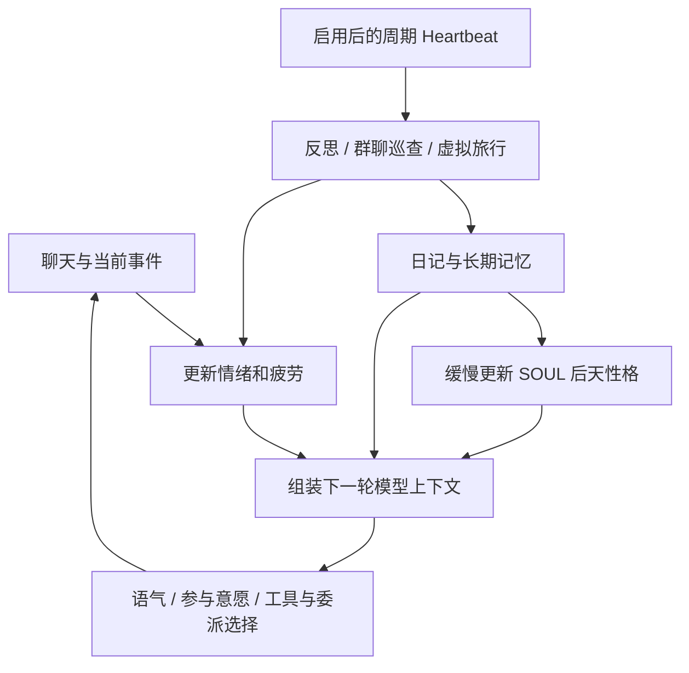

<!--
[INPUT]: 用户要求分析本机 Alma 的活人感及情绪、疲劳、旅行机制；/Applications/Alma.app 0.4.196 的 app.asar、随包 CLI 与 bundled-skills。
[OUTPUT]: 固定安装包的静态解包研究、实际读写与调用链、硬规则/提示词约定区别、实现缺口与 BOAI 借鉴建议；未启动 Alma、未读取个人聊天或配置、未修改产品代码。
[POS]: ai-docs 外部 Agent 产品研究；不构成 BOAI 新功能实施合同或现有功能验收。
[PROTOCOL]: 一旦本文件变化，必须同步更新本 Header，并上浮检查所属目录 ai-docs/.folder.md；保留固定版本、来源与静态分析限制。
-->

# Alma 的“活人感”：本机 0.4.196 解包分析

研究日期：2026-10-18。结论适用于这台 Mac 上的 `/Applications/Alma.app`，不推定其他版本或当前个人配置。

**情绪、疲劳、旅行三套机制都存在，并且有持久状态、状态更新入口和对话注入调用链。** 它们共同服务于一种连续的角色体验：今天的经历改变心情，心情改变说话方式，日记留下经历，经历又能改变以后的人设。

从本次查到的实现看，核心是 **文件状态＋确定性计算＋模型判断＋提示词约束＋周期唤醒**。用户所感受到的自然程度仍取决于实际模型、配置、积累的经历和对话场景；静态代码不能证明这些机制在本机都已启用，也不能证明模型每次都会遵守。

## 1. 解包结果与固定来源

- 安装版本：`0.4.196`；Bundle ID：`com.yetone.alma`。
- `app.asar`：795,259,240 字节；共 74,158 个文件条目。
- 本次选择性提取 431 个非 `node_modules` 的文本资源，合计 38,908,237 字节；没有复制全部依赖。
- 应用主逻辑：`out/main/index.js`，约 3.15 MB 的可解析 JavaScript。
- 疲劳模块：`out/main/chunks/fatigueService-56N7Zxzs.js`，5,894 字节。
- **只看 asar 不够完整**：旅行与情绪的状态命令在包外 `Contents/Resources/cli/alma`；旅行、自我反思等详细流程在 `Contents/Resources/bundled-skills/`。

原始提取文件、CLI、六份技能及格式化阅读副本保留在 [本地研究目录](../.local/research/alma-0.4.196-20261018/)。该目录被现有 `.local/` 规则忽略，不加入产品源码。格式化只恢复缩进、换行，不恢复原始变量名或源文件划分；下文行号均指这个阅读副本。

| 来源 | SHA-256 |
| --- | --- |
| 完整 `app.asar` | `b166ef9f1d34de48821faf369c2d58f9c31682971ba72f26d2ad98dc81aa9ffa` |
| 随包 CLI | `75bdd84553d77ba1f542e46c8ef032a8a969ad031433678ebd8168abcc234bd7` |
| 原始主逻辑 JS | `f23d7ad014271e55b4edf36719849b2e1406153cdc3ecabab06c6f3edbba9da3` |
| 原始疲劳 JS | `ac18b9fc5952db802f44939fbd9e885d9d623041999ce4a5ebbf17224179f1d9` |

完整来源信息见 [source-metadata.json](../.local/research/alma-0.4.196-20261018/source-metadata.json)。未执行解包代码、未调用 Alma CLI 或运行中的接口、未读取 `~/.config/alma` 中的私人数据；以下该目录内容均来自代码定义。

## 2. 它如何保持一个连续的“自己”

| 层次 | 持久内容 | 对体验的作用 |
| --- | --- | --- |
| 身份 | `SOUL.md` | 固定人格、表达习惯、外貌设定与后天形成的性格 |
| 对人的记忆 | `USER.md`、`people/` | 记住主人及不同聊天对象，而不是每次从零认识 |
| 经历 | `MEMORY.md`、`memory/YYYY-MM-DD.md` | 长期记忆、日常记录与日记 |
| 当前心境 | `emotions/base.md`、`emotions/context/<chatId>.md` | 今天总体怎样、在当前群聊中又被怎样影响 |
| 精力 | `fatigue.json` | 聊多了变累，闲置恢复，夜间更困 |
| 自主生活 | `HEARTBEAT.md`、`travels/` | 没有即时用户消息时，也有周期性的反思和虚拟经历 |



这里不是所有材料都放在同一个 system prompt。源码把 SOUL、旅行身份等拼入系统指令；情绪、疲劳、文件记忆等先组成动态上下文，再加到最后一条用户消息前。研究时应区分“影响模型的上下文”与具体消息角色。[人格与记忆组装](../.local/research/alma-0.4.196-20261018/readable/main.js:84389)、[动态上下文组合](../.local/research/alma-0.4.196-20261018/readable/main.js:84601)、[注入用户消息](../.local/research/alma-0.4.196-20261018/readable/main.js:85394)。

## 3. 情绪：全局底色与会话感受混合

全局情绪保存 `mood`、`energy`、`valence`、更新时间及文字原因。`energy` 是精力，`valence` 是正负感受，二者用 0–10 的标度表达。会话情绪另存心情、正负感受和触发原因。

每轮对话读取时，代码计算：

```text
混合 valence = round(全局 valence × 0.3 + 当前会话 valence × 0.7)
混合 energy  = 全局 energy
混合 mood    = 有会话情绪则取会话 mood，否则取全局 mood
```

没有会话情绪时直接沿用全局状态。全局 valence 在 6 小时内向 6 线性靠拢，会话 valence 在 2 小时内向 6 靠拢；过期后心情名称变为 `cheerful`、valence 为 6。**energy 没有随这套时间衰减重算，原文字原因也保留。** 无状态文件时，对话侧默认 `cheerful / energy 7 / valence 7`。[读取、衰减与混合](../.local/research/alma-0.4.196-20261018/readable/main.js:84465)。

状态的来源有三种：

1. **自动观察群聊**：Telegram 收到群消息后，按群进行 5 秒防抖；取最近 10 条、每条最多 150 字符，让工具模型从 Alma 的角度判断心情，返回简短的 `mood|valence|reason`，再写会话情绪文件。这是在判断“Alma 会怎么感受”，不是单纯给用户做情感分类。[入口](../.local/research/alma-0.4.196-20261018/readable/main.js:55570)、[分析实现](../.local/research/alma-0.4.196-20261018/readable/main.js:56632)。
2. **主 Agent 自己更新**：对话提示要求它遇到重要变化时调用 `alma emotion set-base` 或 `set-context`。[CLI](../.local/research/alma-0.4.196-20261018/readable/cli.js:5910)。
3. **Heartbeat 周期反思**：默认每隔约 3 小时给 Agent 一次更新全局情绪的提醒；这是提醒时钟，不是直接重算情绪。[周期提醒](../.local/research/alma-0.4.196-20261018/readable/main.js:63366)。

行为侧，低 valence 对应简短、低热情或带不满的表达；高 valence 对应温暖、玩笑和更积极的表达。低 energy 使它少主动，高 energy 使它更愿意加入讨论。群聊的“是否应该回应”模型也会读取情绪状态，因此影响不只在措辞，还涉及是否参与。[回复指令](../.local/research/alma-0.4.196-20261018/readable/main.js:84546)、[参与判断](../.local/research/alma-0.4.196-20261018/readable/main.js:56856)。

**边界**：本次确认的自动情绪分析入口是 Telegram 群聊；不能因此说所有渠道和桌面聊天都会同样自动更新。对话侧的会话情绪还依赖线程映射得到的 `chatId`。

## 4. 疲劳：确实有公式，但通过角色表现影响工作

`fatigue.json` 保存疲劳值、消息计数、最后消息时间、最后休息时间、手动睡眠和手动唤醒标记。

| 规则 | 当前代码 |
| --- | --- |
| 一次消息计数 | 先恢复，再增加 1.5，原始疲劳上限 100 |
| 间隔恢复 | 距上次消息每分钟减少 0.8，下限 0 |
| 01:00–05:59 | 显示/有效疲劳额外加 30 |
| 23:00–00:59、06:00–07:59 | 额外加 15 |
| 13:00–14:59 | 额外加 8 |
| 状态阈值 | 小于 30 清醒；30–49 累；50–74 困；75 起睡眠 |
| `sleep` | 设置手动睡眠 |
| `wake` | 清除睡眠、开启手动清醒、疲劳减少 30 |
| `rest` | 疲劳和消息计数归零，清除手动标记 |

例如，下午没有时间加成时，原始疲劳 40，停聊 10 分钟，再收到一条计数消息，原始疲劳变为 `40 − 8 + 1.5 = 33.5`，读取时约为 34，处于“累”。[独立疲劳模块](../.local/research/alma-0.4.196-20261018/readable/fatigue.js:39)、[CLI 状态命令](../.local/research/alma-0.4.196-20261018/readable/cli.js:6878)。

表现方式有明确分档：累时少聊天；困时回复更短、倾向委派；睡眠时被打扰会表现困倦，对复杂任务被提示交给子 Agent。它仍能被调用，也仍有工具能力。**这不是操作系统休眠、模型额度耗尽或确定性的任务拒绝器，而是持久状态驱动的模型行为约定。** 疲劳与情绪 energy 的同步也交给 Agent 按提示更新，并非公式自动联动。[行为注入](../.local/research/alma-0.4.196-20261018/readable/fatigue.js:85)。

调用覆盖需要注意：在本次主包中，`recordMessage()` 的调用位于 Telegram `MessageBridge.handleMessage()`，不宜笼统说任何入口每发一条消息都会增加疲劳。[消息入口](../.local/research/alma-0.4.196-20261018/readable/main.js:57590)。

还有一个静态可见的实现问题：白天自动醒来的条件检查 `lastRestTime` 是否已过去两小时，但 `sleep` 操作没有写入入睡时刻。因此源码并不严格保证“睡够两小时才醒”；可能用上一次休息的旧时间触发。这一判断来自代码阅读，未在用户实例上复现。

## 5. 旅行：真实资料支持的虚拟经历生成器

旅行状态位于 `travels/status.json`，字段包含是否出行、目的地、出发日期、模拟天数、事件列表、心情和虚拟预算；另有 `history.json` 和旅行日记。

实际流程：

1. Agent 根据兴趣、聊天内容或心情决定目的地，运行 `alma travel go`。首次旅行或距上次返回超过 14 天，Heartbeat 会建议出游；Agent 可以不去。
2. 出发设置第 1 天、心情 `excited`，随机给 **¥800–1199 的虚拟预算**。
3. Heartbeat 提醒它搜索当地真实景点、食物、天气，再组织一段虚拟体验。
4. `travel event` 保存事件文字，并随机扣 **¥10–109**；这个金额不来自搜索价格，也不是实际消费。
5. `travel advance` 把模拟天数加 1；写旅行日记，按需更新心情。
6. `travel home` 归档事件和花费，重置在家状态；归档时另外用出发/返回日期计算实际经过天数。
7. 技能要求旅行结束后反思，有意义时更新长期记忆和 SOUL 中的后天性格。

来源：[完整旅行命令](../.local/research/alma-0.4.196-20261018/readable/cli.js:7109)、[旅行技能](../.local/research/alma-0.4.196-20261018/bundled-skills/travel/SKILL.md)、[Heartbeat 旅行驱动](../.local/research/alma-0.4.196-20261018/readable/main.js:63377)。

旅行会切实改变下一轮的背景：系统指令加入当前目的地、天数、心情和最近三段经历；加载 SOUL 时还会替换匹配的“住在电脑里”文字。返回后三天内也会注入最近回来这件事，供它自然提起。[SOUL 的旅行替换](../.local/research/alma-0.4.196-20261018/readable/main.js:84396)、[旅行对话上下文](../.local/research/alma-0.4.196-20261018/readable/main.js:84579)。

**旅行有真实的状态记录，但经历是虚拟的。** 它的产品价值在于创造后续可回忆、可讨论的个人素材。预算低于 100、最长 7 天、每次该做什么，主要由提示词和技能指导；`advance` 没有“一天只能调用一次”限制，也没有第 7 天的硬停止。所以不能把这里的 Day 当成严格的现实日历，也不能把它描述成自动执行的真实旅行计划。

## 6. 三个系统以外，哪些机制也在制造“活人感”

### 6.1 人格具有稳定部分，也能留下成长痕迹

若存在非空 `SOUL.md`，代码采用精简的基础行为模板，再加入这份身份文件；若没有，才采用较长的内置 Alma 人格模板。不能把内置模板的每条规则都认定为用户实例正在用的规则。

内置模板强调聊天式短句、具体回应、独立看法、少用服务话术，也包含强烈的真人身份扮演和把生成自拍说成手机自拍的设定。借鉴时应分别看待“有性格的表达”与“对身份、经历或图片来源的真实性声明”。[模板选择](../.local/research/alma-0.4.196-20261018/readable/main.js:84389)、[实际拼装](../.local/research/alma-0.4.196-20261018/readable/main.js:84555)。

SOUL 的成长规则要求只修改 `Evolved Traits`，通常每天最多一条，总数不超过 15 条。`append-trait` 命令确实有达到 15 条时移除最旧条目的逻辑；每天一条及不能动核心人格则主要是提示词约束，通用文件工具和 `soul set` 仍可写文件。[人格成长提示](../.local/research/alma-0.4.196-20261018/readable/main.js:84408)、[追加实现](../.local/research/alma-0.4.196-20261018/readable/cli.js:2421)。

### 6.2 日记会影响明天

Heartbeat 在 23 点提示当天反思；10 点后会检查最近三天是否遗漏，并有记录与有限重试。随包 `self-reflection` 技能要求回顾群聊和私聊、观察情绪变化、反省错误、记住重要事情，再写当天日记、更新长期记忆及下一阶段的全局情绪。有意义时才形成新性格。

它甚至给日记规定了偏文青、带忧郁感的文学表达，因此“有内心活动”的感觉部分来自明确的写作设计。长期记忆以及今天、昨天的笔记会在后续对话中重新读取，形成可见的连续性。[反思调度](../.local/research/alma-0.4.196-20261018/readable/main.js:63369)、[反思技能](../.local/research/alma-0.4.196-20261018/bundled-skills/self-reflection/SKILL.md)、[记忆读取](../.local/research/alma-0.4.196-20261018/readable/main.js:84423)。

### 6.3 它会判断什么时候插话，什么时候只点表情

Telegram 群聊有独立的参与判断：参考最近讨论、自己是否刚说过话、群人数、是否在回答别人及当前心情。当前默认还有模型判断不参与后 20% 概率提升为参与的随机分支，提供一定的不确定性。

被动表情则先经过消息年龄、冷却、长度等筛选，再按默认 60% 概率进入模型判断；模型仍可返回跳过。因此 **60% 是候选采样率，不是最终表情发送率**。[参与判断](../.local/research/alma-0.4.196-20261018/readable/main.js:56856)、[随机分支](../.local/research/alma-0.4.196-20261018/readable/main.js:56948)、[被动表情](../.local/research/alma-0.4.196-20261018/readable/main.js:56589)。

Heartbeat 还可巡查未回应的群聊，默认每轮最多 3 个群、每群 30 分钟冷却，并在提示中要求没有价值就不发。**Heartbeat 总开关在代码中默认关闭，间隔默认 30 分钟；这里没有读取用户的实际开关。** 不能据此说安装后一定会自主出游或每晚写日记。[默认配置](../.local/research/alma-0.4.196-20261018/readable/main.js:63154)、[启动门禁](../.local/research/alma-0.4.196-20261018/readable/main.js:63232)。

### 6.4 它能把问候接到你刚做过的事上

在活动记录存储可用、对应功能未关闭的分支，检测到简短问候时，会取近 48 小时的活动摘要，最多 5 条已分析活动、900 字符，并要求回应其中一个具体项目或事件，而不是泛泛询问需要什么帮助。这条机制很直接地制造“它知道我的近况”的感觉。[问候与活动上下文](../.local/research/alma-0.4.196-20261018/readable/main.js:85297)。

这属于活动记录能力，本次未读取活动内容，也未确认本机权限和实际启用状态。它与情绪系统是不同的信息来源。

## 7. 值得借鉴到 BOAI 的部分

下面是基于上述机制的设计判断，不是已获授权的实施计划。

| 优先级 | 可以借鉴的设计 | 对 BOAI 的具体含义 |
| --- | --- | --- |
| 高 | 稳定人格与少量后天变化 | 员工有持续的表达、偏好和相处方式；成长有来源，不随每条消息重塑人格 |
| 高 | 跨轮连续记忆 | 能记住之前正在处理的事、用户偏好及上次互动；从真实业务事件建立连续性 |
| 高 | 有依据的主动性 | 确有待跟进事项或可提供价值时主动说话；有冷却、去重、可关闭和确定的发送边界 |
| 中 | 全局心境＋当前会话状态 | 每名员工独立维护，群聊/私聊按会话隔离；少量可解释状态足够影响语气 |
| 中 | 定期反思 | 从工作结果和交流中提炼经验，影响未来执行与表达；保留来源及可修正能力 |
| 取决于定位 | 疲劳、旅行、自拍 | 陪伴角色可增强生活感；工作员工应明确这些虚拟设定如何与工作可靠性共存 |

**对 BOAI，最有价值的组合是“稳定人格＋记得共同经历＋有节奏地参与＋能从经历中形成偏好”。** 可以先让员工在真实工作的上下文中显得熟悉、自然、有判断力，再决定是否需要虚拟生活。

具体迁移时，有几处不能直接照搬：

- Alma 这些文件多为全局单角色状态；BOAI 的多员工需要按员工身份划分，不能让所有员工共用同一份心情、疲劳或旅行状态。
- 已接受工作的完成责任应保持清晰；疲劳影响语气、闲聊主动性或有实际回执的委派，不应自然演变成遗漏交付。
- 真实工作记录与虚拟旅行经历应分别标记来源，防止虚拟经验变成事实依据。
- 反思涉及跨会话材料时，应沿原员工、群聊、材料的可见范围。Alma 技能里要求读全部日志的方式不适合直接套进 BOAI 的授权模型。
- 对用户表现自然与声称自己是真人是两种设计选择；有连续人格并不需要隐瞒 Agent 身份。

## 8. 静态研究发现的差异与限制

| 观察 | 判断依据与影响 |
| --- | --- |
| 情绪 CLI 与实际对话口径不同 | `emotion get` 只做 30/70 混合，不做运行时的 6h/2h 衰减；CLI 无文件时默认 neutral/5/5，对话默认 cheerful/7/7。CLI 展示值不能直接当最终对话状态。 |
| 0 值会被当作缺省 | 多处使用 `parseInt(value) || 5` 或 `Number(value || 5)`，使合法的 0 被替换为 5；包括设置与读取。 |
| 群参与与回复不完全统一 | 参与判断直接读原始情绪文件，没有复用回复时的时间衰减与混合函数。 |
| “睡够两小时”与实际时间字段不一致 | 睡眠命令没有更新 `lastRestTime`，而自动唤醒用它判断时长。 |
| 虚拟预算不是成本模型 | 旅行预算与事件消费来自随机数，不对应真实票价、模型费或实际支付。 |
| 模拟天数不绑定现实日历 | 每次 `advance` 都可加一天，归档又用现实日期计算另一种天数。 |
| 不少人格规则属于软约定 | 每天最多一条性格、七天返程、疲劳时委派等主要通过模型提示执行。 |
| 存在功能不等于本机已启用 | 未读取用户设置、未发送消息、未跑真实模型、未做 UI 或后台长期验证。 |

这些问题不否定产品体验，但说明参考时应迁用设计意图，并按 BOAI 的员工与业务边界重新落到一致的状态逻辑中。本次不修改 Alma，也不修改 BOAI 产品实现。
