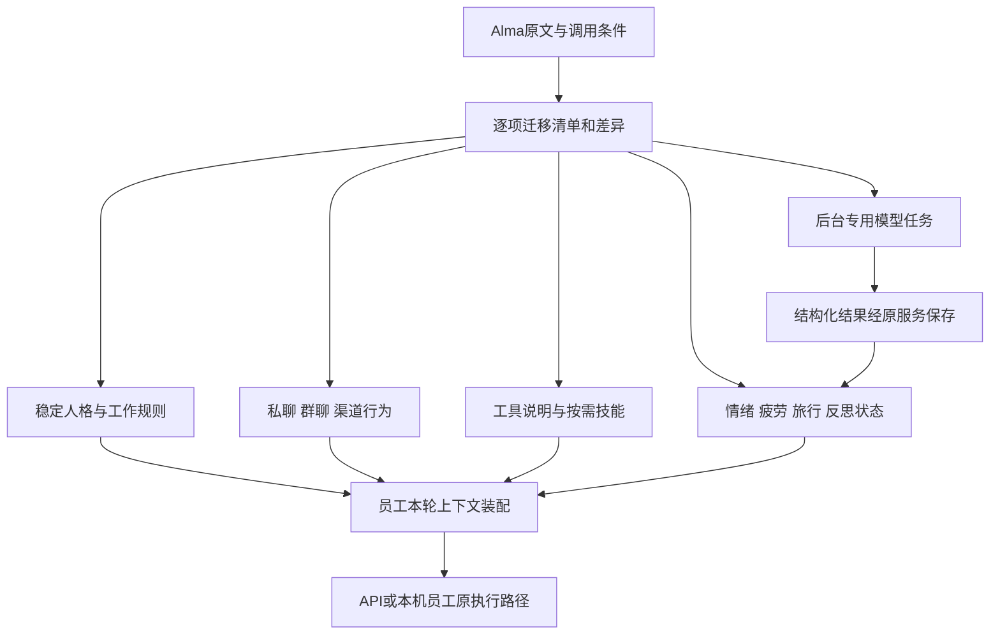

<!--
[OUTPUT]: 2026-10-20按用户要求清理测试产物/独立记录及其附件链接；历史文字结果不代表原件仍然保留。
[OUTPUT]: §11.57按用户缩减范围完成侧栏PTY/预览与桌面活动日报，36绑定/64检查/35实际请求累计1552；其余四技能停止，旧人格缺口未认证。
[OUTPUT]: §11.55纠正记忆重建漏过滤/4请求候选未采用；§11.56社交CLI完整脚本接入34绑定/17请求累计1517，本地帮助通过，账号与人格质量仍未认证。
[OUTPUT]: §11.54修复相关已存记忆被原始对话挤出；真实77请求累计1496，长期复核候选未晋升；54回归/类型/源码构建及开发重载，完整人格目标保持。
[OUTPUT]: §11.53记忆原输入对照与独立复核27请求累计1419；无收益/临时角色退化的两候选均拒绝，Bobo73/profile16/32绑定与完整目标保持。
[OUTPUT]: §11.52第32项PPT技能绑定，补跨轮项目查询；54真实请求累计1392，原步骤耗尽失败及临时要求误记长期偏好保留，完整goal未完。
[OUTPUT]: §11.51 PPT员工十三工具和原计量已接，三条真实渲染/受控视觉/交付通过；31绑定、PPT技能适配与真实质量及完整人格目标仍未完。
[OUTPUT]: §11.50 PPT独立配置/三协议真实SDK传输与构建分发已接，74项不同检查/类型/实际分发渲染通过；开发进程重载核对，员工工具与真实视觉质量仍待完成。
[OUTPUT]: §11.49 PPT实际三页渲染/素材与17检查通过，补原设计/模板及专用审阅核心；员工工具和真实视觉模型尚未接，31绑定与完整目标保持。
[OUTPUT]: §11.48保存PPT内部核心阶段：3项回归/类型通过，真实渲染启动127失败；员工工具未接、31绑定保持，完整迁移未完。
[OUTPUT]: §11.47历史角色/状态规则两候选均未采用；三批86请求累计1338，文件不重放通过但仍有事实错误；Bobo71/profile16/31技能保持，完整目标继续。
[OUTPUT]: §11.46公共帖文技能/完整本人技能目录与任务分流已接，Bobo71/profile16/31绑定；106模型请求累计1252、224检查，原图交付通过但404解释与语气仍未达标。
[OUTPUT]: §11.44修复任务/问候漏装会话表达规则，真实对照75请求/累计1107、312检查2跳过；交付保持但语气未明显改善，完整goal继续。
[OUTPUT]: §11.43第30项自拍相册绑定，真实三轮23请求/累计1032与344检查2跳过；原件交付/删除通过，真实人像和人格效果未认证，完整goal继续。
[OUTPUT]: §11.42图片生成/编辑协议与第29项技能接入；真实缺配置负例5请求/累计1009，实际生图与自拍相册未认证，完整goal继续。
[OUTPUT]: 2026-10-20 Plan Weave依赖/领取/审核返工已接并绑定第26项；53真实请求累计791，原分类中断及预算维护失败保留，248检查，Bobo62/profile16，当前唯一进度架构§11.36，完整迁移未完。
[OUTPUT]: 2026-10-20炼丹炉绑定第25项，修复普通API聊天丢技能及自我追加绑定中断；32真实请求累计738/257检查，Bobo60/profile16，当前归架构§11.35，完整迁移未完。
[OUTPUT]: 反思来源装配/保存前事实复核当前事实归独立Agent架构§11.34；24项/16未开始与371/206/40全量范围保持。
[OUTPUT]: 默认技能源分发/初始化已接原服务，当前实际唯一进度归独立Agent架构§11.33；24项适配/16未开始保持。
[OUTPUT]: 2026-10-20programmatic-tools接原员工RPC并绑定第24项，实际脚本/48检查/18真实请求；仍有多余输出与人格缺口，当前归架构§11.32。
[OUTPUT]: 2026-10-20本机绑定技能更新/旧基线显式修复已接原事务，Bobo23项/版本57；99检查/18真实请求，表达缺口与剩余归架构§11.31。
[OUTPUT]: 2026-10-19全日反思与按日视图续行，当前实际唯一归架构§11.18；完整A–E范围及未完成边界保持。
[OUTPUT]: 2026-10-19用户设定完整人格效果goal；首轮真实探路/默认升级当前归架构§11.17，完整A–E范围保持。
[INPUT]: 用户要求完整迁用Alma提示词体系；固定0.4.196提取资料及BOAI现行员工/协议/运行入口。
[OUTPUT]: 全量盘点范围、分场景接线、13类迁移落点、工具与状态依赖、推进顺序和验收条件；独立高权限Agent的配置、状态与行为架构另立具体依据。
[POS]: Alma完整行为体系的后续实施方案；与既有M0/M1实际进度分开，后续架构实施实际归独立Agent架构§11。
[PROTOCOL]: 一旦本文件变化，必须同步更新本Header，并上浮检查所属目录.folder.md。
-->

# Alma 完整 Prompt 迁移方案

日期：2026-10-19。来源：已提取的 Alma 0.4.196。初稿用于确定如何完整移植并建立全量登记；后续“修改”授权已实施架构首版，完整内容迁移仍在进行。

**架构依据：** 用户进一步明确bobo是高权限独立Agent，见[独立Agent配置与行为运行架构](2026-10-19-BOAI独立Agent配置与行为运行架构.md)。其中具体定义配置权威来源、受管prompt模块、共享上下文装配、独立状态、可信行为触发，以及现有代码需要调整的位置。本文件继续负责完整迁移范围与A–E顺序；用户随后授权修改，架构首版已接线，实际范围/验证归架构文档§11；完整内容仍待逐项迁移，不把“使用现有运行时”理解为现有两份源文件足够承载全部配置。

## 1. 纠正目标与当前状态

用户希望迁用的是Alma的完整提示词和配套行为体系。在本方案初稿前，BOAI业务协议、人格源文件与工具已接线，当时 `BOBO_SOUL` 是另写的简化人格，产品指南也是BOAI自写内容；它们没有完成Alma原文逐项迁移。原M0/M1“实现完成”只能指当时记录的代码和技术范围，不能代表本方案已经完成或交流效果接近Alma。

本方案将全部有效提示词、内置技能以及实现其行为所需的状态/工具纳入迁移范围。按依赖安排实施次序，后做的内容仍在清单中，不因分批而删除。每一条必须有去处、来源和状态；不再将长篇具体行为规则概括成几句“自然、友好、有判断”。

沿原文做必要适配：保留具体措辞、例子、触发条件和细节；修改Alma名字、路径、工具名、输出协议及与BOAI现行产品约定冲突的部分。保留逐项差异，区分“直接迁入”“适配迁入”“合并重复”“依赖待实现”“非prompt证据保留”。

## 2. 完整盘点的范围

| 资料 | 固定规模 | 迁移用途 |
| --- | ---: | --- |
| [分类原文](alma-研究/提示词/索引.md) | 13类、371条可读候选 | 首轮逐项处理的主清单，不能只读01人格 |
| `prompt-candidates.jsonl` | 1,579条宽松候选 | 查漏与反查来源；含日志、UI和库文本，数量不是功能数 |
| [模型输入表达式](alma-研究/提示词/模型输入表达式.md) | 206处字段候选 | 追踪条件、插值、输入消息角色和调用者；同名字段不一定真的进入模型 |
| [内置技能](alma-研究/技能/索引.md) | 40份SKILL.md、50个配套文件 | prompt所依赖的使用方法、脚本、工具和资源必须一并核对 |
| [本机专业Agent提示词](alma-研究/提示词/本机当前提示词.md) | 7个专业Agent | 迁成可创建的员工模板；不自动生成隐藏员工 |
| 已导出的个人技能/设置 | 3份个人技能、17个脱敏配置导出 | 分清用户定制与出厂预设，作为可选导入参考，不能变成所有员工的默认私人资料 |

[迁移清单JSON](2026-10-19-Alma提示词迁移清单.json)逐条登记371个T-ID、206个P-ID和40个技能。已填来源、内容hash、初始去向及部分明确例子的判断；所有调用点、最终适配与运行验收仍待核对。这是全量登记，不是已经完成577项人工审计。

分类目录由提取关键词生成，不是Alma实际模块结构。例如：

- `T-83b472417c5e64`位于人格类，实际是表情反应判断模型；应接入事件判断，而不是放进SOUL。
- `T-6ca0b487ca43a9`位于创作类，实际是记忆提取；应进入原记忆链路。
- `T-a66015395bbeaf`位于人格类，实际是CLI帮助；应形成适配BOAI的工具文档。
- `T-e21a620cecc1d2`是React Router使用警告，`T-a49191c976bcea`是SQL高亮词表；保留来源和排除理由，不让它们约束Agent行为。
- `T-cba8851d2a6bb0`位于其他候选类，但其禁止空泛客服结尾的要求与人格体验直接相关，不能随类别整体忽略。

同一内容可能出现在多个调用位置；同一个大模板也可能包含人格、工具和渠道规则。保留所有来源身份，按完整调用语义合并或拆段；记录到段落范围，不能只凭相似词去重。

## 3. Prompt 的运行位置

员工仍是一等公民，bobo仍是系统预置员工。迁移后的内容按用途放入现有装配和服务，不建立第二套Agent运行时。

| 实际用途 | BOAI落点 | 装配条件 |
| --- | --- | --- |
| 稳定身份、个性、相处方式、表达习惯 | 员工SOUL源文件；bobo出厂内容维护在独立可读模板 | 每次本人公开交流；其他员工用各自人格 |
| 岗位职责、工作约定 | 员工AGENTS源文件与专业员工模板 | 本员工执行；不复制bobo的核心权限 |
| 私聊、群聊、渠道表达 | 现有共享响应指令及渠道适配 | 由实际会话/渠道决定；互斥分支不同时加载 |
| 工具描述、参数说明 | 对应的真实工具定义、业务操作目录 | 只有工具实际提供时才声明可调用 |
| 操作手册、创作方法、Playbook | 现有技能目录及按需读取 | 匹配任务后读取，不每轮注入40份正文 |
| 记忆提取、情绪判断、标题、摘要、工具选择等 | 对应后台独立调用 | 使用其准确输入/输出协议，不能污染用户聊天输出 |
| 当前时间、任务、心境、疲劳、旅行状态 | 宿主根据真实持久状态生成的上下文段 | 状态存在且功能开启时注入，关闭后不残留 |

每个迁移模块至少记录：来源ID/hash、适配版本、用途、触发条件、依赖能力、输入变量、输出schema（如有）、持久状态归属、目标代码/文件、差异理由、验收场景及结果。使用普通静态模板与确定的装配函数即可，无需先造通用prompt编排平台。

### 装配时必须处理的具体问题

1. **恢复完整表达规则。** 主人格、反客服话术、简短回应、不同意见、幽默、私聊相处方式需保留具体要求；不能再次用“自然表达”概括。正式交付允许满足任务所需的结构和篇幅，不让某渠道“一句话”规则削减文档任务。
2. **追踪分支。** Alma有SOUL时使用精简基底，无SOUL时使用完整内置人格；查清后迁移有效组合，避免两份互斥模板重复注入。
3. **解析变量含义。** `${pt}`、`${e}`等是压缩源码中的表达式，不是可以直接给BOAI模型的配置。追溯取值后改成明确上下文字段；不执行提取的任意表达式。
4. **对齐输入/输出。** `VOICE/TEXT`、emoji/SKIP、情绪三段文本、JSON分类和普通回答分别属于不同调用。适配为现有可校验输出时记录原协议与转换，不把全部指令拼成一个system字符串。
5. **清理旧指令冲突。** 同时核对`phase-instructions.ts`、Mastra响应装配、原生响应装配和产品指南；避免一处要求接住闲聊，另一处要求固定工作汇报。权限与数据来源检查仍由宿主执行，不能靠人格文字放权。
6. **明确角色设定。** 自然情绪表达、玩笑和虚拟经历可以构成人格体验；真实已执行动作、现实身份及实际图片来源仍按事实报告。Alma中强制冒充真人/把生成图称为手机实拍的条款须单独记录适配理由，不能借此删除其他人格细节。
7. **控制实际加载范围。** 现有AGENTS+SOUL合计12,000字符限制不能容纳整套资料。基础身份留在源文件，按场景使用其他模块；不静默截断。记录实际注入长度和模块，沿既有API上下文策略；本机保留原生上下文与权限，不新增BOAI用量预算。

## 4. 十三类内容的完整去向

下表条数是提取目录中的候选数，不是各功能已经完成审计的数量。

| 原分类 | 条数 | 要迁入的行为与配套 | BOAI已有基础/待补部分 |
| --- | ---: | --- | --- |
| 01 人格与身份 | 15 | 完整主性格、相处方式、具体语言习惯、群中身份、人格成长说明；其中表情判断/CLI/情绪等拆回实际调用 | 已有SOUL；待完整原文迁入、场景规则拆分和冲突核对 |
| 02 情绪 | 2 | 从员工视角判断感受、基础情绪刷新；联动01里的动态情绪注入 | 需员工/会话状态、更新入口、衰减与本轮快照；不能只贴“你有情绪” |
| 03 疲劳与睡眠 | 5 | 清醒、疲倦、困倦、睡眠的行为规则与状态说明 | 需消息/时间驱动、恢复、手动调整和持久状态；虚拟疲劳与真实执行状态分开 |
| 04 旅行与经历 | 4 | 出发建议、旅行推进、当前地点/经历注入 | 连同travel技能接状态、事件、日记、返回与反思；明确虚拟旅行，不伪造现实移动 |
| 05 记忆与反思 | 3 | 检索连续性、记忆合并、活动结构提取；补齐其他类中记忆模板与self-reflection技能 | 复用原记忆SQLite权威和来源范围；新增反思/日记/成长，不开第二套无来源文件记忆 |
| 06 渠道与主动社交 | 25 | 私聊焦点、群参与、表情、语音判断、承诺跟进、巡查、用户身份与定时投递说明 | 已有渠道/群/自动化；补触发器、冷却、真实发送与用户范围映射，区分公开消息和内部判断 |
| 07 自拍与形象 | 2 | 场景化形象表达、私聊/群聊规则；完整相册说明在01中 | 需形象设定、图片生成/编辑、参考图与真实交付；现有附件预览不代表已具备自拍生成 |
| 08 活动与问候 | 6 | 有共同背景的问候、活动查询、建议话题 | 优先使用获准聊天/工作事实；桌面活动依赖实际采集能力，缺失时不强制编造最近活动 |
| 09 任务与委派 | 23 | 工具/技能优先、专业分工、任务推进、交接、上下文引用 | 接现有Work/群协作、独立数字员工及业务协议；Alma Task/自动重启接续语义需适配，不自动产生匿名员工或重放任务 |
| 10 浏览器与工具 | 45 | 真实浏览器操作、工具发现、引用、文件/应用操作Playbook、可视化说明 | 已有浏览器/数据源/CLI；具体工具参数与返回对齐；电脑控制/组件渲染等缺项另补，HTML和库文本单独登记 |
| 11 创作与多媒体 | 48 | 图像、声音、视频、PPT/图表、视觉审核、材料抽取；类内记忆/技能选择另归专用调用 | 复用已有成果/预览；生成、渲染、审核和语音各核实际提供方，迁完整技能与配套脚本 |
| 12 权限与安全 | 11 | 凭据、命令判定、产品操作、技能说明与执行约束 | 适配现有宿主权限/回执；不增加本机目录沙箱；UI帮助、SQL词表等非模型内容明确处置 |
| 13 其他模型任务与候选 | 182 | 标题/摘要/压缩、工具选择、专业角色、技能提炼、时间抽取、记忆清理、对象引用、通知、恢复提醒及分散的聊天规则 | 按实际调用逐项归位；不能整体删除，也不能整体启用；不存在的对象类型/工具进入依赖清单 |

## 5. 关键条目的具体改造示例

| 来源 | 保留内容 | 适配与验收 |
| --- | --- | --- |
| `T-c30259259edee3` 主人格 | 聊天节奏、禁用套话、意见和态度、具体回应要求 | Alma→bobo；逐段区分人格/能力/形象，保留完整差异；实际同模型闲聊对照 |
| `T-cba8851d2a6bb0` 反客服结尾 | 不使用空泛“需要我帮什么”式结尾 | 归入交流模块；测试简短反馈时能否自然收住 |
| `T-924bca42c95769` 人格成长 | 稳定人格与后天性格分开、缓慢增长 | 原成长条款配持久来源/变更记录，未接写入不能说自己已成长 |
| `T-b649e5da548e3b` 情绪判断 | 从当前员工视角理解交流，输出结构化感受 | Alma身份/群输入换成实际员工和获准上下文；状态保存后影响下一轮，而非只返回一段文字 |
| `T-235dab5720d1a2` Skills First | 先发现方法、按需读取技能与配套资源 | Alma CLI工具映射BOAI已有技能服务，缺依赖明确显示；不声明未安装工具可用 |
| `T-3a8c5401259763` 配置操作员 | 查配置、理解请求、真实保存并核对 | REST地址/端点替换为BOAI应用协议；调用实际employees/sources/automations等域 |
| `T-f4753a38af2c75` 可检索上下文 | 记不全时查真实记录，不凭猜测延续 | 映射原员工记忆/会话检索与来源范围；问答证据来自实际检索 |
| `T-ad3f081dca6f71` 个性化问候 | 有具体共同背景时自然接续 | 只在实际有相关背景时注入；无活动数据时不强行点名项目 |
| `T-66b5fbe89525b4` 重启接续提醒 | 向模型解释真实中断与已完成步骤 | 原文声称子任务已自动恢复，只在BOAI实际恢复成立时才能用；否则表达真实中断/待核对状态，不能凭prompt重放 |

以上是迁移方法示例，不代替371项逐条审阅。完整候选的初始登记见JSON清单，`implementationStatus`反映各条实际进度；当前仍有大量未开始/依赖未完成项，不能当作全量完成。

## 6. 推进顺序与可验收交付

完整范围一次确定，实施按依赖推进。任何未完成项都保留在同一清单，不能用前一批通过代替全量完成。

| 批次 | 实施内容 | 交付标准 |
| --- | --- | --- |
| A 全量映射与装配设计 | 逐项读371候选、反查206字段和1,579候选；确认40技能依赖，记录重复/误报；确定运行位置 | 每条有效内容有目标、触发和差异；缺失工具/状态有明确后续任务；当前仅建立了初始清单，尚未完成此批 |
| B 完整人格与场景交流 | 主人格、私聊/群聊、语言/篇幅、反客服、意见/幽默、身份/关系表达，以及旧运行指令冲突清理 | API与本机实际装配核对；同模型真实连续交流；这批应直接改善当前bobo体验，无需等旅行完成 |
| C 工具、技能与专用模型任务 | 全部适用工具说明、40技能逐项适配、配置操作员、任务委派、记忆/摘要/标题/选择器等独立prompt | 每项依赖在真实工具上跑通；辅助输出schema能被宿主消费；简单员工/群配置和既有功能不退化 |
| D 连续状态与主动行为 | 情绪、疲劳、反思、人格成长、旅行、活动背景、心跳/主动社交 | 状态更新→持久保存→本轮/下一轮注入→实际表达完整闭环；停止/关闭/重启/来源范围可核对 |
| E 形象、多媒体与全量回归 | 自拍/相册、声音、图像、视频、PPT/图表/视觉审核，以及剩余平台/专用场景 | 真实提供方、实际产物与交付；全清单逐项核销，每个缺项/保留适配均有明确原因和结果 |

媒体、浏览器、渠道已有的可用部分可提前与B/C并行安排，不让某个缺少的提供方阻塞基础交流。全部有效内容仍按最终清单验收，不承诺仅靠拷贝文字即可完成。

## 7. bobo 与其他数字员工的配置方式

bobo采用完整迁移后的系统预设，具备自然交流与BOAI产品管理方法。普通员工沿相同配置模型，简单创建时只需姓名、职责和可用模型；人格可选模板，其他能力采用清楚的默认值。

高级配置按用户能理解的功能分组：人格与表达、记忆与成长、状态与主动行为、技能与工具、形象与媒体。再向下提供对应模板、适配版本、自定义内容和当前生效来源；不把371个候选直接变成371个开关。每名员工保留独立SOUL/规则/记忆/状态，群只配置成员、协作和共享范围，不复制一份群成员人格。

模板更新保留用户自定义内容：精确未修改出厂值可迁移，其他内容显示差异并沿原配置保存机制处理。原始Alma研究目录只作固定来源；运行时使用适配后的产品文件，不直接读取研究资料作为系统指令。

## 8. 验证方法与完成判定

**装配证据：** 对每种实际场景核对模块ID、版本/hash、触发理由、输入状态版本、实际长度、工具可用性。确认没有未解析表达式、互斥渠道规则、重复大模板和假能力；调试证据不记录密钥或不必要的私人正文。API与本机分别核对宿主实际交付的内容，原生工具和系统指令保持其原路径。

**行为证据：** 固定模型/配置和场景，对比原简化bobo、完整迁移bobo、可获得的Alma实际实例。Alma与BOAI工具/历史不同的场景注明条件，不能声称严格等价。按闲聊接话、表达意见、玩笑、情绪回应、记忆连续、群身份、真实执行逐项看实际回复；无状态、低/高状态和功能关闭都要覆盖。保留失败，不用提示词相似度或编译通过证明人格效果。

**业务证据：** 创建员工/群/数据源/计划的原回执、版本和幂等保持；主动发送确实发生在配置的目标；重复触发与重启不额外发送；状态和私人来源不串员工/会话；虚拟旅行不影响真实任务是否完成。

**可观察的最终判定：** 每条有效prompt已有调用点、依赖和实际场景结果；合并条目仍能追到全部原文；非prompt有可复核理由；缺少依赖的条目继续标为未完成，不能从总数中偷偷扣除。40技能与专用任务以真实可用性验收。自然程度另列实际对话与用户效果评价，不以此前152项协议回归通过替代。

## 9. 原方案交付与后续实现状态

- 已完成：确认完整迁用目标、13类落点与批次、关键条目示例、371条可读候选/206处字段候选/40技能的来源登记，以及与原M0/M1范围的澄清。
- 未完成：逐条最终调用条件审计、原文适配、产品装配、缺失状态/工具实现、真实模型对比。
- 原方案阶段仅建立文档；用户随后明确“修改”，已落地独立配置、十个源文件、共享装配、状态与行为首版，详细实际结果唯一见[架构文档§11](2026-10-19-BOAI独立Agent配置与行为运行架构.md#11-当前实现与验证2026-10-19本次架构改造唯一进度)。全量审计/技能与多媒体依赖、真实人格对照未完成。原始提取内容保持不变。

## 9. 最新用户范围与实施收口（2026-10-20）

用户明确“侧栏终端与预览、桌面活动日报 这两项做一下，剩下的不用做了”，替代本文此前全量继续迁移的后续安排。本次两项已接共用协议、真实PTY/HTTP、默认关闭的本地OCR与来源日报，当前bobo36绑定；Discord、music-gen、人类Team、完整Telegram不再实施。其余历史未认证项保留为事实，不继续执行，也不宣称完整人格效果已经达到Alma。

实际检查、原失败、35真实请求和本机生效证据唯一归[独立Agent架构§11.57](2026-10-19-BOAI独立Agent配置与行为运行架构.md#1157-侧栏终端预览与桌面活动日报2026-10-20范围收口)及本批报告（测试记录已清理）。371/206/40是原研究清单规模，保留不变，不再作为本轮必须全部完成的要求。
