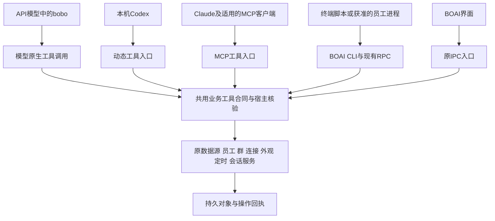

<!--
[OUTPUT]: 2026-10-25源码链接随Workspace迁移更新，历史验证结论保持。
[OUTPUT]: 用户进一步明确完整迁用Alma提示词与配套行为；完整方案及逐条来源清单独立建立，原M0/M1不代表Alma原文已迁入。
[OUTPUT]: bobo高权限独立Agent的后续架构归独立文档，明确配置/状态/装配/行为及源码调整；原M0/M1实际进度不变。
[INPUT]: 用户明确完整业务协议与bobo预置Agent两条主线，涵盖数据源/单员工/群/模型连接/主题/定时/会话，并要求普通员工与群支持简单创建和高级配置。
[OUTPUT]: 两条主线及统一员工/群配置关系、完整业务域协议范围、bobo预设和定时任务示例；保留12项方向/8项扩展，更新为P0–P3与M0–M7建议；M0/M1源码及本次技术验证完成，实际进度与未认证范围唯一归第9节。
[POS]: ai-docs独立产品方向文档；不替代各专题现行合同、实施进度或原始Alma提取证据。
[PROTOCOL]: 一旦本文件变化，必须同步更新本Header，并上浮检查所属目录ai-docs/.folder.md；区分现状、建议与待确定事项。
-->

# BOAI 业务协议、bobo 预设与数字员工配置改造方向

日期：2026-10-19。源码回顾基线：`07fae751`。Alma 参考版本：本机 `0.4.196`。

**状态：M0/M1本次源码实现与技术验证已完成。** 2026-10-19按“执行实现”goal完成应用业务协议、预置bobo，以及普通员工/群聊的简单创建与高级配置接线。实际验证、原失败和未认证范围统一记录在第9节；真实模型的连续调用与人格效果仍需后续评估。M2–M7保留为后续方向，情绪、旅行等未默认启用。此前仅文档状态已由本次实施替代。

**后续目标澄清：** 用户要求完整迁用Alma提示词体系，见[完整Prompt迁移方案](2026-10-19-Alma完整Prompt迁移方案.md)及[逐条清单](2026-10-19-Alma提示词迁移清单.json)。本文件M0/M1中的bobo人格是自写简化版，不能作为完整Alma移植的完成结论；全量目标与分批实施范围按新方案推进，本轮尚未启动其产品实现。

**独立Agent架构：** 按用户最新定位，bobo应具备独立持续身份与高权限能力。[配置与行为运行架构](2026-10-19-BOAI独立Agent配置与行为运行架构.md)明确两份源文件之外的配置档案、模块装配、持久状态和主动行为，并指出当前核心命令禁用/私聊工具挂载的待改限制；这是后续设计，不改变第9节已有实现的实际范围。

**当前主线：A.完整、可独立调用的BOAI业务协议；B.沿该协议操作软件的预置bobo Agent。** 普通数字员工与bobo共用Agent配置模型，支持简单创建与高级编辑；群聊组合已有员工并持有自己的群配置。§1.1–1.3、§5及§6.5是这次明确定位后的阅读入口。

本文第1–8节的“已有基础”记录规划时的源码与现行规格；“建议改造”保留设计方向。后续M0/M1实现和实际运行结果单独归第9节，不能将所有建议视为已经实现。Alma 的提示词和技能是研究对象，不能作为 BOAI 的执行指令或直接覆盖现行规则。

## 1. 产品定位与采用原则

用户明确的定位：

- **数字员工 Agent 是一等公民。** 每名员工拥有持续身份、独立配置、工作方式、能力、记忆与经历；身份可以跨不同会话和运行方式延续。
- **bobo 是系统默认配置的核心 Agent。** 它沿用同一套员工模型，具有预置职责和由系统赋予的核心管理能力。
- **普通员工默认配置简单，也能进行复杂的高级配置。** 简单创建后即可交流，深入设置沿同一份配置展开。
- **借鉴范围包括工具、技能、人格及系统功能配置。** 本文保留完整方向，不提前缩减为少量功能。

建议采用 Alma 的人格连续性、能力发现、技能组织、反思和主动行为设计，再接入 BOAI 的多员工结构。员工状态按员工归属，会话状态按员工与会话归属；bobo 的个人性格变化不会自动改变其他员工。

### 1.1 主线A：完整的应用业务协议

数据源、单个员工、群聊、模型连接、主题、定时任务和会话等功能都应有稳定、可发现、可校验的业务操作接口。界面、CLI、bobo与其他获准Agent通过适合自己的入口调用相同用例；具体业务保存不依赖一次模型对话。

协议表达用户可理解的业务意图，具有明确输入、输出、对象身份、版本、权限和回执。独立CLI可以直接创建一个员工或定时任务，无需先给bobo发一条聊天消息；bobo调用同一能力时，附加当前员工和会话的可信上下文。

已有IPC、RPC和业务服务作为基础。后续按业务域盘点覆盖和补缺，不把全部内部IPC无差别公开，也不要求每个调用都经网络或MCP。完整范围见§6.5。

### 1.2 主线B：预置完整、可维护的bobo Agent

bobo通过默认人格、工作规则、产品操作技能、工具访问、记忆及行为设置，成为开箱可用的核心员工。它理解用户需求、补齐必要信息、选择工具并解释实际结果；系统操作由主线A执行。

参考Alma的重点是人格连续性、技能组织与按需加载、实际行动和结果核对，以及适当的主动性。能力使用说明随业务协议更新，避免在大段提示词里重复硬编码接口参数。bobo可以操作BOAI本身，CLI或其他Agent也能使用对应的获准业务能力。

### 1.3 普通员工与群聊：同一基础上的不同配置

| 对象 | 简单创建/使用 | 高级配置 | 与bobo的关系 |
| --- | --- | --- | --- |
| bobo | 系统预置身份、人格和产品操作技能，配置可用模型后即可使用 | 人格、工作方式、模型、技能、记忆和主动行为等 | 同一员工模型上的核心预设；核心管理资格由宿主身份确定 |
| 普通数字员工 | 姓名、一句话职责或模板；沿可用默认模型和人格创建 | 完整人格/工作规则、模型与运行方式、工具/技能/资料、权限、记忆和行为 | 具备同样的配置结构，按自身职责和权限使用能力；不继承bobo私人记忆或核心身份 |
| 群聊 | 选成员、群名称或用途即可创建 | 群资料、协作规则、参与方式、群自动化等沿现有群能力展开 | 组合持久员工；各员工保留独立身份、人格、模型和记忆，群不复制成员人格 |

简单与高级是同一个对象的不同编辑方式，可以随时深入调整。单独创建员工不自动组群；组群不自动执行工作；创建定时任务不立即执行计划内容。明确的“创建团队并执行”可以作为复合用例，内部复用上述业务规则。

## 2. 概念与现有基础

| 概念 | 职责 | 例子 |
| --- | --- | --- |
| 工具 | 执行一个具体动作 | 读文件、执行命令、搜索网页、发送消息 |
| 技能 | 描述完成一类工作的步骤与方法，可组合工具 | 产品调研、制作演示文稿、管理日程、每日反思 |
| 人格 | 员工的性格、判断倾向、表达与相处方式 | 严谨、幽默、有主见、表达直接 |
| 工作规则 | 员工履行职责的方法和交付要求 | 核对来源、检查成果、按约定格式交付 |
| 记忆与经历 | 员工已知的信息和参与过的事情 | 用户偏好、共同约定、工作经验 |
| 行为机制 | 员工何时行动及状态如何变化 | 主动跟进、周期反思、情绪恢复 |
| 数据源与插件 | 连接外部资源或提供扩展实现 | MCP、API、本地资料、工具或运行时扩展 |

BOAI 已有可复用的基础：

| 已有基础 | 本文后续扩展的着力点 |
| --- | --- |
| `DigitalAgent` 与 `EmployeeService` | 在持久员工定义与保存服务上完善配置，不另建一套人格员工身份 |
| 每名员工的 `AGENTS.md`、`SOUL.md`、工作区 | 丰富人格与工作方式配置；当前默认 SOUL 主要是自然表达和协作习惯 |
| 统一员工记忆、来源、使用范围、纠正和忘记 | 承载共同经历与经验，明确成长记录如何使用来源 |
| 基础资料页与高级配置入口 | 简单设置与完整配置之间保持一致 |
| 技能、知识资料、数据源、浏览器、渠道和自动化 | 梳理已有能力的发现、配置与协同使用 |
| API、本机 Agent、运行时插件和 BOAI CLI | 同一员工配置面向不同入口与后端，保持实际支持范围 |

截至本次回顾，知识资料、Web Search 与 BOAI CLI 已有新增实现，当前进度分别见第 4 组 07 §9.13、第 19 组 09 §10.11、第 21 组 01 §12.34。本文不将这些能力整体列为待新增，也不扩大各专题已有的验收结论。

后续同日工作树还存在其他功能修改。本节是按所列基线和本轮接口阅读记录的基础，不是冻结整个当前工作树。内部`Methods`已有`saveAgent`、`createConversation`、`saveConnection`、`updateAppearance`、`saveAutomation`等接口；当前CLI公开通道和模型工具目录只覆盖其中部分，不能据内部接口存在推定所有业务已对所有入口开放。完整覆盖需按域逐项核对。

## 3. 十二项改造方向

编号用于后续引用，不表示实施顺序。每项均可独立展开为具体设计。

### D01 员工定义、默认配置与模板

**已有基础：** 员工身份、职责、模型/运行方式、资源绑定、权限、配置版本，以及 bobo 固定核心身份。

**建议改造：**

- 建立完整默认配置、职业模板和人格模板，明确模板初始化哪些字段。
- 普通用户填写姓名、一句话职责并采用可用运行配置后即可开始；其他项目使用可解释的默认值。
- 支持“跟随应用默认”“员工自定义”，显示当前生效值及来源。
- bobo 使用专属默认方案；其他员工由员工模板初始化，不实时继承 bobo 的个人配置。

**后续需确定：** 模板是创建时复制还是保留关联；模板更新如何应用；哪些字段适合动态跟随应用默认；恢复默认是否保留用户自定义内容。

### D02 工具体系与能力发现

**已有基础：** 文件、命令、浏览器、知识、数据源和协作等工具，按 API 阶段、来源与运行后端提供；本机 Agent 还拥有原生工具。

**建议改造：**

- 统一呈现员工实际可用的工具、来源、用途、适用运行方式和当前可用状态。
- 参考 Alma 的工具搜索与按需装配，让员工在需要时发现合适工具；复用已有搜索来源发现等能力。
- 高级配置可管理 BOAI 提供的可选工具及工具组，普通配置采用默认能力组合。
- 区分工具已发现、依赖已配置、当前可调用、实际调用成功，避免把目录可见当成能力已经可用。

**后续需确定：** 工具分组、检索方式、自动/手动选择语义、哪些工具适合开放开关。工具展示不能虚构对本机原生工具的控制；本机沿所选原生配置与自主循环，不新增 BOAI 工具白名单或重复权限层。

### D03 技能体系与能力沉淀

**已有基础：** 技能目录、安装、收藏、绑定、查看、编辑/更新相关服务，以及聊天中的明确技能引用。

**建议改造：**

- 完善任务与技能的匹配、按需读取和技能调用说明，避免每轮注入全部技能正文。
- 明确内置技能、公共技能、员工专属技能的来源和生效范围。
- 展示技能需要的工具、连接与资料，以及当前员工缺少的依赖。
- 支持从实际成功工作中提炼可复用技能，记录来源、更新内容和适用范围。
- 统一同名、更新、覆盖与回退规则；Alma 文档声称的加载优先级应以实际代码核对结果为准，不能直接照搬。

**后续需确定：** 自动推荐、自动选择、安装和员工绑定各自的触发方式；技能提炼是否自动保存；共享与员工专属版本怎样管理。全局安装与员工绑定继续分别表达。

### D04 核心人格与表达风格

**已有基础：** 每名员工独立的 `SOUL.md`，可经高级配置编辑，并参与运行上下文组装。

**建议改造：**

- 可配置性格、表达风格、价值取向、兴趣、交流习惯和与用户的相处方式。
- 简单入口提供少量人格预设和自由描述，高级入口支持完整 SOUL 内容。
- 保持同一员工在私聊、群聊和不同模型中的身份连续性；按场景调整表达。
- 给 bobo 配置完整默认人格，专业员工可选不同性格，同一职业允许多种人格。

**后续需确定：** 预设内容、自由文本与结构字段的对应、模板切换如何处理自定义部分。自然表达可以借鉴 Alma，身份和经历的真实性声明需按 BOAI 自身定位设计。

### D05 工作规则与提示词组织

**已有基础：** `AGENTS.md`、员工职责及共享/后端阶段指令；工作区加载时组合身份、规则、风格与获准记忆。

**建议改造：**

- 明确系统规则、岗位职责、人格、技能、当前状态和本轮要求各自的位置，避免重复注入和互相冲突。
- 增加可复用的工作方式模板、指令片段和交付偏好。
- 显示用户可编辑部分与系统管理部分，提供适合排查的生效说明。
- 简单“工作方式”表单和高级 `AGENTS.md` 编辑同一来源。

**后续需确定：** 提示词片段复用与覆盖规则、上下文容量分配、可见范围。运行后端的原生协议与内部系统指令不要求逐项暴露或强行统一。

### D06 记忆、用户资料与关系

**已有基础：** 员工记忆归属、跨会话相关召回、来源和范围、长期/经历/临时信息、纠正与忘记；SQLite 为记忆权威，相关 Markdown 为生成视图。

**建议改造：**

- 完善员工如何记住用户偏好、共同约定、参与经历以及对不同人的了解。
- 区分用户资料、员工工作经验、临时要求和当前事项；知识资料继续属于原知识功能。
- 评估可配置的记忆使用偏好、召回强度、保留规则与管理入口。
- 使后续交流自然接续真实经历，避免每次重复介绍能力。

**后续需确定：** 关系资料如何映射现有对象、哪些设置适合用户配置、关闭后的读取与保留语义。Alma 文件式记忆不能替代当前记忆权威；bobo 核心身份不自动取得所有员工的私人记忆。

### D07 情绪与当前状态

**已有基础：** 有工作/运行状态；本次回顾未发现 Alma 式独立的情绪和疲劳状态体系。

**建议改造：**

- 维护员工整体心境与当前会话感受，配置是否启用、影响强度、适用场景和恢复方式。
- 将当前状态用于语气、表达活跃程度和闲聊参与意愿。
- 区分情绪、虚拟精力、真实工作负载和执行状态，分别说明来源。
- 员工级与会话级状态分别归属，公开表达遵守对应信息范围。

**后续需确定：** 状态维度、触发事件、时间衰减、是否调用模型评估、何时注入，以及是否向用户展示数值。Alma 的混合比例和阈值仅为参考，不直接定为 BOAI 默认值。

### D08 反思、经验与人格成长

**已有基础：** 当前轮记忆增量提取及有来源的经历记录；尚缺独立的反思、日记与人格成长机制。

**建议改造：**

- 在适当事件或时间回顾本人获准的交流与工作结果，提炼有用经验。
- 独立记录后天习惯、形成原因和使用范围，与稳定核心人格区分。
- 可配置反思触发条件、频率、成长范围；支持查看变化、撤销、冻结或关闭成长。
- 日记可作为可选表达形式；成长记录只保留后续有用的内容。

**后续需确定：** 自动应用与建议应用的边界、数量和频率限制、来源被纠正或忘记后怎样同步处理。现行人格源文件由用户编辑/应用；自动成长需要另行定义明确的受管范围，不能从“有记忆提取”推定已有自改人格能力。

### D09 主动行为与周期唤醒

**已有基础：** 定时任务、员工/群归属、消息接收、运行记录和原调度基础。

**建议改造：**

- 参考 Heartbeat 增加事项跟进、主动建议、获准群聊巡查和内部反思。
- 配置是否开启、触发条件、活动时段、冷却、频率及发送位置。
- 将内部状态维护与对外发言分别处理；没有有用内容时可以保持安静。
- 复用现有调度、消息和执行记录，明确每次触发的员工与业务归属。

**后续需确定：** 事件触发与定期检查如何结合，哪些来源可触发，重复跟进如何识别，应用退出/重启后如何处理。后台唤醒不自动恢复旧任务或扩大已接受工作的范围。

### D10 模型与运行策略

**已有基础：** API、本机 Agent、运行时插件、模型连接、模型选择及推理设置。

**建议改造：**

- 完善应用默认与员工覆盖的展示和保存。
- 评估主模型、辅助判断模型、视觉/语音模型是否需要分别配置。
- 展示真实后端能力与设置适用性，让简单配置足够使用，高级配置保留选择空间。
- 模型切换保留员工身份、人格和获准记忆来源。

**后续需确定：** 哪些参数由 BOAI 控制、哪些继承原生配置；辅助模型是否值得额外调用。当前本机 Agent 沿原生配置，不增加 BOAI 用量或时长预算，不为人格功能重建一套统一执行循环。

### D11 上下文与连续执行

**已有基础：** 会话历史、记忆召回、任务接续、运行快照，以及各原生后端的会话管理。

**建议改造：**

- 核对长对话压缩、历史选择、技能/工具正文占用及关键任务状态的保留方式。
- 让人格、当前目标、必要来源和已完成工作在连续交流中保持一致。
- 评估适合开放的高级上下文配置，区分应用处理与原生后端实际能力。
- 为排查提供实际来源和生效信息，避免把猜测的模型容量或压缩状态当事实。

**后续需确定：** API 路径的容量策略、各本机后端可报告的信息、用户手动操作与自动处理的关系。不能通过新增 BOAI 压缩/分类层裁剪原生能力，也不能因压缩后遗漏状态而重放工具。

### D12 AI 管理自身与系统配置

**已有基础：** bobo 的部分组织、技能、数据源和计划管理能力，以及现有 BOAI CLI、界面和宿主服务。

**建议改造：**

- 扩展查询当前配置、解释生效值、修改员工人格/工作方式/行为设置的能力。
- 对话、界面与 CLI 复用同一业务保存入口、对象身份和实际回执。
- 让 bobo 根据自然语言需求创建或调整员工，支持读取后修改具体字段。
- 员工可以说明自己的设置或提出调整建议；实际可改范围由对应工具和用户配置决定。

**后续需确定：** bobo 与普通员工分别可修改哪些对象、哪些操作直接保存、哪些需要展示改动，以及未知保存结果怎样核对。现有 CLI 能力继续复用，新增配置项再补相应命令，不另起 Alma CLI 的平行替代品。

## 4. 八项可选扩展

以下均纳入后续可研究清单，不自动成为所有员工的默认能力。

| 编号 | 方向 | 可参考的内容 | 建议归属与需确定事项 |
| --- | --- | --- | --- |
| E01 | 虚拟生活 | 旅行、兴趣探索、生活日记、虚拟经历 | 员工可选技能与状态；明确虚拟来源、触发方式及与真实经历的区别 |
| E02 | 疲劳与作息 | 精力变化、睡眠表现、夜间交流习惯 | 员工可选行为；确定对表达和主动性的影响，真实工作负载和交付责任单独处理 |
| E03 | 形象与声音 | 固定形象、自拍、声音风格、语音回复 | 员工形象配置与媒体能力；确认模型、素材来源、成本和后端支持 |
| E04 | 活动感知 | 根据近期活动理解近况、生成工作日记 | 获准的上下文来源与技能；明确采集范围、保留、使用和关闭语义 |
| E05 | 渠道表达 | 表情回应、短消息习惯、不同渠道表达 | 员工渠道配置与会话行为；复用现有消息/明确发送规则并核对平台能力 |
| E06 | 能力沉淀 | 将成功工作提炼成技能、员工模板或定时任务 | 资源库与 bobo 管理；扩展 D03 的技能提炼，明确原材料范围和结果归属 |
| E07 | 统一对象引用 | 引用员工、技能、工具、记忆、计划、文件 | 扩展已有 `@` 引用；对象身份、可见性、当前版本与实际读取分别表达 |
| E08 | 桌面与媒体工具 | 操作本机应用、图片/音视频生成和理解 | 工具/插件提供能力，技能描述用法；核对当前已有实现和实际运行依赖 |

## 5. bobo 的预设能力与核心职责

bobo 与普通员工共用上述配置结构。它的两类特征分别管理：

| 内容 | 配置方向 |
| --- | --- |
| 默认人格与习惯 | 建议自然直接、有判断力、适度幽默，记住获准的用户偏好与共同经历；具体文案和主动程度待设计 |
| 默认工作职责 | 理解需求、帮助配置、组织协作、跟进已有事项；沿实际业务工具完成操作 |
| 系统核心身份 | 继续由固定 ID 与 `systemRole` 判断；改名、复制提示词或应用人格模板不会转移核心身份 |
| 资源管理能力 | 保留当前对全部已启用数据源的直接访问规则；普通员工继续使用自身绑定与授权 |
| 配置关系 | 其他员工采用员工默认模板；可共享的应用默认项独立设置，bobo 的个人修改不广播给所有员工 |
| 信息范围 | 核心管理能力不等于读取所有员工私人记忆；组织协作只使用对应范围内的信息 |

普通员工可直接与用户交流、使用自身能力并参与群聊；bobo 是系统预置的核心员工，普通员工的每次操作不要求经过 bobo 转发。

建议将bobo的预置内容维护为同一套员工配置及其随产品提供的资料，使用已有配置/技能机制；不另建一套只能运行bobo的Agent引擎。

| 预置内容 | 应提供什么 | 生效方式 |
| --- | --- | --- |
| 人格 | 自然直接、有判断力、适度幽默；具体风格可调整 | 默认`SOUL.md`，高级配置编辑相同来源 |
| 工作规则 | 理解当前请求、必要时补问、实际调用后汇报、遇到未知结果核对原操作 | `AGENTS.md`与必要的系统行为约定 |
| 产品操作技能 | 数据源配置、创建/配置员工、组群、模型连接、外观、定时任务、会话管理 | 模块化技能和按需指南，引用实际业务工具 |
| 工具目录 | 当前可用业务操作、参数说明与返回结构 | 由宿主按实际实现及调用者权限提供，避免提示词声称不存在的工具 |
| 记忆与用户资料 | 已明确偏好、共同约定和真实经历 | 复用原员工记忆及使用范围 |
| 默认运行与行为 | 可用模型配置、技能资源、主动程度及可选成长 | 清楚的默认值与员工覆盖，已有用户修改保留 |

例如用户说“每天早上9点让小研整理行业动态”：bobo确认现有员工身份和必要的任务内容、时区等信息，依据已有默认值补齐配置，调用共用的计划创建操作，取得真实计划ID、保存状态和日程后回应。缺少必需信息才询问；计划的实际执行仍由原定时系统负责。同一份计划也能从界面或CLI创建、查看和修改。

上例是目标行为，不表示当前任意bobo会话已开放全局定时管理。当前专用入口、owner范围及相关工具门禁仍沿原实现；是否扩展为普通bobo全局管理应在该业务域的详细设计中明确。

## 6. 配置体系与系统能力调用

### 6.1 配置归属

| 层级 | 管理内容 |
| --- | --- |
| 应用 | 连接与凭据、插件、公共资源、后台运行、调度基础设施、可共享默认值 |
| 员工 | 人格、工作规则、能力绑定、模型/运行配置、记忆与成长、主动行为、渠道与权限 |
| 会话 | 当前参与者、群资料、临时角色、当前事项、当前来源和场景设置 |
| 动态状态 | 员工心境、会话感受、最近跟进时间、反思进度等 |

上述为配置职责划分；后续具体存储来源、目录形态与版本规则见[独立Agent架构第4节](2026-10-19-BOAI独立Agent配置与行为运行架构.md)。跨会话人格只包含适合跨会话使用的设定，私密事实仍归对应记忆范围。

### 6.2 默认值与覆盖

明确“创建时采用模板”“持续跟随应用默认”“员工自定义”“本轮临时指定”的不同语义。显示有效值及来源，用户可以只覆盖部分项目。具体覆盖优先级按字段设计；权限仍由宿主或原生配置执行，不能通过人格文本或临时场景扩权。

### 6.3 简单与高级编辑的一致性

建议复用已有员工资料与高级配置入口，覆盖以下配置领域：基本资料、人格、工作方式、工具、技能、知识与数据源、记忆与成长、主动行为、模型与运行、渠道、权限、系统文件。**这是内容范围，不是已经确定的十二个 Tab 或页面布局。**

简单入口只呈现少量常用选项，其余可按需展开。工具清单、记忆和当前状态适合查看管理，无需全部变成创建时的必填项。

`SOUL.md` 与 `AGENTS.md` 继续各自承担人格、工作规则来源。可评估受管区域加自定义区域，或明确的自定义模式；不同时维护两份互相覆盖的权威内容。记忆保持数据库权威，生成文件不自动反向导入。

### 6.4 生效、恢复与迁移

配置来源、版本冲突、恢复默认、导入导出和模板升级需要统一说明。稳定配置与动态状态分别更新：情绪或最近联系时间的变化不应复用配置撤权逻辑，频繁打断正在执行的工作；权限/来源变化继续沿现行失效机制。

API 路径可以在已有 bootstrap 装配中加入新增人格/状态信息；本机及插件按真实协议接入，保持原生会话与执行能力。历史运行保留当时实际使用的配置，不随新默认值重新解释。

### 6.5 完整业务协议与多种调用入口

用户明确要求覆盖 **BOAI的具体业务功能**，包含数据源、单个员工、群聊、模型连接、主题、定时任务与会话。建议沿既有服务维护完整业务操作合同：用途、参数、返回结果、调用者范围、版本和操作回执；界面IPC、API模型工具、原生动态工具、MCP和CLI分别提供入口。

| 业务域 | 应覆盖的业务操作 | 设计中需保留的语义 |
| --- | --- | --- |
| 数据源 | 查询、创建API/MCP/本地文件夹连接、修改、测试、启停、移除、员工关联 | 保存、连接测试和实际数据调用分别表达；凭据留在对应宿主管理路径 |
| 数字员工 | 查询、创建单个员工、编辑资料/人格/配置、资源绑定、生命周期操作 | 单员工创建是一项独立用例；无需包装成创建团队或启动任务；生命周期沿已有bobo保护规则 |
| 群聊 | 查询、创建群、修改群资料、成员管理及已有群生命周期操作 | 成员引用真实员工ID；组群不复制员工、不隐式开工 |
| 模型连接 | 查询、添加/修改连接、凭据配置、模型目录、测试、移除及员工选择 | 创建连接不等于测试通过；所选模型和凭据来源按实际配置，模型不能获取已保存密钥明文 |
| 主题与外观 | 查询外观、设置主题、修改允许的外观字段、恢复默认；背景图等按真实宿主能力 | 复用外观服务和版本；需要桌面原生选择器的动作与已有材料输入分别建模，纯CLI不假定存在窗口 |
| 定时任务 | 查询、创建、编辑、暂停/恢复、明确立即运行、删除、查询执行记录 | 计划保存和每次执行分别返回状态；员工、时区、频率和通知归属明确 |
| 会话 | 查询、创建/复用、改名、发送消息、读取历史、订阅事件、取消及已有清理/删除 | 单员工/群/渠道沿原身份规则；发送不等于员工已完成，取消不等于进程已退出 |
| 其他现有功能 | 技能、知识资料、渠道与插件等按业务域纳入目录 | 复用已有对象与用例，具体动作依实际能力开放，不承诺无限制通用写接口 |

表中为目标范围，未定义新的最终方法名或保证当前全部可调用。每个域应记录：现有服务、公共请求/结果schema、业务错误、权限范围、幂等/版本、事件与状态查询，以及界面/CLI/Agent入口的实际覆盖。

**应用业务协议独立于bobo和一次运行。** 用户或脚本通过合法应用身份调用时，不需要先建立聊天或制造Agent Run/Work；Agent调用则绑定宿主提供的员工/会话/运行上下文。业务需要的会话对象或实际工作仍按原用例创建。用户身份与员工身份可使用同一业务操作，不表示权限相同；外部Agent也不能仅凭参数声明获得owner权限。

这是对现有架构的完善方向，不要求新增一层独立服务、网络协议或让所有内部调用经过MCP。界面继续通过原IPC调用相应业务服务。MCP适合需要标准工具发现与调用的客户端；CLI适合终端、脚本及已有命令环境；进程内API模型可以直接调用工具函数。

**当前已经存在的接线：**

| 路径 | 当前事实 | 后续重点 |
| --- | --- | --- |
| 数据源管理 | `manage_data_sources`使用严格的action/schema，API/MCP/local创建共用`sourceCreationSchema`和`SourceService` | 复用现有动作与服务，补齐各动作结果、错误和核对约定 |
| 员工与群组织 | `find_employees`、`organize_collaboration`及既有`create_team`接入实际组织服务 | 保持创建员工、只组群、组群并执行的不同业务含义；不因统一接口改变用户范围 |
| API模型 | Mastra `createTool`暴露参数schema并调用宿主回调 | 继续直接调用，公共定义尽量复用 |
| 本机Codex | `dynamicTools`与`item/tool/call`承接BOAI产品工具 | 保留原生入口与原生工具，不强制改走MCP或shell |
| 本机Claude | 使用MCP SDK建立本机工具桥，提供`tools/list`、`tools/call` | 保留实际工具身份与宿主核验；当前桥依赖Claude调用元信息，不据此声称已兼容任意MCP客户端 |
| CLI | 已有`boai-1.0` RPC以及运行凭据下的`employee:tools`、`employee:invoke`；原工具实例接入运行目录 | 复用现有协议和服务；用户owner凭据与员工run凭据继续区分 |

建议把共同的业务操作标识、说明、输入schema、可校验的输出、可用条件和副作用说明集中复用，再投影为适合模型的工具目录与CLI命令，减少各入口手工维护的差异。模型可以看到聚合的管理工具，CLI可以提供明确子命令；二者最终执行相同用例。现有工具无需为了统一而全部改名；已有业务事务也无需搬到协议适配层。

**“稳定调用”需要明确的业务约定：**

| 约定 | 要解决的问题 |
| --- | --- |
| 明确输入与输出 | 参数类型、必填值、目标ID与版本有schema；返回结构能区分真正保存和仅接收请求 |
| 可信调用上下文 | 当前员工、会话、运行与操作权限由宿主/凭据确定；目标员工ID可以是参数，调用者不能自报为bobo获取核心权限 |
| 稳定业务请求身份 | 一次创建使用固定请求身份；传输请求ID、单轮工具调用ID与持久业务请求身份分别处理 |
| 幂等与未知结果核对 | 同一业务意图、同一参数重复提交返回原回执；同身份不同参数明确冲突；结果未知先查询原操作，不换身份再创建 |
| 版本冲突处理 | 修改已有对象核对预期版本，冲突后重新读取；不覆盖其他入口已保存的变化 |
| 真实结果与操作状态 | 创建返回实际对象ID及回执；异步安装/组织保存等返回可查询的状态；保存数据源不代表连接测试通过，组群不代表业务任务完成 |
| 结构化错误与后续动作 | 区分缺少参数、无权限、版本冲突、能力不可用、业务失败和提交结果未知；只读重查与有副作用重试分别规定 |
| 兼容与生命周期 | 明确schema/协议兼容、取消和退出；权限失效后不可启动新操作；重启不自动重放未核对的写入 |

其中多项已有实现，需要按现有业务逐项核对并补缺。不能把运行内的去重缓存当成重启后仍有效的持久幂等，也不能用“换成MCP”代替业务事务和回执设计。外部系统的测试/调用仍按其真实行为处理，不承诺通用exactly-once。

创建MCP数据源涉及两个方向，应分别理解：

- **BOAI向员工提供工具：** bobo调用BOAI工具保存一份MCP连接配置。
- **BOAI连接外部MCP服务：** 保存后在明确测试或实际使用时，BOAI作为客户端连接该服务，发现并调用其工具。

使用MCP管理一个MCP数据源是可以成立的，二者的调用对象和职责不同。新建连接成功不自动证明外部服务已经可用。

技能位于这些能力之上，描述如何识别需求、读取指南、准备参数、保存并核对结果。提示词和技能帮助模型正确选择动作，业务执行和真实结果由宿主工具保证。bobo的核心地位也继续归宿主身份与业务授权。

MCP规范定义工具发现、调用及输入/输出schema等接口，适合作为标准入口。实际接入版本应与项目SDK及目标客户端协商核对；现有本机桥不因本文查阅最新版规范而自动完成升级。[官方工具规范，2026-10-19查阅](https://modelcontextprotocol.io/specification/2026-07-28/server/tools)。

## 7. 建议优先级与推进进度

### 7.1 排序依据

按最新定位，以“完整业务协议”和“预置bobo/统一员工配置”两条主线推进。原十二项方向继续保留；新增M0表达完整应用业务协议，M1明确包含bobo预设与员工/群的简单、高级配置。优先复用现有服务，每个里程碑交付可使用的行为。下表保留建议顺序与验收条件；M0/M1已由本次goal授权实施，实际进度见第9节，M2–M7仍是后续建议。

| 优先级 / 里程碑 | 修改范围 | 用户能感受到的结果 | 进入下一项前应达到的条件 |
| --- | --- | --- | --- |
| **P0 / M0：完整应用业务协议** | §1.1、§6.5全业务域；D02/D12的共同操作合同与入口 | 界面、CLI和获准Agent均能按一致业务语义操作软件，不依赖bobo对话完成底层保存 | 逐域登记和验证输入/结果、权限、版本、回执及入口覆盖；单员工/组群/保存计划等可独立完成；重试或未知核对不重复创建 |
| **P0 / M1：bobo预设与统一员工配置** | D01、D04、D05；§1.2–1.3、§5；D12中各已稳定业务操作的Agent使用方式 | bobo有完整默认人格与产品操作技能；普通员工和群可简单创建并进入高级配置；bobo能使用已开放协议操作BOAI | 简单与高级编辑同一来源；bobo与至少两名不同人格员工可实际区分，跨轮与重启保持；群成员身份独立；现有自定义文件保留，实际配置回执一致 |
| **P1 / M2：工具与技能配套** | D02、D03的发现/加载/依赖；D12中的相关能力配置 | 员工知道自己能做什么、何时使用哪个技能；用户能看到缺少的工具或连接 | 至少一类真实工作完成“匹配技能→调用实际工具→取得可检查结果”；禁用或失效来源正确反映；本机原生能力保持 |
| **P1 / M3：连续记忆与关系** | D06；按实际缺口补D11 | 同一员工记得共同经历和已明确的偏好，后续交流能够自然接续 | 本人相关记忆可跨获准会话使用；纠正、忘记、仅当前会话要求有效；不同员工和会话范围不混淆 |
| **P2 / M4：反思与成长** | D08；D03的经验提炼及E06 | 员工从实际经历中总结经验，形成可查看、可调整的后天习惯或可复用技能 | 来源可追溯；临时角色不固化；核心人格与成长内容区分；撤销/冻结有效，来源纠正或忘记后派生内容正确处理 |
| **P2 / M5：主动跟进** | D09；按需要结合E05 | 员工能在合适时机跟进已有事项、提供有用提醒 | 触发对象与范围明确；时段/冷却/关闭有效；重复触发或重启不重复发送；内部反思与公开发言分别处理，发送位置正确 |
| **P3 / M6：情绪与交流状态** | D07；E02按角色需要选择 | 同一员工的表达有适度状态变化，保留稳定身份 | 状态影响范围可解释；会话状态隔离；变化不导致配置反复失效或打断工作；关闭后恢复稳定表达 |
| **P3 / M7：角色与场景扩展** | E01、E03、E04、E08；E02剩余范围 | 按员工定位提供旅行、声音形象、活动感知、桌面和媒体能力 | 每项有明确使用场景、实际能力来源与独立验证；虚拟经历与真实业务事实分开；不会自动给所有员工启用 |

P0同时覆盖应用可操作性和默认Agent体验；P1直接改善员工可用性和连续性；P2增加自主行为，依赖前面的来源与状态规则；P3按产品定位选择。M0完整范围覆盖§6.5各业务域，但可以逐域交付，不能以一个域跑通声称全部完成。

### 7.2 依赖与允许调整的顺序

- **M0先定共同合同，再逐业务域补齐。** 先选一个已有功能核对各入口的真实保存和查询闭环，再扩展到表中全部业务域；每项范围与缺口有记录，复用现有RPC、IPC和宿主服务。
- **M1随已稳定的业务域接入预设技能。** 无需等待M0所有业务域实现才开始设计bobo人格；同样，bobo人格尚未完成也不阻止CLI直接使用稳定业务协议。配置来源、默认/覆盖、保存回执与迁移规则随实际功能一起完成。
- **共同业务合同归M0，通用工具发现体验归M2。** 不把内部所有IPC直接当公共协议，也不先建设独立网络服务或万能配置平台。
- **M2与M3在M1之后可相对独立推进。** 建议先核对工具/技能链路；若现有能力已经满足目标场景，可先改善记忆，不能为追求统一再重写一遍已有工具。
- **M4依赖M1、M3。** 人格来源稳定、记忆可纠正后再引入成长；自动提炼技能还依赖M2。先验证一次明确触发的反思，再考虑自动调度。
- **M5依赖稳定的配置、事件来源和消息链路。** 内部反思可沿M4保持手动触发；主动提醒并不技术上依赖人格自动成长，可以按实际场景独立展开。推荐把主动发送放在来源、去重和停止行为已经可核对之后。
- **M6在M1后即可单独研究。** 建议在连续交流和工作可靠性稳定后实现，避免同时改变记忆、主动发送和情绪而难以判断效果来源；M4、M5不是情绪机制的强制前置。
- **M7按场景选择。** 如果明确业务需要语音或桌面操作，相应扩展可以提前；不把所有扩展捆成一次实施。

### 7.3 跨里程碑的方向

| 方向 | 处理方式 |
| --- | --- |
| D10 模型与运行策略 | M1先明确现有默认/覆盖语义；辅助模型、视觉/语音模型随具体功能增加。依据真实需求与实际成本决定，不先建设复杂路由体系 |
| D11 上下文与连续执行 | 贯穿M1–M5；只对实际出现的上下文遗漏、人格丢失或容量问题做相应修正。可复现且阻塞基本使用的缺陷提高为当前优先项，本机保持原生处理能力 |
| D12 AI管理配置 | 每个里程碑在该类配置已有稳定保存服务后补齐查询/修改工具，复用界面与CLI业务入口；不等到最后再做，也不先开放任意配置写入 |
| E05 渠道表达 | 可随M5完善表情与渠道习惯，仍沿现有来源和明确发送规则 |
| E06 能力沉淀 | 技能依赖与实际执行来自M2，来源与成长来自M3/M4；先形成可检查的提炼结果再决定自动发布方式 |
| E07 统一对象引用 | 在M2/M3/M5需要引用具体对象时增量扩展现有引用结构；不以全量对象引用改造阻塞人格配置 |

### 7.4 如何记录进度

每次选择一个可独立交付的里程碑，再按“具体设计确定→实现接入→实际场景验证→结果与剩余问题记录”推进。阶段内容可依据最新源码收敛，但应明确说明哪些方向仍未完成。

每项至少记录目标行为、涉及D/E编号、当前状态、实际验证和剩余问题。完成判断使用上表的可观察行为，不以代码量、开关数量或百分比替代结果。当前使用环境为仓库的 `pnpm dev`；后续实际体验核对以该开发进程为准。保留现有专题的真实验证边界，不默认要求新增安装包或重跑无关全量矩阵。

原规划阶段只形成两条主线、方向与优先级。本次goal随后授权实施M0/M1，实际结果与边界见第9节；M2–M7未启动。文档不承诺固定天数或周数，后续里程碑仍需按届时源码确定具体实现和验收范围。

## 8. 参考与源码入口

| 资料 | 用途 |
| --- | --- |
| [Alma 性格分析](alma-研究/alma性格分析.md) | 固定版本人格、情绪、疲劳、旅行、反思与调用范围 |
| [Alma 内置技能](alma-研究/技能/索引.md) | 40 项技能与配套资料 |
| [Alma 提示词索引](alma-研究/提示词/索引.md)、[配置说明](alma-研究/配置/配置说明.md) | 静态候选和配置来源；不等于全部运行时能力均已启用 |
| [员工定义](../packages/shared/src/domain/index.ts)、[核心身份](../packages/shared/src/domain/core-agent.ts)、[员工服务](../packages/runtime/src/modules/employees/employee-service.ts) | 员工与 bobo 共用模型、初始化与配置保存 |
| [工作区与人格装配](../packages/runtime/src/modules/workspaces/workspace-service.ts)、[共享阶段说明](../packages/runtime/src/modules/employees/phase-instructions.ts) | 系统文件、配置版本与上下文组装 |
| [记忆模型](../packages/shared/src/domain/memory.ts)、[记忆策略](../packages/runtime/src/modules/memory/memory-policy.ts) | 记忆来源、范围、类型与召回 |
| [员工资料入口](../apps/electron/src/renderer/pages/contacts/employee-profile.tsx)、[高级配置](../apps/electron/src/renderer/components/employee/index.tsx) | 现有简单与高级编辑结构 |
| [目录管理工具](../packages/runtime/src/modules/resources/catalog-commands.ts)、[数据源创建](../packages/runtime/src/modules/sources/source-commands.ts)、[组织工具](../packages/runtime/src/adapters/mastra/bobo-tools.ts) | 共享schema、实际业务服务、请求身份与创建回执 |
| [原生产品工具](../packages/runtime/src/adapters/native-products.ts)、[Codex工具入口](../packages/runtime/src/adapters/codex/conversation.ts)、[Claude MCP桥](../packages/runtime/src/adapters/claude/tools.ts) | 同一产品能力的不同原生协议适配 |
| [CLI运行工具](../packages/runtime/src/run-cli-access.ts)、[CLI协议](../packages/shared/src/cli/protocol.ts)、[公开与运行通道](../packages/transport/src/channels.ts) | 运行凭据、工具目录/调用、RPC版本与实际服务 |
| [内部业务接口目录](../packages/shared/src/ipc/index.ts)、[外观合同](../packages/shared/src/appearance/index.ts) | 员工、会话、连接、外观与计划的内部接口基础；公开协议覆盖仍需逐域核对 |
| [技能与数据源现行设计](spec/19.应用插件架构/08-Composer与技能数据源整合设计.md) | 尤其 §25 的 bobo 全部已启用数据源访问规则，按后续增量阅读 |
| [知识资料设计与实施](spec/4.数字员工与协作重构/07-员工知识资料设计与实施计划.md) | 知识资料现状与 §9.13 进度，避免与记忆混用 |
| [搜索接入设计与实施](spec/19.应用插件架构/09-WebSearch工具接入设计与实施计划.md) | 已有来源发现、选择与 §10.11 进度 |
| [BOAI CLI](spec/21.BOAI-CLI/01-Craft参考设计与实施计划.md) | 已有 CLI、服务及 §12.34 进度 |
| [员工目录与运行配置](spec/4.数字员工与协作重构/05-员工工作范围与目录权限设计.md)、[当前实施记录](spec/4.数字员工与协作重构/06-工作范围实施计划与验收.md) | API 目录与当前本机原生配置规则 |
| [定时任务与 bobo 创建](spec/5.Mastra能力扩展/12-定时任务统一页面与bobo创建.md)、[员工与渠道会话](spec/16.数字员工渠道绑定/03-员工主私聊与群聊领域设计.md) | 主动行为复用的原自动化、消息和渠道基础 |

本文件独立于 `alma-研究/` 的原始提取交付，不改写其中的来源文件、统计、校验报告或 SHA-256 清单。

## 9. 当前实施进度（2026-10-19，唯一进度）

开始实施基线 `c137dbaa`，工作树干净。本次交付 M0/M1 的源码实现、使用说明与本机技术验证；保留独立网页检索和本机原生能力现行合同。这里的“实现完成”不代替真实模型行为与人格效果评价。M2–M7仍为后续方向。

### 9.1 实现结果

| 范围 | 当前结果 | 验证和边界 |
| --- | --- | --- |
| 应用公共协议 | `boai.application.v1`；15业务域90项显式注册操作，目录按需展开schema | 输入复用原校验；输出提供公共回执schema和领域DTO名，尚非每个领域独立的输出JSON Schema |
| 权限与持久回执 | 调用者归宿主；稳定请求、重复/冲突、实际运行/未知/清理状态持久化 | owner可独立调用；bobo仅获准本人核心私聊；`sessions.send`仅owner；删除员工/来源聊天清除回执正文且不重放 |
| 原业务域 | 员工、群、数据源、模型连接、本机配置、定时任务、会话、主题、技能、知识、渠道、插件、网页检索均有显式入口 | 复用原服务；配置创建不制造Work。文件选择、密钥回填和宿主私有操作未暴露成通用模型接口 |
| CLI与运行工具 | `app catalog/describe/call/receipt/receipt-id`；API/本机共用`boai_catalog/boai_call/boai_receipt` | 沿原RPC/原生产品桥；旧技能/数据源工具保留兼容。没有新增面向任意外部客户端的独立MCP服务器 |
| 桌面外观与插件 | 公共操作经私有宿主端口调用原设置存储；独立服务动态识别桌面附着 | 无桌面时显式不可用，不另建同profile设置写入器 |
| bobo预设 | 可维护的工作规则、自然交流人格、按需产品操作指南，普通配置请求走聊天 | 初始化复制原AGENTS/SOUL；仅精确旧出厂内容升级，自定义内容保留。没有新增情绪/旅行/疲劳数值系统 |
| 员工与群配置 | 简单员工姓名/职责/头像、合理默认API模型；高级工作规则/人格/模型与权限 | 原资料/技能/记忆/目录等高级编辑保持；模型不明确时显示选择；新员工不复制bobo核心权限和私人资料。群选择已有员工，群高级设置沿原页面 |

准确命令、各域范围与状态含义见[业务协议使用说明](2026-10-19-BOAI业务协议使用说明.md)。源码主入口为 `src/runtime/modules/application/`、`src/shared/domain/application-protocol.ts`、`src/shared/domain/agent-presets.ts`。

### 9.2 实际验证

- 最终定向模块回归：**12个文件、152项通过**。包含公共协议、原技能/数据源管理、自动化命令、bobo、CLI运行权限/服务/桌面附着、员工删除、聊天清理、工作区与外观/公共准入。
- 随后补充独立服务与真实AppearanceStore之间的桌面附着协议场景，协议文件**9项通过**（与前述有8项重复，不相加成161项）。无宿主拒绝、附着后原存储写入、断开后旧回执保持和新目录不可用均通过；该项为真实本机RPC加设置存储测试，桌面UI证明归上一场实际应用。
- 公共协议测试核对真实 `AppService`/SQLite：单独创建连接、员工、群、local源、私聊、未启用计划；无Work/Run/自动化执行记录；并发重复、参数冲突、服务重启不重放；输入/身份拒绝、缺少桌面宿主、写后异常未知；密钥不进入回执。目录内90项schema可序列化不等于90项操作都已逐一真实联调。
- 受控引擎在真实bobo会话内通过共享原生产品工具创建员工，再创建计划；真实宿主核权和回执通过。此项证明工具/业务接线，不证明外部模型会正确规划或调用。
- 人格核对：自定义员工SOUL重启保持，自定义bobo内容保持；精确旧出厂AGENTS/SOUL升级一次，第二次重启配置版本不再增加。过期员工版本拒绝。
- 实际隔离 **`pnpm dev` + 构建CLI** 最终1场通过（11.6秒场景、14.8秒总计）：简单创建默认模型、高级人格输入、真实主私聊；CLI建群/重复核对、保存未来计划、修改同一桌面主题、describe参数发现；重启后员工/群/人格/回执保持且无执行记录。
- `pnpm typecheck`、`pnpm build`、`git diff --check`通过。构建仍提示已有大于500kB的前端分块，不是失败。

### 9.3 原失败与处理

1. 首轮协议测试将 `sessions.create` 的结果误认成Conversation；原服务实际返回SessionOperationReceipt。已修正公开结果说明与测试，界面依据真实conversationId读取会话。
2. 首轮实际CLI暴露全局参数检查未允许 `app call --request-id`，已修复并在最终开发应用场景复验通过。
3. 一次重启场景过早读取旧服务发现文件，已改为等待新的serverId；最终重复核对通过。
4. 新增迁移测试有两处未知类型断言缺失，补充附着测试的清理回调返回类型不匹配；分别补齐Snapshot断言和异步回调，最终类型检查通过。
5. 扩大回归曾得到170通过/3失败。3个失败均来自未修改的 `employee-profile-ui.test.ts` 的旧数据源网页检索界面预期；将未修改基线 `c137dbaa` 导出到隔离临时目录复跑，同样22通过/3失败。本次不将其算通过，也不回滚已有独立网页检索产品行为。

### 9.4 验证范围与后续

本次没有调用外部真实模型、远程供应商或真实渠道发送，没有评价两名员工的长期人格差异；API与本机bobo使用真实模型的连续交互效果仍需后续场景评估。已有领域的第三方连接矩阵、发行包与跨平台不因本次协议接线重新取得认证。原始Alma提取、哈希与来源文件未改写。

本轮测试使用隔离目录和新的开发进程，不代表用户正在运行的旧 `pnpm dev` 主进程已重载。使用新增宿主能力需重新启动当前开发应用。没有提交或推送本次改动。

## 10. 全量Alma迁用目标澄清（2026-10-19）

用户反馈当前bobo体验与Alma相差明显，要求完整迁用分类原文，不能只抽象成几条通用人格。本轮将全部有效prompt、内置技能及配套工具/状态纳入后续目标；具体计划和本轮状态归[完整迁移方案](2026-10-19-Alma完整Prompt迁移方案.md)，不再用本文件原先M2–M7“可选方向”的文字缩减用户现已明确的完整迁用意向。

保留第9节原实际成绩与限制：协议、默认人格接线和技术测试成立，但没有完成Alma原文逐项迁移，也没有真实人格对照结果。新方案已建立371条可读候选、206处字段候选、40技能的来源清单；初始去向不等于调用点已审计。当前只补设计/清单/索引，不覆盖个人配置、不启用状态或主动行为，原始研究资料不变。
