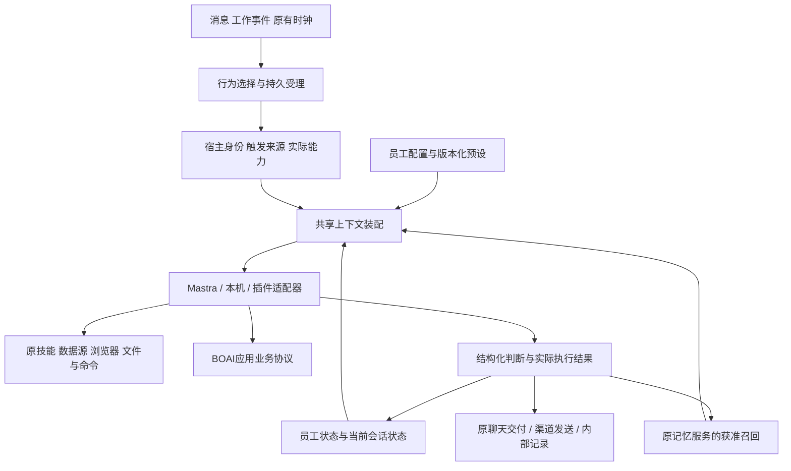

<!--
[OUTPUT]: 2026-10-20按用户要求清理测试产物/独立记录及其附件链接；历史文字结果不代表原件仍然保留。
[OUTPUT]: §11.57按用户缩减范围完成侧栏PTY/预览与桌面活动日报，36绑定/64检查/35实际请求累计1552；其余四技能停止，旧人格缺口未认证。
[OUTPUT]: §11.55纠正记忆重建漏过滤/4请求候选未采用；§11.56社交CLI完整脚本接入34绑定/17请求累计1517，本地帮助通过，账号与人格质量仍未认证。
[OUTPUT]: §11.54修复相关已存记忆被原始对话挤出；真实77请求累计1496，长期复核候选未晋升；54回归/类型/源码构建及开发重载，完整人格目标保持。
[OUTPUT]: §11.53记忆原输入对照与独立复核27请求累计1419；无收益/临时角色退化的两候选均拒绝，Bobo73/profile16/32绑定与完整目标保持。
[OUTPUT]: §11.52第32项PPT技能绑定，补跨轮项目查询；54真实请求累计1392，原步骤耗尽失败及临时要求误记长期偏好保留，Bobo73/profile16，完整goal未完。
[OUTPUT]: §11.51 PPT十三工具接API/native/CLI，实际三条渲染/受控视觉/交付及计量核对通过；256不同检查/类型/构建，开发重载；31绑定及完整迁移未完。
[OUTPUT]: §11.50提交前补记专用审阅执行/计量接线；类型与197回归通过、1跳过，专项记账验证和员工工具仍待完成。
[OUTPUT]: §11.50 PPT独立配置/三协议真实SDK传输与构建分发已接，74项不同检查/类型/实际分发渲染通过；开发进程重载核对，员工工具与真实视觉质量仍待完成。
[OUTPUT]: §11.49 PPT实际三页渲染/素材与17检查通过，补原设计/模板及专用审阅核心；员工工具和真实视觉模型尚未接，31绑定与完整目标保持。
[OUTPUT]: §11.48保存PPT内部核心阶段：3项回归/类型通过，真实渲染启动127失败；员工工具未接、31绑定保持，完整迁移未完。
[OUTPUT]: §11.47历史角色/状态规则两候选均未采用；三批86请求累计1338，文件不重放通过但仍有事实错误；Bobo71/profile16/31技能保持，完整目标继续。
[OUTPUT]: §11.46公共帖文技能/完整本人技能目录与任务分流已接，Bobo71/profile16/31绑定；106模型请求累计1252、224检查，原图交付通过但404解释与语气仍未达标。
[OUTPUT]: §11.45最终回复阶段候选39真实请求仍有执行旁白，193检查/类型通过但拒绝晋升；累计1146，生产及30技能保持。
[OUTPUT]: §11.44修复任务/问候漏装会话表达规则，真实对照75请求/累计1107、312检查2跳过；交付保持但语气未明显改善，完整goal继续。
[OUTPUT]: §11.43第30项自拍相册绑定，真实三轮23请求/累计1032与344检查2跳过；原件交付/删除通过，真实人像和人格效果未认证，完整goal继续。
[OUTPUT]: 搜索/读取及暂停计划实际业务补验，52模型+3检索请求；末轮记忆预算失败与表达问题保留，当前§11.39。
[OUTPUT]: §11.38 Alma长期记忆筛选片段适配；29真实请求/299通过2跳过，原泛化与剩余噪声保持，完整目标继续。
[OUTPUT]: §11.37引用双链与源权限，27技能/54真实请求及原多余Work、表达和记忆泛化问题保留；完整目标继续。
[OUTPUT]: 2026-10-20 Plan Weave依赖/领取/审核返工已接并绑定第26项；53真实请求累计791，原分类中断及预算维护失败保留，248检查，Bobo62/profile16，当前唯一进度架构§11.36，完整迁移未完。
[OUTPUT]: 2026-10-20炼丹炉绑定第25项，修复普通API聊天丢技能及自我追加绑定中断；32真实请求累计738/257检查，Bobo60/profile16，当前归架构§11.35，完整迁移未完。
[OUTPUT]: 2026-10-20反思来源分层/保存前复核实际进度归§11.34；31真实请求累计706，部分纠正不等于人格通过。
[OUTPUT]: 2026-10-20默认技能分发/首次绑定与升级保护实际进度归§11.33；24项、675真实请求保持，完整迁移继续。
[OUTPUT]: 2026-10-20programmatic-tools接原员工RPC并绑定第24项，实际脚本/48检查/18真实请求；仍有多余输出与人格缺口，当前归架构§11.32。
[OUTPUT]: 2026-10-20本机绑定技能更新/旧基线显式修复已接原事务，Bobo23项/版本57；99检查/18真实请求，表达缺口与剩余归架构§11.31。
[OUTPUT]: 2026-10-20实际图片/批量帧输入及视频技能接入，Bobo23项；57真实请求/215检查，原失败与表达缺口归架构§11.30。
[OUTPUT]: 2026-10-20截图/音频分析技能实际绑定，Bobo22项；24真实请求/8回归、文件hash及原失败保留，当前归架构§11.29。
[OUTPUT]: 2026-10-20记忆来源/保存时间装配修正，29真实请求/49检查；反思原文候选失败未晋升，20技能保持，当前归架构§11.28。
[OUTPUT]: 2026-10-20员工表情回应接原消息/渠道SDK与回执，Bobo20项；63定向检查/25真实请求，原失败和未认证范围归架构§11.27。
[OUTPUT]: 2026-10-20仅笔记日期反思与origin来源接线；76检查/16真实请求，候选仍错归经历未晋升，Bobo19项，当前进度归架构§11.26。
[OUTPUT]: 2026-10-20规划模式/待办文件接入并绑定，Bobo19项；57真实请求/38不同检查及失败保留，当前唯一进度归架构§11.25。
[OUTPUT]: 2026-10-20情绪来源历史/召回纠正屏障与Notebook接入，Bobo17项；80真实请求/83不同检查，失败候选不晋升，当前唯一进度归架构§11.24。
[OUTPUT]: 2026-10-20新增六项技能实际绑定，Bobo共16项；会话搜索/改名与技能分类接线，61真实请求/211检查，失败和未达标人格保持，当前唯一进度归架构§11.23。
[OUTPUT]: 2026-10-20反思补较早漏日并读取当日获准笔记，派生记忆随来源失效；Bobo十项技能，表达候选撤回，51检查通过，真实22请求及失败唯一归架构§11.22。
[OUTPUT]: 2026-10-20七项Alma技能接真实工具/协议并绑定，Bobo共九项；任务/记忆与电脑MCP诊断实测，293检查通过/2跳过，电脑系统权限未授予，当前唯一进度归独立Agent架构§11.21。
[OUTPUT]: 2026-10-19继续Alma迁移：精确默认升级/详细表达与疲劳规则、实际开发重启核对、86请求探路；效果未达标，当前§11.17。
[OUTPUT]: §11.16替代列表内联结果/提示词；简洁记录行右侧详情Popover按需呈现，源文件Card保持。
[OUTPUT]: §11.15后台历史沿执行记录列表支持确认删除/清空，保留去重身份；用户最终取消全部折叠，结果直接显示，实际技术检查与当前dev旧接口分开记录。
[OUTPUT]: §11.14配置源文件与后台活动记录直接作为人格页同级分区，取消高级设置及记录展开；记录卡片用途Tooltip解释来源。
[OUTPUT]: §11.13人格即时保存只显示相关控件忙态，连续修改串行版本提交与未知停队列；状态/记录分读，小Select/Tooltip与高级文件Card。
[OUTPUT]: §11.12疲劳休息恢复状态按钮，加载开关移至对应文件行；替代§11.11休息Switch，原状态操作及提示词加载语义保持。
[OUTPUT]: §11.10为当前人格默认策略与简单主动交流合同，替代手工人格计划；本次不是Alma全部提示词/技能迁移。
[INPUT]: 用户明确bobo是高权限独立Agent，要求确定承载Alma完整配置的架构；当前员工、工作区、记忆、业务协议、API/本机和自动化源码，以及固定Alma 0.4.196研究。
[OUTPUT]: 配置/权限/状态/提示词/行为的职责、单一数据来源、具体改动位置、完整迁移依赖与验收；已按后续“修改”授权接入架构首版；实际结果与完整迁移剩余归§11；配置入口统一归§11.5，按用途分组及能力/加载/计划区别归§11.6。
[POS]: Alma完整迁移的架构依据；提示词逐条进度归原迁移清单，既有M0/M1实际成绩归原改造方向第9节。
[PROTOCOL]: 变化时更新Header与ai-docs/.folder.md，并检查根入口；设计、源码现状与实际验证必须分别陈述。
-->

# BOAI 独立 Agent 配置与行为运行架构

日期：2026-10-19。依据当前工作树阅读，包含尚未提交的M0/M1修改。**用户随后授权“修改”；架构首版已接线，实际范围和验证见第11节。第2节是修改前基线，不作为当前代码事实。**

## 1. 结论与目标

现有架构能承载员工身份、人格文本、技能和真实业务调用，但还不能完整承载Alma的连续人格与自主行为。需要把现有员工配置扩展成：**持久员工身份＋版本化配置＋模块化提示词＋独立状态＋事件驱动行为**。bobo采用其中的高权限系统预设，其他员工采用简化预设；使用同一套模型和执行基础。

独立意味着bobo有自己的配置、记忆、状态和行为归属，可以跨私聊、群聊、后台任务持续存在。无需为此增加一个常驻模型循环或单独的操作系统进程。没有新消息和到期行为时不调用模型；桌面或独立运行服务未运行时，不声称仍在后台活动。

高权限意味着宿主为bobo提供广泛的软件管理和实际执行能力。人格负责如何交流，权限负责能够操作什么，行为设置负责何时主动行动。三个部分分别配置，避免“写了有权限，工具却没提供”或“有工具就持续自主操作”的错位。

完整迁移范围沿[Alma完整Prompt迁移方案](2026-10-19-Alma完整Prompt迁移方案.md)和[逐条清单](2026-10-19-Alma提示词迁移清单.json)。本架构给所有有效内容安排运行位置，不把371条候选都拼成一个system prompt，也不把当前少量简化人格视为完整移植。

## 2. 修改前基线与改造原因

| 当前源码事实 | 对Alma配置的影响 | 需要改变的地方 |
| --- | --- | --- |
| `DigitalAgent`已有独立ID、模型、技能、资源、权限和配置版本 | 员工已经是持久对象，不必重建身份体系 | 在员工域扩展配置，不新建独立的“Alma员工”对象 |
| `WorkspaceService`只把`AGENTS.md`、`SOUL.md`当作可编辑指令源，合计12,000字符 | 不能表达几十种场景模板、独立辅助调用和全部原文 | 建立受管prompt模块与选择规则；来源容量与单轮加载容量分开 |
| `WorkspaceService.load()`把两份文本和获准记忆拼成一个字符串 | 稳定规则、动态资料、当前状态缺少明确结构 | 输出有来源的上下文快照，由共享装配器按场景编译 |
| Mastra与native各自拼装多段指令，`phase-instructions.ts`另有阶段规则 | 同一人格可能被不同后端的工作话术覆盖或重复注入 | 共同选择模块，各适配器只负责协议交付和实际工具 |
| `BOBO_SOUL`目前是自写的简化人格 | 文件已加载也不会自然得到Alma的具体表达习惯 | 迁入完整有效人格与场景规则，保留逐项适配差异 |
| 核心员工初始化/保存强制`allowCommands=false` | 当前“核心”不能直接等同高权限通用执行者 | 改为明确的bobo执行预设，统一接原命令/文件/浏览器权限路径 |
| 应用工具挂载要求核心私聊、本人用户消息、chat阶段等条件 | bobo在自己的后台行为、部分工作和群场景中没有同等管理入口 | 把可信员工身份与触发来源分开，按实际授权挂载能力 |
| `ApplicationActor`的员工分支必需`conversationId/messageId` | 无聊天来源的反思、主动跟进没有合适的身份合同 | 增加宿主生成的行为/计划来源，不能伪造用户消息 |
| SQLite已有权威记忆与自动化账本，文件为部分投影 | 可复用持久化和恢复，但尚无完整情绪/疲劳/旅行领域 | 增加员工状态和行为记录，接原事务、备份、清理、忘记链路 |

源码入口：[员工定义](../src/shared/domain/index.ts)、[员工保存](../src/runtime/modules/employees/employee-service.ts)、[工作区](../src/runtime/modules/workspaces/workspace-service.ts)、[阶段指令](../src/runtime/modules/employees/phase-instructions.ts)、[API装配](../src/runtime/adapters/mastra/agent-factory.ts)、[本机装配](../src/runtime/adapters/native-conversation.ts)、[工具挂载](../src/runtime/service.ts)、[应用协议](../src/shared/domain/application-protocol.ts)。

上表是修改前的现状核对，不表示修改其中一行即可完成高权限或完整迁移。例如去掉`allowCommands=false`后，还需要核对执行准入、工具注册、原生权限与实际任务回执。

## 3. 目标结构



这张图中的“行为选择”复用原时钟和调度准入；“共享上下文装配”负责确定内容；“适配器”继续拥有各自运行循环。业务调用继续走已实现的应用协议和原领域服务，CLI/MCP只是入口适配。

## 4. 配置如何组织、文件放在哪里

### 4.1 在员工域扩展一份配置档案

建议新增按`agentId`索引的`AgentProfile`，放在现有ProductStore中，由员工服务统一保存。保留`DigitalAgent`现有字段，不复制模型、资源与执行权限到另一份配置中。新增档案承载：

| 配置领域 | 内容 | 示例 |
| --- | --- | --- |
| 预设 | 预设ID、固定版本、员工覆盖项 | `bobo-core`、通用员工、研究员 |
| prompt选择 | 模块绑定、受管覆盖文件、版本与启用状态 | 私聊表达、群参与、反思任务、情绪判断 |
| 人格选项 | 具体表达偏好和可调整的风格 | 简短闲聊、有主见、幽默程度；完整人格仍有原文 |
| 记忆与成长 | 原记忆服务参数、反思与性格演化设置 | 是否启用成长、可使用来源、成长频率 |
| 行为 | 事件类型、启停、时间、目标、冷却和并发 | 反思、承诺跟进、主动问候、旅行推进 |
| 模型用途 | 特定辅助任务可选的已有连接/模型引用 | 情绪分析、摘要；默认继承员工模型，不自建凭据系统 |
| 形象与媒体 | 形象设定、参考图引用、实际能力绑定 | 相册、语音、图片生成提供方 |

权限仍是宿主授权记录和原执行配置。AgentProfile可以引用宿主维护的能力配置，不能用可编辑JSON中的`admin: true`自我授权。

### 4.2 明确每种数据的唯一来源

| 数据 | 权威来源 | 文件或页面的角色 |
| --- | --- | --- |
| 已有身份/运行方式/资源绑定 | 原DigitalAgent与对应领域服务 | 沿原保存入口编辑 |
| 新增结构化设置 | SQLite中的AgentProfile | 表单编辑；JSON/YAML只作导入导出 |
| 员工人格与工作规则 | 现有SOUL/AGENTS受管源文件 | 继续可编辑，原hash与原子写入保护扩展使用 |
| 内置场景与辅助prompt | 随产品发布的版本化模板 | 员工按模块选择；自定义覆盖另存受管源文件 |
| 情绪、疲劳、旅行、行为记录 | SQLite中的员工状态/行为记录 | 可提供只读状态视图或导出文件 |
| 用户事实、记忆、经历、成长依据 | 原记忆体系及其来源/派生关系 | USER/MEMORY/日记等是对应范围的视图 |

因此不建议同时让`agent.yaml`、员工表单和SQLite三个地方自由覆盖同一配置。喜欢文件配置时，提供明确的导入/导出协议：解析→校验版本和依赖→经原服务保存→返回生效版本。直接编辑受管SOUL或场景源文件仍可支持；未知文件不会自动被当作系统指令执行。

建议运行资料形态如下，具体新增文件名在实现时固化：

```text
产品内置预设 bobo-core@版本（只读）
  preset manifest                # 模块、技能与行为默认值，引用版本
  SOUL.md / AGENTS.md             # 完整出厂人格、工作规则
  prompts/chat / group / task     # 场景模块
  prompts/emotion / reflection    # 独立模型任务模板
  skills                         # 在原技能系统登记，不建立第二个技能库

用户数据 agents/bobo/workspace/
  SOUL.md / AGENTS.md             # 保持现有源文件兼容
  prompts/...                    # 已登记的员工自定义模块覆盖
  IDENTITY.md / USER.md / MEMORY.md# 原生成视图
  sessions/...                   # 原会话工作区

原SQLite
  DigitalAgent + AgentProfile
  员工状态、会话状态、行为受理与结果
  原记忆、Work、消息、回执、计划等
```

全局预设只提供默认值，不能把bobo的私人记忆和当前心情复制给其他员工。共享模板允许复用，实例数据必须归各自员工。

### 4.3 版本与升级

- 预设固定版本，员工可以逐项覆盖。升级时区分未修改默认、用户修改和冲突；不重新覆盖整份SOUL。
- 已有员工沿原SOUL/AGENTS继续运行；只有能精确识别的旧出厂值才可自动迁移。自定义内容保留，并能查看与新预设的差异。
- 人格、场景模板与行为配置更新影响后续受理；动态状态更新单独递增`stateVersion`，不每次递增员工`configVersion`。
- 权限撤销、来源失效继续即时核验；模型/运行方式切换仍等待原执行实际退出。普通心情变化不会因此打断正在执行的工作。
- 多文件和结构化设置一起导入时，扩展原pending-update/hash机制为可恢复发布：新文件先准备，事务登记版本和引用，核对成功后生效；不承诺文件系统与SQLite天然原子。

## 5. Prompt 必须有共享装配层

### 5.1 为每个模块声明用途

用类型化模块表和静态装配函数即可，无需先实现通用脚本编排语言。每个模块记录：

`id / version / sourceIds / sourceHash / purpose / scenes / requires / variables / outputSchema / overridePolicy`。

- `purpose`区分公开交流、工具说明、辅助判断和动态背景。
- `scenes`由真实会话和执行目的共同确定，不靠模型猜当前页面。私聊/群聊、渠道与task/greeting可叠加且各自遵守加载开关；emotion/reflection/travel的私有结构化阶段保持独立。§11.44修复此前单选实现造成的任务漏装。
- `requires`对应实际可用工具和服务；技能存在不等于它需要的图片、语音或电脑工具存在。
- `variables`由明确上下文字段填充，禁止直接执行提取的压缩JS表达式。
- 互斥模板按调用分支选择。Alma的“有SOUL精简基底”和“无SOUL完整内置人格”不能叠加两遍。

### 5.2 每轮编译一份可核对的上下文

建议把目前BootstrapSnapshot扩展为结构化的`AgentContextSnapshot`，至少包含：

- 员工、触发来源、会话/工作身份和当前任务。
- 实际选用的配置/模板/状态/记忆版本与来源。
- 稳定指令、当前场景指令、动态背景和实际工具目录。
- 模块启用/跳过原因，以及实际交付内容的hash和长度。

加载顺序明确为：宿主运行合同→员工身份/人格/规则→本轮场景→获准背景/状态→当前用户任务。背景是数据，不作为可执行授权；当前任务的格式和篇幅要求覆盖闲聊的默认表达偏好。

公开回复使用完整人格和当前场景。情绪判断、记忆提取、标题、反思等独立任务使用各自prompt与输出schema，按需要取身份/性格摘要；不把全部闲聊话术塞入每个内部判断。后台分类器产生结构化结果，由宿主校验保存，不把分类输出发送成聊天正文。

### 5.3 容量和双运行时

需要替换“所有人格规则合计12,000字符”的单一限制：保留合理的单文件读取保护，按每个模块储存完整内容，按本轮真实用途加载。技能先给目录和适用信息，命中后读取正文；无关场景和历史状态不常驻。出现上下文超限时显示具体模块与处理结果，不静默裁掉完整人格。

API适配器把快照映射到原消息和工具协议。本机适配器把同一份BOAI人格/背景通过原生支持的指令与当前轮输入交付，保留原生会话、工具循环和权限；不能把Mastra阶段机强加给本机。

稳定模板hash与动态状态hash分开。本机只因需要重建的配置变化更新启动指纹，新的情绪/疲劳作为当前轮背景，避免每次状态变化丢失原生会话。实际支持方式要按各适配器验证，不能仅凭共享接口就宣称所有运行时等效。

## 6. 让情绪、疲劳、成长和旅行真正运行

新增一个小而明确的员工状态模块，继续使用原ProductStore。建议至少区分`agentId`级状态和`agentId + conversationId`级状态；并发更新使用版本检查、事件去重和明确合并规则。

| 功能 | 输入与更新 | 下一轮实际用途 |
| --- | --- | --- |
| 情绪 | 有效交流/事件→员工视角判断→校验保存；代码计算时间衰减与混合 | 影响表达、主动性与参与判断；三处共用同一有效状态计算 |
| 疲劳 | 已受理消息事件和时间→确定性计数/恢复；睡眠/唤醒为显式状态动作 | 影响闲聊节奏和可选主动行为，不伪造已接受工作的完成或取消 |
| 反思 | 已获准的一段经历→独立反思prompt→保存反思结果和来源 | 形成可检索经验，实际有依据才影响后续交流 |
| 人格成长 | 反思提出候选→校验频率/数量/来源→保存成长条目 | 与稳定SOUL分开装配；不让模型任意改写整份核心人格 |
| 旅行 | 启用后出发/推进/事件/返程→明确状态机与日记 | 注入当前位置、近期虚拟经历；真实搜索资料与虚构经历分开标记 |

Alma的衰减、疲劳分档、成长限制可作为可配置默认值参考。哪些原本只是提示词要求、哪些原本由代码执行，逐条登记；BOAI决定提升为确定性约束时明确记录差异，不能谎称原样复制。

状态变化记录原因引用与时间；当前轮冻结使用的快照，后续提交影响下一轮。若同一输入确实需要即时情绪，可在公开回复前执行有明确时限的判断；失败保持上次有效状态并记录失败，不为制造“活人感”阻塞所有聊天。

状态中的私人原因只能在对应授权范围使用。全局只暴露适合跨会话的状态值，不把私聊原话随心情注入群聊。忘记或撤销来源时，关联日记、成长和派生状态也要失效或重算。虚拟旅行可以成为明确标记的角色经历，不能进入真实工作证据或成为现实行动回执。

通过应用协议提供读取/调整状态、睡眠/唤醒、旅行动作、反思/成长记录管理等具体操作。CLI与Agent调用同一服务，避免另加`emotion.json`通用写文件旁路。方法名和schema在实施时登记；目前这些新操作尚不存在。

## 7. 高权限 bobo 与主动行为的接线

### 7.1 权限归员工，触发来源归本次行动

bobo仍由`id=bobo + systemRole=core`确认核心身份，显示名和SOUL不能改变身份。目标预设提供完整BOAI管理能力，并支持文件、命令、浏览器等真实执行能力；去掉核心员工一律禁用命令的特例，通过已有执行权限统一配置。本机继续沿用户选择的原生配置，不增加BOAI目录沙箱或用量预算。

当前“只有特定私聊chat阶段才能挂应用工具”的条件需要改为可信来源校验。建议宿主内部授权上下文包含：

```text
principal: owner | employee(agentId)
trigger:
  user-message(conversationId, messageId, authenticatedSender)
  automation(automationId, occurrenceId, policyVersion)
  behavior(behaviorId, eventId, policyVersion)
scope: 本次动作允许的对象/目标及实际能力
execution: runId或内部作业ID、取消信号、当前有效版本
```

这是拟新增的宿主合同，不是模型或CLI可以自行填写的授权字段。普通业务参数仍是`operation/input/requestId`。既有owner CLI语义继续独立；员工调用保留本人的身份和回执。

由此可以支持：本人要求bobo建计划；bobo在已启用的跟进行为中更新自己的提醒；bobo在真实授权的群任务中管理相关业务。群成员身份、渠道来源与群内文字不能自动等于本机owner授权，须由已认证发送者及预设范围决定可用动作。管理其他员工配置不自动意味着可以读取其全部私人记忆。

自我调整人格/状态可作为bobo已有能力的正常操作，通过版本化保存生效；修改自己的核心授权范围仍由宿主处理。高权限配置无需把每次已授权业务调用重新变成人工确认，但保存与外部动作仍须有实际回执。

### 7.2 行为接入原有时钟和事件

建议在`automations`内增加员工行为服务，复用原Mastra时钟、执行准入、持久受理、取消与通知机制，不另建一套heartbeat定时器。行为配置与用户定时任务分别表示用途；内部反思无需伪装成用户创建的计划，也不需要制造一条用户聊天消息。

每条行为至少包含员工、触发、启停、目标、冷却、并发策略、能力范围及停止条件。事件来源包括新消息、本人工作结果、真实计划时间、需要跟进的承诺等。确定性判断由代码完成，需要语义判断时才调用对应模型prompt；没有值得说的内容就记录跳过。

执行链：**有效事件→去重受理→读取员工配置/状态→选择行为→运行与校验→保存结果→必要时公开交付**。

受理、状态变化和待交付意图要有可恢复记录。外部发送继续使用原发送回执；超时未知先核对，不盲目重发。停用行为后不再受理新动作，进行中的动作按原取消/实际退出规则收尾。宿主离线后不补发一串过期问候；计划是否补跑按明确策略，不从“重启了”推定应重做。

内部情绪更新、反思保存可只产生内部作业记录。需要实际文件、浏览器写入、委派和交付的行为进入原Run/Work执行链；公开发言使用本人真实身份和原消息受理/渠道投递。不能把反思文本误作成果，也不能让无人监督的角色旅行篡改已有任务状态。

“支持主动行为”和“开启主动行为”分开记录。基础人格可立即采用完整预设；问候、巡查、旅行等按员工行为设置启用。本轮源码支持这些行为，但新预设没有自动创建或启用行为；只有显式保存的启用项才进入原时钟。

## 8. 普通员工与高级配置

所有员工使用同一份AgentProfile结构。bobo选择系统核心预设，普通员工创建时选择通用或专业预设，填写姓名和职责，沿现有可用模型默认值即可开始；不用填写几十个内部prompt。

高级设置展示人格与表达、模型、技能和工具、记忆与成长、状态与主动行为、形象与媒体。每个区域能看当前有效值、来自哪个预设、哪些是员工覆盖，以及依赖能力是否实际可用。原“系统文件”保留给希望编辑原文的用户，扩展受管模块清单。

简单创建和高级编辑操作同一对象。普通员工也可以开启情绪/旅行/反思，不复制bobo身份和授权。群配置成员和协作关系；同一员工进入群仍使用自己的身份、适用于群场景的prompt与获准状态。

## 9. 具体代码改造落点

下表保留设计职责，已落地文件与仍未实施范围见§11；预设最终放在现有shared/domain中，避免新增构建资源路径。

| 现有位置 | 改造职责 |
| --- | --- |
| `src/shared/domain/` | 新增AgentProfile、状态、行为和上下文快照类型/schema；扩展原内部调用身份合同 |
| `src/shared/domain/agent-presets.ts` | 从短字符串默认值转为版本化预设描述；简单创建沿原默认规则 |
| `src/runtime/modules/employees/` | 增加配置解析/保存与共享上下文装配；稳定身份、权限和配置仍由员工服务负责 |
| `src/runtime/modules/workspaces/` | 扩展源文件注册、覆盖/hash、容量与原子发布；从加载服务分离prompt选择职责 |
| `src/runtime/presets/`（新增） | bobo完整可读模板、模块清单和原文适配来源；按现有构建显式打包，不运行时读取ai-docs |
| `src/runtime/modules/agent-state/`（新增） | 员工/会话状态、确定性演算、结构化更新和来源关系；使用原ProductStore |
| `src/runtime/modules/automations/` | 增加行为配置/事件受理/执行衔接，复用原唯一时钟与去重/停止机制 |
| `src/runtime/modules/memory/` | 扩展反思、成长、经历的类型和来源关系，保持数据库权威与忘记传播 |
| `src/runtime/modules/application/` | 公开新配置/状态/行为操作；既有业务继续复用原服务，能力目录由实际授权产生 |
| `src/runtime/modules/resources/` | 完整技能及脚本适配、依赖检查和按需读取；复用原技能安装/绑定 |
| `src/runtime/service.ts` | 连接可信来源、状态快照和行为执行；将选择规则放回上述模块，避免继续堆巨大条件 |
| `src/runtime/adapters/mastra/`与本机/插件适配器 | 消费共享上下文，接专用任务结果，消除重复/冲突指令，保持各自原生运行循环 |
| 原员工高级设置与业务协议CLI | 展示/编辑相同档案、状态、有效来源；没有第二套前端配置真相 |

无需新增bobo专属数据库、第二套技能平台、第二个业务协议、第二套记忆库或替代Mastra/native的Agent框架。MCP入口可以接同一业务服务，不能用MCP外壳替代配置和行为领域本身。

## 10. 实施顺序与完成标准

沿完整迁移方案A–E推进，本节细化架构依赖，不另立一份与迁移清单竞争的完成进度。

| 顺序 | 具体交付 | 对应迁移范围 |
| --- | --- | --- |
| 1 | 明确配置权威来源、预设与模块合同、内部触发身份、状态类型；逐条审计原prompt真实调用 | A：完成映射和可实施设计；架构首版已接线，但逐条调用点审计未完成，不能算A全部完成 |
| 2 | 配置档案、受管模块、共享装配和运行证据；同时迁入完整基础人格/私聊/群聊并清理旧话术冲突 | B：让当前交流先真实改善，完整性按来源逐项核对 |
| 3 | 高权限执行预设、可信调用来源、完整工具/技能适配与辅助任务输入输出 | C：操作软件和做事稳定，缺少的媒体/电脑能力显式登记 |
| 4 | 状态持久化→情绪/疲劳→反思/成长→主动跟进/旅行，接原时钟与交付链 | D：形成持续状态和主动行为闭环，全部保留在迁移范围 |
| 5 | 补齐形象/多媒体依赖、其余专用场景和API/本机回归，核销完整清单 | E：按每项有效内容的实际行为验收 |

状态schema和可信触发合同应在第1步确定，避免第4步推倒前面的装配。已有媒体/浏览器能力可随对应技能提前接入；实施次序不缩减最终范围。

最低验收包括：

1. **配置真的生效：** 一项模板或SOUL修改后，下一轮能核对实际使用的版本、模块和内容；自定义不会被重启覆盖。
2. **人格完整且不冲突：** 每条有效原文可追到实际调用位置；闲聊、正式交付、群聊和辅助判断各用正确规则。
3. **权限可真实使用：** bobo从聊天创建计划、从获准行为跟进、在实际任务中使用命令/文件，均有原协议/Run/Work结果，不能只在文字里说能做。
4. **状态连续：** 情绪或疲劳变化持久保存并影响下一轮，重启保持；两个员工和不同私聊不会混用原因。
5. **行为可停止且不重复：** 重复事件、并发、重启、取消和发送未知不产生重复工作/消息；时区和睡眠恢复沿确定规则。
6. **原有功能保持：** 员工/群/源/计划业务的版本、回执和原生会话继续有效；静态人格更新与动态状态更新不混为一次运行方式切换。
7. **效果单独评价：** 在同模型与尽量相同背景下看真实连续对话，比较自然接话、态度、幽默、记忆和执行；工程测试通过不等于像Alma。

研究快照显示，本机Alma当时没有SOUL、情绪/旅行/疲劳状态文件，heartbeat配置也未保存，按包默认关闭。因此眼前的聊天差距不能全部归因于“还没旅行系统”。完整基础人格、有效装配、模型及上下文是先要核对的变量；状态与主动行为负责后续连续体验。依据见[研究文档](alma-研究/alma性格分析.md)第10节。

## 11. 当前实现与验证（2026-10-19，本次架构改造唯一进度）

**当前交互与后台策略以§11.10为准。§11.1是首版接线记录；§11.5–11.9保留迭代历史，手工人格计划的设计已退役。**

用户在上述设计后明确要求“修改”。本节替代此前“仅文档、尚未实施”状态；旧M0/M1成绩继续归原改造方向第9节。**当前完成的是可配置、可执行的架构首版，完整Alma内容迁移尚未完成。**

### 11.1 已落地的实际行为

| 部分 | 当前实现 | 实际入口 |
| --- | --- | --- |
| 独立配置 | `AgentProfile`按员工ID存入原SQLite的`agentProfiles`，使用独立revision；预设、八场景开关、四种状态功能和行为定义 | `employees.profile/configure`；员工高级配置“人格与行为” |
| 人格与模块 | AGENTS、SOUL及`prompts/{direct,group,channel,task,emotion,reflection,greeting,travel}.md`十个登记源；每文件64 KiB，取消原两文件合计12000字符上限 | 人格/场景编辑与页内配置源文件共用原Dialog、`employees.readFile/writeFile` |
| 基础人格 | 按固定`T-c30259259edee3`与`T-cba8851d2a6bb0`原文适配，保留具体语气、例子、禁用客服开场、观点、幽默和语言规则 | [bobo-persona.ts](../src/shared/domain/bobo-persona.ts)；`agent-presets.ts`引用 |
| 自定义保留 | 只升级内容精确匹配旧出厂默认的bobo人格；自定义SOUL不覆盖。八个新模块首次补齐，已登记后丢失的文件显示缺失并阻止错误加载 | 原员工初始化/manifest/hash保存流程 |
| 共享装配 | API/native都按实际场景选择模块；静态规则、动态状态分开。普通Run的bootstrap保留模块文件、hash、来源ID、选择原因和版本；行为记录保留同样证据 | [context-compiler.ts](../src/runtime/modules/employees/context-compiler.ts)、原WorkspaceService |
| 原生续聊 | 情绪/疲劳变化只进当轮数据，不改变会话静态指纹；人格文件或功能工具开关变化才刷新相应会话 | Codex/Claude实际stdio协议测试已核对 |
| 高权限bobo | 新核心API预设为完全访问；旧核心未设置整体权限时迁移，已明确设置的只读/审批保留。本机现有权限不强改。本人当前消息中的群/工作管理沿原业务工具 | 原员工权限入口；真实核心身份和来源由宿主确定 |
| 持久状态 | 原SQLite保存全局/会话情绪、疲劳、虚拟旅行和小幅成长；CAs更新、情绪衰减、每消息只计一次疲劳。成长保留来源消息及父记忆版本，忘记/删除后不再注入 | [agent-state/](../src/runtime/modules/agent-state/)；`employees.state/updateState`与固定身份自我工具 |
| 行为运行 | 情绪判断、反思、问候、跟进、旅行使用原Mastra唯一时钟的独立workflow；记录真实事件、配置版本、模型调用/可得用量、跳过/失败/取消/中断 | [agent-behaviors.ts](../src/runtime/modules/automations/agent-behaviors.ts)；界面立即运行/停止/历史 |
| 真实交付 | 问候/跟进直接以员工身份提交原消息事务，不插入假用户消息、不生成行政Work；反思进入原记忆仓库。只有显式管理行为的bobo获得应用工具，后台应用写入还要求完全访问 | `employees.runBehavior/stopBehavior/behaviorHistory` |
| 运行边界 | 同员工行为互斥、目标忙碌跳过、冷却、过期触发不补发；已受理事件不重放。停止等待执行返回；活跃行为未实际退出时不能清理目标聊天 | 原消息、员工、备份和退出生命周期 |
| 清理与恢复 | 聊天清理删除会话状态、相关成长/旅行来源和行为结果正文并暂停计划；员工删除移除独立记录；备份中的行为默认停用；旧running启动转interrupted | 原history/contact-deletion/backup，未新增第二套数据库 |

来源适配说明：将Alma姓名/用户环境换成实际bobo身份；明确数字员工而不冒充真人；不伪造身体、拍照或工具结果；正式工作深度/用户格式优先于闲聊短句。情绪与反思模块是原文要点适配；群、渠道、旅行模块当前为BOAI合同补充，不能宣称完整迁入对应Alma分类。每条状态详见原JSON清单。

### 11.2 如何在当前项目试用（按§11.10更新）

1. 使用当前项目的`pnpm dev`，进入通讯录 → bobo → 高级配置 → 人格与行为。
2. 人格、工作规则及场景提示词继续通过原文件编辑窗口保存；自定义SOUL不覆盖。开关、提示词加载与主动交流偏好修改后立即保存，无整页保存按钮。
3. bobo默认情绪/疲劳开启，普通员工默认四项状态功能关闭；成长/旅行按需开启。应用运行时后台每30分钟检查一次，没有合适的新内容不调用模型；不必添加任何行为计划。
4. 人格成长在本机23点后尝试反思，10点后可补充此前日期未处理的交流；每天最多一次。旅行由模型根据已授权交流决定是否开始，正在进行的旅程每天最多推进一次，也可手动指定目的地。
5. 主动交流默认关闭。开启后选择联系频率与免打扰；Bobo使用最近普通核心私聊，普通员工使用其主私聊，不向群/渠道/任务会话自动发消息。频率为最小间隔，没有合适话题会跳过，同一用户输入已被主动联系后不会继续催问。
6. 高级设置 → 后台活动记录可查看真实结果、来源模块和停止运行。业务提醒/汇报继续在员工自动化中创建，二者没有界面混用。
7. CLI沿同一协议，例如`boai app describe employees.configure`、`boai app call employees.profile '{"agentId":"bobo"}'`；写操作带稳定request-id及当前revision。完整Alma迁移与真实人格效果对照仍见§11.4，不以本次后台接线代替。

### 11.3 本轮实际验证与失败保留

- 新架构模块及核心合同首批：2文件11项通过，包含真实Mastra每秒时钟的独立行为触发（本地夹具）与重复事件核对。
- 原7文件首轮：165通过、10失败、2跳过。2项是旧“核心强制禁命令”断言；8项暴露团队暂存目录遗漏`workspace/prompts`，已修复目录冻结并复测原8项通过。原失败保留，未删除断言绕过。
- 新宿主行为集成初轮3失败，原因是误把空ID传给要求真实消息锚点的上下文读取；已改为最近实际完成消息的只读窗口，空聊天用空上下文，不制造用户消息；原3项复测通过。
- 实际Mastra SDK/本地HTTP行为：2项通过，验证工具后续请求、配置调用上限和错误输出零修复重试；没有发布中间草稿。
- 原生新增2项通过：Codex/Claude实际协议进程在情绪变化后resume，关闭状态工具后start；不冒充真实供应商语义质量。
- 扩大11文件回归：385通过、4失败、2跳过。3项网页检索UI旧断言属于本轮前既有失败，未修改对应功能；1项高级配置从6类增到7类的旧数量断言已更新，并保持原未保存/基础字段排除断言，定向复测通过。
- 额外备份恢复：1项通过，来源配置仍启用、导出配置停用，恢复没有后台模型调用。该项与后续批次不可重复累计。
- 保存响应丢失恢复：补充界面测试，验证保留已改草稿、锁住重复提交、核对同一requestId。首轮测试把Base UI隐藏输入的ID当作ARIA开关读取而失败；改为核对实际checked及提交配置后通过。最后定向3文件20项全部通过（11.45秒，含此1项、状态/时钟6项和应用协议13项），与上述批次有重复，不累计为新增20项。
- 隔离`pnpm dev`桌面：首轮因“当前状态”section/card重名使定位歧义而失败，已将内部卡片明确为“状态数值”。随后实际场景通过，涵盖文件保存、草稿守卫、开关、休息/唤醒、真实本地HTTP行为发布与重启零重复。首轮错误上下文保存在`.local/alma-architecture/desktop-first-failure/`。
- 最后类型检查及生产构建再次通过（保留现有大chunk提示）；`git diff --check`通过。最终桌面复验1场通过（22.2秒），同样为隔离pnpm dev，实际本地模型HTTP请求1次、外部请求0次；同时核对界面已显示“已完成”后截图。随后增加保存IPC异常锁定和记忆变更中断行为两处收尾，以上20项及最终类型/构建在这两处修改之后执行；桌面场景未重复运行。

测试入口：[agent-personality.test.ts](../tests/agent-personality.test.ts)、[agent-personality-ui.test.ts](../tests/agent-personality-ui.test.ts)、[application-protocol.test.ts](../tests/application-protocol.test.ts)、[mastra-engine.test.ts](../tests/mastra-engine.test.ts)、[native-conversation.test.ts](../tests/native-conversation.test.ts)、[桌面场景](../tests/e2e/features/agent-personality.feature)。本轮所有模型响应为受控本地协议或确定性夹具，**外部供应商请求为0；未评价“与Alma一样自然”**。两项原生已有跳过范围保留，未进行新发行包、长期后台或全平台认证。

### 11.4 完整迁移仍需完成的内容

1. 371个可读候选/206处字段候选/40技能的逐项调用点与依赖审计仍未全部完成。当前基础人格有两个明确来源，情绪/反思有部分适配；不能把注册八个场景说成所有原文已迁完。
2. 40个Alma技能及其`alma` CLI、原应用路径、图像/音乐/视频/头像/渠道依赖尚未全部改造。已存在的BOAI技能/资料/浏览器/业务协议继续可用；没有安装一个只改名字却调用失效路径的技能包。
3. 当前行为执行承载结构化状态/反思、纯文字跟进与显式应用管理。需要成果文件、浏览器写入、委派的长期业务应继续创建原定时任务并走Run/Work；尚未为每种Alma后台活动增加完整Work交付适配。原生后台仍按自身能力与权限执行，BOAI不虚称能控制其内部步骤预算。
4. 情绪衰减、疲劳、成长上限和旅行事件已实现为当前可配置架构，尚未声称精确复刻Alma全部算法、日记/活动选择、睡眠恢复策略或旅行推荐。当前疲劳使用宿主本地时段，行为时间使用各项明确时区；没有额外“quiet hours”编辑器。
5. 尚未做同模型、同背景的连续真实人格对照评估；模型能力、原有自定义SOUL和上下文都会影响实际体验。该评估要沿项目`boai-evals`另记真实请求和语义结果，不能由工程通过替代。

本轮未提交/推送、未覆盖个人Alma研究快照、未替你启用个人主动行为，也未重启你已经打开的开发窗口。


### 11.5 人格配置入口统一（2026-10-19，同日后续）

用户确认将人格与行为作为主入口，配置源文件降为高级入口。本次仅调整员工界面和对应导航，不迁移存储：正文仍是原文件，功能开关/行为定义仍是原员工配置，运行状态/记录仍独立保存。

- 高级配置默认“人格与行为”；移除同级“系统文件”菜单。顶部直接编辑人格与工作规则，场景行把开关和“编辑提示词”放在一起；关闭场景仍能编辑正文。
- 底部“查看配置源文件”展开原文件清单；同一个原文件Dialog支持友好标题或文件名，沿原hash/员工版本保存、未保存确认和保存期间关闭锁。生成视图继续只读。
- 打开、保存、关闭正文编辑器不卸载人格表单，开关草稿保留；正文保存不会顺便提交开关。当前状态与行为记录仍为独立分区。
- 模块回归：配置弹窗与人格未知回执2文件共30通过、3失败。3失败涉及Codex/Claude保存参数新增`useNativePermissions`与创建模型选择器定位；本次未改这些行为或修复这些断言，保留原失败。相关文件编辑/只读/保存锁/草稿用例通过。
- 高级入口定向：首轮因新增夹具遗漏`defaultAgentProfile`导入导致编辑按钮未出现而失败；补导入后1通过、24项因名称筛选未执行，不计为业务跳过。
- 隔离`pnpm dev`桌面1场通过（场景34.8秒，总37.5秒）：人格入口→源文件入口→人格入口的双向编辑读回、开关草稿保留、关闭场景仍可编辑、切页/关窗守卫、状态操作、主动消息以及重启保留同一内容。真实本地模型HTTP请求1次，外部供应商0次。截图与来源保存在`.local/alma-architecture/config-entry-review/`；使用原报告生成器输出`.local/alma-architecture/config-entry-report/index.html`（7项资源逐字节核对）。终态由最终Playwright list日志与场景身份核对后规范化，原日志/hash保留，并非官方JSON reporter；报告明确保留未登记该feature分组、缺少运行前构建摘要两个缺口。不代表真实人格效果评估。
- 类型检查、生产构建、BDD生成和`git diff --check`通过；生产构建保留现有大chunk提示。其余受影响的旧BDD文件只更新配置入口与独立文件Dialog定位，未重跑完整旧业务场景。

本次未提交或推送；未改本机Alma研究原件、个人员工文件或用户已打开的开发进程。


### 11.6 按用途归类规则，分开能力、提示词加载与计划（2026-10-19，同日反馈）

用户指出状态开关与八个场景提示词不是一一对应，并列两组开关造成困惑。现行页面替代§11.5中的“八项场景开关与编辑同排”呈现，底层原文件、配置及行为语义保持。

| 页面位置 | 控制内容 | 相关规则及触发 |
| --- | --- | --- |
| 人格与工作规则 | 基础性格、通用工作约定 | 原SOUL/AGENTS正文 |
| 对话与工作 | 私聊、群聊、渠道、工作四类补充规则 | 实际进入对应场景时加载，与状态开关无一一对应关系 |
| 状态与成长：情绪 | 允许使用/更新情绪状态 | 旁边编辑的是定时情绪判断规则；聊天自我状态更新沿原工具，定时判断需另配行为 |
| 状态与成长：疲劳 | 交流消耗、时间恢复、休息与时段 | 程序计算，没有独立提示词 |
| 状态与成长：人格成长 | 允许从反思积累细微性格变化 | 编辑原反思规则；反思计划也能整理记忆，关闭成长不会自动停止反思计划 |
| 状态与成长：旅行 | 持久虚拟旅程 | 编辑旅行行为的规则；先开启并开始旅程，再按需要配置推进计划 |
| 主动行为 | 何时执行、目标聊天、约定与单项启用 | 问候/跟进共用规则；不同类型显示对应依赖说明 |
| 高级：提示词加载设置 | 是否附加八份补充正文 | 改为明确的“加载…补充规则”复选项；不启用能力、不停止计划、不删除正文 |

规则旁只在停用加载时显示“补充规则未加载”，不会静默修改原disabledPrompts或个人计划。当前状态仅呈现已保存启用的情绪/疲劳/旅行；不再在全部关闭时显示默认cheerful及数值。未保存开关不冒充已生效状态。

本批实际：新增语义回归与原未知保存恢复共2项通过；验证按用途提供原文件入口、功能切换不偷偷启用提示词或创建计划、高级加载不改功能开关、未保存/已停用状态不显示数值。隔离pnpm dev桌面1场通过（场景22.6秒、总27.0秒），原双入口文件编辑、加载选择、功能保存、状态/行为和重启断言保持，新增全关不显示默认心情的实际检查；本地模型HTTP请求1次、外部供应商0次。最终类型检查、生产构建、BDD生成与diff检查通过；构建保留既有大chunk提示。使用官方Playwright JSON生成`.local/alma-architecture/rule-grouping-report/index.html`，8项资源核对；保留feature尚未分组、缺少运行前构建摘要两项报告缺口。前两批失败与未运行范围继续保留，本轮未重跑这些失败，不修改业务后端或迁移个人数据。


### 11.7 即时保存、就近状态与自动化入口（2026-10-19，入口归属已被§11.8纠正）

用户明确授权修改此前提出的交互方案，并要求本轮不运行 E2E。本节替代§11.5–11.6中开关草稿需整页保存、独立当前状态区、主动行为和执行记录位于人格页的描述。仅修改前端与检查脚本，底层原文件、配置协议、状态计算和调度继续复用。

- 人格、工作与场景正文继续在原文件Dialog单独保存；功能开关和高级加载复选项即时提交原版本化配置，整页“保存人格与行为”按钮退役。
- 确定失败回退开关；保存期间禁用重复操作/切页。结果未知时保留本次选择、原requestId和核对入口，未查到明确终态继续锁定，不重复提交。明确终态后重新读取配置；不会把未确认的开关当作生效状态。
- 情绪、疲劳/休息、旅行当前值和操作显示在对应功能下，仅在已确认启用时显示；移除独立“当前状态”区。“刷新状态”仍从原员工状态读取。
- 员工既有“自动化”入口同时展示主动行为和原定时任务入口。行为新增/编辑在独立Dialog保存，取消时保留原草稿守卫；列表开关即时保存，运行、停止和移除沿原协议。行为记录一并迁入，原记录和提示词证据保持。
- 人格页保留问候规则编辑及“管理主动行为”跳转；配置源文件继续为底部高级入口。重新进入任一配置页先读最新profile，避免其他页面已保存计划被旧版本表单覆盖。
- 本轮不启用或运行用户个人行为、不修改个人文件、不重启用户开发进程。

本批实际验证：3个组件测试文件定向10项通过（53项因名称筛选未执行），覆盖即时保存、确定失败回退、未知回执缺失/明确成功的核对且零重发、独立加载选择、计划Dialog草稿保护/保存/启用、跨页最新配置、自动化归属及原文件编辑保护。初轮5项中4通过、1失败，原因是jsdom夹具缺少PointerEvent；按既有UI夹具补齐后复验通过，未以修改产品逻辑绕过失败。类型检查、三个改动前端文件ESLint及diff检查通过。用户明确不运行E2E，因此仅同步旧BDD步骤的新入口/保存语义，未启动Electron、生产构建或模型请求，也不引用前批桌面通过作为本批视觉验收。


### 11.8 纠正自动化归属（2026-10-19，现行界面合同）

用户明确指出：自动化是员工的自动化任务，与人格主动行为及其记录没有关系。§11.7将两者放在同一入口属于助手设计错误，现已撤销该入口调整。

- “自动化”恢复原 OwnerAutomations 员工任务列表，仅请求对应员工任务数据；不挂载人格面板或读取人格/行为历史。
- “主动行为”和“行为记录”回到“人格与行为”，与状态和规则共用同一员工配置版本；删除跨到自动化的管理按钮及全部误导说明。
- 开关/提示词加载即时保存、状态就近展示、疲劳嵌套行样式、计划独立Dialog及未知回执核对继续保留。既有行为定义与历史不迁移、不删除。
- 本轮仅修正前端入口及相关回归，未运行E2E、模型或个人行为，未重启开发进程。

本批定向组件检查7项通过（另24项因名称筛选未执行），包括自动化页面只请求员工任务、人格页保留主动行为/记录，以及即时保存、未知回执和计划Dialog守卫；类型检查、相关3个前端文件ESLint与diff检查通过。未运行E2E。前批检查通过只证明当时实现，不代表被用户否定的入口设计正确。


### 11.9 人格页底部入口收敛（2026-10-19，同日交互反馈）

用户指出问候规则、加载设置、主动行为、行为记录和源文件五个零散入口难用。本批在§11.8正确归属下整理呈现，员工自动化任务入口不变。

- “主动行为”共用一张Card：顶部编辑问候与跟进规则，其下列出已配置计划；没有计划时提供简短说明，添加按钮仍在该分区右侧。移除单独的问候大标题和计划嵌套Card。
- “行为记录”收为主动行为Card底部的展开入口，可查看记录数量与有无活动行为；展开后刷新、停止和提示词证据保持。手动运行自动展开结果区域，空记录只在用户展开时说明。
- 页面底部仅保留一个“高级设置”入口，默认折叠，同时收纳提示词加载复选项和原配置源文件；源文件仍使用原Dialog/hash保存，加载选择保持即时保存。
- 原功能开关、疲劳子行样式、计划Dialog草稿保护、保存未知核对及员工自动化仅展示任务的边界均保持。

本批定向组件检查10项通过（另53项因名称筛选未执行），覆盖归类/折叠、手动运行展开、原文件编辑与草稿保护、即时保存与未知回执、员工自动化隔离。类型检查、三个前端文件ESLint与diff检查通过。初次类型检查因图标导出名使用错误失败，改为现有ChevronDownIcon后通过。相关BDD仅更新高级入口名称，本批未运行E2E、Electron或模型请求。

### 11.10 人格后台默认策略，取消手工行为计划（2026-10-19，当前合同）

用户追问Alma为何没有“添加行为”，确认后授权修改。本批纠正将内部调度参数暴露为人格任务配置器的设计；参考的是Alma的心跳与技能协同方式，不宣称复制了Alma同名设置页。

- 界面移除“主动行为”“添加行为”、类型/聊天/Cron/时区/冷却/模型上限/管理权限表单和运行计划按钮。状态与成长开关直接管理后台功能；主动交流只有开关、三档频率、免打扰和原交流规则编辑，全部即时保存。记录在高级设置内按需展开，员工自动化仍只展示OwnerAutomations。
- 同一Mastra实例为每个需要后台功能的员工投影一条30分钟心跳，不另建定时循环、不创建AutomationDefinition或假用户消息。每轮最多执行一项到期活动：反思、旅行、情绪、交流依次检查；忙碌、过期、没有新内容均安静跳过。空检查保留最小去重身份，不进入可见活动列表；同一旧触发不能处理后来到达的新消息。模型可返回skip。
- 情绪只在新的用户交流后判断；成长于本机23点后日终反思，10点后可补充前一天或更早的未处理交流。相同输入和当天已尝试的反思不重放，失败/中断也保留实际记录，不静默重试。
- 虚拟旅行启用后模型可给出目的地；只记录虚构经历，当前没有迁入Alma旅行搜索技能。开始当天不推进、此后每日最多一次；可主动返程，达到七天的更新转为返程。手动开始/结束仍可用。
- 主动交流默认关闭，低/中/高频分别至少间隔12/4/2小时；默认22:00–08:00免打扰，开始结束相同表示无免打扰，均按本机时区。用户未回复上次主动联系时不连续发送；发布前再检查免打扰、休息/疲劳及是否已经有新消息。
- 普通员工只使用可见主私聊。Bobo现有模型是多核心会话，使用最近普通核心私聊，排除旧专用创建会话。后台不合并群聊/渠道/其他私聊的素材；记录与成长仍归实际来源会话。
- `proactive`是独立偏好。旧`behaviors`配置保留为只读存档，旧日程暂停，旧触发不执行，不自动迁成业务任务。内置活动不挂应用管理工具，正常bobo聊天的权限保持。高级协议可检查一次内置活动，但不能绕过上述门槛。
- 备份对全部员工显式保存关闭的后台功能/主动交流（包括此前只有默认配置的员工），恢复不会自动开始活动；源库保持原设置。原稳定回执、版本失效、停止等待退出与清理来源不重放保持。

实际验证：首轮专项26项中4项失败：1项测试忽略Mastra规范化后的日程ID，3项暴露Bobo实际使用core会话而非mainPrivate。修正测试ID取返回值、生产目标选择按真实会话领域处理后，原3文件26项全部通过。补充每日旅行完整状态路径、发布时跨入免打扰、员工自动化隔离后，4文件定向20项通过，34项按名称筛选未执行。补充空检查去重后最终3文件29项全部通过；前述员工自动化隔离检查也已通过。最终类型检查、三个前端文件ESLint和diff检查通过；最初广泛ESLint调用中的后端/测试文件被仓库配置忽略，不计为lint通过。相关BDD源码已改为偏好保存/空聊天静默及重启保留合同，但本批未运行E2E、Electron、真实模型请求或安装包，未重启用户pnpm dev；界面由用户查看。完整Alma提示词/技能迁移和主观人格效果不在本批完成声明内。

### 11.11 疲劳休息控件（2026-10-19，休息Switch已被§11.12替代）

疲劳子行保留原缩进/疲劳数值，右侧改为“休息”Switch和独立的“恢复精力”secondary按钮。Switch开启沿原sleep操作、关闭沿原wake操作；恢复精力仍为原rest操作，不改变休息开关。继续使用原状态版本、即时提交、忙时禁用与未知回执核对。本批未修改后台或提示词加载语义；加载复选项与下方对应场景文件是同一内容的使用选择，并非第二套规则。BDD仅更新控件选择器，不运行E2E。

本批检查：既有人格组件测试5项、类型检查、目标前端ESLint及diff检查通过；未新增测试、未运行E2E。

### 11.12 状态按钮与文件行加载开关（2026-10-19，同日交互调整）

用户要求休息改回按钮、用颜色表达状态，并将高级加载规则与对应文件合并呈现。本节替代§11.11的休息Switch和此前单独的加载复选区。

- 疲劳子行保留缩进与数值；未休息时为secondary“休息”按钮，休息中使用主题主色和“休息中”文案，点击执行唤醒。独立“恢复精力”按钮保持secondary。状态仍来自原员工状态回执。
- 高级设置删除独立“提示词加载”复选区。对应八份`prompts/*.md`文件各自右侧为加载Switch和secondary编辑按钮，同一行操作；关闭加载仍能编辑原文件。SOUL/AGENTS等基础文件和身份/记忆只读视图没有加载开关。
- 规则加载继续只决定是否附加该场景正文；上方功能开关仍控制后台功能。文件编辑沿原Dialog/hash校验，加载选择沿原版本化即时提交；确定失败回退、未知回执保留与禁写核对保持。
- 未修改后台调度或个人配置；BDD只维护选择器，不运行E2E，界面由用户查看。

本批检查：既有人格组件5项与文件编辑Dialog定向2项全部通过（后者另30项未选择），覆盖加载开关与功能独立、即时保存/未知回执及原文件草稿/保存禁关。类型检查、两个改动前端文件ESLint及diff检查通过；未新增测试用例、未运行E2E或重启开发进程。

### 11.13 局部保存与统一卡片（2026-10-19，同日交互修正）

用户反馈休息/所有开关操作导致整个Dialog闪动。源码确认每次写入都禁用整页fieldset及侧栏，统一disabled样式使全部控件同时变灰；写入后还统一读取状态和记录。本批替代正常保存时整页禁用的呈现，保留未知结果时的禁写核对。

- 正常保存只禁用当前控件；休息/恢复共享疲劳操作忙态，其他配置仍可操作。连续修改按队列执行，每次从上一份确认配置应用本字段变化并提交新revision；后来的草稿不被先返回的结果覆盖。同字段待提交时防止重复操作。
- 确定失败回退对应修改并用Sonner提示；未发送的其他字段继续按确认版本提交。未知结果保留原requestId和可见草稿，停止后续排队操作，提示尚未提交；只能核对原回执，不重复写入。
- 保存期间仍阻止关闭/切页，侧栏维持原外观。正文编辑、展开项及已有DOM保留；正常保存不重新读取人格配置，不清空整个面板。明确点击恢复入口才重读配置。
- 功能变更读取相关员工状态；休息操作只更新/读取状态。提示词加载与主动交流偏好不重新读取状态和行为历史。刷新状态与刷新记录分别读取各自数据；活动中的后台记录继续原轮询，较早读取结果不能覆盖较新的读取。
- 主动交流的频率和时间Select改用sm尺寸；底部说明分别移至频率和免打扰标签旁的Info Tooltip。高级设置为折叠分区，文件列表使用与上方一致的独立ContactProfileCard、分隔行和右侧开关/编辑，移除文档图标与常驻元信息；只读文件仍只提供查看，原文件Dialog/hash保存保持。

本批实际验证：人格组件8项、文件编辑Dialog定向2项通过（后者另30项未选择）；新增延迟配置回执/连续版本、未知停队列及休息局部读取3项，检查原DOM不替换与不重复读取profile/history。类型检查、两个改动前端ESLint及diff检查通过。未运行E2E、Electron、模型或重启用户开发进程；实际视觉由用户查看。

### 11.14 源文件与后台记录直接展示（2026-10-19，同日入口简化）

用户要求取消“高级设置”外层展开/收缩，直接展示“配置源文件”和“后台活动记录”，并询问记录的含义。

- 删除高级设置标题、折叠状态与展开按钮；两者成为人格页的同级分区。配置源文件继续使用原Card/加载开关/编辑入口。
- 后台活动记录直接使用公共分区标题与Card，不再单独折叠；标题Info Tooltip说明情绪更新、反思成长、虚拟旅行和主动交流的执行时间、状态、结果。刷新位于标题右侧，真实运行的停止与提示词证据保留。
- 记录读取的是该员工已有活动回执；查看或刷新不会新增计划或触发执行。普通聊天、员工业务自动化记录沿各自原入口；无任务的内部空检查仍不进入列表，后台策略不变。
- 原局部保存队列、未知回执核对与文件Dialog草稿保护保持；仅同步组件检查和BDD入口，用户仍自行查看视觉，不运行E2E。

本批检查：人格组件8项、文件Dialog与通讯录高级配置/自动化隔离定向4项通过（后两文件另54项未选择）；类型检查、两个改动前端ESLint与diff检查通过。未新增测试用例，未运行E2E、Electron或模型。


### 11.15 后台活动列表与记录清理（2026-10-19，最终不使用折叠）

用户要求参考“自动化→执行记录”的样式，并支持单条删除和全部清空；随后通过实际界面反馈明确“不要收缩展开”。本节以最后要求为准，替代本轮中途的Collapsible呈现。人格活动仍归人格页，不混入员工业务自动化。

- 标题恢复公共ContactProfileSection，与配置源文件同级且直接显示。列表复用执行记录的时间图标、两行标题/时间状态和悬停/键盘聚焦删除；结果及提示词证据直接显示。移除标题/每条记录/提示词的全部折叠箭头、按钮底色及嵌套灰色大圆角详情卡，改为留白与细分隔线。
- 刷新、全部清空位于标题右侧；单删和清空均沿原Popover确认样式。运行中记录不能删除，保留停止操作；正常操作只锁定记录操作和局部刷新历史，不替换人格表单或重新读取profile/state。未知写回执继续保留原requestId与核对入口，不自动重发。
- 应用协议新增employees.deleteBehaviorHistory和employees.clearBehaviorHistory；后者显式接收before，前端在打开确认时固定截止时间，服务事务扫描该员工全部记录，不限界面最近100条。仅清理此前已结束记录，保留运行中、实际尚未退出及此后才结束的记录；单删前置核对与事务内复核真实归属和活动状态。
- 清理删除结果、错误、提示词证据、模型调用与用量字段，隐藏历史行；保留最小原事件/sourceMessageId/periodKey/时间/终态等去重及频率依据。删除后同事件、相同已处理内容或未回复的主动交流不被当作新活动。当前人格状态、成长、记忆、聊天及其他员工记录保持。
- 本次未清理用户个人记录、未触发真实模型、未运行E2E或重启用户开发进程。既有BDD仍为直接读取记录区域，无新增折叠步骤。

实际检查：首轮人格架构/应用协议/组件三文件38项通过，新增6项覆盖真实SQLite单删/全量清空、超过100条/截止范围/活动与员工隔离、去重与重启、协议稳定回执、UI确认取消/局部更新/未知核对。用户取消折叠后最终组件11项再次通过；最终类型检查、两个前端文件ESLint及宿主构建通过。首轮通过包含中途折叠呈现，不作为最终视觉认可；最终视觉由用户查看。

运行进程核对：当前pnpm dev的Electron主进程PID 76646于20:53:36启动，dev脚本仅启动时buildHost，不热重载运行服务。新宿主已构建，但只读CLI查询employees.deleteBehaviorHistory返回operations:[]，确认当前旧进程尚未加载新接口。前端由HMR生效；删除/清空需用户重启pnpm dev后加载。本批隔离新进程协议通过不等于用户旧进程已生效。


### 11.16 活动详情移入右侧 Popover（2026-10-19，用户纠正）

用户指出§11.15把结果、提示词文件/字符数/hash全部铺在列表中不合适，并反馈配置源文件列表出现空白；随后明确详情可以通过右侧按钮Popover显示。

- 后台记录只显示名称、时间、状态及操作。新增右侧secondary小按钮“详情”，结果/历史错误/实际提示词证据仅在打开Popover时挂载，关闭后退出详情DOM；列表不折叠，也不直接展示诊断正文。删除、清空、停止与原回执保持。
- 配置源文件组件和原文件内容未删除、未重建。实际只读查询当前服务employees.files成功返回14项文件且status均为current；当前开发窗口截图已能看到源文件Card、场景加载开关与编辑按钮。用户此前空白截图仍是已发生问题，本批未确证其瞬时原因，不把恢复显示宣称为已定位并修复某个后台故障。
- 为诊断曾临时加入只读布局采集，因当前CSP不允许临时本机端口而未取得数据；临时代码及监听进程已撤除。未放宽CSP、未重启用户服务、未修改个人配置或清理个人记录。

本批定向组件6项通过（37项按名称筛选未执行），覆盖详情默认不渲染/Popover展示、源文件编辑草稿与保存锁/生成文件只读、删除确认/截止时间清空/未知回执。类型检查、目标前端ESLint与diff检查通过。仅对当前开发窗口做读取截图观察，没有运行E2E或操作用户的开关/删除记录。新增删除接口的旧进程加载边界仍以§11.15为准。


### 11.17 继续完整Alma迁移与真实人格探路（2026-10-19，goal继续中）

用户明确目标“继续迁移，直到拥有Alma的人格效果”。完整Prompt方案A–E及371候选/40技能范围保持；以下为本批实际进度，不能将主人格改善替代完整能力或用户效果验收。

- 修复旧默认prompt不升级：仅匹配登记过的完整SHA-256，沿原文件journal/CAS/configVersion提交；自定义和已登记缺失文件保持。包含本机旧emotion裸JSON与后台统一结构不一致的问题。SOUL第二版和私聊第四版可从精确旧默认迁移，重启后不重复升版。
- 迁入具体群聊/渠道交流规则、连续上下文和反客服结尾；保留说话人身份、真实送达和工具能力条件。公开bobo响应不再重复私有决策/组织schema，实际persona/scene/state放在业务指导之后。没有更换执行引擎、移除业务协议或硬截断回复。
- 动态情绪迁入valence/energy分档、自然表达与全局锚点规则。疲劳迁入清醒/累/困/睡眠四档及01–06 +30、23–08 +15、13–15 +8时段加成；原每消息+1.5与每分钟恢复0.8保留。真实sleep/wake独立时间戳防止新消息重置睡眠时钟，白天满两小时自动醒；wake临时清醒两小时，深夜不覆盖困倦分档。旧数据可读，功能关闭不注入。疲劳不会伪造任务取消/委派。
- 使用boai-evals约定的真实AppService/Mastra和只读凭据桥新增PERSONA-v1探路；8个用户轮，4业务簇，独立SQLite，记录实际请求/回复/源hash。初版和第一候选都未达到人格效果；模型输入观察确认实际新源已加载。最后候选闲聊更短、空泛服务邀约减少，但技术意见仍偏长，文案补造“原因已经定位，正在修复”仍失败。全部原件/未通过现象见本批审阅（测试记录已清理）。没有人工标签/校准，不作自动选优或Alma实际进程等效声明。
- 实际模型请求：原版24、第一候选26、输入观察6、装配顺序6、最后候选24，共86；无未知请求重放。每批40请求/12分钟上限。普通日常聊天保持原库，不写入探路对话。
- 工程检查：application-protocol/agent-personality/core-agent/mastra-engine共209项通过；native-conversation及人格UI共100通过、2跳过；类型检查通过。第一次命令还指定了不存在的employee-workspace文件，它没有执行，不计覆盖。未运行E2E。
- 用户运行环境：只读核对原开发进程及数据库，无活动Run/人格活动/自动化执行后，于23:05重启当前仓库pnpm dev。CLI health正常；实际bobo 8场景源及SOUL均与当前默认一致、status=current，configVersion从17变23。实际23点fatigue=15、level=awake，证明新后端已加载。原用户功能开关保留：emotion/growth/travel关闭、fatigue与主动交流开启；本批未擅自启用后台活动。

本批结束时的下一步：修正文案事实补造及普通意见冗长，继续状态/成长和完整清单；以下续行更新替代该阶段状态。


**续行更新（23:34，当前状态）：**

- 用户明确“可以直接抄Alma”。SOUL v3直接保留T-c302原文的语气、例子与具体规则；六处身份/实现/形象适配逐行登记；名称和环境插值映射BOAI。私聊v5沿Alma原CHAT STYLE、回复礼仪和禁用服务结尾；情绪与四档疲劳使用原文表达，CLI/Task命令映射实际状态/协作工具。不能称所有提示词都已原文迁完，group/channel/task/greeting和剩余辅助模板仍需继续核对。
- `self-reflection`技能Step2/3日记和T-924b演化规则迁入reflection v3。私人日记与稀少trait分开，日记保存到现有员工记忆；反思心情进入base，情绪判断仍在当前聊天。全日私聊/群聊收集、完整日记日期与文件视图、trait修改/删除仍未迁完，清单标为partial。
- 跨会话成长通过原memoryAllowed/recallMemory授权、来源/材料/资源检查和预算加载。短trait独立为日记的派生记忆，绑定ID/版本；被忘记/归档/删除/收紧来源时停止；旧无记忆引用trait继续限定原聊天。每日上限改用本机日期，最多15条。日记继承原experience记忆生命周期，不是永不失效的旁路数据库。
- 新真实状态探路24请求，睡眠/唤醒与情绪持久通过；反思skip。第二次成长探路10请求仍skip，连续感来自普通记忆。原文版34请求真实保存日记与trait，但长日记超原2400字节预算导致新会话未注入；原失败保留。修复后13请求，日记成功，本次没有新trait；真实跨会话trait的后续正例仍未认证，不能把普通记忆或受控夹具算成它。
- 累计167真实请求。原文版仍有冗长意见、虚构小经历/文案细节和追加服务结尾，全部留证；技术通路成立不等于Alma效果已达标。当前真实回复及来源见本批review，质量未人工校准。
- 工程：原文修改后5模块225项通过；长日记修复后application-protocol/agent-personality/unified-memory共46项通过，含跨会话正例、限定范围、收紧/忘记和日期/15条上限。类型检查与diff检查通过；未运行E2E。
- 用户实例：核对无活动Run/人格/自动化后重启仓库pnpm dev。实际文件逐项hash一致，configVersion26。emotion已于前段开启，此次growth开启；profile revision16。当前emotions/fatigue/growth=true、travel=false，主动交流沿原normal/22–08；原自定义、聊天与业务自动化保持。

下一步仍按用户明确的原文迁用继续：其他场景、剩余专用prompt/工具与40技能、旅行完整工作流和全日反思；人格效果继续通过真实对话评审。完整目标未达成，goal保持active。


### 11.18 全日反思与按日记忆视图（2026-10-19，goal继续中）

本节是§11.17之后的当前实施进度，替代§11.10“后台不合并其他聊天素材”对反思的旧限制；情绪、问候、旅行仍沿原当前私聊逻辑。用户明确直接迁用Alma，继续保持完整Prompt/40技能范围。

- `self-reflection` Step1的全日读取接入现有员工身份和消息来源：同一天本人参加的获准私聊/群聊全文按时间汇集，不再只取最后一个聊天的30条。隐藏/合并/别人员工/外部渠道/限定会话/不同事项及材料、资源、忘记、过期来源沿现有memoryAllowed和发布快照门禁；私聊作为发布目标不意味着可搬入其他受限聊天。
- 宿主把源日期、会话名称/类型、消息ID、时间和说话人交付API和本机共同背景输入。发布前重新核对实际消息及原文、授权、材料和记忆版本；日记继承所有已读来源，即便模型只引用其中一条。任何来源聊天清空会失效日记、短trait和活动正文；活动中的任一来源变更也可取消。
- 日期去重归员工及实际来源日，不随主私聊切换重跑。23点后可反思当天，白天10点后可追补最近一个符合条件的来源日；旧periodKey/源消息兼容，失败/中断身份仍被消耗。本批没有实现任意历史漏日逐日补写，不能称完整历史catch-up。
- 原SQLite MemoryEntry增添宿主专用`diary={date,behaviorRunId}`；普通模型候选和公共编辑输入不能指定。createdAt仍为真实写入时间；不同日期相同日记文字不误合并。短trait继续是原日记的派生记忆，不另造人格数据库。
- `memory/YYYY-MM-DD.md`按日展示笔记和日记；补写昨天的日记进入昨天文件，旧日期投影不再把全部记忆复制到每一天。旧无日记元信息的条目仍按实际createdAt本机日期，不猜测或批量补造历史标签。MEMORY.md继续展示当前范围有效记忆。每文件48KiB显示预算、最近30日期列表、原90天experience生命周期和外改hash冲突保护保持，不能称无限全文档案。
- 公共`employees.readFile`修复原只接受源文件的缺口，允许原受管身份/记忆/日期视图；仍由WorkspaceService核验具体路径、链接、文件类型与大小。writeFile只准登记提示词源文件，任意路径与日记写入明确拒绝。

实际模型探路`whole-day-reflection`共10请求，全部有200回执：三个新私聊，第一聊天随后设为仅本聊天，后台实际输入只含另外两个聊天的4条消息，日期2026-10-19；真实保存一篇日记，记录包含两个源会话，暗号未进入反思输入或日记。没有产生trait。该真实批次运行在日期文件元信息补丁之前，所以只证明全日输入/持久化；普通员工群聊、日期追补/文件和清理是受控AppService检查，不能借用为真实模型群聊证明。完整原件与冻结worker/source hash见审阅（测试记录已清理）及whole-day-reflection.json。累计177真实请求，均为开发探路；没有E2E、人工校准或Alma实际进程等效对照。

质量仍有未通过：本次日记擅自补“今天风大，键盘声都显得清脆”，把修灯的接触不良具体化为拧紧松线；保留原输出，不以文学语气掩盖无来源细节。此前冗长意见、服务结尾、文案补事实和真实跨会话trait未认证继续保持。完整人格效果未达标。

工程检查：全日输入阶段5模块311通过、2跳过；日期视图/接口最终3模块50项通过，包括70条不截断、私聊＋群聊、限定排除、当日/次日追补、源聊天清空、日期笔记合并、外改保留与公共只读边界。最终类型与diff检查通过。保留前置失败：新增测试最初三处类型名缺失已改为真实默认profile；日期测试首次两项50ms假时钟精确相等断言失败，改验实际写入分钟；随后两项暴露公共readFile拒绝生成文件，修复白名单后通过。原失败不被通过结果抹除。未运行E2E或安装包。

下一步：继续其余场景的原文适配、self-reflection完整情绪/笔记上下文与漏日补写、trait管理、40技能依赖和旅行工作流；真实人格表达仍需独立评审。goal保持active。

实际开发实例核对（23:59）：CLI health/service/storage正常；profile revision16、configVersion26，情绪/疲劳/成长开启、旅行关闭、主动交流normal及22–08保持，全部提示词源status=current。当前23:58:54启动的仓库pnpm dev已加载新接口，公共读取实际memory/2026-10-17.md返回succeeded/generated/current。读取files按新规则刷新原生成视图，未读出或发布用户正文。该进程并非本次新启动命令：本次另行启动因5187已占用退出，核对后保留现存新开发进程，未抢占端口或再次重启。首次启动命令错误与实际可用服务分别记录；新行为仍需后续真实触发，未以只读接口证明已在用户聊天生成新日记。


### 11.19 当前本机配置效果实测（2026-10-20，goal继续中）

用户在完整迁移goal中要求“测试看看效果”。本批推进实际效果核对，未缩减完整371候选/40技能及状态工具目标；未修改生产提示词或业务实现。

- 原人格脚本会关闭情绪/成长，不代表当前开关。新增`--current-profile`通过原公共接口冻结当前Bobo源文件、profile及模型引用，检查配置版本与源hash；复制到隔离服务，原用户历史/记忆/情绪不复制。API后端和所选连接必须匹配当前员工，仍沿原只读凭据桥，40请求/12分钟界限不变。
- 固定4组8轮保持原题，再增加2轮“做梦/追问真实性”，共5组10轮。当前deepseek-flash、revision16/configVersion26、情绪/疲劳/成长开启、旅行关闭；本轮33请求全部200、全部产品Run终态completed。10个公开上下文源hash与本机冻结文件一致，33份usage完整：305519输入、4084输出、309603总token。累计210个真实请求。
- 实际回复更口语化、能坚持立场，明确要求只吐槽后能停止建议；情绪对话真实调用agent_state/update_agent_state并保存soft/明白。问题依旧明确：技术意见三/四段并训斥用户，正式文案虚构修复方案/进度并追加服务邀约，先编梦境及醒来感觉、追问才承认。
- 本次是实际配置/新合成经历的单批探路，不包括用户原私人记忆、实际Alma同题对照、独立人工评分或未见泛化认证。五个聊天共享一个测试员工的记忆，跨题提及咖啡是实际现象，不视为独立统计样本。quality保持needs_review；完整原回复与证据在效果报告（测试记录已清理）。
- 准备失败保留：第一次脚本把API后端误写为api，实际是mastra-model，前置退出且零模型调用；类型检查发现getAgentHome返回unknown，补实际AgentHome类型后通过。最终类型检查、脚本语法和diff检查通过。未跑E2E、未重启用户开发进程、未改变用户开关/日常聊天，受理后的请求零重放。

本批检查使下一步更明确：先解决普通意见冗长/说教、自身经历真假和正式任务事实边界，再继续原文场景、技能与完整状态工作流；完整目标未达成，goal保持active。


### 11.20 场景、旅行运行链与技能绑定（2026-10-20，goal继续中）

用户要求继续执行剩余迁移。本批修改生产实现，并安装两项实际技能；完整371候选/40技能目标保持，未标记完成。此前“先修所有表达问题再迁其余”的顺序不再阻塞能力迁移，表达缺陷与运行链分别留证。

- **场景原文**：群聊v3迁入说话人区分/参与/连续性原文，渠道v3迁入语言匹配、聊天节奏、少过程噪音、回复礼仪和去重投递，情绪v2沿原视角/示例；旅行为v2，原四个旅行prompt登记来源。身份、工具名称、平台格式和真实任务要求按BOAI适配；原群日志/people/平台反应等专属能力尚未整体迁完。四份旧默认仅按精确hash升级，自定义内容保持。差异清单在本批`scene-travel-adaptations.json`。
- **旅行状态**：实际状态工具新增心情、初始/剩余虚拟预算、当日游记、参考URL、返程历史和按日期读游记；日进度、事件、花费、心情、游记和最后一天返程原子保存。默认1000为BOAI角色预算，不声称原版精确数值；不足100或达到七天返程，超余额拒绝。旧状态兼容，保留最近50次历史、每次最多30事件/日记；常规工具结果只投影最近3事件，游记按需读最近7项，不把整部历史塞进每轮上下文。
- **来源和生命周期**：旅程记录宿主所读消息/记忆版本；忘记、删除或版本失效后不再返回。清空相关聊天清理旅程/历史；原自我状态读写回执按当前会话投影，避免更新一个状态时附带其他聊天的旅行记录。业务记忆仍沿原MemoryEntry，游记是虚拟状态，不能凭保存动作变成事实记忆。
- **后台接线**：API/本机行为适配器共用现有只读检索工具；仅装配当前员工实际可用且符合其选择的服务。调用前后及保存前核对服务/插件/版本/权限，结束关闭连接。游记URL必须由本次实际检索结果返回；没有检索时不能编造引用。选择浏览器时不偷偷改用API；**后台浏览器旅行检索尚未接入**。每日去重归员工而非主聊天，最后一天事件不再因返程分支丢失；返程两周后可再次考虑出发。
- **技能落地**：新增`resources/agent-skills/boai-travel`和`boai-self-management`两份BOAI适配源，明确实际工具和未提供能力。`scripts/install-alma-skills.mjs`通过原skills.save/bindingPlan/bind及版本/回执创建共享源、绑定Bobo独立副本；不是另一套安装器，也不会在启动时强制重绑已移除技能。实际两项绑定已完成，普通员工可按原入口选择。此批是迁移工具＋源包，尚未实现新安装BOAI自动种入全套40技能。
- **事实边界增量**：共享上下文明确区分人格表达、想象与实际经历，正式文案不能以合理猜测补事实。真实4轮12请求全部200，梦境首轮开始说明“现编”；延期说明仍补造“目前团队正集中处理”，并加服务邀约，**此项未通过**。本次仅开发探路，无人工校准、无真实Alma对照；技能安装在这批实测之后，不能据此声称新技能已被模型正确采用。累计222真实请求。

实际检查：最终4模块305通过、2项原有跳过；类型检查和diff检查通过；开发构建与实际CLI读取通过。包括旧旅行状态、预算拒绝、末日游记/历史、不同聊天隔离、忘记来源、清理，以及真实AppService受控旅行结果和真实Mastra SDK受控HTTP检索循环。没有E2E、安装包或实际旅行模型认证。

失败保留：第一轮疲劳旧断言要求关闭功能时动态上下文为空，与新增通用事实规则冲突，改为核对没有状态模块；新SDK测试第一次SourceSummary夹具缺description/type，已修正。一次全仓类型检查遇到并行编辑的prompt-bar类型问题，未改动该文件，最终检查已通过。技能安装首次把外层应用requestId当内部安装ID查询失败；原旅行绑定实际上已成功。先查原app receipt及真实员工绑定，再修脚本使用原应用回执；未重发原写入，第二次按existingResourceId跳过旅行，只安装自我管理。

用户实例：开发服务空闲核对后加载新实现，健康/存储/浏览器正常。实际configVersion32，profile revision16保持；两个独立技能源已绑定，四份场景源hash与新预设一致。情绪/疲劳/成长开启、旅行关闭、主动交流原偏好保持。第二次开发加载用于纳入旅行来源清理补丁，未触发用户的虚拟旅行或改写日常聊天。

剩余：其余技能与原调用点依赖、后台浏览器旅行/生成图片/旅行成长、self-reflection漏日补写及完整情绪笔记上下文、trait管理，真实群/渠道/旅行模型与技能激活验证；普通意见冗长、服务结尾和正式任务补造事实仍待处理。完整人格效果未达到，goal保持active。

### 11.21 用户点名七项技能与实际能力集成（2026-10-20，goal继续中）

用户明确要求集成Alma的web-fetch、web-search、scheduler、memory-management、browser、computer-use和tasks。七份原技能按实际工具/协议适配到`resources/agent-skills/boai-*`，沿原技能安装与版本化员工绑定生效；原研究目录保持原件。当前Bobo共九项绑定（含§11.20的旅行、自我管理），configVersion39、profile revision16。不是仅登记迁移计划，也不宣称Alma的40项原功能全部完成。

- 渐进读取：API普通聊天及本机共同提供`list_skills/read_skill`，只读取实际获准绑定，并冻结/复核资源字节和当前授权。不需先建Work，不执行技能脚本、不授予缺失工具。修复普通聊天工具白名单；普通员工技能/记忆可完成工具调用及后续回答步骤，原模型预算继续核对。
- 搜索/网页/浏览器/定时：分别接现有网页搜索选择/服务、网页读取与`browser_tool`、`automations`协议。保留真实来源、登录/权限失败、实际员工/群和预览时区、写入回执；技能不能凭Alma命令名推断BOAI已提供同名功能。员工业务自动化与人格后台活动继续分离。
- 记忆：`search_memory`回原授权召回，并把实际记忆版本/来源补入当前Run快照；忘记或收紧来源沿原失效链。`remember_memory`只接受当前用户触发消息的精确原文片段，拒绝伪造来源，沿原MemoryRepository保存与去重；不另建记忆数据库，不写只读投影。完整人物/归档管理尚未迁齐。
- 进度：应用协议新增`tasks.list/get/create/update/delete`，SQLite中的员工任务记录包含实际ID、步骤、状态、note和revision；同请求去重、事务内员工/源会话校验及CAS保持。组群/限定来源不能成为跨私聊全局记录。员工删除及相关会话清理同步处理任务记录/回执。任务登记不调度、不运行模型，不替代执行Work或自动化；当前调用入口为owner CLI及原Bobo应用管理身份，未开放普通员工的额外应用管理权限或新增前端任务页。
- 电脑：固定MIT项目`minghinmatthewlam/computer-use-mcp`修订`82dd8093e44819c51537f489059e172777d7f1d7`，本机构建并将二进制/许可证放入稳定应用数据目录；通过原stdio MCP登记`BOAI Computer Use`，真实连接测试发现17项工具。新增可重用安装脚本与来源清单，未修改系统授权。API/本机MCP图像部分及Chat协议图像转换保持真实图像，日志只留摘要，限制4图/每图8MiB并校验类型。

实际模型：三批46请求，累计268，均使用当前Bobo配置/真实连接的隔离AppService/Mastra。技能发现实际读scheduler/tasks且未创建；实际创建“纸船研究”三步并在下一轮更新同一ID到revision2；实际记忆保存“小橘灯”后检索命中；电脑检查实际调用health_report。第一次记忆请求被聊天白名单拒绝，修复后两轮成功。第一次电脑工具检查被归入task，运行结束但没有公开回复；修正通用能力诊断分类后最终chat复测成功。原失败、实际回复/任务快照和每批请求数见七项集成审阅（测试记录已清理）及`skill-integration.json`，不把终态completed一概算效果通过。

电脑权限仍缺辅助功能和屏幕录制，真实health只证明连接/诊断可达；本批没有操作应用、读取应用内容或截图。媒体接线由受控检查验证，不能宣称真实视觉电脑操作已通过。搜索/网页/浏览器/定时复用原产品能力，本批没有新增真实外网搜索、浏览器操作或用户自动化执行。

最终检查：技能/应用协议/Mastra三文件204项通过；原生会话89项通过、2项原有跳过，合计293通过。类型、宿主构建与diff检查通过，无E2E或安装包。保留准备失败：隔离skill-home目录缺失（补mkdir，零模型调用）；当前配置冻结碰到明确开发重启（零模型调用）；旧工具数量/业务域/不存在Snapshot.runs断言已按实际合同修正，SDK进度事件与工具事件分开检查。原失败不被最终通过覆盖。

用户开发服务空闲确认后重载，当前pnpm dev PID57409、CLI health/service/storage/browser正常，实际tasks目录可用。技能安装沿稳定应用回执核对，七项新资源与原两项均已绑定；没有把探路聊天写入日常会话，没有启动用户定时计划或旅行。profile开关保持原情绪/疲劳/成长开启、旅行关闭、主动交流原偏好。

后续完整范围保持：其余31项技能/专用工具、旅行后台浏览器/图像/成长、反思漏日补写/特征管理，以及真实人格质量。技能已可用不等于人格已达标；本批任务说明与诊断仍偏长，正式文案补事实和服务式结尾问题继续保留。goal保持active。

### 11.22 反思漏日接续、当日笔记与原文技能（2026-10-20，goal继续中）

本批继续原完整目标，未缩减371候选/40技能。修复反思准入只检查最近来源日、已处理后不再考虑较早漏日的问题：一轮选最近未处理来源日，后续心跳继续更早日期。10点前不运行，23点前只补往日；原失败/中断/清理去重身份继续消耗对应日期。事务内同时核对原MemoryEntry.diary日期，已有日记即使没有配套旧活动回执也不重复生成。没有绕过资格或重放未知工具。

`reflectionContext`新增该日实际保存且仍获准的笔记，保留保存时间、evidence、attribution和来源消息。递归核对父记忆、员工/会话范围和忘记屏障，缺失/循环/过期来源拒绝；模型不会收到全量管理记忆。所用笔记/父版本、消息和会话进入原运行核对与派生记忆链，发布前复核；删除笔记后，日记与成长失效。日期笔记原件仍保留，保存时间不解释为事件发生时间。本机与API共享输入合同，实际本机反思未跑。

新增`boai-self-reflection`独立技能，保留Alma原反思问题、日记结构和文学风格，Step1/保存/查询映射已有宿主。通过真实skills.save/bindingPlan/bind回执安装成功，Bobo技能数10、configVersion40、profile revision16；原九项识别already-bound，未重绑或覆盖自定义。显式检查仍沿原employees.runBehavior资格，不增加人工后台计划。

三批真实AppService/Mastra共22请求，累计290；隔离进程使用Asia/Dhaka且实际23点，用户服务时区和时间不变。首批8请求实际保存偏好笔记，后台输入包含其原文/版本/时间，SQLite日记继承该笔记ID，但日记仍补“晚上安静得像一张没写字的纸”。候选v4只为文学风格增加想象/实景边界，8请求仍出现说话方式/性别推断；验证题6请求的第二轮公开回复完成、记忆维护因来源未授权或不存在失败，未进入后台反思。该候选已撤回，生产源仍v3/hash e8312fb5a01632330b7fcce909437a0533fffdb9448532fb29c00b6ed6091d02，不宣称人格效果收益。具体记忆候选未被旧探路记录，根因尚未确定；后续评估器新增候选/输入ID留证，没有放宽生产门禁或重跑该失败。

实际证据见反思补写与笔记接入（测试记录已清理）、`reflection-notes-catchup.json`和撤回候选JSON。最终51项相关检查、类型、宿主构建与diff通过；原手动笔记evidence断言2项失败和findLast类型错误保留。多日准入/重启由受控SQLite检查证明，本批真实模型只验证当日日记，不借其声明真实多日效果。

当前pnpm dev空闲确认后重载为PID64097，health/service/storage/browser就绪；实际十项绑定和原反思源核对。未运行E2E、安装包或用户日常反思，没有把探路消息写入私人聊天。

仍待：情绪历史/完整上下文、仅有笔记日期、长日分批、特征管理、其余30项技能、旅行完整流程；真实表达中的武断/说教、事实补造以及此次记忆来源失败继续处理。完整人格效果未达到，goal保持active。

### 11.23 技能管理、会话与文件能力接入（2026-10-20，goal继续中）

本批新增 skill-search、skill-hub、thread-management、file-manager、send-file、system-info 六项 BOAI 适配技能，映射原工具/协议并实际绑定当前 Bobo；共16项，configVersion46、profile revision16。原十项已绑定项跳过，16份员工副本逐一核对源hash一致，研究原件保持。技能库创建/更新与员工独立绑定仍是不同操作；未增加新安装自动种入40项的隐式策略。

公共协议新增 sessions.search/rename，搜索沿原schema、分页与来源核验；改名复用原核心会话列表服务，普通员工/群名称沿各自配置。受信身份、owner-only本人发送、稳定写回执和未知不重放保持。实际改名后原消息/运行不变，隐藏来源不返回，重复回执不再次改变对象。技能管理/发现、文件操作/发布、系统命令继续使用已有服务，无第二套工具后端。

五批真实隔离AppService/Mastra共61请求，累计351，全部HTTP200但语义有失败。初批改名成功却多建Work，补通用会话管理分类后实测chat；技能创建实际保存成功，但初次未读取说明，显式读取时又多建Work。进一步说明技能正文创建/核读属于目录管理后，最终读取两技能、保存并读回走chat、零Work。原失败/多建Work保留，不能用后一次覆盖。系统诊断读取真实macOS/架构/核心，额外读CPU品牌超出所问三项；文件技能真实写入并publish_artifact，notes.txt原件/hash核对，内容为指定句子加末尾换行。没有日常聊天测试写入、E2E或安装包，也没有新认证远程市场更新、跨渠道媒体或本机完整矩阵。

记忆候选留证改到硬来源验证之前，开发观察器只拿副本，不能篡改候选绕过拒绝。诊断7请求没有复现§11.22来源错误，旧无效ID仍未知，不宣布已修。新日记再次虚构窗外光线和未观察白天心情、推断性别/性格；真实人格效果未通过，反思源保持v3，没有推广撤回候选。

实际证据见技能管理会话与文件能力（测试记录已清理）及skill-workflows.json（完整合成回复/工具、实际SQLite、文件原件核验、模型用量及绑定）。四文件211检查通过，最后分类文字补充后相关两文件181再次通过；类型/宿主构建/diff通过。当前pnpm dev空闲核对后加载到PID68516，服务/存储/浏览器健康；原人格开关保持，电脑MCP辅助功能/屏幕录制权限仍未授予。

剩余完整范围保持：24项尚未适配技能；已适配项的专属缺口/真实矩阵；旅行浏览器/图片/成长、反思情绪上下文/仅笔记日/长日和特征管理，以及日常语言/事实边界与真实Alma效果对照。371候选/40技能总范围没有缩减，goal保持active。

### 11.24 情绪历史与Notebook能力（2026-10-20，goal继续中）

情绪实际更新现在连同状态原子保存消息/会话、父记忆版本和真实时间。反思按来源日读取、按当前记忆/材料/成员资格过滤，发布前复核；日记继承所有来源，清空聊天/删除员工清理相应记录。旧状态不回填、无来源管理员改动不构造历史，缺失时段仍未知；次日补写日记所产生的新心情保存为实际现在。本机与API共享合同，实际本机未跑。

真实首批发现旧召回缺口：一条消息的记忆被纠正后，同源另一条 active 记忆仍被选中，但原发布忘记屏障会拒绝整个反思。新增 `recallBlockedIds` 供原宿主授权选择使用，与发布共用屏障，未放松来源校验。实际 AppService/SQLite 回归覆盖真实 supersedes、同源旧条目过滤、新来源继续反思；后续真实重跑成功但没有再次触发 supersedes，不能作为同故障条件真实认证。

新增 `boai-notebook`，沿 Alma Jupyter 单元格工作流映射 BOAI 文件/命令/发布工具。三轮真实创建、代码修改、插入/删除及交付，通过三份文件 JSON/hash 核对；无末尾换行、旧代码输出/计数清空、原 metadata 与无关单元格保持。没有执行 notebook 代码，不把这个技能解释为记忆本。实际绑定当前 Bobo 后共17项、configVersion47、profile revision16；17份员工副本逐一与源文件比对一致，40份研究原件hash保持。

本批六批80次真实模型请求，累计431。基线8与候选8的日记仍推断未提供性别/说话状态或补写经历，隔离候选未晋升；原准确候选正文/hash单独留存。情绪首批10请求后台因原召回缺口失败；修复后两批各11请求实际读到两条历史并保存日记，另一批另有新情绪/成长保存。Notebook32请求通过代表文件任务。技术 completed 不等于人格通过：日记仍有无依据动机/性格推断且偏长，生产反思仍v3/hash e8312fb5a01632330b7fcce909437a0533fffdb9448532fb29c00b6ed6091d02。

实际输入、原始合成回复/工具、SQLite、三份文件原件核对和限制见情绪记录与Notebook能力（测试记录已清理）及`emotion-history-notebook.json`。四文件82项检查通过，新增完整纠正链路定向1项通过，共83项不同检查；类型/宿主构建通过。首次括号语法导致两套测试未开始断言/类型失败保留。没有E2E、安装包或日常探路聊天。

空闲核对后用户pnpm dev已重载为PID75246，服务/存储/浏览器ready。原人格开关/主动交流偏好保持；电脑MCP仍缺辅助功能/屏幕录制授权。其余23项尚未适配技能、已适配能力完整矩阵、旅行图像/浏览器/成长、仅笔记日/长日/特征管理及真实人格质量仍属完整目标；371候选/40技能范围不缩减，goal保持active。


### 11.25 规划模式与待办文件（2026-10-20，goal继续中）

新增 planning.get/enter/exit，沿原应用协议/SQLite/回执保存员工×会话规划状态、真实 since 与 revision，CAS 拒绝过期更新。员工 get({}) 由宿主解析实际身份，owner CLI 显式指定范围；跨会话拒绝，重启保留，下一轮实际上下文注入模式。清空聊天同步清理状态与回执，包括已退出且从未落状态行的退出回执。规划不执行业务、不改变权限、不把步骤算完成；原owner/core准入不扩大。Alma原过程全局boolean/since有意适配为员工会话持久状态，不冒称plan-weave的依赖图/审阅/重做协议。

boai-plan-mode 与 boai-todo 实际安装绑定，Bobo共19项、configVersion49、profile revision16；19份副本逐项hash相等，40份研究原件保持。todo沿原每线程Markdown清单，使用会话工作目录稳定文件，真实read/write/edit/publish；与SQLite任务进度、Work和自动化保持各自语义。没有新增UI或自动任务执行。

三批57次真实模型请求，累计488。规划首批19请求两轮进入/退出、零Work，但先猜错会话ID被拒绝；宿主get({})修复后验证17请求两轮通过、真实下一轮上下文含状态。两批各有一次模型工具JSON错误后纠正，原失败保留。todo21请求两轮真实读技能、更新同一源文件并交付，agentTasks为零；两份交付和当前源文件字节/hash核对，最终为第一项完成/第二项进行中/第三项待办。规划表达仍偏长且有服务式结尾，生产反思仍v3，没有证明新人格收益。

实际原文/参数/SQLite/文件与检查见规划模式与待办文件（测试记录已清理）和planning-todo-workflows.json。三文件38项不同检查通过；最后无状态行回执修复定向重测同一综合用例1项通过/25有意未选，不重复计数。类型、最终宿主构建/diff通过。旧业务域数量断言1失败37通过和只读CLI/证据准备错误保留。无E2E、安装包或日常聊天探路。

空闲核对后用户pnpm dev加载最终源码，PID80469/Electron80475，service/storage/browser就绪，planning实际目录可达。原人格开关和主动交流偏好保持。余21项尚未适配；daily-report原文依赖屏幕活动/OCR，plan-weave依赖真实任务图，未以聊天摘要或模式布尔量替代。已适配完整矩阵、旅行/反思剩余能力、电脑macOS授权及真实人格效果保持完整范围；371候选/40技能目标未缩减，goal保持active。


### 11.26 仅笔记反思与来源归属（2026-10-20，goal继续中）

补齐仅有笔记日期：原心跳按保存日同时考虑真实笔记，保持时段、最近未处理日、既有日记/失败去重；候选准入不授予读取权，模型输入/提交仍沿原来源范围、忘记屏障与版本核对。没有当天消息也可由实际笔记触发，sourceMessageIds为空，宿主reflectionSources绑定真实父ID/version。普通无来源记忆提取仍拒绝；紧凑成长子条目沿原日记父链，删除/修改笔记后派生失效。情绪历史支持仅记忆父来源，后续读入过滤失效父记录，没有伪造聊天或重新解释保存时间。

真实首批暴露原输入遗漏origin：用户保存的笔记被写成bobo自己的经历。反思笔记现在携带原origin/attribution及来源说明；正确输入不等于模型必然遵守，验证候选仍将用户记下书名写成自己的动作并补出架上的书。保留Alma文学语气、只调整五维度/片段数/章节配额的候选未证明收益，拒绝晋升，生产反思仍v3/hash e8312fb5a01632330b7fcce909437a0533fffdb9448532fb29c00b6ed6091d02。

两次准备因空Bobo会话门禁失败、零请求；修正评估器使用真实首发完成后清空再保存笔记，不改产品建聊门禁。四批各4请求，共16、累计504：两开发批实际保存日记、候选另存情绪；来源复测基线缺sourceMessageIds必填字段而失败，验证候选保存但人格事实边界失败。每批3准备聊天请求+1反思请求，实际反思时消息为零，三篇日记的父笔记在SQLite逐项核对。进程仅设置自然23点的Asia/Karachi，未改用户系统时钟/时区；原失败不被后批覆盖。

76项不同检查通过（中间单文件24复验不重复计数），类型/宿主构建/diff通过。实际原文、父链、候选和限制见仅笔记反思与来源归属（测试记录已清理）及notes-only-reflection.json。无E2E、安装包或日常聊天探路，真实本机未验。

原self-reflection技能同步仅笔记/来源合同，失败候选未写入。全局技能源按hash保存；本机副本checkUpdate不支持，解绑后的新计划因原同名资源保留返回unknown。先核原回执/实际资源，不重放计划；核对旧hash并保留原文后更新该生成副本，按当前版本恢复原19绑定及顺序。其他18项和员工配置核对保持，不能称本机skills.update已支持。当前configVersion51、profile revision16；19份副本与源hash一致、40研究原件保持。

空闲确认后pnpm dev已加载最终源码，PID84417/Electron84422、service/storage/browser ready；原开关/主动交流保持。19项绑定/21项待适配、完整能力矩阵、长日分批/特征管理、旅行与真实人格效果仍未完；371候选/40技能目标保持，goal继续active。


### 11.27 表情回应技能与原渠道回执（2026-10-20，goal继续中）

新增boai-reactions，实际绑定当前Bobo后20项、configVersion52/profile revision16，20份员工副本与源hash逐项一致，40研究技能原件保持。API/native共用list_reaction_messages/react_to_message，宿主固定员工身份和本轮实际可见范围。原BOAI消息保存真实表情，不创建Work/新消息、不冒充用户；原UI显示员工名称。当前BOAI触发即使包含渠道历史也不外发。

飞书/Lark与Telegram沿现有SDK适配器、原输出队列及channelDeliveries接线。渠道触发只对原绑定/聊天/主题实际来信操作；重复动作同run回执去重，未知/重启不重发，旧add回执不覆盖后来remove的状态。Telegram替换员工原表情而保留用户回应。钉钉/Discord缺实际回应通路，未假冒支持；真实平台未发送测试，只做原SDK到受控平台的参数验证。

两组四轮真实隔离AppService/Mastra，共25请求、累计529，全部HTTP200。实际技能读取走manage_skills list/read；第一组当前消息🎉随后撤掉换👍，第二组原🙏保留且新消息👍，全部senderId=bobo。独立SQLite核对四条用户消息、三条最终回应，Work/渠道发送均零。语言仍有操作说明和多余身份解释，本批证明能力，不声明已经达到Alma人格；反思v3及其生活经历错归问题保持。

最终63项不同定向检查通过（14技能/渠道SDK，49 API/native/消息），类型/宿主构建/diff通过。初次完整三文件运行3失败/19通过/1跳过后worker SIGSEGV；两项旧webSearch source合同失败不在本批修复，新增测试同步异常、清空参数及只读store类型夹具错误已纠正。原失败保留，定向通过不冒充完整渠道回归。无E2E、安装包或日常探路聊天。

全量安装器在旧self-reflection元数据冲突处返回unknown，核对原回执后不重放或解绑。增加单技能参数并提前保存planRequestId，仅新增reactions安装成功；其他19项保持。原CLI snapshot未公开的读取被拒，未扩大接口；绑定实际核对通过只读存储。实际原文/工具/SQLite/安装回执、SDK依据与限制见表情回应技能（测试记录已清理）及reactions-workflow.json。

空闲核对后用户pnpm dev已加载最终源码，PID90548/Electron90556，service/storage/browser ready；原功能开关、主动交流偏好与反思源保持。余20项尚未适配、全部技能实际矩阵、旅行/反思剩余及真实人格效果仍未完；371候选/40技能完整目标保持，goal继续active。


### 11.28 记忆来源与反思事实边界（2026-10-20，goal继续中）

共享记忆装配把 createdAt 从“发生于”改为真实“保存于”，updatedAt/日记素材日期分别标明；origin 区分用户、模型、导入及未知旧记录，真实父记忆/引用消息/原归属保持。修正无消息的模型整理被标成用户设置的问题，不改正文、存储与授权。API/本机共用，新增实际 AppService 输入检查。

Alma 原 self-reflection 最后 Guidelines 未进入当前后台源，隔离补回原文测试四批16请求，仍补造场景并把用户记下书名归为自己的动作，验证候选还编出童年；拒绝晋升。修正记忆来源后的普通两轮9请求正确区分用户经历、未决计划和保存时间，但准备问候仍有服务式尾句、首答偏长；原v3反思4请求仍补身体动作/性别。真实日记继承原用户笔记ID，零消息来源，没有放松写入门禁。

本批29请求、累计558；49项不同检查、类型/宿主构建通过，原失败候选和全部原文/SQLite见记忆来源与反思事实边界（测试记录已清理）及reflection-provenance.json。没有人工标签/校准评分，单样本不作因果或泛化认证。无E2E、安装包或日常聊天探路。

空闲重载pnpm dev PID94250，health/service/storage/browser ready；Bobo20项绑定/configVersion52/profile revision16，反思仍v3/hash e8312fb5a01632330b7fcce909437a0533fffdb9448532fb29c00b6ed6091d02。其余20技能、已适配矩阵、旅行/反思剩余与真实人格质量保持完整范围，goal active。


### 11.29 截图与音频分析技能（2026-10-20，goal继续中）

新增boai-screenshot/boai-music-listener，沿原命令和publish_artifact使用macOS screencapture/sips及已安装ffprobe/ffmpeg，不新造工具后端。截图保留原件/独立缩略图，已有图片不触发桌面捕获；音频按请求读取属性、频谱/片段与实际可用转录。API本地文件视觉、真实音频听觉与缺失Whisper均如实说明，不把文本元数据当视听能力。

三项真实隔离AppService/Mastra任务8/10/6共24请求，累计582。实际1600×1000原图生成1024×640 JPEG、3秒单声道44100Hz PCM生成最终800×200频谱，两份实际交付/hash核对；2秒双声道48000Hz验证只读属性。三份合成原件SHA-256不变，SQLite三Work最终delivered、两成果、零渠道发送。未截取用户屏幕/私人音频，未安装或上传。

原失败保留：第一次截图发布使用受管绝对路径被拒，改self:/后成功；原Alma频谱示例默认legend增加尺寸，模型复核并另存精确尺寸。音频回答仍偏长，并虚称MD5前后/修改时间校验；实际只做一次SHA-1，独立确认原件不变不证明模型所声称动作。验证题有无音频输入支持的听感/额外属性，不能判人格通过。

两个技能均实际绑定，Bobo22项/configVersion54/profile revision16；22副本源hash一致，40研究原件保持。现有8项技能检查、类型/diff通过，无E2E或安装包。只读SQLite证据首次mode=ro两次失败，实际退出且无WAL后immutable核读成功，原因未知；原件未改。完整原文/工具/文件/回执见截图与音频分析技能（测试记录已清理）及media-skills-workflow.json。

本批未改宿主生产代码，当前pnpm dev PID94250健康，下一次运行读取新增绑定；原人格开关与反思v3保持。电脑授权、真实截图/长音频/转录、本机完整矩阵、其余18技能、旅行/反思和人格质量仍未完；371/206/40完整目标保持active。


### 11.30 图片读取与视频技能（2026-10-20，goal继续中）

API read_image通过原目录/会话/成果来源读取实际栅格字节，复用原Chat图片适配且不再要求浏览器/MCP会话；单图兼容，数组最多12张/合计8MiB、保持顺序，逐源读取及批量返回前复核。记录仅存类型/大小/hash，字节只进入实际模型输入。共享成果使用同一次宿主验证所得快照，普通文件保留链接/读取变更/撤权检查，不开放内部受管绝对路径。

新增boai-video-reader，实际绑定后23项/configVersion55/profile revision16。原生视频工具仍未接入，当前走已安装ffprobe/ffmpeg的有限抽帧和read_image；真实音频转录依赖仍缺，不虚构Alma命令或自动上传。23份员工副本/仓库源hash一致，40研究技能原件保持，现有反思v3和开关保持。

三批9/24/24共57真实请求，累计639，全部HTTP200。两张静态图颜色位置正确、原字节hash实际进入模型，但验证题漏report_work，原Work blocked/no_progress；首视频批一题交付、一题步骤耗尽失败；批量修复后两题交付并实际接收多图。6条Work为4delivered/1blocked/1failed，不能以正确回答或HTTP200覆盖原业务失败。原图/视频输入SHA-256均保持，零成果发布和渠道发送。

SDK最初1失败/3通过定位到task无浏览器的媒体适配缺口，修复后通过；视频步骤失败通过批量工具补齐，不提高任务额度。复测仍先误用内部绝对路径、拒绝后改self:/，失败保留。开发回答从抽帧过度推断硬切/无渐变和时间，验证额外场景/颜色检测且回复冗长，首批“没生成文件”与临时帧事实不符；人格准确性未通过，没有候选晋升、人工标签或泛化认证。

最终215项不同检查、类型/宿主构建通过；中间213与定向结果不重复计数。完整原文/工具/SQLite/媒体hash与能力限制见图片读取与视频技能（测试记录已清理）及image-video-workflow.json。无E2E、安装包、git提交或用户日常聊天探路。

确认12会话idle后原开发宿主94250/Electron94260已正常退出，当前pnpm dev PID4647/Electron4655、service/storage/browser ready；最终冻结生产输入无漂移。其余17技能、技能更新流程、完整能力矩阵、旅行/反思和真实人格效果仍待继续；371/206/40完整目标保持active。

### 11.31 本机技能更新与规则同步（2026-10-20，goal继续中）

本机源员工副本沿原skill check/update支持更新：来源由已存localSkillId解析，不接受另指定路径；原预览/版本/hash、使用锁、交换回滚和回执保持。仅更新选定员工副本，自定义变更默认拒绝覆盖。文件已与来源相同但安装基线陈旧时生成显式更新计划，经原确认事务同步版本和清理证据，不静默认领外改。协议新增skills.installations/boundDetail只读映射，迁移脚本先留请求身份再提交，不自动重放未知结果。

真实Bobo视频技能更新55→56，重复操作already-current且版本不变。原self-reflection正文已同步而安装记录陈旧，在完整树一致条件下显式采用原源，56→57，正文/树hash不变；这修复§11.26/27后续检查冲突，不删除原失败。全量安装器23项均already-bound/版本57；全部副本/来源/安装记录一致，原绑定身份和顺序、profile revision16/开关与主动交流保持，40研究原件hash保持。

视频技能补批量抽帧、原命令路径映射、有限采样边界和实际report_work；两题各9共18真实请求，累计657，全部HTTP200，两Work经独立SQLite核对delivered，原视频hash保持，零成果发布/渠道发送。每题一次批量read_image，无路径工具失败；仍武断说硬切、切换区间且回复偏长，事实与人格不判通过。只有一对既有样本，不作成本因果、最终未见或人格认证，无候选晋升/人工标签。

最终99检查/4文件、类型/宿主构建与脚本语法通过；原权限断言1失败70通过及首次更新脚本读取字段假设错误保留。视频冻结后仅skill-updates.ts又补基线修复，其验证来自最终检查及真实更新回执，不冒充同一模型批次。原文/回执/SQLite/媒体摘要和完整剩余见本机技能更新与规则同步（测试记录已清理）及local-skill-update-workflow.json。

确认12会话无活动后两次重载，旧4647/4655及7475/7480退出；最终pnpm dev PID8758/Electron8771，service/storage/browser ready。无E2E、安装包或git提交。其余17技能、完整能力矩阵、旅行/反思及真实人格质量仍未完成，371/206/40完整目标保持active。

### 11.32 脚本编排工具技能（2026-10-20，goal继续中）

Alma programmatic-tools迁为原命令环境中的脚本循环/筛选/聚合。当前宿主随包构建employee-tools库，通过原run租约提供Node/库位置，不依赖全局CLI安装；listTools/boaiTool共用原目录/schema/权限/稳定callId与执行记录，不读取owner配置，不新增Agent运行时。脚本回调结束排空已提交调用，命令实际退出撤回凭据；委派/团队/依赖等待/终态保持直接工具。原命令目录策略精确允许宿主库，读文件类工具标只读，原生配置指纹忽略新增传输位置。

两项真实隔离AppService/Mastra任务10+8共18请求，累计675，全部HTTP200；8命令/15次内部read_file完成，两Work独立SQLite核对delivered，6个JSON原件hash保持，零成果发布/渠道发送。开发首次假定数组而算0/0，检查实际对象后修正为2条/35分钟；验证首次正确为书/笔共13。两题仍额外打印明细且回复冗长，验证未按一句话要求；保留失败，不能称人格通过。没有重复探路取最佳、人工标签或候选晋升。

5文件48项不同检查、类型/宿主构建通过。真实Node脚本在桌面/独立服务两种RPC装配循环读写，稳定ID不重复效果；macOS最终空目录授权夹具沿原审批加载精确工具库。加强后3项定向复验/11有意未选不重复计数。模型冻结后两项目录效果/来源指纹修正由最终检查覆盖，不混成同一模型成绩。原文/命令/回执/文件和限制见脚本编排工具技能（测试记录已清理）及programmatic-tools-workflow.json。

确认12会话idle后旧8758/8771实际退出，新pnpm dev13442/Electron13451健康；此后原协议绑定第24项，Bobo版本58/profile16。前23绑定身份/顺序、人格源/开关保持，24副本/来源/安装记录一致，40研究原件保持。无E2E、安装包、日常聊天探路或git提交。其余16技能、已适配完整能力矩阵、默认种子分发/升级、旅行/反思与人格效果仍未完成，371/206/40完整范围及goal active保持。

### 11.33 默认技能分发与首次初始化（2026-10-20，goal继续中）

本批补上24项技能的产品默认分发。`resources/agent-skills/manifest.json`作为构建/显式迁移共用清单；完整技能源进入`dist/agent-skills`，桌面worker与headless都传原服务。只读builtin目录有稳定命名空间，不随安装路径改变，也不覆盖同名共享来源。

新Bobo创建与默认种子标记同事务；随后沿原SkillManagement扫描/版本核对/独立副本/原子绑定与回执初始化。旧Bobo无标记不自动补绑，普通员工保持按需选择。重启核对原回执，提交后标记丢失不重复；删除tombstone不恢复；失败/中断显式提示核对而不盲目重试。版本升级保留用户副本及解绑，内置新内容走原显式更新预览。内置源没有外部编辑入口。

61项不同定向检查通过：相关5文件52项、headless7项、CLI权限2项；单文件6项复验不重复计数。类型/构建/脚本语法通过。真实构建CLI空目录初始化24条原绑定回执，Bobo版本25；完整源/分发/副本树一致，重启对象不变且操作仍24，零消息/工作/模型调用，两次服务实际退出。没有E2E/安装包或真实模型请求，本批0、累计675。

原测试命令误加`--`启动较广范围，已停止，未完成运行不算成功；旧CLI测试误认高权限Bobo仍是undefined，已修正测试并保留普通员工拒绝/核心错配拒绝。新增正例初次误把原核心首次自动选择连接的版本变化当权限变化，已改为检查实际权限字段，原失败留证。CLI探测参数/操作名及首次停止后SQLite只读核对失败亦保留，最终重启服务独立核对成功。具体见默认技能分发与初始化（测试记录已清理）和default-skills-distribution.json。

确认12会话idle，旧13442/13451实际退出后重载pnpm dev到17079/Electron17084，service/storage/browser ready。当前Bobo58/profile16和24绑定身份顺序/正文hash/人格源/profile均与之前相同；40研究技能原件与原ledger hash一致。原Bobo仍用此前明确绑定的共享来源副本，没有自动转成内置来源。技能数量仍24项部分适配/16未开始；其余技能、已有能力完整矩阵、旅行/反思与人格真实效果仍未完成。371/206/40范围和goal active保持。

### 11.34 反思来源与保存前复核（2026-10-20，goal继续中）

本批继续人格事实边界。API/本机共用behavior-context：保留真实speakerId并区分自己/用户/其他员工，笔记原文作为带原ID/version/origin/归属的引文，宿主来源说明进入规则层。原Alma反思v3、SOUL和AGENTS正文不删减。单独来源呈现的两次候选仍编写纸质便条、书名呈现和全日心情，不算完整通过。

在原行为管道加入保存前事实复核：同一授权来源＋未保存草稿，第二阶段无BOAI产品工具；最终结果才返回原宿主持久化，失败/取消/无效JSON不回退保存草稿。API在原4次上限内预留复核；明确小于2时生成前失败。原生保留自身工具/权限和无BOAI用量预算，不以宿主两阶段冒充原生内部模型次数。普通聊天不增加调用。

七批实际31请求、累计706，全部HTTP200：原版4+4、引文4+4、复核5+5、计量专测5。验证复核确实把借用亲历改为明确想象，把无聊天扩大判断限定到授权记录；但仍篇幅长、部分拟人/时间修辞和过多自我约束说明。无人工标签/校准评分，不是最终未见人格认证。七份SQLite零消息、日记精确等于最终文本、真实user笔记父链和原version保持。

发现并修复复核usage覆盖生成usage：API共用UsageRecorder、原callId逐次记录；本机累加实际返回用量，未知不推算模型调用数。原两批错误计量保留；最终真实记录4879+5726=10605输入、868+765=1633输出、两后台调用独立核对通过。302项不同检查通过/2跳过，最终计量2文件189项复验属于原213项；类型/构建通过。准备类型错误和一次只读证据错误查询/WAL差异保留，最终原SQLite mode=ro核对成功。详见反思来源与保存前复核（测试记录已清理）及reflection-before-save-review.json。

原协议更新同一个self-reflection副本说明，Bobo58→59/profile16，24个技能ID/顺序保持；人格/反思v3/profile正文和40研究原件保持。最终pnpm dev24942/Electron24952健康；旧17079/17084及中间22130/22132均已退出，中间一次即时轮询仍见旧Electron后已核验消失，不以轮询超时重复启动。无E2E/安装包/日常聊天探路/渠道发送/git提交。其余16技能、已有能力完整矩阵、旅行/反思与人格效果仍未完成，371/206/40范围和goal active保持。

### 11.35 炼丹炉与聊天技能接线（2026-10-20，goal继续中）

新增boai-alchemy，第25项实际绑定/默认分发源。读取材料后沿原协议提炼技能、独立员工或定时任务，保存后回读并核对绑定；不把普通待办或planning模式当作Alma依赖图，也不伪造引用双链。剩余15技能未开始，全量371/206/40范围保持。

原真实技能创建7请求发现自我绑定已提交却取消回复。修复仅针对原独立绑定事务的严格追加：核对除skillIds/configVersion外持久配置相同，推进活动上下文的配置校验版本并记录版本链；当前原技能集合/资源/提示词保持，下一轮才加载。删除/其他配置仍取消。回归随后发现普通API聊天在进入引擎前过滤掉绑定技能，已移除；现通过list_skills/read_skill按需读取，原文件/命令/Work工具边界保持。此前Bobo全局技能管理工具读正文不能代替此入口的实际接线证据。

三批32真实请求，累计738：原失败7、独立员工9、修复后技能两轮16，全部HTTP200但原取消仍为业务失败。SQLite核对原失败已提交绑定；修复后只有一份技能及绑定、次轮read_skill正文与真实文件相同、无修改，新增员工规则/默认连接/ask权限正确。三个隔离库均零Work/群/定时任务，未在日常聊天执行。创建与复用回复仍冗长，复用增加未经请求的提交结论；无校准judge或人工标签，不算Alma人格质量完成。

5文件257不同检查通过，类型/源码构建通过；原14/72及单项复验不重复相加。保留轮询期限/undefined对象比较/零技能测试前提/聊天过滤的原失败；首份计划文件在首批启动后补存，未伪称预先冻结；hash核对纠正树hash/正文hash区别。具体输入、输出、失败与证据见炼丹炉与聊天技能接线（测试记录已清理）及alchemy-and-skill-runtime.json。

原协议安装回执skill-install-1792444701457：当前Bobo59→60/profile16，25个实际副本与源字节一致；原24个身份顺序/人格profile保持，dist25源一致，40研究原件hash保持。确认12会话idle/无活动人格运行后，旧24942/24952实际退出，再重载pnpm dev29264/Electron29269，service/storage/browser ready。无E2E/安装包/外发/git提交。定时分支本批只映射原scheduler，原生模型/依赖图/双链、其余技能完整矩阵、旅行/反思及人格效果仍未完成，goal active。


### 11.36 依赖计划与审核返工（2026-10-20，goal继续中）

新增boai-plan-weave并默认分发/实际绑定，第26项部分适配源。plans域接任务/步骤DAG、持久单项领取、实施报告、审核/优先返工、阻塞/重置/归档/删除；同一员工会话范围、原事务CAS、token及清理epoch。达到审核次数上限记max_cycles，整图completed_with_unapproved_reviews，不冒充审核通过。Alma原共享cwd文件/独立UI/自动委派未迁用；当前Bobo/owner应用授权保持。

首批13真实请求：正确保存待返工，但第二轮误选已delivered Work而取消，后续上限题未跑。私有判断补计划记录/给定文本审核chat分类，真实外部实施仍task，不放宽已交付不可重放。修复批40请求：12首轮、15同计划返工重审通过、13上限题明确未通过；三次公开执行均chat、零Work，最后记忆维护触及测试40请求上限失败。两批退出码均1，53请求累计791、全部HTTP200不等于全部成功。两冻结批生产差异仅phase-instructions.ts；无重复抽样挑好答案。

独立SQLite核对计划revision5→9、两个审核/反馈resolved及Q:V cycles1/max_cycles，零自动化/成果；原失败库保留一delivered Work/取消执行。修复批B1原句保持但报告额外包装、未满足整份原样；首答冗长且将审核上限叫返工名额，保留语义偏差。无校准judge/人工标签/最终未见认证，不算人格目标完成。

最终5文件248不同检查、类型/源码构建通过，含19项计划/清理竞争检查；原17/61/63属于子集。测试缺mentionIds与旧17域计数失败保留，目录现18域。原件、实际回复、回执和完整边界见依赖计划与审核返工（测试记录已清理）及plan-weave-workflow.json。

原安装/更新回执skill-install-1792446447888、skill-update-1792446469902：Bobo60→61→62/profile16，原25身份顺序保持，26副本/源/dist字节一致，40研究原件hash保持。确认12会话idle与无活动后重载两次，旧29264/29269和34315/34320退出；当前pnpm dev36030/Electron36046健康。无E2E/安装包/日常聊天/外发/git提交。其余14未开始技能、已适配完整矩阵、双链/旅行/反思及人格效果仍未完成，371/206/40范围和goal active保持。


### 11.37 引用双链与源权限（2026-10-20，goal继续中）

新增boai-references并实际绑定/默认分发，第27项部分适配源。refs九操作接employee/conversation/message/memory/skill/prompt/task/plan八类当前可访问对象，支持规范URI、短卡片/版本正文分页、正文双链、手动关联和两层邻域。原消息/材料/记忆/绑定技能授权保持，不复制正文；会话/员工清理移除手动关系，原请求回执不重放。聊天点击源卡片，变更/隐藏撤下内容，已有文件引用不改。

原批31真实请求完成关联，但前两轮误建两条delivered Work；保留一次模型工具参数JSON转换错误。仅phase-instructions补refs记录管理chat分类，复测23请求三轮chat/零Work，真实建立/查询/解除关系和原pending任务/备注核对通过。两批共54、累计845请求全部HTTP200/脚本exit0，原业务失败不抹去。冻结生产差异仅分类文件，最终hash保持，无重复抽样取最佳。

独立SQLite证实每库一任务、最终零手动关系/自动化/成果/Plan Weave；正文引用保留，后续回复可增加新的backlink。修复批第三轮未编正文/断言删除，但仍冗长、host/unavailable内部术语、猜临时地址；首轮记忆维护把一次性备注要求泛化成长期偏好，第三轮无新记忆。初始零memory核对失败和修正后的实际来源留证，未删原件。没有人工标签/校准judge/最终未见人格认证。

7文件241不同检查、类型/源码构建通过；原11与193项均有子集不重复计数。旧域数、Bobo会话测试夹具两次错误及UI类型准备失败保留。当前Bobo63/profile16、27绑定，原26身份顺序和人格配置保持；27份SKILL.md入口字节source/copy/dist一致、40研究原件hash保持。详见引用双链与源权限（测试记录已清理）和references-workflow.json，最终pnpm dev进程/health归其finalHost。

无E2E/安装包/日常聊天探路/外发/git提交。其余13技能、现有完整能力矩阵、引用其他对象/项目/时间索引/跨会话图谱、旅行/反思和真实人格效果仍未完成；371/206/40完整范围和goal active保持。


### 11.38 记忆保留边界（2026-10-20，goal继续中）

沿§11.37真实任务备注被泛化成long_term的问题，对照Alma T-c5cf8f2e0c8c9e的长期候选筛选片段。当前仅在共享memoryInstructions区分稳定可复用偏好与一次性输出要求，保留自然个人偏好学习、有来源经历、未完约定和临时事项；原Schema/来源/范围/忘记/提交保持，无新模型阶段。该原文属于屏幕活动分析，其整体管道未迁入。

独立候选目录先验证，再仅应用源字节匹配的phase-instructions。单批29真实请求、18run完成，累计874、HTTP200/exit0；实际两条稳定偏好无需“记住”即可保存并进入新会话bootstrap，临时角色仅原会话temporary；原任务两轮候选均空，真实任务/双链操作保持且零Work。实际声明顺序先状态样例后引用样例，与旧基线的记忆背景不同，不作完全受控因果涨分或未见认证。

独立SQLite四条记忆中仍有一条反对误认角色的通用长期纠正规则，来源真实但噪声保留；公开回复仍偏长/额外追问、引用用裸URI而非Markdown卡片。旧任务泛化失败、合成覆盖与无校准judge/人工标签均如实保留，不能称人格目标完成。原件与限制见记忆保留边界（测试记录已清理）及memory-retention-workflow.json。

4文件299检查通过/2原Claude专属分支跳过，类型/源码构建/diff通过。重载前12会话idle、无活动人格运行，旧43682/43694退出，最终pnpm dev/health归finalHost。Bobo63/profile16/27技能和人格源hash保持，40研究技能源hash保持；不改旧日常记忆。无E2E/安装包/日常聊天/外发/git提交。

其余13技能、已适配完整能力矩阵、旅行/反思、引用展示和人格真实效果仍未完成；371/206/40完整范围及goal active保持。


### 11.39 网页检索与定时技能实测（2026-10-20，goal继续中）

用户点名七项已在27绑定中。本批补人格探路遗漏的当前检索配置：显式冻结实际服务/修订和偏好，既有只读凭据桥仅内存传递独立检索密钥；按ID内存凭据替代所有ID返回模型key。实际模型/检索请求分账，网页返回正文及计划每轮列表留证；生产源和Bobo配置不变。

实际两批：网页12模型＋3检索请求，真实搜索→官方正文、指定URL直接读取两题均完成/exit0；定时四轮40模型请求，暂停日计划同ID改时及另一个周计划创建/删除已核对，零Work/任务进度/occurrence。最后删除回复后记忆维护准备第41次时达到原实验上限，未发请求；原memory failed/exit1保留，不扩大额度重跑。当前累计926模型请求，另3检索；原记录和成本见网页检索与定时技能实测（测试记录已清理）及retrieval-scheduler-workflow.json。

43项/3文件检查、类型/脚本语法和源码冻结核对通过。独立DB核对包含web WAL，schedule无WAL；初次字段/WAL假设及只读错误保留。Bobo63/profile16/27技能、源与副本hash保持，40研究原件保持，当前开发宿主health ready。没有E2E、安装包、日常任务或外发、git提交；评估修改无需重启。

实际回复仍冗长/追加题外解释，计划回复暴露enabled字段；无校准judge/人工标签，不是人格效果认证。浏览器/电脑真实动作、到点调度、其余13技能、已适配完整矩阵、旅行/反思与371/206/40全目标仍未完，goal保持active。


### 11.40 操作回复候选未采用（2026-10-20，goal继续中）

Alma项目卡咨询T-fd38493d06d13d第4条仅取直接回答/避免逐字段点评片段，隔离候选未迁其无工具角色。基线23请求因已保存计划后的工具JSON/步骤上限失败，后续两项未跑；候选37请求完成真实同ID暂停计划改时与聊天改名，零Work/任务/调度执行。累计986模型请求，另3检索保持。

候选仍冗长、提出恢复已明确暂停的计划，正式文案仍补未给定事实/承诺，因此拒绝晋升，生产applicationInstructions保持。完整输入/回复、SQLite原件/用量/失败见操作回复候选未采用（测试记录已清理）及response-economy-workflow.json。单次观察、基线中断，无因果涨分/校准judge/人工或未见认证。原Bobo63/profile16/27项绑定保持；其余技能和371/206/40全目标未完。


### 11.41 本地语音技能（2026-10-20，goal继续中）

Alma voice本地Qwen3路径接入：固定MLX提交/模型revision，独立venv、完整模型hash、离线生成、9音色/情绪/分段与原WAV交付；原Qwen speed忽略问题由真实ffmpeg atempo补齐。安装与生成分离，不启动下载或读取Alma私有配置。

Bobo沿原保存/绑定协议增加第28项，configVersion64/profile16；旧27身份/顺序、人格源hash和40研究原件保持，12会话在绑定前idle，当前dev health ready。8项Python检查（含确定性提供方的实际变速/完整段落）与17项技能检查、类型/源码构建通过，无E2E/安装包/git提交。

安装已完成：原Xet下载停滞/等待超时、首次稀疏分块修复hash失败保持；核对固定revision的HTTP范围后补齐缺块和16MiB前缀，整模型hash通过，再沿原安装器完成。实际四次本地Qwen（两次直接、两次Bobo）成功；Bobo两题18请求/6run完成、两Work delivered，两份WAV发布副本与源hash一致，输入全文/1与2段/1.0与1.2语速核对。累计1004模型请求，另既有3检索；准备失败未产生模型请求，没有反复采样选声音。完整原件、用量和限制见本地语音技能（测试记录已清理）及voice-workflow.json。

实际WAV现走文件卡外部打开，正文预览unsupported；上游固定版本发出model-type/tokenizer-regex兼容警告，实际合成成功但听感影响未验证。Bobo仍附采样率/时长和重复约束，没有人格达标或听审认证。最终28份SKILL.md源/副本/dist一致、当前host ready；宿主业务代码本批未改，无需重启来加载既有动态技能/命令工具。

自动语音/持久提供方及音色偏好/OpenAI TTS/Telegram语音消息未接，实际听感与内容完整性未认证。当前28部分适配绑定/12未开始，已适配完整矩阵和371/206/40全目标仍未完成。


### 11.42 图片生成协议与技能（2026-10-20，goal继续中）

独立 images.settings/configure 接现有模型连接、宿主凭据/CAS/稳定回执；API任务与普通本机会话共享实际生成/原图编辑、目录/材料授权、取消、新文件独占写入及原成果发布。明确选模型，不回退聊天模型；当前只支持OpenAI Images兼容base64，真实提供方未配置，未向现有聊天密钥试发图片请求。

第29项boai-image-gen实际绑定/更新，Bobo64→65→66/profile16；原28身份顺序/人格配置、29源/副本/dist和40研究原件核对保持。真实Bobo缺配置负例5请求/3run完成，零图片成果/设置修改；一Work delivered的是解释。累计1009模型请求，另原3检索。本次回复仍长、暴露字段且指向不存在的设置面板，技能已澄清入口但未追加模型样本，不认定人格达标。

受控HTTP、SQLite、任务/本机产品工具及原回归通过；初次域数/类型和native清理方法失败保留，去重统计和原件归图片生成能力接入（测试记录已清理）与image-workflow.json。没有E2E/安装包/真实生图/外发/git提交。当前dev沿空闲检查重载，最终host记录归该workflow。

持久自拍相册、Gemini/Auto/专用设置UI、真实图片质量及其余11技能未完成；29项完整矩阵、旅行/反思与371/206/40全目标继续，goal active。


### 11.43 自拍形象相册（2026-10-20，goal继续中）

第30项boai-selfie接持久形象参考：实际owner消息来源、认可后保存/去重、私聊元信息/原图导出、版本删除与原字节清理/重启恢复；API与本机共用工具，生成沿已选Images提供方和宿主私人选参考。原员工删除清理相册、原备份包含文件目录。渠道尚无可验证owner身份，因此原图管理只开放BOAI本人私聊；未接原文无限制成人服务分支。

隔离Bobo实际三轮23请求/9run完成：认可保存、导出发布原图、删除参考并保留已交付副本；相册1→1→0，原件hash一致/实际清理、10份源提示词保持。累计1032模型请求，另原3检索；3Work delivered但仅一份文件成果。回复仍冗长且暴露hash/revision/内部回执，缺少人格质量认证；没有再采样取更好结果。

7文件344通过/2原有跳过，类型/源码构建通过。原类型、路径与删除夹具失败保留；辅助核对字段错误也如实登记。实际评估Bobo68，补齐image-gen文件Header后当前Bobo69/profile16/30绑定，原29身份顺序、30源/副本/dist和40研究原件保持；空闲核对后原pnpm dev重载健康。完整原件/用量/失败及具体边界见自拍形象相册（测试记录已清理）与selfie-workflow.json。

未选择真实生图模型；受控参考生成不代表人像质量/一致性认证，专用相册UI和渠道原图未接。剩余10未开始技能、已适配完整矩阵、旅行/反思、编造生活与冗长表达、371/206/40全目标仍未完。无E2E/安装包/日常测试聊天/外发/git提交，goal保持active。


### 11.44 工作与聊天规则叠加（2026-10-20，goal继续中）

实际bootstrap证实task原本排除全部私聊/群聊/渠道表达。共享context-compiler与WorkspaceService现按真实会话叠加交流规则和task/greeting；渠道群聊同时保留group/channel，私有emotion/reflection/travel保持独立。各源开关、自定义/hash与API/native身份权限保持；没有修改人格正文、工作协议或输出截断。

两隔离真实批次基线38/候选37请求，各五轮15run完成；完整说明文件/明确SHA256核查及相册保存→交付→删除均保持。候选五次任务实际载入direct+task，基线只有task；两冻结源树仅上述两文件不同。累计1107模型请求，另原3检索。表达仍复述内容/内部回执、额外旁白，没有语气改善认证；保留的是配置装配正确性修复，不将技术接线冒充人格达标。

4文件312通过/2原有跳过、类型/源码构建通过；应用前核对原基线，应用后734源码/相关测试字节匹配。原patch定位/SQLite读取观察失败保留，模型运行零失败但语义问题保持；完整原件/用量/回复和限制见工作与聊天规则叠加（测试记录已清理）与conversation-task-workflow.json。当前Bobo69/profile16/30技能与源文件不变，原40研究技能保持；空闲检查后开发宿主重载健康。

无E2E/安装包/日常测试聊天/外发/git提交。剩余10未开始技能、已接完整能力矩阵、群/渠道/本机真实表达、事实与旅行反思，以及371/206/40全目标仍未完成，goal active。


### 11.45 最终回复阶段候选未采用（2026-10-20，继续中）

隔离候选在成功report_work后，用原最后一个步骤专注公开回复；工具撤下、人格/对话/必需证据/预算取消保持，无额外润色调用。193检查/类型通过；真实五轮39请求/15run完成，最终请求机制核对及完整文件/hash/相册交付删除通过，仍复述内容/约束和不必要字节数，按原门槛拒绝晋升。生产两源hash不变，Bobo69/profile16/30技能保持。

累计1146模型请求，另原3检索；§11.44的37请求基线复用不重复计数。原类型/测试/编辑路径及capturedAt核对失败保留，无校准judge/人工/未见认证。原件/回复与成本见最终回复阶段候选未采用（测试记录已清理）和task-public-reply-workflow.json。剩余10技能及371/206/40完整目标继续，未运行E2E/安装包/外发/git提交。


### 11.46 公共帖文技能与任务分流（2026-10-20，继续中）

第31项boai-twitter-media接实际只读公共帖文工具，API/native共用绑定/版本/取消核验；正文在chat读取，下载/文件交付沿原task。判断元信息显示全部本人技能（原截前20项）、实际聊天读取工具与命令/文件能力；私有阶段无执行工具，原权限/审批保持。macOS技能下载使用系统代理，原有文件发布保持。评估修复运行完成但答复withheld/缺失的假通过，不放宽产品证据门禁。

六批106模型请求累计1252；另8公共帖文工具HTTP、开发探查7次及原3检索，命令内部网络沿实际轨迹另记。原基线、仅分流、仅读取、组合CDN失败和误启动中断4请求全部保留。最终25模型请求三例完成：原图209332字节/hash与独立CDN匹配，技能查询无Work；不可用帖文未造替代图，但错误推断删除/私密并尝试过多后备端点。图片答复仍啰嗦，不算人格达标或完整语义通过。

224相关检查、类型及源码构建通过。当前Bobo71/profile16/31源/副本/dist相等，原30绑定顺序和40研究原件保持；12会话空闲、Bobo无活动行为后重载原pnpm dev，健康已核对。SQLite只读检查失败后，退出后的原DB和WAL完整复制再核对；原文件hash保持。完整实际/成本/失败/限制见公共帖文技能与任务分流（测试记录已清理）和twitter-media-workflow.json。

剩余9未开始技能及31项完整矩阵、人格事实/简洁表达、旅行反思与371/206/40全目标未完。没有E2E/安装包/日常聊天/账号操作/外发/git提交；未把技术修复宣称为完整goal完成。


### 11.47 连续对话与状态指令候选（2026-10-20，继续中）

当前基线、历史角色候选、状态规则分段候选分别28/30/28次真实模型请求，共24用户轮、86请求，累计1338。三批同一Bobo71/profile16/31技能和十份源；实际模型deepseek-flash。第二个假设复用原基线；不同批次自然记忆/状态不同，不能当严格随机种子配对。

两个运行候选均未应用：历史候选部分变短，但梦境首轮没有历史角色输入，收益不能归因；状态候选将虚拟休息说成进程关闭并在追问后坚持，另有八个字误说六个的事实错误。基线先编梦后承认、建议偏长也保留；不是人格达标。

237项不同隔离工程检查、两树类型检查通过。退出后DB/WAL独立核验每批一份正确原件/发布副本、一项delivered Work，后续七轮chat、第二轮没有新Work，源hash及固定worker核对通过。保留运行中Header误编辑恢复/错误cwd准备失败，无额外模型重放。根目录仅新增真实连续任务用例与审阅材料，生产及本机配置不变。详细原回复、成本、失败和补丁见连续对话与状态指令候选（测试记录已清理）及dialogue-state-workflow.json。

事实约束已确认进入实际请求；后续转向身份/虚拟状态语义和记忆冲突核对，不再将格式调整当已验证解法。9未开始/31部分适配及371/206/40完整目标继续未完；未做E2E、安装包、日常聊天、外发或Git提交。


### 11.48 PPT 内部核心阶段保存（2026-10-20，未接员工工具）

按用户 git cp 请求保存当前阶段。Alma `team` 原文是跨设备真人共享团队频道，不能用 BOAI 数字员工群聊替代。`presentations` 已迁入固定 0.4.196 的完整模型、编译、渲染和素材提取实现；移除遥测前导、改本地导入并调整渲染器自有子进程退出等待。来源及目标 hash 见 `src/runtime/modules/presentations/alma/source-manifest.json`。

内部项目服务支持不可变版本、原子 current 指针、expected revision 冲突、文件 hash 复核和逐页更新。当前不注册员工/API/CLI 工具，不接受未接授权导入的 image 文件路径。八个依赖精确固定；尚需接员工身份/文件权限、构建分发、模板检查、素材导入、专用视觉审阅和交付门禁，不能当 Bobo 已有 PPT 技能。

本次 `pnpm typecheck` 和 `pnpm exec vitest run tests/presentation-kernel.test.ts` 通过（3 项）：真实可编辑文字/图表/内嵌工作簿/备注，重开及保留其他页面，版本竞争、无效内容、外改和取消保护。探针初次因字符串换行转义在构建阶段失败；修复后生成三页 PPTX 至 revision 3，但 `/opt/homebrew/bin/soffice` 的常驻渲染进程启动退出 127，因此 PNG 和后续素材提取未完成、视觉质量未评价。失败原日志分别为 `.local/presentation-kernel-probe.log` 与 `.local/presentation-kernel-probe-cp.log`，不把编译通过当渲染通过。

本阶段无新模型请求（累计仍 1338），未做 E2E、安装包或外部账号操作；Bobo71/profile16/31 技能绑定不变。清单为 31 项部分适配、presentations 内部核心进行中、其余 8 项未开始；371/206/40 全范围和人格效果目标仍未完成。


### 11.49 PPT 渲染、素材与审阅核心（2026-10-20，继续中）

沿 §11.48 继续，已迁入原八套设计/模板识别/视觉审阅 prompt，补已授权字节入口、私有素材与图片 hash 校验、修订绑定审阅和导出门禁。系统 soffice 是残留 launcher；隔离下载 Alma 固定 LibreOffice 26.2.6 后通过 hash/签名/版本检查。实际接入暴露的 PDF.js 6 销毁接口、Canvas/Path 类型和标准字体路径问题已修复，原失败逐次保留。

最终实际三页 PPTX→PDF→三张 1600×900 PNG 成功；独立核对可编辑图表 7/11、原备注、内嵌工作簿及素材提取。17 项定向检查和类型通过，取消/启动失败的实际自有子进程退出已核对。真实视觉模型未配置或调用，受控审阅测试与人工式看图不等于模型质量认证。完整证据/原失败见 PPT核心渲染与审阅（测试记录已清理） 及 presentation-kernel-workflow.json。

下一步接员工身份/原文件权限与清理、模型配置与请求计量、API/native/CLI 工具和构建分发后，再绑定技能；不把内部核心称为 Bobo 已可用。仓库默认31项保持；本轮模型请求0、累计1338，未做E2E/安装包/日常聊天/外发/新Git提交。8未开始、presentations进行中、既有31项完整矩阵及371/206/40和人格真实效果仍未完成。


### 11.50 PPT 专用配置、传输与分发（2026-10-20，继续中）

独立 renderer/vision 设置接原应用协议与持久回执；CAS、来源版本和渲染器文件 hash 防止旧选择继续使用。专用 SDK 适配实际支持 Chat/Responses/Messages 的 PNG 媒体，单请求零重试，保留真实来源/用量/路由并要求宿主提供请求账本。原 Alma 批次/提示词/质量门禁保持；员工调用者与原 Work 账本仍待接线，不等于 Bobo 已能制作 PPT。

五文件70项回归通过，后补故障后专用文件17项通过，合计74项不同检查；类型/源码宿主构建通过。分发worker实际完成一页PPTX→PDF→1600×900 PNG及素材提取，七份分发hash和40技能研究原件核对通过。原目录计数断言失败、CLI参数拒绝与旧开发进程目录为空保留。确认13会话空闲和无活动Bobo行为后，重载原pnpm dev，实际新增协议和健康已核对；Bobo71/profile16/31绑定保持，PPT真实配置仍为空。

外部模型新增0、累计1338；没有E2E、安装包、真实视觉模型或人格评测。完整结果见PPT专用配置与模型传输（测试记录已清理）及presentation-capability-workflow.json。下一步仍需员工文件来源/清理、制作工具、原任务账本与真实专用视觉审阅，再绑定技能；8未开始、31项完整矩阵及371/206/40和人格效果全目标继续未完成。

**Git 存档补记（2026-10-20）：** 随后已将专用审阅租约接入 `EngineContext` 当前执行资格和原追加请求入口，记录独立视觉连接/模型/路由；主模型累计用量与按请求标识保存的审阅用量串行合并。本机分支不增加原生调用次数或 BOAI 用量预算。该接线尚未完成专项 AppService 记账、取消及本机语义验证，员工制作工具仍未注册，不能据此宣称完整 PPT 能力可用。

用户要求 `git cp` 时，当前树类型检查通过，7 个相关模块文件 197 项通过、1 项跳过（`.local/git-cp-typecheck.log`、`.local/git-cp-regression.log`）。本次只保存并推送当前进度，未运行 E2E、安装包、外部模型或重新加载开发进程；上文的开发重载证据仅覆盖其当时的 §11.50 构建。后续计量接线不追记到旧机器报告的源码 hash 或原成绩中。

### 11.51 PPT 员工工具、来源与原计量（2026-10-20，继续中）

上一轮实际提交/推送为 `a4e804ac`，属于进展。本轮将13个PPT工具接入API任务、原生惰性Work和CLI同一工具实例/schema；目录、模板、材料、完整页面和审阅仍复用原Alma核心。项目按员工×聊天持久保存，源文件/解析图片按当前权限和hash核对；原文件队列负责真实退出。渲染可导出获准PNG预览；专用审阅通过且原选择/版本仍有效才导出PPTX，再经原成果发布。

补验主/附加用量串行合并、独立来源/路由、未知用量、设置变更和停止。真实AppService/API、Codex协议程序、Claude协议程序三条流程均完成实际LibreOffice渲染、独立SDK受控视觉、原件导出/发布及hash核对；两种原生各保持externalInvocations=1，零BOAI模型预算/用量行。API清空会话清除私有项目缓存，无请求重放。原生协议程序和固定视觉回复不代表真实模型质量。

11文件253通过/4跳过，随后PPT两文件包含三条实际渲染流程的29项全部通过，合计256项不同检查、1原有跳过；类型/宿主构建通过。测试准备/接口参数/类型原失败和修正保留。最终再次确认13会话idle、行为全终态后重载开发进程；当前health和新PPT指南核对通过。Bobo71/profile16/31绑定，真实PPT设置revision0/renderer及vision为空，未自动选择配置；40研究技能原件保持。

详见PPT员工工具与计量（测试记录已清理）及presentation-employee-workflow.json。本轮外部模型0、累计1338；无E2E、安装包、真实人格评测或新Git提交。下一步是PPT技能正文适配/绑定、真实视觉选择与质量、自动化记录清理/备份恢复/更新等完整生命周期验证；其余8技能、31项完整矩阵、371/206/40及人格事实/简洁表达仍未完成。完整goal保持。


### 11.52 PPT 技能绑定与跨轮项目修订（2026-10-20，继续中）

上一轮已按用户git cp提交/推送13774a7d，属于进展。本轮完整适配Alma presentations十二步工作流、设计与失败规则，加入默认清单并沿原源/绑定/更新协议成为第32项。初次Bobo71→72，后续同一副本显式更新至73；profile16和原31项绑定顺序保持。研究原件40项hash不变。

首批真实32请求：缺配置检查/三页草稿完成，续改时缺项目发现接口，模型扫描目录恢复ID；数字已改但步骤耗尽无完成回复，原失败保留。补共享presentation_list（当前员工/聊天、来源资格、只读元信息），共14工具；技能跨轮list/get再修订。第二批22请求完成同一任务两轮，无命令/重复项目/导出，实际revision5→6、第一/三页完整保持、原生图表7/13和工作簿/hash独立核对。未提高步骤上限，两批新增54模型请求，累计1392；一次样本不作统计可靠性或视觉质量认证。

人格仍未达标：回复偏长，配置检查过度承诺；第二轮临时“只保留草稿”的任务要求确被保存为active长期偏好。该记录在隔离评估库，不是日常bobo库。后续优先核查临时任务/长期偏好语义；本轮未改生产记忆逻辑。详细原回复、失败、成本及下一步见PPT技能绑定与跨轮修订（测试记录已清理）及presentation-skill-workflow.json。

最终33项检查通过/3条件跳过，类型/技能结构/源码构建通过；图片提取句柄跨运行实际导入与撤权核验已补。夹具缺altText及独立核验脚本错误假定版本号的原失败保持。核对13会话idle/后台全终态和原dev/Electron实际退出后，最终构建已加载，health ready、Bobo73/profile16/32副本与仓库/dist相符。PPT设置仍revision0、renderer/vision空，专用视觉选择已询问但未代选；无E2E/安装包/新Git提交。剩余8技能、32项完整矩阵、真实视觉与生命周期、371/206/40及人格事实/表达/记忆完整goal保持active。


### 11.53 记忆原输入对照与候选拒绝（2026-10-20，继续中）

上一轮已按用户要求提交/推送为`6566a1e7`。本轮核对§11.52真实误存的长期偏好仍在隔离库；当前规则已经排除一次性要求，模型误判仍会通过来源校验，问题未修复。

Alma短`why`门槛候选以四份实际私有阶段输入做三次交错对照，共24请求；基线和候选均不再复现原PPT误存，稳定偏好/情境角色均保留，没有可归因收益，拒绝合入。另一个独立候选复核原实际提取结果，最多9请求；实际第3请求丢掉应保留的临时角色而停止，拒绝合入。首批旧记录缺URL的准备错误与已完成两请求保持，补地址元信息后只继续剩余22项，没有重置账本或重放。

共27请求、累计1419，HTTP均200；业务判定退化和原长期偏好误存均保留。详见记忆候选原输入对照（测试记录已清理）及memory-retention-replay.json。只做私有请求/候选诊断，未做完整任务/持久化/召回认证；无新生产代码、E2E、构建、日常数据修改或Git提交。

当前health ready，Bobo73/profile16/32绑定不变。接续需分别验证长期复用门槛和临时情境保留，再验证实际API/native预算/取消及存储召回。32项完整矩阵、8未开始技能、真实PPT视觉和371/206/40及人格事实/表达/记忆完整goal保持active，不因单次复现消失宣称修复。


### 11.54 已保存记忆召回修复与长期复核候选（2026-10-20，继续中）

上轮失败证据属于进展。本轮长期专用复核把temporary/experience留在原路径，15次原候选/明确合成补充直接验证符合预期；374工程检查/2跳过，但实际AppService九轮32请求仍有通用纠正噪声和漏召回，未晋升该候选。新夹具缺memoryVersion/apiKey的原类型失败和修正保留。

退出后SQLite核对发现两条学习偏好均active；重建实际输入时旧生产召回恰好返回原bootstrap的四个ID，长原始问句/回复在固定预算中挤出了学习方式。仅修复`memory-recall.ts`排序：原置顶/成长优先级之后，相关已保存记忆先于原始对话，授权/来源/失效和原2400预算保持。同一输入两条事实均进入，计数2105→2248，零模型调用。

无复核代码的独立召回候选实跑同四场九轮30请求，两条偏好均保存/进入实际上下文/正确跨会话回答，周报纠正和临时角色保持。通知仍编造同一时间/地点/议程，角色纠正仍存长期噪声；原始旧确认与后续纠正关系还待查，不把局部召回修复说成完整人格通过。

主树采纳召回修改及相应回归/真实用例。最终54项检查、类型/源码宿主构建通过；13会话idle与行为终态后确认原dev/Electron实际退出，再加载pnpm dev，当前health ready、Bobo73/profile16/32绑定不变。无E2E/安装包/新提交，Alma40技能原件保持。77外部请求累计1496；完整证据见记忆召回优先级与长期复核候选（测试记录已清理）及memory-recall-priority-workflow.json。

下一步需继续处理无依据补事实、临时要求误泛化及旧确认关系，同时保持32项完整验证、8未开始技能、PPT真实视觉与371/206/40全范围；完整goal active。


### 11.55 旧确认来源复核与事实规则候选（2026-10-20）

上轮已按用户要求提交推送70ea4bab。原SQLite经实际MemoryRepository过滤后，旧周报确认观察被纠正屏障排除，发布校验也拒绝不完整重建；§11.54旧确认疑点来自离线重建漏过滤，不新增产品修复。正确重建保留两条学习偏好和新周报偏好，计数2120；原旧排序仍精确复现实际漏召回。

将原事实规则移出状态JSON的隔离候选完成4个真实请求，通知仍补事实、一次要求仍泛化，无收益未采纳。下一旧记录缺URL，在请求前停止，原24预算剩余20未执行。累计1500请求；无新的生产记忆/人格逻辑变动。完整证据和原失败见记忆来源复核与事实指令候选（测试记录已清理）。继续完整技能与人格迁移，不据此缩减371/206/40或声明目标达成。


### 11.56 社交 CLI 技能与完整目录（2026-10-20，继续中）

新增完整boai-twitter-cli和boai-xiaohongshu-cli目录，保留原工作流与随附脚本，固定上游0.8.5/0.5.0。read_skill返回真实获准目录/相对文件版本并核验脚本外改；评估冻结完整目录、走原默认绑定服务。显式迁移核对伴随文件并识别内置命名空间，不退化为纯正文或覆盖共享自定义源。

实际两题17请求（8/9），原脚本版本/帮助均返回成功，两个Work delivered；Twitter首次多余目录申请在执行前被拒绝，后续沿已有命令权限运行，失败保留。无status/cookie/登录/账号或发布操作，不能认证账号业务。实际回复仍冗长；累计1500→1517，原件及限制见社交CLI技能与完整目录（测试记录已清理）和social-cli-workflow.json。

原夹具参数/类型、内置slug遗漏、CLI分页上限准备失败均保留；最终24项不同检查、类型/语法/宿主构建通过。确认13会话idle/行为终态与旧进程退出后重载pnpm dev；当前90804/90815健康。原协议绑定Bobo73→74→75/profile16，原32绑定和十份人格源保持；34源分发/两项完整副本、396冻结源及40研究原件核对通过。无E2E/安装包/外发/新Git提交。

六项未开始技能仍为artifact-sidebar、daily-report、discord、music-gen、team、telegram；已接完整矩阵、PPT真实视觉、人格事实/表达/长期记忆及371/206/40完整目标仍未完成。


### 11.57 侧栏终端预览与桌面活动日报（2026-10-20，范围收口）

用户最新指令只做“侧栏终端与预览、桌面活动日报”，其余不用做；替代此前继续全量迁移的待办范围。Discord、music-gen、人类Team、完整Telegram标记excluded-by-user。既有人格事实/篇幅/记忆、PPT真实视觉等未认证范围保留原历史，不继续实施、不改写为通过。

两项已接入原应用协议/CLI/员工工具：Rust守卫内真实持久PTY、终端输出与输入、实际HTTP静态/开发预览及精准清理，前端复用全局右栏；macOS前台窗口本地OCR默认关闭，记录/排除/保留/清理与有来源主题日报、十分钟缓存、原bobo生成/保存链路接通。设置复用原Card/Switch/Calendar/Popover；记录与员工自动化及人格行为分离。

8文件64检查、类型、原生helper/源码宿主与前端构建通过。真实首批13请求虽完成网页与退出，但步骤耗尽无最终回复；补workspace.close后复测22请求，两题均delivered（终端14、空日报8）。原40预算实际35、累计1517→1552，未提高生产步骤上限；原失败及仍冗长回复保留。实际屏幕OCR/非空模型日报质量、长期常驻资源与发行包未认证；没有E2E/安装包。

当前开发进程已提供新协议，health正常；原协议绑定Bobo75→76→77/profile16，34→36技能，原34顺序与人格/模型配置、十份人格文件保持。两份完整副本与仓库/dist、40研究原件hash核对通过。记录开关仍关闭/count0；无权限申请或屏幕采样。独立helper status=false与Electron宿主status=true按实际上下文分别保留，不能误报应用权限。

完整证据见侧栏终端预览与桌面活动日报（测试记录已清理）和workspace-activity-workflow.json。两项本次实施完成，剩余迁移按用户要求停止；本轮未新增Git提交/推送，不将旧完整人格目标标记完成。
