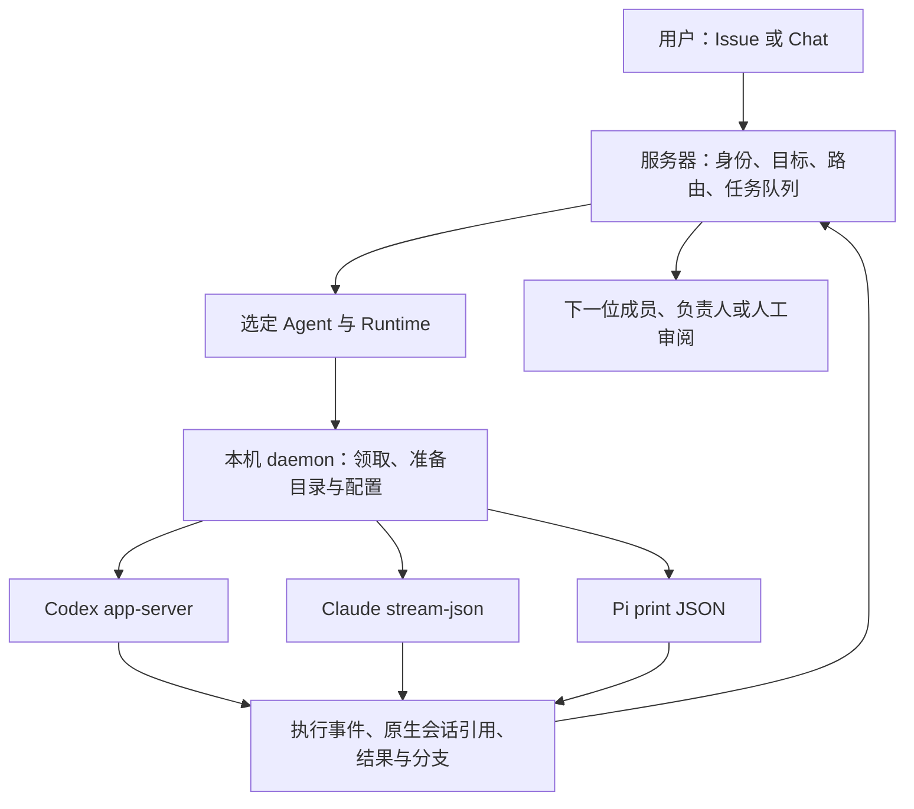
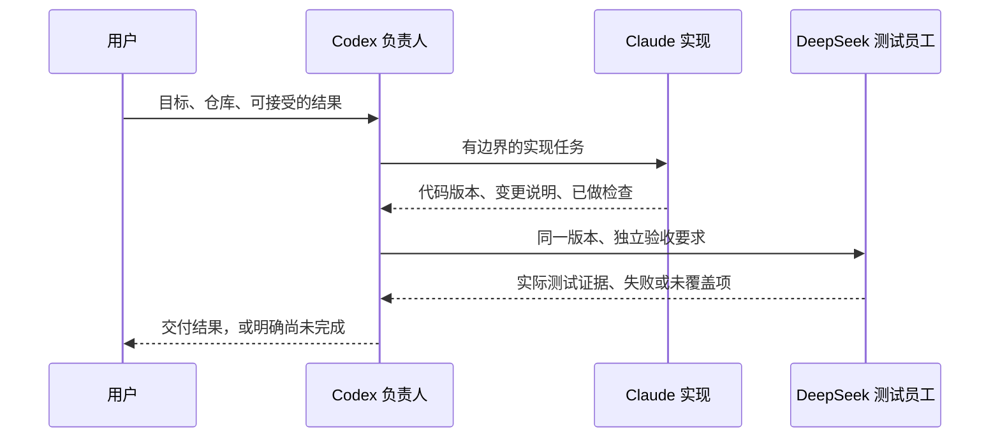

<!--
[INPUT]: multica-ai/multica固定提交8305976793097a3d38e3a2f29bc1626abe76130d、官方说明、BOAI固定提交f0ea0d87d6916a62d67efb00d66e5f744b3bd57c，以及用户对personal agent、跨本机Agent协作与原生会话可见性的研究问题。
[OUTPUT]: Multica架构、负责人调度、运行交接、原生会话存储与BOAI参考价值；逐项区分源码事实、推断、建议与未验证范围；仅研究文档。
[POS]: 外部项目源码研究，不替代现行产品规格、实现进度或真实业务验收。
[PROTOCOL]: 一旦本文件变化，必须同步更新Header与所属目录.folder.md。
-->

# Multica 源码调研与 BOAI 可借鉴方向

研究日期：2026-10-28。范围：分析项目并输出参考文档；没有实施下述建议。

## 1. 结论与研究基线

**Multica 最值得 BOAI 参考的是“把多种本机 Agent 组织成一支能交接工作的团队”：明确负责人、明确触发来源、持久化工作与执行的关系，以及把代码交付留在可追踪的分支上。**

对于“Codex 做组长，Claude Code／其他 Codex 实现，DeepSeek 测试”的设想，它的 Squad 机制有直接参考价值：分配给团队的工作先路由到负责人，负责人再点名成员，成员返回结果后负责人接着安排工作。这里既有服务端路由，也有提供给模型的协作规则，两者不能混称为全部由系统强制保证。[负责人路由][m-route]、[负责人指令][m-brief]

但它不是原生能力完整保留的现成答案。当前代码会改写部分任务环境、默认关闭受管 Codex 的原生子 Agent 和记忆，并对 Claude 使用自动执行的权限模式。**BOAI 可以吸收组织和交接机制，同时保留自己的原生执行、审批和来源核验约定。**[Codex 子 Agent 配置][m-multi]、[记忆配置][m-memory]、[Claude 启动参数][m-claude]

| 项目 | 本次固定依据 |
| --- | --- |
| 官方仓库 | [multica-ai/multica](https://github.com/multica-ai/multica) |
| Multica 提交 | `8305976793097a3d38e3a2f29bc1626abe76130d` |
| 提交时间 | 2026-10-28 21:55:34 +08:00 |
| BOAI 对照提交 | `f0ea0d87d6916a62d67efb00d66e5f744b3bd57c` |
| 研究方法 | 获取固定源码，沿路由、领取、执行、会话与完成回执阅读生产代码；以测试源码辅助确认设计意图 |
| 未执行 | 未安装或运行 Multica；未启动 daemon、数据库、真实模型或真实多 Agent 任务；未跑其测试 |
| 证据含义 | “已实现”指固定源码存在相应路径；不代表本机实测、模型遵守规则或完整业务验收成功 |

许可也要单独识别：当前 README 称其为 source-available，LICENSE 是 Apache 2.0 正文加额外条件的整体许可，不能把它当成纯 Apache/MIT 项目。对外托管、商业嵌入及品牌／署名存在额外条件。本文只研究机制，没有迁入代码；未来直接复用源码应按届时的实际用途核对完整许可。[固定 LICENSE][m-license]

## 2. Multica 如何把工作交给本机 Agent

Multica 以 Issue 为主要工作载体，也提供 Chat。服务器保存团队、任务与运行记录；本机 daemon 发现执行工具、领取任务并调用实际 CLI。其核心抽象是 `Backend.Execute → Session`，各 provider 自行对接自己的执行协议。[运行架构说明][m-runtime-doc]、[Backend 合同][m-backend]

这几个对象的职责值得分清：

| Multica 对象 | 解决的问题 | BOAI 中相近的对象 |
| --- | --- | --- |
| Agent | 谁负责、用什么模型和能力 | 数字员工及其配置 |
| Runtime / daemon | 在哪台机器、用哪个实际程序执行 | LaunchProfile、运行时插件、宿主服务 |
| Squad | 一组成员由谁接收并分配工作 | 群成员、协作背景；普通群尚无等价的显式负责人合同 |
| Issue | 这件事的目标、讨论、产物与最终状态 | 原群消息、根 Work、成果与交付记录 |
| Run / task queue | 一次实际执行、失败或等待 | AgentRun 与 WorkExecution |
| 原生 session | 某个 provider 持续交流的上下文 | NativeSessions 与后端 session／thread |
| Workflow | 到达某阶段后由谁接手 | Work 依赖与定向唤醒可作为已有基础 |

上述 BOAI 对照是本次源码映射，不表示要新增一套同名实体或改成 Issue 看板。BOAI 已有真实委派、等待、成果发布和运行身份；研究价值在于补足使用方式与调度合同。[BOAI 协作工具][b-tools]、[Work 委派存储][b-work]、[原生会话][b-sessions]

## 3. 最直接的参考：负责人是明确的路由目标

### 3.1 系统确定先唤醒谁

Squad 数据包含 `leader_id`。Issue 分配给 Squad 后，服务端查找该负责人，核对运行就绪和访问条件，再生成该负责人的执行目标。不是把团队请求广播给所有成员后，让每个人自行猜测是否参加。[Squad 数据][m-squad-db]、[Issue 路由][m-route]

负责人接到的上下文包含运行规则、成员名单和团队补充说明。名单提供实际成员身份、可用的提及格式、角色，以及所绑定的技能名称。负责人据此选人；角色标签不自动授予权限，也不代表工具或环境已经就绪。[名单构建][m-roster]

对 BOAI 的参考点是：**如果用户明确要“负责人带队”，就应有可核对的负责人身份与路由行为，而不只是在团队背景里写一段建议。**

BOAI 类型里仍保留历史 `coordinator` 枚举，但启动恢复会把非 natural 的会话模式记为 legacy 并归一到 natural；群配置中的“协作建议”也明确不改变调度或权限。自动化已有指定 coordinator 的入口，不能据此推导普通群已经具备同样的团队模式。[模式恢复][b-mode]、[群配置][b-group]、[自动化入口][b-auto]

### 3.2 分派之后结束本轮，结果到达再接续

Multica 给负责人的规则要求：读取任务，发一条包含明确提及的委派评论，登记评估结果，然后结束当前轮次。成员更新、结果返回或相应事件到来后，再让负责人处理下一步。[负责人指令][m-brief]

产品接口与服务端把评论中的结构化身份解析为触发对象。普通文字 `@名字` 不等于可靠委派。成员结果还可触发已分配 Squad 的负责人，避免用户每次充当中间传话人。[评论路由][m-comment]

这里有两层：

- **代码保障**：负责人身份解析、可访问性核对、任务入队、已有待执行任务的去重。
- **模型遵守的规则**：负责人不抢着实现、不重复解释需求、委派后及时退出、何时认为结果足够。

因此它具备明确协作机制，但静态源码不能证明任意模型都能稳定当好组长。

BOAI 已有 `delegate_work` 和 `wait_for_work`，后者也明确让调用方结束当前轮次、由结果就绪后接续。优先参考 Multica 的负责人路由和成员说明，不必再引入一个平行的任务执行循环。[BOAI 工具][b-tools]、[依赖登记][b-work]

### 3.3 不需要动作时允许保持安静

负责人可登记 `action / no_action / failed`。其中 no_action 有按当前 task 查询的持久记录，负责人指令要求此时不再发一条“收到／无需处理”的评论。事件接续还区分自己已经知道的输入与可以合入待启动执行的输入，以减少无效唤醒。[no_action 查询][m-noaction]、[唤醒合并][m-wakeup]

这对个人使用很实用：你需要的是阶段性结果和需要决定的问题，而不是每位成员不断确认自己正在工作。

BOAI 可参考这种“有记录但不一定发消息”的区分；不能把静默直接算成功，也不能把所有进度都再交给组长调用一次模型。

## 4. 开发、测试和交付怎样真正接上

### 4.1 Run 结束与工作完成分开

Multica 明确区分一次 Run 正常结束和 Issue 目标完成。负责人完成第一次分派后，父工作仍在进行；后续才判断是否进入审阅。源码中的工作流还允许为阶段指定 agent、squad、人或项目负责人，进入阶段时交接给对应处理者。[Run 状态说明][m-task-doc]、[阶段处理者][m-workflow]

它对你设想的帮助是：可以把“实现交付”与“测试核查”表达成不同责任，而不是依赖一段聊天里的“写完了请你测试”。

对 BOAI，更小的适配方式是沿用既有 Work 依赖：

1. 实现成员交付明确版本的代码／文件。
2. 测试成员取得这个版本及验收要求。
3. 测试返回实际执行证据与未覆盖项。
4. 负责人按证据安排修正或交付。

**这只是建议流程。** Multica 的阶段切换不会自动证明测试跑过，也不自带“DeepSeek 测试一定可靠”的保证。DeepSeek 是模型；它要经可用运行时与工具访问准确的代码版本和测试环境。BOAI 的 API 员工也须具有实际命令能力，才能执行测试。[BOAI 命令工具][b-command]

### 4.2 并行工作的代码位置和后续接续有明确归属

Multica 的 local worktree 实现值得细读。它不仅为任务创建 Git worktree，还处理：

- 用户已有未提交改动和未跟踪文件的快照。
- 不写用户原索引的独立快照索引。
- 同一员工、同一工作线后续轮次继续同一分支。
- 用 workspace、agent、conversation 身份核对分支归属，而不只比较分支名。
- 收尾时保存未提交结果，再清理临时 worktree；不能合入的新用户改动不被冒称已交付。[worktree 实现][m-worktree]

这是多 Agent 写同一个项目时的直接参考。单有“每个员工有 workspace”，并不能自动解决两个成员写同一仓库的冲突，或测试员测到了错误版本的问题。

BOAI 当前已有员工工作区、业务 cwd 和文件成果，所查运行核心未见与该机制等价的自动 Git 工作线管理。未来若补这部分，应先限制为一个明确仓库与少量成员，规定每个任务的分支、基线、成果提交和接管方式；不要默认将用户所有未提交／未跟踪文件都纳入自动提交。

### 4.3 网络断了，只补交回执

daemon 在结束后把 complete／fail 回调放入本地持久 outbox，内容包括 task、session、工作目录、分支和失败信息。服务器通过状态转换保存终态；回执可重送，模型工作不应因此重新执行。[终态 outbox][m-outbox]、[服务端完成转换][m-complete]

BOAI 已有稳定请求、回执和未知结果不重放规则，因此这是可参考的实现细节，不是需要重写整个存储系统。若未来将 UI 与执行宿主进一步分开，最值得复用其思路的是：**执行完成与产品收到完成回执之间，可以有一个可恢复的中间状态。**

## 5. 原生客户端可见性：它做到哪一步

必须把四件事分别判断：调用原生程序、保存原生会话、从原生客户端打开，以及两边同时操作／双向同步。

| 后端 | 固定源码的实际做法 | 能得出的结论 |
| --- | --- | --- |
| Codex | app-server 的 thread/start／resume；给线程设置语义标题；任务使用专用 CODEX_HOME；local_directory 路线有按 agent 与 issue/chat 区分的持久 session store | 有真正的原生线程和续聊基础；不是默认共用用户整个 `~/.codex/sessions` |
| Claude Code | `-p`、双向 stream-json、按返回 session ID 续用；运行简报主要通过工作目录中的 CLAUDE.md 装配 | 有原生会话恢复路径；具体历史可见性还取决于目录、环境与原生客户端 |
| Pi | `-p --mode json --session <path>`；保存到 `~/.multica/pi-sessions`；执行期持有文件锁 | 有可定位的 Pi JSONL；它不在 Pi 默认会话目录，不能宣称默认列表自动出现 |

来源：[Codex 协议][m-codex]、[Codex 存储][m-home]、[线程名称][m-title]、[Claude 参数][m-claude]、[Pi 参数][m-pi-args]、[Pi 路径][m-pi-store]、[Pi 锁][m-pi-lock]。

Codex 的持久 store 还加了 Multica 自己的写锁，以协调不同任务专用 HOME 指向同一个会话存储的情况。**这个锁约束采用该协议的 Multica 写者，不等于任意外部原生客户端都遵守同一个锁。**[写锁实现][m-codex-lock]

本次沿 provider、daemon、会话持久化和桌面／运行记录入口的检索，未找到足以证明以下完整能力的实现链路：

> 在 Multica 启动 → 在普通原生客户端自动发现 → 人工接管同一活动会话 → 原生新增内容完整同步回 Multica → 继续原任务协作。

这属于“本次未找到／未实测”，不是断言项目任何角落都绝无相关功能。

对 BOAI 的直接启发是把“可定位原生会话”做明确：记录运行后端、程序／配置来源、原生 session ID 或文件、cwd、工作分支，并显示可理解的名称。BOAI 已记录 session／turn；下一步应核对哪些定位信息缺失，再考虑打开入口。[BOAI 会话映射][b-sessions]、[运行信息呈现][b-run-info]

另一个可分开参考的方向是“原生 Agent 使用产品 CLI”。Multica 的平台 Skill 引导 Agent 通过 CLI 读取任务、评论和操作团队；受管执行使用绑定 agent、task、workspace、owner 的任务凭据。这让平台操作有稳定产品协议，但不意味着任意外部会话自动变成已有员工。[平台 Skill][m-platform]、[任务凭据][m-token]

BOAI 本身也已有 CLI 和 Run 身份凭据，因此不需要另造一套管理通道。若未来允许从原生客户端参与原群，应先明确是用户身份操作还是员工身份执行，以及这次外部输入怎样登记为原工作的一部分。[BOAI CLI][b-cli]、[Run 身份合同][b-run-access]

## 6. 哪些做法不适合原样迁入

| Multica 做法 | 本次源码依据 | BOAI 应如何取舍 |
| --- | --- | --- |
| 默认关闭受管 Codex 的原生子 Agent | 其注释解释：父线程结束时，子线程可能仍在运行；可通过环境变量选择保留 | 参考它暴露的生命周期问题，继续核对子线程事件与退出，不以默认关闭代替 BOAI 的原生能力目标 |
| 默认关闭受管 Codex 自动记忆 | 任务配置写入关闭项，另有环境变量选择保留 | BOAI 应按自身员工／原生来源合同处理，不能默认照搬关闭策略 |
| Claude 使用 bypassPermissions，并禁止 AskUserQuestion | 固定启动参数为非交互自动执行设计 | 保留 BOAI 用户选择的原生权限与待决交互，不因协调方便而扩大权限或丢弃提问 |
| 简报与技能写入工作目录／任务 HOME | 各 provider 使用其能发现的原生文件位置 | 借鉴“固定说明与本轮输入分开”，不直接覆盖用户项目里的 AGENTS.md／CLAUDE.md |
| 某些原生 resume 失败后新建会话继续 | Codex 区分协议与传输失败，并附连续性说明；不是无条件 fallback | 保留 BOAI 来源和输入确认门槛；丢失会话与写操作结果未知必须分别处理 |
| 引入完整 Web／服务端团队工作台 | 多用户、远程 runtime、Issue、权限与队列体系 | BOAI 当前个人桌面场景优先补局部能力，是否需要远程 daemon 另行决定 |

依据：[子线程策略][m-multi]、[记忆策略][m-memory]、[Claude 参数][m-claude]、[简报与增量输入][m-prompt]、[Codex 恢复][m-codex]、[运行架构][m-runtime-doc]。

其中“稳定说明与本轮输入分开”可单独吸收。Multica 将变化频繁的执行身份、接续提示、工作流和工作树信息放到本轮输入，避免每轮改变历史前缀。它是提示词装配思路，不能仅凭源码注释就宣称在 BOAI 已节省多少 token。[本轮输入装配][m-prompt]

## 7. 对 BOAI 的参考优先级

下面是研究建议，不是已经批准的开发范围。

| 优先级 | 候选点 | 用户能直接获得什么 | 应复用的 BOAI 基础 |
| --- | --- | --- | --- |
| P1 | 明确的负责人路由 | 给一个人交代目标，成员不会都抢着开工 | 群成员、当前消息投递、原 Work 委派；普通讨论模式保持独立 |
| P1 | 实现 → 测试 → 负责人核查的交接约定 | 测试基于确定版本，负责人能按结果继续 | Work 依赖、成果版本、定向接续与已有回执 |
| P1 | 原生会话定位与可理解名称 | 知道一次工作对应哪个 Codex／Claude／Pi 会话 | NativeSessions、运行详情、profile 和 cwd |
| P2 | 开发任务的分支归属与跨轮延续 | 并行修改可分离，同任务后续不丢代码上下文 | 员工工作区、业务 cwd、成果提交信息 |
| P2 | 无动作记录、唤醒合并 | 群里少重复确认，减少不必要模型调用 | 现有消息事件、调度和依赖通知 |
| P2 | 固定简报与动态输入拆分 | 接续更清晰，便于核对缓存与上下文变化 | 原生 bootstrap、增量消息投影 |
| 条件性 | 独立远程 daemon 与终态 outbox | UI 断开或跨机器时仍能追踪执行与回执 | 现有 CLI serve、宿主退出与稳定回执 |
| 暂不建议 | 全量迁入 Multica UI／Go 后端／全部 provider | 当前收益不足以解释新体系的维护成本 | 继续使用已有 Electron、TypeScript runtime 和插件机制 |

优先做负责人路由，不代表先搭一个庞大的组织系统。最小候选可以只覆盖一个明确选择的群：保存负责人、向其提供真实成员能力、定向委派、等待结果、按证据交付。直接点名其他成员时如何处理，应在这个小范围内说清楚。

原生会话则先做到“能定位并查看”。活动接管与双向同步有额外的输入归属、并发写入、产品工具和回执问题，不能把一个启动命令包装成完整互通。

## 8. 用一个真实任务验证，而不是按功能数量验收

如果以后决定试验，建议用一个已知小 Bug，固定仓库基线和验收条件：

该图是 BOAI 候选实验，不是本轮已执行结果。测试员工可以是现有 API 路线，也可以是具备相应配置的 Pi 等原生运行时；此处不预设哪种模型更强。

| 验收点 | 必须看到的事实 |
| --- | --- |
| 负责人路由 | 首次请求只启动预期负责人，成员由明确委派启动 |
| 真实执行 | 实现成员产生实际 diff；测试成员执行明确命令或真实浏览器步骤 |
| 同一版本 | 测试记录能指向被测 commit／工作树快照，而不是另一份代码 |
| 依赖接续 | 负责人由真实结果唤醒，不靠用户复制粘贴，也不重复实施 |
| 失败边界 | 测试失败、CLI 异常、结果未知各有真实状态，不能自动称为完成 |
| 会话定位 | 三类后端分别记录并验证会话引用；“BOAI CLI 可读”与“原生 CLI 可读”分别验收 |
| 外部继续 | 若纳入范围，先验证单端接管与交还；普通原生列表可见、实时同步另列结果 |
| 非目标能力 | 不因通过此任务就宣称所有原生插件、审批、子 Agent、跨平台都无损 |

源码中已有针对 Squad、worktree、会话锁和原生异常的测试，例如 `squad_workflow_status_contract_test.go`、`local_worktree_test.go`、`codex_home_sessions_test.go`、`pi_resume_refused_unix_test.go`。本轮只检查了相关测试的存在和部分断言／设计说明，没有执行这些测试，更没有将其视为业务成功证据。

## 9. 本轮交付边界

本轮新增研究文档及文档导航，不修改产品、配置、原生 Agent 或运行环境。正文引用固定提交，后续上游变更需重新核对。

尚待实际验证的关键问题是：这套协作在你自己的模型、仓库和权限设置下是否稳定；原生会话能否在指定客户端找到；外部接续怎样回到 BOAI 原有工作记录。Multica 提供了值得研究的实现样本，但没有替你完成这些验证。

<!-- 以下为固定提交的来源链接；行号由本次实际读取的源码定位。 -->

[m-route]: https://github.com/multica-ai/multica/blob/8305976793097a3d38e3a2f29bc1626abe76130d/server/internal/service/issue_trigger.go#L175
[m-brief]: https://github.com/multica-ai/multica/blob/8305976793097a3d38e3a2f29bc1626abe76130d/server/internal/handler/squad_briefing.go#L34
[m-roster]: https://github.com/multica-ai/multica/blob/8305976793097a3d38e3a2f29bc1626abe76130d/server/internal/handler/squad_briefing.go#L285
[m-multi]: https://github.com/multica-ai/multica/blob/8305976793097a3d38e3a2f29bc1626abe76130d/server/internal/daemon/execenv/codex_multi_agent.go#L11
[m-memory]: https://github.com/multica-ai/multica/blob/8305976793097a3d38e3a2f29bc1626abe76130d/server/internal/daemon/execenv/codex_memory.go#L11
[m-claude]: https://github.com/multica-ai/multica/blob/8305976793097a3d38e3a2f29bc1626abe76130d/server/pkg/agent/claude.go#L1090
[m-license]: https://github.com/multica-ai/multica/blob/8305976793097a3d38e3a2f29bc1626abe76130d/LICENSE#L20
[m-runtime-doc]: https://github.com/multica-ai/multica/blob/8305976793097a3d38e3a2f29bc1626abe76130d/apps/docs/content/docs/daemon-runtimes.mdx#L12
[m-backend]: https://github.com/multica-ai/multica/blob/8305976793097a3d38e3a2f29bc1626abe76130d/server/pkg/agent/agent.go#L18
[m-squad-db]: https://github.com/multica-ai/multica/blob/8305976793097a3d38e3a2f29bc1626abe76130d/server/pkg/db/queries/squad.sql#L1
[m-comment]: https://github.com/multica-ai/multica/blob/8305976793097a3d38e3a2f29bc1626abe76130d/server/internal/handler/comment.go#L3009
[m-noaction]: https://github.com/multica-ai/multica/blob/8305976793097a3d38e3a2f29bc1626abe76130d/server/internal/service/squad_no_action.go#L12
[m-wakeup]: https://github.com/multica-ai/multica/blob/8305976793097a3d38e3a2f29bc1626abe76130d/server/internal/service/issue_wakeup_join.go#L19
[m-task-doc]: https://github.com/multica-ai/multica/blob/8305976793097a3d38e3a2f29bc1626abe76130d/apps/docs/content/docs/tasks.mdx#L157
[m-workflow]: https://github.com/multica-ai/multica/blob/8305976793097a3d38e3a2f29bc1626abe76130d/server/internal/issueworkflow/issueworkflow.go#L1
[m-worktree]: https://github.com/multica-ai/multica/blob/8305976793097a3d38e3a2f29bc1626abe76130d/server/internal/daemon/execenv/local_worktree.go#L20
[m-outbox]: https://github.com/multica-ai/multica/blob/8305976793097a3d38e3a2f29bc1626abe76130d/server/internal/daemon/terminal_report_queue.go#L34
[m-complete]: https://github.com/multica-ai/multica/blob/8305976793097a3d38e3a2f29bc1626abe76130d/server/internal/service/task.go#L4598
[m-codex]: https://github.com/multica-ai/multica/blob/8305976793097a3d38e3a2f29bc1626abe76130d/server/pkg/agent/codex.go#L1996
[m-home]: https://github.com/multica-ai/multica/blob/8305976793097a3d38e3a2f29bc1626abe76130d/server/internal/daemon/execenv/codex_home.go#L17
[m-title]: https://github.com/multica-ai/multica/blob/8305976793097a3d38e3a2f29bc1626abe76130d/server/internal/daemon/thread_name.go#L7
[m-pi-args]: https://github.com/multica-ai/multica/blob/8305976793097a3d38e3a2f29bc1626abe76130d/server/pkg/agent/pi.go#L1139
[m-pi-store]: https://github.com/multica-ai/multica/blob/8305976793097a3d38e3a2f29bc1626abe76130d/server/pkg/agent/pi.go#L1372
[m-pi-lock]: https://github.com/multica-ai/multica/blob/8305976793097a3d38e3a2f29bc1626abe76130d/server/pkg/agent/pi_session_lock_unix.go#L15
[m-codex-lock]: https://github.com/multica-ai/multica/blob/8305976793097a3d38e3a2f29bc1626abe76130d/server/internal/daemon/execenv/codex_session_writer_lock.go#L19
[m-platform]: https://github.com/multica-ai/multica/blob/8305976793097a3d38e3a2f29bc1626abe76130d/server/internal/service/builtin_skills/multica-platform/SKILL.md#L8
[m-token]: https://github.com/multica-ai/multica/blob/8305976793097a3d38e3a2f29bc1626abe76130d/server/internal/handler/daemon.go#L4324
[m-prompt]: https://github.com/multica-ai/multica/blob/8305976793097a3d38e3a2f29bc1626abe76130d/server/internal/daemon/prompt.go#L50
[b-tools]: https://github.com/6owen/boai-agent/blob/f0ea0d87d6916a62d67efb00d66e5f744b3bd57c/packages/runtime/src/adapters/native-products.ts#L76
[b-work]: https://github.com/6owen/boai-agent/blob/f0ea0d87d6916a62d67efb00d66e5f744b3bd57c/packages/runtime/src/modules/collaboration/work-repository.ts#L607
[b-sessions]: https://github.com/6owen/boai-agent/blob/f0ea0d87d6916a62d67efb00d66e5f744b3bd57c/packages/runtime/src/adapters/native-sessions.ts#L60
[b-mode]: https://github.com/6owen/boai-agent/blob/f0ea0d87d6916a62d67efb00d66e5f744b3bd57c/packages/runtime/src/service.ts#L889
[b-group]: https://github.com/6owen/boai-agent/blob/f0ea0d87d6916a62d67efb00d66e5f744b3bd57c/apps/electron/src/renderer/components/employee/group-configuration-fields.tsx#L43
[b-auto]: https://github.com/6owen/boai-agent/blob/f0ea0d87d6916a62d67efb00d66e5f744b3bd57c/packages/runtime/src/service.ts#L789
[b-command]: https://github.com/6owen/boai-agent/blob/f0ea0d87d6916a62d67efb00d66e5f744b3bd57c/packages/runtime/src/adapters/mastra/task-runtime.ts#L478
[b-run-info]: https://github.com/6owen/boai-agent/blob/f0ea0d87d6916a62d67efb00d66e5f744b3bd57c/apps/electron/src/renderer/components/detail-panel/execution-record.tsx#L51
[b-cli]: https://github.com/6owen/boai-agent/blob/f0ea0d87d6916a62d67efb00d66e5f744b3bd57c/apps/cli/src/index.ts#L61
[b-run-access]: https://github.com/6owen/boai-agent/blob/f0ea0d87d6916a62d67efb00d66e5f744b3bd57c/packages/shared/src/cli/run-access.ts#L8
