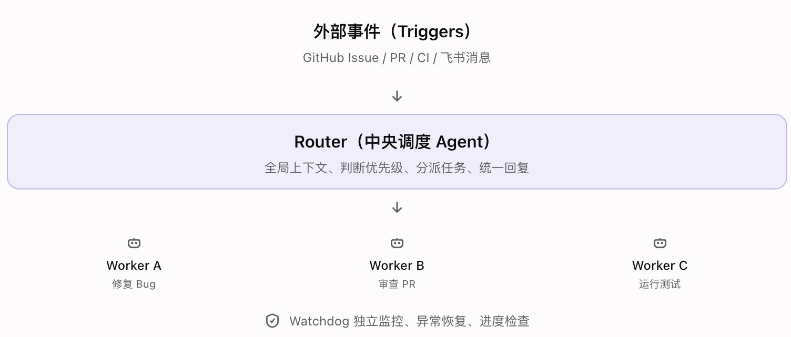
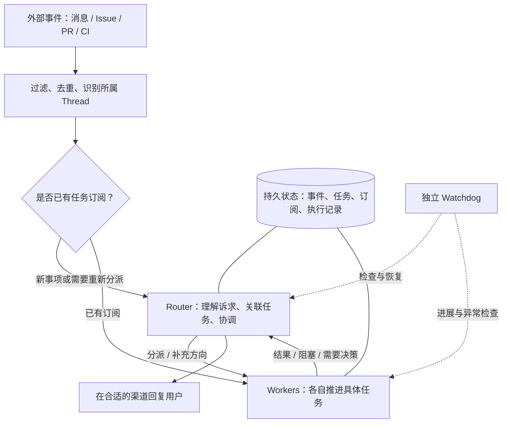

<!--
[INPUT]: 2026-11-02 浏览器读取的 DeepSeek Super-agent 文章、官方原型文档、用户示意图及 BOAI 当前仓库规范。
[OUTPUT]: 外部架构分析、任务与执行边界、BOAI 参考建议及来源范围；后续源码现状与演进分析导航至 02。
[POS]: 外部架构调研，不替代现行产品规格，不表示已实施或已完成运行验收。
[PROTOCOL]: 一旦本文件变化，必须同步更新 Header，并上浮检查所属目录 .folder.md。
-->

# Super-agent 架构分析与 BOAI 参考

日期：2026-11-02。返回[研究目录](README.md)。

本篇保留第一轮外部材料研究。后续关于 BOAI 当前源码能力与执行优化的定向核对，见 [02-BOAI现状与演进建议](02-BOAI现状与演进建议.md)；两篇均未进行新的运行验收。

## 1. 研究结论与材料范围

用户给出的“外部事件 → Router → Workers，另有独立 Watchdog”抓住了架构主干。要解释系统如何持续工作，还需要补上事件直通、持久任务与结果回流。

本文的核心判断是：这套设计的价值在于让系统承担跨渠道的信息关联、并行任务的上下文管理和后续跟进，减少用户手动切换会话与搬运信息的负担。

材料分为三层：

| 层次 | 本次依据 | 能支持的结论 |
| --- | --- | --- |
| 文章观点 | 浏览器读取《Super-agent 设计探索：迈向更自主的 Agent 系统》全文 | 作者提出的职责划分、内部实践与实验说明 |
| 原型文档 | 官方仓库 README、领域模型、执行说明、架构文档、设计原则 | 公开原型的设计与声明；不等于逐文件源码审计或运行验证 |
| 本文建议 | 对用户图的补充、具体示例、BOAI 映射与验证场景 | 可供后续设计讨论，不代表作者原文承诺或 BOAI 已实现 |

文章署名为 DeepSeek 产品部，发布账号为 DeepSeek Harness 团队；页面显示发布时间为 2026-10-31，并标注 2026-11-01 修改。文章是架构探索。官方仓库明确说明它是研究原型，公开版本与内部版本及文章描述并不完全一致，部分方向尚未实现。[文章][S1] [原型说明][S2]

本轮未安装或运行该原型，未执行真实模型、飞书、GitHub、CI 或恢复实验；未审计 BOAI 当前运行代码。

## 2. 对照用户的架构图

### 2.1 用户原图

此图来自本轮用户输入，非 DeepSeek 官方原图。

### 2.2 补充后的关系

原文将 Router 用于全局协调和对外交互，让 Worker 在隔离上下文中执行；已订阅事件可以直接送达 Worker，关键结果再汇报给 Router。Watchdog 在主系统之外检查运行异常与任务进展。[文章 §2–3、§6][S1]

下面将文章的职责关系与原型的持久任务概念合并表达，是本文整理图。持久化和监控连线只表达职责关系，不声明其部署拓扑。

“已有订阅”在这里是简化表达。公开原型将事件分发给订阅该 Thread 的 Ticket；已被 Ticket 承接的人类消息留在该任务，其他事件仍可能进入 Eval 判断是否产生新工作。因此，不能将图理解为所有事件在程序中只能二选一。[领域模型][S3]

## 3. Router、Worker 与任务的边界

### 3.1 Router 保持全局理解，但应避免承担执行细节

对用户图中的“全局上下文”，本文建议理解为：知道有哪些事情、各自谁在处理、用户作过什么决定，以及事情之间的关联。

例如，Router 需要知道“登录问题正在修复，关联 PR #123，用户要求兼容旧版本，目前等待 CI”。它通常不需要同时携带每次搜索结果、每段编译日志和每个文件的修改细节。

适合交给 Router 的内容包括：

- 判断新消息属于已有任务，还是独立的新目标。
- 分派目标、约束和交付条件，传递用户的新决定。
- 协调不同任务的依赖与冲突。
- 汇总关键事实，在正确渠道给用户答复。

单任务中的具体步骤、工具选择和详细调试由 Worker 负责。一个实用的设计检查是：某个 Worker 连续工作半小时，Router 是否仍能快速接住另一件事？

### 3.2 Worker 更适合按完整任务组织

用户图中的“修复 Bug、审查 PR、运行测试”存在两种组织方式：

| 关系 | 本文建议 |
| --- | --- |
| 三项工作各自服务不同目标 | Router 分派给三个独立 Worker |
| 三项工作共同完成一个 Bug 修复 | 一个 Worker 负责整体交付，再自行组织步骤或子 Agent |

把每一步都提升到 Router，会迫使全局协调者深入单任务细节。分派时更适合描述目标、约束、材料和交付条件，而非预先写死所有执行步骤。

应区分四个对象：

| 对象 | 代表什么 | 不应混同的对象 |
| --- | --- | --- |
| 员工 / Agent 身份 | 长期能力、配置、身份与权限归属 | 一次临时执行会话 |
| 任务 | 用户希望持续推进的目标及交付条件 | 某轮模型调用 |
| Worker 会话 | 推进特定任务时使用的执行上下文 | 员工的全部历史 |
| 单次执行 | 一次运行及其状态、证据和结果 | 整项任务的最终完成 |

这些是用于 BOAI 讨论的概念边界，不要求引入四套新的存储或同名类型。

### 3.3 持久任务承接跨轮连续性

公开原型的 `Ticket` 表示获准开展的工作，通过 `Assignment` 绑定执行器；一个 Ticket 可以先后经历多个 Assignment。Ticket 自己维护状态，不直接跟随执行会话变化。[领域模型][S3]

以“修复登录问题”为例，它可能经历提交 PR、等待审查、按评论修改、等待 CI 和用户验收。期间模型可以多次结束输出，执行器也可能重启，但用户委托的仍是同一件事。

因此，设计时需要明确：

- 单轮执行结束，不必然意味着任务完成。
- 等待审查、等待批准或等待设备，不必然意味着任务失败。
- 新消息可以续接旧任务，不应默认创建新的任务。
- 用户验收、交付就绪、执行失败和人为停止分别表达不同事实。

公开原型针对 PR 的结束规则具有研发场景特征，不应不加区分地成为 BOAI 所有任务的完成规则。

## 4. 事件直通如何形成持续推进

以下是本文根据上述设计构造的示例，不是本次实测记录：

1. 用户在飞书提出“处理登录报错”，Router 关联目标并分派 Worker A。
2. A 创建 PR，并将飞书话题与该 PR 关联到同一项工作。
3. PR 收到审查意见，事件通过订阅送达 A。
4. CI 失败，A 收到结果后继续处理。
5. 用户同时要求整理会议纪要，Router 分派 Worker B。
6. A 需要用户决定兼容范围，或者完成可审阅结果，再汇报给 Router。

对用户的收益是无需手动将平台事件逐条转述给 Agent；对系统的收益是已确定归属的事件不必反复进行全局分派。

但落地时不能只写一句“把消息转给 Worker”。还需要回答：

| 情况 | 需要明确的行为 |
| --- | --- |
| 平台重复投递同一事件 | 以稳定身份去重，避免重复启动或重复外发 |
| 一个话题包含多个目标 | 区分任务归属，保留独立目标与订阅关系 |
| 任务已经停止，结果随后到达 | 保存必要记录，不擅自恢复被停止的工作 |
| Worker 接到超出范围的要求 | 交回协调层判断，不自行扩大任务边界 |
| 同一事件送达多个 Worker | 共享上下文不意味着允许并发覆盖同一资源 |

官方原型将事件接收、Ticket、Assignment、订阅和对外回执纳入领域层，状态变更通过事务组织，外部动作由适配层在提交后执行。[架构文档][S5] 这说明持续性需要程序层的状态保障。

## 5. 简图之外的三项能力

文章还讨论上下文按需召回、异步工具与计算／状态／执行环境分离。这些共同支撑跨渠道连续性和持久在线。[文章 §3.3–5][S1] 以下分析说明它们对 BOAI 设计意味着什么。

### 5.1 全局理解需要引用关系和按需读取

本文建议让 Router 保存任务摘要、关键决定与关联标识；需要细节时再读取对应任务、讨论或执行记录。近期高相关信息可以直接进入上下文，长日志和低频信息保留可追溯的读取入口。

例如从“上次那个登录问题”找到任务，再找到 PR 和未解决的审查意见。需要验证召回得到的是当前有效决定，而不是仅命中了相同关键词或一段已被纠正的旧摘要。

这类任务关联不能直接证明跨月长期记忆质量，也不应据此替代原生 Agent 的记忆和上下文机制。

### 5.2 后台执行与新输入必须能够并存

理想体验是：测试仍在后台运行，用户可以继续补充条件、询问状态或停止任务。公开原型说明，较长的前台命令会移至后台，让执行会话在后续步骤接收消息；后台工作与任务占用的并发槽位也有单独规则。[执行说明][S4]

这不意味着模型推理可以在任意时刻被立即打断。需要分别定义“输入已收到”“输入被模型读取”“停止已请求”和“执行实际退出”，避免界面提前宣称已停止。

### 5.3 持久在线依赖部署与状态归属

从工程设计看，持久状态应能在计算进程重启后恢复；需要本机文件、凭据或工具链的执行则受到目标设备可用性的限制。

即使协调层放到云端，也不能推导出休眠中的个人电脑仍可执行命令。设备离线时应保存待办与依赖，在设备恢复后按既定授权续接，而不是默认复制或迁移用户环境。

BOAI 是否采用云端协调、本机协调或混合部署，应独立决策。本次研究不构成迁移运行位置、增加远程 daemon 或改变凭据使用方式的实施方案。

## 6. Watchdog：检查运行健康与真实进展

本文建议把 Watchdog 的观察分成两层：

| 层次 | 观察内容 | 合适的主要机制 |
| --- | --- | --- |
| 运行健康 | 进程退出、接口持续失败、输入投递异常、状态无法恢复 | 确定性探测与受控恢复 |
| 任务进展 | 反复执行同一路径、偏离目标、漏掉新要求、长期没有有效成果 | 结合目标与证据的模型判断 |

“十分钟没有回复”本身不能证明卡住。执行可能在编译、等待平台反馈或等待批准。更有效的问题是：当前阶段预期发生什么，最近出现了什么新证据，下一步依赖是否满足？

恢复也不能统一为重启。已经创建 PR、发过消息或修改过文件的任务，必须先识别现有动作和回执，避免重复副作用。对结果未知的动作，应先核对，不能因未收到确认就直接重发。

Watchdog 的独立性需要按故障范围判断。独立 Session 仍可能共享同一进程、调度器、存储或模型服务；主进程彻底退出时，还需要外部进程监督机制。它也不应在恢复过程中扩大授权、绕过用户停止或替用户接受交付。

以上是本文的工程建议，未在本轮运行验证。

## 7. 对 BOAI 的参考映射

### 7.1 延续产品协调层与原生执行的边界

下表是建议，不是当前能力清单。BOAI 规范与现有专题仍是实施依据；本轮只核对相关文档规则，未审计运行代码。

| Super-agent 职责 | BOAI 可参考的方向 | 需要保持的边界 |
| --- | --- | --- |
| Router | Bobo 或指定协调者理解诉求、关联工作、汇总结果 | 是否启用协调角色按场景选择，不强制所有员工交流经过 Bobo |
| Worker | 由员工对应的任务会话执行 | Codex、Claude、Pi 等保留原生循环、工具、会话、配置和审批能力 |
| 持久任务 | 保存目标、交付要求、讨论与多次执行的关联 | 复用现有任务与执行职责，避免另建并行状态真相 |
| 订阅 | 把渠道消息与外部结果送回对应工作 | 事件关联不自动产生外发授权或跨员工上下文访问权限 |
| Watchdog | 检查基础异常和任务偏离，按明确规则恢复 | 不覆盖用户验收、停止和未知回执处理规则 |

相关仓库入口：[本机 Agent 调用与原生能力保留](../spec/28.本机Agent调用与原生能力保留/README.md)、[员工任务队列与聊天分离](../spec/5.Mastra能力扩展/16-员工任务队列与聊天分离.md)、[数字员工渠道绑定](../spec/16.数字员工渠道绑定/README.md)。

### 7.2 人工委派看板不能等同于所有后台工作

本轮读取的最新 `origin/main` 为 `58b562f2`。其 [AGENTS.md](../../AGENTS.md) 的 2026-11-02 规则明确：Kanban 承载人明确创建或确认的目标，人工委派与 Agent 内部 progress 分层；独立目标不能被 Agent 擅自合并，执行中的计划、todo 和子 Agent 分工不自动进入看板。具体合同见上述员工任务文档第 25 节。

因此，参考 Super-agent 时需要明确区分：

- 用户创建或确认的委派：沿既有看板与任务会话管理。
- Agent 内部执行步骤：留在执行过程，不自动拆成新卡片。
- 外部事件触发的候选事项：是否获得执行授权、是否进入人工看板，分别判断。
- 定时任务：继续保有计划、触发与执行历史的原职责，不因引入事件概念就混入普通任务。

公开原型的 Ticket 不能直接按名称映射为 BOAI 的每一张人工委派卡。尤其不能把“模型觉得值得处理”视为“用户已经创建并验收了一个目标”。

### 7.3 低打扰与明确交付

官方原型把节省人的注意力作为设计原则，强调在请求或规则允许时行动，在结果可用或需要人参与时沟通。[设计原则][S6]

对 BOAI 的启发是：后台过程应可查，用户需要决策和成果就绪时应清楚可见；不应把每次工具调用、每次自检和每条重试都变成外部通知。群聊、私聊和 PR 等渠道可以使用不同详略的输出。

## 8. 后续值得验证的场景

以下为设计验证建议，尚未执行，也不是本轮新增实施计划。

| 场景 | 需要观察的结果 |
| --- | --- |
| 同一目标跨飞书、PR 和 CI 续接 | 用户不重复讲背景，后续事件归属正确 |
| 两项独立任务并行，其中一项长时间执行 | 另一项能够正常响应，用户的新输入能被及时处理 |
| 中途改变要求 | 新要求被读取，旧方向停止推进，已发生动作有记录 |
| 执行器重启 | 原任务、未读输入、已有成果保持，未知动作先核对 |
| 用户停止后出现迟到结果 | 不擅自重启任务，不重复外发 |
| 正常等待与无效循环对照 | Watchdog 不把等待误判成失败，能识别实际无进展 |
| 执行设备离线再上线 | 等待原因明确，恢复条件与授权保持 |
| 人工委派与内部步骤同时存在 | 看板不被内部计划、子 Agent 任务和自动候选污染 |

评价时应分别记录调度延迟、任务结果质量、人工跟进次数、重复操作、恢复正确性和通知噪声。单一“任务完成率”不足以说明这些不同能力。

文章的初步实验采用合成消息流，并用耗时工具替代真实编码工作，主要评估调度与协作。因此不能将实验结果解释为真实编码质量、跨月记忆或长期无人值守可靠性的认证。[文章 §7][S1]

本轮完成的是研究文档与索引。Mermaid 以可编辑源码保存，用户原图保留；未开展运行实验或产品改造。

## 9. 来源与复查入口

2026-11-02 读取公开材料。官方仓库 `main` 当次查询到的提交为 `6337fc823ce20251c8de8085948165c81aaa701e`；下表保留当次阅读的分支链接，后续内容可能变化，复查时应核对版本。本轮没有下载或复制整篇文章、完整仓库，也不把网页读取当作代码运行验证。

| 编号 | 来源 | 本文用途 |
| --- | --- | --- |
| S1 | [Super-agent 设计探索：迈向更自主的 Agent 系统][S1] | 原文职责、核心方向、Watchdog 和实验边界 |
| S2 | [原型 README][S2] | 原型定位、与内部实现及文章的差异 |
| S3 | [001 Domain model][S3] | Trigger、Thread、Ticket、Assignment 和订阅 |
| S4 | [003 Execution][S4] | 后台执行、会话接收新输入和任务执行规则 |
| S5 | [007 Architecture][S5] | 状态事务、事件接收、领域核心与外部动作 |
| S6 | [000 Philosophy][S6] | 行动边界、低打扰沟通与人的注意力 |

[S1]: https://mp.weixin.qq.com/s/zoS7GlReWPhfCjENGxXCdg
[S2]: https://github.com/deepseek-ai/dsh-superagent-prototype/blob/main/README.md
[S3]: https://github.com/deepseek-ai/dsh-superagent-prototype/blob/main/docs/001-domain.md
[S4]: https://github.com/deepseek-ai/dsh-superagent-prototype/blob/main/docs/003-execution.md
[S5]: https://github.com/deepseek-ai/dsh-superagent-prototype/blob/main/docs/007-architecture.md
[S6]: https://github.com/deepseek-ai/dsh-superagent-prototype/blob/main/docs/000-philosophy.md
