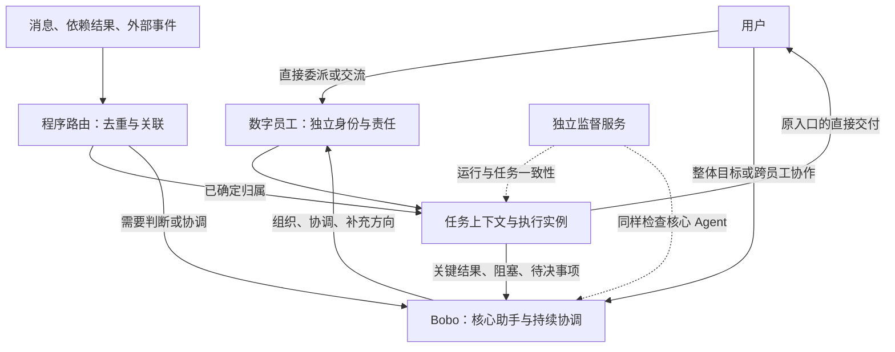

<!--
[INPUT]: 用户明确的数字员工优先与 Bobo 核心定位；BOAI 58b562f2 定向源码核对；本目录 DeepSeek Super-agent 研究。
[OUTPUT]: 已有协调与监督能力、执行接续边界、员工优先的演进建议、顺序与待验证场景。
[POS]: 源码现状分析与设计建议，不是已授权实施计划或运行验收报告。
[PROTOCOL]: 一旦本文件变化，必须同步更新 Header，并上浮检查所属目录 .folder.md。
-->

# BOAI 现状与演进建议

日期：2026-11-02。返回[调研入口](README.md)，外部架构背景见[01-Super-agent架构分析与BOAI参考](01-Super-agent架构分析与BOAI参考.md)。

## 1. 产品前提与结论

本次分析以用户明确的产品定位为前提：数字员工是第一优先级；Bobo 是系统核心 Agent；数字员工是长期存在、能够独立承担责任的主体；任务和工作交由数字员工处理。

建议保持这一定位，在员工之上补充 Bobo 的持续协调，在执行之下完善共享事件调度和监督。参考 Super-agent 时，应分别理解员工身份、任务目标和执行会话，避免将长期员工简单映射成临时 Worker。

针对“当前是否没有 Router、Watchdog，以及执行是否需要优化”，源码层面的结论如下：

| 问题 | 当前判断 | 建议方向 |
| --- | --- | --- |
| 是否有 Router | 已有组织、局部路由、委派和定向唤醒；尚未看到完整的跨任务持续协调闭环 | 复用现有能力，补任务归属、跟进责任、事件订阅和关键结果回流 |
| 是否有 Watchdog | 已有执行内进展复核与原生进程监督；未看到覆盖全系统任务的独立巡检回路 | 先建立确定性的跨任务检查，再增加有证据的语义进展判断 |
| 执行是否需要优化 | 队列、依赖、取消和保留现场已有基础；运行中新输入、等待与恢复语义仍分散 | 优先统一接续行为与状态事实，再扩展协调与监督 |

这是对所检查链路的判断，不代表全仓库不存在其他局部机制，也不代表运行质量已经通过验证。

## 2. 核对基线与证据边界

本次定向源码核对采用研究 worktree 的 `58b562f2`，即当时读取的最新已合并代码。主目录仍为 `fd7cbd1f`，落后三个提交；未切换主目录、未重启应用，也未核实用户正在运行的进程或安装包版本。

两版本之间，本次重点引用的群调度、运行中补充、Work 恢复、Bobo 组织模块、进度复核和渠道接收文件没有差异。员工任务状态与人工委派规则存在后续变化，因此相关结论以 `58b562f2` 及其 AGENTS.md 为准。

本次完成：相关源码、接口、调度条件与恢复策略的静态核对。未完成：新一轮真实模型任务、跨渠道联调、故障注入、性能测量、长期运行或个人应用生效验证。文中体验影响属于基于源码的推断，需要用实际场景确认。

## 3. 数字员工优先的职责划分

| 对象 | 产品职责 | 生命周期与边界 |
| --- | --- | --- |
| Bobo | 理解用户整体意图、组织员工、跟进跨员工工作、汇总需要用户决策的事项 | 长期核心助手；保留自己的交流、人格与直接工作能力 |
| 数字员工 | 持续拥有身份、能力、配置、记忆和工作责任 | 长期主体；不会随着一次执行结束而消失 |
| 任务 | 用户委派给员工的目标、约束和交付要求 | 可以跨多轮执行、等待、修订和验收 |
| Work / Run 等执行对象 | 记录具体工作的认领、依赖、运行、结果与证据 | 沿现有模型承接职责，不因参考外部架构另建并行状态真相 |
| Worker / 执行会话 | 员工处理某项任务时使用的上下文和执行实例 | 按任务隔离；不等于一个新的数字员工 |
| 调度与监督服务 | 投递事件、管理容量、检查异常和保持状态一致性 | 基础设施职责，不替代员工身份或业务负责人 |

一个员工可以先后处理多个任务，并拥有多个隔离的任务上下文。这不意味着默认让同一员工无限并行；实际并行仍受共享目录、工具、会话和执行内核能力约束。

交互应保留两条入口：

- 用户直接找某名员工：工作直达该员工，由该员工负责。
- 用户通过 Bobo 发起协作：Bobo 组织员工，并承担明确约定的跟进与汇总责任。

Bobo 可以按需要查看工作概览，但不要求所有员工交流都经过它，也不要求将全部员工的完整会话历史复制到 Bobo 上下文。

## 4. 现有能力与具体缺口

### 4.1 Bobo 已能组织，但组织交付与业务交付分开

当前 [Bobo 组织模块](../../packages/runtime/src/modules/bobo-collaboration/service.ts) 负责员工选择、缺员准备、群发布和启动意图；模块职责明确不调用成员模型，也不负责群执行调度。

[阶段指令](../../packages/runtime/src/modules/employees/phase-instructions.ts) 的 `boboResponseInstructions` 明确：核心会话中的组织工作以真实组织回执为交付证据，群业务在独立群内执行；不能把建群成功称为业务完成。

这一边界应保留。需要补强的是组织完成后的持续关系：谁需要跟进、哪些事件应通知它、什么时候需要协调、什么时候结束跟进。

建议形成以下闭环：

> Bobo 组织工作 → 记录跟进责任 → 员工出现关键进展、阻塞或交付 → 事件回流 → Bobo 协调或汇总 → 用户验收后结束相应跟进。

负责人可以是 Bobo，也可以是某名员工；“谁负责”需要有可查询的业务事实，不能仅依赖某条聊天中说过“你来负责”。具体字段或存储方式需要在后续设计中沿现有对象确定，本篇不新增类型合同。

### 4.2 委派、等待与唤醒已有基础

[任务工具](../../packages/runtime/src/adapters/mastra/task-runtime.ts) 已提供 `delegate_work` 和 `wait_for_work`。等待依赖时记录真实工作 ID、结果版本和后续动作，当前执行结束后释放容量。

[依赖模块](../../packages/runtime/src/modules/collaboration/work-dependencies.ts) 的 `refreshWaiters` 检查依赖是否交付；`queueWorkWake` 生成带去重身份的定向唤醒。失败依赖可使工作阻塞，而非伪造成功。[服务层](../../packages/runtime/src/service.ts) 的 `scheduleWork` 再核对负责人、来源与实际上下文，安排续行。

因此不宜另建一套相同的工作依赖或“任务完成通知队列”。演进重点是把现有能力连接到清楚的任务归属和协调责任，并验证关键事件是否可靠抵达负责人。

### 4.3 当前渠道路由主要围绕员工会话

[渠道接收](../../packages/runtime/src/modules/channels/channel-service.ts) 的 `receive` 已检查绑定、授权用户和群、消息来源及重复回执。当前机器人消息不触发员工，群消息要求明确提及机器人；接收后送入绑定员工的渠道会话。

这证明已有确定性的入口路由与去重。它不能直接证明已具备“任意外部事件 → 对应持久任务 → 持续推进”的完整订阅机制。

建议把两类职责分开：

| 输入情况 | 建议处理者 |
| --- | --- |
| 已明确员工和任务的消息 | 程序直接投递原任务 |
| 已登记依赖的结果到达 | 原 Work 唤醒机制 |
| 已关联任务的外部结果 | 订阅或关联关系直通负责人 |
| 新目标需要找人、分工或组织协作 | Bobo 或用户指定协调者 |
| 跨任务冲突或需要重新分配 | Bobo / 负责人结合上下文判断 |

是否监听未提及消息、哪些外部来源允许主动行动，是独立的产品与授权选择。不能因为增加事件关联就默认放开这些入口。

### 4.4 已有局部进度检查与进程监督

[ProgressMonitor](../../packages/runtime/src/modules/contexts/progress-monitor.ts) 在单次运行内保存有限的完整观察，识别重复轨迹，并排除仅等待或轮询的轨迹。观察本身不持久化为全局任务监督状态。

[进度复核](../../packages/runtime/src/adapters/mastra/progress-review.ts) 的 `progressBoundary` 先给出调整反馈，满足条件后通过 `reviewProgress` 使用原员工模型连接进行无工具复核；有效证据支持无进展时才请求暂停，未知或复核不可用不作为停止理由。

[原生进程守卫](../../packages/runtime/src/adapters/native-process-guard.ts) 提供进程监督与残留清理，不启动或重放 Agent 工作。服务层调用原生路径的进度边界时不提供该 API 复核连接，因此不能将 API 的复核行为描述成所有原生内核共有的统一能力。

这些机制主要解决单次执行和进程资源问题。尚需跨任务检查的情形包括：

- 任务未交付，但已经没有活跃执行，也没有明确等待原因。
- 依赖结果到达后，负责人没有续行。
- 运行已退出，任务状态仍未正确反映。
- 输入或结果处于未知状态，缺少可见的核对责任。
- 员工提出需要用户决定的问题，但协调者尚不知道该阻塞。

## 5. 执行优化应优先处理的三个问题

### 5.1 运行中新输入的语义与能力不统一

[GroupScheduler](../../packages/runtime/src/group-scheduler.ts) 的 `accept` 会让原讨论让出后续调度；`kick` 仍将普通用户输入保持为单通道。当前执行未释放时，新一轮可能等待。这不等于所有会话或所有员工全局串行。

[NativeSteering](../../packages/runtime/src/modules/conversations/native-steering.ts) 提供精确绑定原 run / turn 的补充与回执，但当前 `current` 限定 Codex 本机活动轮次，且有来源和输入限制。专用补充通路不能当作所有内核都支持全双工的证据。

建议首先统一产品语义，再按执行器实际能力接线：

| 输入 | 期望行为 | 必须区分的事实 |
| --- | --- | --- |
| “做到哪了” | 读取已知状态与证据，尽量不打断工作 | 状态记录时间；未知信息不能猜测 |
| “原任务增加要求” | 进入原任务上下文 | 已受理、已投递、原生已确认、实际已读取可能是不同阶段 |
| “另外做一件事” | 形成独立工作，按容量排队 | 不能默认覆盖当前任务或复用错误上下文 |
| “停止这项任务” | 精确作用于目标执行范围 | 停止请求与实际退出分开；不能顺带取消无关工作 |

如果某个原生接口只能确认提交，界面只能报告提交事实；若需要等待下一轮才能读取，应如实表达。不能仅通过统一 UI 声称所有内核具有相同中断或实时输入能力。

### 5.2 区分工作状态、等待原因与资源占用

现有 [TaskAdmission](../../packages/runtime/src/modules/collaboration/task-admission.ts) 管理任务容量和资源互斥；[自动化调度策略](../../packages/runtime/src/modules/automations/schedule-policy.ts) 的 `sharesTaskExecutor` 检查同会话、同定义或共享员工等冲突，`MAX_ACTIVE_AUTOMATIONS` 当前为 2。不同执行入口受到的调度条件并不相同。

[员工任务服务](../../packages/runtime/src/modules/automations/employee-task-service.ts) 的 `sendMessage` 将任务会话输入接回员工任务运行流程。不能把独立任务会话直接理解为无限并发执行。

应检查的优化方向是：

- 真正执行中的工作占用哪些资源。
- 等待用户、依赖、外部服务或设备时，哪些资源可以释放。
- 用户的新输入是否能优先被受理，而不是被无关后台执行挡住。
- 互斥是保护同一资源，还是仅因为入口共用了较粗的队列。

需要通过实际等待场景测量再决定调整，不因“多 Agent”概念直接提高并发上限或移除互斥。

### 5.3 恢复目前偏向保留现场与明确续行

[WorkRepository.init](../../packages/runtime/src/modules/collaboration/work-repository.ts) 将原活跃、ready 或 waiting 的工作标记为 interrupted，并要求核对；待处理唤醒也被标记中断。[GroupScheduler.init](../../packages/runtime/src/group-scheduler.ts) 中断未结束讨论；[自动化服务](../../packages/runtime/src/modules/automations/automation-service.ts) 的恢复核对只采用已提交、已结算的结果，不在该处重新开工。

这是当前的保守恢复策略，不应直接称为缺陷。若希望实现更持续的 Personal Agent，后续可以讨论按事实分类恢复：

| 恢复时能确认的事实 | 建议行为 |
| --- | --- |
| 工作已登记，但尚未实际执行 | 在原授权仍有效时恢复排队 |
| 动作已经完成且有可信回执 | 读取既有结果，从后续步骤继续 |
| 动作是否完成未知 | 先核对，不直接重发 |
| 正在等待用户或明确审批 | 保持等待，不自动替用户决定 |
| 用户主动停止 | 保持停止，不被后台巡检唤醒 |

这张表是演进建议，不是当前恢复行为，也不是对所有历史任务自动续行的授权。

## 6. Bobo 协调与独立 Watchdog 的建议结构

下面为职责示意，尚未实施。图中员工和事件节点代表一类对象，并不要求只有一个实例。

Bobo 只需得到自己承担跟进责任或获准查看的关键事实，不需要接收每个工具事件。直接委派的员工仍可直接向用户交付。

Watchdog 建议分两层：

1. 确定性检查：状态与运行是否匹配、事件是否遗漏投递、等待条件是否满足、错误是否已通知负责人、未知动作是否需要核对。
2. 语义进展检查：在证据充分且确有疑点时，结合目标、最近成果和尝试判断是否偏离或重复无效工作。

监督服务也应覆盖 Bobo。若它与主系统共享进程、存储或模型服务，需要明确共同故障边界；独立 Session 不能代替外层进程监督。

不应以固定时长无回复直接判定失败，也不应通过简单重启制造重复外发、重复修改或绕过用户停止。更合理的监控输入是当前阶段、等待原因、近期有效证据与下一步条件。

## 7. 建议推进顺序

以下是后续设计与验证顺序，本轮没有开始实现。

| 顺序 | 工作内容 | 该阶段应形成的可审阅结果 |
| --- | --- | --- |
| 1 | 梳理执行接续 | 任务 / Work / Run / 会话的职责图；输入、等待、停止、恢复的行为矩阵；各内核实际支持范围 |
| 2 | 补关键事件回流 | 完成、阻塞、待决、失败的接收人和去重规则；沿原任务与原回执实现的关联设计 |
| 3 | 增强 Bobo 持续协调 | 对其组织工作的跟进责任、概览查询、介入与结束条件 |
| 4 | 建立跨任务监督 | 先覆盖确定性异常，再补语义进展复核；恢复条件与不可自动执行范围 |

共同约束：

- 数字员工继续是一等主体；直接交流与独立会话保持。
- 原生 Codex、Claude、Pi 等保留其执行循环、工具、配置、审批和上下文能力，不在外层重造同一执行内核。
- 人工看板保持“明确创建或确认的委派”语义；内部计划、todo、工具步骤和子 Agent 分工不自动进入看板。
- 分别定义的用户目标保持独立；不借路由、去重或摘要擅自合并目标。
- 定时计划、触发与执行历史继续保持原职责；不因统一事件入口就合并所有业务对象。
- 原生收到输入、真实退出、业务交付和用户验收分开记录，不互相代替。

相关现行合同：[员工任务队列与聊天分离](../spec/5.Mastra能力扩展/16-员工任务队列与聊天分离.md)、[本机 Agent 调用与原生能力保留](../spec/28.本机Agent调用与原生能力保留/README.md)、[长任务执行与工作现场恢复](../spec/27.长任务执行与工作现场恢复/README.md)。

## 8. 首组验收建议

场景：用户通过 Bobo 委派两项独立工作给不同员工；期间直接向其中一名员工修改要求；另一项发生中断；最终由 Bobo 准确说明各项结果、阻塞和需要用户决定的事项。

| 检查点 | 通过依据 |
| --- | --- |
| 员工独立性 | 原员工身份、会话和目标保持，不被重新包装成临时联系人 |
| 独立任务 | 两项用户目标保持独立，内部步骤不产生额外人工卡片 |
| 输入接续 | 新要求归属原任务，报告的投递或读取状态有对应证据 |
| 并行与等待 | 一项阻塞不无故阻止另一项推进，等待原因可解释 |
| 故障恢复 | 中断后已完成结果保留，未知操作不重放，用户停止被尊重 |
| 关键事件回流 | Bobo 在承担跟进责任的范围内获得真实结果和阻塞信息 |
| 准确交付 | 不将启动、建群、单轮结束或本地检查当作业务完成 |
| 低打扰 | 工具过程可查，外部通知聚焦结果与待决事项 |

所有检查点当前均为待验证。只有真实运行、恢复和用户交付证据齐备后，才能评价此闭环是否成立。

## 9. 本次完成范围

本次交付为源码分析与演进建议文档，已与目录索引关联。没有修改运行代码、配置、模型绑定、任务数据或部署；没有启动原型、真实任务或故障实验。后续实施需先明确具体范围及现行对象如何承接职责，不能把本篇建议当作已经实施的产品能力。
