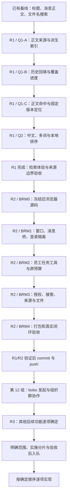

<!--
[INPUT]: 用户于 2026-10-02 确认先升级检索、再实现浏览器、后续功能逐项加入；第 5 组 09 检索规格、第 10 组 D6 既有交付及第 11 组浏览器迁移合同。
[OUTPUT]: R1/R2 技术验证与首批提交 `23fdf6c` 已完成；第 12 组 BC0–BC4 实现与最终模块/桌面/应用包技术验证完成，真实模型全流程未通过/人工质量单独记录。
[OUTPUT]: 当前实施顺序、路径图、两项功能的最小范围/开工入口/完成标准、详细进度归属和后续功能入队方法；当前检索排除向量语义检索与 embedding。
用户于 2026-10-02 授权实施 R1→R2，完成验证后 commit/push，再实施第 12 组 bobo 发起与组织群协作；阶段进度以专题真实证据为准。
[POS]: ai-docs/spec/01-后续功能实施路线图.md；后续功能的统一顺序入口，专题文档继续拥有实现合同和详细验收进度。
[PROTOCOL]: 一旦本文件变化，必须同步更新 Header，并上浮检查所属目录 .folder.md；优先级变化同步规格 README 和对应专题入口。
-->
# 后续功能实施路线图

更新：2026-10-02。状态：**R1 检索升级与 R2 浏览器迁移已实现并完成技术验证，已于 `23fdf6c` 提交推送；随后第 12 组 bobo 群协作已实现，最终1157项模块及源码/实际macOS应用包各13例技术验证通过。浏览器与群协作的完整真实供应商模型任务尚未通过，人工质量仍待核验。**

用户确认的顺序：**R1 本地检索升级 → R2 浏览器能力迁移 → R3 后续功能逐项确定。** 后续开工先读本篇，再进入专题规格；专题编号与文件排列不代表开发优先级。

当前检索只使用本地关键词、文件正文和确定性排序；不引入向量语义检索、embedding 模型/服务、向量数据库或相应配置入口。已有文档中的框架能力介绍不作为本路线的需求。

## 1. 路径图

R1/R2 表达产品实施顺序；各功能的技术前置仍以专题合同为准。已有 D6 不重新开发，检索升级只补缺口；浏览器沿旧 `boai-app` 实现迁入，不重新选择整套浏览器方案。

## 2. 路线与文档分工

| 路线 | 开工入口 | 本阶段目标 | 详细进度归属 |
| --- | --- | --- | --- |
| R1：本地检索升级 | [第 5 组 09](./5.Mastra能力扩展/09-检索文件系统与LSP能力核对.md) | 已发材料/已登记文本成果正文可查，中文和多词查找改善，保持原来源定位 | 第 5 组 09 的 Q1/Q2 执行与验收清单 |
| R2：浏览器迁移 | [第 11 组 README](./11.浏览器能力迁移/README.md) | 员工在获准任务中使用旧版浏览器，用户可查看/接管，结果有来源与真实文件 | [第 11 组 05](./11.浏览器能力迁移/05-实施步骤与验收清单.md) 的 BRM0–BRM4 |
| R3：后续功能 | 本篇第 5 节 | 每次确定一项实际需求，再补专题和执行分片 | 新功能指定的唯一详细进度文档 |

R1 新增本地正文/质量/规模验收已登记于第 5 组 09 与 [R1 证据](../2026-10-02-R1检索升级验收.md)；R2 技术验收已登记于第 11 组 05，两阶段已提交推送，当前实施第 12 组。

本篇维护顺序、最小范围和阶段转换条件，不复制专题的逐项通过状态。进度有分歧时，核对实际代码与证据，再同步对应文档；不能只修改路线图宣布完成。

[第 10 组 05](./10.真实工作交付闭环/05-实施步骤与验收清单.md)继续维护既有 D0–D7 交付。其 D6 已验收不等于 R1 新增正文/分词能力通过；[00 重构总计划](./00-重构总计划.md)保留技术阶段与历史依赖，后续功能先后以本篇为准。

## 3. R1：先升级本地检索

### 升级前基线

升级前的全局检索已经覆盖 SQLite 全历史的会话标题、完整消息正文、已发送材料名称和已登记成果名称，具备筛选、有界分页、隐藏/清理门禁、固定版本/hash 和点击复核。当时文件正文不参与搜索，关键词按连续子串匹配，结果按时间排序。本次 R1 已增加文本正文索引、多词 AND 与相关性排序，实际覆盖及限制见 R1 验收记录。

上一轮针对现有基线的 3 个测试文件、73 项模块测试通过；它们不是新扩展的验收。源码与证据详见第 5 组 09、第 10 组 D6。

### 实施分片

| 顺序 | 实现内容 | 完成后用户能做什么 | 最小完成证据 |
| --- | --- | --- | --- |
| 1：Q1-A | TXT/Markdown 材料与文本成果的正文派生索引；绑定来源、版本/hash；接发送/发布与清理 | 新的合法文本来源具备可索引身份 | 未发送/未登记/事务失败的对象不进入索引；来源变化使旧正文失效 |
| 2：Q1-B | 有界历史回填、进度、失败/超限记录和确定性重启核对 | 明确知道旧文件哪些已可检索 | 回填不调模型、不重放业务；清理期间的迟到结果不复活正文 |
| 3：Q1-C | 普通搜索弹窗返回文件正文片段，点击打开确切材料/成果版本 | 文件名没有关键词，也能通过正文找回成果 | 只在正文出现的关键词可命中；同名文件和旧版保持具体身份 |
| 4：Q2 | 固定中文语料，选择本地分词/多词匹配与排序方案，维护稳定分页 | 用中文短词、多个关键词查找更方便 | 双字、多词、文件名/正文混合有固定质量对比；查询耗时和分页实测 |
| 5：R1 收尾 | 相关模块、持久化、Electron 搜索/清理/重启与应用包验证 | 日常搜索可用，来源失效和历史导航行为可靠 | 记录实际通过范围、未覆盖项和证据；不以原 D6 测试替代新场景 |

Q2 先比较确定性方案并记录选择依据，再实施；不能用默认英文 tokenizer 推断中文效果，也不为了排序引入向量服务。索引、摘录、结果页保持有界，授权与可见性先于分页，点击再次核对真实来源。

### R1 完成标准

- 关键词只在已发送 TXT/Markdown 或已登记文本成果正文中，仍能检索并定位原版本。
- 中文短词、多词和混合结果经过固定样例验证，排序及游标规则清楚。
- 外改、缺失、撤权、隐藏、清理与备份恢复不能通过旧索引返回陈旧正文。
- 历史回填覆盖范围和失败可见；检索、回填不产生模型调用、Work 或额外模型配置。
- 原消息搜索、文件名搜索、准确导航与持久阅读没有回归。

达到上述最小范围并登记证据后，推进 R2。若出现阻塞问题，先缩小为可完整验收的文本类型/规模并记录实际覆盖，不能把尚未覆盖的文件称为已支持。

### 员工检索的安排

第 5 组 09 的 Q3 是员工在任务中查获准消息与成果，与本人搜索不同。当前先保留已有 `search_knowledge`；Q3 作为后续候选，是否加入以及排在哪一步，等具体员工场景确定后更新本路线。它不默认成为 R2 的前置条件。

## 4. R2：再实现浏览器

R1 完成后，按第 11 组顺序迁入。浏览器的具体授权、工具协议、登录隔离、回执与实际退出合同继续由该组维护。

| 顺序 | 实现内容 | 完成后用户能做什么 |
| --- | --- | --- |
| BRM0 | 冻结旧源码版本/hash，确认直接搬入和必要适配清单 | 知道迁移采用哪份旧实现 |
| BRM1 | 旧窗口/工具栏/CDP、宿主桥、员工×会话登录隔离与生命周期 | 在当前应用真实打开、查看和管理浏览器 |
| BRM2 | 任务专用 `browser_tool`、单命令校验、原 Work 预算与动作回执 | 已授权员工在任务中浏览网页 |
| BRM3 | 动作授权、人工接管、网页来源、下载与受管成果发布 | 登录/接管、检查引用、取得真实文件 |
| BRM4 | 模块与 Electron 场景、应用包、真实模型任务及质量记录 | 从任务到来源和成果形成完整闭环 |

本阶段的最小完成标准：原版窗口和主要交互可用；登录归属隔离；普通聊天不自动取得浏览器工具；停止/接管等待实际动作退出；未知提交不重复执行；打包应用可运行；真实任务提供可检查来源与成果。

与 R1 的联合验收：浏览器任务发布的 TXT/Markdown 文本成果，沿正常发布链进入正文索引，可在全局检索中打开该确切版本。未发布下载、网页缓存、Cookie、截图等不会因此自动成为正文搜索来源。

技术成功、真实任务结果与人工质量评审分别记录，详细证据写入第 11 组 05；本路线不提前宣布全平台、全部网站或全部模型均支持。

## 5. R3：后续功能逐项加入

当前已按 R1 → R2 → commit/push → 第 12 组执行。用户已明确一个后续主题：[第 12 组 bobo 发起与组织群协作](./12.bobo发起与组织群协作/README.md)；该组已在 R1/R2 技术验证、提交并推送后开工；不预先把其他框架能力列为必须开发的任务。

| 已明确的后续主题 | 最小场景 | 专题与详细进度 | 开工位置 |
| --- | --- | --- | --- |
| bobo 发起与组织群协作 | 原 bobo 讨论会话保留；找已有员工/补齐缺员→发起独立群→群内目标、分工、交流和真实交付，员工身份始终独立 | [第 12 组 README](./12.bobo发起与组织群协作/README.md)、[05 BC0–BC5](./12.bobo发起与组织群协作/05-实施步骤与验收清单.md) | 已在 `23fdf6c` 推送后开始 BC0–BC4，实现/验收状态见第 12 组 05 |

本组需要接通受控组织操作、bobo 在发起群中的成员资格和首次群目标受理；这与现有仅创建新成员/默认群的 create_team 不同。Mastra A2A 网络协议、Agent Controller、Browser 或向量检索均不是本地群协作产品流程的必需前置；排在浏览器之后是当前路线的顺序安排。

每次加入一项功能，先填写下面的最小信息，再更新路径图。已有专题就扩展原目录；没有合适专题才新建目录并补 `.folder.md`。

| 要填写的内容 | 说明 |
| --- | --- |
| 功能名称与用户场景 | 用户在什么入口做什么，完成后得到什么 |
| 本次最小范围 | 明确首批支持的对象、动作和结果 |
| 已有能力与依赖 | 复用哪些已实现模块，哪些条件确实阻塞开工 |
| 专题文档与执行分片 | 一个明确规格入口、一个详细进度入口、可逐项验收的步骤 |
| 完成标准 | 可观察结果、关键边界、实际验证和证据位置 |
| 队列位置 | 放在浏览器之后哪一项；改变当前顺序时记录用户决定 |

已有员工资料检索、MCP 插件、Computer、LSP 等调研仅作为参考，不自动排入实现队列。向量语义检索和 embedding 当前不属于路线，未来需要时再单独提出需求。

功能进行中发现新需求，先记录到候选区；影响当前最小范围时更新规格和验收，不能在实现过程中悄悄扩张成全部功能。

## 6. 后续如何按这条路线开工

1. 开始检索时：读取本篇 R1 和第 5 组 09，先做 Q1-A；依次完成回填、正文命中和 Q2，按真实结果更新该专题清单。
2. 开始浏览器时：核对 R1 收尾证据，再读取第 11 组 01–05，从 BRM0 冻结旧源码开始，逐步推进到真实闭环。
3. 加入新功能时：先补本篇第 5 节的信息和专题，再确定顺序；路线变更同步 `spec/README.md` 和相关目录地图。
4. 每个分片完成后：更新实现、文件 Header、所属 `.folder.md` 与对应验收记录，明确当前可用范围及剩余工作。

本次用户明确授权 R1/R2 实施、验证、commit/push，随后实现第 12 组。其他后续候选仍需单独确定范围；每阶段按实际测试和交付证据更新，不能用文档状态替代实现。
