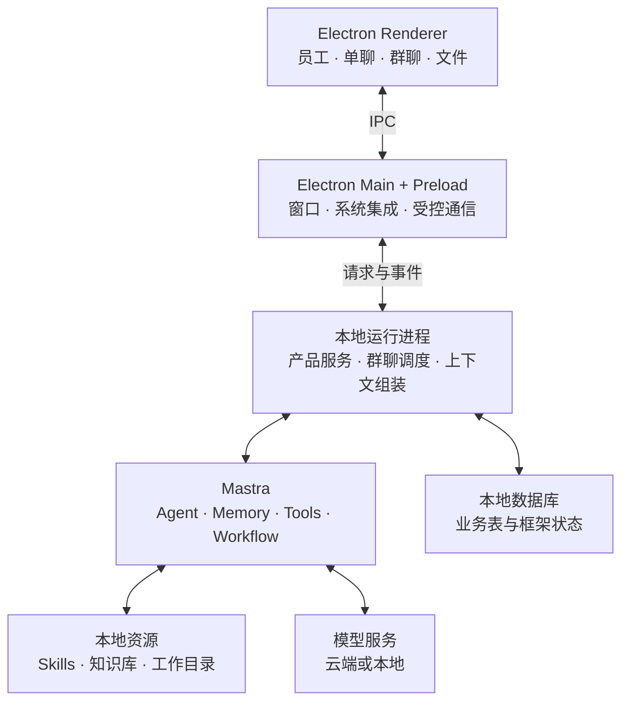

# 技术架构与选型

> 归档说明（2026-09-27）：下文保留原制定时的设计与时间语境；“当前/下一版/尚未开发”不代表最新状态。实际交付请读 [当前功能与代码现状](../2.已实现功能与代码现状/README.md)。

版本：v0.1（草案）  
日期：2026-09-26

> 版本说明：本表保留早期选型建议，实际 v0.1 技术落地见 [07](../2.已实现功能与代码现状/07-实现记录.md)。v0.2 增加员工独立工作区、作用域记忆与成员自决事件机制，以 [09](./09-独立员工与自然群聊.md) 和 [10](./10-v0.2开发顺序与验收.md) 为开发基线。

## 1. 选型状态

2026-09-27 后续设计：外观设置与 Base46 主题见 [14](../3.前端重构与功能/14-外观设置与主题系统.md)，Vite / React / shadcn/ui / Tailwind CSS / Zustand 的前端职责及目录迁移见 [15](../3.前端重构与功能/15-前端目录架构与迁移计划.md)。14–15 尚未实施；当前交付以 [12](../2.已实现功能与代码现状/12-v0.2实现记录.md) 和 [13](../2.已实现功能与代码现状/13-v0.2.1群聊修复与图标.md) 为准。

| 层次 | 方案 | 状态 |
| --- | --- | --- |
| 桌面宿主 | Electron，参考 boai-app 外层 | 已确认 |
| Agent 运行框架 | Mastra | 已确认 |
| 部署方式 | 运行逻辑、产品数据与工作文件优先在本机 | 已确认 |
| 界面开发 | React + TypeScript + Vite | 建议基线，与参考项目方向一致 |
| 运行进程 | Electron 管理的独立 Node.js 进程，优先验证 utilityProcess | 建议基线，需验证打包 |
| 通信 | preload 暴露受控接口，IPC / MessagePort 传递请求与事件 | 建议基线 |
| 产品数据库 | 本地 SQLite/libSQL，自有业务表 | 建议基线 |
| 框架状态 | Mastra Memory + LibSQLStore，与产品数据明确分工 | 建议基线 |
| 本地工作能力 | Mastra Workspace、LocalFilesystem、LocalSandbox、filesystem skills | 建议基线，需验证执行与权限 |
| 知识检索 | 文档解析与索引层；先验证必要格式及基础检索，再决定向量配置 | 待原型验证 |
| 构建与分发 | Vite、独立运行进程产物、参考 boai-app 的 electron-builder 方案 | 建议基线 |

依赖版本在初始化时核对并锁定。本规格不把参考项目的旧 Node 下限、依赖版本和构建脚本直接当作新项目要求。

## 2. 运行拓扑

独立运行进程首先提供生命周期和故障边界，不是工具脚本的安全沙箱。第一版可由一个运行进程按需承载多个员工会话，无须为每个联系人启动永久进程。

## 3. 各层职责

### Renderer

显示联系人、会话列表、群成员、消息、文件与运行进度。通过受控接口发送命令和订阅事件，不直接访问凭据、数据库、任意文件系统或 Mastra 实例。

### Electron Main / Preload

管理窗口和系统能力，提供文件选择等用户交互，启动和停止运行进程，并校验跨进程请求。Renderer 保持上下文隔离，preload 只暴露明确需要的能力。

### 产品服务与调度层

拥有员工定义、Conversation、Message、AgentSession、Run 等领域对象；决定谁参加、谁发言、看哪些资料，负责去重、队列、预算、取消和运行状态记录。

产品层调用 Mastra，但产品消息结构不直接等同于 Mastra 或模型厂商的消息格式。

### Mastra 适配层

依据员工配置装配模型、指令、工具、记忆与 Workspace。接收产品层传入的上下文和运行标识，将流式输出、工具请求及完成结果转为产品事件。

第一版只实现 Mastra 适配。保留清晰的模块边界即可，不预先构建多内核插件体系。

## 4. 请求与事件边界（建议）

请求至少区分：发送消息、启动/取消任务、回应需要用户处理的工具请求、查询会话、更新员工配置。

事件至少区分：消息增量、消息完成、运行状态变化、工具状态、产物更新、运行错误。

相关请求和事件携带稳定的 conversationId、agentId、runId、messageId。每个标识只承担自己的职责，不能用框架 thread ID 同时代替所有标识。

消息提交先持久化并去重，再启动任务。流式增量用于展示；最终内容与必要检查点进入产品持久化。界面重连时从持久化记录恢复，再继续订阅，避免重复气泡。

初版可只支持本地 IPC。若以后需要远程运行，再通过单独传输适配增加 HTTP / WebSocket；不要求第一版启动公开网络服务。

## 5. 数据与记忆的所有权

| 数据 | 所有者 | 约定 |
| --- | --- | --- |
| 员工、群成员、公开消息、附件归属 | 产品数据库 | 用户界面的权威事实 |
| 调度计划、Run 状态、任务关联 | 产品运行服务 | 决定任务如何推进和恢复查看 |
| 模型上下文、压缩状态、框架 thread 映射 | Mastra 适配与 Memory | 执行状态，不作为唯一群聊记录 |
| 知识库原件和授权信息 | 产品资源层 | 原件和授权是权威来源 |
| 检索索引 | 检索层 | 可由原件重建，检索必须应用访问范围 |
| 技能包与产物 | 本地资源层 | 按归属和权限提供路径 |

建议把业务表和 Mastra 管理的表放入不同数据库文件，便于分别迁移、备份和排查。是否共用一个文件在原型阶段确定；无论物理上如何组织，都不允许两层共同修改同一套表。

产品消息到模型上下文的转换只能有一个明确入口，防止同一段历史同时由应用注入和 Memory 自动回填而重复出现。运行检查点不应宣称可以仅靠公开聊天记录完整重建；内部工具结果等恢复材料另行管理。

第一版建议由产品上下文适配器显式构建每轮输入，关闭对同一公开历史的框架自动回填；内部运行状态另行持久化。具体去重与恢复规则见 [03 数字员工与会话模型](./03-数字员工与会话模型.md)。原型需验证所选 Mastra 版本的配置组合，并检查实际模型请求中的消息，不能仅依据界面没有重复气泡判断正确。

## 6. Mastra 的使用原则

- 使用 Agent 执行开放任务，使用 Workflow 表达确有固定步骤的业务流程。
- 协调者可使用 supervisor/subagents，但群聊身份和持续上下文由产品层管理。
- 明确 @ 可以直接调用目标员工，不必每次先调用一个模型做路由。
- 独立的群成员调用与临时子 Agent 委派分别记录。
- 当前官方文档已将旧的 Agent.network() 标为弃用，新实现基于当时安装版本支持的 Agent.stream()/generate() 与 subagents 能力。
- 选定版本后优先查该版本内嵌文档和类型，不把示例代码跨版本照搬。

## 7. 发行版约束

- Mastra 运行产物保留适配其要求的 ESM 边界；不能因为参考项目主进程是 CJS 就把整个运行层强行一起打包。
- Node 运行环境由 Electron 内置或应用明确打包提供，满足所选 Mastra 版本的要求。
- 数据库、技能安装区和工作目录都使用可写位置；不写入应用 ASAR。
- 本地数据库驱动、动态加载资源、平台脚本及子进程入口必须在实际安装包中验证。
- 窗口关闭、应用退出和操作系统休眠是不同事件，产品需明确哪些情况停止执行。
- 本地持久化仅保证已保存数据存在，不自动保证中断任务可继续执行。

## 8. 依据与待验证事项

官方能力已在选型讨论中核对，核对日期为 2026-09-26；尚未在 boai-agent 安装依赖或运行原型。

- [Mastra Electron 接入](https://mastra.ai/integrations/frameworks/electron)：官方示例通过本地服务连接桌面界面。
- [Mastra libSQL](https://mastra.ai/integrations/databases/libsql)：支持本地文件存储。
- [Mastra Subagents](https://mastra.ai/docs/subagents)：主管委派、记忆与取消行为。
- [Agent.network()](https://mastra.ai/reference/agents/network)：当前弃用说明。
- [Electron utilityProcess](https://www.electronjs.org/docs/latest/api/utility-process)：受管理的 Node 子进程与消息通信。
- [Electron 安全建议](https://www.electronjs.org/docs/latest/tutorial/security)：Renderer 与宿主能力边界。

本项目的“utilityProcess + Mastra + 自有 IPC”是架构建议，不能由官方 Electron HTTP 示例直接推定已通过打包验证。
