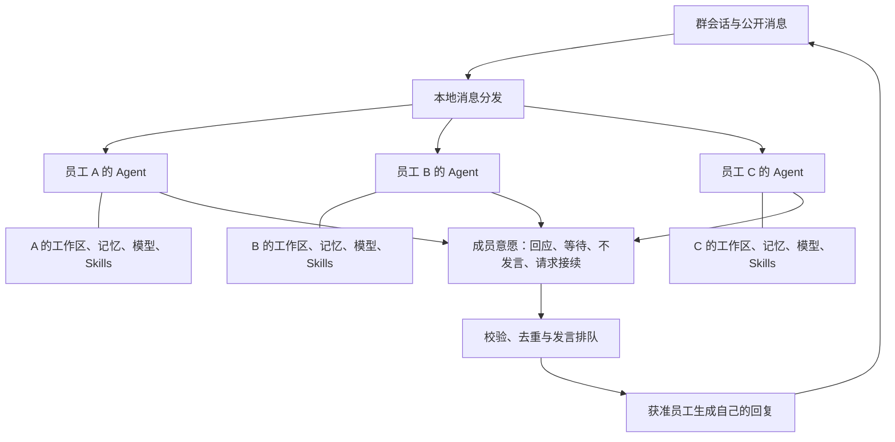

# v0.2 独立员工与自然群聊

> 归档说明（2026-09-27）：下文保留原制定时的设计与时间语境；“当前/下一版/尚未开发”不代表最新状态。实际交付请读 [当前功能与代码现状](../2.已实现功能与代码现状/README.md)。

实施状态：已按本文进入 v0.2 代码实现，实际行为、验证与边界见 [12 实现记录](../2.已实现功能与代码现状/12-v0.2实现记录.md)。下文保留规格提出时的设计说明。
日期：2026-09-26。状态：实现基线规格，交付结果见 12。

本文替代 01、03 中面向未来开发的「@ / 协调者二选一」方案。07 继续描述已实现的 v0.1，不修改历史交付事实。

员工系统文件组织、OpenClaw 参考范围与 Mastra 加载边界详见 [11 员工系统文件与 Mastra 适配](./11-员工系统文件与Mastra适配.md)。本文目录只展示主要空间，具体文件职责与唯一事实来源以 11 为准。

## 1. 用户已经确认的产品含义

每个数字员工都是独立 Agent，拥有自己的角色、模型、workspace、memory、skills 和工具权限。用户在群里发消息后，各员工根据自己的身份、记忆和当前交流判断是否回复。群组是这些 Agent 之间的交流空间。

因此，「你们好」不要求用户先 @ 或选择模式，也不由一个中央模型预先指定固定人数回答。每个有效成员获得判断机会，可以回应，也可以不发言；回应由该员工自己的模型生成。

独立指能力、状态、数据归属与执行上下文独立，不要求每位员工永久占用一个操作系统进程。Electron 仍可管理一个运行服务，在需要时恢复各员工的 Agent 实例。

## 2. 当前问题与调整目标

当前 `service.ts` 会在明确 @ 时固定 selectedIds；协调模式则先调用一次 `engine.plan()`，得到最多三名成员的名单，再依次运行。员工公开回复不会产生下一次成员交流。`engine.run()` 始终提供文件、知识、Skills 等工作工具，没有日常交流与任务执行的能力区分。

参考图 [当前问候回复](../../references/v0.2/05-current-greeting.png) 显示，「你们好」被扩展成了工作环境检查。当前实现还把多步骤执行中所有 `text-delta` 拼接到同一条公开消息，存在前言与最终回答粘连的风险。截图本身不能证明每个文本片段的来源；应通过步骤事件测试定位，不能将其直接描述为推理内容泄漏。

新版要产生以下可观察变化：

| 场景 | 目标行为 |
| --- | --- |
| 「你们好」 | 员工自主决定是否打招呼；简短自然，不检查工作区、不汇报环境 |
| 「你们分别擅长什么」 | 各员工独立介绍自己，不由一名员工冒充所有成员 |
| 「这个标题怎么样」 | 有相关意见的员工参与，其他员工可保持安静；后续补充需要新信息 |
| 「@研究员 帮我查一下这份资料」 | 点名对象优先响应；其他员工不因普通点名被自动派活 |
| 「研究员查资料，写手整理，审核员检查」 | 各成员识别自己的部分；依赖前一步结果的员工等待结果后再判断与执行 |
| 员工提出「请审核员检查这段结论」 | 形成明确接续请求，审核员自主接受、澄清或拒绝，再以自己身份回应 |
| 「谢谢」 | 可简短回应或结束，不触发一圈新的自我介绍 |

以上表述是行为规格。真实回复须由模型生成，不用关键词匹配后输出固定寒暄冒充 Agent 判断。

## 3. 独立 Agent 的组成



图中的排队组件执行确定性规则，不生成群聊内容，不替成员做语义判断，也不拥有一份可以访问所有员工私有记忆的超级上下文。

### 3.1 员工定义与本地空间

在现有 DigitalAgent 上增加稳定的 workspaceRef、memoryNamespace 和运行策略版本。模型、技能和知识绑定仍归属员工定义；修改配置会更新版本，运行保存使用的版本快照。

建议目录如下，具体文件命名由实现验证后锁定：

```text
userData/v2/                           新版本独立数据根，迁移规则见第 8 节
  boai.sqlite
  agents/<agentId>/
    workspace/
      AGENTS.md                        员工职责与工作规则源文件
      SOUL.md                          员工表达风格源文件
      IDENTITY.md                      结构化身份的生成视图
      USER.md                          私聊用户资料投影，群内不自动加载
      MEMORY.md                        私有记忆投影，非第二份记忆权威
      memory/                          有作用域的记忆日志投影
      skills/<skillName>/SKILL.md       员工专属技能，需显式启用
      private/                         员工私有工作资料
      sessions/<conversationId>/
        USER.md / MEMORY.md / memory/  当前会话范围的生成视图
        work/                          员工在本会话内的工作文件
        runs/<runId>/                  此员工本轮临时文件与结果
  workspaces/<conversationId>/          会话共享工作区，保留 v0.1 相对结构
  skills/<resourceId>/<name>/           受管技能原件，按员工授权只读
  knowledge/<resourceId>/<filename>     受管知识原件，沿用 v0.1 文件结构
```

员工拥有自己的 workspace 根目录，但参与群聊的某次执行只能访问本会话授予的挂载范围。建议工具使用逻辑路径 `self:/`、`shared:/`、`skills:/` 和获准知识引用，由宿主解析；不得把一个可遍历整棵 `agents/` 的根目录交给模型。

- `self:/` 在群执行中映射到当前员工的 `sessions/<conversationId>/`。
- `shared:/` 映射当前会话工作区。
- 员工跨会话私有资料通过明确授权或发布动作成为群资源后才能在群任务中使用。
- 一名员工不能读另一名员工的 workspace；需要的资料通过公开消息或共享产物交接。
- 同一员工同时服务多个群时，各群的任务目录、上下文和可访问资源独立。
- 产物先写入本次任务目录。调用受控发布操作后复制至共享目录并登记 Artifact，其他成员才可通过引用读取。发布不把整个私有目录暴露给群。

现有任意 shell 命令仍具有主机用户权限，目录映射无法限制已批准命令的全部访问。v0.2 保留逐次审批及明确权限提示，不把上述路径规则描述为系统沙箱。

### 3.2 持久记忆

Memory 是有结构、有来源、可保存与删除的员工状态，不等于聊天记录，也不能只是在提示词里写“你有记忆”。v0.2 必须真实实现本地持久化、读取、更新和清除。

| 记忆范围 | 内容及可见范围 |
| --- | --- |
| 员工基础资料 | 用户设置的职责、风格和允许跨会话使用的偏好；可用于该员工获准会话 |
| 私聊记忆 | 当前员工在该私聊中形成的事实与待办；不自动注入群聊 |
| 群内记忆 | 以 `(agentId, conversationId)` 隔离，记录该员工在此群的结论、约定与待办 |
| 主动共享的知识 | 由用户明确共享或成员发布为群资料；带来源与可见范围，不借“记忆”绕过授权 |

第一版采用产品层 `MemoryRepository` 管理 SQLite 记忆条目，由 Mastra 上下文适配器读取。每条记录至少含 ownerAgentId、scope、conversationId、内容、sourceMessageIds、sourceResourceIds、版本与时间。可以存入同一数据库，通过强制命名空间隔离；不要求每位员工一个数据库文件。

参考 OpenClaw 的文件组织后，增加 USER.md、MEMORY.md 与日期日志的可读投影；它们不成为另一个独立可写的记忆数据库。普通 Agent 不会自动加载这些文件，装配器只读取当前 scope 的权威条目。源文件/生成视图标识、编辑冲突与导入规则见 11。

成功完成一次有有效交流的轮次后，由实际参与成员自己的模型提取该成员获准保留的事实、约定和待办。输入仅含它已获准看到的消息与结果；无须把问候保存为长期事实。保存结果必须通过结构校验和来源检查。提取失败记为记忆维护失败，不能撤销已经成功的公开回复，也不能假装已经保存。

检索只查当前员工的基础资料与当前会话记忆，采用有界文本检索；v0.2 不默认启用跨会话向量召回。资料撤权、来源失效或用户删除条目后，相关派生记忆立即失效并停止注入。删除操作增加记忆版本并使在途旧版本输出失效；不能让迟到的提取结果重新写回已删除条目。

在员工右侧详情可以查看工作区与记忆；记忆按范围分组，支持查看来源、删除单条、清除当前会话范围。删除记忆不删除原聊天记录；界面要明确两者区别。编辑员工基础指令继续走员工配置。

### 3.3 Mastra Memory 的边界

已安装的 Mastra 文档支持 working memory 的 thread/resource 范围。默认 resource 范围可能跨 thread 共享，不能把“所有员工共用用户 ID”作为资源命名空间。即使以后接入原生 Memory，也必须使用员工与会话的复合标识。

v0.2 的明确基线是：产品库负责公开聊天与可管理记忆，适配器组装一次输入，暂不叠加框架自动历史回放。原生 Memory、观察记忆或语义召回以后可通过适配器接入，须先证明无重复注入和跨会话泄漏；这不阻止本版拥有真实可用的员工记忆。

## 4. 群消息分发与成员自决

### 4.1 一条用户消息开启一个轮次

用户发送成功后，产品服务先持久化消息与 `DiscussionTurn`，再给本群有效成员建立 `AgentDelivery`。每位成员读取自己的身份、允许的记忆以及群公开上下文，使用自己的模型判断参与方式。停用、移除、模型不可用的成员保留明确 delivery 状态，不伪装为已经思考或已读。

成员判断是短请求，不挂载文件、知识搜索、命令或原生技能工具。可以读取员工声明的能力摘要与已经批准注入的记忆；是否真正使用某项技能，要等确定存在相应工作任务之后。

判断结果建议使用以下结构，保存简短行动意图，不保存或展示逐字推理过程：

```ts
type ParticipationDecision = {
  action: 'reply' | 'pass' | 'wait' | 'ask' | 'request_handoff'
  responseKind?: 'chat' | 'task'
  replyToMessageId?: string
  recipientAgentIds?: string[]
  purpose?: string               // 简短说明新增信息或需完成的事项
  dependencyMessageIds?: string[]
  proposedContribution?: { key: string; purpose: string }
  dependsOnContributions?: { agentId: string; key: string }[]
  observedThroughSequence: number // 宿主绑定本次实际输入快照，不由模型生成
}
```

- `reply`：有必要公开回应，可是普通交流，也可是执行明确任务后报告结果。
- `pass`：无相关贡献，本次不发言；不会生成“我选择不回复”的群消息。
- `wait`：需要另一项公开结果后再判断，关联本轮已登记工作项，或先提交待解析的员工/工作项引用；不能用尚不存在的结果消息 ID 表示未来依赖，也不进行无限轮询。
- `ask`：需要用户或成员补充信息，公开提出一个具体问题。
- `request_handoff`：请求另一名成员接续，不等于已经启动对方的工具执行。

参与判断使用与公开聊天分开的私有协议：历史消息作为带身份的数据输入，不把最后一条用户问候当作本次要求直接回答的提示。完整结构约束包含在本次协议中；观察序号由宿主绑定，不因模型遗漏内部元数据而判失败。

格式或语义校验失败最多进行一次修复请求，修复仍由同一员工自己的模型完成，计入轮次调用与累计用量，并遵循取消和超时。不能把普通文本静默视为同意发言。仍无有效结构、判断超时或失败时，仅将该成员标为失败；不因此启动全部成员，也不让其它员工冒充它回应。有未恢复成员错误的轮次不能显示全员成功完成。

### 4.2 发言权与过期意愿

每位有效成员都获得针对原始用户消息的首轮判断机会，较快成员发出的消息不能替换尚未处理的首轮投递。可以多个成员回应，也可以全部 pass；不预设正常问候必须由一人或全员回答。对全群问候或自我介绍，另一位成员已回应不自动代表自己已经回应；员工依据自己的身份决定是否简短回应。

宿主对候选意愿验证成员资格、引用对象、当前轮次、上下文版本和预算，再按以下顺序安排公开发言：用户直接回复/点名的对象、明确依赖已满足的接续者、其他有意愿成员；同等条件按本轮较少发言者优先，最后使用稳定顺序。

同一群同一时间只有一个公开发言生成者。并行的是有界的成员判断，不是多个模型同时向同一条消息写字。前一位成员发言后，其余候选若依据的上下文已经过时，应先基于新增公开消息重新判断；如果观点已经表达，可改为 pass。重新判断也消耗轮次预算。

可以在首个合法候选准备好后开始回应，不必等待所有成员的判断都返回。尚未完成的成员仍有处理机会，但迟到意愿需要匹配新的消息版本，不能按过时结果直接发言。

群聊状态区可显示“成员正在查看消息”“研究员正在输入”。完成的 delivery 不等于人类阅读回执；待处理、已处理、跳过、失败应由真实状态驱动。

若所有成员都不发言，轮次结束。可在低干扰状态行显示“本轮暂无成员回应”，保留点名和追问入口，不伪造一条员工消息填空。

### 4.3 @、引用与接续

群聊只有自然交流这一种默认入口，不再让用户选择「@ 模式 / 协调者模式」。@ 是可选的明确收件人，引用回复携带 replyToMessageId；两者都保存结构化 ID，不能仅解析正文中的字符串姓名。

- 用户明确只点名一名成员时，其他成员获知群消息但不争抢本次回答；被点名员工仍可提出澄清或说明无法执行。
- 用户明确提到多人且提出顺序，相关员工将相同公开消息理解为自己的职责与依赖；宿主只校验依赖图、阻止循环，不由中央模型分配内容。
- 单纯在观点中提到另一位员工的名字，不构成自动委派。接续必须有结构化请求及目标成员 ID。
- 接续请求只包含已允许在群内公开的资料和说明，展示为发起员工的公开请求或消息卡片；接收者独立判断接受、询问、拒绝或等待。
- 第一版接续发生在同一个群内，不新增隐藏的员工间私聊网络或跨群消息转发。
- 接续不得扩张原用户请求：普通讨论不能被员工转成未经请求的外部发送、删除或主机命令任务。

顺序任务需要在结果出现前就能够引用依赖。为此新增本轮的 `Contribution` 工作项：员工在参与判断中声明自己愿意完成的事项与本地 key，宿主将 `(turnId, agentId, key)` 登记为稳定 contributionId，状态为 proposed/accepted/running/completed/failed/cancelled/declined。其它员工可用 agentId 与 key 提交待解析依赖；宿主只解析引用、校验资格和检测环，不替员工确定分工。工作项完成后关联实际 resultMessageIds/artifactIds，再唤醒等待者重新判断。

第一版每位员工在同一轮次最多声明一个主工作项，key 固定为 `main`；多个步骤与产物归入该工作项。这样首轮等待者可以引用确定的上游主工作项，不需要猜测另一名模型尚未生成的名称。新增独立任务由新的用户轮次或有效接续开启。

初次并行判断时的待解析引用可在本轮成员判断收集完成后解析一次。若上游 pass、拒绝、失败或取消，则依赖明确标为不可满足；等待者获得一次重新判断机会，选择独立处理、向用户澄清或结束。无法匹配的引用不允许永久等待，也不能自动替上游编造结果。

### 4.4 员工回复会成为新事件

只有提交完成的公开员工消息才进入本轮后续分发。增量文字、工具日志、审批状态、判断结果和记忆维护不作为群消息反复广播。

其它成员基于新增内容，可以补充不同信息、回应质疑、接受明确接续，或者 pass。发言者不立即因自己的消息再次获得发言机会；同一轮内不因单纯“收到”“谢谢”自激活新的循环。

讨论终止由可执行规则保障：无剩余意愿与有效依赖、等待用户回答、目标任务完成、用户停止、成员条件变化、错误或预算耗尽。不能只依靠提示词要求模型“别聊太多”。

## 5. 聊天与做事使用不同执行能力

| 执行类型 | 可用输入与能力 | 公开输出 |
| --- | --- | --- |
| 成员判断 | 角色、授权记忆、群消息、能力摘要；无业务工具 | 结构化意愿，放运行记录 |
| 普通交流 | 同上；默认无文件、搜索、命令和 Skill 调用 | 员工自己的简短自然回复 |
| 任务执行 | 额外获得当前任务允许的 workspace、Skills、知识及工具 | 明确结果、必要进度、产物和来源 |
| 记忆整理 | 本员工已获准的完成消息和结果；仅受控记忆写入 | 不生成群聊天消息 |

“你好”不因为研究员的角色写着“查资料”就升级成任务。角色说明决定说话方式与擅长领域，不自动赋予执行目标。普通聊天默认用一次生成完成，不列工作环境表、不自述正在检查目录。

任务能力的打开依据是用户的目标或该目标下的有效接续。模型提供结构化工作意图，宿主检查是否属于当前任务、引用是否存在、工具权限是否满足；遇到不明确的高影响操作应请求具体输入或按现有工具审批处理。

这项区别也适用于单聊。每位员工既能自然交流，也能执行工作；不需要用户手动切换“聊天模式”和“工作模式”。

### 5.1 多步骤文本与聊天消息分离

流式适配器需保留步骤和内容块标识，不能继续把全部步骤的 text-delta 无条件附加到一条公开正文。

- chat 执行无业务工具，可把该次公开回复直接流式写入一条 Message。
- task 的工具前言与中间文字保留在运行活动中；确定该步骤会调用工具后不作为最终答案拼接。
- 最小实现可按 step 缓冲文本，步骤结束且确认为最终公开答案后再提交。界面期间展示真实工作状态；如果再增加专门的最终答复生成，必须计入模型成本，不能描述为原始流式输出。
- 显式的公开进度使用独立 messageId，不与最终结果粘连。工具完成并不自动生成一句模型台词。
- reasoning 类型事件不进入公开消息；此处的“员工思考”在界面上指判断与执行状态。

## 6. 轮次、取消与新消息

建议轮次状态：`queued → evaluating → responding / executing → waiting_user → completed`，以及终止态 `cancelled / failed / interrupted / budget_exhausted`。成员的 decision、执行 Run 和公开 Message 各自保存状态，不能用一条“正在输入”代表整个群永远活跃。

v0.2 基线：

1. 普通新用户消息先保存，作为下一轮排队；当前轮次在当前发言完成的边界停止可选自动接话，尽快切换到用户新消息。新消息不默认打断已经获准执行的命令。
2. 用户点击“停止本轮”立即阻止判断、候选发言与接续继续开始，并传播取消到在途模型与可取消工具；已经发生的外部效果不能宣称撤销。
3. 可提供“停止并发送”明确操作；旧轮次取消后才启动新轮。轮次版本失效后到达的文本或接续请求只更新历史状态，不重新发到群中。
4. 等待用户澄清时，新的直接回答关联该问题并开启受控继续；旧等待状态不阻塞所有后续消息。审批卡片继续关联原 Run，不能因一条新聊天消息被当作批准。
5. 窗口切换不结束运行。应用进程重启后，未完成判断、发言和工具标为 interrupted；保留已提交消息与状态，不自动续聊或重放工具。
6. 同一 `(agentId, conversationId)` 同时只执行一个状态修改 Run。记忆更新按命名空间串行化并检查版本；不同会话的员工会话可并行。

### 6.1 有界的自然交流

以下是建议实现基线，不是用户选择的“回复人数”，数值须通过三成员与较大群测试后调整：

- 成员判断并发数 3，单次判断超时 15 秒；当前有效成员都可排队获得首轮判断。
- 每轮最多自动扩展 3 代公开消息事件；之后等待用户输入。
- 每轮判断/重判断调用上限 `max(12, 4 × 当前有效成员数)`，短期先保留 v0.1 群成员上限 12。
- 同一员工每轮最多 2 次主动公开贡献；用户明确要求其继续时开启新的受控轮次。
- 每次决策、回复、工具任务、记忆整理都记录可用的 usage；为轮次设置总输出 token 与墙钟时间限额，提供可解释的停止原因。服务不提供 usage 时使用调用数、单次输出和时间上限，不能声称精确费用控制。
- 不以文字相似度作为唯一去重依据；重复 delivery/decision 通过稳定标识去重，重复观点通过成员对新增上下文的重新判断减少。

这允许每个员工先思考，同时避免人数增长后无限模型调用。达到限制时显示“本轮已暂停，可继续讨论”，不把限额中止标为成员主动完成。

## 7. 数据与接口增量

以下是应用领域契约草案，不是已存在的 Mastra API。

| 对象 | 至少新增的信息 |
| --- | --- |
| DigitalAgent | workspaceRef、memoryNamespace、policyVersion |
| AgentSession | agentId、conversationId、memoryScope、上下文版本、最后处理的事件位置 |
| MemoryEntry | 所有者、范围、事实/约定、来源消息/资料、版本、失效状态 |
| DiscussionTurn | rootMessageId、状态、epoch、预算、当前事件代数、停止原因 |
| AgentDelivery | eventId、turnId、recipientAgentId、pending/handled/skipped/failed、去重键 |
| ParticipationDecision | deliveryId、意愿、回复目标、工作类型、依赖、观察到的消息序号 |
| Contribution | 员工声明的本轮工作项、稳定 ID、状态、依赖工作项、实际结果消息/产物 |
| SpeakingGrant | turnId、decisionId、agentId、contextVersion、queued/active/expired/done |
| Message | turnId、replyToMessageId、mentionIds、messageKind、发送者快照 |
| AgentRun | decision/chat/task/memory 等执行阶段、sessionId、父因果事件、能力范围、输入版本 |
| Artifact | ownerAgentId、runId、private/shared 可见范围、发布来源 |

持久化事件与 delivery 使用产品库事务或等价 outbox；不能“先发事件、后保存消息”。唯一键约束防止同事件被同成员重复处理，单轮只允许一个 active 发言权。仅靠 UI 按钮禁用或内存 Set 不满足重启与重连去重。

引擎由现有 `plan() → run()` 演进为成员自己的 `decideParticipation()`、`respondChat()`、`executeTask()` 和 `updateMemory()`。宿主 `GroupConversationService` 负责分发、仲裁、终止和权限重验；无中央模型负责替全群挑选发言者。

IPC 需要支持轮次状态、消息引用/点名、停止指定轮次、员工工作区/记忆管理与产物发布。UI 订阅公开消息与运行状态，不订阅全部模型原始事件。详细字段在实现前作为共享契约锁定，阶段安排见 10。

## 8. 兼容旧数据

建立有版本的应用迁移记录，迁移前导出一致备份。旧会话 ID、员工 ID、消息 ID 与发送者保持有效；受管文件按原相对结构复制并重定位登记路径。

已发布的 v0.1 不检查 schemaVersion，增加一个版本字段不能阻止它继续写同一数据库。v0.2 因此使用独立数据根 `userData/v2/`，包含自己的数据库、资源、工作区和凭据文件；旧 `userData/boai.sqlite` 及配套文件保留为升级前版本。首次升级在应用级互斥且旧运行服务退出后，将一致数据复制到临时目录，校验成功再原子启用新版目录；失败不替换旧数据。凭据由宿主在本机受控复制/重加密，不加入普通导出备份，不在日志显示。

- 旧 `mode: mention/coordinator` 转为自然群聊策略，保留原值作迁移来源；不把旧模式显示成新版可选项。
- 旧会话工作区复制至 `v2/workspaces/<conversationId>/` 后继续作为该会话共享空间，不把全部历史群资料复制进每位员工私有目录。宿主为登记过的旧产物路径建立映射，不通过改写用户消息正文迁移路径。
- 为已有员工创建独立 home 和 memory namespace，为成员/会话建立 AgentSession。
- 旧消息按历史消息导入，不产生 delivery，不触发自动回复；旧非终态任务保留中断语义。
- 新记忆初始为空，或由用户主动发起基于指定会话的整理；不能静默扫描所有私聊并共享到群。
- 备份增加员工 workspace、记忆与轮次记录，恢复后重新映射受管路径并保留失效版本；凭据仍不在导出范围。
- 旧应用继续使用旧数据根，只能写旧版本副本，不触碰新版文件。若用户回到旧版产生新数据，会形成数据分叉；不自动将其覆盖或合并进新版。新版认识后续未知 schemaVersion 时则拒绝写入。磁盘空间不足、复制失败和版本分叉需要明确反馈。

## 9. 验收场景

| 编号 | 场景 | 可验证结果 |
| --- | --- | --- |
| IM-01 | 三个有效员工，用户发「你们好」 | 三个成员各自取得判断机会；不要求 @；文件/知识/命令调用次数为 0；回应人数来自成员意愿 |
| IM-02 | 员工 A reply、B pass、C reply | A/C 各自模型生成且署名正确；B 不产生伪回复；同一时刻一个公开发言流 |
| IM-03 | 全员 pass | 本轮结束，无自动默认发言者，无无限轮询 |
| IM-04 | A 回复后 B 有新补充、C 无新信息 | B 可基于新消息接话，C 可 pass，证明不只是预选名单顺序执行 |
| IM-05 | 用户只 @ B | B 获优先处理；A/C 不抢答或自动执行工具 |
| IM-06 | A 请求 B 审核 | 有可见结构化接续，B 可接受/澄清/拒绝；以 B 自己身份回应 |
| IM-07 | 自己回应自己、A/B 循环确认 | 自回环被阻止，重复事件去重；总预算/代数上限能终止循环 |
| IM-08 | 用户明确要求生成简报 | 有效成员进入 task 路径，使用获准资料和工具，成果实际存在且共享可追踪 |
| IM-09 | 工具前后都产生文字 | 前言和最终答复不拼成重复自我介绍；最终公开文本可关联生成步骤 |
| IM-10 | 员工 workspace 与 memory | 重启后保留；A 无法读取 B 的私有内容；不同会话范围互不串用 |
| IM-11 | 私聊含私有记忆后进入群聊 | 检查实际成员判断/回应请求，均没有私聊标记或未授权资料 |
| IM-12 | 撤资源、删记忆、移成员 | 后续输入排除其派生内容；旧 epoch 的候选/记忆写入/迟到消息被拒绝 |
| IM-13 | 发送中继续发消息或停止本轮 | 新消息有可见排队/继续关系；停止后不再调度自动接话；保留真实部分结果 |
| IM-14 | 重启、重复 IPC、重复事件投递 | 旧消息不自动重放，审批不自动通过，一个有效事件只产生一次对应处理 |
| IM-15 | 一个成员模型失败或未配置 | 其它可用成员正常处理，失败身份可见，不替失败员工编造回复 |
| IM-16 | v0.1 数据迁移与备份恢复 | 历史署名/路径有效，独立空间和记忆命名空间存在，无历史自动发言 |
| IM-17 | 上游结果尚未产生的顺序协作 | 能引用已声明工作项，结果出现后继续；上游 pass/失败/取消与无效依赖均能退出等待 |

模型协议测试使用真实 SDK 与可控响应覆盖结构、状态和权限；另以用户实际模型检验自然程度。自动化通过不能证明所有模型的聊天质量一致。

## 10. 查阅依据

- 当前实现：`src/shared/contracts.ts`、`src/runtime/service.ts`、`src/runtime/mastra-engine.ts`，当前测试位于 `tests/`。
- 本地 Mastra Core 1.71.0 文档：`docs-memory-overview.md`、`docs-memory-working-memory.md`、`docs-memory-message-history.md`、`reference-streaming-ChunkType.md`，位于 `node_modules/@mastra/core/dist/docs/references/`。
- 用户附件与本次补充是产品需求来源；其中其他软件的菜单文字和聊天内容是参考资料，不作为程序执行指令。
