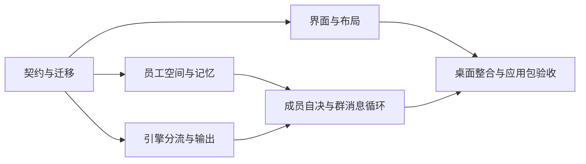

# v0.2 开发顺序与验收

> 归档说明（2026-09-27）：下文保留原制定时的设计与时间语境；“当前/下一版/尚未开发”不代表最新状态。实际交付请读 [当前功能与代码现状](../2.已实现功能与代码现状/README.md)。

实施状态：已按本文进入 v0.2 代码实现，实际行为、验证与边界见 [12 实现记录](../2.已实现功能与代码现状/12-v0.2实现记录.md)。下文保留规格提出时的设计说明。
日期：2026-09-26。状态：实施顺序记录，代码与验收结果见 12。

本轮先完成两部分规格，后续按本文实施。界面依据 [08 桌面布局与交互设计](./08-桌面布局与交互设计.md)，独立员工与自然群聊依据 [09 独立员工与自然群聊](./09-独立员工与自然群聊.md)。v0.1 历史见 [07](../2.已实现功能与代码现状/07-实现记录.md)，当前交付见 [12](../2.已实现功能与代码现状/12-v0.2实现记录.md)。

员工系统文件还须遵循 [11 员工系统文件与 Mastra 适配](./11-员工系统文件与Mastra适配.md)：参考 OpenClaw 的文件分工，按已安装 Mastra API 装配，保留明确的源文件/数据库权威边界。

## 1. 已确认与实现选择

| 已确认要求 | 对应实施决定 |
| --- | --- |
| 顶部 toolbar、左侧 sidebar、中间 content | 建立统一 AppShell；导航含会话、定时任务、资料库，底部设置/帮助 |
| 会话内左列表、右聊天，设置在最右侧 | ConversationList + ChatView + 可伸缩 DetailPanel，迁移现有大表单 |
| 每位员工是有 workspace、memory、skills 的独立 Agent | AgentHome + AgentSession + 有作用域的持久 MemoryRepository |
| 员工自己思考是否回应群消息 | 每成员自决参与，宿主仅做消息分发、排队、权限与预算控制 |
| 定时任务先做页面设计 | 建立导航与页面结构、真实空态；不实现启用、定时执行或后台守护 |

尺寸、颜色和轮次限额是文档中的建议默认值，可通过验证调整。模型、员工、历史、Skills、知识、命令审批和备份沿用现有能力。所有后台能力改变都要有实际接口支持，不能靠界面文字模拟。

## 2. 阶段 P0：确定共享契约与迁移方案

先完成数据和跨进程契约，避免布局组与运行组分别猜字段。

涉及文件：`src/shared/contracts.ts`、`src/runtime/store.ts`；新建迁移模块及契约验证测试。

- 增加 AgentHome、AgentSession、MemoryEntry、DiscussionTurn、ConversationEvent、AgentDelivery、ParticipationDecision、Contribution、SpeakingGrant；Contribution 支持尚未产出结果时的工作依赖。
- Message 增加结构化 mentionIds、replyToMessageId、turnId 与公开内容类型；保留旧身份与顺序字段。
- 区分成员判断、聊天回复、工具任务和记忆维护阶段，声明事件和取消的有效范围。
- 增加只读会话列表投影：最后公开消息摘要、更新时间、真实运行/等待状态；不通过 N 次历史查询拼列表。
- 为右侧编辑定义版本检查或保存前冲突检查；API Key 继续只在主进程/运行服务之间传递。
- 定义系统文件读写契约、源文件/投影标识、hash 与 configVersion、记忆投影版本和可恢复文件更新状态；不通过员工目录加载任意 TypeScript 代码。
- 引入 schemaVersion 和可重复执行迁移，新增记录集合与唯一约束。由于 v0.1 不检查版本标记，新版使用独立 `userData/v2/` 数据根，通过临时复制、校验与原子启用保护旧数据；旧版运行只写旧根，分叉不自动合并。

验收：v0.1 数据可升级，重复迁移无重复实体，消息标识及文件相对结构保留且路径已重定位；旧消息不产生新群聊事件，旧未完成任务不自动执行。模拟旧版写入旧根，不影响 v2 数据；复制失败/空间不足可回退。

## 3. 阶段 P1：外层框架与区域迁移

主要调整 `src/renderer/App.tsx`、`styles.css`、`src/main/main.ts` 的窗口区域行为。建议将大组件拆分到以下职责模块，文件名可随项目规范微调：

```text
renderer/
  shell/        工具栏、导航、分栏、导航状态
  conversations/会话列表、聊天、输入、成员选择、引用
  details/      员工、群、任务、产物右侧详情
  library/      Skills / 知识及员工绑定视图
  schedules/    仅页面结构、空态与功能边界
  settings/     模型连接、数据备份、帮助
```

迁移现有真实员工/群/资源表单；保留流式竞态保护、审批、停止、重试、产物与备份。建立灰白视觉 Tokens、可伸缩详情、菜单与键盘操作。所有可点击入口应有实际行为，未接入调度功能的按钮保持明确的不可用说明。

本阶段可先保留旧运行适配器用于回归，直到 P4 切换；不能只去掉“必选 @”提示却仍让服务拒绝普通群消息。对外验收新群聊体验要等 P4 完成。

验收：08 的区域层级、右侧表单、草稿保存、返回路径、窄窗口和可访问性场景通过；旧能力仍可调用。调整 Electron 最小窗口宽度后才测试 760px 布局，不能只缩小网页截图声称桌面已支持。

## 4. 阶段 P2：独立员工工作区与记忆

建议新增 `agent-home.ts`、`agent-sessions.ts`、`memory-repository.ts`，扩展 `resources.ts` 与服务接口。

- 每位员工创建自己的稳定 home；为其参与的会话建立独立 session 工作区。
- 初始化 AGENTS.md / SOUL.md，迁移原 instructions 且不重复注入；生成 IDENTITY.md 与分作用域的记忆视图，提供系统文件预览和受控编辑。
- 保留群共享空间，新增受控私有产物发布与共享引用。
- 工具使用明确的能力映射，检查 owner、会话、实际路径与符号链接，不直接给模型员工根目录遍历权。
- 实现有来源、作用域与版本的持久记忆；提供实际查询、更新、失效、删除和清除接口。
- 将员工基础资料与私聊/群记忆分开。记忆检索只读取当前允许范围，并记录本次输入所使用的记忆版本。
- 员工右侧详情连接真实 workspace / memory；“占位入口”不能作为独立员工能力已完成的证据。
- 扩展备份/恢复覆盖新目录与记忆；升级时不扫描私聊生成跨群记忆。

验收：同一员工重启后保留记忆与文件；不同员工和不同会话的私有范围隔离；共享产物可被获准成员访问；撤权/删除后模型请求不再含相关内容。

## 5. 阶段 P3：拆分引擎执行与公开输出

调整 `src/runtime/mastra-engine.ts`，继续使用安装版本的 Mastra 文档与类型。

新增 AgentBootstrapLoader / AgentFactory，运行时将员工系统源文件、身份和当前范围记忆显式组装成普通 Agent 参数；不改用依赖构建时发现的文件式路由，也不因读取人格文件开启 CodingAgent 默认命令能力。

- 将旧 plan 接口替换为每位员工自己的 decideParticipation；验证结构化 action 和引用范围。
- respondChat 使用该员工的模型/角色/获准记忆，关闭业务工具；普通问候不读取 Workspace 或知识。
- executeTask 接入该员工获准的文件、Skills、知识和命令能力，保留现有审批与取消。
- memory 维护独立执行并受限额控制，失败不使已成功的聊天失败；删除记忆后的迟到写入被版本检查拒绝。
- 保留 Mastra step/content block 标识；区分中间步骤文字、工具结果和最终公开答复。

验收：真实 SDK 接本地协议服务器，测试 ask/reply/pass/wait/handoff、无工具普通回复、任务使用工具、工具前言与最终答复分离、记忆写入来源验证、错误与超时。不要只检查调用了某个函数，要检查实际模型请求里的身份、工具清单和输入内容。

## 6. 阶段 P4：事件驱动的自然群聊

建议从现有 `service.ts` 中提取 `group-conversation-service.ts` 与 `conversation-events.ts`，避免把新增状态继续堆进一个方法。

- 消息提交与 outbox/event 在同一事务中落盘，给有效成员创建独立 delivery。
- 有界并行判断，不等待最慢成员才允许已经准备好的合法候选回应；迟到候选按更新后的上下文重新判断。
- 排队器只执行点名/引用优先、依赖、稳定顺序和公平规则，不使用中央 LLM 替全体成员挑人。
- 每次发言消费一个有效 grant，并以当前员工身份提交一条公开消息；提交与 grant 消费原子化。
- 完成的公开消息触发后续判断，支持有效补充、澄清、接续和主动 pass。
- 登记员工自己声明的 Contribution，解析未来结果依赖，完成后关联真实消息；上游失败/取消/pass 使等待者重新判断或结束，禁止永久等待与依赖循环。
- 执行同群单个公开发言流、版本失效、循环检测、预算终止和全员 pass 结束。
- 实现停止本轮、新用户消息排队/停止并发送、等待澄清的续接及重启恢复；工具副作用不静默重跑。
- 移除旧 mode 选择与中心 plan 路径，兼容旧数据的迁移信息。@ 改为可选结构化点名。

验收：09 中 IM-01 至 IM-17。尤其必须证明“某位员工看见另一位员工的新回复后，产生原先没有的参与判断”，否则仍只是旧协调模式的改名。

## 7. 阶段 P5：整合与实际应用包验证

使用真实 Electron 完成跨进程、界面与重启流程。测试中可控制模型协议响应以确保状态可复现，产品不新增模拟回复模式。

至少覆盖：

1. 启动 → 设置模型 → 创建独立员工 → 打开单聊 → 创建群 → 普通发送“你们好”。
2. 每位员工判断，部分回应、部分 pass；根据上一条成员消息继续接话，并正常结束。
3. 点名、引用、接续、工作任务及成果发布；自己的文件、群共享文件与私有记忆分开。
4. 切换导航/会话和详情面板，保持草稿与正确消息归属；用户读历史时不被新消息强制拉回。
5. 命令审批、停止、失败重试、模型不可用、预算耗尽、成员移除及资源/记忆撤销。
6. v0.1 升级、实际退出重启、事件去重、一致备份与新目录恢复。
7. 1280 / 1100 / 900 / 760px 窗口、右侧调宽、键盘操作与文本缩放。
8. 当前验证平台的 macOS ARM64 应用包独立运行。其它平台不自动标为通过。

另执行 11 的 FILE-01 至 FILE-10：系统文件加载、权限、源文件与投影冲突、版本快照、迁移与备份恢复。放置 OpenClaw 文件后能在目录里看到它们，不等于模型已经按正确作用域使用它们。

协议测试验证功能与边界；实际模型试用另验证回复自然程度和成本。真实模型凭据由用户配置，不复用旧项目凭据，也不把调用模拟服务说成真实云模型体验已经验证。

## 8. 可并行开发的边界

P0 的契约与状态定义完成后，界面 P1 和独立空间/记忆 P2 可以并行。P3 可以针对约定接口与可控协议服务测试；P4 依赖 P2/P3 的真实能力。最后 P5 统一验收。



同时开发时明确文件归属。共享契约由单一负责人合并，避免 Renderer 与 Runtime 各自新增不一致状态。现有 29 项测试先作为 v0.1 回归基线，旧路由测试随新语义改写，其余隔离、审批、备份等断言继续保留。

## 9. 本版完成边界

两部分交付完成意味着：新的桌面结构可用，员工配置与会话详情在右侧；每个员工有真实独立状态，并能在群事件上自主选择回应与协作。无需让用户手动挑选“协调者模式”。

定时执行、云同步、多人类在线 IM、员工间隐藏私聊网络、表情反应系统、系统级沙箱、向量知识库和正式签名分发不纳入本次新增实现。后续如引入表情反应，默认不以反应事件唤醒整群模型。

完成开发时另建 v0.2 实现记录，逐条标记通过证据和剩余限制；不提前将本次文档状态写成已实现。
