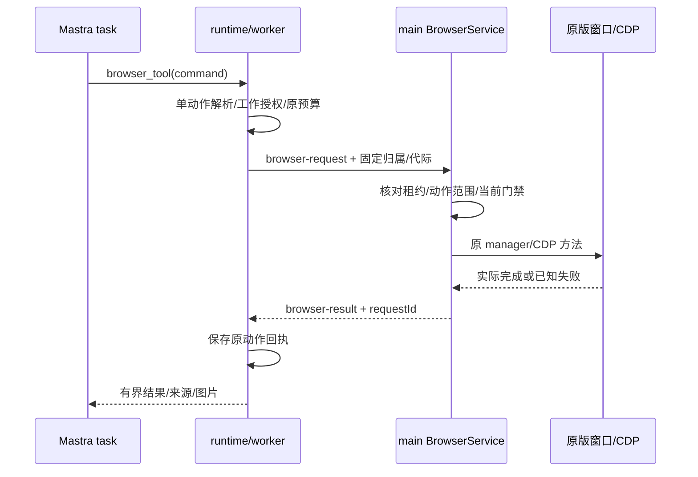

<!--
[OUTPUT]: 2026-10-14员工/群自动化与员工浏览器为独立待实施闭环；群内真实采集→依赖汇总，浏览器优先直接迁用固定GitHub源码；仅文档复核。
[OUTPUT]: 内置浏览器迁入文件与应用统一窗口/Session接线；任务身份只供工具授权/回执，源码/验证分别核对。
[INPUT]: 本机 boai-app 的 BrowserPaneManager、BrowserCDP、browser_tool runtime、独立工具栏/空态入口与当前 BoAI Agent 的主进程、utilityProcess、Mastra task 和构建源码。
[OUTPUT]: 优先直接复制旧浏览器的文件映射、必要依赖替换、主进程消息桥、单动作工具接入、持久分区与打包步骤；当前路径已接入，实际验收以05为准。
[POS]: 第 11 组开发接线指南；03 定义执行合同，04 定义原版交互，05 维护唯一进度。
[PROTOCOL]: 一旦本文件变化，必须同步更新 Header，并上浮检查所属目录 .folder.md。
-->

**2026-10-14后续目标（未实施）：** [06员工浏览器操作](./06-数字员工浏览器操作设计与实施计划.md)扩展API/Codex/Claude共用当前网页工具及页面引用；[07GitHub复用清单](./07-GitHub源码复用清单.md)固定Craft v0.15.1的直接迁入源、hash和适配。应用统一窗口/登录、普通导航/X关闭、来源/实际退出保持；下方仅Mastra task、Work前置和旧工具注册限制描述已有版本，不限制新目标。本轮只改文档；自动化为独立闭环，实际成绩仍唯一归05。

# 源码映射与接入步骤

基线日期：2026-10-02。源码依据为 [旧实现分析](/Users/wangwenbo/Desktop/demo/boai/boai-agent/ai-docs/2026-10-01-boai-app浏览器实现与迁移分析.md)。下述源码已迁入并按当前合同适配，路径存在不代表测试或打包已经通过；进度只登记在 [05](/Users/wangwenbo/Desktop/demo/boai/boai-agent/ai-docs/spec/11.浏览器能力迁移/05-实施步骤与验收清单.md)。

## 1. 开发路线：先复制，再替换边界

保留旧 `BrowserWindow + toolbarView/pageView/nativeOverlayView` 三个 `BrowserView` 的窗口组合、布局、地址栏和 CDP 动作实现。首批不替换成 WebContentsView，不引入 Playwright/Stagehand/AgentBrowser，也不重写浏览器 UI。

保留 `browser_tool({ command })` 名称和主要命令语法。仅把旧 Pi/Session 工具工厂换成当前 Mastra `createTool`，把原 `BrowserPaneFns` 接到当前主进程消息桥。模型每次调用只执行一个动作，旧批命令函数保留在内部但入口拒绝批命令。

必要变化集中在应用统一登录与工具授权分离、实际退出、来源文件和工程导入。不能复制旧always-allowed、跨应用凭据或未核对调用身份的本地RPC处理器。

## 2. 旧文件 → 迁入目标文件

以下记录迁入映射，已撤销组件明确标注。维护时先读目录.folder.md，保留来源和Header，变更同步目录地图。

| 已存在的源文件 | 迁入目标 | 复制策略与必要差异 |
| --- | --- | --- |
| [browser-pane-manager.ts](/Users/wangwenbo/Desktop/demo/boai/boai-app/apps/electron/src/main/browser-pane-manager.ts) | `src/main/browser/browser-pane-manager.ts` | 直接复制窗口/CDP 调用与视觉层；改 session partition、路径、依赖和回调归属 |
| [browser-cdp.ts](/Users/wangwenbo/Desktop/demo/boai/boai-app/apps/electron/src/main/browser-cdp.ts) | `src/main/browser/browser-cdp.ts` | 保留 AX/ref、几何、输入、截图等算法；替换日志导入并加在途动作跟踪 |
| [browser-live-fx.ts](/Users/wangwenbo/Desktop/demo/boai/boai-app/apps/electron/src/shared/browser-live-fx.ts) | `src/shared/ipc/browser-live-fx.ts` | 复制平台圆角和原控制视觉参数，避免 UI 重设计 |
| [browser-toolbar preload](/Users/wangwenbo/Desktop/demo/boai/boai-app/apps/electron/src/preload/browser-toolbar.ts) | `src/main/browser-toolbar-preload.ts` | 保留最小 toolbar API；服务端核对真实 sender/mainFrame，不信任 query 的 instanceId |
| [toolbar HTML](/Users/wangwenbo/Desktop/demo/boai/boai-app/apps/electron/src/renderer/browser-toolbar.html)、[TSX](/Users/wangwenbo/Desktop/demo/boai/boai-app/apps/electron/src/renderer/browser-toolbar.tsx) | `src/renderer/browser-toolbar.html`、`browser-toolbar.tsx` | 保留地址栏、菜单、48px 工具栏和拖拽区；替换旧 UI/i18n/style 导入 |
| [空态 HTML](/Users/wangwenbo/Desktop/demo/boai/boai-app/apps/electron/src/renderer/browser-empty-state.html)、[TSX](/Users/wangwenbo/Desktop/demo/boai/boai-app/apps/electron/src/renderer/browser-empty-state.tsx) | `src/renderer/browser-empty-state.html`、`browser-empty-state.tsx` | 保留视觉与组件；去掉旧 routes、自动 newSession/send 和 hash-launch 回退 |
| [BrowserControls](/Users/wangwenbo/Desktop/demo/boai/boai-app/packages/ui/src/components/ui/BrowserControls.tsx)、[BrowserEmptyStateCard](/Users/wangwenbo/Desktop/demo/boai/boai-app/packages/ui/src/components/ui/BrowserEmptyStateCard.tsx) | `src/renderer/components/browser/BrowserControls.tsx`、`BrowserEmptyStateCard.tsx` | 复制组件 DOM 和交互，用当前 Button/Spinner/DropdownMenu/图标与文案替换依赖 |
| [BrowserTabStrip](/Users/wangwenbo/Desktop/demo/boai/boai-app/apps/electron/src/renderer/components/browser/BrowserTabStrip.tsx)、[BrowserTabBadge](/Users/wangwenbo/Desktop/demo/boai/boai-app/apps/electron/src/renderer/components/browser/BrowserTabBadge.tsx) | 已撤销这两个旧组件 | 当前由header-browser直接打开内置窗口，不保留会话窗口条 |
| [browser-pane atoms](/Users/wangwenbo/Desktop/demo/boai/boai-app/apps/electron/src/renderer/atoms/browser-pane.ts) | `src/renderer/stores/browser.ts` | 保留状态映射/tombstone 意图，接当前状态范式，不为迁移引入第二套 Jotai |
| [browser-tool-types.ts](/Users/wangwenbo/Desktop/demo/boai/boai-app/packages/shared/src/agent/browser-tool-types.ts)、[runtime](/Users/wangwenbo/Desktop/demo/boai/boai-app/packages/shared/src/agent/browser-tool-runtime.ts) | `src/runtime/adapters/mastra/browser-tool-types.ts`、`browser-tool-runtime.ts` | 复制接口和 parser/命令执行，新增可复用的单命令解析入口 |
| [browser-tools.ts](/Users/wangwenbo/Desktop/demo/boai/boai-app/packages/shared/src/agent/browser-tools.ts) | `src/runtime/adapters/mastra/browser-tool.ts` | 只复用描述/结果格式，改为 Mastra createTool；不搬旧 Session/Pi 工厂 |
| [handlers/browser.ts](/Users/wangwenbo/Desktop/demo/boai/boai-app/apps/electron/src/main/handlers/browser.ts) | `src/main/browser/browser-service.ts` | 参考 manager 方法映射；重写薄消息分发与校验，不复制旧全局 RPC 权限 |

当前合同位于 `src/shared/ipc/browser.ts`；工具授权、动作回执与来源规则位于 `src/runtime/modules/browser/`。按已有 `ProductStore`/WorkRepository 事务方式保存，不建立第二个浏览器业务数据库。

远程 [RemoteBrowserPaneManager](/Users/wangwenbo/Desktop/demo/boai/boai-app/packages/server-core/src/sessions/RemoteBrowserPaneManager.ts)、WebSocket transport、Pi 注册、外置 MCP adapter 与 CLI `scripts/browser-tool.ts` 不进入首批复制集合。

## 3. BRM0：冻结可复现的复制基线

1. 记录旧仓库绝对路径、当前 HEAD、脏文件清单、每个复制源的 SHA-256；脏源码必须按实际字节记录，不能仅写 commit。
2. 列出要复制的文件、拟议目标、来源 hash、必要修改及对应测试；不要复制整个 monorepo 或把 `@craft-agent/*` 全部装入当前应用。
3. 阅读旧文件实际调用者及上述 UI 的间接依赖，补齐徽标/菜单/空态样例使用的本地辅助文件清单。
4. 保留 [原 LICENSE](/Users/wangwenbo/Desktop/demo/boai/boai-app/LICENSE) 与 [NOTICE](/Users/wangwenbo/Desktop/demo/boai/boai-app/NOTICE) 中有关迁入代码的归属；修改的源码明确注明改动及旧路径。
5. 复制许可/来源记录放在新受管目录，并接入当前随包许可复制。不要把本次没有使用的 Claude Agent SDK 写成新浏览器依赖。
6. 标明“源已读取/已复制/类型通过/真实运行/打包通过”是不同证据。旧测试文件存在不表示当前产品已通过。

BRM0 的产物是源文件清单、hash 和复制边界；不是可用浏览器，也不提前启用员工能力。

## 4. BRM1：保留原窗口，接主进程桥与独立登录

### 4.1 导入依赖替换表

| 原导入/行为 | 当前接法 |
| --- | --- |
| `@craft-agent/server-core/handlers` 的 manager/interface/path helper | 提取首批用到的 interface，置于共享 Browser DTO；文件访问交给当前材料/成果授权，不复制旧 workspace 路径放行 |
| `@craft-agent/server-core/transport` 的 RPC/wire 类型 | 使用 `src/shared/ipc/browser.ts` 的本地消息联合类型；不引入远程 transport |
| `../shared/types` 的浏览器类型 | 从旧大 types 文件只摘浏览器 DTO，剔除旧 workspace/Session 导航依赖 |
| `WindowManager` /旧 session resolver | 只接应用窗口及下载策略回调，不保留关联会话路由或旧完整窗口管理器 |
| `mainLog` | 接当前运行事件/错误通道的薄适配；本仓库没有同名独立 logger，不能原样保留悬空导入或散落 console |
| `DEFAULT_THEME/loadAppTheme` | 接已有外观快照与语义 token，保留原工具栏布局；不引入旧主题持久化体系 |
| `getAllowRemoteEvaluate/CodedError` | 首批移除远程 evaluate 配置依赖；错误沿当前消息响应规范返回明确状态 |
| `@craft-agent/ui`、旧 HeaderIconButton/styled-dropdown | 复制需要的 Browser 组件并换当前 Button/DropdownMenu/Spinner，保持交互与几何 |
| 旧 `react-i18next/setupI18n` | 接当前文案方式；首批无需为浏览器新建整套 i18n 服务 |
| 旧 `lucide-react` | 按当前 renderer 的 Solar/Carbon Iconify 范式替换本地图标，不引入运行时远程图标请求 |
| 旧 Jotai/remote workspace state | 接当前 renderer 状态与 typed desktop-client；授权过滤必须先在宿主完成 |

旧 [BrowserShader](/Users/wangwenbo/Desktop/demo/boai/boai-app/packages/ui/src/components/ui/BrowserShader.tsx) 使用 `@paper-design/shaders-react`，当前 manifest 没有此包。先确认迁入的实际空态是否引用，再决定保留原组件并添加该直接依赖；不要因名称相近安装旧 UI 整包。第三View保留实际退出核对，尺寸为零，不绘制控制遮罩。

### 4.2 主进程与 worker 的职责

[main.ts](/Users/wangwenbo/Desktop/demo/boai/boai-agent/src/main/main.ts) 用 `utilityProcess.fork` 启动 [worker.ts](/Users/wangwenbo/Desktop/demo/boai/boai-agent/src/runtime/worker.ts)。BrowserWindow、BrowserView、Electron Session 和 debugger 必须留在 main；worker 不能直接 import 窗口 manager。

拟议消息至少区分 `browser-request`、`browser-result`、`browser-cancel`、`browser-exited` 和状态事件；使用唯一请求 ID，结果带实例 ID、租约代际、动作 ID，取消不能复用普通工具超时作为退出证明。

worker 的 Browser host client 单独保存 pending 请求；参考已有 secret-result 模式，但加有界超时、信号与 unknown 语义。main 到 runtime 的普通 `requestRuntime` 是另一方向，不应把反向 Browser 请求挤入 renderer 的公开 `Method` 白名单。

状态事件只有授权列表和展示元信息能进入 IM renderer。Cookie、原始网页桥、CDP 任意命令、页面密码、磁盘目录和凭据不暴露；网页 `pageView` 不装 BoAI 主 preload。

### 4.3 应用统一持久分区

内置浏览器采用应用稳定实例和持久partition，窗口/网站登录不含员工、会话或清理代际。公开manualOpen与状态读取不接受业务身份。工具租约单独保存实际run/work、执行代际及授权；相互不替代。

页面/popup使用内置浏览器实际Session；网站权限不继承旧自动allowlist。手工导航与工具调用串行，当前工具持有者的旧回调不能关闭或释放新的持有者。

业务对象清理仅清原调用证据/任务文件；不销毁浏览器或其Session。重启保留登录但不恢复任务动作，旧业务分区不自动合并账号或删除。

## 5. BRM2：把原 browser_tool 接到获准 Mastra task

### 5.1 parser 保留，工具每次单动作

旧 `executeBrowserToolCommand` 已有 `splitBatchCommands`、`tokenizeCommand`、`executeSingleCommand` 和命令执行。迁入时只做小范围提取：导出同一 parser 的 `parseSingleBrowserCommand`，返回规范动作与参数，拒绝 0 个或多个命令。

必须按旧 parser 的引号/转义规则判断批命令，不能简单拒绝字符串中所有分号，也不能用 `startsWith('click')` 判权限。`fill @e1 "a;b"` 是单动作；`fill @e1 a; click @e2` 在任何动作开始前整体拒绝。

模型 schema 保持 `{ command: string }` 并加长度上限；字符串数组模式/`release all`/任意别人的 windowId 不向模型开放。旧 batch 函数可留作内部兼容，但 Mastra 工具不能触达它。

runtime 和 main 使用同一确定性解析/规范化结果校验，动作摘要含参数 hash。解析后的动作逐项检查权限和当前 scope，然后才执行原 `executeSingleCommand` 对应逻辑；避免权限检查和实际执行使用两套不同 tokenization。

首批保留原 `open/navigate/snapshot/find/screenshot/scroll/back/forward/wait` 语法，按阶段接入交互命令。open/windows操作固定应用浏览器实例，focus/hide/close/release仍核对当前工具租约，不能由模型传入任意窗口身份。

`evaluate/upload/set-clipboard/get-clipboard/paste` 在模型命令入口先拒绝。关闭这些命令后同步调整 `--help` 与工具描述，不能仍教模型调用未开放能力。

旧 runtime 的 `getPageMetrics` 通过 `fns.evaluate` 执行固定查询；这与模型任意 evaluate 命令不同。把固定查询登记为宿主内置只读操作/枚举，继续复用算法；不要因此开放 `evaluate(expression)` 反向裸接口。

### 5.2 当前任务装配点

1. 在 [EngineContext](/Users/wangwenbo/Desktop/demo/boai/boai-agent/src/runtime/contracts.ts) 增加可选 Browser host/授权合同。实际 employee/conversation/work/run 从宿主冻结，工具不能自选。
2. 在 [AppService](/Users/wangwenbo/Desktop/demo/boai/boai-agent/src/runtime/service.ts) 的既有 task 上下文组装处，按启用状态、受支持 Mastra 后端和当前授权版本提供 Browser client；旧 `allowBrowser=false` 或缺失不阻挡。
3. 在 [createTaskRuntime](/Users/wangwenbo/Desktop/demo/boai/boai-agent/src/runtime/adapters/mastra/task-runtime.ts) 有条件合并 `browser_tool`，沿已有 `beforeEffect/afterEffect` 与 signal 处理，不给普通 chat/decision/memory/report 注入。
4. 在 [agent-factory](/Users/wangwenbo/Desktop/demo/boai/boai-agent/src/runtime/adapters/mastra/agent-factory.ts) 保持现有阶段分支。移除员工配置中的浏览器开关，Mastra 员工含 bobo 默认可用，不向两字段团队创建弹窗加选项。
5. 保留 [engine.prepareStep](/Users/wangwenbo/Desktop/demo/boai/boai-agent/src/runtime/adapters/mastra/engine.ts) 后续模型调用的原 Work 预算；浏览器结果后的思考不能建立新根工作或隐含额外 LLM。
6. task dispose 同时结束 Browser 执行租约和 workspace；结束租约不得清除应用登录资料。等实际在途动作退出后再释放该员工任务槽，旧代际不能释放新代际。

Mastra tool execute 读取真实 `context.agent.toolCallId`，并沿原 Work 生成唯一动作身份。调用重复先查询已保存回执；已执行/unknown 的动作不得因桥超时、模型重试或重启再执行。

首批不额外赋 `Agent.browser`，避免自动注入第二套工具。旧 Electron debugger 不是可直接供官方 AgentBrowser 使用的外部 CDP URL。

### 5.3 返回值与模型图片

保留旧命令文字结果，附上可检查的 URL/title、动作身份和来源身份；有界正文截断需明确，不把 `@eN` 当网页引用。

图片经过受控本地消息序列化，限制 MIME、尺寸与大小，再使用当前 Mastra 支持的实际图片输入机制。仅返回文件路径或 `image-preview` 文本不算模型看过截图。

若当前连接无法接收图片，返回明确“不支持图片理解”的状态，导航/AX 文字仍可按已验证能力执行；不能假称截图识别成功。

## 6. BRM3：接授权、正常浏览、来源与文件

按 [03](/Users/wangwenbo/Desktop/demo/boai/boai-agent/ai-docs/spec/11.浏览器能力迁移/03-员工任务与执行合同.md) 添加动作授权/回执，按 [04](/Users/wangwenbo/Desktop/demo/boai/boai-agent/ai-docs/spec/11.浏览器能力迁移/04-原版界面与浏览器生命周期.md) 接普通手工导航、固定工具栏和X直接关闭，不再接操作权菜单/输入遮罩。

沿当前启用员工/受支持后端、审批和任务详情范式实现。获准范围内读取无需每步打断；有实际外部副作用的点击/按键/提交用确定性动作身份审批，目标/页面代际/参数变更使旧授权失效。

停止加载、窗口关闭/失焦和task取消是不同事件。手工导航沿原scope队列，不隐式取消工作或增加approvedOrigins；员工后续动作重读当前来源/pageVersion/snapshot，不能使用页面变化前的ref/批准直接续做。验证码/release不触发隐形pause/take等待。

网页来源保留实际 URL、title、获取时间、scope、证据 hash 和父来源链。来源派生内容进入成果/记忆时沿已有权限核对；网页指令不能增加员工权限，移入另一群也不自动共享登录或来源。

下载目录由宿主决定，受管文件 hash/动作归属写入现有成果流程；下载完成不等于已发布。上传命令仍关闭，后续接明确材料/成果 ID 时另立增量合同，不能用裸路径绕过现有文件授权。

先取得 Browser exited/动作回执再执行来源清理、会话删除或员工撤权后的目录清理；不把失败时删除 UI 徽标当成资源释放。登录资料首批不加入普通业务备份，不随导出包泄漏 Cookie。

## 7. BRM4：HTML/preload/Vite 与生产打包

旧 [Vite 配置](/Users/wangwenbo/Desktop/demo/boai/boai-app/apps/electron/vite.config.ts) 的 toolbar/empty-state 是独立 HTML 入口，不能只复制 TSX 而继续单 index.html 构建。

1. 在当前 [vite.config.ts](/Users/wangwenbo/Desktop/demo/boai/boai-agent/vite.config.ts) 的 `rollupOptions.input` 添加 `index.html`、`browser-toolbar.html`、`browser-empty-state.html`；保留当前相对 base、renderer root 和别名。
2. 在 [build.mjs](/Users/wangwenbo/Desktop/demo/boai/boai-agent/scripts/build.mjs) 增加 toolbar preload 构建，输出 `dist/main/browser-toolbar-preload.cjs`。manager 源码在子目录时，运行路径仍按最终 main bundle 的 `__dirname` 计算。
3. 开发服务沿 [dev.mjs](/Users/wangwenbo/Desktop/demo/boai/boai-agent/scripts/dev.mjs) 的 `BOAI_RENDERER_URL`，替换旧 `VITE_DEV_SERVER_URL`；toolbar/empty-state 用同服务器的对应 HTML 路径，不沿旧固定端口。
4. 生产模式加载 `dist/renderer/browser-toolbar.html` 和空态 HTML；query 仅携带展示 instanceId，实际 sender 映射由 main 保存。检查 ASAR 中 preload 与 HTML 的真实相对路径。
5. toolbar 与网页 pageView 使用不同权限面：toolbar 才能有专用 preload，远程网页没有 `window.boai/browserToolbar`。空态只说明浏览器操作，不启动、选择或预填聊天。
6. 替换旧 Google Fonts 外链为当前本地字体，样式导入当前 global.css；工具栏 CSP 沿本地资源收紧，开发放宽仅在 dev 生效。不要直接复制旧任意 `wss:` 白名单到生产 toolbar。
7. 源码许可/NOTICE 跟现有离线素材许可一样复制进 dist；应用包不依赖旁边还存在 `boai-app` 或其 node_modules。
8. 用当前 Electron 版本验证 BrowserView/addBrowserView/setTopBrowserView 的实际可用性；若运行阻塞，记录具体错误后只处理阻塞点，不预先做整套架构替换。

## 8. 迁入测试与完成证据

旧 [manager 测试](/Users/wangwenbo/Desktop/demo/boai/boai-app/apps/electron/src/main/__tests__/browser-pane-manager.test.ts)、[CDP 测试](/Users/wangwenbo/Desktop/demo/boai/boai-app/apps/electron/src/main/__tests__/browser-cdp.test.ts)、[runtime 测试](/Users/wangwenbo/Desktop/demo/boai/boai-app/packages/shared/src/agent/__tests__/browser-tools.test.ts) 和 release/tombstone 测试用于复用业务意图；按当前 Vitest mock/测试入口改装。

必须移除按员工/会话划分浏览器的旧断言，保留全阶段工具注入、always-allowed和乐观关闭的禁止边界。新增测试聚焦内置浏览器登录保持、业务清理不影响窗口、引号内分号/整批拒绝、固定内置 query 与任意 evaluate 分离、跨实例请求拒绝、未知动作不重放和取消真实退出。

真实桌面场景沿 `tests/e2e/features/`、`steps/`、`support/` 与 `pnpm test:electron`；不新增平行 `.spec.ts`。开发窗口通过后还需以打包应用验证独立 HTML、preload、原版地址栏/登录、popup、关闭/重启和模型图片输入。

最终至少保存源 hash/目标 diff、模块与 BDD 结果、打包版本、真实浏览器操作和来源证据。真实模型检查显式计入预算；未执行、证据不足或人工待评审分别标明，不能因为源码复制完成把 BRM4 标为通过。
