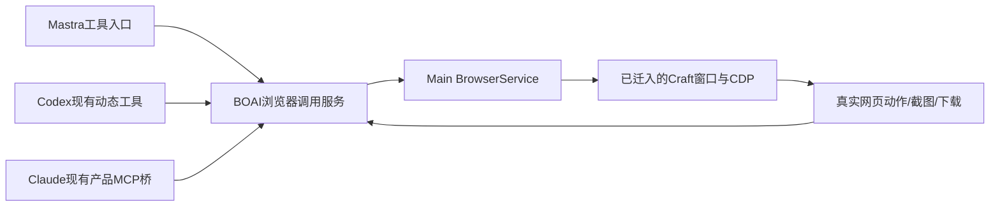

<!--
[OUTPUT]: 2026-10-25源码链接随Workspace迁移更新，历史验证结论保持。
[OUTPUT]: 2026-10-17定时任务继承员工浏览器能力，原origin禁用移除；执行卡片新增真实聊天定位，已删仅Sonner。实际归execution-message-browser审阅。
[OUTPUT]: 2026-10-15按用户纠正以员工实际网页操作验收，固定Craft优先；真实失败/修复/复测只记05，不以画布文件交付替代。
[INPUT]: 2026-10-14用户确认员工操作已打开网页、API/本机员工共用能力、与自动化独立闭环，以及GitHub现成源码优先迁入要求。
[OUTPUT]: 当前页面交接、API/Codex/Claude工具接线、页面操作与结果、人机并行边界、GitHub复用与EB0–EB4验收；EB0–EB3本次源码实现与技术验证完成；实际分批结果、原失败与后续认证唯一归05。
[POS]: 第11组员工浏览器能力的后续目标合同；源清单见07，全部实际进度仍唯一归05。
[PROTOCOL]: 一旦本文件变化，必须同步更新Header，并上浮检查所属目录.folder.md。
-->

# 数字员工浏览器操作设计与实施计划

日期：2026-10-14。状态：**EB0–EB3本次源码实现与技术验证完成；发行包、长期资源及人工效果未认证，分批实际范围归05。** 固定GitHub来源见07，实际迁入及验证范围唯一归05。

## 1. 独立闭环与现行边界

用户打开BOAI浏览器并登录网站，把一个明确页面上的任务交给数字员工；员工使用自己的API或本机Agent读取页面、点击、填写、导航并核对真实结果，用户可以查看网页和原聊天中的执行详情。

本篇是[01–04既有浏览器合同](./README.md)的后续扩展：保留应用统一窗口/登录资料、普通导航/X关闭、当前主进程驱动与业务来源隔离；更新原“仅Mastra task可用”的目标，允许Codex/Claude通过产品工具操作同一浏览器。本轮不改变当前代码，旧实现/验收按日期阅读。

员工浏览器操作与[员工/群自动化](../5.Mastra能力扩展/11-员工与群聊自动化设计与实施计划.md)独立实施和验收。手动对话操作网页不依赖自动化页面、计划、OpenCLI或云服务。定时网页任务在两者分别完成后组合，不能以“已有自动化”替代浏览器验收。

“模拟人类操作”指在真实网站页面上完成点击、输入、选择、滚动和提交；主要使用页面元素/可访问性快照定位，截图和坐标用于需要视觉信息的场景。修改DOM显示并不证明网站业务已保存；最终结果需要页面回读或明确业务回执。

## 2. 当前事实与具体断点

核对基准：2026-10-14实际工作树，记录时HEAD为`c688075ec774066f4cff404b5ea758dd56a70903`，含同期未提交修改。本次不把上游发布说明或历史测试当成本版本的运行证明。

| 来源 | 代码事实 | 本增量处理 |
| --- | --- | --- |
| [BrowserService](../../../apps/electron/src/main/browser/browser-service.ts)、[BrowserCDP](../../../apps/electron/src/main/browser/browser-cdp.ts) | 应用统一持久登录、可见窗口、内部Electron debugger/CDP、动作回执与执行退出 | 作为唯一BOAI浏览器底座继续复用 |
| [backends能力判断](../../../packages/shared/src/domain/backends.ts) | 当前仅mastra-model被认为可用浏览器 | 从“后端名等于Mastra”改为实际工具能力，覆盖Codex/Claude |
| [service装配](../../../packages/runtime/src/service.ts)、[task-runtime](../../../packages/runtime/src/adapters/mastra/task-runtime.ts) | task/Work条件下装配，并排除automation origin/organization | 手动本机员工先接入；后续自动化组合单独开通，不一口气移除全部来源条件 |
| [native-products](../../../packages/runtime/src/adapters/native-products.ts) | 有消息、委派、成果等产品工具，没有browser_tool | 复用已有薄桥，不重写本机执行循环或fork原生CLI |
| [BrowserSession](../../../packages/runtime/src/modules/browser/session.ts) | 点击/填写等交互逐动作批准，源站主要从用户文本URL提取 | 增加明确页面引用；持续执行的授权方案见§5，未覆盖操作沿现有具体审批 |
| [浏览器工具](../../../packages/runtime/src/adapters/mastra/browser-tool.ts) | 单命令，限制脚本/上传/原始日志；已有API图片接线 | 核对原生图片工具回传，不能把路径/JSON/base64文字算作模型已看图 |
| [页面输入](../../../apps/electron/src/main/browser/browser-cdp.ts)、[窗口截图](../../../apps/electron/src/main/browser/browser-pane-manager.ts) | 仍包含旧输入/隐藏截图策略 | 对照Craft v0.15.1迁入后台输入与新帧捕获修复；缺陷在BOAI的实测仍待进行 |

“本机Agent能自行使用其他浏览器插件”和“本机员工已能操作BOAI当前网页”是两项能力。前者不补足本篇的页面身份、登录资料和结果接线。

## 3. 当前网页如何交给员工

### 3.1 页面引用

浏览器窗口继续由应用管理，不选择员工作为窗口所有者。任务交接引用页面，而不是把浏览器或Cookie绑定到员工。

在原员工/群对话中提供轻量“引用当前网页”入口，生成可见的网页引用（标题、URL）。提交时宿主保存稳定实例/页面身份、文档代际和实际来源；URL只用于展示和目标范围，不能代替页面身份。该入口不占用或裁剪现有composer附件/工具栏能力。

一次任务捕获一个明确页面引用。用户随后切到其他页面，不改变原任务目标；原实例关闭、同标签导航或文档替换时先失效旧ref，重新核对目标和snapshot。不静默寻找同URL的其他账号窗口，不把“当前网页”解释为执行那一刻碰巧激活的网页。

用户只给出URL时，员工可在获准范围内打开页面。用户通过飞书说“当前网页”而目标有歧义时，返回实际可引用的标题/URL供澄清；不能猜用户另一个浏览器的活动标签。来自飞书的上下文与结果回发继续遵循第16组的独立渠道会话。

### 3.2 连续交互与用户操作

浏览器维持普通地址栏、返回/前进、刷新/停止加载和X关闭。执行进度在当前员工聊天/右侧执行详情中展示；本篇不恢复旧员工窗口条、控制权菜单或输入遮罩。

用户可以正常操作页面。手工动作造成文档/目标变化后，下一个Agent动作重新读取状态；不得用旧几何/ref点到新按钮。第一版沿现有应用级单一实际工具持有者，冲突可见并在退出后重新核对目标；不为了并发创建每员工一套登录资料。多任务分页/TaskSpace属于后续能力，不是首批前置。

验证码/必须人工登录时显示真实窗口和员工提示，用户完成后通过原对话明确继续，再取新快照。没有不可见的“等待交还”状态；用户停止或窗口关闭时等待在途动作真实退出。网站已接受而回执未知的提交不得自动重放。

## 4. 员工引擎共用同一浏览器服务

- 保留现有`browser_tool({ command })`及确定性单动作解析，尽量直接复用Craft命令、页面驱动和结果逻辑。薄包装只转换各引擎的工具注册、图片格式和原始回执。
- 本机Codex继续app-server，Claude继续原生stream-json。浏览器作为BOAI新增产品工具；不要求原生员工模拟Mastra五阶段，不接管其原生shell/Skills/MCP/内部子Agent。
- 本机普通对话可按已获准任务调用浏览器；不以“必须先成为Mastra task/已有文件Work”阻挡首次读取网页。受信任调用至少绑定真实员工、会话、原用户消息、本机run和页面引用。需要记录实际业务工作时沿现有惰性Work规则认领，历史动作回执不能因此失去来源。
- 现有BrowserLease/Repository强依赖workId的部分需要最小适配，沿同一回执仓库保存真实调用来源；不能用伪造Work补字段，也不建第二个浏览器服务。
- API沿其有效执行阶段和预算；本机不展示或施加BOAI用量/时长预算。停止、来源失效、进程退出、未知不重放对两者同样有效。
- 图片必须通过对应引擎支持的媒体工具结果进入模型。当前Claude桥的通用文本结果包装不能直接当作图片支持；实现时逐后端验证真实图像观察。暂不支持图片的模型应收到真实能力说明，不能假装看见截图。
- 新增BOAI浏览器工具不自动启用或关闭本机已安装的其他浏览器工具。员工要操作被引用的BOAI页面时，须使用该页面所属的产品工具，不能静默换浏览器完成另一个登录态中的动作。

## 5. 操作范围与结果证据

### 5.1 最小授权变化

当前按具体动作批准的路径继续可用；先完成三后端调用和真实回执，再改善连续任务授权。目标是用户明确委托范围内连续办事，不把每次读取/填写都变成重复配置。

任务许可绑定本人指令、页面引用、站点范围和明确操作意图。只读访问可沿引用/URL授权；外部写操作只在已有批准或可确定对应用户明确要求时执行，不能把任意click/key命令都标成无副作用。无法确定的提交继续使用现有可审阅动作审批，页面文字和员工自己的判断不能增加许可。

页面引用本身只确定目标，不代表允许填写或提交。“看看这个页面”不能变成修改请求；“把这个表单的联系人改为张三并保存”才包含对应修改意图。连续授权的匹配规则在实施分片内用明确正反例固定；无法确定匹配的动作沿原具体批准路径，不为了减少弹窗作通用放行。

实现不得新建通用权限DSL、让模型自行批准工具或复制Craft的所有always-allowed规则。原生权限模式与BOAI网页工具授权分别核对；不能因原生CLI可执行命令就认为BOAI浏览器所有网站均已授权。

飞书发起且范围完整的任务应能直接执行并回原来源；遇到额外批准要明确显示待处理及可用处理入口。若手机端尚无稳定的批准/拒绝回执，则说明需要在BOAI处理，不能宣称完整手机审批已接入。该缺口需独立留证，不以静默同意填补。

### 5.2 可用能力与真实完成

| 能力 | 交付要求 |
| --- | --- |
| 快照/查找 | 真实DOM/AX来源、页面代际、有效ref；页面改变后不得沿旧ref盲点 |
| 点击/填写/选择/键盘/滚动 | 后台窗口也有真实输入效果；工具返回含失败或回退事实，不仅是发送了事件 |
| 截图/区域截图 | 当前页面实际新帧、确切尺寸、必要媒体接线；隐藏窗口旧帧不能当最新状态 |
| 网站修改 | 回读保存后的数据或业务回执；仅改DOM/工具成功不等于服务器保存 |
| 下载/交付 | 完成状态、原件hash、任务来源；沿publish_artifact发布才成为聊天成果 |
| 敏感字段 | 输入/工具参数/快照/持久执行事件/导出全路径脱敏，不能只隐藏最终回复 |
| 上传 | 作为有界扩展，使用用户已授权材料/文件来源，不能直接照搬任意宿主路径接口 |
| evaluate、原始network/console、批脚本 | 不随迁入默认开放；受控提取/OpenCLI后续单独核对接口、来源和结果 |

首批保留BOAI现有单动作工具方式，直接迁用上游算法不要求同时开放其所有命令。用户最终获得的是可靠操作同一网页的能力，不是安装另一套浏览器应用。

## 6. GitHub复用策略

用户明确要求“能抄现成的就抄”。执行顺序固定为：**读取上游实际模块与调用者→直接迁入所需实现及必要依赖→接BOAI宿主/类型/样式→验证原行为和产品闭环。** 不根据介绍重新仿写同功能驱动，不以现有BOAI包装不方便为由把成熟能力改成占位实现。

主要来源为Craft OSS固定提交`2e3ba53ff80b229a07e9d1884dc58f6733f22e1f`（v0.15.1，2026-10-13）；模块、hash、目标、许可和测试见[07源码复用清单](./07-GitHub源码复用清单.md)。后续开工可检查更新，但更换基线必须重新记录差异和验收范围。

优先迁入CDP输入/目标命中、下拉选择、隐藏截图新帧、验证提示与密码脱敏；保留当前BOAI应用登录、来源校验、真实退出和已修复行为。不要整文件覆盖后丢掉BOAI本地修复。若模块能完整复用则整段迁入；必须适配的地方逐项说明，避免长期维护重写的平行算法。

Ego Lite用于Page/ref/TaskSpace等接口研究；其helper依赖`globalThis.ego`，不能直接当作Electron插件。OpenCLI作为后续可选站点/提取能力，当前内部Electron debugger不是可直接提供给它的外部CDP地址；若接入，须固定具体桥接方式、同一页面/登录身份和运行回执，再验收。

## 7. 实施分片与验收

| 阶段 | 可审阅交付 | 当前状态 |
| --- | --- | --- |
| EB0 | 固定上游/源hash/依赖/许可；建立当前源码差异与可复用测试清单 | 固定来源及首批直接迁入已登记，实际范围归05 |
| EB1 | 保留现有产品边界，迁入后台输入、截图、脱敏与必要页面驱动修复 | 本次实现与技术验证完成；实际范围归05 |
| EB2 | 页面引用、现有服务接API/Codex/Claude，真实媒体/结果与停止回执 | 本次实现与技术验证完成；实际范围归05 |
| EB3 | 完整手动任务、同页读写、后台执行、并发冲突、失败与重启验收 | 本次源码闭环技术验证完成；各批失败与后续认证唯一归05 |
| EB4 | OpenCLI受控提取、自动化网页任务、完整手机审批等分别扩展 | 后续组合，不阻塞独立手动闭环 |

EB1–EB3的员工浏览器闭环不得只验证API；本机Codex和Claude都需要真实任务证明。若任一后端尚不支持媒体或页面操作，则分别列出缺口，不能写“所有员工可用”。

| ID | 必须证明的行为 |
| --- | --- |
| EB-A01 | 用户先打开/登录网页，再从员工对话引用并让员工读取；实际操作的是同一个实例/账号，未新建替代浏览器 |
| EB-A02 | API/Codex/Claude分别填写并保存受控页面；回读实际保存结果，记录真实工具来源 |
| EB-A03 | 隐藏/未聚焦窗口的点击、键盘、下拉选择有效；用户前台窗口不被反复抢占 |
| EB-A04 | 动态页面隐藏后发生变化，截图包含新状态；三后端媒体输入分别证明模型实际获得图片 |
| EB-A05 | 手工导航、SPA文档变化、窗口关闭重开使旧引用失效；不操作同URL的另一个窗口/账号 |
| EB-A06 | 多员工请求同一页面时不交错写入；旧run回调不能释放新run使用权；失败/停止后无悬挂占用 |
| EB-A07 | 停止、窗口关闭、服务故障分别核对在途输入/下载/CDP实际退出；未知网站提交和重启不重放 |
| EB-A08 | 常规下拉/跳转不误判验证码；真实验证交给用户，确认后读取新快照继续，无隐形接管状态 |
| EB-A09 | 密码在工具参数、输出、持久事件、导出中均不泄漏；已有BOAI来源/敏感值修复没有被上游覆盖 |
| EB-A10 | 下载完成并以真实hash发布；取消或未完成下载不算交付，不混入业务备份 |
| EB-A11 | 明确任务范围可连续处理；越界操作走已有批准或明确拒绝，网页内容不能扩大权限 |
| EB-A12 | 单纯开窗/引用/查看执行详情不发起模型；API预算与本机无BOAI预算分别生效 |
| EB-A13 | 复用原组件/主题、普通X关闭和稳定登录；员工/群/聊天清理不删除应用Cookie |
| EB-A14 | 默认并行性能门槛及短期压力/空闲资源检查覆盖截图、页面切换、关闭和监听器清理；长期泄漏单列 |
| EB-A15 | 飞书发起已明确页面的任务并按原来源回结果；需桌面登录/审批的范围真实说明，不能自动当作手机已批准 |

模块层验证ref失效、参数/回执、未知处理；真实Electron验证输入、新截图和退出；真实员工任务验证自主操作及最终页面状态。过程截图/媒体、源文件/结果hash、失败与原件按spec/02保存。夹具、真实网站、模型、安装包与人工体验分别报告；没有新增成绩前保留05旧失败和未认证范围。

## 8. 文档复核结论与进度归属

本轮已明确：员工身份不等于浏览器所有权；“当前网页”必须有稳定目标；本机工具接线不复制原生执行循环；自动化不作为浏览器前置；GitHub迁入优先且保留本地适配；上游修复不能直接升级成BOAI实测通过。

较早文档阶段要求按EB0核对调用依赖、各后端图片返回格式及迁入函数差异；当前已完成选定范围的迁入和分批验证，具体成绩与未认证范围仍以05为准。只有[05唯一进度](./05-实施步骤与验收清单.md)登记实际结果，本文不另维护成功数量。

2026-10-14实现细化：直接迁入Craft的完整browser-tool-redaction模块，并在BOAI持久化入口对fill/type命令参数提前隐藏输入正文（包括格式错误的调用），保留长度及原参数hash。批准绑定真实原参数/pageVersion，展示页面、动作与隐藏值长度，参数hash只作后台绑定；这意味着批准卡不回显填写正文。密码字段仍人工填写，fill/type按实际目标再次拒绝密码；原生图片只在实际模型回执里携带字节，持久记录保留hash摘要，旧摘要不能冒充可重发图片。现阶段仍逐动作批准；连续范围授权为后续交互优化，不声称已实现。

普通网页可见正文与非密码输入的实际操作结果仍可能包含所填业务值；命令参数遮蔽不宣称对整张网页或所有可见业务数据去标识。密码检查/AX脱敏和实际用户授权保持。

## 9. 定时任务沿员工已有浏览器能力（2026-10-17）

“自动化是另一个闭环”不再作为禁用浏览器的理由。用户已开启员工项目浏览器能力，定时/手动触发/群自动化应在当前支持该工具的执行方式中得到相同能力；不得因origin隐藏工具或误报无浏览器。判断阶段只告知能力，业务调用仍在获准执行阶段办理。

API和本机定时任务复用原BrowserSession/Repository及occurrence Work；原授权、成员/配置、预算、取消、页面和未知回执规则保持，不更换应用登录。旧EB4中“自动化网页任务后续扩展”就此项被替代，其余扩展不变。工程、协议夹具与真实网站/供应商认证分别报告，实际结果归05及本轮审阅。
