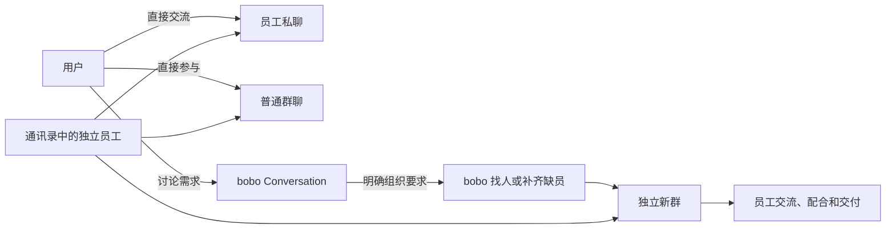
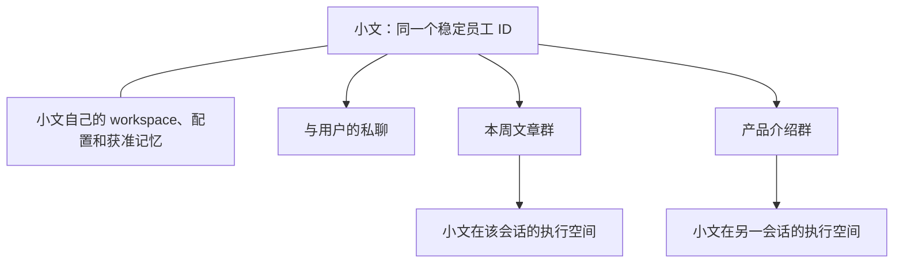
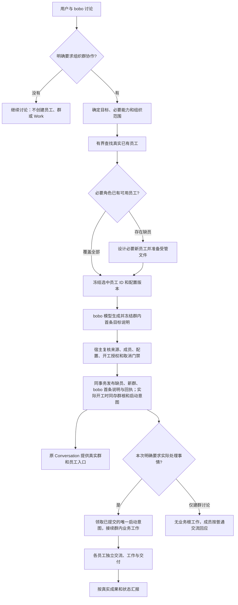
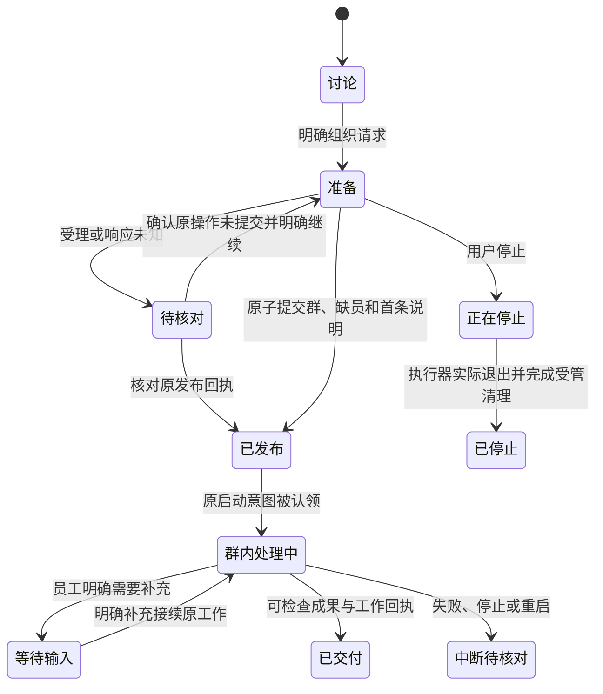

<!--
[INPUT]: 用户确认的持续 bobo 讨论会话、独立员工身份、首批新群组织流程与原子发布/真实交付合同。
[OUTPUT]: 待实施的会话列表、bobo 群/员工入口、独立协作群文本线框及流程、身份、恢复状态图。
[POS]: ai-docs/spec/12.bobo发起与组织群协作/06-界面线框与流程图.md；设计说明，非截图、代码实现或验收证据。
[PROTOCOL]: 一旦本文件变化，必须同步更新 Header，并上浮检查所属目录 .folder.md；图中状态须与 03/05 一致。
-->
# 界面线框与流程图

日期：2026-10-02。状态：待实施设计。交互合同见 [02](./02-用户流程与界面交互.md)，实施状态见 [05](./05-实施步骤与验收清单.md)。

以下名字、文案和成果只展示结构，不是默认数据或实际运行证据。线框沿当前会话分栏、群聊和右侧详情；不复制用户的临时截图为受管设计素材。

## 1. 处理入口与员工身份



这些是同一批员工的不同参与入口，彼此不替代。群只是参与者和记录的组织空间；不生成一套“群内员工身份”或“后台子员工身份”。

## 2. 原 bobo 会话：保留讨论，提供真实入口

```text
┌──────── 会话列表 ────────┬──────── 与 bobo 讨论本周文章 ────────────┐
│ 搜索会话名称            │                                          │
│                         │ 我：帮我组织员工完成本周文章。           │
│ bobo                 ▾  │     现有研究员和写作员能用，不够就补齐。 │
│   本周文章讨论   ←当前  │                                          │
│   其他讨论              │ bobo：现有小研、小文可以承担研究和写作。 │
│                         │       已补齐编辑小编，建立本周文章群，   │
│ 会话                    │       并在群里说明目标和建议分工。       │
│   本周文章协作          │                                          │
│   与小文的聊天          │ [进入群聊：本周文章协作]                │
│   其他群聊              │ [小研·已有] [小文·已有] [小编·本次创建] │
│                         │                                          │
│                         │ ┌──────────────────────────────────────┐ │
│                         │ │ 继续与你的 bobo 讨论…                 │ │
│                         │ └──────────────────────────────────────┘ │
└─────────────────────────┴──────────────────────────────────────────┘
```

这里仍是原 Conversation。新群出现在普通群列表；入口来自已提交对象。群发布与 bobo 首条说明同事务，但回复不能因此说每位员工已开始执行或业务已交付。

点击群入口才打开群，成功通知不会抢导航。原标题、消息、草稿和阅读位置保留，用户回来可以继续讨论；原会话没有自动结束倒计时或“已转为群聊”状态。

联系人入口指向员工资料和已有私聊动作，不创建另一位同名员工。列表具体头像、时间和样式沿现有控件，线框省略不代表删掉既有能力。

## 3. 新群：以各自身份交流

```text
┌──────── 会话列表 ────────┬────── 本周文章协作 ───────┬──任务与产物──┐
│ bobo                 ▾  │ 成员：bobo / 小研 / 小文 / 小编           │
│   本周文章讨论          │                              │              │
│                         │ bobo                         │ 当前工作目标 │
│ 会话                    │ 本周完成一篇 AI 产品文章。   │ 实际状态     │
│   本周文章协作   ←当前  │ 小研核对资料，小文形成初稿， │ 实际负责人   │
│   与小文的聊天          │ 小编在初稿后检查表达。       │ 等待/依赖    │
│                         │                              │              │
│                         │ 小研                         │ 已发布成果   │
│                         │ 我先核对资料，想确认选题…   │ [资料说明]   │
│                         │                              │ [初稿 v1]    │
│                         │ 我：这次聚焦……              │              │
│                         │                              │              │
│                         │ 小文                         │              │
│                         │ 我会基于确认后的资料写稿。   │              │
│                         │                              │              │
│                         │ ┌──────────────────────────┐ │              │
│                         │ │ 发消息，@ 提及 · / 命令 │ │              │
│                         │ └──────────────────────────┘ │              │
└─────────────────────────┴──────────────────────────────┴──────────────┘
```

群头、头像资料、提及、消息、引用、Trace 和右侧详情复用 [现有群聊规格](../3.前端重构与功能/16-群聊界面设计/01-视觉与交互规格.md)。右侧只显示真实工作和成果；没有工作时显示既有空态，不根据成员名单造出分工行。

bobo 的分工建议使用 bobo 署名。员工自己的接受、提问和交付使用员工署名；不能把 bobo 的一段汇报拆成伪造的多员工回复。

## 4. 员工跨会话复用



各会话使用自己的上下文和授权范围。参与另一个群不自动读入原群全文、其他员工 workspace 或 bobo 私人讨论；同一员工的相关记忆召回继续遵循现有来源和使用范围。

## 5. 正常组织流程



启动意图和业务根工作与发布的原子关系见 [03](./03-会话成员与协作合同.md)。讨论、对象组织与群内实际工作分开判定，沿同一协作请求和预算，不重复领取额度或重复执行同一目标。

首批没有按主题相似度自动选旧群的分支。已有群复用属于 BC5，必须先有用户明确指向的群身份及成员/来源核对合同。

## 6. 组织操作与工作状态分开



图中的状态属于操作/工作，不是 Conversation 的生死状态。已交付、停止或中断都不自动关闭原 bobo 会话、新群或删除任何员工。

重启只核对已提交事实；未完成操作的继续/放弃必须明确。已发布群不能通过“重试”再次创建，已公开首条说明不能再次发送，已执行或结果未知工具不能盲目重放。

## 7. 未知结果的线框

```text
bobo：这次组织结果尚未核对。
      我会保留原请求；目前不能确认群是否已经建立。

[核对本次结果]

核对成功：显示原群和原员工入口，不重新创建。
核对失败：保留原请求与说明，不把失败当成“没有群”。
工作中断：保留已发布群和目标，显示工作实际状态。
```

不向用户展示内部请求 ID、文件准备日志或未知用量细节，除非用户进入已有详情查看。核对期间允许阅读其他聊天，不抢焦点或导航。

## 8. 生命周期的界面含义

| 用户动作 | 界面结果 |
| --- | --- |
| 关闭原 bobo 会话页面 | 只切换页面，不停止或删除已受理对象 |
| 清空/删除原 bobo 会话 | 沿既有清理；已发布员工和群不级联删除 |
| 解散新群 | 群按原规则清理，通讯录员工和其他会话保留 |
| 删除某员工 | 沿既有员工清理、成员撤权和执行退出规则 |
| 打开失效历史入口 | 说明明确对象不可用，不恢复或替换同名对象 |

以上图只表达产品合同。实现截图、模块测试、Electron 场景和真实群协作交付证据须在 BC0–BC4 执行后记录于 [05](./05-实施步骤与验收清单.md)。
