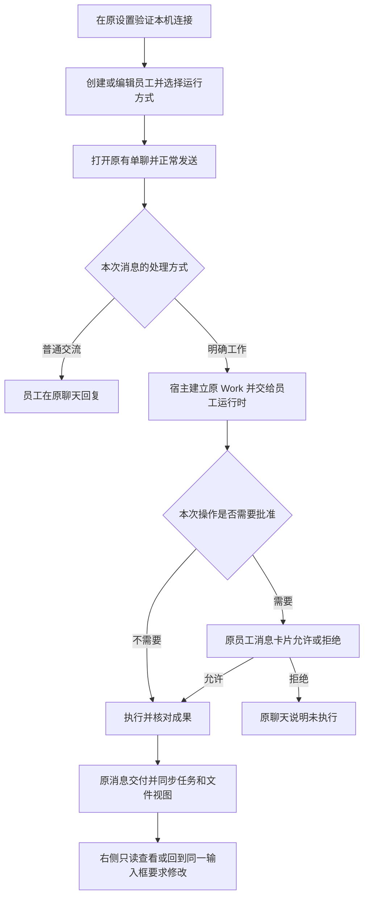

<!--
[OUTPUT]: §97共用Work卡显式标明目标原文，真实状态/交付入口不受完成式措辞影响；源码八状态预置与九原回归、41模块及真实Codex创建/交付/修订通过，原红失败保留，新包和完整目标未完成。
[OUTPUT]: 5.6将已确认的IM保留与底部定向调整整理为六项前端验收清单；仅补开发交接，不改变运行时能力、当前实施状态或06唯一进度归属。
[OUTPUT]: 5.5按布局、配置、事件接线与宿主生命周期划分改动量，提供保留IM的增量开发顺序；设计不另建进度表，实际缺口继续归06。
[OUTPUT]: 底部明确对象导航与原问题/核心空白页/旧ACP的分批证据指向06 §59–60；本文件保留合同，导航成功不推定后续业务、保存或全部组合完成。
[INPUT]: 用户确认的员工本机 Agent 运行方向、现有 API/ACP 实现及员工/聊天/Work/成果交互合同。
[OUTPUT]: 保留 Agent IM 布局的运行方式配置、输入框底部行为、当前员工/本机连接的准确设置入口与配置回写核对项、Claude首批明确API来源与六个前端交付单元、原消息中断与固定执行记录、同一聊天交付流程和真实请求计量；历史基线、设计目标与06实际进度分开。
[POS]: 第 13 组产品范围与前端交互合同；运行时能力见 02，工作/恢复见 03，唯一阶段状态与自动验收见 06。
[PROTOCOL]: 一旦本文件变化，必须同步更新 Header，并上浮检查所属目录 .folder.md。
-->
# 产品范围与前端交互

更新：2026-10-06。状态：**设计合同；实际实施状态以06为准**。本组总入口见 [README](./README.md)，全部阶段进度仅由 [实施步骤与自动验收](./06-实施步骤与自动验收.md)维护。

## 1. 产品目标与当前基线

用户仍在 BoAI 创建员工、单聊或群聊、交付任务并审阅成果；员工可使用成熟的本机 Agent 完成适配范围内的工作。BoAI 保留员工身份、消息、权限、Work、成果和协作关系，具体 Agent 循环与工具执行交给选定运行时。

本轮沿用员工与聊天为中心的 IM，不重做主界面。前端布局变化小，配置、状态、发送与生命周期接线为中等工作量；主要工程量在后端能力适配、会话隔离、工作提交和异常恢复，不能以新增下拉框视作完成。

开工提交 `d3ec502` 中，API 员工已有聊天与协作路径；ACP 员工已有本机进程启动、验证、单聊显式任务、权限请求及文件手动发布。该旧 ACP 路径每次新 session，只接收员工规则与本次任务，没有接入普通聊天、完整 Work、群协作或自动化。工作树后续新增的 Codex 员工不受这份历史描述代表，当前代码事实见[第2组30](../2.已实现功能与代码现状/30-本机Codex员工运行时实施.md)，实际验证与剩余工作见[06](./06-实施步骤与自动验收.md)。

## 2. 员工设置：运行方式属于员工配置

复用员工编辑表单，将现有执行后端入口整理为“运行方式”。姓名、头像、职责、工作规则、员工身份与历史保持原位置；选择运行时不创建另一名员工。

| 运行方式 | 员工需要选择的内容 | 展示边界 |
| --- | --- | --- |
| 模型 API | 已保存连接、模型和支持的思考档位 | 沿用当前 Mastra 员工能力 |
| 本机 Codex | 已保存的 Codex 运行配置、运行时实际提供的可选项 | 具体协议与版本见运行配置详情，不把它当模型 API 连接 |
| 本机 Claude Agent | 已保存的 Claude 运行配置、运行时实际提供的可选项 | 登录方式及可用功能以所选适配器实际核验为准 |
| 其他 ACP Agent | 已验证的 ACP 启动配置 | 按已核验能力开放；不能因握手成功就开放所有员工功能 |

Claude首批按当前已验证适配器配置“本机Claude程序＋已保存的兼容API连接＋模型”；该API连接提供给Claude自身运行循环，不额外调用Mastra父模型。认证与模型配置展示在原员工/连接表单中，不承诺复用Claude订阅登录。单员工创建/编辑入口已接此配置；实际桌面验证及未开放范围见06 §52，配置可保存不等于全部员工能力可用。

四项是目标产品选择，不要求未通过验收的选项提前可用。原 ACP 员工迁移后保留原配置、显式任务范围和历史，不自动提升能力。员工运行配置的版本、能力取值和适配器选择见 [运行时适配与能力契约](./02-运行时适配与能力契约.md)。

模型选项只来自所选运行时实际公开且已验证的配置能力；不支持时显示“由本机 Agent 管理”。不把 API 的模型 ID、思考档位或命令开关直接套用到本机 Agent，也不暗中用另一个 API 模型补齐缺失能力。显式混合运行方式另按 02 配置与说明实际阶段，不能默认启用。

## 3. 设置：复用本机 Agent 接入入口

继续使用“设置 → 模型连接 → 本机 Agent”及现有扫描/配置流程，不新增顶层导航。普通层展示名称、发现结果、验证状态和可操作的下一步；程序路径、启动参数、协议及具体版本放详情或高级设置。

- **发现**：列出已找到的受支持程序和配置来源，未找到时给安装说明及手动指定入口。扫描本身不安装、不执行任务、不登录，也不扫描无关项目凭据。
- **登录信息**：区分已发现配置、需要登录、认证已验证和状态未知；“有配置文件”不能显示为“登录成功”。需要认证时引导到受支持的提供方流程，不在聊天中索取 token。
- **验证**：分别呈现程序可用、协议连接、认证及具体能力核验的结果和时间。轻量连接测试不冒充真实任务验证；需要执行任务的验证单独说明其范围。
- **可用状态**：未安装、待配置、待验证、可用、需登录、版本已变化或当前不可用各有明确原因；程序或配置变化使对应旧验证失效。

“使用本机已有配置”由用户明确选择，仅表示按适配器规则访问该配置；不承诺自动复用某项订阅、免费调用或导入外部密钥。登录使用条件和模型额度由对应运行时实际支持决定。

保存运行配置或员工设置只保存配置，不发送模型任务。账户标识仅展示必要信息，凭据保持宿主管理；访问本机配置与获得 BoAI 材料、记忆或工具权限是不同授权。

## 4. 员工概览：显示真实能力

复用现有员工概览，增加运行方式、当前配置状态和必要能力说明。正常可用时保持简洁；功能不可用或需要处理时展示具体原因和原设置入口，不增加常驻技术状态面板。

能力按普通聊天、明确任务、群协作、自动化、材料、技能、记忆和内置工具分别核对。状态至少区分支持、不支持、未知；未测试、版本变化或来源失效不能沿用旧“支持”。详情可显示验证范围与时间，不展示私有凭据或模型思考。

本机 Agent 自带的 Skills、MCP、浏览器与 BoAI 已绑定能力分别标明来源。外部程序自行发现同名技能不能当作员工已获准读取 BoAI 技能；外部浏览器也不能冒称当前应用内置浏览器会话。

不支持的能力在相关选择入口过滤或说明原因；不能先允许加入群聊、设为自动化执行对象，再在执行时静默跳过。bobo 与自主群聊能力按专门验收开放，不因员工设置增加选项而默认开放。

## 5. 聊天与任务：沿用同一个输入框

目标是具备对应能力的本机员工继续使用正常聊天 composer。是否普通聊天、明确任务或原问题补充，沿产品既有语义处理；不把每句问候都转换成有工具副作用的外部任务。

普通聊天入口只有在对应运行时通过该阶段验收后开放；尚仅支持显式任务的 ACP 员工保留明确任务入口及说明，不能只改按钮文字就宣称支持正常聊天。

- 普通发送不主动取消正在执行的处理；追加消息是否进入后续轮次或明确接续由 [会话工作与恢复协议](./03-会话工作与恢复协议.md)决定，不能隐式重启外部任务。
- 不增加“停止本轮”“停止并发送”、输入框上方状态条或新的停止栏。需要停止时复用原工作或消息的明确操作，展示实际停止结果与未知状态。
- 员工回复、公开进展、工具活动和最终成果沿原消息呈现；推理内容不公开。收到文本或进程结束不等于已交付，任务交付状态须以原 Work 和可核验成果为准。
- 工作卡标题显式标为“目标：”并保留原文；原文使用完成式措辞也不代表已交付。真实状态、结果消息与正式文件动作继续分别读取原业务身份。
- 权限请求在原员工消息卡片允许或拒绝，说明实际操作和授权范围。外部运行时未提供的控制能力不展示为 BoAI 可保证的权限开关。
- 需要补充时从原问题卡片进入同一 composer，绑定原问题、版本、消息及适用 Work/occurrence；普通发言不能代替关联回复或解除等待。
- 发送未知回执、外部断线、停止待确认等状态保留原请求身份并只读核对；不出现可能重复副作用的一键盲目重试。
- 已受理轮次在重启后确认为中断时，从原用户消息显示持久事实并打开该消息的执行记录；尚未产生运行或 Work 也能说明中断，不创建员工假回复、不调用模型补解释。历史消息不能借用下一轮状态。本机执行不展示宿主已拒绝的原运行重试入口；处理尝试、本机请求与内部模型调用分别说明，未知不按零处理。

附件、引用、修订模式仍复用现有控件。图片添加继续沿既有合同，不因模型视觉能力阻止前端添加；适配器是否能传递对应媒体与模型是否理解分别记录。协议不支持的材料明确说明投递限制，不能仅传路径字符串或改写成“已读取附件”。

### 5.1 输入框底部的定向调整

底部继续使用现有 composer 工具栏，保留输入、附件、引用和发送的布局。运行方式属于员工设置；聊天底部负责展示当前员工使用的方式，并提供其实际支持的快捷配置，不再维护另一份仅对单条消息生效的运行绑定。

| 底部位置 | 模型 API 员工 | 本机 Agent 员工 |
| --- | --- | --- |
| 模型入口 | 沿用连接、模型与思考强度选择 | 显示本机运行方式；模型/强度仅在适配器提供并验证该能力时可选，否则显示“由本机 Agent 管理” |
| 工具与命令入口 | 沿用员工已授权能力和命令审批 | 只展示宿主确实能控制的选项；外部工具能力不能从 API 开关推断 |
| 附件入口 | 沿用当前接收范围与材料规则 | 按已接入的输入能力提供相同入口；准备、发送、撤权和来源核对仍由宿主管理 |
| 发送按钮 | 普通发送 | 通过聊天能力验收后同样普通发送；旧 task-only ACP 保留明确任务入口 |
| 连接异常 | 沿用现有错误与配置入口 | 原消息显示实际失败及处理入口；原请求未知时先核对，不自动换后端重发 |

单聊显示当前员工的配置。群聊不新增一个能覆盖所有员工的全局模型选择，每名员工仍按自己的运行绑定执行；相关能力随 LR5 开放。修改配置沿员工原保存流程，活动或未知工作不能借底部快捷操作绕过切换检查。

前端开发主要触及员工创建/编辑、已有本机连接设置、员工能力概览、composer 工具栏及原消息事件展示。会话列表、通讯录、聊天/任务/文件页、全局任务和右侧预览继续复用；新增运行时不能要求用户换一套操作路径。实际文件接线与迁移见 [07](./07-迁移兼容与代码接线.md)。

### 5.2 前端交付单元与可见结果

下表将上述合同对应到现有组件，供后续开发逐项补齐。它不是新增进度表：哪些已经接入、哪些仍需开发或真实验证，统一读取 [06](./06-实施步骤与自动验收.md)。各项可以随运行时能力分阶段交付，不需要先重做所有页面。

| 交付单元 | 复用入口 | 用户可见的完成结果 |
| --- | --- | --- |
| 员工运行方式 | [员工创建](../../../src/renderer/components/employee/creation-dialogs.tsx)、[员工编辑](../../../src/renderer/components/employee/editors.tsx) | 给原员工选择 API 或已验证的本机运行配置；只显示该方式所需字段。姓名、职责、历史保持，保存配置不执行任务；本机方式不要求补选 API 父模型。 |
| 本机连接与状态 | [本机 Agent 列表](../../../src/renderer/pages/settings/local-agents.tsx)、[连接编辑](../../../src/renderer/pages/settings/local-agent-editor.tsx) | 在原设置里完成发现、配置和连接测试；明确缺少程序、需要登录、版本变化与可用状态。连接成功与真实工作成功分别呈现。 |
| 输入框底部 | [composer 工具栏](../../../src/renderer/pages/conversations/-components/composer-toolbar.tsx) | 显示该员工的运行来源和可控权限；模型/强度按真实能力提供。沿原员工配置保存，活动或未知工作时无法绕过换绑检查，发送行为保持 IM 语义。 |
| 员工能力说明 | [员工概览](../../../src/renderer/components/employee/overview.tsx)、[能力投影](../../../src/renderer/components/employee/overview-state.ts) | 用户能区分可用、未支持和待核对；未开放的群聊、自动化或资源能力不能因选择了品牌名称就显示可用。 |
| 原消息过程与办理 | [聊天视图](../../../src/renderer/pages/conversations/-components/chat-view.tsx)、[运行详情](../../../src/renderer/pages/conversations/-components/run-detail.tsx) | 流式回复、申请权限、等待补充、失败及中断回到原员工消息；原问题和成果修订进入同一输入框，未知回执有核对入口。 |
| 原工作与文件视图 | [工作视图](../../../src/renderer/components/work-views/)、[只读详情](../../../src/renderer/components/detail-panel/) | 本机任务使用原 Work 和正式成果后进入已有视图；查看、采用与修订保持原版本身份，无需新增一套本机 Agent 工作台。 |

用于审阅的连续路径是：**在原设置验证本机连接 → 创建或编辑员工 → 单聊连续交流 → 在同一聊天交付文件任务 → 在原消息审批、查看和要求修改 → 重启后读取已提交记录**。这条路径中的每一步都应有实际界面和真实回执证据；保存表单或显示回复不能替代工作交付验收。

底部展示示意：API 员工显示「模型／思考强度」，本机员工显示「本机 Codex／由本机 Agent 管理」等实际来源，右侧继续普通发送。示意文案不增加新的运行方式绑定，也不承诺尚未提供的模型选择能力。群聊仍由每位员工独立配置。

### 5.3 底部显示示例与配置回写

以下是后续实现的状态示意，复用现有工具栏，不新增常驻状态栏。方括号表示既有控件位置；权限项仅在该员工和运行时确实支持时显示。具体文案可随实际能力调整，不能把示意图当作当前界面验收。

```text
API 单聊：       [＋] [／] [命令权限] [当前模型 ▾]                    [发送]
本机 Codex：     [＋] [／] [命令权限] [本机 Codex ▾]                  [发送]
本机 Claude：    [＋] [／]              [本机 Claude · 当前模型 ▾]      [发送]
群聊：          [＋] [@] [／]                                      [发送]
```

本机入口首先说明当前运行来源，再给对应设置入口。Codex 未开放模型配置能力时说明“由本机 Agent 管理”；Claude 当前方案明确显示其使用的 API 模型，并引导到员工设置修改。模型由谁提供、Agent 由谁执行是两件事，不能把“Claude＋API”显示成“Mastra 员工”。群内各员工独立运行，底部不提供覆盖全员的模型开关。旧 task-only ACP 仍沿原明确任务入口。

本机菜单中的两个设置动作按以下具体对象定位；接线和分批验收见[06 §59–60](./06-实施步骤与自动验收.md)：

- **员工设置**：定位当前员工的原编辑入口，用于修改运行绑定、职责及该运行时支持的模型配置。
- **管理本机 Agent**：定位当前员工绑定的本机运行配置，用于核对程序、连接状态和验证结果；绑定已失效时说明原因并进入原连接列表。

打开这些入口仅导航。底部标签仍读取已保存的员工配置；用户保存后才刷新，取消编辑不改绑定。往返保留原聊天草稿、附件、原问题或成果修订引用。若用户已切换聊天，旧配置请求的迟到结果不能覆盖新聊天的员工标签。这些是交互完成标准，当前菜单是否已逐项接通须按实际代码和06证据确认。

| 操作或状态 | 前端应有的结果 | 宿主必须核对的事实 |
| --- | --- | --- |
| 打开运行来源菜单 | 展示当前来源、可用选项及该员工/本机运行配置的准确设置入口；未提供的能力只作说明 | 配置和能力来自该员工的真实绑定；导航不保存、不调用模型、不改变发送对象 |
| 改模型、权限或运行方式 | 明确保存到当前员工；成功后更新显示，失败保留原值，当前输入草稿仍在 | 复用原员工保存接口及配置版本；保存本身不触发模型、任务或重新发送 |
| 员工在其他聊天有活动执行 | 可查看配置；暂不可修改的选项给出原因 | 宿主检查该员工全部相关执行与未决工作，不能只检查当前页面的忙碌状态 |
| 保存响应未知或工作待核对 | 保留原请求，提供核对结果；不能先显示为已切换 | 沿原回执只读核对，确认实际保存结果后刷新，不新建请求盲目重试 |
| 程序、登录或能力失效 | 原消息/设置显示实际原因和处理入口；草稿与历史保留 | 不自动改用 API、另一安装或另一账号重新执行 |

开发时直接核对现有 `ComposerToolbar` 和员工保存链，复用已经接通的来源标签、锁定和普通发送。补齐缺失行为时保留原权限、材料、草稿和固定问题引用的断言；具体状态和证据只登记到 [06](./06-实施步骤与自动验收.md)。

### 5.4 同一聊天的交付流程

以下是目标交互流程；图中步骤的实际支持范围按所选运行时能力开放。



底部运行方式说明和快捷选项服务于这条路径。它们不另开一个聊天产品，也不替代消息中的权限确认；拒绝后的回复只陈述实际结果，不标记工作已交付。处理方式仍沿现有员工判断与宿主路由，不因本机运行方式增加一个额外的 API 父模型。

### 5.5 前端改动量与开发顺序

“前端不需要改太多”指页面结构可以复用。员工配置和原消息事件仍需要接线，工作量不能只按新增控件数量估算。后续开发按下表确定范围，不把本机 Agent 接入扩大成整套 IM 重构。

| 改动范围 | 改动量判断 | 开发交接 |
| --- | --- | --- |
| 会话列表、聊天布局、任务/文件和右侧预览 | 以复用为主 | 读取原员工、消息、Work和成果，不为本机运行时增加平行页面或数据来源。 |
| 员工创建/编辑及现有本机连接设置 | 局部表单改动 | 选择API或本机运行配置，按实际来源显示模型与认证字段；保存与启动分开。 |
| 输入框底部 | 局部展示与导航改动 | 按5.3显示运行来源、准确设置入口及可控选项；群聊保持各员工独立配置。 |
| 原聊天的流式回复、审批、问题、失败和中断 | 有实质事件接线 | 复用原消息组件，核对原请求和版本；外部终态、已停止与业务已交付分开。 |
| 会话隔离、材料/工具授权、预算、取消与恢复 | 主要工程量在宿主 | 按02–05接成熟Agent，复用原事务和业务仓库；前端显示宿主确认的事实。 |

开发顺序沿[06](./06-实施步骤与自动验收.md)的LR0–LR6，不新增一套里程碑。每次选择一个仍未完成的运行时或场景，先核对[当前剩余工作](./06-实施步骤与自动验收.md#19-当前剩余工作清单)，再按[07源码接线](./07-迁移兼容与代码接线.md)复用已有实现：

1. 确认程序、协议、认证和可开放能力，先完成连接与员工绑定。
2. 接通同一单聊、底部来源与准确设置入口，核对连续聊天和多员工隔离。
3. 接入原Work、权限申请与真实文件交付，再验证同一composer的原问题补充和成果修订。
4. 补齐资源、取消、未知回执、重启及换绑边界，随后扩大到群协作、核心助手和自动化。
5. 按实际源码、真实运行时和应用包分别留证；用户审阅原聊天过程与成果。

以上是依赖顺序，不要求从头重做已经接通的Codex/Claude路径。旧ACP只支持显式任务的范围继续单独标明；握手成功不能替代普通员工能力验收。

### 5.6 保留 IM 的前端验收清单

本次确认落实为以下六项交接检查。它们复用5.2的组件与现有业务合同，供后续开发选择具体缺口；不是六项新增功能，也不表示现有实现尚未接入。实际通过、失败与未覆盖状态继续查06，不能把下表全部改成待开发或已完成。

| 用户操作 | 最小界面变化 | 验收必须观察到的结果 |
| --- | --- | --- |
| 创建或编辑员工 | 原表单选择API或本机运行方式，显示相应配置字段 | 保存仍是同一员工，不发送任务；本机运行方式不隐式增加Mastra父模型。未验证能力不会因选了品牌而开放。 |
| 查看聊天底部 | 原工具栏显示当前员工的运行来源及实际可控选项 | 标签来自已保存绑定；员工设置和本机连接分别定位准确对象。群聊中每位员工独立运行，底部没有全员运行方式开关。 |
| 发送消息和附件 | 使用原composer、附件和发送按钮 | 普通聊天仍是原聊天；发送不主动停止正在处理的工作。材料传递失败回到原请求，不能把路径或未传递附件当作已读取。 |
| 处理权限、问题或成果 | 沿原消息卡片办理，问题补充和明确修订使用同一composer | 原审批、问题版本和成果hash保持关联；右侧继续只读预览。外部工具反馈与正式交付分别核对。 |
| 从底部进入设置再返回 | 复用原设置与导航 | 草稿、附件、固定问题或成果引用保持；取消编辑不改变绑定，迟到响应不能改写已切换聊天。活动或待核对工作不能借快捷入口换绑。 |
| 遇到连接失败、停止或重启 | 原消息说明实际状态，并给对应设置或核对入口 | 未知结果不显示成功，不自动重发或换成另一后端；进程退出与工作已交付分别有可检查依据。 |

最小审阅材料是一条完整的原IM路径：运行配置与员工绑定画面、底部菜单与往返草稿、连续聊天、原消息交付/修订以及重启后的记录。实际运行时、源码与应用包的证据分开，已有通过路径不反复重做；相关缺口按[06当前清单](./06-实施步骤与自动验收.md#19-当前剩余工作清单)安排。

## 6. 工作和文件：复用既有视图

正式接入后，本机员工的明确任务写入同一 Work 权威记录。会话“任务”、全局任务和员工当前工作读取同一来源，不增加独立外部任务数据库、任务卡来源或第二套工作台。

历史 ACP 仅有运行记录的过程保留原样，不通过消息文字、运行成功或文件存在反推补造历史 Work。新接入任务的来源、结果和交付状态须明确可查。

会话“文件”继续合并已发送材料与正式发布成果。外部工作目录中的文件先作为候选，经授权、原件/hash 核对和正式登记后才进入已发布列表；不能把外部路径或工具“写入成功”直接当成已交付成果。

右侧预览继续只读，显示内容、版本和来源。采用、稍后处理、修订、审批及未知回执核对仍在原聊天消息完成；修订进入同一 composer 的固定成果版本模式。右侧不增设外部终端、业务审批表单或可直接改源文件的编辑器。

## 7. 切换运行时与多员工隔离

运行方式是版本化员工配置。保存切换前说明下一次交流使用的运行时，以及历史消息仍保留其实际执行来源；运行配置详情或消息详情承载这些信息，不给每条消息增加常驻协议标签。

有运行、待审批、待补充或提交未知的工作时，不静默把该工作转给新运行时。宿主按 03 核对原工作：可完成或明确停止并确认实际退出的，再允许切换；仍未知的保留待核对状态和当前配置，不借切换绕过门禁。

允许切换后保留原 Conversation 和消息身份，从新的运行配置边界建立外部 session；不加载其他运行时的私有 transcript，也不自动重放历史任务。后续可用历史由 BoAI 按当前范围提供，跨边界继续某项未完工作必须符合明确接续合同。

多个员工可共用同一份程序安装及获准登录配置，但员工身份、会话映射、工作目录与运行回执分别隔离。同员工的不同聊天、同群的不同员工也不能共享一个外部 session。共享安装不表示共享员工记忆、文件权限或所有历史。

界面“新聊天”“清空”“删除”仍指 BoAI 对象；清理外部运行时数据的实际覆盖范围在对应操作中说明，未支持删除外部日志时不能宣称全部清除。只设置 cwd 也不能宣称已提供操作系统沙箱。

## 8. 验收意图

详细场景和全部阶段状态见 [实施步骤与自动验收](./06-实施步骤与自动验收.md)。开发代理准备数据、执行真实界面与故障场景并提供可视结果，用户审阅实际体验。

| 用户意图 | 必须证明的结果 |
| --- | --- |
| 给已有员工选本机运行方式 | 身份和历史保留；保存零任务调用；配置不可用原因准确 |
| 与本机员工继续聊天和交付任务 | 只有已验收能力开放；普通消息不取消、不重放任务；处理回到原消息 |
| 给权限或回复原问题 | 操作关联原版本；拒绝和未知回执不产生隐式授权或重复执行 |
| 查看工作与成果 | 三处工作视图共用同一 Work；候选文件不冒称发布；右栏只读 |
| 多员工共用安装 | session、目录、历史与员工归属不串；未获准内容不随共享配置外发 |
| 切换、断线、升级或重启 | 旧工作与新配置边界明确；原回执可核对；没有自动恢复副作用 |

布局沿用原界面仍需验证窄窗口、主题、键盘焦点、隐藏停读和未知状态可操作性；既有 API 员工的普通发送、材料、群协作与任务处理必须保持原业务断言。

## 9. 非目标

本组不新增独立工作台、待处理页、顶层导航或终端优先的交互；不强制 Git 仓库，不做远程机器、手机端或多端同步。也不保证任意 CLI 可接入、订阅可自动复用、所有阶段能力相同或所有外部工具都受 BoAI 沙箱控制。

本规格不以运行方式名称代替实际能力验收，不迁移外部全部聊天与记忆，不静默替用户安装、登录、升级程序或启用自动化。后续新增能力继续遵循原 IM 与工作交付合同。
