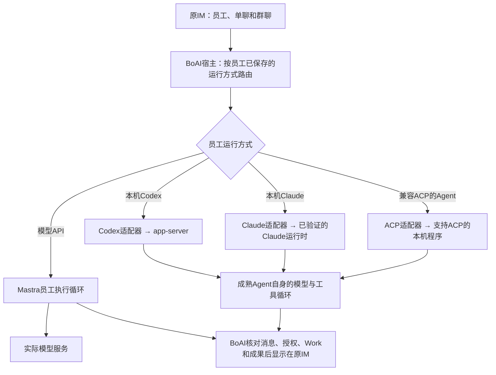

<!--
[OUTPUT]: 2026-10-11按Rovai纠正文档：员工一等公民、原生session/turn与工具、右侧执行历史；删除消息流程卡片，不精简输入框工具栏；仅文档，状态归06 §121。
[OUTPUT]: 第13组09按Todos目录区分已有基础、待补或待验证能力与独立扩展；保留IM和API/本机双路径，当前进度唯一归06。
[INPUT]: 用户确认的IM产品方向和底部调整、Todos官方外部运行时说明、当前员工后端/运行配置/工具栏源码及本组01–07。
[OUTPUT]: 后续开发的范围取舍、局部前端清单、员工运行方式调用图、API/原生Agent/ACP区别和现有接线入口；不新增能力承诺或平行实施进度。
[POS]: 第13组设计交接补充；产品交互归01，运行能力归02，实际完成状态和证据唯一归06。
[PROTOCOL]: 一旦本文件变化，必须同步更新Header，并上浮检查所属目录.folder.md及上级索引。
-->

# Todos参考与开发取舍

## 2026-10-11当前替代条款

**本轮仅文档。** 当前设计入口为[10](./10-员工一等公民与执行能力设计.md)和[11](./11-Rovai对齐与本机执行纠偏.md)，状态唯一见[06 §121](./06-实施步骤与自动验收.md#121-rovai参考与员工执行设计纠偏2026-10-11仅文档)。以下明确替代的要求以本节和11为准，不适用旧文档“更严格者优先”来恢复已废止条件。

本文保留Todos参考的原核读记录。当前主参考已按用户要求改为Rovai，具体来源、运行机制、执行面板和消息卡片规格以[11](./11-Rovai对齐与本机执行纠偏.md)为准。本文旧底部布局、阶段能力限制和旧实施顺序不再作为当前要求；不得从旧示意推导出改动聊天输入框工具栏的授权。

## 历史规格与实现记录（按原日期阅读）

下文保留旧设计和实施背景；与上述替代项冲突的“必须/保持/首版限制”仅说明旧实现，不是当前目标。真实历史成绩、失败及不冲突的数据正确性约束继续保留。


设计交接更新：2026-10-07。

**BoAI保留IM界面，让员工选择执行引擎；前端做局部调整，主要工程量在运行时与原业务的衔接。** 本文将用户确认的方向落实到已有规格，不另起一套产品或实施路线。当前工作树已有Codex/Claude增量实现，继续开发先查[06当前剩余清单](./06-实施步骤与自动验收.md#19-当前剩余工作清单)，不能把设计目标全部当成尚未实现。

## 1. 参考的是什么

Todos同时提供内置与外部运行时。外部Codex通过`app-server`接入，Claude通过Agent SDK接入，部分其他CLI采用ACP，并衔接平台工具。[官方外部运行时说明](https://todos.dev/zh/docs/runtimes)

BoAI采用的设计取舍是：员工身份与执行引擎分开，成熟Agent负责自身执行，BoAI保留聊天、权限、工作和交付的业务权威。产品仍按本项目的IM合同设计。

ACP用于标准化客户端与Agent的通信；支持ACP的程序才能直接走该协议。[ACP官方介绍](https://agentclientprotocol.com/get-started/introduction) “调用本机Agent”不等于接管用户正在其他终端或桌面软件里进行的私人会话，也不表示模型在本机离线运行。

此前会话中的Raft分析属于历史调研背景。本次没有重新核验Raft的新版本，不将其协议、认证或界面细节写成当前事实；上述具体驱动方式依据本次读取的Todos官方文档。

## 2. 员工配置分清三件事

| 配置 | 用户理解 | 宿主责任 |
| --- | --- | --- |
| 运行方式 | 模型API、本机Codex、本机Claude或已支持的其他Agent | 选择对应执行适配器，保持原员工身份 |
| 程序连接 | 使用哪份已安装程序和启动配置 | 核对程序、版本、配置及能力，不借保存配置执行任务 |
| 模型与认证来源 | 使用哪个模型、哪份明确授权 | 按具体运行时显示字段，避免隐式使用另一份账户或连接 |

协议由连接适配器处理，普通员工设置不要求用户把Codex、Claude都配置成ACP。已有API员工继续使用Mastra；本机员工直接使用相应成熟Agent，不强制增加一个Mastra父模型。

当前代码事实需与设计区分：

- `ExecutionBackend`已有`mastra-model`、`codex-local`、`claude-local`和`acp-local`四种身份。见[后端类型](../../../src/shared/domain/backends.ts)。
- 当前Codex配置不能同时绑定BoAI API连接；Claude采用已核对程序与明确兼容API来源，当前核验拒绝`useExistingLogin`。因此“本机Claude”不能宣传为已经复用个人订阅登录。见[运行配置核验](../../../src/runtime/modules/backends/runtime-config.ts)。
- 现有通用ACP仍是显式任务与新会话路径，普通聊天、判断和记忆未开放；选项存在和握手成功不能代表完整员工化。现状见同一后端类型文件，目标合同见[02](./02-运行时适配与能力契约.md)。

### 2.1 员工选择后的调用关系

下面是沿现有后端身份整理的接线图；是否开放聊天、工具、群协作和自动化，仍按各运行时的实际能力核验。



本机路径由BoAI启动或连接受管程序，为员工与聊天建立独立会话；程序内部负责自己的执行循环。BoAI仍负责哪些材料能发送、操作是否获准、结果是否正式交付，以及停止和重启后的记录核对。已有API路径继续使用Mastra，本机路径不隐式借用另一份API父模型。

员工设置保存“使用哪种运行方式及哪份连接”，聊天底部显示这一已保存选择并打开准确设置入口。保存、打开设置和查看历史都不启动任务；只有明确受理的新消息或原工作接续才能进入执行。换运行方式保留原员工与历史，新运行方式不重新执行旧任务，具体边界沿[03](./03-会话工作与恢复协议.md)和[07](./07-迁移兼容与代码接线.md)。

## 3. 前端需要改多少

页面结构以复用为主，配置和事件接线仍有实质工作；这里不按控件数量估算开发时间。

| 位置 | 本轮设计 | 后续核对 |
| --- | --- | --- |
| 通讯录的员工创建与编辑 | 在原表单选择运行方式，显示该方式必需的连接/模型字段 | 同一员工、保存不执行任务、未验证能力不开放 |
| 现有模型连接设置 | 管理API连接和具名本机程序，分别核对可用状态 | 程序可启动、认证可用、业务能力分别验证 |
| 单聊输入框底部 | 显示当前员工的运行来源，提供准确的员工设置与连接入口 | 标签使用已保存绑定；仅显示实际支持的选项 |
| 群聊输入框底部 | 继续成员点名和原发送方式；逐员工配置 | 没有一个能替全群切换引擎的控件 |
| 原聊天消息 | 接入真实流式回复、权限请求、问题、失败和中断状态 | 保留原请求、问题版本、Work和成果关联 |
| 任务、文件及右侧预览 | 读取原Work和正式发布文件，沿原消息办理采用/修订 | 文件写入与正式交付分别核对，右侧保持只读 |

底部的展示意图可以是：

```text
API员工：    (+)  /  [命令权限]          [当前模型 ▾]  发送
Codex员工：  (+)  /  [命令权限]          [本机 Codex ▾]  发送
Claude员工： (+)  /  [命令权限]          [本机 Claude · 模型 ▾]  发送
```

这是交互示意，不是新增界面的验收截图。具体布局、群聊/核心助手差异和可用选项遵循[01前端合同](./01-产品范围与前端交互.md#53-底部显示示例与配置回写)，当前接线位于[原工具栏](../../../src/renderer/pages/conversations/-components/composer-toolbar.tsx)。

点击运行来源先定位该员工设置或已绑定连接。配置变更继续通过原保存和未知结果核对流程；活动或待核对工作期间不能借快捷入口换绑。普通发送不主动取消当前处理，原问题补充和成果修订继续使用同一composer。

## 4. 底层开发接在哪里

| 层次 | 职责 | 原规格 |
| --- | --- | --- |
| 成熟Agent | 自身模型调用、内部工具循环和原生会话能力 | 02逐运行时能力 |
| BoAI适配器 | 程序连接、独立员工/聊天会话、流式事件、授权转接、取消及实际退出 | [02](./02-运行时适配与能力契约.md)、[03](./03-会话工作与恢复协议.md) |
| BoAI业务 | 身份、当前授权、Work/预算、材料/成果版本、协作、定时触发和业务回执 | [04](./04-材料技能记忆与工具桥接.md)、[05](./05-群协作核心助手与自动化.md) |

复用现有`src/runtime/adapters/codex/`、`claude/`与`acp/`及原模块仓库，按[07代码接线](./07-迁移兼容与代码接线.md)继续。不要另建第二份工作状态或文件登记；Mastra原生日程仍承担现有周期时钟，其用途与外部员工的模型调用分开。

多名员工可以引用同一程序安装，但各自会话、工作目录、获准上下文和回执独立。本机cwd不代表系统级沙箱；运行终止也不自动证明任务已交付或未知操作没有执行。

## 5. 后续开发如何选范围

| 范围 | 处理方式 |
| --- | --- |
| 原IM中的创建员工、连续聊天、文件工作和原消息办理 | 核对已有实现与证据，针对06仍列出的具体缺口继续，不从头重复开发 |
| 停止、撤权、未知回执、配置切换、重启以及混合协作故障 | 沿06的具体剩余场景补齐，保留实际失败与未覆盖状态 |
| 通用ACP完整员工化、Claude个人订阅认证、其他程序/版本 | 作为单独能力扩展核验，现有Codex/Claude成绩不能代替 |
| 远程机器、手机端、多端同步或Git专用工作台 | 属于额外产品范围，当前本机员工规格不因参考产品有此功能就自动纳入 |

实施顺序继续使用06的LR0–LR6：能力基线 → 连续单聊 → 原Work/文件交付 → 材料、技能、记忆 → 多运行时与迁移 → 群协作及自动化 → 完整验收。对已接通阶段只做所选变更所需的回归。

最小验收链是“原通讯录新建员工 → 原单聊连续交流 → 明确文件任务 → 原消息交付/修订 → 停止与重启核对”。开发代理执行并保留真实界面、原件和失败结果；源码、真实供应商和应用包结果分别登记。用户审阅实际效果，技术通过不代替人工认可。

## 6. 开发文档入口

Todos左侧目录的逐项对照、BoAI已有基础与待补能力见[09](./09-Todos目录对照与待补能力.md)。它将本轮本机员工缺口和Git／远程／手机等独立扩展分开，实际进度仍归06。

- 前端范围与六项核对：[01](./01-产品范围与前端交互.md#55-前端改动量与开发顺序)。
- 能力、会话、资源和协作合同：[02](./02-运行时适配与能力契约.md)至[05](./05-群协作核心助手与自动化.md)。
- 唯一实施状态、当前剩余和实际证据：[06](./06-实施步骤与自动验收.md#19-当前剩余工作清单)。
- 现有源码与旧数据迁移：[07](./07-迁移兼容与代码接线.md)。

本次仅补充开发文档与导航，没有执行新的产品验收，也不改写既有通过、失败或未完成状态。
