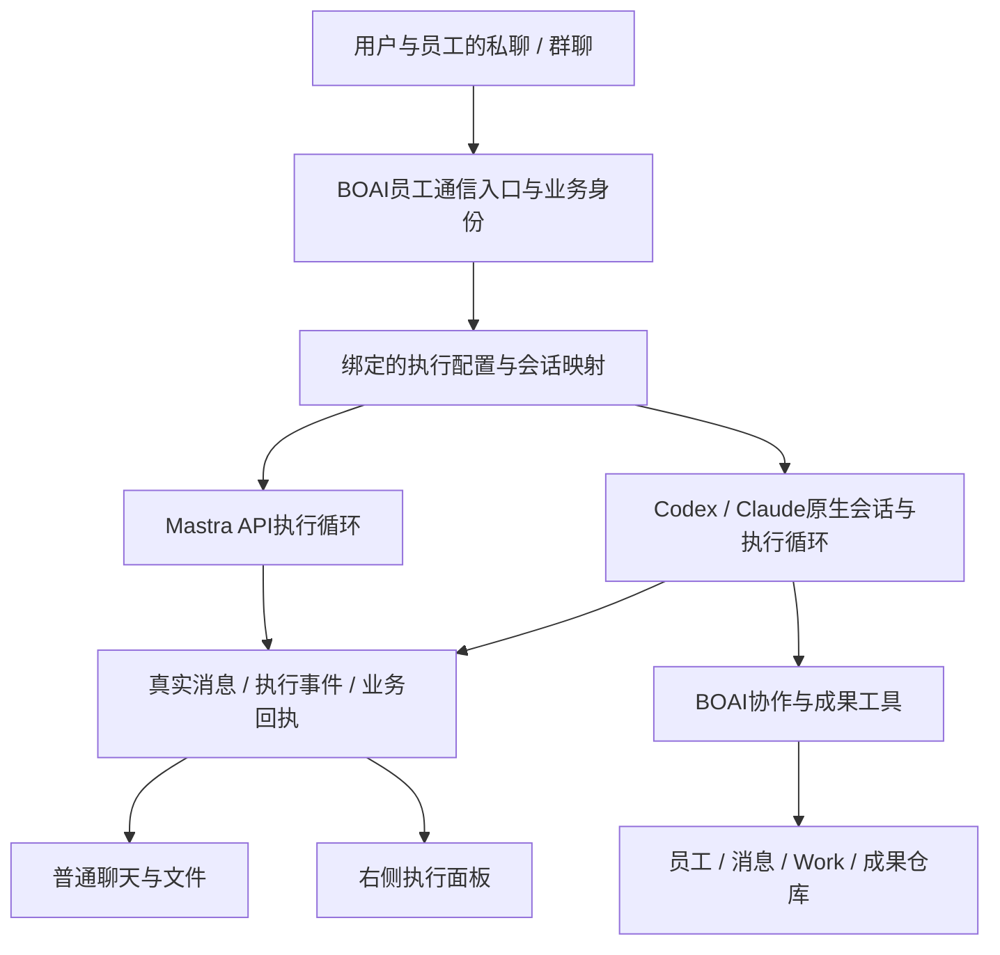

<!--
[OUTPUT]: 2026-10-16运行时插件首版已接线：Mastra主线、通用绑定、Pi RPC/共享ACP及受信独立包；实现/实际失败与未认证范围唯一归19组06，SDK仍为候选。
[OUTPUT]: 2026-10-14产品房间关系补充见第16组03；本人BOAI/关联飞书共主私聊，同员工不同群保持独立session。
[OUTPUT]: 2026-10-13本机不展示/限制BOAI用量预算，覆盖Work与本机协作/自动化；14最新补充为现行规则，实际见06 §147。
[OUTPUT]: 2026-10-12用户授权实施14；输入/原件/原生信息修复与实际结果归06 §143，以下仅文档记录按阶段保留。
[OUTPUT]: 2026-10-12复核明确员工是本机Agent的有身份通信入口，绑定引用执行配置/session映射；材料权限不扩大为原生门禁，两类追问分开，最新文档状态归06 §142。
[OUTPUT]: 2026-10-12按用户要求固定输入交付/原生信息修复边界，专项合同见14；当前仅文档状态归06 §141，原真实成绩归§140。
[OUTPUT]: 2026-10-11已授权完整实现与测试评测，当前事实归06 §122，来源与必要移植差异归12；旧仅文档/暂停按日期保留。
[INPUT]: 用户确认员工与协作是核心、API与本机Agent是执行能力；2026-10-11要求先参考Rovai纠正文档，并明确仅删除消息流程卡片而非精简输入框工具栏。
[OUTPUT]: 2026-10-11补充：Rovai功能逻辑能迁就迁，视觉呈现统一使用BOAI现有组件/主题/字体/间距/图标；外观适配不削减原生能力，仅文档。
[OUTPUT]: 员工一等公民的当前架构、原生执行与产品职责、配置及会话归属、Rovai参考入口；旧13节留作历史，不再冻结新实现。
[POS]: 第13组当前架构入口；11及14定义具体合同，实际状态唯一归06，§122/§140/§141–142按批次保留。
[PROTOCOL]: 一旦本文件变化，必须同步更新Header与所属目录.folder.md；旧约束替代须同步原合同和AGENTS，设计不代表已实现。
-->

# 员工一等公民与执行能力设计

**2026-10-16插件化实施补充：** 新Agent不再以逐品牌修改核心为目标。统一运行时接口、共用ACP驱动、Pi原生RPC/OpenCode接法及独立插件包见[第19组05](../19.应用插件架构/05-Agent运行时插件协议与接入架构.md)，实施计划与该增量唯一进度见[06](../19.应用插件架构/06-Agent运行时插件实施计划与验收.md)。Mastra主线、原生自主执行、员工身份/会话/Work、来源与未知不重放保持；新Pi/ACP已走统一插件宿主，已有Codex/Claude继续原路径兼容，不改写旧数据；实际验收/失败与缺口唯一归第19组06，本组06 §150仅指向该账本。

**2026-10-13最新补充：** 本机Agent自主执行，不展示或施加BOAI用量/预算；包括文件Work及本机协作/自动化，API预算保持。此条替代此前“本机沿用Work预算/计量完整性”等要求，详见[14当前规则](./14-本机Agent输入交付与原生信息修复合同.md)，实际实现/测试归[06 §147](./06-实施步骤与自动验收.md#147-本机执行移除boai用量与预算2026-10-13)。

**2026-10-12当前状态：** 用户已授权“开始修改”，14的输入/材料/元信息修复进入实施与测试；实际工程、真实批次、失败和未覆盖范围唯一见[06 §143](./06-实施步骤与自动验收.md#143-输入交付与原生信息修复实施2026-10-12)。下方当日文档建立/复核陈述为此前阶段，不限制本次实施。

更新：2026-10-12。2026-10-11授权范围的原生实现与评测见[06 §122](./06-实施步骤与自动验收.md#122-原生员工运行时实施与评测2026-10-11)，具体Rovai来源、执行面板与旧合同替代见[11](./11-Rovai对齐与本机执行纠偏.md)。此前仅文档复核阶段记录归[06 §142](./06-实施步骤与自动验收.md#142-员工通信入口定位下的文档复核2026-10-12仅文档)。

2026-10-12文档建立阶段（历史）：用户明确BOAI主要交付指令/获准材料并接回本机Agent信息，原生能力由Agent承担。真实小批对照见06 §140；随后要求先分析修复、再更新文档，当前仅文档固定[14 输入交付与原生信息修复合同](./14-本机Agent输入交付与原生信息修复合同.md)，尚未实施这些修复。后续输入接续、原件交付和模型容量取源按14落实，不能将既有任务通过写成修复通过。

BOAI以员工和协作为核心。用户创建“产品研究员”、与他聊天、安排工作；该员工可以使用Mastra模型API、本机Codex或本机Claude。执行能力换了，员工身份、职责、聊天关系与成果归属仍然保留。

## 1. 员工与执行能力的关系

员工是长期业务主体；执行配置决定他怎样工作。API Key只是连接凭据，不是员工，也不是完整Agent。API路线由Mastra执行循环提供能力；本机路线由已安装Agent提供执行循环和原生工具。

**在通信上，绑定本机Agent的员工就是该Agent在BOAI里的聊天入口，类似channel。** 消息从员工入口交给绑定配置下的原生session，Agent自主执行，公开回复/过程/文件回到该员工。绑定可以引用同一已安装程序/profile和登录来源，不要求重新创建或复制一个Agent；员工身份、协作和成果归属继续由BOAI维护。这里不要求将原生执行后端改成外部渠道类型。

首版每位员工选择一个默认执行引擎。两个员工可以引用同一模型连接或本机登录来源，但不能共用同一原生聊天session、私聊上下文或成果归属。失败不静默切换引擎重做。

| 对象 | 保存什么 | 归属 |
| --- | --- | --- |
| 员工 | 稳定ID、姓名头像、职责、工作指令、技能/知识/记忆引用、群成员关系 | BOAI产品 |
| 执行配置 | 所选引擎、连接/profile引用、模型及实际支持的选项、配置版本 | 属于员工 |
| 全局连接资源 | API端点/凭据引用，或本机程序/profile/登录来源 | 设置统一维护，员工引用 |
| 原生会话 | 员工×产品会话×运行配置关联的session/thread | 适配器维护映射，运行时维护自身上下文 |
| 一次执行 | 原消息、员工、所用配置、原生turn、真实事件/用量/终态 | 归属该员工和会话 |
| Work与成果 | 目标、负责人、协作关系、真实文件和版本、交付回执 | BOAI业务记录 |

对象表是职责边界，不要求创建对应数量的新表或重命名现有类型。

## 2. 架构

BOAI维护身份、消息、协作与成果。原生接入、执行事件与右侧面板能直接复用Rovai就直接迁入，必要接线只负责产品集成；不能先自行重写受限适配器。技术栈差异先核对原模块及依赖能否复用，确需移植则保留原行为并记录差异；旧BOAI抽象不能承载时调整旧抽象，不裁剪原生能力。不得为统一接口强迫本机Agent模拟Mastra的五阶段模型工作流。共享的是产品用例和数据，不是每次调用都要遵守相同的模型编排。

Codex采用app-server；Claude采用自己的stream-json协议。原生session、模型循环、工具、计划、压缩及内部子Agent交给原生运行时。BOAI协作工具只补充公开消息、同事委派、产品资料和成果登记等应用能力，不取代Agent原生读写文件和命令工具。

## 3. 从聊天到工作

用户给员工发送普通消息，路由到该员工配置的执行能力。原生Agent在连续会话里决定回复、澄清或调用工具；同一聊天从问答进入文件任务时不强制切换到一条临时任务线程。

Agent问“什么产品？”，用户直接答“白噪音微信小程序”，即可继续。聊天列表不再插入“处理工作”“回复此问题”“已提交补充”等流程卡片。公开回答和文件留在聊天，步骤放右侧执行面板。用户正常聊天要求修改文件，产品内部保留真实版本关系。

普通回复中的提问已结束turn时，用户回答沿同一session进入下一turn；只有真实待决原生控制请求才在当前run回应。回答该请求时，正文和附件都归当前请求，不能因附件新建一轮并排在等待它的执行后。首次输入和回答共用材料交付及来源核验；通用文件须交付获准原件，元数据不代替内容。产品受理与原生接收分别核对，未知不重发，具体边界见14 §3–4；不额外调用模型分类/改写用户消息。

Work用于记录实际任务与协作，不是每次原生工具调用的前置审批记录；普通问候不创建Work。API路径可以保留自身有效的判断/执行逻辑，但这些逻辑不再定义本机Agent能否成为员工。

运行中新增输入按原生协议实际支持的steer或后续turn队列处理；普通发送不自动取消当前执行。对同一请求只做一次可核对投递，未知结果先查询事实，不能新开session盲目重演。

## 4. 配置与原生能力

“设置→模型连接”管理资源，员工配置引用资源。API模型缺少员工覆盖值时使用连接默认值；本机模型和权限选项来自实际运行时。保存员工或扫描程序不执行模型任务。

Codex/Claude原生登录由CLI管理，不复制token；Claude另配API Key不再是强制产品要求。CLI实际支持的显式API来源保留为一种选择。前端显示真实来源，不把“本机”解释为离线模型。

原生文件、命令、MCP、Skills、插件和子Agent遵从所选运行时及权限模式，不再因为旧chat/task阶段限制被统一关闭。BOAI管理自身资料与成员权限，不能假称拥有运行时未提供的拦截能力，也不偷偷启用绕过审批模式。

BOAI材料导出权限只约束自己的产品数据。用户正文中的文件路径、命令和项目指令保留原文，Agent按原生权限处理，不能因未导入BOAI附件而追加统一文件门禁。可选模型/命令/Agent目录或容量缺失时显示未知，不因此阻止已有消息执行；必须协议请求失败另行核对。

程序、协议和模型实际兼容性须如实呈现；版本白名单、握手成功或测试夹具通过不能替代真实执行证据。具体旧约束替代见11 §8。

公开原生目录与真实执行分别核验。员工选择、原生初始化模型和API报告模型分别留证，容量按可核对的模型条目匹配，不猜默认容量或误取辅助模型；原生公开信息取源见14 §5。

## 5. 右侧执行和聊天界面

执行面板优先直接迁入Rovai的员工头像筛选、真实运行历史、过程说明、连续工具分组、参数/结果/输出/文件变更及状态处理代码，并保留配套事件与查询能力；不止参考样式。视觉统一沿用BOAI当前组件、主题、字体、间距和图标；迁入功能逻辑与组件行为，可替换视觉外壳，不照搬Rovai整套样式。所有内容来自原生执行事件并可重读；Trace只保留为次级排错信息。

同一会话使用一个执行标签；内部选择员工和具体运行，不因点不同消息重复创建同名标签。长记录按窗口加载，工具输出可展开读取，不能只留下最后几条固定阶段文字。

聊天消息列表保留普通员工回复、用户发言、附件和文件。删除处理工作/回复问题等流程卡片以及成果下采用/修改/稍后处理栏。普通引用是可选IM操作，不能成为回答问题的必经步骤。

**用户已明确：这次不是精简输入框工具栏。现有模型、权限、附件、命令等输入框控件不在本次变更范围。** 单聊头像、群聊姓名、时间与真实送达状态保持既有要求。

## 6. 群协作与成果

员工始终是群成员和工作负责人。API与本机员工共用真实消息、收件人、分工、依赖及文件成果；内部执行方式可以不同。用@、明确收件人和已提交协作事件定向唤醒，不把每条进度全群广播再触发全员判断。

原生内部子Agent只属于该员工执行过程，不自动成为BOAI员工。bobo权限来自真实核心身份；普通本机员工不能通过系统提示或工具参数冒充核心员工。

文件由原生工具生成，再由产品工具核验并登记来源、版本和归属，接现有文件预览。运行结束不等于成果交付，成果交付也不需要用户点击“采用”后才算员工发出文件。

原生上下文和BOAI长期员工记忆分别管理，不要求每次聊天再跑一次私有记忆提取。来源失效、员工/聊天隔离和备份恢复继续保持真实边界。

## 7. 生命周期与当前范围

切换运行方式保留员工和业务历史，原生会话只在兼容且来源有效时复用。活动执行需核对真实退出，旧运行不能被新配置改写来源；重启读取已提交事实，不能自动重发未确认的原请求。

本机内部模型调用数不可见时明确未知，使用其真实报告的用量。产品并发/时限与API逐调用预算分开表达，不能把“无法精确计量原生内部步骤”变成关闭所有原生能力的理由。

当前保留Mastra/API路径、已有本机代码和历史数据；A2A、远程宿主等仍不属于本次范围。后续开发需要用户授权，不能由这份设计自动触发。具体纵向实施目标和验收见11 §9–10，实际进度仍只写06。

## 8. 文档目录与优先关系

| 文档 | 职责 |
| --- | --- |
| 本文10 | 员工一等公民、执行能力与产品职责 |
| [11 Rovai纠偏](./11-Rovai对齐与本机执行纠偏.md) | 固定源码依据、右侧执行、消息卡片、原生能力、旧限制替代、实施目标 |
| [14 输入交付与原生信息修复](./14-本机Agent输入交付与原生信息修复合同.md) | 当前专项补充：附件回答、获准原件、模型/容量取源与待执行验收；不代替实际成绩 |
| [01 产品前端](./01-产品范围与前端交互.md)、[02 运行契约](./02-运行时适配与能力契约.md) | 当前替代条款与旧设计对照 |
| [03 会话恢复](./03-会话工作与恢复协议.md)、[04 资源桥接](./04-材料技能记忆与工具桥接.md) | 连续会话、正确性约束和产品资源职责 |
| [05 群协作](./05-群协作核心助手与自动化.md)、[07 迁移接线](./07-迁移兼容与代码接线.md) | 共享员工业务与原生执行分离、旧数据和代码采用 |
| [06 唯一进度](./06-实施步骤与自动验收.md) | 各批实际结果、失败、§140真实对照、§141修复文档状态及未来实施证据 |
| [08](./08-Todos参考与开发取舍.md)、[09](./09-Todos目录对照与待补能力.md) | 旧Todos参考，和当前要求冲突的布局/阶段限制不再使用 |

本文和11明确替代的旧条款不再生效，其他专题的真实历史与API合同按其范围保留。第5组API主线、第14组API协作结果不能被改写成本机新方案已经通过。

## 13. 历史实施选择（2026-10-10，已被纠偏规格替代）

以下逐项保留当时选择，**仅用于理解现有代码和06 §119证据，不是继续开发的限制**。五阶段、宿主工具桥独占、任务临时线程、Claude仅API、原Trace执行详情均已由11明确替代。旧版本支持列表仍只是当时实现声明，不是新方案兼容验收。

- 配置继续复用`DigitalAgent.executionBackend/connectionId/modelId`与`LaunchProfile`，首版每位员工一个默认引擎。全局资源不另建员工或聊天；明确切换保留员工ID与既有业务记录。
- 原生传输继续由`runCodexPhase`/`runClaudePhase`承担线程、提交、事件、用量和实际退出；共享`NativeEmployeeEngine`承接现有员工阶段，宿主仍拥有判断受理、Work、来源、工具执行与发布事务。本次不为了类型改名重写已接线的五个业务阶段。
- 首版任务选择**宿主工具桥**。Codex/Claude自管该次模型及工具选择循环，BOAI执行获准工具并返回实际回执；原生命令、原生写文件、继承的插件/hooks/MCP/全局技能与子Agent仍关闭。原聊天的命令审批、受管写入/发布和材料hash边界不变。未来开放原生文件/命令须单独实现和验证权限投影，不能仅切换沙箱模式。
- 普通聊天沿员工×会话的已确认增量线程；任务/判断/汇报/记忆仍使用独立短期线程，业务接续沿原Work、真实消息与依赖成果重新构建。当前不承诺跨任务复用原生线程或跨Work继承工具授权。
- 员工详情新增“执行详情”，资料页可直接打开；API与本机均可查看有界历史及固定运行、当时配置、实际工具/Trace/工作/成果，停止只作用于原工作。批准与继续发消息仍回到原聊天。
- 本机“获取模型列表”只在用户点击后请求已验证启动项的`model/list`，不提交turn、不计作模型调用、不自动选模型或改员工配置。Codex实际解析的默认模型和原生提交线程/轮次回执会写入原运行记录，避免将后来全局默认值解释为旧运行来源。
- Codex协议兼容版本明确限定为0.159.3与0.161.0；后者按当前安装CLI生成的v2 schema适配，仍须产品里的启动项测试、当前程序hash及版本一致检查。0.161.0的真实模型效果未验收。Claude沿既有2.1.214和明确Anthropic/DeepSeek API来源，不开放个人订阅登录。
- 预算保留原`external-turn`/`mixed`账本及绝对期限。本机计数是宿主提交的外部阶段请求，内部模型步骤未知；不以部分tokens代替完整用量。

## 会话领域补充（2026-10-14）

用户已确认并授权[第16组03](../16.数字员工渠道绑定/03-员工主私聊与群聊领域设计.md)。本人与员工的BOAI/明确关联外部私聊共用产品主会话；每个群独立，多个机器人参加同一群则共用该群会话。原生session继续按员工×产品会话×执行配置映射；历史归一时保守失效，不拼接旧原生线程或自动重放。原生权限、Work、审批及真实来源保持，实际增量归第16组02 §7.7。
