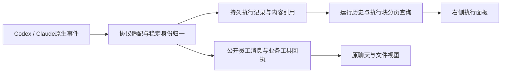

<!--
[INPUT]: 2026-10-11用户明确Rovai能直接迁入就直接迁入，禁止以自行适配裁剪本机能力；员工一等公民、消息流程卡片删除且输入框工具栏不变；固定源码与当前BOAI核读。
[OUTPUT]: 2026-10-11补充：Rovai功能逻辑能迁就迁，视觉呈现统一使用BOAI现有组件/主题/字体/间距/图标；外观适配不削减原生能力；后续已授权实现与测试评测。
[POS]: 第13组当前纠偏规格；10为架构入口，本文为具体行为及旧合同替代依据，实际进度唯一归06 §122。
[PROTOCOL]: 一旦本文件变化，必须同步更新Header与所属目录.folder.md；冲突条款同步原专题和AGENTS，设计不得写成已实现或已验收。
-->

# Rovai对齐与本机执行纠偏

日期：2026-10-11。**当前状态：用户已明确授权完整实现并测试评测，正在按本文实施。** 此授权替代§121当时的仅文档范围；当前实际结果与剩余统一见[06 §122](./06-实施步骤与自动验收.md#122-原生员工运行时实施与评测2026-10-11)。历史成功、失败与未知记录保持，不能将规格目标写成验收成绩。

本文与[10员工一等公民](./10-员工一等公民与执行能力设计.md)是当前设计入口。下面明确废止的旧要求不再作为本机目标，也不能被“遵从更严格旧合同”重新引入。历史事实、旧数据和Mastra/API自身有效的实现不因此被删除。

## 1. 这次纠正什么

BOAI的业务主体是员工。用户与员工聊天、协作、交付文件；员工可以用Mastra模型API，也可以用本机Codex或Claude。运行时是员工的执行能力，不能反过来要求员工成为某套模型调用流水线中的临时角色。

当前偏移同时发生在底层和界面：底层把本机运行拆成BOAI规定的判断、无工具聊天、临时工具任务、私有汇报和记忆阶段，并关闭多种原生能力；界面把这些阶段、Trace和办理按钮投影进聊天。连接到本机进程不等于完成了用户要的原生Agent工作体验。

纠正目标是：**本机Agent保留自身会话、工具和执行循环；BOAI管理员工、消息、协作和成果；真实执行过程在右侧按Rovai的方式呈现。**

**采用原则：Rovai能直接迁入的实现就直接迁入，不止参考样式，也不默认另写一套。** 范围包括原生Agent接入、会话与权限处理、执行事件、持久化/查询、内容分组和右侧组件。BOAI只做实际需要的身份、数据、通信和界面接线；不能为迁就旧架构而缩减Rovai已支持的原生能力。具体要求见§9。

用户最新澄清的交互范围：删除的是消息列表中的“处理工作”“回复此问题”等流程按钮卡片。**没有要求把聊天输入框精简成“消息、附件、发送”。输入框工具栏的模型、权限、附件、命令入口不在本次文档纠偏的改动范围内，不得据此删除。**

## 2. 已核读的Rovai实现

参考仓库：[murray17/rovai-ai](https://github.com/murray17/rovai-ai)，固定提交`f9acc2395283d49f0ce247dc0af2207c155f6eb6`。以下来自该提交的实际源码，不是根据截图推断；本次未启动Rovai应用。Rovai使用MIT许可，后续直接迁入源码时保留原许可、来源路径和提交标识。

| 源码 | 已确认的做法 | BOAI采用方向 |
| --- | --- | --- |
| [codex.rs](https://github.com/murray17/rovai-ai/blob/f9acc2395283d49f0ce247dc0af2207c155f6eb6/crates/rovai-core/src/codex.rs) | 启动实际Codex `app-server --listen stdio://`，创建/续用thread，启动/中断turn；解析文本、计划、工具活动、命令输出和文件变更 | 沿原生协议接完整执行；无需另写Codex模型循环或替代其文件/命令工具 |
| [claude.rs](https://github.com/murray17/rovai-ai/blob/f9acc2395283d49f0ce247dc0af2207c155f6eb6/crates/rovai-core/src/claude.rs) | Claude `--print`配合输入/输出`stream-json`、partial messages及stdio权限请求，使用`--resume`或`--session-id` | Claude独立原生适配，不把这条路线误写成ACP或Mastra模型API |
| [single_chat.rs](https://github.com/murray17/rovai-ai/blob/f9acc2395283d49f0ce247dc0af2207c155f6eb6/crates/rovai-core/src/single_chat.rs)、[execution_drivers.rs](https://github.com/murray17/rovai-ai/blob/f9acc2395283d49f0ce247dc0af2207c155f6eb6/crates/rovai-core/src/application/execution_drivers.rs) | 普通消息进入会话输入队列，由执行驱动消费；原生会话与产品会话保留关联 | 追问的回答继续正常发送，产品不要求用户切换“补充问题”办理模式 |
| [execution_evidence.rs](https://github.com/murray17/rovai-ai/blob/f9acc2395283d49f0ce247dc0af2207c155f6eb6/crates/rovai-core/src/execution_evidence.rs)、[execution_window/blocks.rs](https://github.com/murray17/rovai-ai/blob/f9acc2395283d49f0ce247dc0af2207c155f6eb6/crates/rovai-core/src/execution_window/blocks.rs) | 持久执行证据、规范化活动及有顺序的执行块；工具组与子项按窗口分页读取 | 执行历史是可重读的产品数据，不是临时字符串列表或Trace截图 |
| [execution-presentation/index.ts](https://github.com/murray17/rovai-ai/blob/f9acc2395283d49f0ce247dc0af2207c155f6eb6/apps/desktop/src/shared/execution-presentation/index.ts)、[tool-grouping.ts](https://github.com/murray17/rovai-ai/blob/f9acc2395283d49f0ce247dc0af2207c155f6eb6/apps/desktop/src/shared/execution-presentation/tool-grouping.ts) | 文本、计划、工具等活动按稳定身份组织；相邻工具组成可折叠组，文字打断工具分组 | 对齐“说明文字 → 已完成N个步骤 → 说明文字”的内容结构 |
| [ExecutionToolGroup.tsx](https://github.com/murray17/rovai-ai/blob/f9acc2395283d49f0ce247dc0af2207c155f6eb6/apps/desktop/src/renderer/src/ExecutionToolGroup.tsx)、[ExecutionNarration.tsx](https://github.com/murray17/rovai-ai/blob/f9acc2395283d49f0ce247dc0af2207c155f6eb6/apps/desktop/src/renderer/src/ExecutionNarration.tsx) | 工具可展开实际参数、结果、文件差异及长内容；说明文字单独渲染 | 复用呈现规则，接BOAI的文件预览和当前UI组件 |
| [ExecutionAvatarRail.tsx](https://github.com/murray17/rovai-ai/blob/f9acc2395283d49f0ce247dc0af2207c155f6eb6/apps/desktop/src/renderer/src/ExecutionAvatarRail.tsx)、[useExecutionWindow.ts](https://github.com/murray17/rovai-ai/blob/f9acc2395283d49f0ce247dc0af2207c155f6eb6/apps/desktop/src/renderer/src/useExecutionWindow.ts)、[ExecutionVirtualList.tsx](https://github.com/murray17/rovai-ai/blob/f9acc2395283d49f0ce247dc0af2207c155f6eb6/apps/desktop/src/renderer/src/ExecutionVirtualList.tsx) | 员工筛选、执行窗口和长列表分别处理 | 右侧可以查看全员，也能聚焦一名员工的执行历史 |

Rovai也有自己的权限与上下文策略，例如Codex启动参数管理其自动记忆、Claude按所选permission mode启动。迁入时保留原实现的实际语义和用户选择，不把这些事实推导成BOAI可以新增统一能力限制的理由；不得自行增加工具黑名单、阶段门禁、会话切断或事件丢弃策略。

截图里“思考链路”的可实现内容是运行时公开的过程说明、计划和工具步骤。Rovai上述呈现代码不把原始私有thinking当作聊天说明，工具证据展示还排除了`reasoning_summary`。BOAI先对齐可见过程，不伪造、推导或承诺所有模型的隐藏思考内容。

## 3. 职责重新划清

| BOAI负责 | 原生Agent负责 |
| --- | --- |
| 员工ID、资料、职责、群成员与业务授权 | 自身模型调用、上下文压缩、执行循环 |
| 私聊/群聊消息、目标收件人、排队和送达记录 | 本机会话、turn、实际原生工具及其内部调度 |
| 员工执行配置及具体运行的来源记录 | 支持的模型、思考选项、权限模式与原生登录 |
| 公开消息、分工、Work及成果归属与版本 | 文件读写、命令、MCP、Skills、内部子Agent等已有能力 |
| 协议适配、执行事件存储和右侧呈现 | 原生操作产生的文本、输出、差异、状态与用量 |
| 产品数据清理、恢复、实际执行退出核对 | 运行时自身的会话文件、认证和外部状态 |

API路径继续由Mastra执行。共享的是员工和产品数据接口，不是强制所有引擎实现相同的`decision/chat/task/report/memory`模型阶段。本机适配器只负责原生协议和产品事件对接；不加一个Mastra父模型包装每次本机执行。

BOAI协作工具作为增量能力提供：发布员工消息、读取获准群消息、委派真实同事、登记文件成果等。它们调用原业务仓库。Agent原生的读文件、写文件和执行命令继续归Agent，不能全部替换成BOAI自制工具再称“原生接入”。

## 4. 普通消息到原生执行

1. 用户正常发送消息，BOAI保存稳定消息身份、员工收件人和附件引用，显示实际发送/接收状态。
2. 按员工执行配置选择Mastra或原生适配器；已明确收件人的私聊不额外调用模型判断是否参与。
3. 原生路径取得该员工在该产品会话中的session，补入未投递消息及当前必要的员工/协作上下文，启动一个原生turn。
4. Agent自主决定答话、提问或使用工具。普通聊天页面不意味着工具禁用；具体工具遵从所选原生权限模式。
5. 公开回复进入聊天，过程说明和工具事件进入右侧执行记录；同一最终回复不得因原生final和产品发消息工具重复发布。
6. 用户继续发言，继续同一会话。Agent问“什么产品？”、用户答“白噪音微信小程序”，就是两条普通消息。

Work记录真实工作的负责人、目标、分工和结果，不是每次原生工具调用的入场券。不因为一句问候建立Work，也不要求原生Agent先产出BOAI私有JSON报告才能结束本轮回复。明确文件交付/委派可以通过产品工具或明确的业务事件关联Work；事务核验由BOAI完成。

同一员工×产品会话优先连续使用兼容的原生session，不因“聊天变成任务”就切换临时线程。不同员工、不同聊天、不同配置来源保持独立映射。更换运行时保留员工和聊天历史，不能把Claude线程交给Codex或跨员工共用原生线程。

执行中收到新消息时，协议支持明确steer且可核对则使用该能力；否则排队到下一turn，并显示真实排队状态。普通发送不自动取消当前工作，不将排队消息重复投递。停止入口放在执行面板，核对真实终态和资源退出。

断线或重启保留已提交历史和未知回执，不盲目重发有副作用的请求。正常会话恢复和重新执行旧任务必须区分；用户的新消息可在核对会话后继续。旧不完整映射只能重建上下文，不能重放旧工具。

## 5. 原生能力、配置和产品工具

### 5.1 连接与权限

全局“模型连接”继续保存API或本机程序/profile资源；员工引用该资源及自己的模型、执行选项。Codex和Claude的原生登录由各自CLI管理。**Claude必须另配兼容API Key**不再是本机员工的产品要求；CLI支持的显式API来源可以保留为一种选择。连接扫描/保存不运行任务，也不复制登录token。

按原生协议提供的权限模式启动。保持用户选择，展示原生真实审批请求和结果；不得统一关闭文件、命令、MCP、Skills、插件或子Agent，也不得为了“放开能力”偷偷改成绕过全部审批。BOAI只为自己的协作与数据操作维护权限，不假称能介导全部原生副作用。

`node_repl`、`code_mode`等若是所选版本/模型的原生执行方式，应按实际协议接入，不能修改模型目录把它们伪装成只支持direct tools。普通未知通知可保留为诊断，不应因无法呈现而让整个任务失败；无法正确回应的审批/必需协议请求则明确报具体兼容错误，不能吞掉原始原因。

程序/版本检测服务于实际兼容。白名单增加一个版本号不等于完成该版本适配；未识别的非关键事件也不等于不允许用户使用整个Agent。真正不支持的必需协议能力要指出具体缺口。

### 5.2 文件、技能、记忆

员工工作目录、当前附件与获准产品资料提供给实际运行时；原生工具在其权限范围内完成读取和修改。BOAI控制自己的资料提供、成员范围和成果发布，不把原生工作目录声称为操作系统沙箱。

文件生成后登记为原员工的成果，聊天显示回复与文件预览卡。登记保存实际文件、版本、来源和发布回执；“运行成功”不能代替文件存在。“要求修改”通过普通聊天表达，明确的当前文件内部绑定实际版本；有歧义就正常询问用户，不强迫用户操作采用/修订表单。

保留原生Skills、MCP及项目规则的实际加载机制。BOAI绑定的技能和资料是额外提供的资源，不冒充原生唯一的工具权限。来源和作用范围在配置详情中说明，不增加每次聊天的办理步骤。

原生会话上下文与BOAI长期员工记忆分别管理。正常聊天不强制附带一轮私有记忆模型调用；是否使用原生自动记忆、如何隔离员工，按所选profile和运行时机制明确配置，不能因旧memory阶段设计而一刀切关闭。BOAI记忆写入仍需真实来源，不能把原生私有日志直接灌入其他员工。

### 5.3 协作与计量

群聊仍以真实员工为单位，@、明确收件人和已提交分工决定定向投递；原生员工在自身执行中使用BOAI协作工具联系同事。API员工继续使用其现有策略，二者共用消息、分工与成果身份，不要求本机员工先通过无工具私有判断考试才能进入群。

同事的新消息与任务完成事件有各自身份和去重；不将每条过程更新全群广播后再次唤醒所有员工。原生内部子Agent属于该员工的执行树，不自动变成BOAI联系人。bobo的产品管理权限仍取决于真实核心身份，不能由原生模型自报身份获得。

显示运行时实际报告的tokens、上下文和费用；不可见部分显示未知，不把一次外部turn当成一次模型调用，不把消耗比例当任务完成率。BOAI可管理任务时限、并发和可实际执行的额度；不能因无法精确计数原生内部模型调用，就笼统禁止全部原生工具或协作。API逐调用预算保留自身准确口径。

定时计划仍使用已有产品调度与触发身份，原生Agent只是员工执行能力；本次不另造原生定时平台。自动化和跨员工扩展的完成证据不能由单聊成功代替。

## 6. 右侧“执行”面板

### 6.1 布局和导航

优先直接迁入Rovai可复用的内容处理、状态、查询和组件行为，保留其执行信息结构与完整交互。**视觉和基础组件统一沿用BOAI当前风格**：主题变量、明暗模式、字体字号、间距、圆角、边框、阴影、图标，以及按钮、折叠、菜单、提示等现有组件。名称使用“执行”。

- 不迁入Rovai的全局主题、独立视觉组件体系或整套页面外壳；BOAI现有IM布局、导航和详情容器继续保留。
- 可将迁入组件的视觉外壳替换为BOAI现有组件，调整必要的JSX/CSS与组件props；保留事件消费、状态、分组、展开、分页、完整详情和可用操作。
- “直接迁入”强调复用成熟功能实现，不要求界面像素与Rovai一致；“沿用BOAI风格”也不能成为删减功能、改写执行循环或增加工具限制的理由。

```text
聊天                                  │ 执行                         ×
                                      │ [总览] [员工A] [员工B] [员工C]
用户：做一份产品需求分析               │ ──────────────────────────────
员工：这份分析针对什么产品？           │ 员工A · Codex
用户：白噪音微信小程序                 │ 实际模型 / 原生选项 / 实际用量
                                      │
员工：已完成文档……                    │ 执行历史
[产品需求分析.md，点击预览]            │ ✓ 白噪音微信小程序         ▴
                                      │   我会先整理目标用户……
                                      │   ▾ 已完成 3 个步骤
                                      │     ✓ 读取项目说明
                                      │     ✓ 写入 产品需求分析.md
                                      │     ✓ 检查文件内容
                                      │   文档已完成……
                                      │ ▸ 做一份产品需求分析
```

示意中的文字和步骤只说明布局，产品必须来自真实事件，不能作为预填假进度。

- 复用会话已有的执行入口打开右侧面板；同一会话只对应一个执行标签，切换员工/运行是内部定位，不继续制造多个同名标签。
- 顶部为总览和员工头像筛选。总览按实际时间展示各员工运行；选中员工后仅看本人运行及其真实执行配置。
- 运行头显示触发消息摘要、员工、时间和状态；实际报告了用量才显示。当前运行默认展开，较早运行可折叠并分页加载。
- 活动内容变化不抢走用户正在阅读历史的位置；处于末尾时可跟随新事件，否则提供回到最新入口。展开工具后保留位置和展开状态。
- 打开/关闭/切换执行面板只读取数据，不启动或恢复任务。进入文件预览后可回到原运行位置。

### 6.2 内容与状态

| 内容 | 默认呈现 | 展开内容 |
| --- | --- | --- |
| 公开过程说明 | 按时间展示自然语言段落，支持流式更新 | 真实长内容按需读取 |
| 计划 | 原生返回的步骤及实际状态 | 原计划变更，不用BOAI固定阶段替代 |
| 连续工具调用 | “执行中N个步骤”或“已完成N个步骤”的折叠组，文字出现后开启下一组 | 每个真实工具项 |
| 文件读取/搜索 | 可识别的文件名、路径或搜索对象 | 实际输入、结果、错误 |
| 命令 | 实际命令摘要和状态 | 完整命令、输出、退出码；长输出分页/按需读取 |
| 文件修改 | 实际文件及修改状态 | 运行时提供的patch/diff，或可核验的前后内容；缺失不能伪造 |
| MCP/产品协作工具 | 服务/工具的可读名称 | 实际参数、结果及关联对象 |
| 原生内部子Agent | 本员工执行下的子活动 | 实际子执行事件；不可见则只显示已知状态 |
| 审批 | 当前待批准的实际动作 | 原生协议支持的允许/拒绝及范围 |
| 失败/停止 | 在发生位置显示原因和终态 | 可选诊断详情，不能只显示“事件提交失败” |

“已完成N个步骤”只计真实完成项；运行、失败、停止、等待批准分别计数。一次工具的started/delta/completed更新同一项，不能算三个步骤。原生执行载体与内部操作有明确父子关系时保留层次，不能把一次`node_repl`载体与同一底层动作重复计算；无法拆解则如实显示一个工具活动。

当前默认的Trace瀑布、参与判断/回复与执行阶段、调用次数摘要不再承担产品执行面板。确需排错的技术信息放次级折叠详情，不能占据用户想看的执行过程。`run完成`与`成果已交付`分别取真实事件，不互相推定。

### 6.3 数据链路



每次运行关联employeeId、conversationId、触发消息、运行配置快照和原生session/turn；工具项保存原生item/call身份、顺序、状态、输入和结果引用。具体类型优先扩展现有结构，不要求为图中每格新建一套数据库。

流式增量按稳定块身份合并，完成事件补全同一块；迟到事件不得串到新运行。公开文本、过程说明、工具、审批、用量、终态分别映射，不把所有原始JSON直接渲染到页面。当前线程的原始私有推理不进入普通聊天或默认面板。

执行历史使用分页/窗口和按需读取，保留真实先后顺序。页面限制一次挂载的数量可以存在，但不能以“最多24条/每条截断2000字”代替完整历史而不提供读取余下内容的能力。执行面板关闭期间仍持久保存事件，重开和重启后读取已保存记录。

## 7. 聊天消息列表的明确变更

这是用户最新截图指出的问题，和输入框工具栏不是同一区域。

| 现有交互 | 纠正后的目标 |
| --- | --- |
| “Codex · 处理工作 / 失败 / 文件目标”按钮卡片 | 从消息列表删除；对应过程和失败归右侧执行记录，不为每次运行插入一条假聊天消息 |
| “回复此问题 / 已回复此问题”卡片 | 删除；员工提问是普通消息，用户直接在原输入框回答 |
| 回答问题必须进入专用回复模式、自动附加长问题引用 | 删除这一前置要求；用户主动使用普通消息引用仍可保留 |
| “已向原问题提交补充。”提示DOM | 删除，不生成额外成功卡片 |
| 文件下“采用此版本 / 要求修改 / 稍后处理”按钮栏 | 不展示；用户继续聊天提出修改，文件卡只提供正常预览 |
| 每个内部阶段都变成聊天提示或卡片 | 过程留在执行面板，聊天只呈现员工真实公开消息及附件 |

普通问答不需要“追问协议按钮”。宿主可在后台关联本轮输入和待回答问题；目标明确就接续，有多个问题/文件产生歧义就用正常对话确认。不能把一条无关新消息自动判定为已回答所有旧问题。原有未知提交仍需核对，但不能因此长期要求用户操作特殊问题卡片。

保留既有单聊头像/消息、群聊姓名、悬停时间及真实送达标记。没有公开回复时，使用现有非消息式处理状态表达已接收/正在执行，并可从会话执行入口查看；不通过新增“处理工作”卡片解决无反馈问题。

真正的原生权限批准与普通追问不同，实际批准入口归执行面板待处理动作；不能把所有澄清问题包装成审批。历史旧审批和未知回执需保留可核对入口，不能在迁移时擅自同意或标记完成。

**本节不要求删除或重排输入框工具栏。** 工具栏如需另行调整，必须基于用户后续明确的界面要求，不能从“消息列表太多按钮卡片”推导出来。

## 8. 旧约束替代清单

| 原约束/来源 | 当前处理 |
| --- | --- |
| 02、03、05及旧10 §13：本机必须实现五个固定业务模型阶段 | 废止作为原生员工接入条件；API原路径可保留，本机按原生session/turn执行 |
| 01–05：普通本机聊天必须无工具，否则只准显式任务 | 废止；正常IM消息可触发原生工具，遵从所选原生权限 |
| 04旧§7、旧10 §13：只准宿主工具桥，原生文件/命令/技能/MCP/子Agent统一关闭 | 废止；原生能力由实际运行时提供，BOAI协作桥做增量 |
| 03旧§9：聊天长线程，任务/汇报/记忆临时线程 | 废止作为目标；同一员工会话连续使用兼容原生session |
| 01、02、旧10 §13、AGENTS：Claude只能明确API来源 | 废止作为产品限制；以CLI原生登录为首要接入路线，显式API仍可选 |
| 01底部示意、08/09旧布局：以旧工具栏扩展作为本轮前端任务 | 不作为本轮任务；用户此次明确要求的是消息列表流程卡片 |
| 01、03、04、AGENTS：专用补充问题/成果采用修订办理 | 追问和修改回归正常聊天；删对应流程按钮，后台保留真实来源与版本 |
| 旧10执行详情、06 §119–120：原Trace加少量进度即为执行面板 | 不再作为目标完成标准；按§6实现完整可读过程 |
| 06历史LR矩阵及旧“保持原合同” | 保留实际历史；与本文冲突的旧条件不再限制新目标，未来验收按§10逐项登记 |

继续保留员工身份、成员权限、真实消息/成果、回执去重、未知不盲目重放、停止核对、原件归属和历史数据。废止旧产品限制与删除这些基础正确性要求是不同操作；后续实现须明确区分。

## 9. 直接迁入原则与接线顺序

**先迁入现成代码，再做必要接线；不要先自行设计一个“BOAI简化版”再拿Rovai对照。** “参考”“采用”“适配”在本专题均受以下要求约束：

1. 可复用模块直接迁入，连同必要类型、工具函数、状态处理和依赖一起核读，不只抄组件外观。保留原来源、固定提交和许可。
2. 右侧UI和底层事件链一起迁入；禁止先把原生事件压缩为BOAI旧白名单，再让迁入的UI只显示残缺数据。原有工具类型、输入/输出、文件变更、审批、子执行及历史读取能力均须保留其语义。
3. 允许必要的员工/会话ID映射、typed IPC、存储对接、文件导航；视觉层应使用BOAI当前基础组件和主题，可替换Rovai视觉外壳而保留组件行为与功能逻辑。不得照搬其整套样式，也不得借样式适配引入新的模型阶段、工具禁用、执行权限降级、会话切断或静默截断。
4. 技术栈不同不是默认重写的理由。先核查能否保留原模块及语言复用、迁入其必要依赖；确实不能直接复用的部分才做等价移植，逐项记录具体阻塞、对应源码和行为如何保留。不预先指定必须改写成现有BOAI受限适配器。
5. 现有BOAI抽象若承载不了完整原生能力，应调整或替换该抽象，不削减迁入实现来迁就旧限制。无法保持的差异明确列为未完成项，不能自行关闭后宣称迁入完成。

| 具体工作 | 直接迁入/保留的实现 | 必要接线位置 |
| --- | --- | --- |
| 原生协议和生命周期 | 优先复用Rovai的Codex/Claude驱动及必要依赖，保留原生会话、工具事件、权限与停止行为 | 现有`codex/`、`claude/`只作为接线位置，不要求保留其受限策略或强制改写为相同架构 |
| 分离两条执行路径 | 原生session/turn契约，原Mastra路径 | `native-employee.ts`、`contracts.ts`、`service.ts`；移除本机强制五阶段依赖 |
| 执行证据与查询 | 优先迁入Rovai执行证据、执行窗口和内容读取逻辑；保留完整事件身份、顺序和分页语义 | 对接BOAI持久化与typed IPC，不以旧Trace字段不足为由丢事件 |
| 过程组织 | 直接迁入可复用的`execution-presentation`、`tool-grouping`及配套类型/工具函数/相关用例 | 做字段接线，保留分组、去重及各种状态，不重新设计简化分组 |
| 右侧UI | 直接迁入可复用的头像筛选、运行历史、Narration、ToolGroup及配套hooks/长列表逻辑 | 接BOAI数据和文件预览，以现有BOAI组件/主题替换视觉外壳，保留迁入行为；替换`trace-tab.tsx`默认内容并修正`app-shell`定位 |
| 消息卡片收敛 | 原消息与附件组件 | `execution-progress.tsx`、`message-card.tsx`、`question-reply.tsx`及其调用者；去除处理/问题流程卡片，普通消息接续 |
| 员工与业务数据 | BOAI员工、Conversation、Work、Artifact、成员和记忆仓库 | 复用身份与事务，产品工具增量桥接；不是复制Rovai整套团队数据库 |

Rovai核心驱动包含Rust代码。后续先说明可直接复用的模块和依赖边界，再决定必要的跨语言接线；本文件不预先决定新增某种服务或全部重写为TypeScript。迁入清单逐项记录“原文件/提交、目标位置、直接复制或必要移植、差异原因、原能力保留情况”，使用户能核对哪些是真正迁入，哪些仍有缺口。

后续实施以完整用户路径交付：先Codex“消息→原生执行→完整右侧过程→公开回复/文件→正常追问/修订”，同时完成后端与前端；再Claude同一体验；随后核对API与本机混合群、产品协作桥、旧数据和自动化。不能只扩版本白名单、显示配置标签或增加Trace，就报告本机接入完成。

2026-10-11后续用户已授权完整实现与评测。具体迁入/移植边界见[12](./12-Rovai迁入实现对照.md)，成绩见06 §122。

## 10. 后续可见验收目标

下表是当前实现标准，**不是验收结果**；实际成绩只写06 §122。

| 场景 | 必须能观察到的结果 |
| --- | --- |
| 员工配置本机Codex/Claude | 保持员工身份，实际启动对应本机程序和所选登录来源，不暗中回退API |
| 普通问候 | 正常员工回复，不插入“处理工作”卡，不为问候强行建任务或跑私有判断/汇报流水线 |
| 提问后补充 | 直接发送“白噪音微信小程序”即可接续，无回复问题按钮、专用模式和补充成功DOM |
| 创建Markdown | 右侧实时显示原生说明、真实工具、参数/结果和文件；聊天收到公开回复及可预览真实文件 |
| 普通聊天提出修改 | 原会话继续处理，保留实际版本关系，无采用/要求修改/稍后处理按钮栏 |
| 执行错误 | 错误定位到真实动作，已有步骤仍可读；不是仅剩“处理工作失败”或泛化Trace错误 |
| 长执行与重新打开 | 早期/最新步骤都能读，展开完整输出；稳定顺序和滚动位置，无静默截断丢失 |
| 原生权限与停止 | 实际请求可允许/拒绝，状态准确；停止不冒充已撤销先前副作用 |
| 运行中发送/重启 | 消息有真实排队/受理状态，不自动取消、不重复投递；重启读历史不重跑旧工具 |
| 多员工与混合群 | 各自原生会话、身份与执行历史清楚，头像筛选准确，定向协作不无限互相唤醒 |
| API员工 | 现有API运行保持可用，共用员工和正常聊天交互，显示自己的真实过程 |
| 改动范围 | 消息流程卡片按本规格去除；输入框工具栏不被顺手删改 |
| 视觉一致性 | 执行内容具备Rovai对应功能，外观与BOAI现有组件/主题一致；不迁入另一套全局样式，不改变现有IM页面风格 |
| 迁入完整性 | 可复用实现有实际来源对应；必要接线差异可核对，没有因BOAI旧抽象缩减原生能力，也没有把自行重写说成直接迁入 |

源码核读、协议夹具、真实程序、产品界面和人工体验是不同证据。用户现已授权实施及测试评测；仍须分别登记各类证据和未完成项。
