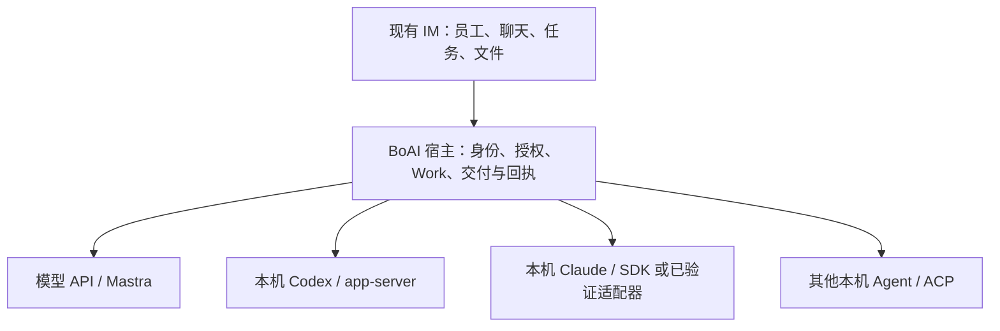

<!--
[OUTPUT]: 2026-10-13本机不展示/限制BOAI用量预算，覆盖Work与本机协作/自动化；14最新补充为现行规则，实际见06 §147。
[OUTPUT]: 2026-10-13普通native通用输出截断修复复测收口：287通过/2跳过，真实双后端四轮/Claude同run材料回答通过；成绩唯一见13组06 §145，Work预算有限与旧失败保持。
[OUTPUT]: 2026-10-13用户授权普通本机16000截断移除并复测，最新实际归13组06 §145；API/显式Work预算及旧失败保持，新BOAI复测最多8用户轮。
[OUTPUT]: 2026-10-13原生长任务/Claude上游分析见13组15与06 §144；通用16000截断零模型复现，生产未改、§143失败和14/16账本保持。
[OUTPUT]: 2026-10-13输入/原件/信息专项修复与实际失败复测收口见06 §143；下方仅文档按当时日期保留，R2/E1–E3及完整认证保持未完成。
[OUTPUT]: 2026-10-12已授权并实施输入/原件/原生信息修复，工程与真实结果唯一归06 §143；旧文档阶段及成绩保留。
[OUTPUT]: 员工通信入口定位下文档复核归14 §8/06 §142：两类追问、原生/材料权限、可选信息边界已明确；后续按10/11及14实施，代码未修。
[OUTPUT]: 14固定输入交付/原生信息专项修复合同并补入10/11；当前仅文档归06 §141，真实对照仍归§140，R1/I1/M1待实施。
[OUTPUT]: 2026-10-12真实本机直跑/BOAI同任务对照与原预算、准备失败、边界/元信息和证据限制见06 §140；不认证全部原生功能。
[OUTPUT]: 2026-10-12新增13本机Agent review及评估准备，2项产品/3项评估缺口；检查事实见06 §139，任务稳定性方案见第15组12。
[OUTPUT]: 2026-10-11现行原生员工macOS实现与本轮测试/评测已收口；完整批次、修复复测、原失败和未认证范围唯一见13组06 §122。
[OUTPUT]: 2026-10-11已授权完整实现与测试评测，当前事实归06 §122，来源与必要移植差异归12；旧仅文档/暂停按日期保留。
[OUTPUT]: 2026-10-11补充：Rovai功能逻辑能迁就迁，视觉呈现统一使用BOAI现有组件/主题/字体/间距/图标；外观适配不削减原生能力，仅文档。
[OUTPUT]: 2026-10-11Rovai原生执行与面板纠偏：10/11为当前设计，消息处理/回复卡片删除，输入框工具栏不在范围；只改文档，旧限制明确替代，实施事实归06 §121。
[OUTPUT]: 2026-10-10聊天接收/执行卡与公开进度增量见06 §120，原员工执行能力§119和旧真实缺口保持。
[OUTPUT]: 2026-10-10已获恢复实施授权；资源/员工执行绑定与详情按10 §13接线，当前实际结果唯一归06 §119，历史暂停/失败不重写。
[OUTPUT]: 2026-10-10新增10员工一等公民与执行能力目标设计：资源/执行配置/会话/Work分层、员工执行详情与Paseo参考；仅文档，本机暂停及06唯一进度保持。
[OUTPUT]: 2026-10-08用户确认保留成果、暂停本机路线开发与兼容测试；现有配置/个人历史不禁用不迁移，历史失败与证据保持，当前Mastra首批闭环转第5组10，A2A延期未接线。
[OUTPUT]: §116原生目录协议与双配置来源修复/13模块及桌面夹具定向通过；§117真实Claude受理后未知保存/两业务重启通过，受理前格式及80字效果失败、新包/原生关闭/完整目标保持未完。
[OUTPUT]: §115原AppService真实Codex新员工/组群/依赖v1核读/五指定文件后台一场通过，原48/16000内九外部调用7506输出及实际退出后完整核验；无GUI/包/业务重启，原失败与完整目标保持未完成。
[OUTPUT]: §114组织goal/委派保留必要精确约束，文件提示尊重指定路径；224模块/类型/源码构建通过，真实私有组织及普通判断两例通过，原两产品失败/新包/原生关闭/完整目标未完成。
[OUTPUT]: §113策略11真实Claude活动核心源码三场1通过2未到保存；正常保存/两业务重启零重放，路径约束与普通工作分类缺口及原摘要更正保留，77资源/85引用，新包/原生关闭/完整目标未完成。
[OUTPUT]: §112私有格式器有序选择/布尔回执已接生产Claude策略11，三组红绿与单次208模块、类型/源码构建通过；复杂真实两阶段仅对照，旧根因/成本及活动保存/新包/完整目标仍未完成。
[OUTPUT]: §111复制前准备事务内实际退出，离线/真实Codex源码/同包三场通过；78资源/87引用/9回放、两次重启零重放，原件与中断/未知保持；§110格式器五阶段仅候选，生产双包未改、完整目标未完成。
[OUTPUT]: §109新增真实活动Claude核心保存候选，三个源码正常保存均未到目标动作；51资源/57hash及三原图，最终固定文件留证和候选静态通过，原失败/未知保持，生产双包未改，五组合与完整目标未完成。
[OUTPUT]: §108Claude外部流字节与固定内容桶仅增加观察，类型/168模块/构建通过；新完整macOS arm64包3405/26672/119、895输入，6实际3通过3失败，反向三场因原预算取消、旧失败保持，完整目标未完成。
[OUTPUT]: §107混合核心真实父子工作停止/故障，6实际4通过2失败、2计划未运行；240资源/262hash与6原图，原组织独立根/预算/原件/两重启核对，生产双包未改、反向与完整目标未完成。
[OUTPUT]: §106真实日历Codex负责人/Claude同事的停止与故障，源码/同包四场通过；Claude负责人两失败及三未运行保持，209资源/231hash与六原图，生产双包未改、完整目标未完成。
[OUTPUT]: §105摘要v2区分离线实际协议夹具／声明版本与真实失败原生Codex；543引用及初版原hash保持，公开副本不改原像素，真实升级未通过。
[OUTPUT]: §105留存v5实际生成旧聊天至v6源码／新包离线两场通过，两次受控重启零重放与明确新消息增量续用；两真实旧v5原120秒失败及两测试前置失败保留，193资源／208hash与十五关闭原件核对，生产双包未改、完整目标未完成。
[OUTPUT]: §104策略v6同时启用Codex启动/线程系统代理，107项相关测试及源码/新包真实文件修订与主窗口来源通过；活动Claude核心保存源码/同包仅离线三组合通过，旧失败/缺口保留，完整目标未完成。
[OUTPUT]: §103补齐Codex固定传输回退观测、55模块与退出后留证；离线通过、真实记忆原期限取消及原生关闭锁屏分别保留，当前新包未验、完整目标未完成。
[OUTPUT]: 第13组09按Todos目录区分已有基础、待补或待验证能力与独立扩展；保留IM和API/本机双路径，当前进度唯一归06。
[OUTPUT]: §102额外测试窗口经原实际IPC拒绝，原主保存/本人回复与阶段失败分别核对；六批2通过/4失败，真实期限与观察超时分开，生产未改，不证明双产品窗口或原生关闭，完整矩阵未完成。
[OUTPUT]: §101旧ACP迁移受理前/后未知保存、原底部核读/载入及两次受控重启零重放，离线/真实Codex源码/同包三场通过；原旧文件保持，新请求才建Work，生产未改、完整矩阵未完成。
[OUTPUT]: §100本机Codex/Claude核心未发送首发的正常与受理前后未知保存、两次受控重启及明确新消息，离线/真实源码/同包六场通过；两原测试旧窗口失败保留，生产未改，原生关闭与完整矩阵未完成。
[OUTPUT]: 开发首页先展示IM复用结论、八份规格与继续开发入口；六条最近实施记录移入当前记录区，事实和原文逐段保持。
[OUTPUT]: §99员工正常换至同程序独立本机配置并切回，离线/真实源码/同包六场通过；保存和两次重启零重放、明确新消息重建原生会话并保留历史，原SQLITE_FULL/ENOSPC失败与留证缺口保留，原生关闭仍因锁屏未验、完整目标未完成。
[OUTPUT]: §98工作目标标签已构建新完整macOS arm64应用，3405包文件/26672归档文件及119构建输入核对；包内八状态历史场景、九原回归和真实Codex新员工/交付/明确修订11场通过，初次核验误报与报告登记错误保留，完整目标仍未完成。
[OUTPUT]: §97共用Work卡显式标明目标原文，真实状态/交付入口不受完成式措辞影响；源码八状态预置与九原回归、41模块及真实Codex创建/交付/修订通过，原红失败保留，新包和完整目标未完成。
[OUTPUT]: §96混合本机自动化实际写入后双向停止/服务SIGKILL，源码/同包各四场通过；两原失败及存储辅助竞争保留，318资源/360hash与八原图，原共享预算/同事交付/两重启和实际退出核对，生产未改、完整目标未完成。
[OUTPUT]: §95普通Claude群停止/服务故障/成员撤权九场分别通过、两原失败与缺证据保持；原IM/业务和生产构建未变，六原图可审阅，完整目标未完成。
[OUTPUT]: 08汇总本轮IM设计确认、Todos官方参考、底部示意与后续范围取舍；八份文档按原合同交接，06唯一进度及既有证据保持。
[OUTPUT]: §94完整新macOS应用包3405文件/24008归档校验/119构建文件核对；四场混合原问题与真实到期追加全部通过，172资源/184hash和四原图；891输入未变，旧失败保留，完整目标未完成。
[OUTPUT]: §93原问题来源/额度派发修复，1841模块和五场源码通过、三失败保留；289资源/310hash、八原图与可恢复打包归档；四新包未运行，完整目标未完成。
[OUTPUT]: 混合原问题投影绑定实际未回答来源，额度追加原负责人只沿定向Work接续；有限源码与剩余应用包证据归06 §93，完整目标未完成。
[OUTPUT]: 第13组06 §92新增Claude/Codex混合自动化，源码/同包手动与真实Mastra日历四场通过、两候选断言失败保留；原24共享预算/独立两根与原件/原生触发/重启及实际退出，196资源/213hash与922引用，583生产输入未改，完整目标未完成。
[OUTPUT]: 第13组06 §91新增Claude/Codex核心复用相反本机员工，源码/同包双向四场真实通过、一连接准备超时保留；原48共享预算/身份/原件/重启及实际退出，161资源/175hash与752引用，583生产输入未改，完整目标未完成。
[OUTPUT]: 第13组06 §90修复wait非空依赖生产合同，8红/22绿与1835模块通过；源码/新包四场真实群及真实Codex创建修订通过，142资源/156hash及739引用，双包3405文件分别核验，完整目标未完成。
[OUTPUT]: 第13组06 §89补齐Codex/Claude双向普通群，源码及同包四场真实与一离线回归通过，一包内无依赖等待错误保留；147资源/162hash及723引用、五原图，583生产输入未改，完整目标未完成。
[OUTPUT]: 第13组06 §88新增快速真实私有判断与原停止/故障最终Trace留证，12有效结构/两次纠正；源码及同包两场通过、一ENOSPC失败保留，67资源/77hash和356引用，生产未改、旧格式根因未知。
[OUTPUT]: 第13组06 §87补齐Claude模型ID/同程序独立profile底部三阶段拒绝，离线/真实源码/同包十场通过；341资源/366hash与794引用、16原图及字段捕获限制，583生产输入未改，完整目标未完成。
[OUTPUT]: 第13组06 §86修复本机来源连接/模型ID换绑漏检，1813模块及四批桌面十场通过、一包内私有格式失败保留；224资源/252hash与561引用、八原图核对，完整目标未完成。
[OUTPUT]: 第13组06 §85补齐Claude协议/合成密钥/删除连接的调用前门禁，离线/真实源码/同包九场通过、三旧断言失败保留；160资源/198hash与439引用、十二原图核对，583生产输入未改，完整目标未完成。
[OUTPUT]: 第13组06 §84修复Claude当前会话401/403拒绝与本机普通调用实际退出收尾，缺计量保持未知；1809模块及源码/新macOS包四场通过，旧失败/原包/图片限制保留，完整目标未完成。
[OUTPUT]: 第13组06 §83补齐Claude程序外改/丢失的两层门禁、修复/两次受控重启零重放与明确新消息；离线/真实源码/同包六场通过，首批两失败保留，150资源/174hash及357引用，生产未改，完整目标未完成。
[OUTPUT]: §82新增真实原生关闭步骤与显式已关闭生命周期，但工具报告Mac锁定，两场源码待操作超时；18留证回归/两次类型及BDD生成通过，原生选择/重启/包内未验证，完整目标未完成。
[OUTPUT]: §81补齐Claude底部执行中/实际退出后待核对/重启拒绝切回API，离线/真实源码/同包各两场通过；140资源/159hash与323引用/四幅原图，生产未改，整体未完成。
[OUTPUT]: §80补齐Codex/Claude底部保存的源码/同包真实验收与离线回归，未知放弃/受控关闭重启及并发旧版本保持原记录；837引用/四幅原图，整体未完成。
[OUTPUT]: 最新§79私有判断显式off、五组真实语义与1803模块及七场通过；源码/新包Codex与Claude各完整验证，193资源/460引用，整体未完成。
[OUTPUT]: 最新§78核准原公告并非实际触发消息；源码核心通过/当前包私有判断超时、15模块及三场两通过一失败，完整目标未完成。
[OUTPUT]: §77增加实际退出后最终SQLite/必需原件，18定向及九场八通过一失败；当前Codex源码/包通过，Claude核心额度与历史工具/格式问题保持未完成。
[OUTPUT]: §76补齐宿主工具只读诊断/群原件快照导出；1797模块及源码/当前包Codex完整通过，Claude私有回执/核心额度失败与退出后留证缺口保留，完整目标未完成。
[OUTPUT]: 01 §5.6提供六项IM前端验收清单及最小审阅材料，便于从现有七份合同继续开发；已有实现与06当前缺口保持分开，本次仅补文档交接。
[OUTPUT]: §75补充私有记忆off、1793模块及当前包三场通过；三批源码/包八场五通过三失败、原件缺口及完整剩余保持独立，143资源/158hash及353引用核对。
[OUTPUT]: §74修正当前执行权与原Work偏好来源，1793模块及源码/包内原群完整通过；两次源码失败保留，165资源/182hash和四幅原图核对，完整范围仍归06 §19。
[OUTPUT]: 开发入口补充IM前端改动量与增量顺序，明确Todos内置/外部双路径仅为参考；七份合同复用，实际状态唯一沿06。
[OUTPUT]: §73真实群更新两次自然触发等待report off，但整场失败且第二批新增重复根/子工作与预算；两个离线对照通过，完整范围仍归06 §19。
[OUTPUT]: v10当前依赖等待私有报告经已验证桥显式disabled，实际报文/同输入供应商阶段通过；源码和当前包四场原IM回归通过但未自然触发新分支，完整进度归06 §72。
[OUTPUT]: v9只为当前已声明依赖的私有报告增加已验证低档；源码核心/当前包Codex分批通过，包内核心仍超额，CLI关闭设置仅省略thinking，实际进度归06 §71。
[OUTPUT]: §70修复私有草稿退出遗失依赖等待，精确源码/当前包分支及普通群/Codex回归通过；包内核心仍超原额度，完整剩余归06 §19。
[OUTPUT]: §69补齐Codex底部正常/未知保存与活动换绑的源码及同包实际验收，生产未改；首批测试失败与完整剩余范围分别保留。
[OUTPUT]: §68核对Claude原文件新根修订/独立预算/版本采用，普通中文源码及同包真实通过；完整范围与剩余缺口唯一归06 §19。
[OUTPUT]: §67修复Claude宿主消失时遗留同组CLI；源码与当前macOS包两种自动化停止/故障真实通过，完整剩余矩阵仍归06 §19。
[OUTPUT]: §66补齐首次Work前明确接续与必需问题分类；最新Codex/Claude两场真实原界面交付/重启通过，前序失败与完整未验范围分别保留。
[OUTPUT]: §65补齐真实Claude外部失败位置及传输观测，持续增量无终态的真实失败不冒充宿主阻塞或可靠性已修复。
[OUTPUT]: §64补齐Claude流式已知用量与未知终态，活动和Work承接保持完整性；全量模块通过，真实失败与整组完成分开记录。
[OUTPUT]: §63明确组织管理Work的低档范围；两次真实复验一完整通过一超额，原预算可靠性继续待处理，成果与重启原图独立保留。
[OUTPUT]: §62修正Claude私有结果渠道与全部工具禁令的冲突；双员工非空记忆/重启及Codex续聊真实回归通过，原核心两次复验仍超额，完整阶段保持未完成。
[OUTPUT]: §61对已验证Claude模型的私有阶段增加低强度与格式计数；一次核心通过后复验仍超额，双员工非空记忆/重启和Codex续聊单独通过，完整范围仍归06 §19。
[OUTPUT]: 底部准确配置与草稿/固定成果引用见06 §59；原问题/核心空白页/旧ACP导航增量证据及Claude核心预算失败见§60，完整未完成范围仍归§19。
[OUTPUT]: Claude自动化已接原表单、原时钟/触发预算及文件交付；原问题/实际期限追加与公开文件名表达的分批证据见06 §58，完整未完成矩阵仍归06 §19。
[OUTPUT]: Claude核心/组织与具名团队新增接线及独立验证归06 §56，自动化与完整故障/混合矩阵仍未完成。
[OUTPUT]: 交互分工接续后的记忆已沿原员工/本轮交付/预算接回，实际批次与未验范围见06 §55；其他唤醒授权保持。
[OUTPUT]: Claude普通群原UI/成员、程序核对和原Work分工已接；实际双Claude/混合运行验证及剩余边界见06 §54。
[OUTPUT]: Claude图片传输和原三类材料接入见06 §53；图片输入不等于所选模型视觉理解，完整阶段保持进行中。
[OUTPUT]: Claude单员工已接原UI、AppService、Work预算与清理备份；真实单员工桌面通过及Codex回归修复见06 §52，完整Claude能力仍未完成，代码事实见第2组31。
[OUTPUT]: Codex自动化接入原时钟/预算和七项表单，固定问题补充与停止重启沿原合同；当前技术/桌面证据与剩余矩阵唯一归第13组06 §16。
[OUTPUT]: 本机bobo与组织群接入原核心合同，创建/复用员工沿真实运行配置及原预算；代码事实见第2组30，实际进度唯一归第13组06 §15。
[OUTPUT]: 普通群API/Codex独立工作与双向分工共原请求账本；真实批次与LR5剩余范围唯一见第13组06，代码事实见第2组30。
[INPUT]: 用户确认的 IM 产品方向、Todos/Raft 调研、当前本机 ACP 和 Mastra 实现、既有员工及交付规格。
[OUTPUT]: 将本机 Agent 作为员工一等运行方式的开发入口；首屏提供IM保留、前端范围、原生接口/ACP区别、开发问题导航与九份文档树状目录，08补充员工运行方式调用图、09对照Todos目录与待补能力；开发交接统一为前端确认、剩余范围和源码接线三个入口，实际进度唯一归06。
[POS]: 第13组产品入口；06唯一维护实施与验收进度，第2组30记录已接代码。
[PROTOCOL]: 方案改变时同步 Header、所属 .folder.md、相关合同与上级索引；实现状态只据实际代码和证据更新。
-->

当前实施与验证：[06 §122](./06-实施步骤与自动验收.md#122-原生员工运行时实施与评测2026-10-11)。直接迁入清单：[12-Rovai迁入实现对照](./12-Rovai迁入实现对照.md)。此前记录按原日期阅读。


# 本机 Agent 员工运行时

**2026-10-13最新补充：** 本机Agent自主执行，不展示或施加BOAI用量/预算；包括文件Work及本机协作/自动化，API预算保持。此条替代此前“本机沿用Work预算/计量完整性”等要求，详见[14当前规则](./14-本机Agent输入交付与原生信息修复合同.md)，实际实现/测试归[06 §147](./06-实施步骤与自动验收.md#147-本机执行移除boai用量与预算2026-10-13)。


**2026-10-12当前修复实施：** 用户确认员工是绑定本机Agent的有身份通信入口，复核文档后授权“开始修改”。[14 输入交付与原生信息修复合同](./14-本机Agent输入交付与原生信息修复合同.md)补充10/11，已接线附件回答、真实原件交付和原生信息取源。工程验证、真实批次及未覆盖范围唯一见[06 §143](./06-实施步骤与自动验收.md#143-输入交付与原生信息修复实施2026-10-12)；旧§140实际对照和§141–142文档阶段保持。

**2026-10-11早期文档阶段，已被后续完整实施授权替代。** 员工是一等公民，API/Mastra与本机Agent提供执行能力。按用户明确要求，Rovai原生接入、事件链和右侧执行面板能直接迁入就直接迁入，必要接线不得减损原生能力，视觉统一使用BOAI当前组件、主题和布局，删除消息列表中的处理工作/回复问题等流程卡片；用户明确不是要求精简输入框工具栏。

| 当前要读什么 | 文档 |
| --- | --- |
| 员工、连接、执行能力和产品职责 | [10 员工一等公民与执行能力设计](./10-员工一等公民与执行能力设计.md) |
| Rovai直接迁入原则、固定源码、完整执行面板、消息卡片与旧约束替代 | [11 Rovai对齐与本机执行纠偏](./11-Rovai对齐与本机执行纠偏.md) |
| 输入/附件接续、通用原件、原生信息取源及修复验收 | [14 输入交付与原生信息修复合同](./14-本机Agent输入交付与原生信息修复合同.md) |
| 原生实施、真实对照、原失败与当前文档状态 | [06](./06-实施步骤与自动验收.md)：§122实施、§140对照、§141合同建立、§142文档复核、§143修复实施 |

01–05、07–09的开头已明确当前替代条款。无工具聊天、强制五阶段、宿主桥独占、任务临时线程、Claude仅API及消息办理卡片不再是本机目标；不能援引旧“严格合同”恢复这些限制。原数据正确性和API有效合同保留。用户后续已明确授权完整实现与评测，当前代码和验证见06 §122；文档目标本身不代替实际成绩。

## 历史导航与进度（按原日期阅读）

以下保留旧授权、设计索引及批次说明，和当前规格冲突的要求不再用于新开发；历史成功/失败仍真实保留。旧“底部定向调整”不是本次输入框工具栏改造授权。


**2026-10-10当前实施：** 用户明确恢复按10的员工执行能力设计开发，资源/员工绑定入口及执行详情已接线。Mastra/API、原员工/Work/审批/成果保持，Claude沿明确API认证，A2A仍延期。本次不运行E2E或真实模型验收；当前代码、模块/构建结果与剩余范围唯一见[06 §119](./06-实施步骤与自动验收.md#119-员工执行能力接线2026-10-10)。以下暂停与历史成绩按原日期阅读。


## 历史设计与实施摘要

2026-10-10设计补充：用户确认以**员工和协作为核心，API与本机Agent作为员工执行能力**。先读[10-员工一等公民与执行能力设计](./10-员工一等公民与执行能力设计.md)，其中包含完整目录、领域对象、执行详情、协作与成果桥接、现有合同差异和候选实施顺序。本次只输出文档，不恢复本机开发或前端入口，不新增验收成绩。

2026-10-08当前方向：**本机路线的后续开发与兼容测试已暂停，保留代码、配置、历史和全部成功/失败证据；现有员工与连接不自动禁用或迁移。当前开发主线改为Mastra/API单员工产品闭环，见[第5组10](../5.Mastra能力扩展/10-Mastra主线收口与外部Agent延期.md)，A2A作为后续外部任务扩展。** 本文继续维护本机路线的历史状态与冻结缺口，不将旧未完成矩阵作为当前待执行计划。方向调整不代表本机完整目标已完成。

## 暂停前的设计与交接记录

本目录01–09及下文旧开发摘要、规格和批次记录保留为暂停前设计与实施事实；10为暂停期间新增的目标设计，旧约束与10/11冲突时以当前纠偏规格为准，实施结果见06 §122。

**前端以复用现有 IM 为主，主要调整员工设置、聊天底部和本机连接入口。** 主要工程量在底层：把成熟 Agent 接入原会话、权限、Work 与成果交付。下面是设计与开发目录，实际实现和未验范围另由06维护。

先读[08设计交接](./08-Todos参考与开发取舍.md)，再看[09目录对照与待补能力](./09-Todos目录对照与待补能力.md)：已核对Todos内置/外部运行时区别，明确员工选择引擎、协议交给适配器，并给出[员工运行方式调用图](./08-Todos参考与开发取舍.md#21-员工选择后的调用关系)、底部示意与现有代码边界；08、09仅补设计文档，实际进度仍归06。

## 历史开发设计摘要

- **产品仍是 IM**：员工、单聊、群聊、消息、任务与文件沿用现有入口。
- **员工选择运行方式**：保留模型 API，增量接入本机 Codex、Claude 和兼容 ACP 的 Agent；用户选择执行引擎，底层按具体程序使用原生接口或 ACP。ACP 是接入协议，不能把任意已安装 CLI 直接当作 ACP Agent。
- **前端做定向调整**：底部显示该员工的运行来源和实际可用的模型、工具选项，同时接通员工设置、本机连接、能力说明及原消息的权限和异常状态。运行方式绑定仍归员工配置，普通发送语义保持。
- **主要开发在底层**：连接成熟 Agent 的执行循环，补齐独立会话、业务工具、授权、取消、Work 与成果回执；不再强制外包一层 Mastra 模型调用。
- **逐运行时交付**：先验证“创建员工 → 连续聊天 → 文件工作 → 原消息办理 → 重启核对”，再扩展资源、群协作与自动化。具体阶段及已有证据统一沿 [06](./06-实施步骤与自动验收.md)，不重复实现已完成的部分。

## 按开发问题找文档

本轮确认保留IM，员工配置选择API或本机Agent，聊天底部展示并操作该员工已保存的配置。下面将后续开发问题直接对应到现有规格；仅在用户明确恢复本机路线后，才查06冻结的剩余清单并重新确认范围，复用已经接通的能力。

| 开发问题 | 文档入口 |
| --- | --- |
| 当前员工/引擎分层与Rovai执行规格 | [10架构](./10-员工一等公民与执行能力设计.md)、[11具体纠偏](./11-Rovai对齐与本机执行纠偏.md)；仅文档，代码未按新方案实现 |
| 前端哪些页面复用、哪些控件要调整？ | [01：改动量与顺序](./01-产品范围与前端交互.md#55-前端改动量与开发顺序)、[六项前端验收](./01-产品范围与前端交互.md#56-保留-im-的前端验收清单) |
| 底部怎样显示来源、打开设置和保存配置？ | [01：底部示意与配置回写](./01-产品范围与前端交互.md#53-底部显示示例与配置回写) |
| API、Codex、Claude和ACP各怎样调用？ | [02：适配与能力](./02-运行时适配与能力契约.md)、[08：员工调用图](./08-Todos参考与开发取舍.md#21-员工选择后的调用关系) |
| 连续聊天、工具、文件、停止和重启怎样衔接？ | [03：会话与恢复](./03-会话工作与恢复协议.md)、[04：资源与工具桥接](./04-材料技能记忆与工具桥接.md) |
| 群聊、bobo和定时任务怎样使用本机员工？ | [05：协作与自动化](./05-群协作核心助手与自动化.md) |
| 当前还缺什么、现有代码从哪里继续？ | [06：唯一剩余清单](./06-实施步骤与自动验收.md#19-当前剩余工作清单)、[07：代码接线与迁移](./07-迁移兼容与代码接线.md) |
| Todos哪些功能可借鉴、哪些属于另一个专题？ | [09：目录对照与待补能力](./09-Todos目录对照与待补能力.md) |

## 文档目录

设计复用本目录，编号文档为01–14。10/11提供现行架构与纠偏，14补充当前输入交付/原生信息修复；01–09保留原专题，12记录迁入差异、13保留review。前端范围在01，运行时职责在02，实际状态唯一归06；文档顺序不自动增加本轮实施范围。

```text
ai-docs/spec/13.本机Agent员工运行时/
├── README.md                       设计入口与阅读顺序
├── 01-产品范围与前端交互.md          IM结构、员工设置和聊天底部
├── 02-运行时适配与能力契约.md        API、本机Agent及ACP适配边界
├── 03-会话工作与恢复协议.md          连续聊天、Work、停止和重启
├── 04-材料技能记忆与工具桥接.md      原有资源、权限和成果接线
├── 05-群协作核心助手与自动化.md      混合员工、bobo和定时任务
├── 06-实施步骤与自动验收.md          LR0–LR6、当前缺口和实际证据
├── 07-迁移兼容与代码接线.md          原代码位置、旧数据和运行方式切换
├── 08-Todos参考与开发取舍.md          参考依据、局部前端范围和继续开发取舍
├── 09-Todos目录对照与待补能力.md      已有基础、待补能力及独立产品扩展
├── 10-员工一等公民与执行能力设计.md  当前员工/执行能力架构
├── 11-Rovai对齐与本机执行纠偏.md    当前Rovai源码/执行面板/消息卡片与旧约束替代
├── 12-Rovai迁入实现对照.md          固定来源与实际迁入差异
├── 13-本机Agent接入Review与评估准备.md  原审查发现与评估接线缺口
├── 14-本机Agent输入交付与原生信息修复合同.md  附件接续/原件/元信息修复与待执行验收
└── evidence/                       按实际批次保存的验收材料
```

本机路线恢复时可从以下三个历史交接入口继续。本段只整理开发交接，已有Codex/Claude接线和验收记录保持；设计摘要不代替实际完成状态。

1. **确认前端范围**：读[01的改动量与开发顺序](./01-产品范围与前端交互.md#55-前端改动量与开发顺序)，按[六项IM前端验收清单](./01-产品范围与前端交互.md#56-保留-im-的前端验收清单)复用原界面。
2. **选取剩余工作**：以[06 §19](./06-实施步骤与自动验收.md#19-当前剩余工作清单)的当前状态确定本次范围；不要按开工时的历史基线重新开发已接通能力。
3. **接线与验收**：进入02–05对应合同，结合[07的源码接线与迁移](./07-迁移兼容与代码接线.md)实施；源码、真实运行时和应用包的实际结果统一登记到06。

Todos左侧各栏与BoAI的对应关系、现有基础和独立扩展已整理在[09](./09-Todos目录对照与待补能力.md)。它用于选取后续工作，不另设进度，也不把手机、远程机器或Git专用流程列为本轮前置。

参考关系也应明确：Todos同时提供内置和外部运行时，外部CLI仍需与平台能力衔接，并有各自限制。BoAI借鉴这种职责分工，保留API员工路径；本机Agent通过已验证的原生接口或ACP接入原IM。[Todos外部运行时文档](https://todos.dev/zh/docs/runtimes)

2026-10-06 配置增量：Codex聊天底部原员工设置已分别验证正常保存、受理前/后答复丢失的只读核对/明确载入、活动及故障重启后的换绑拒绝。最终离线、真实源码和同包两场各自通过，生产代码未改；实际结果与未验范围见[06 §69](./06-实施步骤与自动验收.md#69-底部员工配置保存与未知结果核对2026-10-06)，完整阶段仍按06 §19保持未完成。

2026-10-06 修订增量：Claude员工可沿原文件卡片与同一composer明确修订，普通中文请求在真实源码和当前macOS包分别完成新版发布、独立预算、采用及重启核对；包内群/团队/自动化/原问题的独立重启批次也通过。证据与适用范围见[06 §68](./06-实施步骤与自动验收.md#68-claude原文件修订与应用包重启2026-10-06)，完整矩阵与核心可靠性仍归[06 §19](./06-实施步骤与自动验收.md#19-当前剩余工作清单)。

2026-10-06 停止增量：已修复Claude运行服务意外退出后CLI遗留，原自动化文件工作在源码与当前macOS应用包分别通过正常停止/服务SIGKILL及重启核对。实际失败、修复与证据见[06 §67](./06-实施步骤与自动验收.md#67-claude自动化停止与宿主意外退出2026-10-06)，完整阶段仍按[06 §19](./06-实施步骤与自动验收.md#19-当前剩余工作清单)保持未完成。

2026-10-06 接续增量：本机员工已补齐原请求关联，明确暂不建任务时可先提问，用户在原卡片回复后再首次交付。最新 Codex/Claude 两场真实桌面均通过，前序失败与适用输入见[06 §66](./06-实施步骤与自动验收.md#66-建工作前的明确接续与澄清判断2026-10-06)；完整阶段仍按[06 §19](./06-实施步骤与自动验收.md#19-当前剩余工作清单)保持未完成。

## 当前记录与阅读边界

2026-10-08本机路线已暂停，见[06 §118](./06-实施步骤与自动验收.md#118-暂停本机路线并聚焦mastra2026-10-08范围调整)；下列批次按当时的范围原样保留，不将旧“仍未完成”视为当前待执行任务。当前Mastra产品闭环与A2A延期见[第5组10](../5.Mastra能力扩展/10-Mastra主线收口与外部Agent延期.md)。

2026-10-08目录与保存增量：明确本机Codex目录选择保留原生协议及同账号双配置独立，13模块与实际Electron协议夹具通过，原路径断言失败保留；两个新真实Claude源码场景中，受理后未知保存/实际退出/两业务重启零重放通过，受理前未到保存。两条bobo汇报超过80字、不完整用量和完整文件交付缺口保持；最新完整包、原生关闭及完整目标仍未完成。实际证据与唯一剩余范围见[06 §116](06-实施步骤与自动验收.md#116-本机目录载入保留原生协议2026-10-08源码与桌面夹具定向通过)、[§117](06-实施步骤与自动验收.md#117-claude核心未知保存v4复验2026-10-08受理后保存通过受理前未到保存)及06 §19。

2026-10-08后台增量：原AppService真实Codex创建独立员工、组织分工、等待第1版并实际核读、五个指定路径文件及两次正式发布一场通过；原共享预算内九次外部调用、7506输出，实际退出后最终账本和原件复核。无GUI、新包或业务重启，两个原Claude未知保存失败与完整目标继续未完成。证据及边界见[06 §115](06-实施步骤与自动验收.md#115-codex原服务创建员工与指定路径2026-10-08真实后台一场通过)，唯一剩余范围沿06 §19。

2026-10-08当前增量：组织目标/群委派保留必要精确约束，文件提示遵守指定路径，原BDD先核本人原来源组织Work/账本；224模块/类型/源码构建和两独立真实私有判断通过。行政办理字段、宿主写入/权限、原预算与IM入口保持；两个原产品失败、新完整包/原生关闭/完整目标仍未完成。事实与边界见[06 §114](06-实施步骤与自动验收.md#114-组织目标约束与指定写入路径2026-10-08源码提示及私有判断)，此前记录按当时范围保留。

2026-10-08当前增量：策略11已接入Claude，单次208模块/类型/源码构建通过；真实活动核心源码三场1通过2未到保存，正常保存及两业务重启零重放。路径约束传递和普通Work分类缺口、原摘要更正与未知证据保留，新完整包/原生关闭/完整目标未完成。实际进度与原件见[06 §113](06-实施步骤与自动验收.md#113-策略11活动claude核心保存与前置缺口2026-10-08源码一通过两失败)，此前记录按当时范围保留。

2026-10-08本机交付故障增量：[06 §111](06-实施步骤与自动验收.md#111-复制前准备事务内部故障2026-10-08定向完成)完成复制前准备事务内部退出的离线、真实Codex源码和同包三场验证；原件保留，两次业务重启零重放。[§110](06-实施步骤与自动验收.md#110-claude私有格式器选择的受控对照2026-10-08仅候选)另记录Claude格式器五个CLI阶段的受控候选，简单真实对照均通过但未接入生产。原失败、原生关闭和完整范围仍未完成，进度继续唯一归06 §19。

2026-10-08活动核心保存增量：三个真实Claude源码正常保存候选均未到目标动作，首发菜单观察、原预算取消及私有格式回执分别保留；最新候选静态及结束留证通过，生产/双包未改。源码未知保存与同包五组合未启动，原生关闭及完整范围仍未完成，见[第13组06 §109](./06-实施步骤与自动验收.md#109-活动claude核心保存的真实验收2026-10-07至08未完成)。

[§108](./06-实施步骤与自动验收.md#108-claude外部流与内容子类型诊断2026-10-07反向仍未完成)新增Claude外部流字节与固定内容子类型观察，计数进入处理不表示完成、历史缺项保持未知；168模块、类型检查和构建通过，新完整macOS arm64应用核对3405包文件/26672归档文件/119构建文件及895输入。六场真实场景三通过、三失败：源码/新包Codex新员工交付与明确修订通过，原场景没有业务重启；包内Codex核心/Claude子工作实际写入后服务故障及两次受控重启通过；源码停止/源码故障/包内停止均因原预算取消而未到目标动作。仅两个Claude生产文件增加观察字段，无行为修复或预算放宽，旧包和旧失败保持；[汇总原件](./evidence/LR4-Claude外部流诊断-20261007.json)与详细边界统一归06，完整目标§19仍未完成。

[§107](./06-实施步骤与自动验收.md#107-混合核心父子工作中断的定向验收2026-10-07反向未完成)补齐混合核心G+C真实父子工作停止/服务故障的定向证据：6实际4通过2失败，2计划未运行；原独立组织根A、共享预算/绝对期限、准备原件、两次重启及实际退出分别核对，生产/双包未改。反向及完整矩阵仍未完成。

2026-10-07真实日历中断增量：[06 §106](./06-实施步骤与自动验收.md#106-真实日历混合自动化中断的定向验收2026-10-07claude未通过)完成Codex负责人、Claude同事已交付时的原停止／服务故障，源码与同一完整包四场通过；Claude负责人两失败及三未运行计划保持。原预算、期限、原件、两次重启和实际退出沿同次记录，生产／双包未改，完整目标及人工效果仍未完成。

2026-10-07旧会话升级增量：[06 §105](./06-实施步骤与自动验收.md#105-已完成v5会话至v6的实际升级2026-10-07真实未通过)补齐留存v5实际生成旧聊天后的离线源码／新包升级与两次受控重启零重放，明确新消息后的续用沿原来源资格。两真实尝试在旧v5首判断原120秒期限失败，未进入v6；两测试前置失败与实际退出原件保留。生产／双包未改，真实升级与完整目标保持未完成。

2026-10-07系统代理与新包增量：[06 §104](./06-实施步骤与自动验收.md#104-codex系统代理与完整应用包复验2026-10-07)将Codex策略v6接入启动和线程两处，原审批、工具、模型与期限保持。107项相关测试、当前源码及新完整macOS包真实Codex文件修订与主窗口来源通过；活动Claude核心正常/受理前后未知保存只取得源码和同包离线证据。原失败、首批终态/冻结缺口及完整矩阵继续保留，人工效果待审阅。

2026-10-07传输与退出增量：Codex回退类别及warning计数已进入原Trace，55模块／类型／源码构建通过；离线退出支撑通过，真实新交流仍因原期限未完成记忆，但实际退出后状态已留证。原生关闭因锁屏未验，旧失败保持、当前新包未验，见[06 §103](./06-实施步骤与自动验收.md#103-codex传输回退观测与退出后留证2026-10-07)。

2026-10-07主窗口来源增量：明确额外测试窗口经实际IPC四项拒绝，原主窗口底部草稿/保存、明确Codex新消息按独立批次留证；离线两通过，真实源码两未完整通过，同包按原结果记录。期限取消、观察超时及退出后状态缺口分开。不证明第二产品窗口编辑或原生关闭，生产未改，见[06 §102](./06-实施步骤与自动验收.md#102-唯一主窗口来源核对与明确codex新交流2026-10-07)。

2026-10-07旧ACP未知迁移增量：原底部保存受理前/后丢答复、只读核读/显式载入和两次受控重启，在离线/真实Codex源码/§98同包三场通过；旧文件保持，明确新消息才建Work。旧ACP为协议夹具，生产未改、完整目标未完成，见[06 §101](./06-实施步骤与自动验收.md#101-旧acp迁移未知保存与明确codex新工作2026-10-07)。

2026-10-07核心设置增量：两种本机核心未发送首发的正常/未知保存与两次重启零业务调用、明确新消息的三外部阶段，在离线/真实源码/§98同包六场通过；原两测试旧窗口失败保留，原生关闭和完整目标未完成，见[06 §100](06-实施步骤与自动验收.md#100-核心本机配置未知保存与明确首发2026-10-07)。

2026-10-07正常本机配置换绑增量：Codex/Claude同程序独立profile和切回，在离线、真实源码及同包六场通过；两次重启不重放、明确新消息重建原生会话且保持历史。首批存储失败保留，原生关闭仍未验、完整目标未完成，见[06 §99](06-实施步骤与自动验收.md#99-正常本机配置换绑后的明确新交流2026-10-07)。

2026-10-07目标标识新包增量：完整macOS arm64应用已构建，3405包文件/26672归档文件及119构建输入核对，包内历史状态/九原回归/实际Codex创建交付修订11场通过；原核验误报与报告登记错误保留，完整目标及人工效果仍未完成，见[06 §98](06-实施步骤与自动验收.md#98-工作目标标识的完整应用包验收2026-10-07)。

2026-10-07工作目标标识增量：共用卡片显式标“目标：”，保留原文与真实状态/交付入口。当前源码八状态预置、九原视图回归、41模块及真实Codex创建/交付/修订通过；本次新包和完整目标未完成，实际边界见[06 §97](./06-实施步骤与自动验收.md#97-工作目标与真实状态分开显示2026-10-07)。

2026-10-07混合自动化中断增量：当前Claude/Codex双向实际写入后停止/服务退出，源码与同一完整macOS包各四场通过，原共享预算/同事交付/两次重启及实际退出保持；两原失败和目标标题显示歧义保留，完整目标未完成。实际范围与剩余见[06 §96](./06-实施步骤与自动验收.md#96-混合本机自动化停止与服务故障2026-10-07)。

2026-10-07 普通群中断增量：Claude两独立根写入后的停止、运行服务故障和成员移出/重新加入，在离线/真实源码/同包各三场通过；原失败、六原图与完整剩余范围见[第13组06 §95](./06-实施步骤与自动验收.md#95-claude普通群停止故障与成员撤权2026-10-07)。

2026-10-07 当前包内接续增量：同一完整新macOS应用包四场真实原问题回复/到期追加全部通过，原IM和业务身份保持；891输入未变，旧失败与完整剩余范围见[第13组06 §94](06-实施步骤与自动验收.md#94-混合接续修复的完整应用包验收2026-10-07)。

2026-10-07 混合接续修复增量：原问题聚合来源和额度确认重复负责人判断已修复，1,841项模块通过；源码原问题与真实到期追加双方向四场、原手动回归均通过。新包因磁盘不足发生归档截断，四场未运行；原失败与完整矩阵保持，见[06 §93](./06-实施步骤与自动验收.md#93-混合自动化原问题与额度接续修复2026-10-07)。

2026-10-07 混合自动化增量：Claude/Codex原群在源码和同一macOS应用包分别完成手动/真实Mastra日历四场；原七项表单、24共享预算/两独立根及原件、原生触发/重启零重放和实际退出均核对。两个候选断言失败保留，583生产输入未改；等待/追加/故障与完整矩阵仍未完成，见[06 §92](./06-实施步骤与自动验收.md#92-混合本机员工手动与真实日历自动化2026-10-07)。

2026-10-07 混合核心增量：Claude/Codex bobo复用相反运行时的已保存员工，在源码和同一macOS应用包双向四场完整通过；原IM/独立身份、48共享预算/依赖文件、重启及实际退出分别核对。仅新增BDD，首次account/read准备超时独立保留，混合自动化及完整矩阵仍未完成，实际结果见[06 §91](./06-实施步骤与自动验收.md#91-混合本机核心组织与原员工复用2026-10-07)。

2026-10-07 最新增量：私有wait输出合同现要求非空依赖，宿主身份核验与IM结构保持；22回归/1835模块及源码、新macOS包双向普通群分别通过，新包真实Codex员工创建与文件采用/修订单独通过。实际CLI因果检查、原失败及尚未完成范围见[06 §90](./06-实施步骤与自动验收.md#90-私有等待合同修复2026-10-07)，完整目标仍未完成。

2026-10-07 本机混合群增量：当前Codex与Claude已在原群入口完成双向委派、等待、两份实际文件、原共享预算和逐员工来源偏好；源码与同一macOS包各两场完整通过，离线单员工回归也通过；一包内首次判断的无依赖等待错误独立保留，后续通过不作修复证明。前端布局和生产代码未改；实际证据及其他剩余范围见[06 §89](./06-实施步骤与自动验收.md#89-codex与claude双向普通群分工2026-10-07)，完整目标仍未完成。

2026-10-07 私有格式诊断：原停止/故障场景现在保留外部Trace、普通调用和原生会话映射；十二次独立判断有两次同请求纠正，源码和同包两场完整通过、一留证磁盘不足失败独立保留。旧格式根因尚未确定，生产未改，实际证据见[06 §88](./06-实施步骤与自动验收.md#88-私有格式失败诊断与停止场景最终留证2026-10-07)。

2026-10-07 绑定组合验收：原IM和底部设置保持，模型ID/同程序独立本机配置分别经过原工作门禁，十场桌面通过；实际Codex在源码和同一应用包完成新建员工、连续聊天、文件交付/采用/明确修订。生产代码未改，具体目标/图片限制与剩余见[06 §87](./06-实施步骤与自动验收.md#87-claude模型id与独立本机配置换绑组合2026-10-07)，完整运行时仍未完成。

2026-10-07 绑定门禁修复：同一本机后端/profile更换连接或模型ID现在经过原实际退出和Work待核对检查。1813模块及离线/真实源码/新包十场通过，初包私有格式失败独立保留；Codex新员工/文件修订在源码与新包分别通过。实际范围见[06 §86](./06-实施步骤与自动验收.md#86-本机员工模型绑定切换门禁2026-10-07)，完整目标仍未完成。

2026-10-07 来源门禁增量：Claude协议不兼容、清除本场合成密钥及删除独立连接均在调用前拒绝；同员工恢复原来源后仅执行明确新消息，两次受控重启零重放。离线、真实源码和同一macOS包各三场通过，原三场断言失败保留，详见[06 §85](./06-实施步骤与自动验收.md#85-claude模型来源配置门禁与同员工恢复2026-10-07)。生产和应用包未改，完整阶段未完成。

2026-10-07 认证增量：实际Claude当前会话401立即停止，普通本机失败调用补齐结束时间且缺计量保持未知；1809模块及源码/新macOS包各两场通过，原UI Codex文件修订分别回归。原失败、旧包及图像限制保留，详见[06 §84](./06-实施步骤与自动验收.md#84-claude认证拒绝与普通调用收尾2026-10-07)；其他来源/版本、凭据撤销/过期和完整阶段仍未完成。

2026-10-07 程序故障增量：Claude程序外改/丢失在离线、真实源码和当前macOS包各两场通过；旧验证与失效配置均在调用前拒绝，恢复重测和两次受控重启保留原失败，只有明确新消息执行。首批两场测试断言失败独立保留，实际结果见[06 §83](./06-实施步骤与自动验收.md#83-claude程序外改与丢失后恢复2026-10-07)。程序版本/认证/其他来源和原生关闭仍待验证，完整阶段未完成。

2026-10-07 原生关闭验证准备：新增真实CUA弹窗与显式已关闭生命周期，18留证回归通过；工具报告Mac锁定，源码两场等待首个实际按钮超时。原生选择/实际关闭后重启及包内仍未验证，详见[06 §82](./06-实施步骤与自动验收.md#82-真实原生关闭步骤与未验证状态2026-10-07)。

2026-10-07 Claude底部门禁增量：原定时文件执行中、实际停止/服务故障后的待核对Work及受控重启均拒绝切回API；离线/真实源码/同包各两场通过，原配置/原件/账本保持。实际结果与完整剩余见[06 §81](./06-实施步骤与自动验收.md#81-claude底部活动与待核对工作换绑2026-10-07)。

2026-10-07 底部配置增量：Codex/Claude共用正常/未知保存与API往返；未知放弃、受控应用关闭重启和并发旧版本拒绝覆盖的离线、真实源码及同包各两场通过。生产/包hash未变，原聊天/映射零重放；原生关闭弹窗及完整范围未验，实际结果与失败见[06 §80](./06-实施步骤与自动验收.md#80-底部配置未知结果离开重启与并发编辑2026-10-07)。

2026-10-07 私有判断配置增量：已验证DeepSeek的Claude decision沿原无业务工具格式桥显式off，公开会话版本和组织管理low保持。五组真实一致输入语义、1803模块及三批七场通过；真实源码与重新构建应用包各完成原群/核心/Codex文件修订与重启。受控反馈不能认定旧供应商失败根因，最新结果与完整剩余见[06 §79](./06-实施步骤与自动验收.md#79-私有判断的显式思考配置2026-10-07)。

2026-10-06 派发留证增量：原公告字段是工作身份，后续员工判断可由新的bobo等待汇报触发；已交付员工独立交流保持。15项模块和离线/源码核心通过，当前包后续私有判断持续增量120秒未提交格式结果而失败，已交付原件/未知用量独立保留。实际事件链与完整剩余见[06 §78](./06-实施步骤与自动验收.md#78-原公告身份与实际判断派发2026-10-06)，完整阶段仍未完成。

2026-10-06 结束留证增量：普通群/核心先保存状态和画面，正常关闭并核对本场所观察进程实际退出后，再读取最终SQLite和严格归档固定hash原件；归档失败明确拒绝且其余文件继续。18定向模块、三批九场八通过一失败，Codex源码/当前包全流程各自通过；包内Claude核心再次超出原额度，最终账本和两原件已保存，失败保持。原公告对应的已分工员工decision派发需继续核验，旧工具/私有格式失败不因新通过关闭。实际结果及完整剩余见[06 §77](./06-实施步骤与自动验收.md#77-实际退出后的最终状态与必需原件2026-10-06)，整体仍未完成。

2026-10-06 工具观测增量：新增宿主实际接收/执行/退出/确认及响应准备的只读计数，原生工具错误仍失败且不重放；普通群补清理前原件快照导出，实际退出后的迟到发布仍需补留证。1797模块通过；源码和当前macOS包的真实Codex新员工/文件修订/采用/重启分别通过。Claude源码普通群通过，包内普通群私有格式回执失败，两批核心均触发原16000输出上限；旧工具错误仍未解释。两批六场三通过三失败、257引用及105资源/116hash与完整后续范围见[06 §76](./06-实施步骤与自动验收.md#76-宿主工具诊断与当前源码及应用包复验2026-10-06)，整体仍未完成。

2026-10-06 私有记忆配置增量：已验证DeepSeek的Claude memory显式off，判断/组织low及公开聊天身份保持；1793模块和当前macOS包的真实普通群/核心组织/Codex新员工文件修订三场通过。两批源码的核心额度、后续判断超时及普通群工具未确认失败分别保留，不据包内通过关闭完整可靠性；核心失败原件已补留证，群失败子原件缺口保留。三批原预算、143资源/158hash与353引用及完整后续范围见[06 §75](./06-实施步骤与自动验收.md#75-私有记忆配置与外部失败复验2026-10-06)，整体仍未完成。

2026-10-06 原群更新修正：共同私有判断区分当前执行权与历史目标，交付后维护的模型输入/宿主白名单共用原Work精确用户来源。1793项模块通过；真实源码与重新构建的macOS包分别完成原群两文件、同预算、两名员工非空原偏好及重启，包内Codex新员工/文件修订/重启也通过。首批空记忆和第二批Codex在240秒截止时仍运行的失败保留，后者原因仍未知；不能据包内通过抹去旧失败。实际三批及完整剩余范围见[06 §74](./06-实施步骤与自动验收.md#74-当前请求执行权与已交付工作记忆2026-10-06)，整体仍未完成。

2026-10-06 群更新增量：新等待报告off已在原IM实际自然触发，147/395输出及合法结果完整，原依赖保持；两次真实整场仍失败，其中信息更新被判断为新任务并实际增加根/子工作和预算。BDD拒绝观察的准备限制与真实重复建工作问题分开保留，最新观察修正尚未实跑。实际批次和后续修复入口见[06 §73](./06-实施步骤与自动验收.md#73-真实群信息更新与私有等待报告2026-10-06未完成)，完整目标未完成。

2026-10-06 思考参数增量：Claude当前已声明依赖的私有报告经专用兼容桥明确发送disabled，原模型/来源/格式器与预算保持；实际CLI报文及同输入真实供应商阶段已验证。1782项模块及源码/当前macOS包的Claude核心、Codex新员工文件修订/重启共四场通过；两场核心均未自然触发新等待报告，不据此宣布成本可靠性完成。实际证据、历史失败和剩余范围见[06 §72](./06-实施步骤与自动验收.md#72-claude私有等待汇报显式关闭思考2026-10-06)，完整阶段保持未完成。

2026-10-06 汇报配置增量：当前Work已受理依赖的Claude私有汇报定向使用已验证低档，普通交付和用户问题默认。真实源码核心和当前包Codex完整流程分别通过；包内核心低档汇报仍触发原额度，Codex首批记忆失败原因未明。固定CLI关闭设置只省略thinking，不直接等于DeepSeek关闭思考；实际失败、三批结果和下一步核验见[06 §71](./06-实施步骤与自动验收.md#71-claude私有等待汇报分阶段配置2026-10-06)，完整目标未完成。

2026-10-06 等待增量：暂不公开旧汇报现在保留本轮已声明依赖、原预算及未知副作用门禁，精确源码/当前包场景通过。真实普通群和Codex文件修订也分批通过；包内核心仍有私有汇报高消耗失败，实际结果及剩余范围见[06 §70](./06-实施步骤与自动验收.md#70-暂不公开汇报保留已声明等待2026-10-06)。

更新：2026-10-06。原生 Codex 员工已接入原 IM，连续聊天与文件任务已有同次真实桌面证据；完整实施状态、失败和剩余缺口只在 [06 实施与自动验收](./06-实施步骤与自动验收.md)维护。下表记录历史开工基线，新增实现见[第2组30](../2.已实现功能与代码现状/30-本机Codex员工运行时实施.md)。设计文档用于说明目标和后续开发范围，不单独证明功能已完成。

Claude 的[内部员工引擎与专用适配](../2.已实现功能与代码现状/31-Claude运行时底层接入.md)已有判断、连续聊天、私有记忆候选、宿主文件及重新汇报的实际模型证据；共用协议、独立认证与会话归属。员工配置/UI、AppService、原Work预算与交付事务、清理恢复已接线；独立真实桌面已验证新员工、连续聊天、文件发布/采用及重启零重放。底层证据见06 §51，产品批次及当前Codex回归见§52，普通群独立身份与原Work分工也已接入，新增普通群批次及缺口见§54，交互分工接续的交付后记忆及分批验证见§55；核心助手/组织群与具名团队新增接线及独立验收见§56；原自动化新增接线见§57，固定问题、实际到期追加及公开交付修正的分批证据见§58；不能将有限主路径扩大为完整Claude能力。

聊天底部准确设置入口已沿原IM配置接线：员工设置定位原员工，管理本机Agent定位其绑定配置；附件草稿与固定成果修订、迟到查询隔离的实际结果见[06 §59](./06-实施步骤与自动验收.md#59-聊天底部准确配置入口2026-10-06进行中)。原问题、核心空白页及旧ACP的底部往返增量证据见[06 §60](./06-实施步骤与自动验收.md#60-原问题核心空白页与旧acp的底部导航2026-10-06进行中)。Claude核心两次导航通过后的组织任务均触发原输出额度上限，不能认定完整路径通过；同节当前macOS包的旧ACP迁移通过，Codex原问题初始判断超时、核心群汇总原期限失败仍待处理；配置保存/未知回执等剩余组合仍由06 §19维护。

[06 §61](./06-实施步骤与自动验收.md#61-claude私有阶段强度与原预算复验2026-10-06)继续核对Claude私有阶段请求配置、真实用量与格式计数。当前已有一次原额度内完整组织/重启通过，以及双员工非空记忆/重启和独立Codex创建/续聊通过；两次组织复验仍超额，最后一次高消耗判断没有格式纠正。因此这项可靠性缺口仍留在§19，不能把增加低档参数视作完成修复。 [06 §62](./06-实施步骤与自动验收.md#62-私有结果提交合同与单次输出限制核验2026-10-06)进一步消除私有格式渠道的指令冲突，但两个原组织场景复验仍超额；格式提交修复与整个工作在原额度内稳定完成分开评价。

[06 §63](./06-实施步骤与自动验收.md#63-claude组织阶段运行强度2026-10-06)将已验证来源的组织管理Work设为low，群内业务任务保持原配置；同一构建下两次真实复验分别累计13582和20412输出token，前者完整交付/重启通过，后者超出原16000上限。阶段参数边界已验证，完整稳定性仍未完成，后续开发继续以06 §19为准。

[06 §64](./06-实施步骤与自动验收.md#64-claude流式用量与终态完整性2026-10-06)补齐Claude流式计量：失败和取消保留已收到的数字，完整终态、个人活动及转入Work时的未知状态分别核对。该修复不证明模型输出更少或核心组织可靠性已完成；实际批次结果继续由06维护。

[06 §65](./06-实施步骤与自动验收.md#65-claude失败阶段诊断与真实持续输出2026-10-06)补齐Claude外部失败的阶段、事件与回调积压记录。真实独立汇报曾持续返回协议增量直到原时限，尚未提交私有结果；该诊断不回填旧失败原因；本轮真实桌面单员工与Codex续聊通过，核心组织仍因已知输出额度取消群汇总，完整稳定性缺口未关闭。

## 已确认的方向

BoAI 继续是一款以员工和聊天为中心的 IM 软件。用户与独立员工单聊、组群、提出工作、补充问题和查看成果；保留会话「聊天／任务／文件」、全局任务总览、通讯录及原消息上的业务动作。

员工可以使用 **模型 API（现有 Mastra 路径）、本机 Codex、本机 Claude Agent、其他 ACP Agent**。本机成熟 Agent 负责自己的模型调用、工具循环和上下文管理，BoAI 负责员工身份、会话组织、授权、工作状态、交付及可核对记录。无需为每个外部员工强制增加一个 Mastra 父模型；需要分阶段混用时必须由用户明确配置。

这里的“本机”指 Agent 进程运行在当前电脑；模型可能仍调用云端，也可能产生费用或受账户额度限制。ACP 是连接协议之一，不是员工类型，也不意味着任意命令行程序都能直接接入。



图中后三种运行方式各自运行成熟 Agent 循环；既有 Mastra 原生 schedules 继续承担产品周期时钟，不作为外部员工的父模型。

## 员工配置中需要分清的三件事

| 概念 | 回答的问题 | 在 BoAI 中的归属 |
| --- | --- | --- |
| 运行方式 | 谁负责员工的模型调用与工具循环？ | 员工选择现有 Mastra 路径或已验证的本机 Agent；姓名、职责、聊天和工作仍属于原员工。 |
| 接入协议 | BoAI 怎样启动 Agent、发送消息并接收事件？ | 由适配器和启动配置管理，例如 Codex app-server、Claude 已验证接口或 ACP；普通员工表单不要求用户自行拼接协议。 |
| 模型与认证来源 | 该运行时调用哪个模型、使用哪份授权？ | 按运行时能力明确选择。API 也可以直接供本机 Agent 使用，不意味着要额外经过 Mastra；不因本机已安装或登录就承诺可用。 |

因此，“员工配置 ACP 后调用本机 Agent”是可行的接入形式，但前提是该程序本身支持 ACP，或存在经过验证的适配器。ACP 标准化客户端与 Agent 的通信，不代替具体 Agent 的运行循环和产品能力验收。参见 [ACP 官方介绍](https://agentclientprotocol.com/get-started/introduction)。

本组的“调用本机 Agent”是使用已安装的程序，为 BoAI 员工建立独立、受管的运行会话；不会接管用户正在终端或其他桌面软件里进行的私人对话。多名员工可以引用同一份程序安装，但各自的身份、上下文、工作目录与业务回执保持独立，映射规则见 [03](./03-会话工作与恢复协议.md)。

例如，一名员工选择“本机 Claude＋明确 API 来源”，表示 Claude 自己使用这份 API 完成执行。它仍在原单聊或群聊中回复，文件仍经 BoAI 原交付流程发布；底部无需再要求用户选择一个 Mastra 父模型。具体认证与当前可用阶段以 [02](./02-运行时适配与能力契约.md) 和 [06](./06-实施步骤与自动验收.md) 为准。

## 底层调整的职责分工

后续开发按下面三层接线，前端继续使用原员工和聊天入口：

| 层次 | 负责的内容 | 开发依据 |
| --- | --- | --- |
| 成熟 Agent 运行时 | 模型调用、原生工具循环、内部上下文管理和运行时提供的会话能力 | 采用对应运行时支持的集成接口；本机安装不等于已经具备全部员工能力 |
| BoAI 运行时适配器 | 启动与连接、员工会话映射、流式事件、权限请求转接、取消及实际退出、能力和用量回执 | [02 能力契约](./02-运行时适配与能力契约.md)、[03 会话与恢复](./03-会话工作与恢复协议.md) |
| BoAI 产品与业务 | 员工身份、IM 消息、当前授权、Work 与预算、材料/成果版本、协作及自动化 | 复用现有业务仓库与界面，按 [04 资源接入](./04-材料技能记忆与工具桥接.md)、[05 协作](./05-群协作核心助手与自动化.md)增量接入 |

因此可以减少自行维护 Agent 工具循环的工作，但会话隔离、权限转接和业务交付仍需 BoAI 实现。ACP 是适配接口之一；Codex app-server、Claude SDK 与通用 ACP 分别核验，不能只给员工增加一个 ACP 选项就认为这些路径全部打通。此分工与 [Todos 外部运行时文档](https://todos.dev/zh/docs/runtimes)所描述的原生执行与平台能力分离思路一致，具体集成仍以各运行时的官方接口和本项目验收为准。

## 前端究竟改多少

**页面结构改动较小，运行状态与交互接线有实质工作，主要工程量在底层。** 不重做 IM 主界面，不建立第二个总管工作台或独立待处理中心。

| 层次 | 变化 |
| --- | --- |
| 保留的界面 | 员工/会话列表、单聊群聊、消息与同一 composer、任务/文件视图、右侧只读预览 |
| 定向改动 | 员工运行方式选择、本机 Agent 连接与验证、可用能力说明、会话切换边界、原消息中的流式过程/审批/失败与恢复提示 |
| 主要底层改造 | 成熟运行时适配、连续 session 与隔离、统一事件、原 Work/成果接线、材料和权限、重启核对、预算与协作 |

不把“底层”理解为删除现有系统后重写：已有身份、SQLite 仓库、Work、材料、成果、审批、搜索和自动化继续复用。输入框底部仍是现有工具栏，运行方式归员工设置，底部按该员工的真实能力显示模型与工具选项；详细改动清单见 [01 前端交互](./01-产品范围与前端交互.md)，对应文件与迁移见 [07 代码接线](./07-迁移兼容与代码接线.md)。

## 开工时已有与本组补齐

基线：`d3ec502`。此提交用于定位调研代码，不要求未来开发重置仓库；开工时核对最新状态。

| 开工基线事实（d3ec502） | 本组目标 |
| --- | --- |
| 已有 `acp-local` 员工后端，发现/保存/测试启动配置并真实启动 ACP 程序 | 增加具名运行时适配和逐版本能力证据，保持通用 ACP 兼容 |
| 已有权限请求、程序 hash/版本核对、取消及实际进程退出 | 与新运行时同一业务授权和回执衔接，能力不足时保持受限 |
| ACP 仅单聊显式任务，每次 fresh session，主要输入为员工说明和本次任务 | 验证后开放连续单聊、受控历史与原始工作接续 |
| ACP 有 Message/AgentRun；旧外部执行没有 Work，用户可明确选文件发布 | 新任务进入原 Work/交付链；旧运行保留原事实，不伪造历史 Work |
| 普通聊天、群协作、bobo、自动化仍有外部后端门禁 | 按真实能力逐阶段开放，不能仅删除限制条件 |
| API 员工已有独立判断、记忆、技能和自动化 | 保留 API 运行方式；外部资源接入需单独证明，不能直接继承“支持” |

现有工作视图 WV0–WV4 已接入，最新验证和剩余缺口见[第 8 组 13](../8.Agent-IM产品完善/13-工作视图实施与自动验收.md)。该成绩不构成本组外部运行时的验收。

## 阅读与合同归属

按用途进入：看产品和界面先读 [01](./01-产品范围与前端交互.md)，其中 **5.1 定义底部行为，5.2 列出前端交付单元，5.3 给出显示示例、准确设置入口与配置回写核对项，5.4 串起同一聊天的交付流程**；继续开发先读 [06 的当前剩余工作清单](./06-实施步骤与自动验收.md#19-当前剩余工作清单)，再按 [07](./07-迁移兼容与代码接线.md)核对当前源码。现有目录同时保留设计与实施记录，不能把设计表中的目标能力都当作已完成，也不需要从开工基线重新实现已有功能。

| 开发时要回答的问题 | 对应文档 | 交付要点 |
| --- | --- | --- |
| 前端具体改哪里，用户怎样操作？ | [01 产品范围与前端交互](./01-产品范围与前端交互.md) | 复用原员工和聊天入口，按六个前端交付单元接配置、底部与原消息交互。 |
| 本机 Agent 怎样接入，哪些功能可以开放？ | [02 运行时适配与能力契约](./02-运行时适配与能力契约.md) | 核对程序版本、协议、认证及逐项能力；连接成功和员工功能可用分别验收。 |
| 怎样连续聊天、执行工作、停止和恢复？ | [03 会话工作与恢复协议](./03-会话工作与恢复协议.md) | 独立员工会话接回原 Work；未知结果保持待核对，重启不盲目重放。 |
| 原有附件、技能、记忆和工具怎样继续使用？ | [04 材料技能记忆与工具桥接](./04-材料技能记忆与工具桥接.md) | 沿现有授权及来源投递，工具结果和正式成果使用原业务记录。 |
| 怎样扩展到群聊、bobo 和定时任务？ | [05 群协作核心助手与自动化](./05-群协作核心助手与自动化.md) | 员工保持独立身份，分工、预算和自动化沿既有合同接入。 |
| 目前缺什么，按什么顺序开发，怎样算完成？ | [06 实施步骤与自动验收](./06-实施步骤与自动验收.md) | 以 §122 记录当前实施与评测；旧 LR 矩阵按当时范围保留。 |
| 应修改现有哪层代码，怎样兼容旧数据？ | [07 迁移兼容与代码接线](./07-迁移兼容与代码接线.md) | 读取最新导出及调用者，复用已有适配器、仓库和组件，保留 API 与旧 ACP 历史。 |

后续每项开发先关联 **06 的具体缺口、对应设计条款和 07 的代码位置**，再交付用户入口、实际运行结果及适用的故障/重启证据。只完成配置表单、连接测试或后台探测时，按实际范围登记；完整用户流程的验收仍沿原场景执行。本表用于交接，不另建完成状态，也不把已经接入的功能重新列为待实现。

第 4 组[员工执行后端与能力契约](../4.数字员工与协作重构/04-员工执行后端与能力契约.md)继续拥有通用阶段/权限不变量；第 5 组[ACP/A2A/MCP](../5.Mastra能力扩展/05-ACP与A2A及MCP连接.md)拥有协议研究与既有连接边界。本组拥有“本机 Agent 完整员工化”的产品落地、增量接线与执行顺序，不维护相冲突的第二套业务合同。

材料/成果继承[第 10 组](../10.真实工作交付闭环/README.md)，bobo 组织继承[第 12 组](../12.bobo发起与组织群协作/README.md)，自动化继承[第 5 组 07](../5.Mastra能力扩展/07-自动化产品与运行时设计.md)，验收继承[统一自动化审阅规则](../02-自动化功能验收与结果审阅.md)。改变现有约束时，必须在对应阶段同时修改原合同和验收。

## 参考与边界

- [Todos 外部运行时](https://todos.dev/zh/docs/runtimes)：参考把成熟运行时和产品工作流分开；Todos 也有自己的原生路径，并非只包外部 CLI。
- [Codex app-server](https://learn.chatgpt.com/docs/app-server)：优先评估官方面向应用集成的会话、事件和审批接口；实际 SDK/协议版本在 LR0 冻结。
- [Claude Agent SDK](https://code.claude.com/docs/en/agent-sdk/overview)：参考现成工具循环与会话能力；第三方应用的认证和可用额度必须按当时官方规则验证，不因电脑已登录就承诺可复用订阅。
- [Codex ACP 适配](https://zed.dev/blog/codex-is-live-in-zed)及[Claude ACP 适配](https://zed.dev/blog/claude-code-via-acp)：说明 ACP 需要兼容运行时或适配器，不能把普通 CLI 文本输出冒充协议事件。
- 仓库内的[Todos 功能对照](../../2026-10-05-Todos功能对照与可借鉴方向.md)与[Raft/OAR 调研](../../2026-10-05-Raft与OAR源码及桌面调研.md)保留比较背景；参考文档不自动变成本轮用户需求。

本组不顺带引入远程机器平台、托管 Git 仓库、PR 合并、全新版本化方案审批、独立 AI 审查产品、云同步或向量检索。本机员工目标包含连续对话、真实工作、资源接入和协作，不能只做一次命令执行后就宣布整组完成。

2026-10-10聊天反馈增量：原消息的接收标记/员工执行卡、Codex公开摘要/工具参数结果及单聊/问题/文件交互精简，实际结果唯一见06 §120。

迁入来源与差异见 [12-Rovai迁入实现对照](./12-Rovai迁入实现对照.md)，当前实际成绩唯一归 06 §122。

2026-10-12新增[13 本机Agent接入Review与评估准备](./13-本机Agent接入Review与评估准备.md)。本次类型/160项定向回归和离线复现归06 §139，未应用修复或新增真实业务成绩；后续任务稳定性评估合同见[第15组12](../15.Agent评估与持续优化/12-本机Agent任务稳定性评估方案.md)。

后续用户要求实际测试，已沿原生输入输出目标执行同任务CLI/BOAI对照；成绩、原准备失败和附材料回答/元信息差异唯一见[06 §140](./06-实施步骤与自动验收.md#140-本机直跑与boai接入的真实任务对照2026-10-12)。可审阅入口为[真实对照报告](../../../.local/native-parity-20261012-02/index.html)。

随后分析并固定[14](./14-本机Agent输入交付与原生信息修复合同.md)修复合同，当前仅文档、待实施与复测；该状态唯一归06 §141，未来不能直接以§140的小批成功判定附件/元信息问题已修。

用户进一步确认员工通信入口定位，五类文档歧义已按14 §8纠正，最新文档状态归06 §142。后续依10/11及14 §1–7修改，原生执行不逐工具重建，可靠传输/产品数据与Agent权限边界分别验收。


2026-10-13最新：用户已授权并完成14专项接线及有界复测，替代上方待实施阶段。实际工程、三批准备/真实结果、14/16共享账本、原生提问已触发后中断的报告更正和剩余认证统一见[06 §143](./06-实施步骤与自动验收.md#143-输入交付与原生信息修复实施2026-10-12)，不从旧“仅文档”段落恢复暂停。

2026-10-13接续分析：[15](./15-Codex长任务边界与Claude上游接法分析.md)核对长任务边界与Claude上游实现，发现普通native仍继承通用16000输出截断并完成零模型复现；生产预算尚未改，原真实结果保持，观察唯一归06 §144。

2026-10-13最新输出政策结果：普通native通用16000截断已移除，真实Codex/Claude四轮及Claude同run材料回答通过；工程/原件/预算/认证限度唯一见06 §145。正式交付Work等独立预算仍适用，不宣称所有长任务或全部原生功能已认证。
