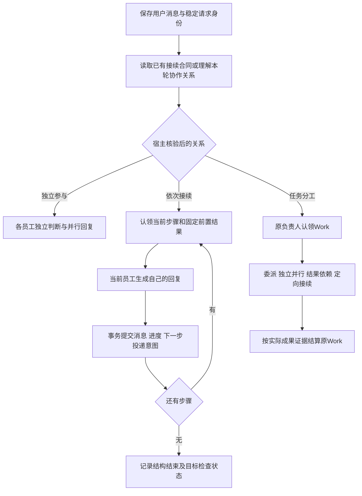

<!--
[INPUT]: 本组02产品语义与03事务状态；GroupScheduler、AppService、员工判断合同和原Work运行边界。
[OUTPUT]: Mastra/API调度设计与明确限字顺序聊天的有界纠正；候选范围与已接线能力分开，实际接口和验证以05为准。
[POS]: 第14组实施设计；设计与落点；实际接口和首批限制见05。
[PROTOCOL]: 一旦本文件变化，必须同步更新Header，并上浮检查所属目录.folder.md；同步02规则取舍，实际结果归05。
-->
# 调度协议与代码改造

## 1. 核心执行关系

顺序链约束的是模型生成开始时间。B必须在A完整提交且共同状态推进后才能取得生成资格；B开始时读取A的实际结果。先并行生成再依次显示不符合本协议。

## 2. 一次群级理解

新普通群请求缺少明确接续合同且属于首批支持范围时，进行一次只读、有预算的语义理解。输入只含本轮请求、当前获准成员摘要和必要公开上下文，不装配业务工具、管理工具或其他员工私有记忆。

候选装配方式：由宿主按明确收件人优先、其次冻结成员顺序选择一个可用API员工配置承载该私有调用，并记录真实来源身份。该职责只负责解释共同约定，不代替员工答复，不让模型逐消息挑选唯一发言人。不能偷偷调用未在群内的bobo或回退另一个凭据。

输出只提出协作关系、原目标、参与范围、显式依赖/顺序与结束约定；用户未指定的顺序由宿主按02约定填入。模型不得自定数据库身份、预算、成员权限或工具授权。参与者必须是当前有效成员，顺序不重复，必需约束保真，非法结果按原有界格式修复规则处理，耗尽则明确失败。

当前顺序聊天实现允许提取`maxReplyCharacters`：仅当前用户明确要求每位整条回复的统一字数上限时填写，缺省或null不限制；不能继承历史限制，也不能把文章、摘要片段、英文单词数或token数转换成聊天字符上限。该约束与原轮次一起冻结。宿主按去除空白后的Unicode码点计数，标点、数字及字母均计入；它不是全产品默认字数设置。

具有该约束的回复先私有生成再核验；超限时原员工最多追加一次无工具压缩，共用原请求调用预算、绝对期限、取消信号及逐调用用量，两个调用的累计用量不覆盖。只有合格正文可以发布并成为下一位的前置输入。再次超限则明确失败，不截断、代写或公开草稿。无此约束的普通聊天沿原流式路径，文章成果的长度要求仍按原Work执行；本增量没有通用文稿字数校验器。

现有私有参与判断提示要求“只判断本人”，不能直接让该提示兼任全群规划。实现应建立明确的请求理解合同，复用模型配置、容量和计量适配；是否扩展现有phase类型在GC1确定，不能伪造阶段或混入公开历史。

已经受理的Work唤醒、bobo组织启动和明确步骤接续复用原合同，不另建共同目标或预算。单聊保持现有路径。群级理解的响应延迟和额外开销纳入验收，不能只统计后续回复。

## 3. 三条执行路径

### 3.1 独立参与

保留每位员工的判断机会、自然语言点名理解、reply/pass及原并行容量。首次chat意图不因无关同伴先回复失效的保护，只在新协议明确为独立参与时适用；旧轮次按原语义兼容。

一位员工的回复不能替代其他被邀请成员的贡献，也不能要求所有员工必须说话。来自同伴的普通补充按原合并和预算机制处理，只有上下文用途的投递不消耗模型调用。

### 3.2 依次接续

1. 宿主保存本轮关系、冻结名单、顺序和初始步骤，初始步骤没有前置结果。
2. 原子核对轮次可执行、当前步骤revision、成员/配置、预算和无其他有效持有者，建立该步骤run资格。
3. 读取原请求、共同约定、本人当前职责、必要历史和固定前置消息；核对消息完整提交及来源有效。
4. 当前员工独立生成。对于固定职责的简单接续，优先将“如何完成/需要澄清/无法完成”放在本次执行中，避免先广播给全员再做一次参与判断。仍须保留可检查的失败、提问和沉默处理结果。
5. 提交前再核对成员、来源、取消状态、持有者及步骤版本；同事务保存真实消息、完成事件、步骤进度和下一位投递意图。
6. 事务成功后才能安装内存状态和通知下一位；最后一位后进入结构结束和目标检查，不自动再广播一轮“是否还要说话”。

不能仅靠提示词“等别人说完”实施等待；也不能将流式占位、工具进度或模型自称完成当作步骤完成。

首批是一人一次的有界单链，顺序步数受冻结名单约束。五人接续不能因为旧广播generation达到3而提前停止；应将协议步骤与自由补话代数分开计算，同时保留原请求总调用/输出/期限上限。每人多轮及动态插入步骤属于另行限定范围，不能通过重新创建turn重置预算。

### 3.3 任务分工

用户明确负责人时使用该身份。没有明确负责人且需要共同交付时，由同一请求的有界方案提出职责并经宿主准入，只能形成一个已授权共同根；角色相似或scope文字相近不能成为工作去重依据。

负责人沿原`delegate_work`/`wait_for_work`拆分，同一根的子工作共享原预算；并行仅适用于独立部分。审核引用指定稿件的真实成果/hash/版本，不能以聊天中的“收到”推进结果依赖。

已发布成果的正式版本修订保持原合同：用户从原文件版本进入同一composer，明确指定员工、所见版本/hash及修改要求，受理为新的修订请求/根Work和预算；该新根的子工作才共享本次修订预算。审核意见本身不自动取得替换原成果的权限，不能把新版本挂在已交付旧根下。若同一原始工作内部继续打磨尚未正式交付的草稿，须按既有工作/成果合同处理，不能伪造用户修订回执。

这条路径复用[WorkRepository](../../../src/runtime/modules/collaboration/work-repository.ts)和[work-dependencies](../../../src/runtime/modules/collaboration/work-dependencies.ts)。03的轻量顺序状态不成为Work的第二权威。bobo组织与群业务根既有边界保持。

## 4. 输入与权限

每次调用至少能区分：原用户目标、当前协作关系、本人职责、为何被唤醒、已提交前置结果、哪些成员已完成、剩余结束条件。技术元数据由宿主供给，不能要求模型从气泡顺序猜测。

前置消息的正文必须能进入实际模型输入；超出有界上下文时明确失败或走已授权有来源的压缩方案，不能只传“前一步完成”而丢掉结果。当前步骤对前置版本的绑定在调用前和提交前都核对。

同伴消息仍是带来源的数据；它可以满足原授权目标的依赖，但不能自行扩展目标、工具权限或读取范围。成员移除、材料撤权和记忆来源失效继续触发原门禁。

## 5. 完成、异常和打断

| 情况 | 候选行为 |
| --- | --- |
| 所有步骤已提交 | 记录结构完成；另保存目标检查的证据/未核验状态，不直接套用旧completed证明效果 |
| 内容与约定不符 | 只允许原预算内有界纠正或澄清；保留原错误记录，不能由宿主改写成伪造的员工答案 |
| 必需参与者pass/提问 | 不跳作成功；按约定暂停或明确提问，用户补充走原问题关联 |
| 模型失败/超时 | 保留失败，不推进下一步；显式重试先核原效果与提交身份 |
| 用户普通新消息 | 先保存，当前已启动chat按原规则结束后让位；不启动旧链的后续步骤；同伴插话不能自动扩权 |
| 用户明确停止 | 终结未开始步骤并取消活动执行；实际退出后才释放资格 |
| 成员或来源变化 | 当前资格失效则阻塞/终止；不静默换人、跳步或重新使用旧输入 |
| 重启或恢复备份 | 核对已提交进度，中断活动资格，零自动模型调用/工具重放；明确继续另验原状态 |
| 提交或工具结果未知 | 保留未知，先只读核对；不自动将失败重试当消息补偿 |

“结构完成”和“内容正确”需要不同证据。通用语义目标不能仅靠消息数量确认；需要模型判断时，采用一次有预算、带实际结果引用的检查，并标明模型评价来源。自动检查与人工效果认可继续分开。报数连续性在验收器中可确定性检查，不因此在生产调度器里写一个专用报数引擎。

## 6. 代码落点与职责

| 现有模块 | 候选修改 | 不应承担的职责 |
| --- | --- | --- |
| [domain/index.ts](../../../src/shared/domain/index.ts)、[contracts.ts](../../../src/runtime/contracts.ts) | 版本化轮次关系、步骤输入/投递原因、检查状态 | 不把概念字段未经迁移直接塞入所有旧记录 |
| [group-scheduler.ts](../../../src/runtime/group-scheduler.ts) | 按关系准入、步骤资格、必要唤醒、独立chat适用范围 | 不生成员工内容，不靠关键词判断业务 |
| [service.ts](../../../src/runtime/service.ts) | 宿主来源/上下文装配、事务提交、调用与取消接线 | 不新增另一套工作权威；避免继续堆积通用调度细节 |
| [modules/collaboration](../../../src/runtime/modules/collaboration/.folder.md) | 新增最小协议/状态事务模块的首选归属；复用原仓库 | 不为每种接龙各建一种框架 |
| [phase-instructions.ts](../../../src/runtime/modules/employees/phase-instructions.ts) | 共同目标与本人职责提示；与旧本人判断合同分开 | 不把提示词当作持久状态或锁 |
| [Mastra engine](../../../src/runtime/adapters/mastra/engine.ts)、[agent-factory](../../../src/runtime/adapters/mastra/agent-factory.ts)、[message-projection](../../../src/runtime/adapters/mastra/message-projection.ts) | 结构化理解、实际前置输入、阶段计量 | 不默认启用第二套Mastra Memory/Workflow存储 |
| 原renderer活动/消息/工作投影 | 如实呈现等待、失败和结果 | 不增加协作模式配置、假主持头像或排序补丁 |
| 原Vitest、Electron BDD及evaluation | 06规定的意图、因果和真实效果测试 | 不用固定模型直接输出正确答案证明真实语义通过 |

当前Mastra官方文档支持顺序、并行和条件控制；本项目已拥有运行权、预算与Work状态，首批优先扩展现有宿主协议。若后续引入框架Workflow，须单独决定状态权威与迁移，不能同时保留两个自动恢复执行器。[官方控制流文档](https://mastra.ai/docs/workflows/control-flow)

## 7. 兼容与发布

旧轮次无新协议字段时保留历史语义，不重新分类、不新增调用、不回填目标成功。新增规则只作用于明确启用后的新请求；发布时记录协议版本及构建身份。

当前本机开发暂停。修改共享类型或提示时必须防止误将新协议交给未接线的本机后端；首次支持范围和回退提示明确记录，不能以未运行兼容测试推断兼容。上线前按05同步AGENTS和第6组规则，文档授权不等于当前已启用。
