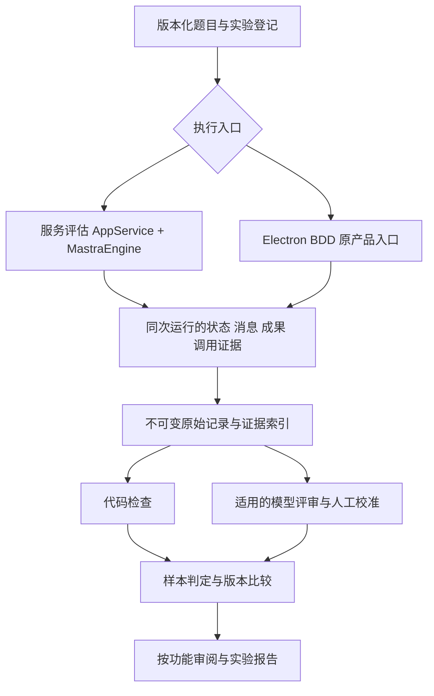

<!--
[INPUT]: tests/evaluation既有合同和执行器、Vitest与playwright-bdd、AppService/MastraEngine及功能留证脚本。
[OUTPUT]: evals分层、入口复用、证据聚合和职责边界的候选设计；不新增运行接口或依赖。
[POS]: ai-docs/spec/15.Agent评估与持续优化/02-分层架构与现有入口复用.md。
[PROTOCOL]: 一旦本文件变化，必须同步更新Header，并上浮检查所属目录.folder.md；实际进度统一更新07。
-->
# 分层架构与现有入口复用

日期：2026-10-09。以下是接续现有实现的设计，不是已接通的新管线。

## 1. 四层各自证明什么

| 层 | 复用入口 | 主要验证 | 不能替代 |
| --- | --- | --- | --- |
| L1 模块与持久化 | `tests/*.test.ts`、Vitest | 幂等、预算、版本、依赖图、停止和迟到提交 | 真实模型能否理解业务 |
| L2 正式SDK协议 | 现有Mastra测试与离线HTTP/SSE | 实际适配器输入输出、流式、错误、有界修复 | 供应商语义效果 |
| L3 真实服务评估 | `scripts/evaluate-collaboration.mjs` → `tests/evaluation/harness.ts` | AppService＋真实MastraEngine的完整任务、状态和成本 | Electron界面与用户入口 |
| L4 桌面流程 | `tests/e2e/features/`、steps/support、`pnpm dev` | 实际聊天、文件卡片、修订入口和重启 | 离线后端不证明真实语义；开发窗口不证明发行包 |

每份记录同时标明入口层和模型来源。L4可使用离线协议或真实API，二者分别报告；不能把一次L3结果与另一次L4截图拼为同场真实桌面通过。

## 2. 目标数据流

两条执行入口共享题目身份、评分定义和证据语义，但保持各自生命周期。该图不要求把整个UI操作转移到服务执行器，也不要求每轮提示词实验都启动Electron。

## 3. 复用点与待扩展职责

| 现有位置 | 复用方式 | 候选扩展 |
| --- | --- | --- |
| `tests/evaluation/schema.ts` | 继续作为评估数据合同 | 版本化增加实验/采样身份、执行来源和新分集；旧记录显式兼容 |
| `cases.ts`、`datasets.ts`、`matrix.ts` | 保留既有场景及冻结检查 | 先增加真实需要的题目映射；不自动改写旧留出题 |
| `harness.ts`、`budget.ts` | 服务执行、隔离环境、请求账本 | 实验登记与调用分账的缺口；沿原上限运行 |
| `tests/e2e/support/` | 继续负责UI生命周期和产品证据 | 在原场景清理前导出可评分证据，不新增平行`.spec.ts` |
| `checks.ts`、`scorers.ts` | 代码判定和Mastra适配 | 新检查以业务意图为边界；不在包装层丢失unknown/pending |
| `calibration.ts`、`rescore.ts` | 标签校验、历史原件重新评分 | 评审器版本和校准批次的可靠关联 |
| `report.ts`、`scripts/generate-feature-review.mjs` | 实验报告与功能审阅 | 互相链接同一证据，避免复制成不同事实源 |

上述为职责映射，不是要求每个位置都改动。具体导出/调用关系在实施前再次读取，按最小切片扩展。

## 4. 整组任务如何聚合

业务身份沿用户请求、会话、轮次、Work根/子节点、run、依赖结果版本和成果hash关联。评估层只能观察并建立索引，不能代替员工补写结果或推进Work状态。

一次多轮业务题可以包含多个明确用户请求和多个根Work。每个根保留自己的产品预算；评估实验另有覆盖整题及全部采样的总账。不得为了聚合评分而把这些请求改造成一个无限期根，也不得给子工作拆新预算。

顺序聊天没有Work时，使用会话/轮次/投递与前置消息身份取证。不要为统一数据结构创建虚假的业务Work。

对写作审核任务，至少关联“实际V1 → 审核者读取该版本 → 审核意见 → 用户明确修订请求 → V2 → 最终汇报”。仅看到成果存在或聊天声称读过，不构成实际读取证据。

## 5. 执行与评分分离

执行器只运行固定题目并保存事实；评分器读取固定证据，不能执行员工工具或修复被测状态。离线重评分不得再次发送业务消息、重建成果或触发记忆写入。

同一原始样本可以有多个评分版本，形成“原记录hash＋评分器版本＋评审版本”的派生结果。评分器变更必须同时处理适用的基线和候选，保留旧结果；不能拿不同评分标准的两批分数比较。

原始记录缺少某项证据时标记不完整。不能通过当前产品读取或重新运行，补造为历史时刻已经存在的证据。

## 6. Mastra的职责边界

现有[scorers.ts](../../../tests/evaluation/scorers.ts)使用`@mastra/core/evals`的`createScorer`包装整组判定，本身不额外调用模型。它不是已经完成校准的语义judge。

可继续使用Mastra承载评分能力，但单个Agent调用的Trace不天然等于跨多轮AppService执行的完整业务任务。团队关系和最终状态以BoAI产品记录为准。

首批不新增评估平台或升级SDK。未来确需内置评分器/实验服务时，再核对当时安装版本与官方接口；框架支持不等于项目接线完成。

## 7. 实施后的架构验收

- 同一业务题在两个入口的运行来源清晰，可共享适用评分，不混算通过率。
- 导入旧记录不会改变其产品状态、旧评分或冻结合同。
- 缺前置输入、原件或hash时能够阻止错误通过。
- 重评分可以在没有供应商凭据的环境运行，且不触发业务执行。
- UI步骤继续位于既有BDD层，评估器不成为第二个产品调度器。
