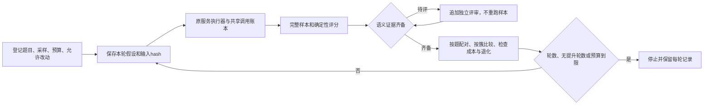

<!--
[INPUT]: 已有服务执行器/证据评分、用户开始新建并测试的要求及E1统一投影。
[OUTPUT]: API实验CLI、固定计划、共享预算、候选门禁及追加评审；开发自动修复另归10，建议与发布认证分开。
[POS]: ai-docs/spec/15.Agent评估与持续优化/09-实验登记与持续优化操作.md。
[PROTOCOL]: 一旦本文件变化，必须同步更新Header，并上浮检查所属目录.folder.md；实际成绩唯一维护在07。
-->
# 实验登记与持续优化操作

**现行增量：** 真实业务eval、独立judge及Codex候选循环见[11](./11-业务评估与Codex优化主线.md)。本文原手动/描述性合同保留；原测试修复改名`dev:repair`，不能作为业务评分。

首版用`pnpm eval:experiment`管理实验。它把已有真实API执行器、离线评分和版本对照接成一条可运行流程。人或开发代理先提交一个明确假设和限定范围的代码改动，再运行固定样本；控制器保存结果、检查退化并决定是否继续探索。代码入口是[optimization.ts](../../../tests/evaluation/optimization.ts)、[CLI](../../../scripts/evaluation-experiment.mjs)和原[evaluate-collaboration.mjs](../../../scripts/evaluate-collaboration.mjs)。

本API实验入口没有后台定时执行、自动生成补丁、自动提交、合并或发布。开发侧自动修复另见[10](./10-Codex开发自迭代机制.md)。`promising`只表示在预登记开发样本上值得进一步验证，不表示统计显著或完成最终验收。第一批真实结果与测试记录见[07第7节](./07-实施阶段与进度.md#7-2026-10-09实验生命周期与真实api探路)。

## 1. 操作流程



`init`、`status`、`review`离线运行。只有显式`run`会调用已保存的供应商配置。首版只接普通服务开发/回归题，沿用原Mastra与隔离AppService。桌面留证仍用08的`eval:score --source desktop`，不混入服务实验的质量分母；独立MD-v1交付协议与最终留出题被优化循环拒绝。

## 2. 预登记计划

把以下内容保存为自己的JSON文件，填入已明确选择的连接ID和原配置数据目录。该文件不包含API key；凭据继续通过原Electron只读桥在内存中传给worker。

```json
{
  "id": "collaboration-dev-01",
  "cases": ["explicit-mention", "legal-silence"],
  "samples": 3,
  "connectionId": "填写已保存连接ID",
  "dataPath": "/绝对路径/BoAI Agent/v2",
  "maxRequests": 120,
  "maxRounds": 3,
  "stopAfterNoImprovement": 2,
  "minimumGain": 0.1,
  "maxCallRatio": 1.1,
  "allowedChanges": ["src/runtime/adapters/mastra/engine.ts"]
}
```

- `cases`固定题目ID、输入/检查合同、分集与任务簇；重复ID、未知题、留出题及不兼容专用协议均拒绝。
- `samples`为每题1–5次独立样本。1次可用于探路；至少两个任务簇各3次才允许输出开发候选建议。这个数量是防止微型探路被提升的最低门槛，并非统计功效保证。
- `maxRequests`是整个实验、所有轮次累计1–1000次供应商请求上限。探针、失败、判断、执行、记忆等沿既有预算原子预留，失败不退额度。它不是每轮额度；不足时保留失败/未完成，不自动追加。
- `maxRounds`不包含第0轮基线，最多10个候选；`stopAfterNoImprovement`固定连续无提升上限。
- `minimumGain`是按任务簇等权平均的通过率差值，`0.1`表示10个百分点；`maxCallRatio`限制候选相对当前参考轮的实际总请求数，包含探针。Token未知单独报告，本版不据此承诺Token成本上限。
- `allowedChanges`为相对仓库的精确TS/TSX文件清单，无通配符；候选相对初始源码在清单外的改动被调用前门禁拒绝。评分器、题库、锁文件、依赖声明和实验规则在该实验内固定。

```sh
pnpm eval:experiment init --root .local/my-evaluation --config /绝对路径/plan.json
pnpm eval:experiment run --root .local/my-evaluation --source . --hypothesis '记录当前明确点名和合法沉默基线'
pnpm eval:experiment status --root .local/my-evaluation
```

初始化要求新的根目录。每轮先写只追加的开始记录，再调用原执行器的`--prepare`保存`settings.json`与完整输入hash；该步骤没有供应商调用。核对允许修改范围后，以`--registered-settings`执行同一登记。运行前后校验源码/评估器不变，首次执行标记拒绝重放，后续轮在探针之前核对模型签名。

服务每题默认120秒、120次请求以及单适配器90秒限制沿既有执行器；题目有显式配置时使用题目配置。全局请求预算仍优先限制累计调用。新入口没有提高产品Work额度或命令权限。

## 3. 追加评审

每轮`run-NNN/report/review-template.json`由原评分器生成，保留样本hash、评分器版本、标准和空白评审栏。独立评审者审阅原件后补充分数、依据ID和理由。

```sh
pnpm eval:experiment review --root .local/my-evaluation --reviews /绝对路径/reviews.json
# 模型辅助评审还需原校准合同；校准未过则继续待评
pnpm eval:experiment review --root .local/my-evaluation --reviews /绝对路径/reviews.json --calibration /绝对路径/calibration.json
```

评审只作用于最后一轮，不能改写已作为后续比较基础的历史轮次。追加文件关联前一结果hash，原始执行结果与原Markdown摘要保持原样；`status`读取最新有效评审。完整原件、样本身份、评分器版本与证据引用必须吻合。运行失败和证据缺损不能被评审覆盖。没有实际人工标签时不得把模型输出填写为`source: human`；自动测试中的人类标签夹具仅用于验证门禁，不是校准数据。

## 4. 候选与停止

候选需要明确说明单一假设，例如减少某段重复指令是否降低同题失败，而不能放宽成功标准。新源码可来自单独工作目录；运行命令继续指向原实验根和该候选路径。

```sh
pnpm eval:experiment run --root .local/my-evaluation --source /绝对路径/候选源码 --hypothesis '限定改动的原因及预期效果'
```

| 结果 | 含义 |
| --- | --- |
| `baseline` | 原始样本齐备且可评分，已建立参考；其中的业务失败仍保留 |
| `blocked` | 待评、缺样本、不可比、越界、执行错误或证据损坏；不能提升 |
| `regressed` | 任一原通过样本退化，或总请求超过登记成本比例 |
| `no-improvement` | 未到提升门槛，或实际代码未变，不能把重复采样噪声称为补丁收益 |
| `promising` | 所有固定检查满足，成为下一轮开发比较参考；仍需独立验证/最终留出 |

基线失败不能从分母删除；重复编号、失败重试、漏题、混代码版本、不同模型/预算/评分器均拒绝。不用平均提高抵消单题退化。成本以同一完整轮次调用账本比较，首版不计算置信区间或显著性，不执行单人/多人价值认证。

候选达到轮数、连续无提升数或总请求上限即停止。未结束轮次、未知调用或中断锁不自动重试，不自动撤销补丁；保留现场，由开发者核对原进程和原件。CLI正常运行不等于业务质量通过：`blocked`退出2、`regressed`退出1；基线登记及描述性无提升可退出0，具体质量必须阅读结果。

## 5. 留证与扩展

`plan.json`保存计划与hash；`rounds/NNN.started.json`保存假设、当前参考、代码位置与开始前账本；`run-NNN/arm-registration.json`绑定实际执行参数；`rounds/NNN.finished.json`保存全部尝试、门禁、调用数和原件hash。评审只追加`NNN.review-NNN.json`。这些hash用于检测意外改写，不是对本机拥有写权限者的防篡改签名系统。

新功能先在原题库/所属专题定义完整任务、失败例、边界例和可核对结果，再选入独立实验；不通过给同一题换名字冒充新任务簇。本机运行时、A2A、自动补丁生成、桌面实时优化、最终留出执行及统计认证仍按07后续阶段安排。
