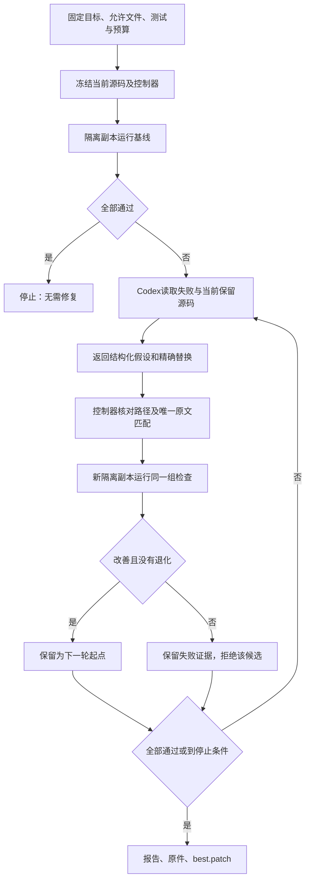

<!--
[INPUT]: 用户明确要求由正在开发BOAI的Codex建立可执行自迭代机制；现有实验/评分基础及Codex非交互接口。
[OUTPUT]: 开发侧自动评估→修复→复测→保留/拒绝→停止的现行代码、命令、证据和质量边界。
[POS]: ai-docs/spec/15.Agent评估与持续优化/10-Codex开发自迭代机制.md；实际验证唯一登记07。
[PROTOCOL]: 一旦本文件变化，必须同步更新Header，并上浮检查所属目录.folder.md与上层入口。
-->
# Codex 开发测试修复（辅助工具）

当前业务eval主线见[11](./11-业务评估与Codex优化主线.md)。本工具仅辅助工程测试修复，历史测试/故障注入结果不代表BOAI业务质量提升。

`pnpm dev:repair`现在能够自动完成一轮或多轮开发修复：先运行固定检查，交给Codex分析失败并生成限定修改，控制器应用到隔离副本，重新检查，再保留改进或拒绝退化。用户的原工作树、未提交修改和Git历史保持原样；最终输出可审阅、可应用的补丁。

这是**开发BOAI的Codex循环**。它不把Codex接回BOAI的员工运行时，不恢复第13组暂停工作。与09的真实API质量实验分工如下：

| 入口 | 负责的闭环 |
| --- | --- |
| `dev:repair` | 开发检查失败→Codex修复→固定测试/类型检查→保留候选或继续修复 |
| `eval:experiment` | 固定真实API任务→原模型/预算执行→独立评审→质量/成本对照 |
| `eval:score` | 服务或桌面历史原件→离线重评分/可比性检查 |

三个入口都保留失败和未知。开发测试通过不自动取得产品语义质量、完整桌面体验或最终留出认证。

## 1. 直接使用

本机需要已登录的Codex CLI、Git和仓库已有依赖。首个可直接运行的预设为[群协作开发计划](../../../tests/evaluation/repair-collaboration.json)：

```sh
pnpm dev:repair run \
  --config tests/evaluation/repair-collaboration.json \
  --root .local/my-collaboration-iteration

pnpm dev:repair status --root .local/my-collaboration-iteration
```

根目录必须是新目录。预设运行群成员/限字合同与群聊投影回归，各重复两次，再运行类型检查。初始源码已经通过时直接结束，模型调用为0；存在可定位失败时才启动Codex。`--source /源码目录`可指定另一个Git工作目录，默认是当前仓库。

当前目录的**未提交修改也进入快照**，不要求为了启动循环先提交全部工作。源码快照按Git已跟踪/未忽略清单采集，取`src/tests/scripts`、必要根配置及显式上下文；不复制`.local`、用户数据库、凭据目录或整个`node_modules`。依赖链接到已安装目录。

首版运行平台为macOS/Linux；Windows进程组退出尚未接入，调用前明确拒绝。

## 2. 自动运行顺序



Codex通过`exec --sandbox read-only --json --output-schema ...`提出文本替换，不直接编辑执行目录。每个替换必须命中允许文件中的唯一原文；控制器先在内存里校验整份建议，再生成候选副本。任何对测试、评分器、计划、权限文件或登记外文件的修改都会被拒绝。

每次Codex调用使用独立临时会话，复用本机登录；关闭用户配置注入，避免继承用户MCP/插件配置到修复器。网络代理环境保留，BOAI供应商密钥等无关应用变量不传入。`model`可在计划里显式指定；未指定时使用Codex自身默认模型，不保证与当前交互会话的临时模型选择一致。

修复上下文含源代码、指定开发测试和显式规格，失败文本明确作为不可信数据提供。既有冻结留出题不主动复制到该上下文，也不拿来当循环奖励。只读沙箱和工作副本不等于针对本机拥有读取权限者的保密隔离；最终未见题仍需独立访问控制。

## 3. 固定计划

可以复制预设修改目标、允许文件和检查集。所有字段在一次运行中冻结：

| 字段 | 含义与默认值 |
| --- | --- |
| `goal` | 要维持/修复的业务行为；不能替代实际断言 |
| `allowedFiles` | 现存`src/`下精确TS/TSX路径，最多20个 |
| `tests` | 固定Vitest开发/回归文件，最多40个；不选最终留出 |
| `contextFiles` | 额外源码、开发测试或规格；默认空 |
| `maxRounds` | 最多Codex修复调用次数，默认3、最大10；不含基线 |
| `maxNoImprovement` | 连续无提升停止数，默认2；不能大于最大轮数 |
| `repeats` | 每次检查的独立执行次数，1–3，默认1；预设为2 |
| `testTimeoutMs` | 单次测试/类型检查期限，默认120000 |
| `codexTimeoutMs` | 单次Codex进程期限，默认180000 |
| `totalTimeoutMs` | 整次迭代绝对期限，默认900000；每次启动只取得剩余时间 |
| `typecheck` | 是否运行原`tsc --noEmit`，默认true |
| `model` | 可选Codex模型名，无默认强制覆盖 |

硬限制是调用次数、期限、文件/输入/输出大小和修改范围。`knownTokens`来自实际`turn.completed`回执，缓存输入不重复相加；缺回执保留未知。这不是供应商金额上限，也不是对一次Codex调用内部请求/token的硬上限。报告中的Codex调用数指CLI修复会话次数，不伪称其内部模型请求数。

## 4. 保留与拒绝规则

评分来自Vitest原始JSON和类型检查退出码，Codex的“已完成”声明不参与判分。每个测试以文件、完整名称和重复编号配对；计划漏测、增减用例、重复身份、跳过、钩子/装载错误、退出码与报告不一致都不算通过。

候选只有在至少修好一个原失败检查，或修好类型错误，同时没有任何原通过用例退化、没有新的类型错误、输入与证据完整时，才成为下一轮起点。无改善或退化的候选留在原目录供审阅，下一轮从上一个保留版本重新开始，失败假设及结果会进入下一次提示。

源文件/测试在执行期间被改写、无有效基线、Codex失败或调用结果未知时停止。候选编译/检查失败可以在原次数与期限内形成下一次修复尝试，但该候选不会被保留。没有自动补发未知模型调用，也没有“最后重试成功覆盖第一次失败”。

全部固定检查通过、连续无提升达到上限、最大轮数或绝对期限到达、用户取消都会结束。取消/超时会终止自有进程组并等实际退出；不会自动恢复。`status`对没有最终回执的目录显示`running-or-interrupted`，不猜测成功或重发。

## 5. 如何接入日常Codex开发

1. Codex先根据用户目标建立或选择能暴露问题的回归检查，核对预期值和失败原因。测试与成功标准必须在修复循环开始前固定。
2. 将可修改文件和固定检查写入计划，运行`dev:repair run`。不把题库、测试或预算修改当作修复手段。
3. 读取`report.md`、`result.json`、逐轮错误和`best.patch`。候选只改变隔离副本，原工作树仍可继续开发。
4. 在原授权开发范围内审阅并应用补丁；先用`git apply --check /实验目录/best.patch`确认当前文件仍兼容，再正常应用。原目录已有并发修改时先处理差异，不执行强制重置。
5. 按文件协议更新Header、目录地图和功能进度，再执行该功能要求的真实API或`pnpm dev`验收。需要语义评审的场景继续走原质量门禁，不把本地回归通过登记成人工质量认可。

这个循环能够自动修复**已被检查捕获的问题**。它不会自主发明新的需求或放宽成功标准。新增功能仍需先建立有意义的验收合同；完整多Agent写稿/审核/文件交付质量仍由真实任务和独立评审验证。

## 6. 文件与留证

实现分为[纯合同/评分](../../../tests/evaluation/repair-contract.ts)、[受控进程与Codex适配](../../../tests/evaluation/repair-process.ts)、[迭代控制器](../../../tests/evaluation/repair.ts)和[CLI](../../../scripts/iterate-agent.mjs)。没有新依赖、数据库或产品页面。

每次运行保留：

- `plan.json`：目标、测试/源码清单hash、控制器hash、版本和预算。
- `controller.mjs`：当次实际控制器原件；CLI运行时是打包模块。
- `round-NNN/started.json`及`codex-started.json`：开始身份及调用前计数。
- `prompt.txt`、Codex JSONL/错误日志、结构化建议与用量。
- 每次Vitest JSON、stdout/stderr、进程回执、类型检查及逐轮结果。
- 候选工作副本、被拒修复、最终`best.patch`、`result.json`和`report.md`。

`status`核对计划、逐轮结果/原件、控制器和最终补丁hash。历史版本缺少某项hash时显示缺口并退出2，不能补造历史。hash用于发现意外改写，不是拥有本机写权限者不可伪造的数字签名。

退出码：固定检查通过或基线已通过为0；轮数/无提升/时间到限但仍有失败为1；证据或执行问题为2；用户取消为130。源码是否发生外部变化、开放语义质量是否评估始终单列。

实际测试、真实Codex受控故障与剩余边界统一见[07第8节](./07-实施阶段与进度.md#8-2026-10-09codex开发侧自动修复循环)。

## 7. 官方接口依据

本机核对的CLI为`codex-cli 0.161.0`。非交互执行、JSONL事件与结构化末条结果的接线参考[Codex非交互文档](https://learn.chatgpt.com/docs/non-interactive-mode)；拆分检查、修复和有界重复的设计参考[OpenAI迭代修复示例](https://developers.openai.com/cookbook/examples/codex/build_iterative_repair_loops_with_codex)。具体命令参数同时以本机`codex exec --help`实测为准。当前实现增加了固定测试、精确文件白名单、完整配对和隔离补丁约束。
