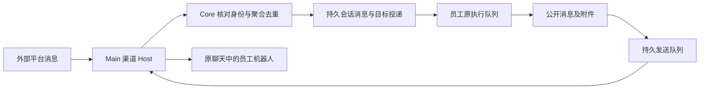

<!--
[INPUT]: 用户提出每个数字员工连接飞书/Telegram/钉钉机器人并要求实现前review；本仓库Mastra 1.71.0文档与类型、官方资料、固定Chat SDK/Rovai源码、飞书适配器0.3.0/channel 0.7.1发布包、BOAI主进程与runtime消息入口。
[OUTPUT]: 2026-10-12按用户纠正收敛为现成Mastra优先，飞书/Lark不适配时直接迁用并维护Rovai对应代码；首版以机器人绑定员工、平台聊天映射现有会话和聊天记录为基础，不自建渠道框架，未实施。
[OUTPUT]: 2026-10-12归入第16组数字员工渠道绑定，保留固定来源与复核记录；后续开发阶段、验收及唯一进度见本组02，未接入真实渠道。
[POS]: ai-docs/spec/16.数字员工渠道绑定/01，作为本组开发计划的调研依据，不代替实现和真实验证。
[PROTOCOL]: 一旦本文件被更新，务必同步更新Header与所属目录.folder.md；实施状态必须与源码和真实验证分别记录。
-->

# Mastra Channels 与 Rovai 渠道接入调研

调研日期：2026-10-11。用户目标：每个 BOAI 数字员工可以拥有飞书、Telegram 或钉钉机器人，从外部聊天工具联系同一名员工，继续使用其能力与工作记录。本次只研究，为后续实现提供依据。

2026-10-12复核及用户纠正：**优先使用现成的 Mastra Channel / Provider；兼容适配器能满足需求时直接接入；没有现成能力时，优先迁用 Rovai 已有渠道实现。** 飞书和 Lark 是两个独立渠道。原稿将BOAI自建渠道Host和通用消息桥列为主线，超出了用户希望的维护范围，该建议在本次修订中撤回。本文仍为实现准备文档，未接入真实机器人。

2026-10-12文档归档：按用户要求从 `ai-docs/` 移入第16组；具体后续任务见[02 开发计划与验收](./02-开发计划与验收.md)，阅读入口见[本组README](./README.md)。以下调研结论和版本留证保留原日期语境，此次归档未新增外部调研或运行验证。

## 1. 结论与能力对照

Mastra 确实已经有正式 Channels，BOAI 安装的 `@mastra/core 1.71.0` 也已包含渠道配置与生命周期接口。它通过 Chat SDK 接入平台。Telegram 有现成适配器及更高层的 Provider；飞书/Lark 有平台厂商维护的 Chat SDK 适配器。本次核对的官方目录没有找到钉钉适配器，钉钉可以使用官方 Stream SDK 接入。

选型顺序固定为：**Mastra现成Provider → Mastra Channels兼容适配器 → Rovai对应渠道模块的直接复用与必要适配**。BOAI负责将渠道关联到已有员工和会话，不先建设自己的机器人平台、连接管理器或通用投递框架。

| 平台 | Mastra / Chat SDK 的现有能力 | Rovai 固定版本 | BOAI 桌面端可用连接方式 |
| --- | --- | --- | --- |
| 飞书 | 优先验证 `@larksuite/vercel-chat-adapter` 接入 Mastra Channels，显式 `domain: 'feishu'`；它是厂商维护的兼容适配器，非Mastra内置飞书Provider | 独立 `feishu` provider，现成员工机器人、发布与消息处理模块可作为复用来源 | WebSocket长连接 |
| Lark | 同一适配器包支持 `domain: 'lark'`，但应作为独立渠道、实例和配置验证，非飞书账号的另一入口 | 独立 `lark` provider；独立账号、应用、会话命名空间与SDK域 | WebSocket长连接 |
| Telegram | `@chat-adapter/telegram`；另有 `@mastra/telegram` 的 `TelegramProvider` 管理安装与恢复 | 所核对提交未实现；渠道枚举只有飞书、Lark、钉钉 | 桌面端可显式使用 long polling；服务端可用 webhook |
| 钉钉 | 所核对的Mastra官方渠道目录未找到现成接入；优先迁用Rovai已有钉钉渠道模块，继续使用其底层官方SDK | 已有Stream连接、消息归一化、OpenAPI收发与机器人配置模块 | Stream长连接 |

来源：[Mastra Channels](https://mastra.ai/docs/channels)、[TelegramProvider](https://mastra.ai/reference/channels/telegram-provider)、[Chat SDK 飞书/Lark厂商适配器](https://github.com/vercel/chat/blob/14c812e4498316f253136b572ac16a823b9eb990/apps/docs/content/adapters/vendor-official/lark.mdx)、[钉钉官方 Stream SDK](https://github.com/open-dingtalk/dingtalk-stream-sdk-nodejs)、[Rovai 渠道类型](https://github.com/murray17/rovai-ai/blob/f9acc2395283d49f0ce247dc0af2207c155f6eb6/apps/desktop/src/main/channel-kind-input.ts)。

这里的机器人需要能接收用户消息、识别会话并回复；只向群里推送通知的 Webhook 不足以完成这一需求。桌面端采用长连接可以减少部署步骤，但 BOAI 宿主仍需运行且联网；这不自动提供关机后的全天候服务。

## 2. Mastra 已经提供什么

### 2.1 两层入口

**Agent Channels**：在 `new Agent({ channels: { adapters: ... } })` 上配置平台适配器；处理私聊、提及、订阅线程和交互事件，映射模型会话并发送回复。支持自定义消息 handlers 和资源/线程映射。适用于由一个持久 Mastra Agent 直接承接机器人对话的应用。

**ChannelProvider**：在 `new Mastra({ channels: ... })` 上注册，管理平台连接、授权/安装、恢复及路由。当前官方 `TelegramProvider` 接收每个 Agent 的 bot token，支持 webhook / polling，并在启动时恢复已保存安装。它不是只有一段 webhook 示例。[Agent Channels](https://mastra.ai/reference/agents/channels)、[ChannelProvider](https://mastra.ai/reference/channels/channel-provider)、[TelegramProvider](https://mastra.ai/reference/channels/telegram-provider)。

版本边界：本机 `1.71.0` 的内嵌文档和类型已核对；`@mastra/telegram` 与平台适配器尚未安装。线上 Provider 文档比内嵌文档更完整，不能据此宣称最新版扩展包已与当前 BOAI 联调通过。实现时再固定依赖组合，验证类型、启动/退出及真实收发。

### 2.2 飞书和Lark：可共用适配器包，渠道必须独立

`@larksuite/vercel-chat-adapter` 复用飞书官方 SDK 能力，支持 WebSocket、卡片、交互和流式更新。调用初始化打开连接，关闭时终止连接。每个适配器显式接收自己的 `appId/appSecret`，适合多名员工分别绑定应用。

文档还提供官方扫码创建应用的 `registerLarkApp`，以及开发者后台手动建应用的路径。2026-10-12进一步核对实际发布包：`0.3.0` 已有 `domain` 参数，默认飞书，可显式传 `feishu` 或 `lark`；国际Lark应用若落到默认飞书域会请求失败。BOAI应保存并显式传递所选平台区域，避免多机器人共享环境变量默认值。扫码创建、应用类型及租户权限仍须真实验证。

飞书与Lark必须分别保存账号、App凭据、员工绑定、会话标识与连接状态；其中一个断开不影响另一个。同一个员工可以各有一个飞书机器人和一个Lark机器人。当前包的适配器 `name` 固定为 `lark`，不能仅在配置里写两个不同标签就认定支持同时挂载；后续用现成框架验证独立实例的注册与存储隔离。复用底层代码不等于合并两个平台。

需要特别适配会话身份：该适配器按平台 chat/root message 构造 thread，私聊识别还有运行期缓存边界。BOAI 应保存自己的外部会话映射，不能直接把每次收到的 SDK thread 都当成新员工会话。该适配器文档声明不实现 webhook 入站；不要给它套用 Mastra 普通 webhook 教程。[厂商适配器文档与限制](https://github.com/vercel/chat/blob/14c812e4498316f253136b572ac16a823b9eb990/apps/docs/content/adapters/vendor-official/lark.mdx)。

### 2.3 Telegram 的桌面接入

Telegram 可采用 polling，避免要求用户准备公网服务。应显式配置传输方式：polling 和 webhook 互斥，相关适配器/Provider 启动 polling 可能删除已有 webhook；一个 bot 只能由确定的宿主负责拉取更新。持久化更新位置、失败回执和业务去重，不能只依赖进程内缓存。[Telegram 适配器](https://chat-sdk.dev/adapters/official/telegram)、[Bot API getUpdates](https://core.telegram.org/bots/api#getupdates)。

Provider 的“断开”也应按具体实现理解：通用接口文档描述清理平台应用，Telegram 的具体实现文档描述停止传输、移除安装及 webhook。BOAI 将来应明确区分停止连接、解除本地绑定、删除远端应用，不能把同名方法直接映射到一个模糊按钮。

### 2.4 发布包核验记录：用于接入测试，不据此自建替代框架

本次从npm下载并校验了 `@larksuite/vercel-chat-adapter@0.3.0` 和其依赖 `@larksuite/channel@0.7.1`，仅解包读源码，未安装到BOAI、未执行包代码。发布包比10月9日固定目录文档更具体，以下结论以发布包为准。

| 核对点 | 实际源码 | 后续接入要求 |
| --- | --- | --- |
| 依赖与区域 | 适配器直接包装 `@larksuite/channel`，后者使用官方node-sdk；适配器公开 `domain` | 固定整个依赖组合；分别传国内/国际域，不能据目录说明认定所有能力与Rovai同版SDK完全一致 |
| 入站处理完成 | 适配器的message回调调用 `chat.processMessage(...)`，没有把下游业务完成回执串回该回调；底层普通消息handler另有捕获错误后记录的路径 | 在C0记录现成组件的实际受理/恢复行为，不能宣称“落库失败必让平台重投”；先评估公开配置、上游修复或Rovai现成实现 |
| 普通发送重试 | channel的 `rawSendWithRetry` 内部重试；所核对的普通create/reply路径未传客户端uuid | 沿用现成组件的发送能力并核对其重试语义；BOAI不再叠加一套盲目重发机制，不将一次SDK调用等同一次网络尝试 |
| 回复目标失效 | `sendOneWithFallback` 可移除失效的reply目标后再发送 | 在真实线程测试中核对现成组件的回退行为，明确产品可接受范围；需要差异时仅对具体接入点适配 |

来源：[适配器0.3.0发布元数据](https://registry.npmjs.org/@larksuite%2fvercel-chat-adapter/0.3.0)、[channel 0.7.1发布元数据](https://registry.npmjs.org/@larksuite%2fchannel/0.7.1)，其中 `dist.tarball` 对应实际核对内容，完整性已按 `dist.integrity` 的SHA-512验证。关键文件为适配器的 `dist/index.d.ts`、`dist/index.js` 和channel的 `dist/index.mjs`。

以上是兼容测试项，不是新建通用收件箱、Outbox、连接注册表或渠道框架的理由。发现实际不兼容时，先用公开配置或已存在的上游能力解决，再评估Rovai对应模块；仅记录确有必要的适配差异。

## 3. Rovai 实际如何实现

核对项目为 [murray17/rovai-ai](https://github.com/murray17/rovai-ai)，固定提交 `f9acc2395283d49f0ce247dc0af2207c155f6eb6`，提交时间 2026-10-10。10月11日调研时远端 main 与本地只读参考一致；10月12日复核继续使用该固定版本，不将其称为当前最新main。以下区分源码行为、项目合同和对 BOAI 的建议。

**Rovai确实自己维护了一套渠道系统；它没有使用Mastra Channels。** 平台连接底层复用官方SDK，上层的账号、发布、队员绑定、会话与投递由Rovai实现。这是可以定位并复用的现有代码来源，不能只提取设计概念后让BOAI从头重写一遍。

飞书与Lark在Rovai中使用同一个渠道服务类的**两个独立实例**，注入不同Provider Profile；Core也按provider隔离账号/Bot表族与会话身份。它们可以同时存在，同一队员各自绑定不同远端App。详见[独立Lark渠道架构](https://github.com/murray17/rovai-ai/blob/f9acc2395283d49f0ce247dc0af2207c155f6eb6/docs/architecture/lark-channel.md)。

### 3.1 每名员工有自己的机器人身份

Rovai 在设置中连接平台账号，再为队员创建/发布机器人。账号、远端应用、队员、凭据引用和发布状态分别保存；连接运行期按具体 App 管理。群里多名员工可以分别以自己的机器人身份回复，不使用一个公共机器人伪装所有员工。

它的产品闭环还包含开发者后台登录、创建应用、配置能力/权限/事件、发布与重新读取状态。发布意图固定原应用身份，重启后继续核对同一个应用。这里包含开发者后台自动化，不能全部当成稳定的公开服务 API，也不等同于厂商适配器的官方扫码创建能力。

已发布机器人的收发凭据与开发者后台会话分开；后台登录过期不直接等于机器人停止收消息。[飞书架构](https://github.com/murray17/rovai-ai/blob/f9acc2395283d49f0ce247dc0af2207c155f6eb6/docs/architecture/feishu-channel.md)、[钉钉架构](https://github.com/murray17/rovai-ai/blob/f9acc2395283d49f0ce247dc0af2207c155f6eb6/docs/architecture/dingtalk-channel.md)。

### 3.2 传输与工作调度分开

飞书/Lark Host 使用官方 SDK 的 `createLarkChannel`，选择 WebSocket；钉钉 registry 为每个 AppKey 创建 `DWClient`，监听机器人与卡片事件。Electron Main 管网络连接与平台收发，Rust Core 管业务身份、会话、工作和持久投递。

消息桥合同规定：业务受理以消息和目标投递提交为界，不等待模型执行结束。后续消息进入既有队列；公开员工消息与待发送记录关联。平台回复发送失败只重试发送，不能重新执行模型任务。附件需要先准备好再进入工作，不能下载失败后偷偷只执行正文。[消息桥合同](https://github.com/murray17/rovai-ai/blob/f9acc2395283d49f0ce247dc0af2207c155f6eb6/docs/contracts/channel-message-bridge-v1.md)。

### 3.3 多机器人群聊不是简单转发

同一条群消息可能由多个机器人的连接分别收到。Rovai 将它们聚合成一次外部消息，再根据有效成员与提及分发给相应员工，避免重复创建工作。外部私聊、群和线程有各自的身份范围；授权基于已连接账号和平台用户身份，不把第一个发消息的人自动认作本机主人。

这两点与 BOAI 多员工场景直接相关：去重要区分“同一个事件重复投递”和“一条群消息有多个合法接收员工”，回发则必须使用真实作者绑定的机器人。身份与聚合的基础条款见[飞书v1 §4–6](https://github.com/murray17/rovai-ai/blob/f9acc2395283d49f0ce247dc0af2207c155f6eb6/docs/contracts/feishu-channel-v1.md)，按[飞书现行合同继承链](https://github.com/murray17/rovai-ai/blob/f9acc2395283d49f0ce247dc0af2207c155f6eb6/docs/contracts/feishu-channel-v17.md)读取；v1的旧凭据/附件条款已被后续版本替代，不作为当前实现建议。

### 3.4 借鉴前需保留的差异

- **凭据存储**：Rovai 的渠道存储合同明确把 secret、token 和开发者 Cookie 明文放入其 SQLite。BOAI 已有 Electron `safeStorage` vault，后续应沿用自己的加密凭据边界；业务记录保存引用。[Rovai 存储合同](https://github.com/murray17/rovai-ai/blob/f9acc2395283d49f0ce247dc0af2207c155f6eb6/docs/contracts/channel-storage-v1.md)。
- **传输 ACK 与业务受理不完全相同**：钉钉 registry 当前先 ACK `SUCCESS`，再异步执行 `onMessage`。从调用顺序推断，ACK 后、持久受理前存在进程退出窗口；本次没有进行故障实验。不能仅凭消息桥合同声称传输层实现了无丢失/恰好一次。BOAI 应在 SDK 支持范围内明确持久收件与 ACK 边界并实测。[实际代码](https://github.com/murray17/rovai-ai/blob/f9acc2395283d49f0ce247dc0af2207c155f6eb6/apps/desktop/src/main/dingtalk-stream-registry.ts#L62)。
- **发送结果未知**：Rovai钉钉v14合同明确承认，该路径没有可用的客户端发送幂等键，响应丢失后的自动重试可能重复发消息。原稿“发送失败只重试发送”只约束不重跑模型，不保证外部只出现一次。后续保留真实未知状态、复用原业务回执，不能靠重跑模型补发，也不据此预先新建通用投递系统。[钉钉v14](https://github.com/murray17/rovai-ai/blob/f9acc2395283d49f0ce247dc0af2207c155f6eb6/docs/contracts/dingtalk-channel-v14.md)。
- **部署边界**：Rovai 当前文档说明渠道依赖连接的桌面宿主，独立 Server 0.4.7 尚不提供飞书/钉钉路径。它的 Web 远程访问能力不能证明渠道已可脱离桌面运行。[官方渠道指南](https://rovai.dev/docs/channels.html)。

### 3.5 后续开发可直接定位的源码

以下路径均相对上述固定Rovai提交。缺少Mastra现成接入时，从这些现有模块确定直接迁用范围，并带入相关测试、固定来源及必要的接口适配；不预设整套Rust Core必须迁入。

| 文件 | 主要参考价值 |
| --- | --- |
| `apps/desktop/src/main/channel-settings.ts` | 飞书与Lark各自服务实例所用的共享实现：账号、发布、连接、入站与回发 |
| `apps/desktop/src/main/channel-provider-profile.ts` | 飞书与Lark独立的域、服务方法和身份配置 |
| `apps/desktop/src/main/dingtalk-channel-settings.ts` | 钉钉账号/应用/机器人发布与收发适配 |
| `apps/desktop/src/main/dingtalk-stream-registry.ts` | 可优先迁用的Stream连接管理与回调模块 |
| `apps/desktop/src/main/dingtalk-inbound.ts` | 已有钉钉消息归一化 |
| `apps/desktop/src/main/dingtalk-open-api.ts` | 已有钉钉API收发封装，按实际调用链适配 |
| `apps/desktop/src/main/channel-host-pump.ts` | 启动/事件驱动的持久任务处理与恢复 |
| `crates/rovai-core/src/channel.rs` | 账号、员工机器人、会话、观察聚合与投递的业务事实 |
| `packages/contracts/src/index.ts` | renderer、main、core之间的公开渠道合同 |
| `docs/contracts/channel-message-bridge-v1.md` | 异步受理、附件与独立发送重试的业务约束 |

## 4. BOAI实现建议：复用渠道，只做业务接线

### 4.1 现成能力与BOAI职责

**机器人绑定员工本身是简单关联，首版按现有聊天功能接入。** 需要表达两层关系：

| 关系 | 用途 |
| --- | --- |
| 平台及机器人/安装ID → 员工ID | 收到消息时确定由哪名已有员工处理 |
| 平台、机器人及私聊/群/thread标识 → BOAI会话ID | 找到或创建原有会话，后续消息继续写入同一份聊天记录 |

这是关系说明，不要求新建两张表；优先使用已有渠道安装记录与BOAI会话字段。外部用户消息进入现有会话，员工照常处理，公开回复保存为现有聊天消息，再通过绑定机器人发回。BOAI中可以查看这份聊天记录，重启后继续原会话。同一员工收到不同人的私聊时，按各自平台会话区分记录。

最小闭环就是：**绑定一个机器人到员工 → 从平台发消息 → BOAI产生并保存回复 → 平台收到回复 → 再发一条消息继续原聊天**。先完成这条链路；多员工群等后续能力按实际需求扩展。

| 能力 | 首选归属 | BOAI需要做什么 |
| --- | --- | --- |
| 平台连接、事件订阅、重连、消息格式与收发 | Mastra Provider / Channels及其适配器；缺口使用Rovai已有模块 | 实例化、配置、接入应用启动/退出；不另写一套连接状态机 |
| 平台安装、恢复和渠道状态 | 使用选定Provider已有安装记录和生命周期；兼容适配器或Rovai按实际已有接口接入 | 将员工ID关联到现成安装/机器人ID，展示状态，不复制一套相同记录 |
| 外部会话到员工会话 | 现成渠道的thread/resource能力，加BOAI必要映射 | 关联真实员工和BOAI conversation；飞书、Lark及其他渠道命名空间分开 |
| 员工执行、记忆、Work和文件交付 | BOAI原业务运行时 | 通过现成自定义handler进入原消息受理/执行入口，避免默认handler和BOAI各运行一次 |
| 结果回复 | 选定渠道的现成发送接口 | 将已发布公开结果交回原渠道；不发送私有执行日志，不为发送失败重新执行任务 |
| 凭据 | Provider支持的加密存储配置或BOAI既有vault | 在现有凭据能力上接线，避免明文、重复存储和Renderer泄漏 |

首版不另立通用Channels框架，不先自研Host registry、机器人发布管理器、通用收件箱/Outbox或平台协议封装。若Rovai某个迁用功能依赖其已有调度或投递机制，评估并复用该实际调用链；这不等于先为所有平台另造一套。

### 4.2 临时Agent不构成自建渠道的理由

[agent-factory.ts](../../../src/runtime/adapters/mastra/agent-factory.ts) 的阶段Agent仍按原方式创建。接入时把**框架管理的Channel/Provider对象**放在应用运行期，通过现成handlers关联员工和会话；不在每个执行阶段重新连接机器人。

这属于生命周期装配。BOAI已有持续运行的 [runtime worker](../../../src/runtime/worker.ts)，由 [Electron Main](../../../src/main/main.ts) 启动；无需因为阶段Agent临时创建就推导出“必须自行维护机器人系统”。长期注册对象、已有持久存储及应用退出如何接线，先按所选Provider/AgentChannels公开接口验证。

对于API员工与原生员工，均优先让自定义handler调用BOAI原执行入口；原生员工接线需要实际验证，不能为了渠道额外运行一次Mastra模型。也不要求把Rovai每个模块重新包装成自定义Mastra Provider后才可使用。

### 4.3 必要接线与验收不变量

- **员工与渠道绑定**：同一机器人明确对应员工；一个员工可以有多个平台身份。优先引用现成安装记录，只补BOAI员工关系。
- **消息来源**：[service.ts](../../../src/runtime/service.ts) 当前 `sendMessage` 使用本地 `user` 身份。外部身份须经过授权与映射，保留平台来源，不能把任意入站消息直接当成本机用户。
- **会话归属**：外部私聊/群/thread须映射到明确会话，不因同名用户或同一员工而合并不同平台历史。SDK线程与BOAI会话之间的必要映射不等于新建第二套聊天系统。
- **单次业务执行**：复用现有消息回执与请求ID，核对平台重复投递不会再创建同一任务；群多机器人处理优先复用现成渠道能力或Rovai既有聚合实现。
- **回复与重试**：任务结果和平台发送结果分别记录；发送未知不能伪装成功，也不能通过重新执行员工任务解决。优先保留现成组件的状态与查询能力，补BOAI展示即可。
- **凭据与UI**：[vault.ts](../../../src/main/vault.ts) 及现有BOAI组件继续复用；Provider有加密配置时直接接入。飞书、Lark分别配置、连接、断开和验收。

这些是接入已有产品必须核对的关系，不预设新的数据库表族或另一套队列服务。

### 4.4 Rovai的复用边界

用户已明确接受：**飞书、Lark若无法通过Mastra现成能力直接接入，就复制Rovai各自已有的渠道代码，做必要适配并维护。** 不必为坚持使用Mastra而重写一个同等功能的适配器。共享实现代码可继续共享，飞书与Lark的配置和运行实例分别保留。

Rovai渠道代码是项目内模块，并非一个安装后即可完整工作的独立npm包。飞书、Lark优先从 `channel-settings.ts` 与 `channel-provider-profile.ts` 的对应调用链确定迁用范围；钉钉从Stream registry、消息归一化和OpenAPI封装入手，连同已有测试迁用；将Core调用适配到BOAI已有员工、会话和聊天记录入口。

机器人自动创建/发布有现成实现时，优先评估厂商官方能力及Rovai发布模块，不从头设计开发者后台自动化。实际迁用须保留来源、许可证和必要适配说明；具体文件集合在开工时按依赖确定。使用Rovai源码会有适配和后续同步成本，这与直接依赖现成Mastra包的维护方式不同。

## 5. 后续开工顺序与验证

以下是实现建议，本次仍只review文档。

| 阶段 | 复用路径 | 需要拿到的实际结果 |
| --- | --- | --- |
| C0：现成接入验证 | 固定与BOAI兼容的Provider/适配器版本，用公开handlers连接一个已有员工 | 框架生命周期可用；收到消息后只走一次BOAI执行；回复回到原会话；记录需适配的具体点，不预建自有框架 |
| C1：飞书 | Mastra现成接入优先；不合适则直接迁用并维护Rovai飞书渠道 | 机器人绑定员工，私聊消息及回复写入BOAI原聊天记录，连续对话与重启接续；再验证文件和两名员工隔离 |
| C2：Lark | 独立Lark渠道；Mastra现成接入不合适则直接迁用并维护Rovai Lark渠道 | 相同的员工绑定/聊天记录闭环；与飞书同时连接、各自断开、同名ID不串会话；分别真实验收 |
| C3：Telegram | 优先 `@mastra/telegram` 的 `TelegramProvider` | 每员工bot绑定、明确polling/webhook模式、恢复和原会话回复；直接使用Provider安装管理 |
| C4：钉钉 | 若开工时仍无合适现成Channel，优先迁用Rovai钉钉模块 | Stream真实收发、BOAI员工接线、恢复和文件能力；先迁用再补必要适配 |
| C5：多员工群 | 已选渠道能力 + Rovai已有聚合/分发逻辑按需复用 | 同群提及两名员工，各自办理并用各自身份回复；无重复业务执行或自发消息循环 |

C0可以用现成程度更高的Telegram Provider先验证通用接线方式，不等于改变用户优先需要的平台。飞书和Lark分别开通、分别验证；无相应租户或账号时，该平台保持未测。

正常收发之外，验证断网、重启、重复事件、发送结果未知、附件失败和撤权；优先核对现成组件的行为与BOAI原回执是否衔接。实际发现缺口后再决定配置、上游修复、Rovai迁用或局部适配，不因理论风险先造一个通用基础设施层。

与已有eval衔接：确定性测试验证路由、身份与恢复；真实业务eval验证员工是否理解请求、协作并交付。平台收到一条问候不等于任务质量通过，API与原生执行路径分别留证。

## 6. 调研留证与本次状态

| 来源 | 固定信息 |
| --- | --- |
| BOAI 已安装 Mastra | `@mastra/core 1.71.0`，依赖 `chat ^4.37.0`；已读内嵌渠道文档、配置与生命周期类型 |
| Rovai | `f9acc2395283d49f0ce247dc0af2207c155f6eb6`；参考克隆位于 `.local/references/native-execution-20261011/rovai-ai` |
| Chat SDK 官方目录/文档 | `14c812e4498316f253136b572ac16a823b9eb990`，提交时间2026-10-09 |
| npm发布元数据快照 | 飞书适配器 `0.3.0`；Telegram适配器 `4.41.1`；仅查询，未安装或验证依赖兼容 |
| 原文快照与清单 | `.local/references/channels-20261011/`，含包元数据、适配器文档、远端提交与hash清单；该目录为本地参考，不作为产品数据 |

2026-10-12新增发布包静态核验及用户纠正后的复用优先方案；发布包原文和复核清单位于 `.local/references/channels-review-20261012/`。本次未安装渠道依赖、创建/发布机器人或发送真实消息，未修改运行代码、未运行渠道端到端测试。文档检查和源码核对不等于平台接入通过。

## 7. 本次review修正清单

| 原稿问题 | 本次修正 |
| --- | --- |
| 将“阶段Agent临时创建”推导成BOAI自建渠道Host主线 | 改为现成Provider/Channel长期实例与BOAI原执行入口的接线 |
| 将飞书/Lark放在一个能力行，容易混淆独立身份 | 拆成两个渠道，补Rovai两个实例与独立Provider Profile的源码依据 |
| Rovai只作为设计参考，钉钉又从SDK开始设计 | 明确缺口优先迁用Rovai现有模块与测试，补具体文件入口 |
| 简单员工绑定被过度展开为渠道体系建设 | 首版明确机器人到员工、平台聊天到BOAI会话两层关联，复用现有聊天记录；飞书/Lark均可直接迁用Rovai代码并维护 |
| 将潜在可靠性缺口扩展成一套通用基础设施设计 | 保留源码发现作为接入测试项，先验证现成组件，按实际缺口局部处理 |
| 源码存在不等于当前BOAI已支持 | 按平台保留未接入/未实测状态；包版本、来源和后续验证分开记录 |
