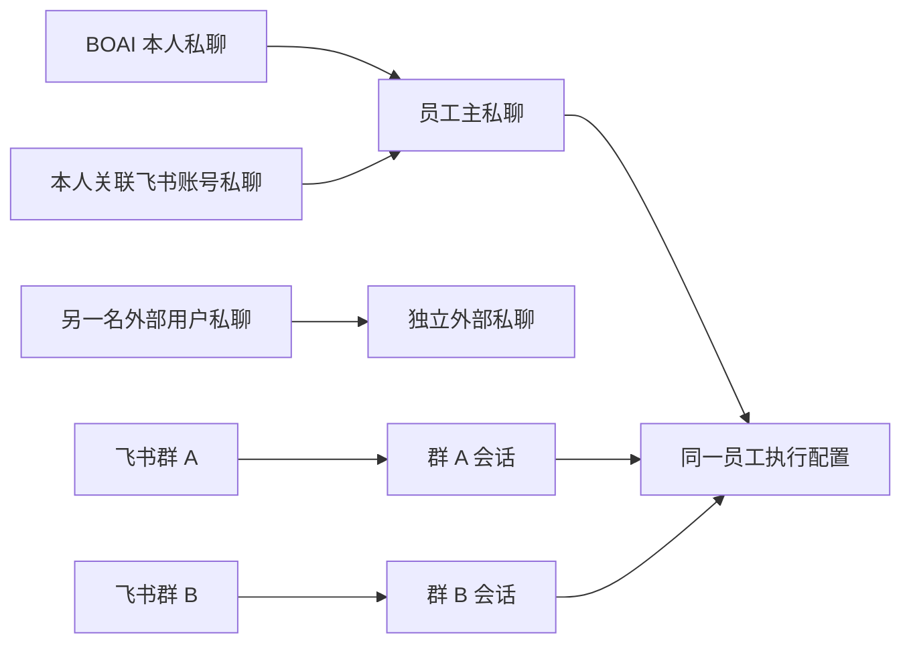

<!--
[INPUT]: 用户2026-10-14确认领域设计，并授权先文档后代码；已有员工、渠道、原生session和持久业务合同。
[OUTPUT]: 主私聊跨入口归一、独立群聊、本人账号关联、原消息回发及保守历史迁移合同；实际成绩唯一归02 §7.7。
[POS]: 第16组现行会话关系合同，替代02初版的每渠道独立私聊与§7.6暂缓实施。
[PROTOCOL]: 一旦本文件变化，必须同步更新Header，并上浮检查所属目录.folder.md；计划不代替实际验证。
-->

# 员工主私聊与群聊领域设计

确认及实施授权日期：2026-10-14。用户已确认：每名员工一个主私聊入口，每个群一个独立群聊入口；先落实本文，再按本文实现。领域词汇见[CONTEXT](../../CONTEXT.md)，实际源码、通过、失败和未认证范围只登记[02 §7.7](./02-开发计划与验收.md#77-主私聊与群聊领域实施2026-10-14)。

## 1. 会话关系

员工身份及执行配置属于员工。会话属于参与者共享的交流空间，渠道属于消息入口。员工可以参与多个会话，但本人对该员工的主私聊只有一个。

| 场景 | 会话与列表 | 执行上下文 |
| --- | --- | --- |
| 本人在 BOAI 私聊员工 | 员工主私聊，一个员工 item | 当前主私聊 |
| 本人关联账号私聊该员工的机器人 | 同一主私聊，同一份历史 | 同一主私聊 |
| 另一名授权用户私聊机器人 | 独立外部私聊，标明外部联系人 | 不得混入本人主私聊 |
| 员工在飞书群 A、群 B 被提及 | 两个独立群聊 item | 每个群分别保留上下文 |
| 同一飞书群有多名员工机器人 | 一个群聊，多名员工成员 | 群内每名员工各自执行 |
| 同一群不同消息回复链 | 同一群聊；回复链保存在消息来源 | 原消息回到对应回复链 |
| 自动化任务及核心助手历史 | 保留既有专用记录和历史入口 | 不把旧任务或核心组织历史改写成普通私聊 |

普通会话列表按真实房间展示，不通过去重姓名掩盖多份私聊。核心助手既有单一分组及其历史入口保持；自动化专用聊天继续归自动化历史，不能误并入员工主私聊。

## 2. 本人账号与权限

渠道绑定增加可选的「本人用户 ID」，使用该机器人对应平台的真实用户 ID；飞书/Lark 为该应用的 Open ID。用户明确填写并保存才建立本人关联，该 ID 必须在授权用户名单内。留空沿原独立外部私聊行为，不把授权名单第一项、唯一一项、同名联系人或首条消息推断为本人。

更换或清除关联只影响后续路由；历史已归一的消息不自动分拆或重新发送。新关联不能把旧主私聊转交给另一名用户。机器人身份和不同平台绑定仍各自核对。

本人关联消息进入主私聊，但保留平台发送者与渠道来源。外部入口不能冒充桌面命令审批、管理操作或预算追加；原 `senderId=user` 的桌面权限边界保持。界面可以辨识本人外部消息，不能因此扩大外部执行权限。

## 3. 房间与回复路由

主私聊由员工身份确定，优先沿用已有本地主私聊 ID；如果仅有已确认本人的渠道私聊，则沿用该房间作为主私聊。本地打开和渠道新消息都解析到这个房间。

外部群由平台、租户和群 ID 确定，忽略机器人绑定和单条回复链身份；群 A 与群 B、飞书与 Lark 不合并。群成员仍为实际参与的员工集合，平台提及决定本轮员工接收范围，不自动把核心助手加入普通群。

每次平台回发从触发消息或原 Work 的来源确定目标，核对平台、群/私聊、绑定、发送者和回复链。BOAI 私聊发起的普通回复只保存在 BOAI；飞书私聊或群消息发起的回复回原入口。群内本地手动消息首版同样只保存在 BOAI，不借「最近目标」进行隐式群广播。其他平台入口、其他群或另一名用户均不能收到本轮私聊回复。

多机器人群共用消息受理身份。被明确提及的每名员工使用自己的机器人回到同一群/回复链；重复事件、已发送或未知回执保持单次受理、不盲目重发。

## 4. 历史迁移与原生 session

已有本人渠道私聊只有在明确保存本人关联后才归一。迁移应在相关房间无正在运行、排队、待审批、未退出原生执行或未结束 Work 时进行；忙时拒绝并保留原配置，用户稍后保存。清理待核对房间不能迁移。

保留原消息、run、Work、材料、成果、回执和发送结果 ID；同事务迁移房间引用，记录原房间来源，按稳定时间/原顺序形成主私聊时间线。原文件路径与内容 hash 不变；成果单独保留原受管存储房间，预览、修订、备份恢复和 hash 清理核对归档关系后读取该原件，旧房间留下指向主房间的归档关系，不继续创建重复列表项。旧定位链接可读并提示归一位置，不能继续在归档房间受理新消息。迁移失败或保存结果未知遵守原请求核对，不单独重执行业务。

迁移不打开模型、启动原生进程或重新发送平台消息。旧原生 session 不拼接为一个虚假 session：合并历史时撤销受影响 session 的续用资格，下次明确新消息才从获准历史重建。未发生历史合并时，BOAI/本人飞书私聊使用同一房间、同一员工、同一执行配置，自然续用同一个原生 session。不同群和不同员工始终分开。

## 5. 实施与验收

1. 共享合同和渠道表单加入明确本人关联；保存版本、幂等回执、凭据隔离保持。
2. 主私聊解析、本地打开、群 ID 解析共用房间规则；旧房间迁移复用现有事务和业务记录，禁止另建通用 IM 框架。
3. 回发只用实际来源，去除最近目标回退；外部发送者来源完整保留。
4. 覆盖两种创建顺序、多个绑定、其他授权用户、多个群、同群多机器人/回复链、旧记录迁移、忙时拒绝、未知发送、重复事件、重启与原生连续输入。
5. 在隔离 Electron BDD 中验证配置、会话列表、同一时间线和实际消息处理；使用本地平台/模型协议夹具并标明与真实飞书的区别。保留截图/原件，按功能审阅合同生成报告。
6. 执行既有默认性能门槛；增加重复入站/本地开聊压力，检查房间、路由和监听器数量不随事件无限增长，观察有界运行内存。短期结果不提升为长期无泄漏认证。
