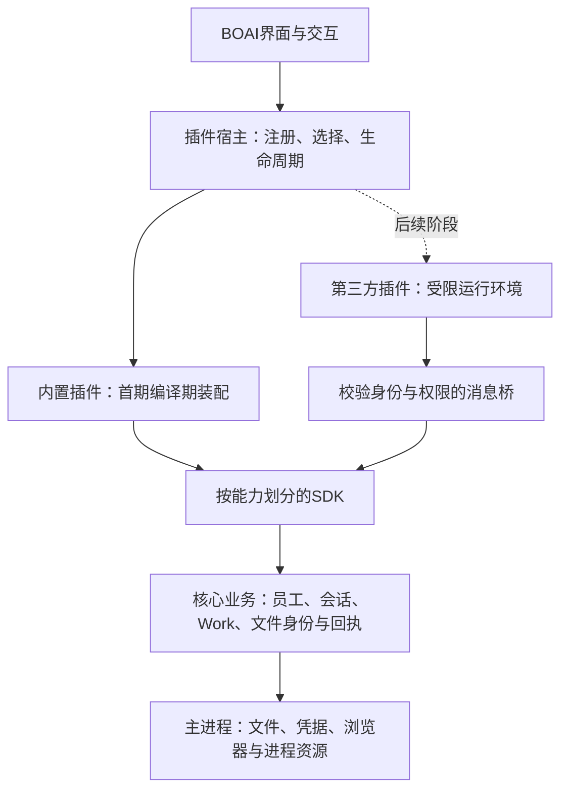

<!--
[OUTPUT]: 2026-10-16运行时插件首版已接线：Mastra主线、通用绑定、Pi RPC/共享ACP及受信独立包；实现/实际失败与未认证范围唯一归19组06，SDK仍为候选。
[INPUT]: 2026-10-15用户提出软件插件化；399f86ca代码与VS Code/Theia/JupyterLab/Electron官方资料。
[OUTPUT]: 宿主管理产品一致性、按类型扩展的应用插件草案；预览首试点，第三方运行隔离单独验证。
[POS]: 第19组整体设计；P1后续实施和实际验证见02，本文保留最初调研基线。
[PROTOCOL]: 修改时同步Header和所属.folder.md，并上浮检查spec索引。
-->
# 应用插件架构设计草案

**2026-10-16后续实施：** 本机Agent扩展按[05运行时插件合同](./05-Agent运行时插件协议与接入架构.md)及[06实施计划/唯一进度](./06-Agent运行时插件实施计划与验收.md)推进：保留Mastra主线，独立provider插件与共用ACP驱动，受信本地包安装已接入。首版源码和实际验证归06，本文原预览/主题成绩保持独立；市场和通用不受信代码沙箱另期。

## 1. 建议与范围

BOAI适合逐步采用插件架构。目标是让新增格式、界面能力和外部适配无需反复修改核心业务。把代码放进plugins目录本身不能达到这个目标；需要同时确定扩展接口、宿主职责、运行位置及生命周期。

建议顺序：**内置功能按插件接口装配 → 稳定接口与故障处理 → 第三方安装与隔离运行**。用户随后追问能否按此执行，已按说明落地有界P1；最新范围与实际成绩见[02](./02-内置预览插件实施.md)，第三方阶段未实施。

最初调研轮只形成设计；后续P1实施另见02，不把下方候选SDK全部记为完成。先前git cp授权已用于399f86ca，不自动覆盖此后新文档的提交/推送。

## 2. 现有代码提供了什么

核对基线为399f86ca；下列是已有实现，不是插件能力。

| 位置 | 已有职责 | 插件化影响 |
| --- | --- | --- |
| `src/main/preload.ts` | 向应用renderer提供完整DesktopApi请求/订阅桥 | 只能给受信应用使用，不能直接作为第三方SDK |
| `src/runtime/worker.ts`、`service.ts` | 装配AppService、引擎、凭据代理与业务请求 | 保留宿主装配；避免给插件暴露AppService或任意handle调用 |
| `src/runtime/contracts.ts` | AgentEngine和EngineContext | 已有执行适配接口，但上下文包含apiKey与大量宿主回调，不能直接公开给第三方 |
| `src/runtime/modules/workspaces/artifact-repository.ts` | 成果权限、原件读取、hash/版本校验和登记 | 继续掌握可信内容来源；不迁入某个PDF插件 |
| `src/runtime/modules/materials/material-repository.ts` | 材料原消息/权限/版本及原件核验 | 保留材料和成果不同的业务语义，由预览宿主统一呈现 |
| `src/shared/domain/file-preview.ts` | 格式分类、文本限额和固定二进制DTO | 当前二进制格式是封闭联合类型；真正扩展新格式还需调整内容交付接口 |
| `common/file-preview/index.tsx`、`binary-preview.tsx` | 格式分发、共用标题与查看器延迟加载 | 可改成声明式贡献注册和格式选择；现有Lody渲染器优先复用 |
| `detail-panel/artifact-tab.tsx`、`material-tab.tsx`、`use-file-edits.ts` | 固定来源、稳定阅读、原请求及交付后切版 | 属于预览宿主流程，不能每个查看插件再实现一遍 |

`LocalSkillCatalogService`已经能发现本机Agent插件里的Skills。这是员工能力来源管理，与BOAI应用插件是两个对象，保留各自身份和生命周期。

## 3. 成熟方案的参考方式

| 参考 | 可借鉴的部分 | BOAI取舍 |
| --- | --- | --- |
| [VS Code Extension Host](https://code.visualstudio.com/api/advanced-topics/extension-host) | 按运行位置选择宿主、声明激活条件并按需加载 | 学习扩展点和运行职责；不为普通预览复制整套IDE平台 |
| [VS Code Custom Editor](https://code.visualstudio.com/api/extension-guides/custom-editors) | 分离文档模型与视图，区分只读和可编辑provider | 首期使用只读预览合同，选区请求由BOAI宿主办理 |
| [Theia Extensions and Plugins](https://theia-ide.org/docs/extensions/) | 编译时产品扩展与运行时可安装插件是两种机制 | 内置装配先行；不承诺兼容VSIX，也不整体迁移到Theia |
| [JupyterLab Develop Extensions](https://jupyterlab.readthedocs.io/en/stable/extension/extension_dev.html) | 明确requires/optional/provides和激活关系 | 依赖可检查；初期只依赖宿主合同，不建立任意插件相互调用网络 |

一个重要事实：[VS Code扩展宿主拥有与应用相同的权限](https://code.visualstudio.com/docs/configure/extensions/extension-runtime-security)。进程分离改善故障和性能隔离，但不自动提供文件/网络权限沙箱。BOAI的细粒度能力授权是自己的设计，不能说从VS Code获得了该保障。

## 4. 架构与职责

本文用“插件”表示能被识别、装配、启停并贡献功能的包；“扩展点”是宿主接受某类能力的固定接口；“SDK”只包含允许插件使用的合同；“宿主”负责校验、调度、资源与产品一致性。一个包可以贡献多个扩展点，扩展点之间不共用一个万能接口。

这是一张职责图，不表示首期增加新的进程。现有main/runtime/renderer分层继续沿用。业务模块仍可以独立维护、注入依赖和测试；只有需要替换、选择或独立分发的能力才引入插件合同。

| 能力 | 建议归属 | 理由 |
| --- | --- | --- |
| 员工/会话身份、Work状态和来源/回执 | 核心业务模块 | 需要唯一事务规则，不允许插件自报“已交付”绕过宿主 |
| 文件权限、版本/hash、发布/清理/备份 | 核心业务模块与平台宿主 | 插件卸载不能导致原文件或历史不可管理 |
| 文件格式预览 | 首期插件 | 已有文本/PDF/Office/图片等实际不同实现 |
| 主题 | 后续独立扩展点 | 优先受限设计变量与资源声明；不授予任意全局脚本/CSS权限 |
| 导入/导出、转换 | 后续插件 | 通过输入授权和受管输出发布，不能覆盖原件或随意写路径 |
| 渠道协议、模型提供商、工具 | 后续分别设计接口 | 各自涉及外部副作用/凭据/重试，不能套用预览启停规则 |
| 应用布局、标题/导航、员工选择和修改请求 | 首期宿主 | 保持一致交互，插件贡献内容或动作，不重建整个应用 |
| 本机Agent原生循环、Skills/MCP/插件 | 保持已有运行合同 | 不因应用插件化重做大而全工具适配，或增加BOAI本机用量/时长预算 |

SDK是若干小接口，例如preview、commands、settings、storage，而不是把`AppService`包成一层再公开。预览插件首期只需要内容、视图状态和选区事件。

## 5. 文件预览试点

### 5.1 宿主和查看插件分别做什么

插件负责渲染、格式特有的工具栏、选区/位置与局部视图状态。宿主负责文件标题、版本历史、请求员工修改、结果关联及自动切版。PDF插件提供页码/原文，Excel插件提供工作表/单元格，均只是定位信息，不授予业务修改权限。

继续直接使用现有Beautiful UI Selection Actions与Lody查看器；插件化只改变接线和职责。Markdown预览所需的材料引用也通过受控来源解析接口取得，不把完整ConversationDetail交给查看插件。

### 5.2 最小合同

以下为设计名称，不是已发布SDK。

| 合同 | 内容与约束 |
| --- | --- |
| `PluginManifest` | 稳定id、包版本、SDK兼容范围、入口、扩展点与所需能力；信任等级由宿主来源策略确定，插件不能自称trusted |
| `PreviewContribution` | providerId、支持的媒体类型/后缀、可选格式检测、能力声明（selection/search/compare）；声明负责发现，不获得读取权限 |
| `PreviewDocument` | 不透明的document/handle身份、固定revision/hash、名称/媒体类型/大小、授权代际；不包含任意路径或数据库对象 |
| 内容读取 | 首期复用已核验文本/字节；新增格式通过宿主只读内容句柄按限额读取。只绑定当前文档，禁止传任意file path |
| 视图会话 | viewId与独立page/zoom/scroll等轻量状态；同一文档可有多个视图，取消一个不销毁另一个 |
| 选区事件 | viewId、document版本、选中文本/位置；宿主校验大小和当前来源，不能把插件报告当权限或精确替换证据 |
| 资源释放 | 取消信号、资源登记、dispose；字节、Object URL、worker、订阅必须可收回 |

内置React查看器可使用内部渲染适配接口。未来第三方UI使用序列化消息和隔离视图，不能把React组件或函数跨进程传输。两者共享业务DTO和能力含义，不承诺共享同一个UI实现。

格式匹配顺序：用户已选择且仍有效的provider → 宿主规则中的精确格式匹配 → 保底文本/图片或文件信息。排序确定且可解释，不允许插件自报无限priority抢占所有文件。不匹配/不兼容与运行失败分别显示，错误不静默变成另一份文件。

### 5.3 保留刚修好的阅读行为

1. 文档身份由固定source/version/hash决定。普通执行/聊天变化只更新状态或后台核源，不创建新视图、不重新发送相同字节。
2. 源变化和进度变化使用不同的宿主事件。宿主可以把原有changed转换为核验结果；首期不要求重写全应用事件总线。
3. 本次明确文件请求完成交付后，宿主核验新版本，再进行一次视图切换；查看插件不根据文件名或时间猜结果。
4. 隐藏时停止主动读取和重资源工作，宿主可保留有界页码/滚动状态；隐藏的第三方渲染进程可被释放。
5. 清理/撤权立即使句柄失效并关闭正文。每个读回执含授权代际，迟到结果不得回填；已交给进程的数据不能靠撤权“收回”，需要释放其视图和缓存，不能承诺消除已被恶意插件复制的数据。
6. 当前provider与包版本在视图期间固定。安装新插件或升级不能在阅读中抢占；下一次明确打开/切换再选择。

## 6. 运行模型与权限

| 类别 | 初期运行方式 | 保障范围 |
| --- | --- | --- |
| 内置受审插件 | 构建时登记、按需import，使用受控接口 | 代码组织与契约约束；同renderer并非恶意代码隔离 |
| 第三方展示插件 | 后续独立沙箱渲染环境，无产品preload，独立来源和受控消息桥 | 必须验证DOM、导航、网络、存储和资源限制；不能直接import进主应用 |
| 第三方计算/转换 | 后续受限Worker/WASM或单独受控宿主，按能力选择 | Worker/独立Node进程本身不等于安全沙箱；涉及Node/原生/任意命令时另定信任策略 |

Electron提供[renderer进程沙箱](https://www.electronjs.org/docs/latest/tutorial/sandbox)及[安全配置指南](https://www.electronjs.org/docs/latest/tutorial/security)。未来第三方实现至少需要禁用Node集成、启用contextIsolation/sandbox、受控CSP与网络策略、校验消息发送者，并且不能复用可访问完整`window.boai`的preload。具体载体与攻击面测试是第三阶段交付条件，本文不宣称已实现。

权限实际执行：插件能力声明 ∩ 用户授权 ∩ 当前文档/员工/工作权限。每次宿主调用重新核验，插件id由通道绑定，不能相信消息自带的id。密钥默认由宿主代用，或授予单独绑定的受信连接能力；不发送完整SecretStore/API key清单。消息有请求id、schema与大小上限，错误结构和取消行为固定。

BOAI插件、员工、当前Work是不同的执行主体；“安装了插件”不等于“某员工可调用它”。浏览器登录状态仍由应用统一宿主掌握，不能因插件化复制到多个渠道或员工插件。

插件渲染/激活的资源限制不改变本机Agent无BOAI用量/时长预算的规则，也不能把UI超时当作员工工作已经取消。

## 7. 生命周期、状态与兼容

- **按需激活**：先读取清单和检查兼容，再因具体扩展点加载。没有打开PDF时不加载PDF解析器；默认无全局通配激活。
- **异常收尾**：激活失败撤销本次已登记的能力，记录具体插件和版本；只读预览回退文件信息/可用保底查看器。受信插件ErrorBoundary只覆盖渲染异常，不能隔离死循环/OOM；第三方阶段另测进程故障。
- **停用/升级**：先停止新调用，再释放视图/取消纯读取。正在执行的外部副作用必须沿原任务/回执收尾；不把“停用按钮已点”当成进程实际退出，不自动重发未知操作。
- **升级切换**：新包预校验并暂存，活动视图保留旧版本，安全点再启用新版本。首期允许要求重开视图或重启应用，不承诺任意插件热替换。
- **依赖**：首期只有宿主SDK依赖，禁止跨插件内部import。后续确有需求再增加显式服务合同，缺失/版本不兼容/循环依赖在激活前失败；不用隐式全局服务定位器。
- **数据**：插件设置与私有状态按pluginId分区、schema版本化；缓存关联真实文档来源/授权代际，清理来源时一并失效。插件不得直接改主业务表；卸载默认保留设置供重装，清除私有数据是独立明确动作，核心原件不属于插件。
- **迁移与回滚**：插件私有状态迁移需快照/事务或可恢复日志；新状态不能被旧版本理解时拒绝直接降级，不以回滚包文件冒充数据回滚。首期预览插件只有可丢弃视图状态，避免引入复杂迁移。
- **版本合同**：清单声明SDK兼容范围、协议版本与能力；发布前做运行时握手，TypeScript类型不能代替schema校验。公有SDK稳定后才承诺兼容期限；初期内部试验接口不得宣传为第三方稳定API。
- **观测**：记录插件id/版本、激活耗时、错误、资源释放与调用归属，默认不记录文档正文或凭据。能定位“哪个插件失败”，不把宿主错误全部归给插件。

## 8. 分阶段实施与门槛

| 阶段 | 交付 | 完成门槛 |
| --- | --- | --- |
| P0 接口与依赖设计 | 确认首期分发范围，列出当前预览数据/调用、定义宿主与provider合同 | 至少两个实际不同查看器能使用同一小接口，权限/版本责任不外泄；仅设计不能计为实现 |
| P1 内置预览插件 | 内置清单、registry、确定格式选择、按需激活、文本/PDF/Office适配、保底视图 | 新增一个实际预览provider不改ArtifactTab/MaterialTab；已有格式、选区修改、自动切版和未知回执回归通过 |
| P2 第二类扩展 | 从主题或导入导出中选择一个实际需求，整理SDK和构建装配 | 证明插件宿主可复用；不为每类扩展复制管理器，也不强迫共用预览生命周期 |
| P3 第三方试验 | 本地包安装/版本校验、隔离宿主、能力授权、升级停用与开发调试 | 未授权读取/网络/消息伪造被拒绝；崩溃、清理、升级和宿主重启有实际验证，之后才考虑商店 |

P1保持现有顶级目录，不先改成monorepo。可把协议放在shared下、装配放在对应宿主层、内置provider放在renderer的独立目录；公开SDK包只有出现实际独立开发者后再提取。具体路径在实施设计确认，本文不创建空目录或通用框架。

P1验证矩阵：新增格式接入；同名不同来源隔离；多视图独立状态；聊天连续更新不重挂载；本次交付只切一次；旧版/文本diff可回看；隐藏停读；撤权/清理/迟到回复；provider加载失败与不兼容回退；禁用后重新打开；原修改请求未知重启不重放。使用现有Vitest与Electron BDD，不增加另一套测试入口。

## 9. 最初调研状态与后续实施

第三方阶段的范围尚未确认。若提前要求支持外部安装，P3隔离/安装/权限合同必须提前，不能将内置registry当作第三方架构完成。主题与导入导出哪个作为第二类扩展，也应由实际产品需求决定。

最初调研轮完成代码依赖核对和上述官方资料研究，新增设计文档，未实施或运行产品测试。随后P1已有实际代码与新批次验证，唯一进度归02；原文件预览业务合同仍归第8组14。
