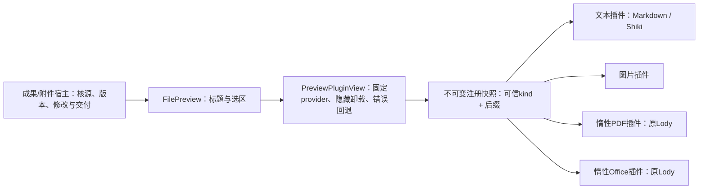

<!--
[INPUT]: 用户追问当前能否按插件设计执行；01草案与现有文件预览合同。
[OUTPUT]: P1内置预览插件实施范围、代码合同、接入方式和本轮实际验证；第三方能力单列。
[POS]: 第19组P1唯一实施进度；不将草案或此前预览成绩冒充本轮验收。
[PROTOCOL]: 变化同步Header和所属.folder.md，并上浮检查spec索引。
-->
# 内置预览插件实施

## 1. 当前决策

2026-10-15用户追问“你会怎么建议？现在能照这种plugins设计执行吗”。本轮按已说明的第一阶段落地：把现有文件预览以受审内置插件装配，验证扩展接口；不把该问题解释为允许整体重构运行时或开放第三方代码执行。

沿用现有成果/材料仓库、hash/版本与权限校验、Beautiful UI Selection Actions、原员工请求/回执和交付后自动切版。没有新增数据库表、依赖包、安装界面或额外运行进程。未提交/推送本轮修改。

## 2. 实际结构



| 位置 | 职责 |
| --- | --- |
| `common/file-preview/plugins/types.ts` | 内部React合同、只读内容与清单；无路径读取、DesktopApi、业务身份或执行权限 |
| `plugins/registry.ts` | 去重、API兼容/禁用诊断、确定格式选择、稳定组件定义 |
| `plugins/builtins.tsx` | 四个内置插件装配；文本/图片轻量组件直接可用，PDF/Office按需import |
| `plugins/pdf.tsx`、`office.tsx` | 直接复用既有Lody及其资源释放；替代原`binary-preview.tsx`格式分发 |
| `plugin-view.tsx` | 当前视图固定provider、Suspense、局部ErrorBoundary、共用标题框架 |
| `index.tsx` | 将原DTO归一后交给插件宿主，继续接原选区与标题操作 |

这是一个实际预览扩展点，尚不是跨所有应用能力的通用插件管理器。未来第二类实际需求出现后，再提取可共用的清单/装配能力，避免先建空框架。

## 3. 运行合同

- 内部清单：`id`、`version`、`apiVersion`、可信内容`kinds`及可选`extensions`；当前只接受API版本1，不声称已实现semver范围协商。
- 重复或空id属于构建装配错误，立即拒绝。不同API版本/宿主禁用项不进入候选，分别保留诊断，不执行加载器。
- 同时匹配宿主已核验的kind及声明后缀；后缀精确项先于通用kind，相同等级按稳定id排序，与注册顺序无关。没有任意priority，也没有新建用户选择插件界面。
- `unsupported`永不交给插件重新解码，保留宿主大小/编码/格式门禁。新增已支持内容类别的查看器只需声明与装配；任意新二进制格式仍需要宿主内容交付合同，不承诺仅注册就能取得未知字节。
- 注册表只缓存代码定义，不缓存文档。源身份仍由上层`source id/revision/hash`的React key固定；当前视图选中的provider不会因注册表替换而改变，关闭/隐藏后重开才重选。
- 同版后台核源保留原内容/字节引用与组件身份；每个视图有独立React状态。隐藏卸载其组件，沿原查看器effect清理worker/Object URL/订阅；首期没有额外的通用资源API。
- 加载/渲染失败局限于当前预览，保留文件标题与宿主操作。正文不回显异常详情；DOM记录插件id/版本/失败状态，方便技术定位。ErrorBoundary不处理死循环/OOM，异步事件错误仍由原查看器处理。
- 清理或来源变化沿原宿主关闭/替换正文；迟到模块加载只取得代码，不持有旧文档回执，因此不能复活已卸载正文。
- 内置代码与应用同renderer运行，接口约束不是恶意代码沙箱。外部安装、协议schema校验、权限隔离、热升级、私有持久状态迁移均留到后续阶段。

## 4. 接入一个查看器

将内部组件作为独立模块，实现`PreviewRendererProps`；在`builtinPreviewPlugins`增加声明即可，业务页`ArtifactTab`和`MaterialTab`不需要新格式分支。例如已通过宿主UTF-8门禁的专用文本格式可使用：

```ts
{
  manifest: {
    id: 'boai.preview.example', version: '1.0.0', apiVersion: 1,
    kinds: ['text'], extensions: ['example'],
  },
  load: () => import('./example'),
}
```

默认组件只渲染`content`正文，宿主在加载/错误边界外保留共用标题/修改入口，组件卸载时释放自己创建的资源。既有同步文本查看器为保留预览/源码切换状态，适配声明`ownsHeader: true`并组合宿主`header(toggle)`；惰性加载器禁止声明该选项，避免加载结束重建标题和关闭菜单。选择文字仍进入宿主原Selection Actions；不能通过组件声明直接改文件或发送员工请求。例子不代表已新增某种产品文件格式。

## 5. 实际验证

本轮5个相关模块80项通过，包括13项新增插件合同/React生命周期测试：扩展接入、匹配与注册顺序、声明快照、兼容/禁用、unsupported门禁、惰性激活、字节与正文身份、隐藏释放、重开重选、同名多源独立视图、加载/渲染故障、迟到模块加载及懒加载完成时标题菜单状态保持。

初次类型检查发现新测试Promise回调允许`undefined`，已改成非空组件类型；最终类型检查、局部renderer ESLint、源码构建及BDD生成通过。构建仍有既有大chunk提示；未做打包体积优化。

首批Electron 11场8通过3失败：PDF/XLSX/PPTX的懒加载完成时替换标题，文件记录菜单在点击过程中脱离DOM；不是文件解析错误。修复为通用标题在正文Suspense/ErrorBoundary外，并增加模块回归，失败记录保留。最终11场全部通过（77.9秒、零重试）：四二进制格式/后台核源、长文稳定阅读、其他入口新版本不抢阅读、同家族diff和清理迟到隔离、代码/附件修改自动切版及未知回执重启恢复。首批缺运行前构建摘要；最终运行前记录1341份输入，465份dist运行后hash不变，98份资源独立核验，最终报告零留证缺口。

本轮使用原真实工具协议夹具、生产Electron/UI/IPC/文件原件，不调用真实付费模型，不以此替代员工模型效果认证。图片插件沿原查看器，本轮没有新增图片桌面场景；第三方运行/安装包/性能压力/人工视觉认可不在本次成绩中。具体资源与结果归[本轮审阅](../../reviews/2026-10-15-preview-plugins/README.md)。

## 6. 剩余阶段

P2第二类扩展尚未选择；P3第三方本地包安装/能力授权/隔离运行/升级和故障恢复尚未实现。首期禁用是宿主装配参数，没有用户插件管理页；需要重开视图生效，没有任意运行中热切换承诺。P1不构成整个软件插件平台完成。
