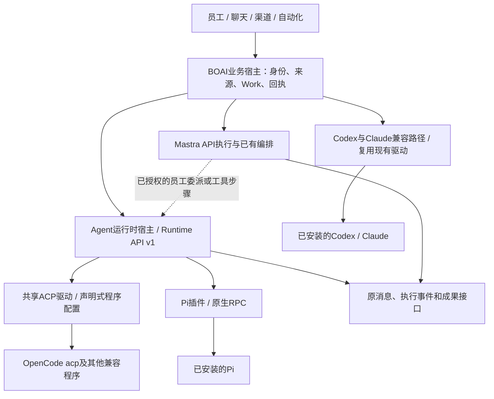

<!--
[OUTPUT]: 2026-10-28数字员工本机Agent接入为已有产品；19组16明确插件边界，17记录内置框架替换待办，当前继续Mastra、不启动重构。
[OUTPUT]: 2026-10-17 Magpie隔离网关三协议路由/并发/工具后进程故障9场通过，36/39请求与SQLite/实际退出已核对；当前归20组02 §6.19，完整goal未完成。
[OUTPUT]: 2026-10-17文档同步：v2私有模型来源与原生配置身份检查，v1兼容；Pi/OpenCode两模式代表批次及剩余归20组02 §6.10/6.12，非完整插件认证。
[INPUT]: 2026-10-16用户要求保留Mastra主线，将Pi/OpenCode等本机Agent接入改为插件式设计；现有第13组原生合同、第19组内置平台与官方协议。
[OUTPUT]: Agent运行时扩展点、Runtime API v1候选、能力协商、独立包与宿主职责；首版宿主/独立包/Pi/ACP已接线，实际验收及缺口归06。
[POS]: 第19组运行时插件架构合同；补充01/03及第13组10/11，实现边界与真实程序验证分开。
[PROTOCOL]: 一旦本文件变化，必须同步更新Header，并上浮检查所属目录.folder.md；实现事实与计划分开。
-->

# Agent运行时插件协议与接入架构

2026-10-28确认两个独立边界：[16 本机Agent插件与数字员工产品边界](./16-本机Agent插件与数字员工产品边界.md)说明现有员工绑定/执行模式，品牌包装与实际能力分别核对；[17 内置执行框架可替换边界与待办](./17-内置执行框架可替换边界与待办.md)仅列后续Mastra/Pi/DSH适配范围，当前继续使用Mastra，不启动重构。 已有数字员工能力不因独立包包装尚有差异而重新列为待开发；下方历史基线按日期阅读。

2026-10-17增量：v1原生合同继续兼容；v2支持[私有模型来源](./07-运行时插件开发接入.md#runtime-api-2明确模型来源)及可选[原生配置身份检查](./07-运行时插件开发接入.md#runtime-api-2原生配置身份)。Pi/OpenCode明确来源实际批次见[第20组02 §6.10](../20.模型网关接入/02-实施计划与验收.md#610-2026-10-17piopencode私有模型来源与实际调用)，原生来源批次见[§6.12](../20.模型网关接入/02-实施计划与验收.md#612-2026-10-17原生来源指纹与四运行时实际文件闭环)；当前验证见[§6.19](../20.模型网关接入/02-实施计划与验收.md#619-2026-10-17实际网关路由并发与工具后进程故障)，最近生产修复仍归§6.17；Codex首次配置及API来源取消修复不替代Pi/OpenCode迁移认证，其他业务/故障及应用认证仍未完成。下方2026-10-16首版结论和旧失败按原时点保留，不把新增批次扩大为完整插件认证。


## 1. 首版决策与当时状态（2026-10-16）

2026-10-16用户要求先更新文档：继续以Mastra为主，将Pi、OpenCode及后续本机Agent通过插件接入，减少每新增一种程序就修改核心的维护成本。用户随后明确“实现代码”，现已接入通用宿主、受信本地包、Pi RPC及共享ACP。旧Codex/Claude保留兼容执行路径。真实Pi模型调用受原生登录失败阻塞，OpenCode实机未验证。实施顺序与本增量唯一进度见[06](./06-Agent运行时插件实施计划与验收.md)。

确定采用**统一宿主接口 + 独立协议插件 + 可复用协议驱动**。BOAI统一连接、会话、输入、事件与生命周期语义；插件负责上游协议差异。兼容ACP的程序优先共用ACP驱动；Pi使用原生RPC；已有Codex/Claude驱动逐步按同一接口装配，保持已经接入的原生行为。

插件化的验收标准是：在已支持的能力范围内，安装一个独立Agent插件包即可完成发现、配置、验证和聊天，不修改`AppService`、员工表单、聊天页面或核心品牌枚举。新增真正不同的能力可以演进版本化接口，但不能以插件私有字段让核心重新出现品牌分支。仅把文件移到`plugins/`不算完成。

插件化减少BOAI核心承担的协议维护；上游协议变化仍由对应插件维护者处理，共用驱动只维护一次。不承诺任意CLI、任意版本无需适配，也不把“扫描发现”当作“已可执行”。

## 2. Mastra、业务宿主与插件的位置



Mastra继续负责API员工及其既有工具/工作流。当前`runtime/worker.ts`装配`MastraEngine`，`AppService.engineFor()`已经将原生员工分到独立驱动；此设计扩展该边界，不替换Mastra，也不要求每条本机消息先经过另一个模型判断。

Mastra员工需要委派本机员工时，复用BOAI已有员工/Work委派；确需通用工具或工作流步骤时，调用同一运行时宿主。步骤必须固定目标员工、来源及原请求回执；不能让Mastra自动重试把“结果未知”的本机调用变成第二次执行。不得把Pi包装成普通`LanguageModel`，丢失其会话、工具执行及取消语义。框架工具支持参考[Mastra工具文档](https://mastra.ai/docs/agents/tools)，本地API以已安装`@mastra/core`的类型和内嵌文档为准。

| 对象 | 负责什么 | 不向插件转交的权威 |
| --- | --- | --- |
| BOAI业务宿主 | 员工、会话、来源授权、调度、Work、材料/成果、持久回执 | 数据库事务、渠道外发判断、业务终态 |
| Mastra | API模型循环及现有工具/工作流 | 不替本机Agent重做原生循环 |
| 运行时宿主 | 选择provider、连接验证、会话映射、请求去重、进程/资源租约、事件核验 | 当前绑定版本、插件版本、来源代际、未知请求处理 |
| 运行时插件 | 发现声明、协议握手、上游会话与输入转换、真实事件/错误映射 | 不直接写业务表，不自行发布聊天或宣告成果已登记 |
| 原生Agent | 登录、模型选择、原生工具/Skills/扩展与自主执行 | BOAI产品权限只管产品数据，原生权限仍按用户所选配置 |

BOAI应用插件与Pi/OpenCode自身的扩展是不同对象。安装BOAI适配插件不自动安装Agent、不自动安装其扩展，也不复制登录token。

## 3. 协议选择与复用优先级

| 程序/场景 | 接入决策 | 复用和验证边界 |
| --- | --- | --- |
| Pi | `pi --mode rpc`，stdin/stdout双向JSONL | 插件处理Pi命令/响应/事件；不将`--mode json`事件输出模式当作完整双向控制 |
| OpenCode | 首选`opencode acp`，使用共享ACP驱动 | 程序名、参数与发现规则可声明；持续session、审批、取消及产品工具能力须逐项验证 |
| 其他ACP程序 | 同一ACP驱动 + 独立provider声明 | 执行权限取握手能力及用户配置，不能只按“支持ACP”开启全部产品入口 |
| Codex / Claude | 现有app-server / stream-json兼容执行路径 | 优先包装现有实现，保持原生能力和已验证回执，不先重写为ACP |
| OpenCode原生服务 | ACP确实缺少已确定必要能力时，独立选择SDK/HTTP事件适配 | 复用官方SDK；先记录具体差异，不同时默认维护两条驱动，不在失败后静默切换 |
| 远程Agent / A2A | 独立后续扩展 | 不作为添加本机Agent的先决条件；涉及远程身份/授权/任务语义时另定合同 |

OpenCode官方提供ACP子进程方式，亦提供JS/TS SDK和HTTP服务/SSE。[ACP说明](https://opencode.ai/docs/acp/)、[SDK](https://opencode.ai/docs/sdk/)、[Server](https://opencode.ai/docs/server/)。本轮只核对官方文档，当前PATH未找到OpenCode，尚未做本机握手或业务验证；官方也列有部分slash命令限制，不能写为BOAI全能力已支持。

Pi已安装版本为`@earendil-works/pi-coding-agent@0.85.1`。核读随包`docs/rpc.md`：支持prompt、steer、follow_up、abort及会话操作；请求id用于关联响应，不证明上游具备持久幂等。[官方RPC入口](https://github.com/earendil-works/pi/blob/main/packages/coding-agent/docs/rpc.md)。本机文档SHA-256为`15fcd26bee72777b373fd5f2edd77091a01cadd4de95e48b08422ced0552a28d`；后续开发以实际安装版本和固定上游源码为准，不能仅跟随main文档。

选择规则是“原生标准协议能满足则共用；确有差异则留在插件内”，不建设自动猜测输出格式的万能适配器。ACP、Pi RPC和Claude stream-json各有不同帧结构，JSON只是编码方式。

## 4. 共同清单与配置

沿第19组应用插件目录和设置管理新增`agent-runtime`贡献，不另建一套同名插件管理器。原预览/主题插件继续使用原生命周期。**现已兼容v1 preview/theme与v2 agent-runtime**：首版每个运行时包一个provider；不能只提高全局版本常量导致原六个插件全部不可用。运行时接口独立采用`runtimeApiVersion: 1`，当前仍为候选合同。

```json
{
  "id": "boai.runtime.pi",
  "version": "0.1.0",
  "apiVersion": 2,
  "name": "Pi",
  "description": "使用本机已安装的 Pi。",
  "contributions": [{
    "type": "agent-runtime",
    "providerId": "pi",
    "runtimeApiVersion": 1,
    "driver": { "kind": "module", "entry": "dist/provider.mjs" },
    "discovery": { "commands": ["pi"] },
    "configSchemaVersion": 1,
    "configSchema": { "type": "object", "additionalProperties": false, "properties": {} }
  }]
}
```

示例中的`entry`只允许包内规范化相对路径，安装时核对真实路径与包hash，拒绝越界/符号链接逃逸和URL模块。程序路径、工作目录、登录来源引用及模型/权限选择由宿主公共表单提供；`configSchema`仅补充插件特有字段，不存密钥或嵌入UI代码。

OpenCode等ACP配置采用`driver: { kind: 'builtin', id: 'acp' }`及声明式`discovery: { commands: ['opencode'] }`与`launch: { args: ['acp'] }`，无自有执行代码也可成为独立插件包。`builtin`仅指宿主明确提供的协议驱动，不允许跨插件内部import或任意npm依赖解析。宿主校验启动命令和参数数组，以无shell方式解析实际程序并固定hash。

宿主执行已启用插件的**声明式只读发现规则**，不在扫描时加载任意插件代码、执行命令、登录或联网安装。显式“测试连接”才允许加载/启动所选provider并做协议握手；模型探针必须是独立明确动作。匹配冲突由用户选择并固定provider，不按名称或扫描顺序静默换绑。

连接状态分别记录：程序已发现、插件未安装/停用、协议待验证、可用、程序已变化、登录不可用、能力不支持。未知信息如实未知。界面显示具体下一步，不把多个状态压成一个灰色“不能添加”。

## 5. Runtime API v1候选

这是BOAI与插件的薄接口，不是新的模型框架，也不强制上游实现同一种线协议。下表为原目标语义；首版具体DTO/方法以[07开发接入](./07-运行时插件开发接入.md)及生成SDK为准。运行时模块通过独立插件进程的版本化消息桥调用，数据均采用可序列化DTO，不向外暴露`EngineContext`、`AppService`、SecretStore或任意`handle()`。

| 方法/数据 | 输入与输出 | 约束 |
| --- | --- | --- |
| `probe` | 已选连接/程序引用 → 实际程序版本、协议、能力与验证结果 | 不提交模型任务；可选模型目录未知不等于连接失败 |
| `openSession` | 宿主scope、工作目录、配置快照、可选原生session引用 → session句柄 | 创建/续用结果必须明确；不能私自接入用户外部个人聊天 |
| `submit` | session句柄、稳定requestId、原文/附件投影、配置与授权代际 → 受理结果与事件流 | 返回accepted/rejected/unknown；accepted须有上游证据，写入stdin不等于受理 |
| `sendInput` | 本轮追加/下一轮排队/指定待决action答复 | 按已协商能力分别处理；普通提问不伪造原生待决action |
| `interrupt` | 精确session/请求/租约 → 取消请求回执 | 取消受理与实际idle/退出分开；不能中断其他员工 |
| `inspect` | 原请求、原生session及可选事件游标 → 可核对状态 | 只读，不重发业务；上游无法确定时返回unknown |
| `closeSession` / `dispose` | session或插件实例 → 资源释放事实 | 不删除业务历史/原件/外部登录；不得释放另一实例资源 |
| `RuntimeEvent` | eventId、session/operation关联、类型化payload、可选原生引用 | 宿主为流补稳定接收序号，核对归属并去重/持久化 |

`requestId`、`operationId`、原生turnId、工具callId分别建模，不能相互冒用。`submit`前宿主登记意图，收到可靠证据后记录受理；上游没有幂等和查询能力时，断连只能记unknown，不承诺恰好执行一次。消息桥本身也不能为提升可用性自动重试未知的submit。

目标事件集合：`input.accepted`、`message.delta`、`message.completed`、`reasoning.delta`、`tool.started/updated/completed`、`action.required/resolved`、`operation.completed/failed/cancelled`、`session.idle`、`diagnostic`。含义分别映射现有执行事件及消息发布接口；streaming正文与最终消息按稳定身份更新，不新增重复上下文消息。

没有上游eventId时，插件在一次连接内分配稳定序号；重连若无法获得原生游标/消息身份，不拼接重复增量冒充完整正文，改为核读可获得的最终快照或标记缺口。未知普通通知进入有界诊断；未知必需审批/协议请求明确失败并说明能力缺口，不静默同意。

后续稳定版错误应统一返回`code`、可显示说明、`acceptance: rejected | accepted | unknown`及关联操作身份；传输超时不自动产生可重试结论。`unsupported-capability`只拒绝相关操作，`incompatible-protocol`拒绝对应连接，`source-invalidated`由宿主执行既有撤权收尾。可选字段/事件可向后扩展；改变受理、取消、来源或持久session语义必须升级Runtime API主版本，兼容范围与合同测试随插件包发布。

消息桥在握手时交换接口版本、schema版本和实际能力；所有跨进程消息做运行时校验、长度/附件边界与请求关联校验。接收身份绑定实际通道/租约，不能相信插件payload自报员工ID。日志不记录登录token和未经筛选的原始私有字段。

首版实现差异：每次调用一个固定provider进程，`services`绑定该run，正文/工具使用块ID/callId，受理用稳定requestId。`submit`最终返回正文；受理与idle通过独立事件送达。原生待决问题走action回调，收到后续原生事件才记录`action.resumed`。宿主在原Run/session保存受理和未知状态，当前错误线上仍为说明字符串，完整code/acceptance信封及跨连接事件游标尚未冻结。跨进程帧已有严格schema/大小/关联核验；无自动重连及重放。`sendInput`可选方法已定义，普通UI仍沿宿主队列，不宣称已接入活动steer。

## 6. 能力协商与产品资格

静态声明仅说明插件可能提供什么；实际能力取“插件实现 ∩ 当前程序握手/版本 ∩ 所选配置”，授权再由宿主核对。字段分为supported/unsupported/unknown，并保留限制/取源，不能仅凭品牌默认全部支持。

| 能力组 | 至少区分的内容 | 不支持时的行为 |
| --- | --- | --- |
| 聊天/session | 持续输入、重启续用、查询、独立会话 | 明确限制；不得每轮无提示清空上下文 |
| 运行中输入 | steer、follow-up、原生待决输入 | 无steer则由宿主可靠排队到下一turn，普通发送不取消原轮 |
| 内容与事件 | 文本、图片、文件引用、工具过程、真实返回思考 | 附件不支持时说明，不能悄悄只发送正文 |
| 交互与终止 | 审批/问题的类型、支持的答复范围、中断、idle和资源退出 | 必需审批无法回应则阻止该能力，不用默认同意绕过 |
| 配置与信息 | 模型/权限选项、原生session引用、可选目录 | 可选信息未知不挡已有聊天能力，不伪造容量/模型身份 |
| BOAI产品桥 | 原消息发布、成果登记、员工委派、自动化管理、应用浏览器 | 按实际桥接逐项开放；缺失不能称为完整员工交付支持 |

产品桥复用`createNativeProducts`等已有产品用例，在宿主核对真实调用者、来源、文件hash与原回执。Pi可通过适合其版本的扩展桥，ACP程序可通过实际支持的MCP/客户端能力承载；具体机制由插件选择并验证，不要求每个程序都原生支持动态工具。

**普通持续聊天的可用性与完整员工业务能力分开验收**。不恢复旧`acp-local`统一“只能任务、不能聊天”的产品门禁；也不因为新ACP聊天可用，就自动授予成果交付、群分工或自动化资格。迁移后入口以实际能力检查替代品牌检查，并保留清楚的限制说明。

原生Skills/MCP/插件/命令继续由上游按照用户配置执行，不为统一接口关闭它们或在BOAI逐工具重做一套。实际返回的思考/公开摘要可以进入现有执行流；隐藏私有字段不能伪装为可见输出。本机无BOAI用量/时长预算规则保持，缺计量不改变工作终态。

## 7. 会话、持久身份与故障恢复

新增运行绑定采用通用`runtime-plugin`类别，引用`pluginId + providerId + profileId`；核心不继续增加`pi-local/opencode-local/...`联合类型。providerId在pluginId内唯一，展示名不参与身份。连接schema和验证回执记录配置revision、插件包版本/hash、驱动协议及实际程序身份，不能用外观设置的enabled替代执行验证。

会话映射至少绑定员工、BOAI Conversation、provider、连接与配置指纹、授权/清理代际；活动执行额外固定插件实例/包版本及资源租约。不同员工/不同渠道聊天隔离；同一条记录的连续聊天沿原映射续用。插件升级是否可续用旧session由明确兼容策略核验，不以包版本相等或变化一概决定。

原生线程结束、业务工作终态、执行资源idle/退出是不同事实。持续空闲的RPC进程可被安全复用；用户停止须确认当前操作和子工具已结束，插件停用/卸载须收回其所属进程与订阅。超时只作为连接/健康观察，不把健康探针超时直接写为工作已取消。

重启先核对原请求、持久session和受管进程身份，不自动补发原输入、工具、成果或渠道消息。不能确认的请求保留unknown；明确新消息可以在资格核对后续聊或创建新映射，但不能隐式重演旧任务。插件缺失/停用时仍可读原历史和成果，配置保留并显示恢复入口。

消息队列由宿主作为权威，插件只报告上游实际队列事实。Pi当前`abort`可能继续处理尚在队列中的输入；停止整个当前工作时需先核对/清除属于该工作的上游队列，再abort并确认idle。不得误清其他请求；原队列请求保存状态，不在重启时自动再发。

## 8. 独立插件包、运行位置与信任

继续使用同一应用插件管理入口，贡献类型和运行宿主分别处理。Agent插件在runtime侧运行，不能把可执行模块直接import进renderer。受审内置Codex/Claude首步可在现有runtime模块内装配；外部代码包进入专用插件进程，通过受限产品能力桥与宿主通信。

独立进程用于故障和资源管理，**不是操作系统权限沙箱**。首版外部代码插件只接受用户明确安装/信任的本地包，显示版本、本地安装来源及受信包说明，目录快照提供包hash；不宣称可安全执行任意恶意插件。Agent本身仍按原生权限运行，不能因插件化限制其已有自主工具能力或默认授予绕过审批。

包安装必需manifest和许可，模块包另需预构建ESM代码；SDK/schema单独生成，发布者须随包提供固定来源和合同测试说明。安装采用受管暂存→校验→原子登记，不运行npm install/postinstall或任意生命周期脚本；依赖由插件打包，SDK仅含宿主DTO/必要工具，禁止导入BOAI内部路径。开发可选本地目录，但启用时固定内容hash，活动调用不可跟随目录热变。

首期插件安装与Agent程序安装分开：插件发现已有`pi/opencode`，缺少程序时给安装说明，扫描/保存不自行下载执行。插件包可独立发布和升级；市场、自动联网更新、远程Agent发现、通用不受信代码沙箱另期，不作为本期插件式结构完成的前提。

若采用HTTP服务适配，仅连接明确选定的实例；首期宿主启动的服务绑定loopback，固定端口/实例/认证与目录范围，事件按session过滤。不能把机器上任意4096端口当作自己的OpenCode，也不能停止用户自行运行的服务。凭据保存在对应宿主/原生登录系统，插件不取得全量SecretStore。

## 9. 启停、升级与卸载

| 操作 | 确定行为 |
| --- | --- |
| 启用 | 校验包/接口/schema及用户信任；只变可选择状态，不启动模型 |
| 停用 | 立即挡新调用；活动执行固定旧版本，状态为“等待当前执行结束”；用户可明确停止，再核对实际idle/退出 |
| 升级 | 新包预检/暂存，旧活动租约保持；安全点或明确重启切换；连接重新核对，不自动发送消息测试 |
| 卸载 | 先停止新调用并处理活动租约，实际释放后删除仅属该包的文件；业务数据和原生登录不随卸载删除 |
| 故障 | 记录具体provider/版本，活动调用按证据失败或unknown；影响限于所属实例，不自动切换另一Agent重试 |
| 回滚 | 保留旧包目录；显式重装已知包并重新测试连接。首版无配置迁移脚本或一键回滚，不回退外部副作用 |

现有预览停用的“当前视图保持”不能原样当作运行时已停用；新增运行状态与配置意图分开显示。首版安装/升级用内容hash与列表revision进行CAS登记；失联后只读刷新列表，不自动重放。独立持久operationId回执仍待稳定版扩展。代码、程序、插件启停偏好和凭据不加入业务备份；业务备份保存运行绑定引用及可读历史，缺包时等待本机恢复配置。

## 10. 迁移与兼容策略

首版新增统一运行时宿主，旧驱动按原路径兼容执行，保留旧数据读取；旧驱动转为独立模块留到单独兼容批次。`codex-local`、`claude-local`和旧ACP profile通过原解析路径执行，旧session/请求身份不改写、不重放；旧ACP任务历史继续按原含义读取，新的持续ACP聊天需要重新验证连接能力。

新增Pi/ACP插件连接写通用绑定；旧Codex/Claude员工和连接保持原kind/session，不强制迁移。原`localConfigId`、程序hash、配置revision和来源失效逻辑不能因改字段丢失。换插件、换运行配置、删除连接仍须等待实际执行结束；任何自动迁移都不得将A员工会话映射给B员工。

扫描注册表、profile schema、员工选项、runtime选择、材料命名空间、会话与进程监督中的品牌分支逐步归入provider/驱动。已有业务身份、权限、Work与成果仓库保持权威；不把整个`service.ts`移进一个“通用插件”。第13组10/11的原生自主执行和14的输入/原件合同继续适用。

## 11. 开发交付与维护责任

宿主维护SDK/schema、注册与兼容、公共ACP驱动、统一配置UI、产品能力桥和合同测试套件；插件维护者维护自己的上游协议映射、版本差异和发行包。一次上游升级如果只改变Pi帧格式，应只发布Pi插件；不能要求BOAI核心同步认识新品牌字段。

必须用两种不同接法证明接口成立：Pi原生RPC插件和OpenCode的ACP声明包。两者均须独立包交付、通过同一宿主验收，不修改核心业务即可安装使用。共用接口仍保留provider限定的可选能力，避免为了“通用”压到只能一次性问答。

协议正式冻结前，对Pi/OpenCode的真实会话、停止/重启、必要审批和成果桥验证一次；文档中的v1目前是候选，不宣传已经发布稳定第三方SDK。完整实施门槛、兼容矩阵与剩余状态见[06](./06-Agent运行时插件实施计划与验收.md)。
