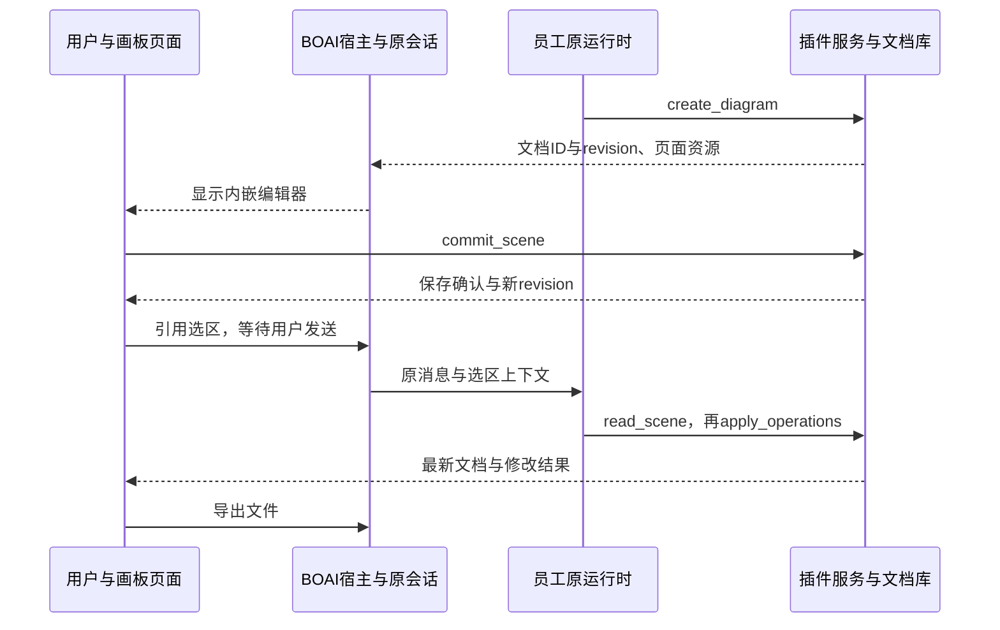

<!--
[INPUT]: 用户采用Excalidraw并完整参考ZCode流程的决定、本地ZCode源码及BOAI现有插件/工具/消息合同。
[OUTPUT]: UI Plugin宿主与Excalidraw完整迁入范围、源码/文档适配、所有者、验收与唯一实际进度；当前仅文档。
[POS]: 第19组UI Plugin产品合同与功能唯一进度；整体实施顺序归第22组03。
[PROTOCOL]: 一旦本文件变化，必须同步更新Header，并上浮检查所属目录.folder.md。
-->

# ZCode UI Plugin与Excalidraw接入设计

日期：2026-10-20。用户确认采用Excalidraw，完整参考ZCode工作流，并要求先落实文档、后续统一修改。**本文件不代表BOAI已经加载UI Plugin或具有画板能力。** 全部阶段顺序见[第22组](../22.开发自动化与持续测试/README.md)。

## 1. 用户流程与范围

完整目标：员工创建画板 → 用户在BOAI内手动编辑并确认保存 → 引用选区到输入区 → 用户发送要求 → 员工读取最新文档并局部修改 → 继续撤销/重做或编辑 → 关闭重开恢复文档 → 导入、切换与导出。

Excalidraw是可嵌入的白板编辑器，UI Plugin包装其页面、MCP工具和文档服务。编辑器/字体随插件分发，运行在BOAI窗口内，不依赖另装Excalidraw桌面App，也不以打开官网代替内嵌画板。AI调用仍沿员工模型连接。

本次目标包含ZCode已实现的UI Plugin交互及完整Excalidraw流程。Gen UI是另一条页面协议，保留独立后续任务；OpenPencil、Blender、Craft系列等后续插件不作为本次Excalidraw完成条件。上游标为未实现的完整消息扩展及页面工具双向进度不能被列作已支持。

桌面本地路径为当前迁入基线。Web、手机、远程若未实现交互面板，沿普通工具结果回退；跨平台实际执行分别记账，不借上游桌面代码声明已完成其他平台支持。

## 2. 固定来源与文档适配

来源版本见[第22组固定参考](../22.开发自动化与持续测试/README.md#4-固定参考)：

- ZCode：`0a1fc56d279fd1001f78387bd81aec1c26767411`；本地`/Users/wangwenbo/Desktop/demo/ZCode`，本次核对工作树干净。
- zcode-plugins：`4acdd7ffc325fbdd9c8d934dc3ce03c7c62cb7f6`；本次确认远程main，尚未下载/构建或复核宿主兼容性。
- 本地`UI_PLUGIN.md`仍含“feat/ui-plugin尚未准备好”的旧描述；本次实际main已有相关源码。正式迁入按固定源码和锁文件核对，不依赖这句旧状态。

| 上游内容 | BOAI归属与适配 |
| --- | --- |
| 根`UI_PLUGIN.md` | 本文件拥有产品与接线合同；详细迁入说明继续放本组，原出处链接保留 |
| `docs/`中的设计、测试说明和截图引用 | 按职责迁入`ai-docs`，同步Markdown相对链接、HTML图片src、脚本引用与指引 |
| 源码旁`CONTRACT.md` | 在迁入模块保留必要局部合同，并接BOAI Header/`.folder.md`及本文件，不机械替换所有包含docs的文本 |
| ZCode AGENTS与架构规则 | 提取适用约束，接BOAI当前治理；命令以BOAI实际package.json为准 |
| `@zcode/*`、服务注入及Host接口 | 改到BOAI真实共享类型、IPC、运行服务和组件入口；不复制另一套会话或执行状态 |
| 插件安装清单与`${ZCODE_*}`路径变量 | 保留上游格式识别与显式映射，或形成可审阅适配清单；未知字段明确报告，不静默丢弃 |
| 编辑器、字体、脚本/WASM及许可文件 | 随插件构建打包，锁定版本和hash，保留实际许可/第三方声明 |

逐文件迁入前形成来源路径、原hash、目标路径、目标hash、必要修改、依赖/资产和验证项清单。上游构建、BOAI构建及安装产物三个环节分别验证；现有下载源码不等于已有可安装插件产物。

## 3. 宿主能力合同

以官方`@modelcontextprotocol/ext-apps`为页面协议基础，读取实际宿主能力；ZCode扩展按兼容映射提供，不能仅凭SDK方法存在就声明BOAI可用。上游锁定版本与BOAI依赖冲突需先核对。

| 能力 | 需要保持的行为 |
| --- | --- |
| 工具关联页面 | 保留工具`_meta.ui.resourceUri`、surface及visibility；服务实际提供MCP App HTML资源；失败保留普通工具结果 |
| 内联与常驻面板 | 支持工具内联、显式面板及工具继续操作同一文档；内联/侧栏切换保留同一个活页面，不重复握手或执行 |
| 工具与资源 | `callServerTool`、资源读取/列表/模板及订阅接当前插件服务；服务端通知到达后重新读取，不跨插件任意取文件 |
| 上下文与消息 | `updateModelContext`只加入可见可删的待发送上下文；`sendMessage`走原会话发送和用户操作确认；保存/调参不自动启动员工 |
| 页面内模型 | sampling使用当前实际获准模型，历史由页面显式提供；结果不自动写入主聊天；支持参数以实际能力协商为准 |
| 页面提供工具 | 活页面登记模型可调用工具，沿原审批/取消；页面销毁和身份失效撤销工具，迟到结果不能写入新实例 |
| 展示与文件 | 主题/语言/尺寸、显示模式、外链、原生保存和诊断日志；按BOAI容器与平台能力适配 |
| 状态与恢复 | widgetState仅为临时视图快照；同一活页面保留编辑状态，持久业务文档由插件服务保存 |
| 生命周期与降级 | 处理取消、资源失败、插件停用/更新、来源失效、崩溃重试与容量不足；普通工具记录仍可查 |

优先使用官方App连接，每活页面一个连接；兼容上游`window.zcode`的页面须经显式桥适配，同页不得建立第二条连接。SDK、兼容别名与Gen UI的状态结构不能混用。

## 4. 数据所有者与执行边界

| 数据/行为 | 唯一所有者 |
| --- | --- |
| 员工配置、消息、Run、取消、成果与回执 | BOAI原服务；UI页面只通过受控入口调用 |
| 插件连接、工具目录、资源及生命周期 | 复用现有数据源/插件服务并补MCP Apps能力，不能另建同名第二连接绕过授权 |
| UI实例、AppBridge、展示锚点、保留与回收 | Renderer窗口级页面管理器；侧栏/卡片仅拥有展示位置 |
| Electron guest、端口、分区、CSP与原生能力 | Main沙箱适配；不承载第二份聊天/执行业务状态 |
| 画板内容、revision和操作去重 | 插件服务与文档库；不把内容只存Renderer或widgetState |
| 视图选区、滚动、缩放与当前编辑器撤销栈 | 活页面；跨应用重启的业务恢复与临时状态分别说明 |

UI实例按实际BOAI数据/profile身份、会话、插件、服务、资源及逻辑视图隔离；员工与配置版本负责调用授权。文档ID是独立持久身份，不随卡片重挂复制文档。跨会话打开同文档须显式定位并核验权限，不能按同名或同一URI推断共享。

页面不能访问Node或任意本地文件；文件操作走插件服务及原员工授权。本机Agent继续沿原生能力和配置，不把页面沙箱规则扩大成本机工具白名单。资源、连接与文件边界按实际宿主所有者核验，网页内容不能扩权。

销毁先使旧实例凭证和工具登记失效，取消调用，再有界teardown、关端口/guest并释放订阅。切内联/侧栏、切聊天和离屏的保留策略沿上游语义适配，不能在卸载卡片时直接丢未保存草稿。无可回收容量时明确失败，不静默销毁编辑器。保存不能仅依赖teardown。

BOAI外层布局复用全局右侧容器、同一宽度与原聊天草稿；控件/主题沿现有体系。宿主加载/保存/校验错误沿Sonner并保留就近重试/核对入口。插件内容需要的冲突草稿、保存状态属于业务状态，不能被toast取代。

## 5. 源码映射与实现拆分

以下上游路径已在本地参考源码中核对；BOAI新模块名称是拟定职责，不是已存在接口。

| ZCode入口 | BOAI接入点/后续职责 |
| --- | --- |
| `packages/shared/src/mcp-apps/` | 共享UI元数据、能力、消息、sampling和限额schema；归`src/shared/`实际领域模块 |
| `packages/services/src/plugin-ui-bridge/` | 连接身份、HTML/资源读取、工具与通知；接`src/runtime/modules/sources/source-provider.ts`、`source-service.ts`的原连接 |
| `packages/ui/src/plugin-ui/` | 拟新增独立UI页面宿主；接现有Renderer全局面板、会话与Composer，不给预览注册表塞业务执行器 |
| `packages/desktop/src/main/pluginSandbox/` | 拟新增Main沙箱/资源协议；接`src/main/main.ts`、preload和public-methods原IPC边界 |
| `pluginUiInteractionPorts.ts`等页面端口 | 接`src/shared/domain/composer-references.ts`、`references.ts`与原消息受理/执行取消 |
| `packages/desktop/scripts/mcp-apps-host-e2e.mjs` | 迁用实际AppBridge/沙箱/生命周期场景至BOAI测试布局与原Electron BDD |
| `zcode-plugins`的Excalidraw源码/清单/构建 | 后续准备固定插件源码，复用编辑器、MCP工具、文档库、资源打包和原业务测试 |

现有`src/renderer/components/common/file-preview/plugin-view.tsx`是文件预览宿主，`src/runtime/modules/backends/runtime-plugins.ts`是Agent运行时扩展；两者都不能直接被称为MCP Apps宿主。需要复用共同管理基础，同时保持各自合同。

## 6. Excalidraw业务协议

| 工具 | 调用方与目标 |
| --- | --- |
| `create_diagram` | 员工/页面创建文档，返回真实ID与版本 |
| `open_diagram` | 员工/页面按ID打开，或明确路径导入；二者互斥 |
| `read_scene` | 员工/页面读取最新版本和元素摘要，可限定元素ID |
| `apply_operations` | 员工/页面按稳定元素ID增删改，携带expectedRevision与operationId |
| `export_diagram` | 员工/页面导出原生文件，核对版本；覆盖需明确指定 |
| `commit_scene` | 仅页面提交手工草稿，检查版本冲突后才确认已保存 |
| `list_diagrams` | 仅页面列出文档并切换 |
| `save_copy` | 仅页面另存草稿/导入内容 |
| `save_image` | 仅页面保存渲染的PNG/SVG |

画板持久化沿插件文档库，按BOAI实际数据边界适配；SQLite等依赖与工作区身份需在安装产物中验证。业务文档和原生`.excalidraw`导出文件有各自身份，不能把未导出的页面草稿声称为已交付文件。

手动编辑与Agent修改必须共同消费最新文档。冲突保留本页草稿，允许重载或另存副本；操作重试复用operationId。用户和工具编辑共享当前活编辑器的撤销/重做，应用重启不承诺恢复撤销栈。

导出后只有原服务确认文件存在且按BOAI发布流程成功，才能作为聊天交付。文件覆盖、来源失效、版本变化、取消及未知结果沿原核对语义处理。导入失败不破坏当前文档，切换/关闭遇未保存状态需有明确处理。

## 7. UI宿主验收矩阵

| 编号 | 必需验收 |
| --- | --- |
| UP01 | 正常安装/启用与资源注册、工具触发页面；不支持路径保留普通工具记录 |
| UP02 | 官方App握手、先注册事件、延迟UI不丢初始输入/结果、只建一条连接 |
| UP03 | 内联/侧栏移动与切聊天保留同一活页面、草稿及请求；后台更新不抢焦点 |
| UP04 | 页面工具调用沿原权限、审批和取消，真实结果回传；仅页面工具不暴露模型 |
| UP05 | 资源读取/模板/订阅、更新和取消；越服务/越来源访问被拒绝 |
| UP06 | 选区上下文可见可删，保存不触发模型，明确发送沿原会话；只读/失效页面不能发送 |
| UP07 | sampling使用获准模型、独立历史与取消，结果不自动追加主聊天 |
| UP08 | 活页面工具登记、发现、执行、取消与撤销；旧调用和迟到结果不能污染新实例 |
| UP09 | widgetState与业务文档分离；重建、显式重试、关闭重启的恢复语义分别验证 |
| UP10 | 沙箱、CSP、身份/分区、原生权限和缓存边界；页面无Node/任意文件访问 |
| UP11 | 插件停用/升级、撤权、窗口关闭、崩溃、容量与大结果读取均有真实终态和恢复入口 |
| UP12 | 主题/尺寸/语言、导出/下载、外链、日志和Sonner适配；原聊天及面板行为无回归 |

## 8. Excalidraw完整验收矩阵

| 编号 | 必需验收 |
| --- | --- |
| EX01 | 员工创建真实文档并自动打开；形状、文字和连线可编辑 |
| EX02 | 手工拖动、改字/颜色、连线及图片等受支持元素；服务确认后才显示已保存 |
| EX03 | 选区引用和整图引用进入当前Composer；用户发送后员工拿到实际选中元素 |
| EX04 | 员工read_scene后按ID局部修改，未选中布局保持；页面实时反映结果 |
| EX05 | 手工与工具编辑共用当前撤销/重做；同操作重试不重复增删 |
| EX06 | 文档列表、按ID打开、切换、原生文件导入和另存副本；错误导入不覆盖当前内容 |
| EX07 | 并发手工/工具修改触发版本冲突，保留草稿，可重载或另存；不静默覆盖 |
| EX08 | 关闭重开/应用重启恢复已保存文档；未保存内容及撤销历史的范围如实说明 |
| EX09 | 原生`.excalidraw`、PNG、SVG导出为真实文件；取消、覆盖、版本变化和未知结果准确处理 |
| EX10 | 编辑器/字体/脚本随安装包可用；脱离源码目录启动产物，画板编辑不依赖官网/CDN |
| EX11 | 员工/会话/插件来源隔离，撤权或停用后旧页面/工具失效；后端原生与API逐项登记 |
| EX12 | 在当前`pnpm dev`中完成整条用户流程，核对真实文件、消息与工具轨迹，纳入持续回归 |

技术夹具、真实页面与真实员工分别验收。桌面源码主路径先串通，再按支持能力矩阵覆盖各后端；完整认证不得只用单一固定模型回执替代。人工观感与技术正确性分别记录。

## 9. 唯一实际进度

| 项目 | 2026-10-20本轮状态 |
| --- | --- |
| 用户决定/完整流程/文档适配 | 已写入本文件，整体计划见第22组 |
| 本地ZCode来源与目录 | 已静态核对commit、干净工作树及关键宿主目录 |
| 独立插件源码与版本配对 | 仅固定远程commit；未下载、构建、安装或实际验证 |
| BOAI宿主、沙箱、协议与Excalidraw | 全部待后续统一实施 |
| UP01–UP12、EX01–EX12 | 全部未执行；无本轮模型/页面/桌面通过成绩 |
| 个人tldraw/旧图 | 未变更；未建立文件转换或迁移能力 |

后续逐批在本节追加来源、适配、实际检查、失败及剩余。第22组03引用这里的结果；既有预览/主题/运行时插件与Magpie网关成绩不作为本增量验收。
