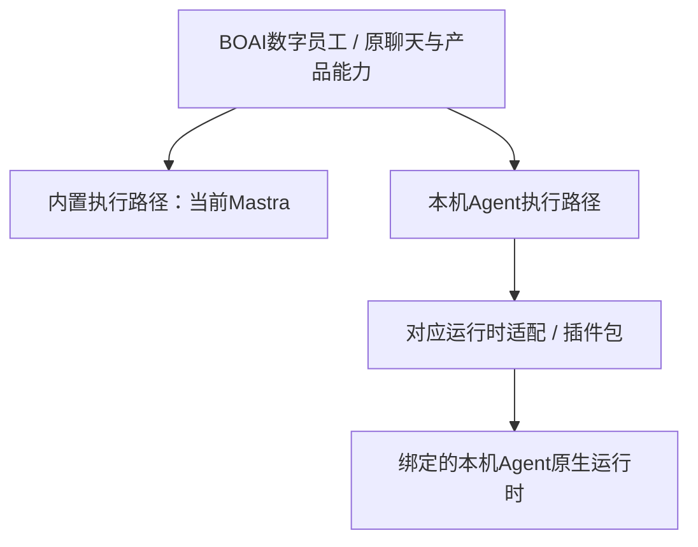

<!--
[INPUT]: 2026-10-28用户确认的两个独立边界、当前数字员工执行路由与Runtime API v2源码。
[OUTPUT]: 本机Agent绑定数字员工是已实现产品模式；插件承接原生运行时，品牌包装和验证状态分别记录。
[POS]: 第19组当前产品边界说明；05/06/07继续拥有协议、实施账本和开发接入。
[PROTOCOL]: 修改时同步Header、README和.folder.md；不以文档重述覆盖历史失败或扩大实现范围。
-->

# 本机Agent插件与数字员工产品边界

## 1. 当前决策

2026-10-28用户明确：BOAI已经支持将本机Agent绑定为数字员工的执行后端。这是当前产品形态，不是未来新增的外部Agent入口，也不是需要重新开发的一套员工体系。

本机Agent插件负责让现有数字员工调用对应运行时并保留其原生能力。内置执行框架可替换是另一项工作，当前仅列待办，见[17](./17-内置执行框架可替换边界与待办.md)。本机插件的使用和后续扩展不依赖替换Mastra。

图中是产品责任关系，不表示所有现有驱动已经迁为独立插件包。

## 2. 产品、插件与原生Agent的职责

| 对象 | 职责 |
| --- | --- |
| BOAI数字员工及业务宿主 | 员工身份、会话与消息、授权资源、Work、材料与成果、渠道来源、持久回执和业务终态 |
| 本机Agent运行时适配 / 插件 | 程序发现与握手、启动或连接、输入交付、会话映射、事件与交互转换、停止和资源收尾 |
| 本机Agent | 原生执行循环、原生工具、模型与登录配置、上下文管理，以及自身支持的Skills、MCP、hooks、扩展和子Agent能力 |
| BOAI产品工具桥 | 将已授权的记忆、资料、任务、消息和成果能力提供给原生Agent，业务写入继续经过原宿主服务 |

用户始终操作BOAI中的数字员工。插件不是另一个员工身份；安装适配包也不等于安装Agent程序、配置登录或完成全部能力认证。

插件使用上游实际支持的协议或SDK，不要求所有Agent改用同一种线协议。共享已有驱动，差异留在对应适配器；不把完整Agent降为普通模型API，也不在BOAI中复制一套原生工具循环。

## 3. 当前源码事实

核对基线：`f0ea0d87`，2026-10-28。本表描述源码接入，不是本轮新增运行验收。

| 范围 | 当前事实 | 状态边界 |
| --- | --- | --- |
| 数字员工后端选择 | [ExecutionBackend](../../../packages/shared/src/domain/backends.ts)已有Mastra、Codex、Claude、ACP及runtime-plugin绑定；[AppService](../../../packages/runtime/src/service.ts)按员工后端路由 | 产品模式已实现，不重新列为待开发 |
| 运行时插件合同 | [Runtime API v2](../../../packages/runtime-plugin-sdk/src/runtime-api.ts)包含会话、提交、追加、停止、状态、工具和能力声明 | 复用现有合同；稳定公共SDK及完整认证仍按原账本判断 |
| Codex / Claude Code | [Codex驱动](../../../packages/runtime/src/adapters/codex/engine.ts)、[Claude驱动](../../../packages/runtime/src/adapters/claude/engine.ts)已有专用执行路径 | 已有员工能力保持；独立模块包装程度不等于产品是否存在 |
| Pi | [Pi provider](../../../packages/runtime-plugins/src/pi.ts)已实现RPC、会话、事件、产品工具桥及交互处理 | 原实现与各批验证保留，不能只引用早期登录失败认定当前始终不可用 |
| OpenCode / ACP | [OpenCode provider](../../../packages/runtime-plugins/src/opencode.ts)与[ACP驱动](../../../packages/runtime-plugins/src/acp.ts)已有源码 | 具体版本、来源和业务组合仍需各自证据 |
| DeepSeek Harness | 属于同类完整Agent的后续接入对象；本次核对未发现独立DSH provider实现 | 品牌名或图标登记不算运行接入；本轮未实现DSH插件 |

现有插件实施账本见[06](./06-Agent运行时插件实施计划与验收.md)，后续模型来源实际批次见[第20组02](../20.模型网关接入/02-实施计划与验收.md)，本机能力对照与修复见[第28组](../28.本机Agent调用与原生能力保留/README.md)。各批次按原日期和验证范围阅读，不能拼成全品牌、全能力已经无损认证。

## 4. 后续维护约束

- 保留员工、会话、原生session与当前运行的明确绑定；取消、续聊和中途追加按实际协议语义处理。
- 原生能力按`支持 / 不支持 / 未知`声明；保留可选差异，新增统一字段必须有具体需求和上游证据。
- BOAI产品资源授权与原生Agent所选权限各守其边界，保持现行原生配置策略。
- 输入交付未知时保留原请求并只读核对；不通过重发或静默换后端制造第二次执行。
- 既有品牌需要独立打包时，优先包装原实现，不重做员工产品，不以打包迁移重新宣称原能力尚未实现。

## 5. 本轮范围

本轮仅落实产品边界与文档导航，不修改协议、插件代码、个人配置或运行进程，不新增能力认证。内置执行框架替换保持待做，个人助手稳定性评估不自动启动该重构。
