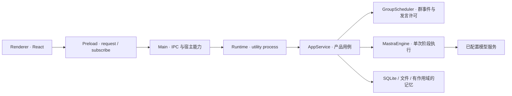

<!--
[INPUT]: 代码与运行目录相关规格与当前模块实现。
[OUTPUT]: 代码与运行目录的说明和源码入口。
[POS]: ai-docs/spec/2.已实现功能与代码现状/02-代码与运行目录.md。
[PROTOCOL]: 一旦本文件变化，必须同步更新 Header，并上浮检查所属目录 .folder.md。
-->
# 代码与运行目录

基线：2026-09-27 的 v0.2.2。**源码位置、用户数据位置、Mastra Workspace 对象是三个不同概念。**

## 四个源码层

| 目录 | 当前职责 | 不应承担的职责 |
| --- | --- | --- |
| `src/renderer/` | React 页面、表单、列表、消息展示、界面状态、受控请求 | 不直接加载 Mastra、文件系统、模型密钥或员工工作目录 |
| `src/main/` | Electron 窗口、IPC 校验、preload、凭据、文件选择/打开、迁移、运行进程生命周期 | 不作为每位员工的推理循环 |
| `src/runtime/` | 本地业务用例、员工与群聊、运行/审批、Mastra 适配、文件/资源/记忆和 SQLite | 不直接渲染 React 或持有界面组件 |
| `src/shared/` | 产品实体、外观 DTO 和跨进程请求/事件类型 | 内部引擎合同只在 runtime/contracts.ts 定义，UI 不依赖执行细节 |



事件反向经 Runtime → Main → Preload 返回界面。所有员工目前共用一个 runtime utility process；员工独立身份与状态并不要求每人长期占一个进程。

## 当前模块入口

| 路径 | 当前职责 |
| --- | --- |
| `runtime/modules/employees/employee-service.ts` | 唯一员工定义注册状态、配置及系统源文件保存、外部编辑对账 |
| `runtime/adapters/mastra/agent-factory.ts` | chat/task/decision/memory 阶段装配和 Workspace 清理 |
| `runtime/adapters/mastra/engine.ts` | 流式消费、协议修复、预算、用量与脱敏 |
| `runtime/modules/workspaces/` | WorkspaceService、文件检查/发布、环境计划与资源版本 |
| `runtime/modules/resources/` | 受管导入、产物列表、带来源知识检索 |
| `runtime/modules/memory/` / `runtime/adapters/storage/` | 产品记忆权威和 SQLite 存储 |
| `shared/domain/` / `shared/ipc/` / `runtime/contracts.ts` | 产品 DTO、IPC 与内部执行合同；调用方直接引用各自所属模块 |
| `renderer/components/app-shell/` / `detail-panel/` | 桌面 Shell、导航/订阅/草稿状态、工具栏和详情容器 |
| `renderer/pages/` / `components/employee/` | 会话私有组件、设置/资料库/帮助/定时任务页面及员工组件 |
| `renderer/services/request/desktop-client.ts` | 唯一 preload 访问适配，不新增业务缓存或订阅 |
| `renderer/styles/global.css` | 唯一样式入口，聚合 Tailwind、颜色、排版和 legacy 层 |

AppService 仍拥有运行生命周期、会话和审批，GroupScheduler 尚未搬迁（B3）。完整实现与验证见 [首批记录](./15-B1-B2-S1-F1首批重构实现.md)。

## 过渡入口清理（2026-09-27）

已删除 19 个没有独立职责的过渡文件：renderer 根目录的旧组件、页面和样式入口，两个仅聚合导出的页面 index，runtime 根目录的五个转发文件，以及混合领域、IPC 和内部执行类型的 shared/contracts.ts。

`renderer/main.tsx` 直接挂载 `components/app-shell`，AppShell 直接引用各页面和会话组件；全局样式仍从 `styles/global.css` 加载。保留承载实现的模块入口，以及 `shared/domain/index.ts` 中有明确领域归属的类型导出。

产品代码和测试直接使用 `WorkspaceService`、Mastra adapter、MemoryRepository 与 ProductStore；共享类型按 domain / ipc / runtime 分开导入。业务逻辑、IPC 方法、存储格式和用户数据路径保持原样。

本次验证：`pnpm typecheck`、`pnpm build` 通过；`pnpm test` 的 120 项测试和 `pnpm test:electron` 的 5 项桌面流程全部通过。Electron 验证使用本次本地构建，未重新生成安装包。

[构建脚本](../../../scripts/build.mjs) 分别构建 Main、Preload、Runtime 和 Renderer；目录调整需要同步入口、别名和测试，但无需改成 Web 服务或 monorepo。

## 数字员工的生命周期

当前“创建员工”是持久化一个 `DigitalAgent` 定义并初始化文件；不会立即创建永久运行的 Mastra Agent。运行时按配置、会话、权限和阶段分别装配 SDK Agent。`MastraEngine` 是共用适配器，回复（chat/task）、参与判断、记忆提取各自创建实例。

本次工厂负责**将运行上下文装配成阶段实例**。保存员工、初始化工作区、配置版本、取消旧任务是产品用例，不能全塞进构造函数。详见 [员工工厂计划](../4.数字员工与协作重构/01-数字员工配置与Agent工厂.md)。

## 用户数据目录

macOS 默认根为 `~/Library/Application Support/BoAI Agent/v2/`；`BOAI_DATA_DIR` 指定父目录时仍使用其 `v2/`。它不位于 `src/runtime` 或源码仓库里。

```text
v2/
├─ boai.sqlite                         产品记录：配置、消息、轮次、运行与记忆
├─ credentials.enc.json                主进程加密凭据，不进入普通备份
├─ data-version.json
├─ agents/<agentId>/
│  ├─ workspace/
│  │  ├─ AGENTS.md / SOUL.md            可编辑的源文件
│  │  ├─ IDENTITY.md / USER.md / MEMORY.md  数据生成视图
│  │  ├─ skills/ / private/ / memory/
│  │  └─ sessions/<conversationId>/
│  │     ├─ work/
│  │     ├─ runs/<runId>/
│  │     └─ USER.md / MEMORY.md / memory/
│  └─ state/                           manifest 与修改恢复记录
├─ workspaces/<conversationId>/         共享文件与已发布产物
├─ skills/<resourceId>/<skillName>/     公共导入技能受管副本
└─ knowledge/<resourceId>/<file>/        导入知识受管副本
```

文件工具 `self:/` 只映射当前员工×当前会话的 work/runs；不能读整个 home、其他员工或其他会话。`shared:/` 只读，通过 `publish_artifact` 显式发布到共享空间。`private/` 目录存在，不代表已开放跨会话私人文件工具。

员工会话记忆按 employee＋conversation 隔离；profile 是该员工可跨会话使用的显式资料。群可见知识取员工绑定与群共享的交集。所有这些都是应用授权与路径检查；批准的 shell 命令仍使用宿主用户权限，没有操作系统沙箱。

## 验证资产

- [agent-homes.test.ts](../../../tests/agent-homes.test.ts)：源文件/生成视图、工作区和记忆边界。
- [mastra-engine.test.ts](../../../tests/mastra-engine.test.ts)：真实 SDK 对接测试协议服务、工具和受控输出处理。
- [service.test.ts](../../../tests/service.test.ts)：产品持久化、生命周期、预算、撤权和协作。
- [tests/e2e](../../../tests/e2e/)：实际 Electron 的桌面、历史群聊和升级/恢复流程。

当前测试资产要随模块迁移维护；文件数和行数不是重构验收标准，原用户行为和隔离边界才是。
