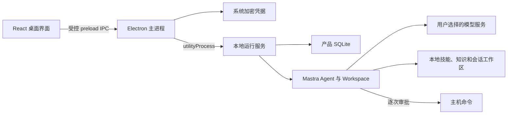

# v0.1 实现记录

日期：2026-09-26。本文记录已落地内容；01–06 仍包含完整产品方向和后续计划。

## 1. 实际架构

- 主进程：`src/main/`，窗口、文件选择器、事件转发、加密凭据与运行进程管理。
- 产品服务：`src/runtime/service.ts`，会话与员工管理、分会话队列、审批、运行记录、去重与恢复。
- 引擎：`src/runtime/mastra-engine.ts`，Mastra 流式 Agent、原生技能、知识检索、文件工具与协调员。
- 数据：`src/runtime/store.ts` 使用 `@libsql/client` 的本地 SQLite 文件；`resources.ts` 管理导入与产物。
- 界面：`src/renderer/`，真实 Electron preload 调用，无模拟回复路径。

实际依赖：Electron 39.2.7（内置 Node 22.21.1）、Mastra Core 1.71.0、React 19.3.0、Vite 8.3.1、TypeScript 7.0.2、libSQL Client 0.18.0。版本及依赖图锁定在 package.json / pnpm-lock.yaml。

当前开发环境的 Electron 二进制因下载网络失败，使用同级 boai-app 已有的同版本官方发行文件复制到本项目 node_modules。应用包包含自己的 Electron 与依赖，运行不引用 boai-app；其他机器正常安装项目依赖即可获得该版本。

## 2. 功能范围

| 能力 | 当前实现 |
| --- | --- |
| 数字员工 | 创建、编辑、停用；角色、模型、颜色、技能、知识、命令开关 |
| 模型 | OpenAI、Anthropic、OpenAI Chat Completions 兼容连接；连接测试；兼容服务允许空 Key |
| 单聊 | 同员工复用一个直接会话，保存历史与产物 |
| 群聊 | 建群、修改成员、@ 指定、协调员选成员；逐一执行，公开回复独立署名 |
| 协调状态 | 规划本身也是可见任务，可停止、失败与重试，不伪造员工消息 |
| 执行状态 | 流式内容持久化、工具调用详情、取消、失败重试、重启中断标记 |
| 上下文 | 产品消息显式组装；会话隔离、已完成消息筛选、消息 ID 去重、排除撤权资源的受影响旧回复 |
| Skills | 原生 Mastra 技能发现，按员工绑定；导入受管目录，原始技能只读 |
| 知识 | Markdown/TXT 本地文本检索，带文件与行号来源；群权限为员工绑定与群共享的交集 |
| 产物 | 会话工作区内读写文本与列目录，任务目录保存输出，界面打开文件 |
| 主机命令 | 默认关闭，逐次审批；取消、超时、输出限制、精简环境变量 |
| 数据 | 本地 SQLite；凭据通过 Electron safeStorage 加密；空闲一致备份与跨目录恢复 |

默认单个运行最多 12 个模型步骤、10 分钟；协调阶段最多选择 3 名成员，模型返回非法成员或格式会失败并允许重试。不同会话可并行，同一会话按用户请求排队。

## 3. 与规划的差异

1. 没有同时启用 Mastra Memory 自动回放。产品库保存公开消息及运行配置快照，每次执行显式组装上下文；长期记忆、摘要压缩和专门的 AgentSession 表待后续实现。
2. 数据库采用最小 JSON 记录仓储，由应用服务验证实体与引用；尚未扩展为完整业务表、索引和升级迁移体系。运行身份通过 runId 与配置快照保留。
3. 知识为关键词/中文词片段检索，没有向量索引、PDF/Office 解析；首次可导入资料格式限制在文本。
4. 内置文件/知识工具已实现；任意工具目录、MCP 连接器、插件市场和周期任务未实现。
5. 群聊调度由产品层管理；协调员只选成员与次序，不运行无限自动互相回复循环。
6. 工作区是路径和资源访问边界。经用户批准的 shell 命令具有主机用户权限，没有操作系统隔离，也不自动准备脚本依赖。
7. macOS 关闭窗口后进程保留；退出应用会停止运行。尚无登录自启、托盘后台常驻或跨设备同步。
8. 当前应用包未签名、公证，使用默认 Electron 图标；Windows/Linux 与正式安装器尚未验证。

## 4. 验证证据

| 验证 | 结果 |
| --- | --- |
| `pnpm typecheck` | 通过 |
| `pnpm test` | 29 项通过：13 项引擎测试、16 项服务测试 |
| `pnpm build` | 主进程、preload、运行进程与 React 页面构建成功 |
| Vite 开发模式启动 | 通过；真实 Electron 页面加载、IPC 读取三个默认联系人成功，无页面脚本错误 |
| `pnpm test:electron` | 真实开发构建 Electron 测试通过：流式、群聊隔离、去重、取消、重启 |
| macOS ARM64 应用目录打包 | 成功，独立 `.app` 位于 `release/mac-arm64/BoAI Agent.app` |
| 应用包 Electron 测试 | 通过，额外经界面编辑员工并发送群聊任务，再重启读取记录 |

模型测试连接本地 HTTP 协议服务器，实际运行 Mastra SDK；覆盖 OpenAI 兼容流式协议、Anthropic messages 协议和自定义地址，不代表已经测试用户真实云服务账号。没有读取或使用参考项目的模型凭据。

引擎测试覆盖：原生 skill_read、真实技能脚本、知识来源、文件产物、符号链接逃逸、审批拒绝与取消、命令超时/输出限制、协调合法性、错误脱敏。实测 Mastra 1.71 的默认文件容器不足以阻止符号链接父目录写入，因此额外加入逐段检查与 no-follow 文件打开。

服务测试覆盖：持久化、隔离和去重、队列、重试、配置/成员/资料撤权、迟到事件、审批与关闭恢复、备份恢复、协调规划状态、慢连接测试不阻塞审批。备份排除凭据文件，恢复重定位受管路径。

## 5. 下一步

优先使用用户自己的模型服务与实际技能验证研究员→写手→审核员的真实任务质量，再推进更丰富的知识格式、长上下文整理、工具连接器与正式分发。当前版本可直接配置使用，也可以作为下一轮开发的基线。
