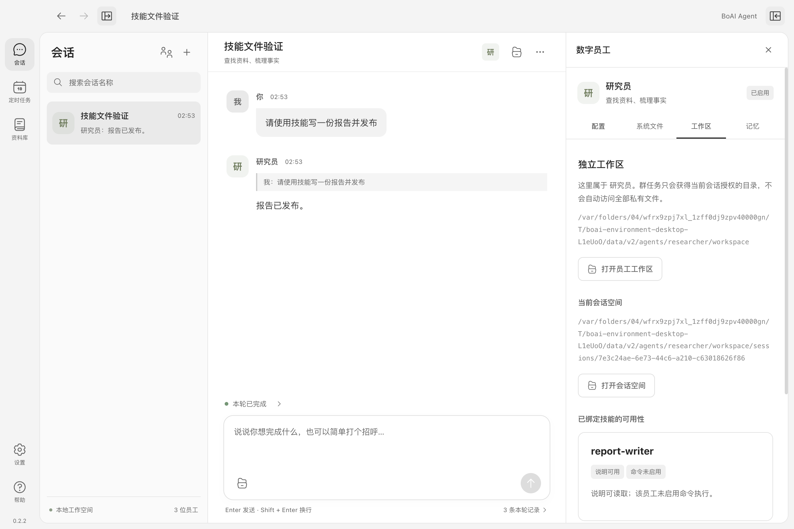

<!--
[OUTPUT]: 2026-10-25源码链接随Workspace迁移更新，历史验证结论保持。
[INPUT]: B1 / B2 / S1 / F1 首批重构实现相关规格与当前模块实现。
[OUTPUT]: B1 / B2 / S1 / F1 首批重构实现的说明和源码入口。
[POS]: ai-docs/spec/2.已实现功能与代码现状/15-B1-B2-S1-F1首批重构实现.md。
[PROTOCOL]: 一旦本文件变化，必须同步更新 Header，并上浮检查所属目录 .folder.md。
-->
# B1 / B2 / S1 / F1 首批重构实现

日期：2026-09-27。状态：**已实施并验证**。沿用 v0.2.2 发布版本号，本记录描述其后的首批源码改造；不表示总计划全部完成。

## 已完成范围

| 阶段 | 交付 | 实际入口 |
| --- | --- | --- |
| B1 | 唯一员工定义注册状态、配置/源文件保存及版本检查；按 chat/task/decision/memory 创建阶段实例 | [EmployeeService](../../../packages/runtime/src/modules/employees/employee-service.ts)、[阶段工厂](../../../packages/runtime/src/adapters/mastra/agent-factory.ts) |
| B2 | 系统文件与会话目录、近端文件检查、资源导入、知识检索、记忆和 SQLite 按职责拆分 | [WorkspaceService](../../../packages/runtime/src/modules/workspaces/workspace-service.ts)、[文件操作](../../../packages/runtime/src/modules/workspaces/file-access.ts)、[资源](../../../packages/runtime/src/modules/resources/local-resources.ts) |
| S1 | 当前员工/会话/run 的授权环境计划、资源内容版本、固定授权下的渐进技能读取、工作区技能状态 | [环境计划](../../../packages/runtime/src/modules/workspaces/environment-plan.ts)、[技能源](../../../packages/runtime/src/adapters/mastra/bound-skill-source.ts)、[工作区界面](../../../apps/electron/src/renderer/components/employee/index.tsx) |
| F1 | 页面/组件/Shell 拆分、类型化通信入口、路径别名、单一样式入口、旧样式分层与 token 名称隔离 | [AppShell](../../../apps/electron/src/renderer/components/app-shell/index.tsx)、[desktop-client](../../../apps/electron/src/renderer/services/request/desktop-client.ts)、[global.css](../../../apps/electron/src/renderer/styles/global.css) |

没有升级依赖或引入 HTTP 服务。群聊调度算法、消息与记忆权威仍由原产品运行路径拥有；B3 才继续拆协作与运行生命周期。

## 员工和阶段实例

EmployeeService 拥有唯一员工 Map，返回定义副本。创建员工只持久化定义与必要系统文件，不创建常驻 SDK Agent、不调用模型。保存定义、保存系统源文件和外部文件对账继续使用原版本、hash、pending-update 和 manifest 恢复协议。

Mastra 工厂只接收明确的运行上下文，模型连接配置、提示装配和任务 Workspace 创建在 adapter 内部。普通聊天、参与判断与记忆维护不创建 SDK Workspace，也没有任务工具。澄清与接续请求不能通过误带 task 值获得文件或命令能力。每次 task 独立创建 Workspace，并在成功、失败、取消及 Agent 构造失败时释放；释放不删除持久工作文件。

流式消费、当前轮次投影、结构化协议修复、额外调用预留、累计 usage 与脱敏保留在引擎执行路径。明确关闭 SDK 默认模型重试，不增加隐藏调用。

另补齐外部编辑规则的失效路径：在新阶段对账发现源文件升版时，取消其他正在使用旧版本的轮次，阻止迟到回复；新会话按新版本装配。当前没有后台文件监听，外部编辑在下一次阶段装配时被发现。

## S1 环境计划和可见状态

计划绑定 employee、conversation、run、configVersion 和 policyVersion，包含当前 session 路径、获准技能、知识及内容 hash。task 使用计划；chat、decision 和 memory 不会因为这份计划获得工具。

- 自有文件仍是 `self:/work`、`self:/runs`，共享文件工具仍只读；发布通过 `publish_artifact` 显式复制并记录归属。
- 资源检查保留路径与符号链接限制，记录普通文件内容 hash；技能实际读取时核对版本，计划形成后新增或改写的文件不能直接读入旧授权版本。
- 员工和群知识授权共用同一函数，严格要求“员工绑定 ∩ 群共享”。这也收紧了原引擎单独接收 EngineContext 时的宽松并集检查；产品层原有交集行为不变。
- 环境计划不保存 API Key，不作为永久 SDK 实例缓存。群、成员或绑定撤权继续取消相关运行；历史记录仅作事实保留，不能恢复执行许可。
- 工作区显示每个绑定技能的“说明可用/不可用”与“命令未启用/执行依赖未验证”。可读取说明不表示脚本依赖就绪，未自动安装任何运行时或软件包。

S1 使用受管资源原件的内容版本校验，没有为命令创建隔离副本或新 Sandbox。首期原始 `spawn` 命令路径保持显式审批、固定 cwd、环境白名单、超时、输出上限和取消。**获批命令仍使用宿主用户权限，文件工具限制不是操作系统隔离。** 命令侧受管输入副本、LocalSandbox、实际运行时与依赖检查属于 S2。

## 合同、存储与回退

纯产品 DTO 位于 `shared/domain`，IPC 位于 `shared/ipc`，含 apiKey 的内部引擎上下文位于 `runtime/contracts.ts`。本批曾在旧 `shared/contracts.ts` 和旧 runtime 模块保留过渡导出；不存在第二份员工状态、记忆数据或存储实现。

S1 是本批明确的新行为，增加两个可选字段：

1. `AgentHome.environment`：读取工作区时生成的状态投影，不保存为第二份权威配置。
2. `AgentRun.environment`：`version: 1` 的运行摘要，包含配置/策略版本、命令模式、policy hash 与资源 hash，随原 runs JSON 记录持久化。没有 schema/table 变更；旧记录没有此字段也可读取，旧代码会忽略它。

不改变 v2 数据根、员工/会话 ID、目录布局、SQLite collection 名称、模型连接字段或旧 IPC 的输入。已有备份与恢复继续重定位员工文件、资源、共享产物及 sourcePath；旧运行摘要只表示历史计划，不会重新获得权限或自动执行。

当前工作目录没有 Git 仓库，因此没有创建提交。改动前源码、测试、文档与构建配置保存在 `.local/refactor-checkpoints/2026-09-27-before-B1.tgz`，不含用户业务数据和模型密钥。恢复源码应先解压到独立目录比较，再替换对应代码并清理本批新增文件；不要覆盖正在运行的工作区或业务数据。

后续清理（2026-09-27）：仓库内消费者与测试已迁移到实际模块，renderer、runtime 和 shared 的过渡入口已删除；`main.tsx` 直接挂载 AppShell。当前入口见 [代码与运行目录](./02-代码与运行目录.md)。

## F1 行为与边界

本批由 App 组合 AppShell（后续清理改为 main.tsx 直接挂载）；Shell 继续作为导航、订阅、草稿、滚动、请求序号与未保存状态的单一所有者。工具栏和详情容器提取为组件；会话列表、聊天、活动面板、设置、资料库、帮助和定时页面按职责迁移。通信适配器不建立额外缓存或订阅，所有直接 preload 访问只出现在 desktop-client。

样式从一个 global.css 入口进入，颜色与 Markdown 排版分开；旧规则进入 legacy layer，旧 primary/secondary/muted/border token 使用 legacy 前缀，图标插件只保留配置文件的一条入口。保留 Vite 的相对 base、生产 CSP、原布局偏好键和 Carbon/Solar 本地图标。F2/F3 的 Base46、深浅主题、Zustand、shadcn 与背景图片尚未接入。

## 本次验证

验证平台：macOS Apple Silicon，实际打包应用 `release/mac-arm64/BoAI Agent.app`。模型请求使用本地协议测试端点，文件、SQLite、IPC、Mastra SDK 和 Electron 为真实实现；本次没有调用用户配置的收费模型，也没有更改真实用户群聊数据。

| 检查 | 结果 |
| --- | --- |
| 改造前类型与测试基线 | 类型检查通过，102 项测试通过 |
| 最终类型检查 | `pnpm typecheck` 通过 |
| 最终单元/集成测试 | `pnpm test`：4 个测试文件、109 项通过 |
| 生产构建 | `pnpm build` 通过 |
| macOS ARM64 应用包 | `pnpm exec electron-builder --dir` 通过；本机无有效 Developer ID，生成的是未签名本地测试包 |
| 基于该应用包的 Electron 测试 | 4 项通过：完整桌面、技能/文件环境、历史群聊、v0.1 数据升级 |

新增回归覆盖群知识双重授权、技能内容变化与新增文件拒绝、跨群同名工作文件、撤权/取消、符号链接、依赖未验证状态、工厂构造失败清理，以及外部源文件升版使旧运行失效。

新增桌面闭环在打包应用内通过原生技能工具加载已绑定技能，写入 `self:/work/report.md`，发布并登记产物，检查界面技能状态，然后重启，验证工作文件、产物和环境摘要仍在且不发生重放。原有桌面回归保留草稿、焦点、未保存保护、760–1280 宽度、200% 缩放与旧数据迁移场景。

[760 宽度的详情页验证](../../images/refactor-first-batch/f1-width-760.png)

## 下一批入口

继续 [S2](../5.Mastra能力扩展/03-Sandbox文件系统与Skills.md)：读取当前安装版 LocalSandbox 的执行/取消 API，验证 macOS 策略，接入审批、输入副本、运行时与依赖状态及清理。随后按总计划处理 B3 / E1，F2/F3 外观、ACP、本地 SDK、MCP、Browser、自动化、Mastra Memory 与 Workflow 均不在本次完成范围内。
