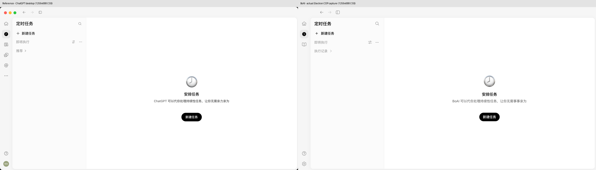

<!--
[OUTPUT]: 2026-10-25源码链接随Workspace迁移更新，历史验证结论保持。
[INPUT]: 用户提供的 ChatGPT Desktop 截图、BoAI 现有模块及实际 Electron CDP 截图。
[OUTPUT]: 桌面布局和统一视觉实现范围、参考依据及验证入口。
[POS]: 第二组实现记录，2026-09-27 前端风格打磨。
[PROTOCOL]: 一旦本文件变化，必须同步更新 Header，并上浮检查所属目录 .folder.md。
-->
# 统一视觉风格打磨

日期：2026-09-27。

## 参考依据

最终布局以用户上传的 ChatGPT Desktop 定时任务及外观设置截图为准。原图 2518 × 1376，按 2 倍密度归一化至 1259 × 688 CSS px。桌面工具对 ChatGPT 宿主的读取仍受限；已连接的 Chrome CDP 只提供网页标签，不能据此声称读取了桌面 DOM。本轮用 Electron 的 CDP 截取 **BoAI 实际运行界面**，与用户原图在同一尺寸、同一浅色空状态下并排比较。

[完整对照](../../images/visual-refinement/desktop-comparison.png) · [视觉验收](./design-qa.md)

## 最终实现

- [桌面框架](../../../apps/electron/src/renderer/components/app-shell/index.tsx)：44px 顶栏、52px 纯图标导航、12px 圆角整体内容容器、右侧和底部 4px 外边距。默认列表区占 312px；历史默认 272px 自动更新，其他自定义宽度保留。后退、前进、详情、拖动调宽和未保存保护继续使用原逻辑。
- [任务页](../../../apps/electron/src/renderer/pages/schedules/index.tsx)：标题与搜索、新建任务、状态筛选和列表在左侧；右侧提供居中的时钟、任务说明与创建入口。执行记录独立进入，计划编辑、启停、删除、手动运行及结果跳转沿用已有 IPC。侧栏开关覆盖任务页，窄窗口重新分配栏宽，缩放后允许纵向滚动。
- [视觉真源](../../../packages/shared/src/appearance/index.ts)：默认浅色外层 `#f6f6f6`，列表 `#fbfbfb`，内容白色；框架边框、导航颜色、列表标签均通过语义 token 输出。深色与 Nord / Catppuccin 持续支持；字体、缩放与分模式自定义色扩展既有偏好，旧配置自动补默认值。
- [样式层](../../../apps/electron/src/renderer/styles/global.css)：基础颜色和尺寸留在 colors.css，桌面公共布局在 legacy.css，任务和外观设置规则在 pages.css，Markdown 排版在 typeset.css。聊天、控件和外观设置共享同一套表面、圆角及字体。
- [时钟素材](../../../apps/electron/src/renderer/assets/schedule-clock.png)：按截图生成的透明 PNG，256 × 256，54px 显示时钟主体约 48px；不是手绘 CSS / SVG。UI 图标继续使用本地 Solar / Carbon 集合。

产品内容使用 BoAI 名称。保留 BoAI 实际存在的会话、定时任务、资料库、帮助和设置入口；原图的其他业务入口和账户头像未伪造。原图的“推荐”位置使用已有的“执行记录”。

## 字体、图标与外观设置

- 诊断窗口的 Electron `zoomFactor` 为 `1`（100%）。先前偏大来自实际字号与图标：控件14px、消息16px、主导航20px。本次改为控件13px、消息15px、导航18px；设置分类图标16px。标题按层级保留较大字号。
- 按第二张截图重做设置：标题/搜索/分类在侧栏，主区采用圆角分组、模式缩略图和44px设置行；主标题28px，主区桌面边距72px/80px。模式缩略图来自实际 BoAI 截图，不新增虚构入口。
- 支持主题、强调色、背景色、前景色、Geist/系统字体和75%–150%界面缩放。强调色用于选中轮廓、焦点和链接；前景用于文字和主按钮；自定义背景推导相邻表面和边界。明暗颜色独立保存，选择主题清除该模式颜色覆盖，重置恢复全部默认。
- 新增 VS Code Plus 浅/深配色；[Geist](https://github.com/vercel/geist-font)采用OFL 1.1，字体和原始许可随包分发，运行时不联网加载。中文回退到系统字体。
- 缩放由 Electron 原生窗口执行。设置、视图菜单、`Cmd/Ctrl +`、`Cmd/Ctrl -`、`Cmd/Ctrl 0`和滚轮缩放事件共用持久化值；新窗口/重载/重启恢复。默认100%，用户可以选择90%。
- 背景图片、透明度保留在“高级”。分模式颜色合并不会互相覆盖，保存与重试继续使用现有IPC版本冲突协议。

[设置同尺寸对照](../../images/visual-refinement/settings-comparison.png) · [90%缩放](../../images/visual-refinement/settings-desktop-90.png)

## 验证

- 类型检查与生产构建通过。
- 123 项单元/集成测试、6 项 Electron 流程通过，包含会话草稿保留、新空状态创建入口、任务运行、主题切换、背景图片、窄窗口、200% 缩放、历史和升级。
- CDP 实测内容框 `(52,44)`、`1203 × 640`、圆角 `12px`，与归一化参考对齐；主按钮 `86 × 36px`，顶部 `446px`。
- 独立界面验证覆盖任务搜索、侧栏开关、编辑取消、未保存提示、执行历史和说明详情。控制台无页面错误。
- 聊天、浅深外观设置和 760px 窗口截图同步更新。预览使用隔离数据目录，没有访问用户模型凭据或收费模型。
- 本轮验证的是本地 Electron 构建，未重新制作安装包。

## 预览

[浅色任务页](../../images/visual-refinement/schedules-light.png) · [深色任务页](../../images/visual-refinement/schedules-dark.png) · [窄窗口](../../images/visual-refinement/schedules-narrow.png)

[浅色聊天](../../images/visual-refinement/chat-light.png) · [深色聊天](../../images/visual-refinement/chat-dark.png) · [外观设置](../../images/visual-refinement/appearance-light.png)
