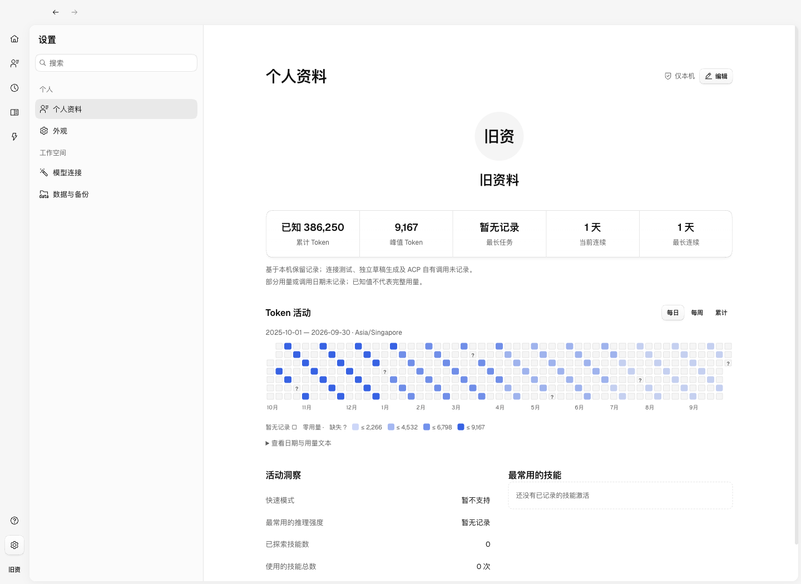
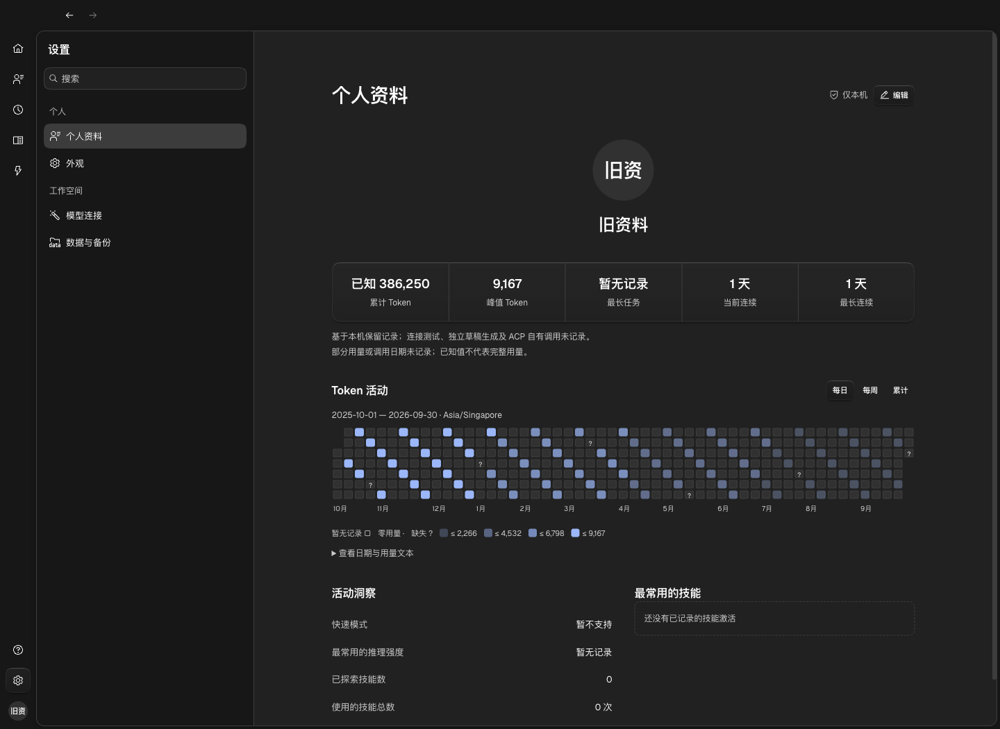

<!--
[INPUT]: 第 17 项个人资料规格、当前实现、Vitest 与隔离 Electron BDD 结果。
[OUTPUT]: 资料编辑复用兼容接口横向表单/默认卡片颜色；默认小猫 SVG/旧文字头像兼容、后续头像菜单/分享/排版调整与本轮未跑 E2E 的边界； 资料编辑/头像联动/可信活动的实现边界、实际截图与明确未通过项。
[POS]: 个人资料本轮实现记录；规格中的实施前观察仍按原日期保留。
[PROTOCOL]: 一旦本文件变化，必须同步更新 Header，并上浮检查所属目录 .folder.md。
-->
# 个人资料实现与验收

日期：2026-09-30。对应 [第 17 项规格](../3.前端重构与功能/17-个人资料/README.md)。资料及活动功能已接入，专项通过；全量工作区回归有失败，不能称为全量验收通过。本次与团队创建、定时任务简化在同一工作区并行，保留了这些改动，本文仅记录个人资料的交付。

## 后续前端调整（2026-09-30）

按用户八项要求完成：头像替代左下角设置图标并接管下拉菜单；全屏活动分享（复制/保存 PNG）；资料页头像复用原选择器并直接保存；编辑弹窗扩为 520px、移除副标题；统计字体缩小；说明进入 tooltip；隐藏日期/时区、图例及文本表；洞察和技能模块上下排列，内部采用统一 Card。

后续将个人默认头像改为现有小猫 SVG：默认资料与恢复默认保存同一预设，旧文字头像和无效/损坏图片也统一显示该 SVG。导航、资料、聊天和分享共用个人头像来源解析；已有有效头像保持原选择，不改写旧资料版本。

资料编辑弹窗改用兼容接口的共用 `ConnectionForm` / `ConnectionSettingRow`：横向标签与输入框、提示图标、行间分隔和卡片内操作栏；头像在卡片上方。资料表单关闭 muted 背景覆盖，直接沿用全局卡片颜色，其他连接表单外观保持原设置。

本轮仅执行类型、UI 静态检查与差异检查；按用户要求不运行 E2E、不做自动桌面验收，等待用户查看效果。下方测试数字和截图是此前版本的历史证据，不能当作本次 UI 改动已被运行验证。分享不创建公开链接、不自动向社交平台发送数据。

## 首轮已实现

- 设置「个人资料」位于外观上方，可搜索；导航底部本人头像直达。页面保留居中身份、同一容器内的五项摘要、Token 活动、两列洞察与技能排行，复用设置布局和全局主题、Button/Dialog/Card/Field/Tooltip/Chart。
- 本机 `userProfiles/user` 是资料唯一来源。版本比较和保存位于 SQLite 事务；默认「我」只是旧数据的读取投影。姓名按 Unicode 字符校验，用户名可空；不读取系统用户名或外部登录身份。
- 文字、离线预设和本地图片共用头像选择器。PNG/JPG/WebP 在前端居中裁成 256px PNG，宿主再次验证大小、PNG 块/CRC、尺寸和有界解压；损坏旧图回退文字。取消、过期响应、保存失败和版本冲突不静默覆盖。
- 编辑接入现有脏状态守卫，保存时禁止重复提交。既有会话在主页面切换时保留挂载，因此运行中的回复和未发输入草稿继续保留。
- 本人始终由 `senderType=user` 且 `senderId=user` 识别。单聊、群聊、外部任务单聊和带自动化来源的人工补充共用头像；自动触发保留独立头像。单聊本人头像在右侧，群聊连续消息规则保留。引用、表情名单、可访问名称使用「你」；旧 `senderName` 不改写，新发送消息记录保存后的姓名。

## 统计证据与边界

入口是 [ProfileRepository](../../../src/runtime/modules/profile/profile-repository.ts)，确定性计算位于 [profile-activity.ts](../../../src/runtime/modules/profile/profile-activity.ts)。Renderer 只接收聚合数据，不拉取聊天正文计算统计。

| 数据 | 权威来源及口径 |
| --- | --- |
| 普通模型用量 | 宿主唯一 call ID，Mastra 实际步骤开始观测与供应商原始回执，保存到 `profileModelCalls`；重复/部分回执不累加第二次，不为普通聊天创建 Work |
| 自动化用量 | 继续读取原 `budgetModelCalls`；资料观测仅补实际开始时间与生效强度，不复制另一份用量账本，不相加 run/预算/Trace 汇总 |
| 旧预算 | 有可信回执可入已知总量；缺少实际调用开始时间时不以预留时间摊入每日图，标明不完整 |
| 日/周/累计 | 当前设备 IANA 时区，最近 12 个日历月；周一分周，累计明确为区间累计，顶部总量覆盖全部保留记录。跨日按实际调用开始时间归属 |
| 缺失状态 | `0`、`null`、部分已知分开；历史 run 汇总不可靠补齐时保留缺口；取消前已收到的可信回执仍可记账 |
| 连续天数/聊天 | 只计本人主动消息的自然日/不同会话；人工补充算本人，纯自动触发不延长连续天数，昨天活跃可维持当前连续 |
| 最长任务 | 已结束根工作及其拥有子工作的真实执行区间并集；不含容量排队和审批暂停；不含独立共享依赖，缺少完整区间保持未知，结束不代表交付 |
| 技能 | 只在原生 skill 工具成功激活且解析出资源 ID 时记录，以 run/toolCall ID 去重；不同身份同名不合并，已删除资源保留名称且禁用详情跳转 |
| 推理强度 | 记录实际请求使用的供应商选项，不用员工当前设置推断历史；无适配记录时显示暂无记录 |

统计写入错误只报告观测缺失，不重试业务工具、不改变预算权威或交付状态。查询带数据版本、时间、时区、范围及完整性；隐藏资料页暂停订阅读取，活跃事件合并刷新。会话清理同步删除相关观测；完整 SQLite 备份包含资料和证据，恢复不累加旧数据、不重放工具。

当前连接测试、独立的团队/日程草稿生成和 ACP 自有调用未纳入资料用量；页面明确提示。快速模式显示「暂不支持」，不虚构比例。历史缺失记录无法从消息字数补算。未来 schema 拒绝覆盖。

## 验证

- `pnpm typecheck`、`pnpm lint:ui`、`git diff --check` 通过。
- 个人资料、Mastra、服务、头像与会话清理的相关 Vitest：171 项通过。包含并发版本、持久化失败、重启/完整 SQLite 备份/无资料旧备份、图片、观测失败不重放业务、唯一调用、未知与零、UTC/年界/DST、自然日连续、执行区间去重、技能移除与聊天清理。
- 个人资料 Electron BDD：4 个场景通过。覆盖保存名称/用户名/真实上传、图片损坏、本人/自动化/外部聊天、连续消息、引用、重启/取消、字段验证、版本冲突、原生关闭保护、模型运行中保存与输入草稿、供应商回执核对、每周/累计、2500 条历史、键盘与文本视图。
- 主题矩阵：浅/深色 × 760/1124/1440px × 100%/125%/200% 共 18 组；检查页面不横向溢出、编辑入口可见、宽屏五列等宽及局部热力图滚动。截图来自实际 Electron，使用隔离种子数据，数字不是用户真实用量。
- 全量 `pnpm test`：574 项通过、3 项失败（577 项）。失败为 `local-skills.test.ts` 的刷新/重启目录断言，以及 `skills-installation.test.ts` 的两项批量更新断言：测试仍预期原目录规模/隐式刷新，当前实现包含本机安装技能并采用明确刷新；对应文件和实现无本次个人资料修改。未绕过或删除这些断言。
- 全量 `pnpm test:electron` 已执行，最终结果与针对性补验见下方回归记录。

### 桌面回归记录

全量命令在本次工作区运行 66 个场景：39 个通过、27 个失败。个人资料 4 个场景全部通过。失败中两项是新规格明确改变的旧群聊断言（单聊头像隐藏、本人称为「我」），已更新为验证头像可见/靠右及本人文案「你」，没有删除原有交互断言。

其余失败分布在外观/员工/连接页面的旧原生 Select 调用、群聊富文本输入的旧 value 断言、会话名称匹配、执行过程点击、并行修改中的通讯录/日程入口和 Skills 页面/目录范围。具体包括 `appearance`、`composer`、`conversation-list`、`desktop`、`detail-tabs`、`employee-tabs`、`extensions`、`history`、`local-connections`、`local-skills`、`native-skills`、`pages`、`skill-marketplace`、`skill-updates`、`skills` 场景。未为个人资料扩散修改这些功能，也未把它们归为通过。

针对最终代码重新构建后，个人资料及全部群聊场景共 8 项补验通过（`pnpm test:electron --grep '@profile|@group-chat'`）。这是专项结果，不替代全量通过。全量日志 `/tmp/boai-profile-full-e2e.log`，最终专项日志 `/tmp/boai-profile-final-e2e.log`；临时日志可能随系统清理，实际截图随规格保留。

### 实际截图

以下为生产页面在隔离桌面的运行截图，保留全局组件样式；[原始参考图](../3.前端重构与功能/17-个人资料/reference.png) 仅作内容组织对照。窄窗采用纵向滚动，热力图保留独立横向滚动。

[浅色 760px / 200%](../3.前端重构与功能/17-个人资料/evidence/profile-light-760-2.png) · [深色 760px / 200%](../3.前端重构与功能/17-个人资料/evidence/profile-dark-760-2.png)

## 验证限制

本轮未做真实付费模型、ACP 外部程序用量、参考应用交互、操作系统断网、安装包签名/分发验证。资料持久化写入失败和备份恢复在真实 SQLite 模块层验证，未逐一展开成桌面文件系统故障和恢复 UI 场景；运行中编辑已验证模型继续完成及草稿保留，滚动位置/精确消息定位沿用现有挂载和导航实现，未另做专门的断言。未将这些缺项记作已通过。
