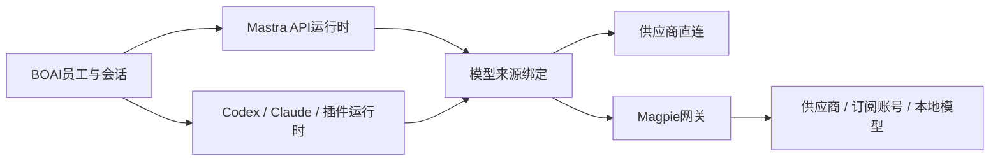

<!--
[INPUT]: 2026-10-17用户的Magpie支持诉求与文档授权、Magpie固定提交、BOAI现有连接/运行时源码。
[OUTPUT]: 经review补齐本机0.1.1277基线、配置优先级、协议/凭据、推理值及导入生命周期；完整接入待后续goal，尚未实施。
[POS]: 第20组设计合同；本增量实际进度唯一归02，第13/19组原有运行时成绩保持。
[PROTOCOL]: 一旦本文件变化，必须同步更新Header，并上浮检查所属目录.folder.md；计划、现有代码与真实验证分别标明。
-->
# Magpie与通用模型网关接入设计

## 1. 范围与决策

日期：2026-10-17。用户先要求将方案落实到文档，随后要求review，并说明本机已安装Magpie、后续准备goal实施全部接入。本轮仅修订文档并只读核对现有服务；未改产品代码、未请求模型推理、未创建实施goal。实施计划和实际记录见[02](./02-实施计划与验收.md)，review与后续goal交接见[03](./03-Review与Goal交接.md)。

设计采用通用模型连接机制和Magpie预设，维持三项独立身份：员工是谁、由哪个Agent运行、模型请求发往哪里。首版接用户独立运行的Magpie，保留已有直连连接；不增加`magpie-local`执行后端，也不把模型网关登记为技能、MCP数据源或渠道。

图表示目标关系；当前本机后端的连接绑定限制见§3，不能据图直接解除现有来源门禁。

| 所有者 | 负责内容 |
| --- | --- |
| BOAI业务宿主 | 员工/会话/Work身份、材料来源、业务工具授权、文件交付、提交回执与取消 |
| Mastra或本机Agent | 各自的执行循环、原生工具、消息协议和运行生命周期 |
| 模型连接适配 | 地址、协议、认证、目录、请求参数与可获得的路由证据 |
| Magpie | 上游模型访问、账号选择、协议转换及网关路由 |

## 2. 固定上游与已核对事实

仓库：`yetone/magpie`。本轮固定提交：`df3734b9599628e88ed18cb33d93f756e80e729d`。以下链接均固定该提交；是源码/文档事实，不是BOAI联调成绩。后续实现前核对实际使用的Magpie版本并另记差异，不用浮动main覆盖本次依据。

| 来源 | 已核对内容及用途 |
| --- | --- |
| [接入指南][integrating] | 默认本机端口3425、`/api/hello`识别、应用归属标识、模型目录与外部应用接入方式 |
| [接口参考][reference] | Chat/Responses/Messages端点、HTTP/SSE、远程认证、路由组和可选路由观察接口 |
| [网关实现][gateway] | hello及目录路由、`modelObject`返回的模型元数据 |
| [实际模型响应头][member] | `X-Magpie-Provider`与`X-Magpie-Model`，响应体模型名可能采用上游名称 |
| [Lody接入示例][lody] | 导入链接交由应用确认；没有公开状态接口时不推断导入成功 |

接口基线：

| 目的 | 接口 |
| --- | --- |
| 服务识别 | `GET /api/hello`，核对name/version |
| 模型目录 | `GET /v1/models` |
| OpenAI Chat | `POST /v1/chat/completions` |
| OpenAI Responses | `POST /v1/responses`，HTTP/SSE；当前WebSocket upgrade返回426 |
| Anthropic Messages | `POST /v1/messages` |
| Codex专用目录 | `GET /v1/codex/models`，是否使用由实际Codex版本及适配器决定 |

本机直连可用`magpie-boai`标识应用；它不是供应商密钥，也不是远程认证凭据。远程共享及通过代理/容器被识别为远端的调用需要有效网关密钥，不能仅凭客户端填写localhost就推断无须认证。[认证参考][reference]

### 2.1 本机安装基线与版本差异

本轮只读核对`/Applications/magpie.app/Contents/Info.plist`：bundle为`com.yetone.magpie`，版本/构建均为`0.1.1277`。正在运行的`http://127.0.0.1:3425/api/hello`返回同名同版本；使用公开归属标识读取`/v1/models`得到54条目录、其中10个`group/`条目。这只证明服务识别与目录可读，不证明认证、模型能力、余额或任务成功。

对应上游tag `v0.1.1277`解析为`ec64543952a67d12193828492ab30e323a54a2ca`，只作为该发行版本的源码参考，不冒充已对安装二进制做可复现构建核验。原调研提交继续保留。所核对的五个源文件中，接入指南、接口参考、模型响应头及Lody示例一致；`gateway.go`在原调研提交多出Chat透传前调用`silentAssistantsOut`的三行，处理被中断且未输出内容的assistant消息。本机版本不能直接继承这一修复结论，G1须覆盖该历史后续聊；未重现前不称为本机必现故障，不自动升级软件或删除真实工具/消息记录。

后续goal开工和真实批次前重新读取hello、固定版本及目录快照；自动升级或模型配置变化单独记账，不把不同版本的成功拼成同一次完整验收。

## 3. BOAI现有基础与缺口

| 当前代码 | 本轮核对的事实 | 后续变化 |
| --- | --- | --- |
| [Connection](../../../src/shared/domain/index.ts) | provider为openai/anthropic/openai-compatible，含baseUrl、model、chat/responses | 兼容扩展网关元信息与协议端点，不按网关品牌扩张执行后端 |
| [model-config](../../../src/runtime/adapters/mastra/model-config.ts) | 自定义地址已走Mastra兼容适配；Anthropic使用SDK | 复用调用路径，补协议相关URL、请求标识与响应元信息 |
| [model-catalog](../../../src/runtime/adapters/mastra/model-catalog.ts) | 标准目录解析只返回去重ID | 增加结构化目录，保留旧调用者兼容投影 |
| [model-preferences](../../../src/shared/domain/model-preferences.ts) | 推理控制仅开放已验证的DeepSeek官方地址/模型，持久类型只有auto/off/low/high/max | 网关能力按目录及协议验证，补完整偏好类型/校验/UI/请求映射，不能仅放开域名 |
| [claude-provider](../../../src/shared/domain/claude-provider.ts) | 明确Anthropic来源可接；普通OpenAI兼容地址不会自动视为Messages | 让明确支持的网关Messages端点进入原校验，不能放开任意地址推断 |
| [runtime-config](../../../src/runtime/modules/backends/runtime-config.ts) | Codex和插件绑定当前拒绝connectionId；Claude已有明确API来源分路 | 第二期增加有能力声明的模型来源绑定；不能只删拒绝条件 |
| [Runtime API](../../../src/shared/plugins/runtime-api.ts) | 有程序/会话/事件与工具桥，尚无本设计的外部模型连接声明 | 按能力演进最小接口，旧插件继续沿原配置运行 |
| [桌面入口](../../../src/main/main.ts)、[打包配置](../../../package.json) | 已有单实例处理；未发现`boai://`导入注册/冷启动处理 | G3须同时接系统协议注册、冷/热启动、待初始化队列与真实保存回执 |

因此，API基础连通有可复用路径；本机通用绑定、完整能力和路由观察仍是待实施项。既有兼容API、Codex或插件测试结果不证明Magpie接入成功。

## 4. 连接与产品流程

入口沿“设置 → 模型连接 → 添加 → Magpie”。保存后员工选择这个连接及模型，composer仍只显示当前员工连接下可选模型。添加Magpie不更改已有员工、默认连接或历史任务。

流程为发现/填写地址→识别服务→拉取目录→选择模型→测试→保存。服务识别和目录获取是只读操作；真实模型测试是独立动作，区分“找到网关”“读取目录”“模型调用成功”，不以hello成功声称模型可用。

### 4.1 地址与认证

优先尝试默认loopback地址；需要时只读Magpie设置文件中的端口，路径按其官方约定和`XDG_CONFIG_HOME`解析。不扫描整个网络、不修改Magpie配置；手动地址始终可用。网关未运行时保留用户输入与其他连接，通过全局Sonner报错并提供重试。

连接保存网关根地址，端点由协议适配器生成。保留显式反向代理路径前缀，不通过任意删除`/v1`猜测根地址；禁止在URL中携带凭据。第一期先支持经验证的直接本机和明确远程地址，代理部署按对应组合另验。

| 客户端 | SDK/CLI使用的基础地址 | 最终请求地址 |
| --- | --- | --- |
| Mastra OpenAI兼容 | `http://127.0.0.1:3425/v1` | `/v1/chat/completions`或`/v1/responses` |
| 当前BOAI Anthropic SDK | 按SDK约定使用带`/v1`的API根 | `/v1/messages` |
| Claude Code环境配置 | `http://127.0.0.1:3425` | `/v1/messages` |
| Codex自定义模型来源 | 协议为Responses，通常使用`…/v1` | `/v1/responses`，实测确认HTTP传输 |

协议端点与SDK的Base URL约定分开建模，避免`/v1/v1`或漏`/v1`。认证分为本机公开归属标识和网关密钥引用；密钥沿已有凭据存储，不进入renderer普通状态、日志或导入URL。服务探测不能证明loopback上的服务受信任，用户保存的来源仍需进入原资格核对。

### 4.2 协议选择与凭据有效性

同一个Magpie连接可声明多个端点，但一次调用只使用一个确定协议：API员工使用已保存的API协议；Claude要求Messages；Codex要求Responses；插件按自身明确声明选择。网关品牌、模型名和一次400/404响应都不能触发静默换协议或换模型。原Connection的provider/api继续保留旧含义，新网关协议选择在设置、员工、composer、测试调用及后台执行中使用同一解析结果。

原生API来源目前存在`hasApiKey`/非空key门禁；实现应按认证模式判断可用性：明确loopback的Magpie连接可生成公开`magpie-boai`标识，不要求用户填写供应商密钥，也不把该标识伪装成已保存秘密。远程模式必须解析真实网关密钥引用；不能以本机标识通过远程门禁。目录和各推理协议使用同一认证解析；代理路径、重定向及错误正文不能使凭据流向另一来源。应用归属与认证是两件事，远程真实key的BOAI归属须独立验证，不保证发送User-Agent就一定被上游识别。

### 4.3 逻辑数据合同

以下是设计字段职责，不是已经存在的数据库schema。实现时优先在现有Connection上做兼容增量，不另建重复连接仓库。

| 对象 | 需要表达的信息 |
| --- | --- |
| 模型连接 | 稳定id、名称、Magpie预设标识、根地址、协议端点、认证模式/凭据引用、连接revision |
| 模型绑定 | connectionId、原样modelId、明确协议、用户选定的推理偏好；运行时绑定独立存在 |
| 目录快照 | connectionId/revision、获取时间、模型条目、元信息来源与已验证范围 |
| 单次调用记录 | 原run/request身份、所选模型、协议、实际模型/供应商（可未知）、证据来源 |

预设品牌不等于协议；底层通用传输只按协议执行。首版做内置Magpie适配，不顺带建设第三方网关插件市场。未来新增网关可复用同一合同。

## 5. 模型目录、能力与推理控制

目录条目原样保存ID，支持包含多个斜杠的模型名及`group/<id>`；发送时不移除provider前缀、不自动改选同名模型。列表可展示名称，实际请求始终使用原ID。

Magpie目录提供`display_name`、`owned_by`、`reasoning`、`supported_reasoning_levels`，并在已知时提供上下文、输出上限和模态。[目录实现][gateway] BOAI保留已知/未知，区分“网关声明”与“当前协议实测”；目录缺字段或失败不凭模型名补出确定能力。

目录的`native_endpoints`表示可以直接透传的上游API，不是Magpie全部可用协议的白名单；缺少某端点仍可能由网关转换，路由组未给该字段也不能直接判为不支持。该字段只作协议来源提示，转换后的图片、工具及结构化能力仍须分别验证。非文本生成条目不能仅因出现在目录就作为聊天模型宣称可用。

推理档位按协议映射：Chat使用`reasoning_effort`、Responses使用`reasoning.effort`、Messages按目标模型支持的thinking/effort合同处理。现有统一UI的auto/off/low/high/max不能机械对应所有模型；auto保持默认，off与档位分别验证，只展示当前连接支持的选项。容量未知不沿用其他同名模型容量，也不因此阻止原本允许的普通任务。

网关偏好须保存目录原始effort值，覆盖例如medium/xhigh等实际出现的值；不能为迁就旧枚举降成low/high/max。所有保存/读取、员工与composer、API阶段和原生映射共用可表达该值的合同，旧直连偏好原样兼容。Magpie的auto表示不增加显式推理参数；off只在验证过关闭语义时提供，不能擅自等同low或把字符串off原样发给所有协议。保留既有直连DeepSeek按阶段处理auto的规则，不由网关改造顺带改写。模型ID在目录/保存/员工/原生之间统一验证边界，不截断、去前缀或因局部200/300字符限制产生半保存状态。

路由组的能力不等于所有成员的能力：Magpie的reasoning可由部分成员声明，不能推出每次都执行推理。图片、工具调用、结构化输出等按当前协议/路由配置核验；混合组无法证明能力时保持未知或引导选择明确模型，不静默丢弃图片、工具或结构化约束。

目录刷新只更新可选项及元信息，不改员工绑定。已选模型消失时保留选择并提示重新核对；后台迟到结果不能覆盖新连接的目录、草稿或推理设置。

## 6. 所选模型与实际路由

composer显示所选模型或路由组；执行详情记录本次有证据的实际模型。响应头优先提供网关范围内模型标识，响应体模型名另存为原生报告值，不能混成全局唯一身份。[响应头源码][member]

一个Work可含多次模型调用，实际模型归各次request，不能把最后一次模型写成整个Work唯一模型。header缺失时保持未知；不得用“全局最近调用”或另一员工的结果补齐。

可选发送`X-Magpie-Session`，标识绑定员工×会话×运行配置代际，使用不含姓名/正文的不可猜标识。路由观察接口只报告该session的最新请求，不能据此假定有逐请求精确历史；并发步骤需有可核对关联，否则仅作为暂态展示，不登记为某次调用的确定证据。原生CLI无法传递/读取这些信息时按原生协议和实际能力处理，不插入新的中间执行模型。

路由观察属于可选增强：缺失、超时、403或旧版本不支持不阻断模型调用；轮询在任务完成、取消、页面隐藏及连接失效时释放。路由组内部成员变化不会改变BOAI所选连接，也不会自行重建员工会话；最终实际模型按本次回执记录。

## 7. 本机Agent的两步接入

### 7.1 先读取既有配置

用户已在Magpie配置好Codex/Claude/插件程序时，BOAI通过该运行时现有的登录/profile路径使用原配置。逐运行时验证：是否实际读取了网关端点、所选模型、原生目录和登录模式，不能因程序存在或握手成功宣称网关接通。

BOAI不改写用户全局配置。配置由Magpie或用户外改后，下一次受理前按来源指纹核对；旧未知任务只核对，不能借来源变化自动重发。对第二期尚未覆盖的程序明确保留“未验证”。

必须明确两种互斥来源模式：

| 模式 | 配置权威及优先级 |
| --- | --- |
| 沿用原生配置（G2a） | 端点/认证由选定原生profile提供；BOAI显式填写的modelId可能覆盖原生默认，不能声称始终跟随Magpie菜单。留空使用原生默认时按该运行时实际行为核对 |
| BOAI明确选择连接（G2b） | 本次固定的connection revision、协议、模型和认证优先；个人环境/profile中的同名设置不能覆盖它。若程序没有可靠覆盖机制，应拒绝该组合并保持原绑定 |

两种模式都要验证实际流量来源，不能拿原生登录成功代替Magpie调用成功。当前Codex配置扫描对OAuth/API来源有不同入口，Claude已有原生登录与显式API分路，Pi/ACP也有各自模型覆盖方式；G2a不是一次“扫描已安装程序”即可自动兼容所有配置。外改profile后对下一次明确新消息重新核对，不强行迁移正在运行的任务。

### 7.2 再支持BOAI内选择网关

运行时声明外部模型来源能力及支持的协议；宿主仅向对应运行实例提供经核对的端点、模型和最小必要认证。凭据不塞入持久化插件config、命令行日志或无关插件。旧插件缺少声明继续沿原生配置，不强制迁移。

插件新增模型来源字段属于需要版本协商的Runtime API增量：先检查provider声明、API版本与所选package hash，再通过专用运行实例的私有IPC初始化载荷传递临时modelSource（协议、端点、模型及必要认证），由适配器仅注入本次子进程。该载荷不得复用可持久化config、普通事件、renderer DTO或错误回显；释放运行时即释放相关引用。旧v1插件继续原合同，不接收未知字段或秘密。ACP协议本身不保证服务端支持外部来源，OpenCode等必须有具体程序适配和证据，不能只因能握手就宣称可用。

Claude复用现有明确API来源路径；Codex和插件分别补受管配置及能力核对。优先使用程序支持的进程级参数/环境或独立profile，避免员工互相改写共享配置。必要配置合并保留用户原生能力、项目指令和所选权限；不能复制原生私有数据或为了网关重建大而全Agent适配层。

绑定变更先等原适配器/进程实际退出；新运行固定profile、连接revision、协议和所选模型。session兼容性沿原恢复规则，证据不足时只在下一次明确新消息建立新原生会话，BOAI聊天历史保持；不自动重放旧消息或工具。连接、模型来源与原生session恢复分别验收。

## 8. 生命周期、预算与故障

| 情况 | BOAI行为 |
| --- | --- |
| 网关未启动、认证失败、模型不存在 | 区分失败阶段；保留连接/绑定，Sonner提示，不静默换直连或其他模型 |
| 请求已发送但终态未知、流式中断 | 保留原run/request及已收到内容；沿原核对路径，不自动重发整轮任务或已执行工具 |
| 用户停止 | API取消实际传输；本机取消沿原生驱动/进程监督；不以UI停止代替实际退出 |
| BOAI或网关重启 | 恢复历史与原回执，未决任务按原语义核对；不因网关恢复自动续跑 |
| 连接编辑/删除/撤权 | 沿原来源失效和实际退出规则，保持历史记录；未知回执不丢弃、不改绑定重试 |
| 网关内部故障切换 | Magpie负责单次模型请求路由；BOAI只处理其对外结果，不重复编排同一网关故障切换 |

实现前核对SDK、原生CLI及网关的实际重试行为。BOAI可控层避免重复重试；原生自身重试能力如实记录，不能宣称所有上游都零重试。网关路由观察和请求标识不构成工具幂等或业务受理证明。

API员工继续原预算，网关内部多次尝试不伪造成BOAI多次业务执行；只能依据可获得用量记账，缺失保持未知，不按路由组名称猜费用。本机员工不展示、不施加BOAI token、费用、次数或执行时长预算；Magpie自身额度/限流是外部结果，不据此恢复BOAI本机预算。混合工作仍按原API/本机边界处理。

本期不接管供应商账号、订阅授权或全局用量面板；可选路由元信息只用于解释本次模型来源。即时错误统一Sonner，已持久化执行错误留原业务记录，不新增页面内错误Banner或历史错误连环toast。

## 9. 便捷导入与版本演进

第三期可提供`boai://provider/import?...`，借鉴[Lody导入实现][lody]：外部链接只生成连接草稿，BOAI展示名称、地址及协议并由用户确认保存。重复导入沿稳定来源身份核对，变更冲突可审阅，不覆盖已有员工选择。

首版链接只承载loopback地址、公开应用标识和版本化端点描述；真实网关密钥由用户在BOAI输入或未来专门的认证传递机制处理。拒绝不支持的协议、任意文件/命令和过大载荷。取消导入无副作用，保存结果以BOAI真实回执为准；不开放外部程序直接写BOAI数据库或凭据。

G3同时覆盖系统scheme注册、macOS `open-url`、冷启动时应用/数据库尚未就绪的有界队列，以及同一实例运行时收到链接的处理。其他平台的argv/second-instance处理按声明平台单独验证。接收链接只产生草稿；取消不能创建连接、员工或模型请求，重复系统事件不能重复保存。保存回执失联先沿原请求身份核对，不能换请求重新写入。卸载/不同安装副本的系统关联及打包后的真实链接分发须核验，开发模式中直接调用解析器不算系统导入通过。

BOAI显示在Magpie的Agents页需要上游适配器支持；基础网关接入不依赖该项。上游接入指南与[README贡献说明](https://github.com/yetone/magpie/blob/df3734b9599628e88ed18cb33d93f756e80e729d/README.md#community)当前对贡献流程的描述有差异，实际提交流程届时核对；不能承诺自动注册、自动合并或已有官方支持。后续如提供公开只读导入状态，也只能返回最小连接状态。

首期不托管Magpie进程、不打包其二进制、不迁移已有连接。未来网关协议或运行时接口演进需版本化并保留旧配置；实际覆盖范围唯一归[02](./02-实施计划与验收.md)。

[integrating]: https://github.com/yetone/magpie/blob/df3734b9599628e88ed18cb33d93f756e80e729d/docs/integrating.md
[reference]: https://github.com/yetone/magpie/blob/df3734b9599628e88ed18cb33d93f756e80e729d/docs/reference.md
[gateway]: https://github.com/yetone/magpie/blob/df3734b9599628e88ed18cb33d93f756e80e729d/internal/gateway/gateway.go
[member]: https://github.com/yetone/magpie/blob/df3734b9599628e88ed18cb33d93f756e80e729d/internal/gateway/member.go
[lody]: https://github.com/yetone/magpie/blob/df3734b9599628e88ed18cb33d93f756e80e729d/internal/agent/lody.go
