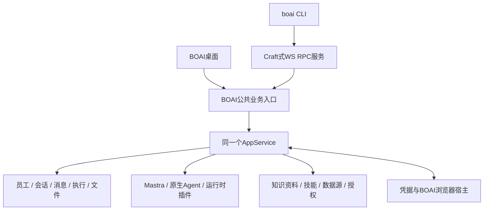

<!--
[INPUT]: 2026-10-18用户要求完全参考Craft CLI设计，先落实文档、以后自行设置goal；固定Craft源码及BOAI现有业务、宿主和员工权限合同。
[OUTPUT]: BOAI CLI完整命令映射、WS协议、桌面/独立服务与run生命周期、必要业务适配、C0–C5实施计划、验收和可复制goal；当前未实施。
[POS]: 第21组唯一设计、实施计划与实际进度；§12维护状态，不以Craft能力或已有BOAI测试代替本功能验收。
[PROTOCOL]: 一旦本文件变化，必须同步更新Header，并上浮检查所属目录.folder.md和spec索引。
-->
# BOAI CLI：Craft参考设计与实施计划

日期：2026-10-18。状态：**仅完成设计文档，等待后续goal；未新增CLI、服务监听、依赖或产品实现，未运行真实员工任务。**

目标：完整参考Craft CLI的命令组织、WebSocket RPC客户端、服务端拆分、流式输出、自启动运行和服务验证方式，交付BOAI数字员工系统的命令行入口。终端与桌面访问同一服务实例时，共用员工、会话、执行、资料、数据源、插件和权限；API员工继续Mastra，本机员工继续原生执行。

“完全参考”指采用Craft这一套设计作为实现主线，不再混合OpenCode/OpenClaw另造框架。业务对象、现有权限和数据保留的必要适配逐项列在§2–7。实现优先迁用可复用源码，再替换BOAI接线；不要求引入Craft的SessionManager、Agent SDK或改造整个仓库为Bun monorepo。

## 1. 固定参考与当前事实

### 1.1 Craft源码基线

仓库：[craft-ai-agents/craft-agents-oss](https://github.com/craft-ai-agents/craft-agents-oss)。本次通过GitHub提交API核对并读取的固定提交为 **`22c9f0414ab63e0a22814c9a2ada740206e09091`**，提交时间2026-10-16T04:36:55Z；该提交CLI包版本为0.15.3。以下固定链接是实现参考，不能用会变化的main内容替换后仍沿用本次结论。

| 固定来源 | 已核对内容 | BOAI采用方式 |
| --- | --- | --- |
| [apps/cli/src/index.ts](https://github.com/craft-ai-agents/craft-agents-oss/blob/22c9f0414ab63e0a22814c9a2ada740206e09091/apps/cli/src/index.ts) | 参数/环境变量、全部命令、stdin、文本/JSON流、run、服务验证 | 迁用组织方式和通用逻辑；换成原BOAI业务方法，逐项映射§3 |
| [apps/cli/src/client.ts](https://github.com/craft-ai-agents/craft-agents-oss/blob/22c9f0414ab63e0a22814c9a2ada740206e09091/apps/cli/src/client.ts) | 握手、关联请求、超时、事件订阅、断开清理；轻量客户端不自动重连 | 优先迁用客户端骨架；与BOAI协议类型及认证接线 |
| [apps/cli/src/server-spawner.ts](https://github.com/craft-ai-agents/craft-agents-oss/blob/22c9f0414ab63e0a22814c9a2ada740206e09091/apps/cli/src/server-spawner.ts) | 自启动服务、随机端口/token、读取ready、子进程停止 | 保留结构，适配Node及BOAI单实例、凭据和实际退出合同 |
| [packages/shared/src/protocol/types.ts](https://github.com/craft-ai-agents/craft-agents-oss/blob/22c9f0414ab63e0a22814c9a2ada740206e09091/packages/shared/src/protocol/types.ts)、[transport](https://github.com/craft-ai-agents/craft-agents-oss/tree/22c9f0414ab63e0a22814c9a2ada740206e09091/packages/server-core/src/transport) | handshake/request/response/event、结构错误、版本、能力与消息限制 | 采用协议形状；业务DTO复用BOAI类型，不复制另一份员工领域模型 |
| [headless-start.ts](https://github.com/craft-ai-agents/craft-agents-oss/blob/22c9f0414ab63e0a22814c9a2ada740206e09091/packages/server-core/src/bootstrap/headless-start.ts)、[lock-identity.ts](https://github.com/craft-ai-agents/craft-agents-oss/blob/22c9f0414ab63e0a22814c9a2ada740206e09091/packages/server-core/src/bootstrap/lock-identity.ts) | 服务初始化、平台注入、token、进程锁和启动状态 | 参考拆分和锁身份核对；同数据目录单一运行所有者 |
| [packages/server/src/index.ts](https://github.com/craft-ai-agents/craft-agents-oss/blob/22c9f0414ab63e0a22814c9a2ada740206e09091/packages/server/src/index.ts) | 独立服务装配、WS/WSS、平台服务、关闭 | 替换为AppService和BOAI宿主适配，不迁入Craft执行引擎 |
| [client.test.ts](https://github.com/craft-ai-agents/craft-agents-oss/blob/22c9f0414ab63e0a22814c9a2ada740206e09091/apps/cli/src/client.test.ts)、[commands.test.ts](https://github.com/craft-ai-agents/craft-agents-oss/blob/22c9f0414ab63e0a22814c9a2ada740206e09091/apps/cli/src/commands.test.ts)、[run.test.ts](https://github.com/craft-ai-agents/craft-agents-oss/blob/22c9f0414ab63e0a22814c9a2ada740206e09091/apps/cli/src/run.test.ts)、[retry-stream.test.ts](https://github.com/craft-ai-agents/craft-agents-oss/blob/22c9f0414ab63e0a22814c9a2ada740206e09091/apps/cli/src/retry-stream.test.ts) | 命令/连接、独立运行与重试流显示意图 | 迁为仓库Vitest用例，另验BOAI真实员工与桌面路径 |

许可证：[Apache-2.0](https://github.com/craft-ai-agents/craft-agents-oss/blob/22c9f0414ab63e0a22814c9a2ada740206e09091/LICENSE)及[NOTICE](https://github.com/craft-ai-agents/craft-agents-oss/blob/22c9f0414ab63e0a22814c9a2ada740206e09091/NOTICE)。实际迁入时保留适用版权/许可和来源说明，记录迁入文件、固定提交及修改；本次仅研究，未复制源码进入产品。上游依赖的许可不因CLI文件采用Apache-2.0而自动被替代。

### 1.2 BOAI已有基础与缺口

| 现有位置 | 本次核对事实 | 待实现内容 |
| --- | --- | --- |
| [package.json](../../../package.json) | Electron入口和开发/评估脚本，无产品`boai`命令bin | 产品CLI构建、分发与安装入口 |
| [src/shared/ipc/index.ts](../../../src/shared/ipc/index.ts) | 已有Methods、AppEvent、sendMessage/getMessageReceipt/cancelRun等类型 | 对外WS合同、方法准入、事件及错误映射 |
| [src/main/main.ts](../../../src/main/main.ts) | 校验桌面请求来源，托管runtime和宿主能力 | 桌面服务入口、连接发现、独立服务连接与生命周期 |
| [src/runtime/worker.ts](../../../src/runtime/worker.ts) | 依赖Electron parentPort；凭据/浏览器向主进程请求 | 可复用服务装配，Electron和独立Node两种启动适配 |
| [src/runtime/service.ts](../../../src/runtime/service.ts) | AppService拥有员工、消息、运行、调度与回执 | CLI复用原业务；不新增第二套执行循环或数据库写入者 |
| [src/main/vault.ts](../../../src/main/vault.ts)、[browser-service.ts](../../../src/main/browser/browser-service.ts) | 凭据使用Electron safeStorage；浏览器由桌面宿主持有 | 显式宿主能力/凭据提供者，缺失时如实返回不可用 |

已有IPC类型不能直接当成无认证远程接口。当前浏览器、资料和插件能力均以原专题实际状态为准；这张表不表示已有独立服务或网络CLI。

## 2. 产品对象与整体结构



- **CLI是客户端。** 与桌面共用业务服务，命令本身不直接读写SQLite，不独立建立调度器、员工循环、Work账本或MCP连接池。
- **session对应BOAI Conversation。** CLI返回的sessionId就是conversationId；本机Agent自己的session仍是员工×聊天×运行配置下的内部映射，不能混用。
- **employee对应已有数字员工。** `--employee`使用稳定员工ID；名称只可在唯一匹配时解析，重名拒绝自动选择。不复制员工配置到一套CLI专用身份库。
- **workspace对应BOAI服务数据配置。** 服务实例关联一个明确的data profile；`workspaces`首版返回该实例的一项配置身份，`--workspace`核对其ID。它不是员工授权目录，也不是把每个聊天变成Craft workspace；不为兼容命令强行建设多租户工作区。
- **群聊仍沿原成员执行。** `send`可指向已有普通群，通过`--mention`选择成员；未指定沿原群路由。CLI不是群内新员工或负责人。
- **一份数据目录只有一个运行所有者。** 桌面启动和独立服务启动共用进程锁、版本核对与发现机制。多CLI只增加连接，不重复接收渠道或触发定时任务。

## 3. 完整命令映射

产品可执行名采用`boai`。所有示例都是待实现设计；CLI参数使用稳定ID，显示名称仅用于阅读。下表是完整goal的交付范围，不能只完成ping/send就宣称Craft式CLI已完成。

| Craft命令 | BOAI命令 | BOAI语义 |
| --- | --- | --- |
| 无参数、`--help`、`--version` | 同名 | 显示帮助/CLI版本，不启动员工或模型 |
| `ping` | `boai ping` | 连接、握手和延迟 |
| `health` | `boai health` | 服务、存储、凭据提供者、宿主能力的可用状态；不返回密钥、不调用模型验证额度 |
| `versions` | `boai versions` | CLI/服务/协议版本及当前运行适配器版本；未知明确标注 |
| `workspaces` | `boai workspaces` | 当前服务profile的身份和显示名；受限调用者不获任意宿主路径 |
| `sessions` | `boai sessions [--employee <id>]` | 获准会话列表，分页；过滤不改变会话成员 |
| `connections` | `boai connections` | 获准模型连接摘要；无凭据正文 |
| `sources` | `boai sources [--employee <id>]` | 数据源目录/绑定与状态；沿bobo和普通员工原有权限 |
| `session create` | `boai session create --employee <id> [--name <text>]` | 获取或创建该员工的原主私聊，返回`created`事实；`--name`仅用于新建，已有会话不被隐式改名。不另造多个主私聊，群和渠道创建继续原业务入口 |
| `session messages <id>` | 同名 | 原会话消息及稳定分页游标，可接续终端/桌面历史 |
| `session delete <id>` | 同名 | 原会话删除业务；活动执行需先明确停止并确认退出，不隐式删除员工、知识资料或外部项目目录 |
| `send <id> <message>` | 同名 | 正文/stdin通过原消息受理，监听本条请求关联的回复与执行事件 |
| `cancel <id>` | `boai cancel <session-id> [--run <id>]` | 原cancelRun语义。多项活动执行时要求明确run，不能猜测取消整群；不把请求已提交当进程已退出 |
| `invoke <channel> [json-args...]` | 同名 | 调用公开登记的BOAI RPC，仍过身份、schema和权限；不调用任意内部方法 |
| `listen <channel>` | `boai listen <channel> [--session <id>]` | 订阅获准事件；输出JSON行，可按会话过滤 |
| `run <message>` | `boai run <message> [--employee <id>]` | 发现/启动服务→解析员工及原私聊→发送→流式等待→按服务所有权退出；见§4 |
| `--validate-server` | 同名 | 结构化多步集成验证，隔离验证数据和结果；见§9 |

BOAI必要补充：`boai employees`提供员工列表，`boai serve --data-dir <path>`装配独立服务；`boai receipt <request-id>`查询原受理/执行状态。文件通过公开的文件列表/读取/导出RPC先接通，完整终端文件浏览器、TUI、插件商店和批量配置向导另期，不扩大本goal。

`session delete`、配置修改和审批属于已认证用户操作。非交互脚本需要明确参数，不能靠终端回答“yes”绕过业务权限；源或连接测试有真实外部调用时按原测试接口标识，普通list/health不触发。

### 3.1 参数与配置

| Craft参数组 | BOAI约定 |
| --- | --- |
| `--url`、`--token`、`--tls-ca` | 保留；环境变量为`BOAI_SERVER_URL`、`BOAI_SERVER_TOKEN`、`BOAI_TLS_CA`。连接参数优先于环境变量，再使用明确选中profile的本地连接配置；URL与token必须来自同一连接配置，显式远端不能带上本地token |
| `--workspace` | 保留，含义按§2；多配置不自动选“第一个”，明确当前profile后才能执行 |
| `--timeout` | RPC/连接等待期限，默认10秒；超时是回执未知或连接失败，不是员工任务自动取消 |
| `--send-timeout` | 默认300000毫秒，沿Craft等待习惯；仅限制客户端等待，支持`0`持续等待。本机执行不因此增加BOAI时长/用量预算 |
| `--json`、`--output-format text\|stream-json` | 列表/单次RPC JSON和执行JSON行分别表达；执行时`--json`等价stream-json，显式冲突参数报用法错误 |
| `--verbose`、`--no-spinner`/`--disable-spinner` | 保留；非TTY/JSON模式无动画和颜色，诊断写stderr |
| `--source <id>` | 可重复；本轮明确选择已有源，沿Composer真实ID/版本和员工授权，不新建源、不默认解除绑定限制 |
| `--workspace-dir <path>` | 本次业务工作位置，等价显式`--cwd`；服务端解析并核对目录许可，不改data profile，不自动授予目录访问权 |
| `--mode` | 缺省继承员工配置；接受`read-only`、`ask`、`allow-all`并映射现有员工执行权限。与已保存员工权限不一致时要求先通过原员工配置明确修改，禁止通过run临时提权或静默改员工 |
| `--provider`、`--model`、`--api-key`、`--base-url` | 保留为本轮API模型来源覆盖，使用原连接校验与冻结来源身份；不修改员工/全局默认连接。仅可信用户可提供；本机员工拒绝这些API覆盖参数，沿自身运行配置。凭据只在服务凭据适配器使用，不写入消息/Trace/结果；重启后缺失则如实不可续用 |
| `--no-cleanup` | 接受并在帮助中说明BOAI默认保留业务会话；该参数只要求保留本轮CLI诊断暂存。没有自动删除历史的默认模式 |
| `--server-entry` | 仅开发/验证入口，默认使用随版本分发的BOAI服务；不能由远端RPC指定宿主执行路径 |
| BOAI补充 | `--employee`、`--mention`、`--request-id`、分页`--cursor/--limit`、`--data-dir`（serve/本地启动） |

`--stdin`明确从标准输入读取正文；无正文且stdin为管道时沿Craft自动读取。显式正文与stdin按顺序合并，控制参数本身不得混入消息。支持`--`结束参数解析，保留其后的原始正文；未知参数、无效数字和缺少参数值在发送前拒绝。

本轮模型覆盖必须记录脱敏的来源身份/版本，不能只在CLI进程中改环境后让服务仍使用旧连接。模型来源、员工身份、权限分别冻结；受理后参数变化不会改写原执行。本机能力、用量和模型目录沿原适配器，未实现的参数明确拒绝，不静默忽略。

服务路径都指向**服务所在机器**。远端`--workspace-dir`不是上传本机目录；附件必须通过原材料导入协议发送真实字节/固定来源，再形成selectionId。`stdin`仅提供正文，不能伪造附件授权。

### 3.2 使用示例

```bash
# 默认连接明确选中的本机BOAI服务，显示获准员工与会话
boai employees --json
boai session create --employee employee-id
boai send conversation-id "整理本周进展"

# 脚本正文、稳定请求ID与可机器读取的过程
cat report.md | boai send conversation-id --stdin --request-id request-id --output-format stream-json
boai receipt request-id --json
boai listen session:event --session conversation-id
boai cancel conversation-id --run run-id

# Craft式一条命令运行，原员工配置和历史保持
boai run --employee employee-id --source source-id "检索资料并给出来源"

# 独立部署；连接凭据由受保护配置/环境提供，不写入示例
boai serve --data-dir /path/to/boai-server-profile
boai --url wss://boai.example.test sessions --json
```

## 4. 服务连接、run与退出

### 4.1 桌面托管服务

第一阶段在原Electron宿主开放受认证的WS入口，代理到原AppService。Renderer可以继续使用preload/IPC，但IPC和WS必须进入同一业务准入层；不要求为首版CLI重写桌面全部调用。关闭窗口按既有托盘设置处理，真正退出仍执行原排空流程。

CLI在本机发现端点后核对profileId、serverId、版本和活跃所有者，再连接。发现文件只提供连接定位和凭据引用，不能作为无需认证的通行证；过期记录不能误连其他程序。默认只监听loopback，不使用固定端口抢占；端口可配置，自动启动默认随机端口。

### 4.2 独立服务

独立入口复用AppService装配，通过接口注入SecretStore、浏览器宿主及通知能力；核心业务不依赖Electron模块导入。`serve`前台运行，显式配置profile后提供WS/WSS。桌面选中该服务时连接既有实例，不再启动同数据目录的worker；桌面本地文件选择仍由本地宿主处理，经材料协议传入服务。

服务配置沿Craft命名结构提供`BOAI_RPC_HOST`、`BOAI_RPC_PORT`、`BOAI_RPC_TLS_CERT/KEY/CA`及`BOAI_SERVER_TOKEN`，`serve --host/--port`可明确覆盖监听位置；证书和私钥必须成对有效。默认loopback/随机端口，显式非loopback监听必须配置有效认证及TLS或明确受保护的隧道部署。ready返回已生效地址、profileId/serverId和能力，不返回token；客户端连接配置与服务端模型凭据分别保存。后台交接的服务提供公开登记的`server:status`与仅用户可调用的`server:shutdown`，关闭仍走原排空流程。

进程锁覆盖桌面和独立入口，至少记录规范化dataPath、实例身份及可核对的进程启动身份。PID相同不足以判定所有者；活跃锁竞争返回已有服务或明确拒绝。恢复旧锁、升级和启动检查不能重放旧消息、工具或定时触发。退出必须等待原执行器和子进程实际退出后释放锁；恢复沿已有未知回执规则。

完整goal要求桌面托管和独立服务两条路径，远端协议用受控WS/WSS环境验收；公有云托管、多用户账户、集群调度和自动部署不在范围。

### 4.3 run自启动

1. 解析目标服务/profile和员工。缺省员工仅在当前profile已有bobo时选择bobo；没有配置则明确提示配置员工，不能偷偷创建一个完全权限员工。`--provider`等参数也不改变这个身份前提。
2. 有明确URL或已有同profile服务时直接连接。否则使用随包服务入口启动该profile的唯一实例，等待真实ready；不能在同一数据库旁再启动一套AppService。此处适配Craft“总是spawn”的做法，以满足BOAI现有常驻调度。
3. 获取员工原私聊，将本轮来源、选择源、工作位置和requestId交给公共受理入口。普通提问沿普通消息，不为CLI统一强制创建Work。
4. 先建立事件订阅再提交；先输出受理身份，后显示原执行事件和最终结果。仅等待本条消息关联的执行，不把会话中其他并行回复当本次完成。
5. 正常结束保留消息、文件、运行记录。连接到已有服务时只关闭客户端；自启动服务且全部工作已结束时，按原关闭流程停止自己拥有的服务。
6. 自启动服务还有其他客户端/活动执行，或本次等待用户输入、客户端超时而任务仍在运行时，交接为可重新连接的后台服务，输出端点与原请求身份；不得为了CLI退出直接杀掉原工作。后台所有者与退出入口必须可查询，不能遗留无登记进程。

`send/listen`的Ctrl+C默认结束终端等待，不隐式取消运行。`run`的Ctrl+C沿Craft表达取消本次调用：按原身份请求取消，仅在确认实际退出后清理本次暂存；确认不到则保留未知/待退出状态和可核对身份。SIGTERM、断网和强杀也不能把未确认的业务结果记成成功；重新连接先查回执，不自动重新发送。

## 5. 传输、输出与受理合同

### 5.1 RPC与准入

采用Craft式`handshake → handshake_ack → request/response/event/error`和关联ID。请求/事件的具体类型定义在共享协议中；握手带协议版本，服务返回自身版本、实例身份、消息上限和当前可用方法/能力。未知版本或未登记方法明确拒绝。

协议关联ID与业务requestId分开：前者关联一次网络请求，后者稳定标识一次用户动作。`send`沿原sendMessage/getMessageReceipt；新建或删除等原来没有持久回执的写操作，在公共业务层补必要幂等受理，不能在CLI内另建“已执行”文本缓存。相同requestId、相同内容返回原回执；相同ID不同正文/目标拒绝。受理回执先于最终回答，模型/工具失败不否认已受理事实。

`invoke`只访问显式公开登记的channel；登记项声明输入schema、权限和副作用类别，再映射现有Methods。不能使用动态对象索引直达AppService私有方法，也不能把桌面全部Methods自动变成远程白名单。`__backup`、`__startBrowserAction`等内部通道以及凭据明文读取不因invoke开放。业务错误保持可检查code/message，网络断开和结果未知单独表达。

### 5.2 事件与结果

采用Craft的文本增量、工具开始/结果、重试/部分内容废弃、完成、中断和错误事件思路，内容取自原Run/ExecutionFeed/Trace及公开消息。BOAI增加accepted、需要审批、需要用户输入和结果待核对状态；不伪造模型推理、完成消息或第二份执行记录。

每条业务事件带可用的conversationId、messageId/requestId、runId和原事件身份；群内还带agentId。客户端按本请求归属过滤；事件缺失或断开时通过回执和历史快照恢复，Craft轻量客户端首版不自动重发/重连。保留原消息/工具证据即可恢复业务状态，不要求为了CLI持久化每一个文字token。

输出规则：stdout只放请求结果或JSON行，日志/连接提示/动画放stderr；每个JSON事件独立成行，含协议版本和类型。`listen`不在JSON流中插入“Listening…”提示。文本模式明确区分被废弃的部分输出与最终回答，工具错误不可被后续普通文本吞掉。

退出码：`0`为该命令达到自身成功条件；`1`业务/服务失败；`2`参数错误；`3`已受理但需审批/输入；`4`等待超时、连接中断或结果尚无法确认；`130`用户中断。`send/run`返回0要求关联执行正常结束；`cancel`返回0要求目标实际停止或已经终态。原业务尚需人工验收时如实返回其状态，不把模型结束等同于人工认可。

超时或返回3/4必须同时输出原requestId、已知messageId/runId以及下一步核对方式；不能将“正在执行”包装成普通成功。stdin及WS消息大小沿现有正文/材料上限校验，不自动截断用户输入。

## 6. 员工权限、资源与渠道

1. **目录授权沿员工。** 参考[第4组05](../4.数字员工与协作重构/05-员工工作范围与目录权限设计.md)和[06](../4.数字员工与协作重构/06-工作范围实施计划与验收.md)：已授权范围直接使用，授权外申请后继续，完全访问自动授权其他目录；`cwd`不等于授权。群和本机各用执行员工自己的许可。
2. **批准仍是用户动作。** 待审批/普通提问保持原run或后续turn语义。CLI输出请求身份和所见版本；可信用户通过公开审批RPC或桌面批准，重复/过期批准拒绝。无TTY时返回待输入状态，不能替用户自动选择。完整权限员工按原规则自动批准，无额外CLI审批开关。
3. **CLI身份必须可信。** 本人终端使用用户级连接凭据；员工工具调用CLI时只获得与其员工/run绑定的受限凭据，身份由服务验证，不能自报agentId冒充用户。子进程不继承用户级管理token；受限请求不能修改自身权限、批准自身操作或调用更高权限员工绕过原委派规则。本机同OS完全权限不是额外进程隔离保障，不在本功能声称能防御已控制用户账户的程序。
4. **知识资料仍是知识资料。** 沿[第4组07](../4.数字员工与协作重构/07-员工知识资料设计与实施计划.md)及已有knowledge权限使用，CLI普通附件不会自动成为员工知识资料，也不改为长期记忆。资料的配置来源不提高其指令优先级。
5. **浏览器/MCP/plugins沿原能力。** 沿[第19组08](../19.应用插件架构/08-Composer与技能数据源整合设计.md)、[09](../19.应用插件架构/09-WebSearch工具接入设计与实施计划.md)和[运行时插件05](../19.应用插件架构/05-Agent运行时插件协议与接入架构.md)。`--source`只引用既有源，不能绕过员工授权；CLI不会再装一套MCP目录或插件宿主。
6. **渠道外发必须明确。** 普通CLI发送表示本人在BOAI内继续该聊天，不伪造渠道入站来源，不因目标是渠道记录就自动回发外部平台。需要外发时调用原明确发布接口，沿原回执和权限；验收必须包含此边界。

上述三份新设计有各自后续goal。CLI复用实施时已有能力，不把它们的全部新增功能拉入本goal，也不能声称CLI完成即目录授权/知识资料/Web Search已经实现。C0记录实际可用能力；尚未实现的选项返回明确不可用，后续能力上线再补相应集成验收。

## 7. 凭据、浏览器与分发

### 7.1 凭据与独立运行

桌面托管模式继续通过原CredentialVault提供SecretStore，不改变既有密钥存储。独立Node服务不能直接假定可解密Electron safeStorage文件：完整goal先支持独立profile的**服务端环境变量引用/进程内临时凭据提供者**，配置只保存变量名或凭据引用，不把值写入业务数据。原生Agent登录继续交给其原生程序管理。

同一已有profile从Electron交给独立服务时，须先实际退出旧所有者；若其持久API凭据只能由原vault解密，必须连接可信凭据宿主才能使用，未连接就报告该连接凭据不可用。本goal不静默迁移密钥、不落明文备用文件。无Electron的新独立profile通过服务端配置和原公开管理接口准备员工/连接，再运行CLI；不自动导入个人原生登录或其他profile密钥。

WSS和自定义CA沿Craft配置方式；TLS配置必须在创建连接前真正生效，不以关闭证书校验实现。用户token、模型密钥不出现在stdout事件、Trace、URL、错误或ready日志；自启动子服务通过私有父子通道传递token和启动回执，不能沿上游打印token的方式进入普通日志。

### 7.2 浏览器宿主

桌面模式直接复用原BrowserHostBridge和BrowserService，沿员工租约、原请求、审批及实际退出。独立服务无已连接浏览器宿主时公布`browserAvailable=false`；普通API/MCP/本机能力可继续，真正请求浏览器则明确不可用，不能静默换搜索源冒充浏览器结果。

完整goal需实现**同机器**桌面宿主连接独立服务后的浏览器桥：身份、实例、租约和文件下载位置都核对原服务，断开不自动重放网页动作。跨机器浏览器文件上传/下载和远程桌面控制另期；远端CLI控制的是服务所在机器的已连接宿主，不默认使用CLI客户端机器的浏览器。

### 7.3 构建与安装

沿BOAI现有pnpm/Node构建，Craft的Bun.spawn/Bun.stdin及workspace imports做最小等价适配。CLI客户端、共享协议、服务入口分别打包，普通CLI命令不启动Electron渲染窗口，不要求用户安装Bun或持有源码checkout。

桌面设置提供“安装命令行工具”、版本/连接状态和卸载入口，复用现有组件与Sonner错误规范；安装只写所选的命令链接/启动器，不改员工配置。CLI与服务版本不兼容时明确提示，升级后链接指向正确构建，不能误连开发服务或旧安装包。本goal验收macOS源码与当前构建产物；其他OS发行包签名、公证、包管理器发布和自动后台服务安装另期。

## 8. 实施落点与阶段

以下是后续实现建议位置，当前不预建源码目录。实施时先核对现有导出/调用者，以最少新模块接线；服务合同只维护一份。

| 位置 | 职责 |
| --- | --- |
| `src/cli/`（待新增） | Craft式参数/命令、CliRpcClient、输出、服务发现与spawner |
| `src/shared/cli/`（待新增） | 版本化信封、公开channel/schema与错误；引用原领域DTO |
| `src/runtime/`内服务装配与独立入口 | 抽离worker启动胶水，复用AppService、存储、引擎及调度 |
| `src/main/`内CLI接线 | 桌面WS入口、原worker代理、凭据/浏览器宿主与安装入口 |
| `scripts/build.mjs`及构建配置 | CLI/独立服务产物和发行应用中的资源定位 |
| `tests/`及现有Electron BDD | 协议、生命周期、真实产品双入口和当前包验证 |

| 阶段 | 必须交付 | 完成依据 |
| --- | --- | --- |
| C0 固定复用与接口清单 | 固定来源/许可、逐文件迁用计划、当前方法和宿主能力盘点、完整命令/参数映射 | 无未说明的命令缺失；已有与待做能力分开 |
| C1 公共协议和桌面服务 | WS/WSS握手、身份/方法准入、单实例发现、统一业务入口 | 桌面与CLI并发访问同数据，无第二worker/调度器 |
| C2 完整客户端 | §3命令、stdin/JSON流、回执、事件、取消、审批/输入反馈 | 全部命令真实接线；失联和未知不重发 |
| C3 独立服务和run | 独立装配、SecretStore适配、serve、自动启动/复用/交接/退出、桌面附着 | 无Electron独立profile可执行；同机浏览器宿主可接回 |
| C4 资源与分发 | 模型来源覆盖、source/cwd权限接线、安装/升级及完整validate入口 | 原资源身份、员工权限和发行产物路径正确 |
| C5 完整验收与交接 | 下表矩阵、原件/日志/实际退出、失败及未认证范围 | 更新§12；不以协议夹具或上游测试替代实际产品成功 |

C1/C2可先形成可用增量，但完整goal包含C0–C5、独立服务和run，不能把后两者改成默认延期。新增目录授权/LK/SE的独立功能及跨机器浏览器另按其原范围办理。

## 9. 验收矩阵

`--validate-server`沿Craft的多步验证形式，打印每步结果、耗时、错误和总体退出码。默认用隔离profile及受控协议/工具夹具；连接已有服务时，默认只做无副作用诊断。完整可变更验证必须明确指定专用验证profile，真实模型使用实施时选定的专用员工/来源并记录调用账本，不修改个人源、技能、渠道或默认连接。清理只处理本次创建且身份/hash仍匹配的验证资源，先导出证据。

| 编号 | 场景 | 通过条件 |
| --- | --- | --- |
| CLI-A01 | 帮助、版本、参数/env优先级与全部命令 | §3逐项可用；错误参数明确拒绝，无隐式业务执行 |
| CLI-A02 | 本机发现、WS/WSS、token和协议版本 | 正确连接成功；错token/错profile/不兼容版本/无效CA拒绝，凭据不串端点 |
| CLI-A03 | 目录、员工、会话、源、连接查询 | 同一服务与桌面事实一致；分页稳定、不泄露凭据/未授权对象 |
| CLI-A04 | 创建/删除会话 | 复用原主私聊；删除走原业务，活动执行/外部项目/知识资料边界正确 |
| CLI-A05 | 桌面→CLI→桌面连续聊天 | 同一员工、conversation/message和原生session沿既有映射，回复与执行可追溯 |
| CLI-A06 | stdin、文本与stream-json | 中文/多行完整，消息上限明确；stdout无日志污染，stderr与退出码可供脚本使用 |
| CLI-A07 | 群内并行与流式关联 | 各成员独立身份；本次完成不误用同会话其他请求事件，不新增虚假Work |
| CLI-A08 | 受理后断连/超时/重复requestId | 回执可查、同ID同内容不重复，冲突拒绝；旧未知工具不重放 |
| CLI-A09 | listen和部分文本废弃 | 事件按授权过滤；退订无泄漏，重新核对可恢复状态，废弃内容不拼成最终结果 |
| CLI-A10 | cancel、Ctrl+C、故障及重启 | send退出与run取消按§4区分，实际进程退出后释放资源；不取消其他员工工作 |
| CLI-A11 | ask/read-only/full权限与输入 | 待批/待答真实呈现；完全权限沿员工自动批准，非交互不自选，旧批准不能用于新动作 |
| CLI-A12 | 身份/invoke/内部通道 | 用户与受限员工凭据分别验收；自我提权/私有channel/明文凭据读取拒绝，公开合法操作通过 |
| CLI-A13 | 工作位置与目录授权 | cwd不改变profile或许可；若目录授权新功能已上线，授权内、申请后、拒绝、完全访问四路径均验；否则明确不可用并登记依赖缺口 |
| CLI-A14 | source/知识资料/原生工具 | 沿现有ID/授权，撤权后新调用失败；新LK/SE能力未上线不能伪造通过，本机原生能力不被CLI裁剪 |
| CLI-A15 | API覆盖与本机保持 | 本轮API来源实际正确、不改已保存默认；本机拒绝不适用覆盖，CLI等待期限不成为本机预算 |
| CLI-A16 | run服务所有权 | 复用已有、自己启动、其他客户端接入和等待交接分别通过；只停本人所拥有且可退出的服务 |
| CLI-A17 | 双启动、残留锁、升级/崩溃恢复 | 同dataPath一个执行/调度所有者，PID复用不误判；原计划和渠道不重复处理 |
| CLI-A18 | 无Electron独立服务与凭据 | 专用profile沿服务端凭据跑通；旧safeStorage不可读时明确失败，无明文降级或破坏旧密钥 |
| CLI-A19 | 浏览器宿主存在/缺失/断开 | 桌面与同机独立服务桥均可用；无宿主如实不可用，断开不重放，下载沿原归属 |
| CLI-A20 | 渠道记录续聊/明确发布 | CLI内部续聊不自动外发，明确发布沿原权限/去重回执 |
| CLI-A21 | validate成功/失败及证据 | JSON与退出码一致，原失败保留，隔离清理不污染个人数据；离线与真实成绩分开 |
| CLI-A22 | 安装、升级、源码和当前包 | `boai`在无源码依赖环境可运行，版本/资源定位正确，卸载只移除CLI安装项 |

真实执行最小覆盖：API/Mastra员工、本机Codex、Claude各做连续聊天与文件交付；已安装运行时插件至少一个做同协议烟测；群聊选一组API/本机混合成员；浏览器选已有可用员工；真实源使用明确授权的测试源。供应商失败、未安装插件或外部认证缺失分别记录，不把“未运行”记为通过。

必需生命周期覆盖桌面托管与独立服务，WSS使用受控证书环境；至少一次当前macOS构建的CLI与桌面互通。测试使用项目Vitest及Electron Playwright BDD，真实模型、受控协议、源码和发行构建分别留证；不得直接运行上游验证脚本去改个人Craft/BOAI环境。

## 10. 与既有专题的关系

- [第17组桌面后台](../17.桌面后台运行/README.md)：原托盘/真正退出/登录启动保持；本组负责CLI服务所有者，自动注册系统daemon另期。
- [第13组10](../13.本机Agent员工运行时/10-员工一等公民与执行能力设计.md)、[11](../13.本机Agent员工运行时/11-Rovai对齐与本机执行纠偏.md)：本机员工是原生程序的BOAI通信入口；BOAI CLI则是用户/程序访问整个BOAI的入口，二者不互换，不包一层新Mastra判断循环。
- [第19组05](../19.应用插件架构/05-Agent运行时插件协议与接入架构.md)：运行时插件沿原注册与生命周期，CLI不新增品牌驱动分支。
- [第20组模型网关](../20.模型网关接入/README.md)：Magpie等是模型来源；BOAI RPC服务是本产品业务入口，不能把两者的端点、token或调用协议混用。
- 目录授权、知识资料、Web Search分别引用§6原专题，原实际进度继续由它们拥有；本功能的唯一实际进度在本篇§12。

## 11. 后续goal文本

> 按`ai-docs/spec/21.BOAI-CLI/01-Craft参考设计与实施计划.md`完整实现BOAI CLI。以固定Craft提交`22c9f0414ab63e0a22814c9a2ada740206e09091`的CLI、WS RPC、服务装配、spawner和验证方式为主线，优先迁用可复用代码并保留来源许可。完成C0–C5，包括完整命令/参数映射、桌面共享业务服务、独立serve、run自启动/复用/交接、stdin/JSON流、回执去重、原权限与资源接线、同机浏览器宿主桥和macOS构建安装。保持员工/会话/Work及原生Agent语义，不重复启动数据库写入者/调度器、不自动重放未知请求、不把等待超时变成本机执行预算。按CLI-A01–A22完成适用范围的技术与实际产品验收，逐项列明独立功能依赖、失败和未认证范围；实际状态只更新本篇§12。目录授权、知识资料和Web Search尚未实施的独立增量不因CLI扩入本goal，但必须明确能力缺失，不以静默忽略代替接线。独立服务与run属于必需范围，不能只交付桌面ping/send后宣布完成。

用户当前仅要求文档。以上文本用于以后明确设置goal，本轮不启动goal、不安装CLI、不监听端口、不提交推送。

## 12. 唯一实际进度

| 阶段 | 当前状态 | 事实与剩余 |
| --- | --- | --- |
| 设计研究 | 文档已建立 | 已读取固定Craft提交的CLI/协议/服务装配/测试参考，并核对BOAI现有入口；不代表上游运行验证 |
| C0 | 待实施 | 文档已给来源和命令映射；实际逐文件迁入清单、接口冻结和能力盘点仍需goal完成 |
| C1–C4 | 未开始 | 无新增CLI产品代码、独立服务、安装或凭据迁移 |
| C5 | 未开始 | 无本功能协议测试、真实员工任务、桌面/独立服务或当前包验收成绩 |

后续每批记录运行构建、阶段/验收编号、真实请求数量、通过/失败、证据位置和未覆盖范围。已有BOAI或Craft测试成绩不能挪作本功能通过；阶段完成与完整goal完成分别记录。
