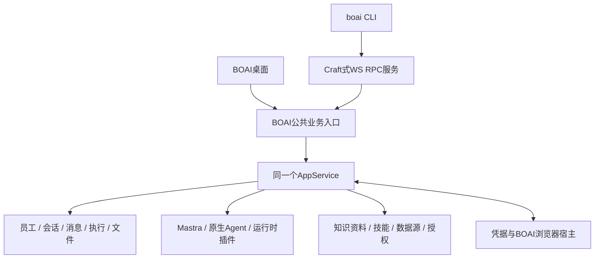

<!--
[OUTPUT]: 2026-10-25源码链接随Workspace迁移更新，历史验证结论保持。
[OUTPUT]: §12.35补第23组同9d7产品指纹CLI恢复7场及现行任务管理共8场通过；原附着/退役导航失败保留，准备屏障不改变业务断言。
[OUTPUT]: 2026-10-19按用户明确要求删除本次四目标的测试数据、截图、回放、数据库、构建归档及临时验收包，不保留本地或上传GitHub；源码/测试源码及文字结果保留，原附件链接已移除。
[OUTPUT]: 2026-10-19四项目标当前macOS约定技术范围完成：目录06 §5.15、知识07 §9.13、搜索19组09 §10.11、CLI21组01 §12.34；本机沿原生配置，历次失败/人工未评价及另期范围保留。
[OUTPUT]: 2026-10-19用户明确本机Agent完全保留原生能力，BOAI目录限制退役；API目录与产品资源授权保持，当前合同及实际归4组06 §5.13。
[OUTPUT]: CLI渠道明确发布接原事务，144回归及独立CLI通过；当前包发布合同/安装验证通过，实际和原失败归§12.32，四目标继续。
[OUTPUT]: 三后端真实CLI文件交付、已安装Pi连续交流及API/Codex混合群均通过；5场6用户轮/101证据/10回放，实际归§12.31；渠道CLI缺口继续补接。
[OUTPUT]: API/Codex/Claude真实CLI与桌面连续聊天三场通过，12实际用户轮含原3失败；108证据/12回放与零重放归CLI §12.30，完整四目标继续。
[OUTPUT]: 当前包3进程恢复/3桌面及3050文件/490构建输入核对通过；CLI§12.29、知识§9.11和搜索§10.10各自登记，完整四目标继续。
[OUTPUT]: 仅更新知识§9.10/目录§5.12/搜索§10.8的接续引用；CLI实现和实际验收仍为§12.28，四目标未完成。
[OUTPUT]: 附件取消/过期排空及服务锁修复，172回归/3场实际进程恢复通过；当前与完整剩余归§12.28。
[OUTPUT]: 当前包3项ready前进程/7场桌面通过；完整产物与原失败归§12.27，四目标继续。
[OUTPUT]: 2026-10-18修复桌面/CLI争锁首屏失败与detach立即退出竞态；80模块及同构建8场桌面通过，原失败/108证据/26回放归21组01 §12.26，完整四目标继续。
[OUTPUT]: 2026-10-18原生待决CLI后台交接8场、源码桌面4场及25模块通过；一致SQLite/实际退出/原失败归21组01 §12.25，完整四目标继续。
[OUTPUT]: 2026-10-18 CLI原问题回答接原事务/Work/预算，待补充和审批后台交接已验；164模块、4实际Node、源码1场及当前包2场通过，原失败/证据与完整接续归21组01 §12.24，四目标继续。
[OUTPUT]: 2026-10-18 CLI run/validate的ready前中断保留真实子进程身份；28模块、11实际Node及源码分批2/1场通过，原失败与完整接续归21组01 §12.23，四目标继续。
[OUTPUT]: 2026-10-18 CLI多步验证已接：现有服务只读/新profile文件闭环及中断留证；24模块、4实际Node和源码/包各一场通过，原失败与完整接续归21组01 §12.22，四目标继续。
[OUTPUT]: 2026-10-18 CLI设置安装/移动更新/卸载与启动就绪修复，28模块及最终源码/包各一场通过；原失败/回放缺口与完整接续归21组01 §12.21，四目标继续。
[OUTPUT]: 2026-10-18 CLI诊断/动画参数、自定义serve模块与日志生命周期接线；27模块/5实际Node/2桌面通过，原类型与审计失败保留，当前归21组01 §12.20，四目标继续。
[OUTPUT]: 2026-10-18 CLI mode核对保存权限，三消息入口/创建及原审批保持；84分批模块/1实际Node/2桌面通过，24输入/66主原件归21组01 §12.19，四目标继续。
[OUTPUT]: 2026-10-18 bobo首次CLI附件与原消息同事务，失败零空会话/未知保原件；2实际Node与最终2桌面通过，原导航失败/31输入/91主原件归21组01 §12.18，完整四目标继续。
[OUTPUT]: 2026-10-18 CLI真实附件分块及原材料授权已接，80模块/实际Node/2桌面通过；原失败/26输入及86主清单原件归21组01 §12.17，bobo首次附件等完整四目标继续。
[OUTPUT]: 2026-10-18 CLI本轮API模型覆盖已接，84不同模块/14分批Node/2桌面通过；24输入/72原件及原失败归21组01 §12.16，完整四目标继续。
[OUTPUT]: 2026-10-18 CLI明确cwd/原目录审批与原生位置已接；108模块、实际Node及桌面分批通过，原失败/40输入/125原件归21组01 §12.15；完整四目标继续。
[OUTPUT]: 2026-10-18 CLI send/run明确--source复用Composer授权/版本与原回执，48模块及实际Node定向通过；原失败/14输入/26原件归21组01 §12.14，完整四目标继续。
[OUTPUT]: 2026-10-18 CLI共用原API/本机产品工具，稳定调用回执与原审批；153模块/10Node/4桌面通过，32输入/81原件及1218摘要核对，完整剩余归21组01 §12.13，四目标未完成。
[OUTPUT]: 2026-10-18 CLI自动进程凭据/API与四原生协议已接；修复插件来源指纹和桌面启动循环，106模块/10Node/3桌面通过；原失败及1216输入/98原件、完整剩余归21组01 §12.12，四目标未完成。
[OUTPUT]: 2026-10-18 CLI运行凭据/原知识门禁已接，owner与run隔离；68分批回归/9Node/3桌面通过，1208输入与69原件、自动注入等完整剩余归21组01 §12.11，四目标未完成。
[OUTPUT]: 2026-10-18 CLI流式文本/废弃、待决恢复与receipt只读续看已接；55回归/9Node/3桌面通过，原失败、1205输入和69原件归21组01 §12.10，四目标未完成。
[OUTPUT]: 2026-10-18 CLI版本来源/双向历史/会话事件已接，旧7失败复核收口；128模块、8Node及两批各3桌面通过，最终1798输入与93原件核对，完整剩余归21组01 §12.9，四目标未完成。
[OUTPUT]: 2026-10-18 CLI精确run取消/群员工隔离与实际退出已接；198相关回归、6Node及三桌面场景分批通过，原失败及完整剩余归21组01 §12.8，四目标未完成。
[OUTPUT]: 2026-10-18 CLI会话创建/清空隐藏/持久回执已接，旧ACP审批版本核验修复；99模块/5Node/2桌面通过，原失败及完整剩余归21组01 §12.7，四目标未完成。
[OUTPUT]: 2026-10-18 CLI宿主死亡/通信断开/服务死亡恢复已接；174模块、五桌面场景分批复验及4Node通过，原失败与完整剩余归21组01 §12.6，四目标未完成。
[OUTPUT]: 同机桌面附着独立owner、私有浏览器/vault桥与活动排空已接；110回归、3桌面/4Node通过，原失败与完整剩余归§12.5，四目标未完成。
[OUTPUT]: 2026-10-18 CLI run自启动/复用/后台交接与Ctrl+C原请求取消已接；176回归、4实际Node和1桌面通过，当前/失败/完整剩余归§12.4，四目标未完成。
[OUTPUT]: 2026-10-18独立serve、共同owner与环境凭据接入；184通过/1跳过、Node崩溃恢复及桌面互斥通过，实际/失败和完整剩余归§12.3，goal未完成。
[OUTPUT]: 2026-10-18原消息执行查询/取消、stdin/send与原过程流已接；43回归/类型/构建和桌面6受控请求通过，当前实际与完整剩余归§12.2，完整goal未完成。
[OUTPUT]: 2026-10-18首批CLI桌面RPC/独立客户端构建已接，28回归/类型及最终双入口6受控请求通过；实际/失败与完整C0–C5剩余归§12.1，四目标未完成。
[OUTPUT]: 2026-10-18用户已启动“实现这四个目标”；此前仅文档限制已由当前goal替代，分项实际状态仍归各自唯一进度。
[INPUT]: 2026-10-18用户要求完全参考Craft CLI设计，先落实文档、以后自行设置goal；固定Craft源码及BOAI现有业务、宿主和员工权限合同。
[OUTPUT]: BOAI CLI完整命令映射、WS协议、桌面/独立服务与run生命周期、必要业务适配、C0–C5实施计划、验收和可复制goal；当前未实施。
[POS]: 第21组唯一设计、实施计划与实际进度；§12维护状态，不以Craft能力或已有BOAI测试代替本功能验收。
[PROTOCOL]: 一旦本文件变化，必须同步更新Header，并上浮检查所属目录.folder.md和spec索引。
-->
# BOAI CLI：Craft参考设计与实施计划

**验收附件清理（2026-10-19）：** 用户已明确要求清空本次测试、回放等数据，且不上传GitHub。原截图、trace、数据库、日志、构建归档、临时验收包和对应报告现已删除；下文的通过/失败及“已留证”描述保留为当时的文字记录，不能再视为当前可下载或可重新审计的原始附件。测试源码保留，可重新运行验证。

日期：2026-10-19。状态：**C0–C5当前macOS约定技术范围完成；22项映射与证据见§12.34，原失败/人工未评价保留。**

目标：完整参考Craft CLI的命令组织、WebSocket RPC客户端、服务端拆分、流式输出、自启动运行和服务验证方式，交付BOAI数字员工系统的命令行入口。终端与桌面访问同一服务实例时，共用员工、会话、执行、资料、数据源、插件和权限；API员工继续Mastra，本机员工继续原生执行。

“完全参考”指采用Craft这一套设计作为实现主线，不再混合OpenCode/OpenClaw另造框架。业务对象、现有权限和数据保留的必要适配逐项列在§2–7。实现优先迁用可复用源码，再替换BOAI接线；不要求引入Craft的SessionManager、Agent SDK或改造整个仓库为Bun monorepo。

## 1. 固定参考与当前事实

### 1.1 Craft源码基线

仓库：[craft-ai-agents/craft-agents-oss](https://github.com/craft-ai-agents/craft-agents-oss)。本次通过GitHub提交API核对并读取的固定提交为 **`22c9f0414ab63e0a22814c9a2ada740206e09091`**，提交时间2026-10-16T04:36:55Z；该提交CLI包版本为0.15.3。以下固定链接是实现参考，不能用会变化的main内容替换后仍沿用本次结论。

| 固定来源 | 已核对内容 | BOAI采用方式 |
| --- | --- | --- |
| [apps/cli/src/index.ts](https://github.com/craft-ai-agents/craft-agents-oss/blob/22c9f0414ab63e0a22814c9a2ada740206e09091/apps/cli/src/index.ts) | 参数/环境变量、全部命令、stdin、文本/JSON流、run、服务验证 | 迁用组织方式和通用逻辑；换成原BOAI业务方法，逐项映射§3 |
| [apps/cli/src/client.ts](https://github.com/craft-ai-agents/craft-agents-oss/blob/22c9f0414ab63e0a22814c9a2ada740206e09091/apps/cli/src/client.ts) | 握手、关联请求、超时、事件订阅、断开清理；轻量客户端不自动重连 | 优先迁用客户端骨架；与BOAI协议类型及认证接线 |
| [apps/cli/src/server-spawner.ts](https://github.com/craft-ai-agents/craft-agents-oss/blob/22c9f0414ab63e0a22814c9a2ada740206e09091/apps/cli/src/server-spawner.ts) | 自启动服务、随机端口/token、读取ready、子进程停止 | 保留结构，适配Node及BOAI单实例、凭据和实际退出合同 |
| [packages/shared/src/protocol/types.ts](https://github.com/craft-ai-agents/craft-agents-oss/blob/22c9f0414ab63e0a22814c9a2ada740206e09091/packages/shared/src/protocol/types.ts)、[transport](https://github.com/craft-ai-agents/craft-agents-oss/tree/22c9f0414ab63e0a22814c9a2ada740206e09091/packages/server-core/src/transport) | handshake/request/response/event、结构错误、版本、能力与消息限制 | 采用协议形状；业务DTO复用BOAI类型，不复制另一份员工领域模型 |
| [headless-start.ts](https://github.com/craft-ai-agents/craft-agents-oss/blob/22c9f0414ab63e0a22814c9a2ada740206e09091/packages/server-core/src/bootstrap/headless-start.ts)、[lock-identity.ts](https://github.com/craft-ai-agents/craft-agents-oss/blob/22c9f0414ab63e0a22814c9a2ada740206e09091/packages/server-core/src/bootstrap/lock-identity.ts) | 服务初始化、平台注入、token、进程锁和启动状态 | 参考拆分和锁身份核对；同数据目录单一运行所有者 |
| [packages/server/src/index.ts](https://github.com/craft-ai-agents/craft-agents-oss/blob/22c9f0414ab63e0a22814c9a2ada740206e09091/packages/server/src/index.ts) | 独立服务装配、WS/WSS、平台服务、关闭 | 替换为AppService和BOAI宿主适配，不迁入Craft执行引擎 |
| [client.test.ts](https://github.com/craft-ai-agents/craft-agents-oss/blob/22c9f0414ab63e0a22814c9a2ada740206e09091/apps/cli/src/client.test.ts)、[commands.test.ts](https://github.com/craft-ai-agents/craft-agents-oss/blob/22c9f0414ab63e0a22814c9a2ada740206e09091/apps/cli/src/commands.test.ts)、[run.test.ts](https://github.com/craft-ai-agents/craft-agents-oss/blob/22c9f0414ab63e0a22814c9a2ada740206e09091/apps/cli/src/run.test.ts)、[retry-stream.test.ts](https://github.com/craft-ai-agents/craft-agents-oss/blob/22c9f0414ab63e0a22814c9a2ada740206e09091/apps/cli/src/retry-stream.test.ts) | 命令/连接、独立运行与重试流显示意图 | 迁为仓库Vitest用例，另验BOAI真实员工与桌面路径 |

许可证：[Apache-2.0](https://github.com/craft-ai-agents/craft-agents-oss/blob/22c9f0414ab63e0a22814c9a2ada740206e09091/LICENSE)及[NOTICE](https://github.com/craft-ai-agents/craft-agents-oss/blob/22c9f0414ab63e0a22814c9a2ada740206e09091/NOTICE)。实际迁入时保留适用版权/许可和来源说明，记录迁入文件、固定提交及修改；文档阶段仅研究；当前首批迁入及验证见§12.1和逐文件来源清单。上游依赖的许可不因CLI文件采用Apache-2.0而自动被替代。

### 1.2 BOAI已有基础与缺口

下表为文档阶段的源码基线；当前CLI增量和仍未实现部分以§12为准。

| 现有位置 | 本次核对事实 | 待实现内容 |
| --- | --- | --- |
| [package.json](../../../package.json) | Electron入口和开发/评估脚本，无产品`boai`命令bin | 产品CLI构建、分发与安装入口 |
| [src/shared/ipc/index.ts](../../../packages/shared/src/ipc/index.ts) | 已有Methods、AppEvent、sendMessage/getMessageReceipt/cancelRun等类型 | 对外WS合同、方法准入、事件及错误映射 |
| [src/main/main.ts](../../../apps/electron/src/main/main.ts) | 校验桌面请求来源，托管runtime和宿主能力 | 桌面服务入口、连接发现、独立服务连接与生命周期 |
| [src/runtime/worker.ts](../../../apps/electron/src/worker/index.ts) | 依赖Electron parentPort；凭据/浏览器向主进程请求 | 可复用服务装配，Electron和独立Node两种启动适配 |
| [src/runtime/service.ts](../../../packages/runtime/src/service.ts) | AppService拥有员工、消息、运行、调度与回执 | CLI复用原业务；不新增第二套执行循环或数据库写入者 |
| [src/main/vault.ts](../../../apps/electron/src/main/vault.ts)、[browser-service.ts](../../../apps/electron/src/main/browser/browser-service.ts) | 凭据使用Electron safeStorage；浏览器由桌面宿主持有 | 显式宿主能力/凭据提供者，缺失时如实返回不可用 |

已有IPC类型不能直接当成无认证远程接口。当前浏览器、资料和插件能力均以原专题实际状态为准；这张表不表示已有独立服务或网络CLI。

## 2. 产品对象与整体结构



- **CLI是客户端。** 与桌面共用业务服务，命令本身不直接读写SQLite，不独立建立调度器、员工循环、Work账本或MCP连接池。
- **session对应BOAI Conversation。** CLI返回的sessionId就是conversationId；本机Agent自己的session仍是员工×聊天×运行配置下的内部映射，不能混用。
- **employee对应已有数字员工。** `--employee`使用稳定员工ID；名称只可在唯一匹配时解析，重名拒绝自动选择。不复制员工配置到一套CLI专用身份库。
- **workspace对应BOAI服务数据配置。** 服务实例关联一个明确的data profile；`workspaces`首版返回该实例的一项配置身份，`--workspace`核对其ID。它不是员工授权目录，也不是把每个聊天变成Craft workspace；不为兼容命令强行建设多租户工作区。
- **群聊仍沿原成员执行。** `send`可指向已有普通群，通过`--mention`选择成员；未指定沿原群路由。CLI不是群内新员工或负责人。
- **一份数据目录只有一个运行所有者。** 桌面启动和独立服务启动共用进程锁、版本核对与发现机制。多CLI只增加连接，不重复接收渠道或触发定时任务。

## 3. 完整命令映射

产品可执行名采用`boai`。所有示例都是待实现设计；CLI参数使用稳定ID，显示名称仅用于阅读。下表是完整goal的交付范围，不能只完成ping/send就宣称Craft式CLI已完成。

| Craft命令 | BOAI命令 | BOAI语义 |
| --- | --- | --- |
| 无参数、`--help`、`--version` | 同名 | 显示帮助/CLI版本，不启动员工或模型 |
| `ping` | `boai ping` | 连接、握手和延迟 |
| `health` | `boai health` | 服务、存储、凭据提供者、宿主能力的可用状态；不返回密钥、不调用模型验证额度 |
| `versions` | `boai versions` | CLI/服务/协议版本及当前运行适配器版本；未知明确标注 |
| `workspaces` | `boai workspaces` | 当前服务profile的身份和显示名；受限调用者不获任意宿主路径 |
| `sessions` | `boai sessions [--employee <id>]` | 获准会话列表，分页；过滤不改变会话成员 |
| `connections` | `boai connections` | 获准模型连接摘要；无凭据正文 |
| `sources` | `boai sources [--employee <id>]` | 数据源目录/绑定与状态；沿bobo和普通员工原有权限 |
| `session create` | `boai session create --employee <id> [--name <text>]` | 获取或创建该员工的原主私聊，返回`created`事实；`--name`仅用于新建，已有会话不改名。bobo沿既有首条消息建会话约束，尚无会话时先send/run首发；群和渠道创建继续原业务入口 |
| `session messages <id>` | 同名 | 原会话消息及稳定分页游标，可接续终端/桌面历史 |
| `session delete <id>` | 同名 | 映射桌面列表删除：清空记录并隐藏，保留会话配置、员工、群成员、知识资料与外部目录；活动执行先明确停止并确认退出，群解散沿原独立业务入口 |
| `send <id> <message>` | 同名 | 正文/stdin通过原消息受理，监听本条请求关联的回复与执行事件 |
| `cancel <id>` | `boai cancel <session-id> [--run <id>]` | 原cancelRun语义。多项活动执行时要求明确run，不能猜测取消整群；不把请求已提交当进程已退出 |
| `invoke <channel> [json-args...]` | 同名 | 调用公开登记的BOAI RPC，仍过身份、schema和权限；不调用任意内部方法 |
| `listen <channel>` | `boai listen <channel> [--session <id>]` | 订阅获准事件；输出JSON行，可按会话过滤 |
| `run <message>` | `boai run <message> [--employee <id>]` | 发现/启动服务→解析员工及原私聊→发送→流式等待→按服务所有权退出；见§4 |
| `--validate-server` | 同名 | 结构化多步集成验证，隔离验证数据和结果；见§9 |

BOAI必要补充：`boai employees`提供员工列表，`boai serve --data-dir <path>`装配独立服务；`boai receipt <request-id>`查询原受理/执行状态。文件通过公开的文件列表/读取/导出RPC先接通，完整终端文件浏览器、TUI、插件商店和批量配置向导另期，不扩大本goal。

`session delete`、配置修改和审批属于已认证用户操作。非交互脚本需要明确参数，不能靠终端回答“yes”绕过业务权限；源或连接测试有真实外部调用时按原测试接口标识，普通list/health不触发。

### 3.1 参数与配置

| Craft参数组 | BOAI约定 |
| --- | --- |
| `--url`、`--token`、`--tls-ca` | 保留；环境变量为`BOAI_SERVER_URL`、`BOAI_SERVER_TOKEN`、`BOAI_TLS_CA`。连接参数优先于环境变量，再使用明确选中profile的本地连接配置；URL与token必须来自同一连接配置，显式远端不能带上本地token |
| `--workspace` | 保留，含义按§2；多配置不自动选“第一个”，明确当前profile后才能执行 |
| `--timeout` | RPC/连接等待期限，默认10秒；超时是回执未知或连接失败，不是员工任务自动取消 |
| `--send-timeout` | 默认300000毫秒，沿Craft等待习惯；仅限制客户端等待，支持`0`持续等待。本机执行不因此增加BOAI时长/用量预算 |
| `--json`、`--output-format text\|stream-json` | 列表/单次RPC JSON和执行JSON行分别表达；执行时`--json`等价stream-json，显式冲突参数报用法错误 |
| `--verbose`、`--no-spinner`/`--disable-spinner` | 保留；非TTY/JSON模式无动画和颜色，诊断写stderr |
| `--source <id>` | 可重复；本轮明确选择已有源，沿Composer真实ID/版本和员工授权，不新建源、不默认解除绑定限制 |
| `--workspace-dir <path>` | 本次业务工作位置，等价显式`--cwd`；服务端解析并核对目录许可，不改data profile，不自动授予目录访问权 |
| `--mode` | 用于send/run/session create；缺省继承员工配置；接受`read-only`、`ask`、`allow-all`并映射现有员工执行权限。与已保存员工权限不一致时要求先通过原员工配置明确修改，禁止通过run临时提权或静默改员工 |
| `--provider`、`--model`、`--api-key`、`--base-url` | 保留为本轮API模型来源覆盖，使用原连接校验与冻结来源身份；不修改员工/全局默认连接。仅可信用户可提供；本机员工拒绝这些API覆盖参数，沿自身运行配置。凭据只在服务凭据适配器使用，不写入消息/Trace/结果；重启后缺失则如实不可续用 |
| `--no-cleanup` | 接受并在帮助中说明BOAI默认保留业务会话；该参数只要求保留本轮CLI诊断暂存。没有自动删除历史的默认模式 |
| `--server-entry` | 仅开发/验证入口，默认使用随版本分发的BOAI服务；不能由远端RPC指定宿主执行路径 |
| `--attachment <path>` | 可重复，客户端真实文件经分块上传取得selectionId，再沿原材料准备/会话授权发送；每条最多三份、每份20MiB，文本另沿原128KiB/16000字限制。普通员工run、已有会话send及bobo首次附件已接；首发准备失败不发布空核心会话，不把客户端路径当服务器路径 |
| BOAI补充 | `--employee`、`--mention`、`--request-id`、分页`--cursor/--limit`、`--data-dir`（serve/本地启动） |

`--stdin`明确从标准输入读取正文；无正文且stdin为管道时沿Craft自动读取。显式正文与stdin按顺序合并，控制参数本身不得混入消息。支持`--`结束参数解析，保留其后的原始正文；未知参数、无效数字和缺少参数值在发送前拒绝。

本轮模型覆盖必须记录脱敏的来源身份/版本，不能只在CLI进程中改环境后让服务仍使用旧连接。模型来源、员工身份、权限分别冻结；受理后参数变化不会改写原执行。本机能力、用量和模型目录沿原适配器，未实现的参数明确拒绝，不静默忽略。

服务路径都指向**服务所在机器**。远端`--workspace-dir`不是上传本机目录；附件必须通过原材料导入协议发送真实字节/固定来源，再形成selectionId。`stdin`仅提供正文，不能伪造附件授权。

### 3.2 使用示例

```bash
# 默认连接明确选中的本机BOAI服务，显示获准员工与会话
boai employees --json
boai session create --employee employee-id
boai send conversation-id "整理本周进展"

# 脚本正文、稳定请求ID与可机器读取的过程
cat report.md | boai send conversation-id --stdin --request-id request-id --output-format stream-json
boai receipt request-id --json
boai listen session:event --session conversation-id
boai cancel conversation-id --run run-id

# Craft式一条命令运行，原员工配置和历史保持
boai run --employee employee-id --source source-id "检索资料并给出来源"

# 独立部署；连接凭据由受保护配置/环境提供，不写入示例
boai serve --data-dir /path/to/boai-server-profile
boai --url wss://boai.example.test sessions --json
```

## 4. 服务连接、run与退出

### 4.1 桌面托管服务

第一阶段在原Electron宿主开放受认证的WS入口，代理到原AppService。Renderer可以继续使用preload/IPC，但IPC和WS必须进入同一业务准入层；不要求为首版CLI重写桌面全部调用。关闭窗口按既有托盘设置处理，真正退出仍执行原排空流程。

CLI在本机发现端点后核对profileId、serverId、版本和活跃所有者，再连接。发现文件只提供连接定位和凭据引用，不能作为无需认证的通行证；过期记录不能误连其他程序。默认只监听loopback，不使用固定端口抢占；端口可配置，自动启动默认随机端口。

### 4.2 独立服务

独立入口复用AppService装配，通过接口注入SecretStore、浏览器宿主及通知能力；核心业务不依赖Electron模块导入。`serve`前台运行，显式配置profile后提供WS/WSS。桌面选中该服务时连接既有实例，不再启动同数据目录的worker；桌面本地文件选择仍由本地宿主处理，经材料协议传入服务。

服务配置沿Craft命名结构提供`BOAI_RPC_HOST`、`BOAI_RPC_PORT`、`BOAI_RPC_TLS_CERT/KEY/CA`及`BOAI_SERVER_TOKEN`，`serve --host/--port`可明确覆盖监听位置；证书和私钥必须成对有效。默认loopback/随机端口，显式非loopback监听必须配置有效认证及TLS或明确受保护的隧道部署。ready返回已生效地址、profileId/serverId和能力，不返回token；客户端连接配置与服务端模型凭据分别保存。后台交接的服务提供公开登记的`server:status`与仅用户可调用的`server:shutdown`，关闭仍走原排空流程。

进程锁覆盖桌面和独立入口，至少记录规范化dataPath、实例身份及可核对的进程启动身份。PID相同不足以判定所有者；活跃锁竞争返回已有服务或明确拒绝。恢复旧锁、升级和启动检查不能重放旧消息、工具或定时触发。退出必须等待原执行器和子进程实际退出后释放锁；恢复沿已有未知回执规则。

完整goal要求桌面托管和独立服务两条路径，远端协议用受控WS/WSS环境验收；公有云托管、多用户账户、集群调度和自动部署不在范围。

### 4.3 run自启动

1. 解析目标服务/profile和员工。缺省员工仅在当前profile已有bobo时选择bobo；没有配置则明确提示配置员工，不能偷偷创建一个完全权限员工。`--provider`等参数也不改变这个身份前提。
2. 有明确URL或已有同profile服务时直接连接。否则使用随包服务入口启动该profile的唯一实例，等待真实ready；不能在同一数据库旁再启动一套AppService。此处适配Craft“总是spawn”的做法，以满足BOAI现有常驻调度。
3. 获取员工原私聊，将本轮来源、选择源、工作位置和requestId交给公共受理入口。普通提问沿普通消息，不为CLI统一强制创建Work。
4. 先建立事件订阅再提交；先输出受理身份，后显示原执行事件和最终结果。仅等待本条消息关联的执行，不把会话中其他并行回复当本次完成。
5. 正常结束保留消息、文件、运行记录。连接到已有服务时只关闭客户端；自启动服务且全部工作已结束时，按原关闭流程停止自己拥有的服务。
6. 自启动服务还有其他客户端/活动执行，或本次等待用户输入、客户端超时而任务仍在运行时，交接为可重新连接的后台服务，输出端点与原请求身份；不得为了CLI退出直接杀掉原工作。后台所有者与退出入口必须可查询，不能遗留无登记进程。

`send/listen`的Ctrl+C默认结束终端等待，不隐式取消运行。`run`的Ctrl+C沿Craft表达取消本次调用：按原身份请求取消，仅在确认实际退出后清理本次暂存；确认不到则保留未知/待退出状态和可核对身份。SIGTERM、断网和强杀也不能把未确认的业务结果记成成功；重新连接先查回执，不自动重新发送。

## 5. 传输、输出与受理合同

### 5.1 RPC与准入

采用Craft式`handshake → handshake_ack → request/response/event/error`和关联ID。请求/事件的具体类型定义在共享协议中；握手带协议版本，服务返回自身版本、实例身份、消息上限和当前可用方法/能力。未知版本或未登记方法明确拒绝。

协议关联ID与业务requestId分开：前者关联一次网络请求，后者稳定标识一次用户动作。`send`沿原sendMessage/getMessageReceipt；新建或删除等原来没有持久回执的写操作，在公共业务层补必要幂等受理，不能在CLI内另建“已执行”文本缓存。相同requestId、相同内容返回原回执；相同ID不同正文/目标拒绝。受理回执先于最终回答，模型/工具失败不否认已受理事实。

`invoke`只访问显式公开登记的channel；登记项声明输入schema、权限和副作用类别，再映射现有Methods。不能使用动态对象索引直达AppService私有方法，也不能把桌面全部Methods自动变成远程白名单。`__backup`、`__startBrowserAction`等内部通道以及凭据明文读取不因invoke开放。业务错误保持可检查code/message，网络断开和结果未知单独表达。

### 5.2 事件与结果

采用Craft的文本增量、工具开始/结果、重试/部分内容废弃、完成、中断和错误事件思路，内容取自原Run/ExecutionFeed/Trace及公开消息。BOAI增加accepted、需要审批、需要用户输入和结果待核对状态；不伪造模型推理、完成消息或第二份执行记录。

每条业务事件带可用的conversationId、messageId/requestId、runId和原事件身份；群内还带agentId。客户端按本请求归属过滤；事件缺失或断开时通过回执和历史快照恢复，Craft轻量客户端首版不自动重发/重连。保留原消息/工具证据即可恢复业务状态，不要求为了CLI持久化每一个文字token。

输出规则：stdout只放请求结果或JSON行，日志/连接提示/动画放stderr；每个JSON事件独立成行，含协议版本和类型。`listen`不在JSON流中插入“Listening…”提示。文本模式明确区分被废弃的部分输出与最终回答，工具错误不可被后续普通文本吞掉。

`text_delta`来自原执行阶段的文本证据，带run/employee/evidence/revision、本块UTF-16 offset与provisional标记；同证据替换或原run失败/取消用`text_discard`明确作废。完成消息仍以原持久公开message为准；私有决策/记忆文本不投影为回答。大文本沿原内容接口按同revision分块核验，变化后重新核对，不能拼接两个版本。工具开始/进展/结果保留原operation与outcome，截断内容标明deferred；原execution事件继续保留。

`receipt REQUEST_ID --follow`只读跟随原请求，支持原输出格式和等待时限，不重新发送、不自动回答或批准。待决与未知结果提供inspect/observe及原approve/respondNativeAction身份；必须明确提交用户选择。`send`或只读跟随的Ctrl+C仅结束终端观察，`run`的Ctrl+C沿原取消/实际退出合同。

退出码：`0`为该命令达到自身成功条件；`1`业务/服务失败；`2`参数错误；`3`已受理但需审批/输入；`4`等待超时、连接中断或结果尚无法确认；`130`用户中断。`send/run`返回0要求关联执行正常结束；`cancel`返回0要求目标实际停止或已经终态。原业务尚需人工验收时如实返回其状态，不把模型结束等同于人工认可。

超时或返回3/4必须同时输出原requestId、已知messageId/runId以及下一步核对方式；不能将“正在执行”包装成普通成功。stdin及WS消息大小沿现有正文/材料上限校验，不自动截断用户输入。

## 6. 员工权限、资源与渠道

1. **目录授权沿员工。** 参考[第4组05](../4.数字员工与协作重构/05-员工工作范围与目录权限设计.md)和[06](../4.数字员工与协作重构/06-工作范围实施计划与验收.md)：已授权范围直接使用，授权外申请后继续，完全访问自动授权其他目录；`cwd`不等于授权。群和本机各用执行员工自己的许可。
2. **批准仍是用户动作。** 待审批/普通提问保持原run或后续turn语义。CLI输出请求身份和所见版本；可信用户通过公开审批RPC或桌面批准，重复/过期批准拒绝。无TTY时返回待输入状态，不能替用户自动选择。完整权限员工按原规则自动批准，无额外CLI审批开关。
3. **CLI身份必须可信。** 本人终端使用用户级连接凭据；员工工具调用CLI时只获得与其员工/run绑定的受限凭据，身份由服务验证，不能自报agentId冒充用户。子进程不继承用户级管理token；受限请求不能修改自身权限、批准自身操作或调用更高权限员工绕过原委派规则。本机同OS完全权限不是额外进程隔离保障，不在本功能声称能防御已控制用户账户的程序。
4. **知识资料仍是知识资料。** 沿[第4组07](../4.数字员工与协作重构/07-员工知识资料设计与实施计划.md)及已有knowledge权限使用，CLI普通附件不会自动成为员工知识资料，也不改为长期记忆。资料的配置来源不提高其指令优先级。
5. **浏览器/MCP/plugins沿原能力。** 沿[第19组08](../19.应用插件架构/08-Composer与技能数据源整合设计.md)、[09](../19.应用插件架构/09-WebSearch工具接入设计与实施计划.md)和[运行时插件05](../19.应用插件架构/05-Agent运行时插件协议与接入架构.md)。`--source`只引用既有源，不能绕过员工授权；CLI不会再装一套MCP目录或插件宿主。
6. **渠道外发必须明确。** 普通CLI发送表示本人在BOAI内继续该聊天，不伪造渠道入站来源，不因目标是渠道记录就自动回发外部平台。需要外发时调用原明确发布接口，沿原回执和权限；验收必须包含此边界。

上述三份新设计有各自后续goal。CLI复用实施时已有能力，不把它们的全部新增功能拉入本goal，也不能声称CLI完成即目录授权/知识资料/Web Search已经实现。C0记录实际可用能力；尚未实现的选项返回明确不可用，后续能力上线再补相应集成验收。

## 7. 凭据、浏览器与分发

### 7.1 凭据与独立运行

桌面托管模式继续通过原CredentialVault提供SecretStore，不改变既有密钥存储。独立Node服务不能直接假定可解密Electron safeStorage文件：完整goal先支持独立profile的**服务端环境变量引用/进程内临时凭据提供者**，配置只保存变量名或凭据引用，不把值写入业务数据。原生Agent登录继续交给其原生程序管理。

同一已有profile从Electron交给独立服务时，须先实际退出旧所有者；若其持久API凭据只能由原vault解密，必须连接可信凭据宿主才能使用，未连接就报告该连接凭据不可用。本goal不静默迁移密钥、不落明文备用文件。无Electron的新独立profile通过服务端配置和原公开管理接口准备员工/连接，再运行CLI；不自动导入个人原生登录或其他profile密钥。

WSS和自定义CA沿Craft配置方式；TLS配置必须在创建连接前真正生效，不以关闭证书校验实现。用户token、模型密钥不出现在stdout事件、Trace、URL、错误或ready日志；自启动子服务通过私有父子通道传递token和启动回执，不能沿上游打印token的方式进入普通日志。

### 7.2 浏览器宿主

桌面模式直接复用原BrowserHostBridge和BrowserService，沿员工租约、原请求、审批及实际退出。独立服务无已连接浏览器宿主时公布`browserAvailable=false`；普通API/MCP/本机能力可继续，真正请求浏览器则明确不可用，不能静默换搜索源冒充浏览器结果。

完整goal需实现**同机器**桌面宿主连接独立服务后的浏览器桥：身份、实例、租约和文件下载位置都核对原服务，断开不自动重放网页动作。跨机器浏览器文件上传/下载和远程桌面控制另期；远端CLI控制的是服务所在机器的已连接宿主，不默认使用CLI客户端机器的浏览器。

### 7.3 构建与安装

沿BOAI现有pnpm/Node构建，Craft的Bun.spawn/Bun.stdin及workspace imports做最小等价适配。CLI客户端、共享协议、服务入口分别打包，普通CLI命令不启动Electron渲染窗口，不要求用户安装Bun或持有源码checkout。

桌面设置提供“安装命令行工具”、版本/连接状态和卸载入口，复用现有组件与Sonner错误规范；安装只写所选的命令链接/启动器，不改员工配置。CLI与服务版本不兼容时明确提示，升级后链接指向正确构建，不能误连开发服务或旧安装包。本goal验收macOS源码与当前构建产物；其他OS发行包签名、公证、包管理器发布和自动后台服务安装另期。

## 8. 实施落点与阶段

以下为实施落点，当前已落地的首批见§12.1。实施时先核对现有导出/调用者，以最少新模块接线；服务合同只维护一份。

| 位置 | 职责 |
| --- | --- |
| `src/cli/` | Craft式参数/命令、CliRpcClient、输出、服务发现与spawner |
| `src/shared/cli/` | 版本化信封、公开channel/schema与错误；引用原领域DTO |
| `src/runtime/`内服务装配与独立入口 | 抽离worker启动胶水，复用AppService、存储、引擎及调度 |
| `src/main/`内CLI接线 | 桌面WS入口、原worker代理、凭据/浏览器宿主与安装入口 |
| `scripts/build.mjs`及构建配置 | CLI/独立服务产物和发行应用中的资源定位 |
| `tests/`及现有Electron BDD | 协议、生命周期、真实产品双入口和当前包验证 |

| 阶段 | 必须交付 | 完成依据 |
| --- | --- | --- |
| C0 固定复用与接口清单 | 固定来源/许可、逐文件迁用计划、当前方法和宿主能力盘点、完整命令/参数映射 | 无未说明的命令缺失；已有与待做能力分开 |
| C1 公共协议和桌面服务 | WS/WSS握手、身份/方法准入、单实例发现、统一业务入口 | 桌面与CLI并发访问同数据，无第二worker/调度器 |
| C2 完整客户端 | §3命令、stdin/JSON流、回执、事件、取消、审批/输入反馈 | 全部命令真实接线；失联和未知不重发 |
| C3 独立服务和run | 独立装配、SecretStore适配、serve、自动启动/复用/交接/退出、桌面附着 | 无Electron独立profile可执行；同机浏览器宿主可接回 |
| C4 资源与分发 | 模型来源覆盖、source/cwd权限接线、安装/升级及完整validate入口 | 原资源身份、员工权限和发行产物路径正确 |
| C5 完整验收与交接 | 下表矩阵、原件/日志/实际退出、失败及未认证范围 | 更新§12；不以协议夹具或上游测试替代实际产品成功 |

C1/C2可先形成可用增量，但完整goal包含C0–C5、独立服务和run，不能把后两者改成默认延期。新增目录授权/LK/SE的独立功能及跨机器浏览器另按其原范围办理。

## 9. 验收矩阵

`--validate-server`沿Craft的多步验证形式，打印每步结果、耗时、错误和总体退出码。默认用隔离profile及受控协议/工具夹具；连接已有服务时，默认只做无副作用诊断。完整可变更验证必须明确指定专用验证profile，真实模型使用实施时选定的专用员工/来源并记录调用账本，不修改个人源、技能、渠道或默认连接。清理只处理本次创建且身份/hash仍匹配的验证资源，先导出证据。

| 编号 | 场景 | 通过条件 |
| --- | --- | --- |
| CLI-A01 | 帮助、版本、参数/env优先级与全部命令 | §3逐项可用；错误参数明确拒绝，无隐式业务执行 |
| CLI-A02 | 本机发现、WS/WSS、token和协议版本 | 正确连接成功；错token/错profile/不兼容版本/无效CA拒绝，凭据不串端点 |
| CLI-A03 | 目录、员工、会话、源、连接查询 | 同一服务与桌面事实一致；分页稳定、不泄露凭据/未授权对象 |
| CLI-A04 | 创建/删除会话 | 复用原主私聊；删除走原业务，活动执行/外部项目/知识资料边界正确 |
| CLI-A05 | 桌面→CLI→桌面连续聊天 | 同一员工、conversation/message和原生session沿既有映射，回复与执行可追溯 |
| CLI-A06 | stdin、文本与stream-json | 中文/多行完整，消息上限明确；stdout无日志污染，stderr与退出码可供脚本使用 |
| CLI-A07 | 群内并行与流式关联 | 各成员独立身份；本次完成不误用同会话其他请求事件，不新增虚假Work |
| CLI-A08 | 受理后断连/超时/重复requestId | 回执可查、同ID同内容不重复，冲突拒绝；旧未知工具不重放 |
| CLI-A09 | listen和部分文本废弃 | 事件按授权过滤；退订无泄漏，重新核对可恢复状态，废弃内容不拼成最终结果 |
| CLI-A10 | cancel、Ctrl+C、故障及重启 | send退出与run取消按§4区分，实际进程退出后释放资源；不取消其他员工工作 |
| CLI-A11 | ask/read-only/full权限与输入 | 待批/待答真实呈现；完全权限沿员工自动批准，非交互不自选，旧批准不能用于新动作 |
| CLI-A12 | 身份/invoke/内部通道 | 用户与受限员工凭据分别验收；自我提权/私有channel/明文凭据读取拒绝，公开合法操作通过 |
| CLI-A13 | 工作位置与目录授权 | cwd不改变profile或许可；API验授权内、申请后、拒绝、完全访问；本机沿原生配置，不注入BOAI目录策略，旧API字段不阻止明确cwd |
| CLI-A14 | source/知识资料/原生工具 | 沿现有ID/授权，撤权后新调用失败；新LK/SE能力未上线不能伪造通过，本机原生能力不被CLI裁剪 |
| CLI-A15 | API覆盖与本机保持 | 本轮API来源实际正确、不改已保存默认；本机拒绝不适用覆盖，CLI等待期限不成为本机预算 |
| CLI-A16 | run服务所有权 | 复用已有、自己启动、其他客户端接入和等待交接分别通过；只停本人所拥有且可退出的服务 |
| CLI-A17 | 双启动、残留锁、升级/崩溃恢复 | 同dataPath一个执行/调度所有者，PID复用不误判；原计划和渠道不重复处理 |
| CLI-A18 | 无Electron独立服务与凭据 | 专用profile沿服务端凭据跑通；旧safeStorage不可读时明确失败，无明文降级或破坏旧密钥 |
| CLI-A19 | 浏览器宿主存在/缺失/断开 | 桌面与同机独立服务桥均可用；无宿主如实不可用，断开不重放，下载沿原归属 |
| CLI-A20 | 渠道记录续聊/明确发布 | CLI内部续聊不自动外发，明确发布沿原权限/去重回执 |
| CLI-A21 | validate成功/失败及证据 | JSON与退出码一致，原失败保留，隔离清理不污染个人数据；离线与真实成绩分开 |
| CLI-A22 | 安装、升级、源码和当前包 | `boai`在无源码依赖环境可运行，版本/资源定位正确，卸载只移除CLI安装项 |

真实执行最小覆盖：API/Mastra员工、本机Codex、Claude各做连续聊天与文件交付；已安装运行时插件至少一个做同协议烟测；群聊选一组API/本机混合成员；浏览器选已有可用员工；真实源使用明确授权的测试源。供应商失败、未安装插件或外部认证缺失分别记录，不把“未运行”记为通过。

必需生命周期覆盖桌面托管与独立服务，WSS使用受控证书环境；至少一次当前macOS构建的CLI与桌面互通。测试使用项目Vitest及Electron Playwright BDD，真实模型、受控协议、源码和发行构建分别留证；不得直接运行上游验证脚本去改个人Craft/BOAI环境。

## 10. 与既有专题的关系

- [第17组桌面后台](../17.桌面后台运行/README.md)：原托盘/真正退出/登录启动保持；本组负责CLI服务所有者，自动注册系统daemon另期。
- [第13组10](../13.本机Agent员工运行时/10-员工一等公民与执行能力设计.md)、[11](../13.本机Agent员工运行时/11-Rovai对齐与本机执行纠偏.md)：本机员工是原生程序的BOAI通信入口；BOAI CLI则是用户/程序访问整个BOAI的入口，二者不互换，不包一层新Mastra判断循环。
- [第19组05](../19.应用插件架构/05-Agent运行时插件协议与接入架构.md)：运行时插件沿原注册与生命周期，CLI不新增品牌驱动分支。
- [第20组模型网关](../20.模型网关接入/README.md)：Magpie等是模型来源；BOAI RPC服务是本产品业务入口，不能把两者的端点、token或调用协议混用。
- 目录授权、知识资料、Web Search分别引用§6原专题，原实际进度继续由它们拥有；本功能的唯一实际进度在本篇§12。

## 11. 后续goal文本

> 按`ai-docs/spec/21.BOAI-CLI/01-Craft参考设计与实施计划.md`完整实现BOAI CLI。以固定Craft提交`22c9f0414ab63e0a22814c9a2ada740206e09091`的CLI、WS RPC、服务装配、spawner和验证方式为主线，优先迁用可复用代码并保留来源许可。完成C0–C5，包括完整命令/参数映射、桌面共享业务服务、独立serve、run自启动/复用/交接、stdin/JSON流、回执去重、原权限与资源接线、同机浏览器宿主桥和macOS构建安装。保持员工/会话/Work及原生Agent语义，不重复启动数据库写入者/调度器、不自动重放未知请求、不把等待超时变成本机执行预算。按CLI-A01–A22完成适用范围的技术与实际产品验收，逐项列明独立功能依赖、失败和未认证范围；实际状态只更新本篇§12。目录授权、知识资料和Web Search尚未实施的独立增量不因CLI扩入本goal，但必须明确能力缺失，不以静默忽略代替接线。独立服务与run属于必需范围，不能只交付桌面ping/send后宣布完成。

此前用户仅要求文档，以上文本用于后续明确设置goal；该文档阶段未启动goal、不安装CLI、不监听端口、不提交推送。

## 12. 唯一实际进度

| 阶段 | 当前状态 | 事实与剩余 |
| --- | --- | --- |
| 设计研究/C0 | 已完成 | 固定Craft来源、许可和BOAI命令/公开schema映射，§12.1–12.20 |
| C1–C2 | 已完成 | 共同RPC、owner/run准入、完整命令/参数、原回执/事件/取消及待决输入 |
| C3–C4 | 已完成 | 独立serve/run、单owner/交接、浏览器/凭据、资源/附件/来源及安装/validate |
| C5 | 已完成当前macOS约定技术范围 | 下方§12.34的22项映射及三后端真实最小矩阵；原失败和未认证范围保留 |

后续每批记录运行构建、阶段/验收编号、真实请求数量、通过/失败、证据位置和未覆盖范围。已有BOAI或Craft测试成绩不能挪作本功能通过；阶段完成与完整goal完成分别记录。

当前结论（2026-10-19）：C0–C5约定范围已完成，有限验收映射见§12.34；§12.1–§12.33的未完成/下一步均为当时批次状态。独立服务、run和完整命令范围未删减；各批原失败、模型/协议与包版本限制原样保留。


### 12.1 2026-10-18：Craft协议、桌面共享服务与独立CLI构建

**本轮为实现和新验证，有实际进展；完整CLI和四项目标均未完成。** 固定Craft提交不变，已将client的关联请求/握手/事件生命周期、protocol信封与codec迁入BOAI接线。逐文件上游hash/修改记录见[src/shared/cli/source-manifest.json](../../../packages/shared/src/cli/source-manifest.json)，Apache许可和原NOTICE随源码及CLI构建分发。未迁入Craft的执行引擎、Claude Agent SDK或SessionManager。

新增src/cli的client/server/channels/discovery/index及main/cli-service。桌面在已有Electron单实例与worker就绪后开启127.0.0.1随机端口，调用同一个requestRuntime；没有第二AppService/SQLite写入者/调度器。每次桌面启动生成独立随机token，写入实际dataPath/.cli/connection.json（0600，目录0700），只在认证握手使用；原worker环境白名单不含此凭据。关闭等待原worker/浏览器和CLI监听实际退出，仅删除属于本实例的连接文件；业务备份不包含.cli。

协议沿Craft handshake/request/response/event，固定BOAI版本/profile/serverId、显式方法与输入schema、消息/并发上限、关联请求与结构化错误。未知版本/profile/身份、浏览器Origin、私有或凭据明文方法拒绝。客户端不自动重连或重发；超时/失联不取消已受理业务。传输支持WS/WSS及连接前自定义CA；目前生产桌面只开启本机WS，WSS用本地自签证书夹具验证，远端serve尚未提供。

当前公开入口：ping/health/versions/workspaces/employees/connections/sessions/sources；原getConversation/listConversationMessages/getMessageReceipt/sendMessage/approve/getDirectoryApprovalReceipt及知识资料清单/文件/预览；app事件订阅/退订按原会话过滤。查询、消息、目录批准等均调用原服务方法，不把全部桌面Methods自动公开。当前仅本人可信token，未向员工/模型发放CLI凭据；受限员工/run身份尚未实现。

当前命令：帮助/版本、上述基础目录查询、session messages、receipt、invoke与listen app；支持明确URL/token、配置身份/本机发现、timeout、CA和JSON输出。sessions使用稳定ID分页。invoke sendMessage只返回原受理回执，不冒充最终任务成功。专用send/run的终态、stdin、完整退出码和取消流程仍待实现；versions尚需补实际适配器版本。未实现命令/不适用参数明确拒绝。

build.mjs生成包含ws等依赖的CLI单文件（Node内置模块及可选性能扩展除外），普通查询不启动Electron；package.json登记boai bin与cli脚本，但没有安装到用户PATH或提供安装界面。实际将此文件复制到源码目录之外，以独立Node进程连接桌面成功，不能据此宣称当前应用包或安装验收完成。

| 检查 | 本批实际 |
| --- | --- |
| 最终模块 | 5文件28项通过：CLI协议/原AppService、退出、网关导入及原公共IPC门禁 |
| 传输 | 真实WS/WSS回环、错误身份/版本/配置、CA成功与未信任失败、关联并发、超时/断连零重发、schema/私有方法/重复关联ID拒绝、事件退订/关闭 |
| 业务 | 真实AppService/SQLite与受控引擎，消息同ID同内容复用、冲突拒绝、原会话/历史与零文件Work；发现文件私有权限、链接拒绝、旧清理保留下一owner及不入备份 |
| 最终Electron | 当前源码1场通过，CLI构建移至checkout外运行；CLI原多行消息→桌面回复显示→桌面发下一条→CLI读同历史，重启旧token拒绝、原回执保持、关闭端点不可达 |
| 调用账本 | 最终两条新用户消息，6次受控本地Mastra HTTP请求；重启仍6次，零重放。此前同场中间批次另6次；不是实际供应商模型 |
| 工程 | 最终类型/源码构建通过，原大chunk提示保留；未生成或认证新macOS发行包 |
| 原失败 | @types/ws离线元数据缺失后固定版本正常安装；verifyClient参数缺类型、BDD误填AgentInput.enabled均修正，原日志保留 |

证据：desktop-rpc-01（原始附件已按要求清理），最终原生桌面报告（原始附件已按要求清理）。独立audit读取原Playwright JSON、两条用户消息/回执、单一会话、重启请求数及CLI构建hash通过。20项源码/产物hash固定本批所列输入，最终CLI原始构建字节与许可已归档；报告缺少专用build-manifest提示保留，不能据此提升为完整发行包。原生截图已目视核对。两次桌面各一场及11/15/28模块批次有重叠，不合并成绩。

**完整接续（保持C0–C5）：**

1. C1补本人/受限员工凭据区分及真实run/当前权限复核、完整方法准入；桌面当前沿Electron已有单实例，.cli元数据不是跨桌面/独立服务锁。
2. C2补专用send及stdin/stream-json、Run/Turn/ExecutionFeed归属与待批准/输入/未知/终态、取消/Ctrl+C实际退出；会话创建/删除幂等受理、完整命令参数、版本和listen生命周期。
3. C3按原Craft装配/spawner/锁身份接独立serve/run、服务所有权/复用/交接、持久profile发现、Node凭据提供者、桌面附着及同机浏览器桥。不能复制第二执行引擎或跳过该阶段。
4. C4接本轮模型覆盖、source/cwd/附件与原目录/知识/搜索权限，设置安装/卸载与升级、完整validate-server；单文件构建不是安装完成。
5. C5继续CLI-A01–A22所有适用矩阵，包含API/Mastra、Codex、Claude、运行时插件、混合群、渠道明确外发、浏览器/资料/撤权、双启动/崩溃/重启和当前macOS构建。当前传输/受控模型成绩不替代真实员工与供应商。

本轮没有个人配置变更、凭据迁移、外部供应商请求、系统安装或Git提交/推送；实际运行均隔离。目录授权、知识资料和搜索仍分别按4组06/07及19组09完整剩余推进，egolite暂缓。

### 12.2 2026-10-18：原消息执行查询、stdin/send与定向取消

上一轮仅向用户简述四目标，没有实施增量。本批继续CLI C2，完整C0–C5保持。

**本批实现。** 新增共享MessageExecution合同与宿主投影：按已持久化requestId找到原消息，沿原Run/Turn、源消息Work及其子树和原生input的responseMessageId确定范围。独立根只因latest-user唤醒不能成为本请求工作；不新增运行账本或调度器。getMessageExecution返回受理/运行/等待批准/输入/依赖/停止中/正常完成/失败/取消/未知，并返回原身份、公开回复ID、审批与人工验收标记。真实活动同时核对runControllers、activeAdapters和外部任务；写入cancelled不代表适配器已退出。原消息清理后沿原回执拒绝读取/重放。

cancelMessageExecution只取消原turn和归属工作子树，避免conversation-wide取消；在serialize内发出取消、返回当前状态，客户端继续查询实际退出，避免拿着业务锁等待需同锁收尾的适配器。本批新增的CLI入口为`cancel <session-id> --request-id <id>`，先核对原请求属于指定会话；这只是精确请求入口，§3要求的`--run`及无歧义会话取消仍未实现，不能把它们视为替代完成。

`send <session-id> [message] --stdin --request-id <id>`已接原sendMessage；默认生成requestId并在提交前输出。固定Craft index.ts的readPrompt/先订阅后发送流程已按原许可适配，新增来源hash。Node标准输入支持跨字节UTF-8、中文/换行，当时客户端上限200000字符（§12.3发现原宿主仅100000并已统一修正）；空白、坏UTF-8及超限在提交前拒绝。支持mention/reply-to，`--send-timeout`默认300000毫秒、0持续等待，仅结束客户端等待，不修改本机预算或原运行。`--json`/`--output-format stream-json`输出request/accepted/原ExecutionFeed block更新/公开message/status/result；消息和过程都带已知原身份，过程更新是原block替换，没有伪造token或第二执行历史。文本模式输出已发布完整回复，工具过程和状态写stderr；文本增量和显式废弃分隔仍待补。

`receipt`现返回原消息执行投影；仍可通过`invoke getMessageReceipt`读取受理消息。send 0只在宿主正常完成时返回，业务失败1、用法2、待审批/输入3、超时/失联/未知4、终端中断130。Ctrl+C/SIGTERM结束send观察，不发业务取消；取消命令返回0要求原目标已正常终态或实际停止。受理调用收到handler错误时先只读核对原回执，不能把可能已提交的消息按失败自动重发。可信本人仍可用公开approve/respondNativeAction处理原请求；CLI不自动批准。

**本批验证。**

| 检查 | 实际结果与边界 |
| --- | --- |
| 最后回归 | 6文件43项通过，含真实AppService/SQLite/WS、协议、公共入口、原群调度与退出；前23/30项为重叠批次，不相加 |
| 生命周期 | 受理去重、实际完成/输出、等待超时和中断不取消、状态已取消而适配器未退出、退出后取消完成、独立第二消息保留、批准后接续/重复批准拒绝、拒绝未受理与清理后拒绝 |
| 范围与原生状态 | 独立群根/子树、原生回答关联、审批/输入/未知和失败后有证恢复为领域回归；本批未运行真实群或本机CLI业务 |
| 工程 | 4次类型检查与源码构建/BDD生成通过；保留原大chunk警告 |
| 实际桌面 | 1场通过、2次启动：仓库外独立CLI通过stdin发送中文两行，JSON含accepted/原执行/最终回复；桌面第二条继续同一私聊，重启receipt仍completed/无活动run，旧token拒绝，关闭无连接文件/监听 |
| 调用账本 | 2条原用户消息、6次本地受控Mastra HTTP请求；重启后仍6，零文件Work；0真实供应商请求 |
| 留证 | 原件/审计（原始附件已按要求清理）、实际桌面报告（原始附件已按要求清理）。选定源码/构建hash不是完整安装包认证；报告缺少专用build-manifest的缺口保留 |

原失败：报告生成器首次找不到playwright-results.json；官方结果原名为playwright.json，逐字节复制到期望名后成功，没有重跑或改写成绩。两个日志保留。最初选定构建hash路径误写main.js/runtime/index.js，只读查找后改用真实main.cjs/worker.mjs；没有遗漏后宣称已核对。原§12.1失败和未认证范围保持。

**完整剩余（下次从这里接续）。**

1. C0/C1补完整公开合同/受限员工身份与允许范围、远程/桌面共同所有权和凭据宿主边界；当前owner token不代表员工级工具token。
2. C2继续§3全部命令：会话创建/删除持久幂等、`cancel --run`及无歧义目标、versions实际适配器版本、完整参数适用性和listen生命周期；文本增量/废弃、工具失败后恢复输出、真实原生待输入与断网/提交后未知仍需完整验证。当前stream-json是原ExecutionFeed block变化，不能冒充完整Craft所有事件语义。
3. C3按固定Craft服务装配/spawner完成独立serve/run、跨桌面/独立进程owner锁、发现/启动/复用/交接/退出、Node凭据提供者、桌面附着和同机浏览器宿主桥。完整goal必需，不能改成延期。
4. C4补模型覆盖/source/cwd/附件与原目录/知识/搜索权限、设置安装/卸载/升级和完整validate-server；CLI单文件构建与本批复制运行不代表安装完成。
5. C5继续CLI-A01–A22：API/Mastra、Codex、Claude、运行时插件、混合群、渠道外发、浏览器/资料/撤权、双启动/崩溃/重启及当前macOS构建。原消息scope对复杂组织与跨会话委派还须实际核对；本批领域测试不替代这些业务矩阵。
6. 四目标其余范围仍按4组06 §5.6及07 §9.5、19组09 §10.3接续；真实搜索供应商成功仍未证实，当前CLI通过不改变其结论。egolite保持暂缓。

本批没有个人配置/密钥改动、外部供应商调用、安装或Git提交/推送；完整goal保持active、未完成。


### 12.3 2026-10-18：独立serve、共同owner与环境凭据

本批已实现独立Node服务和跨入口互斥，完整C0–C5与四目标保持未完成。

**实现。** `startOwnedRuntime`统一桌面worker与独立服务初始化、数据版本核对和实际退出。`.cli/owner.sqlite`独立数据库的持有写事务构成内核释放的独占锁；路径先规范化，旧PID/owner.json/connection.json不能证明存活或允许抢占。owner.json记录实例、规范路径、PID及进程启动时间；时间是进程自身观测，不冒充OS审计身份。崩溃后锁由内核释放，下一进程成功取得锁后才覆盖旧元信息。原AppService另跟踪真实模型适配器Promise，取消记录之后仍等实际返回再释放owner。

`boai serve --data-dir PATH`以前台Node运行原AppService/Mastra，提供原公共业务、受信本人配置入口及server:status/server:shutdown；后者返回受理，实际退出须另核对。回环随机端口/token与私有发现文件；远端需要明确TLS和随机token。ready/stopped stdout不输出token。服务会清除员工子进程不该继承的管理token和模型密钥环境，只保留原平台/代理运行环境。

独立凭据沿SecretStore：会话值仅在内存，持久配置只保存BOAI_SECRET_*变量名。模型连接credentials:bind先过原修订CAS与取消规则，引用写入串行原子文件；退出等待已受理凭据变更。桌面加密vault只检查既有key身份，不在Node解密或覆写；缺凭据能看配置但实际调用明确不可用。环境引用当前只绑定模型连接，数据源引用未接；原备份排除凭据和.cli，恢复后仍需重新配置，不能宣称引用已备份。

普通模型连接现同网关一样更新revision，桌面编辑携带expectedRevision并回填新版本，避免跨CLI配置覆盖。旧测试把返回revision原样传回严格输入schema导致一次失败，已改成原输入字段＋expectedRevision并增加旧修订拒绝。CLI正文上限从错误的200000统一到原宿主100000；不截断输入。

| 检查 | 实际结果与局限 |
| --- | --- |
| 最终回归 | 11文件184通过/1跳过；跳过是未启用的本机Magpie只读探测。早期21、178与后期183通过/1失败/1跳过为重叠批次，不累加 |
| Node实际进程 | 三批各1场通过：完整构建serve、原配置/环境凭据、CLI stdin/send、竞争进程拒绝、SIGKILL后确认实际退出、同profile新服务、原历史和回执零重放、正常shutdown实际exit0 |
| 桌面实际进程 | 首批失败：移动到临时目录的轻量单文件没有serve入口，未测到锁竞争；改用完整构建后两批各1场通过，最后当前构建1场/两次启动，保留原仓库外stdin/send客户端与原历史核对 |
| 调用账本 | Node三批各3次、后两批桌面各6次，合计21次本地受控HTTP；模块夹具另计，0真实供应商请求 |
| 工程与原失败 | 最终类型/源码构建通过，保留大chunk警告；中间TS1128（测试缺闭括号）修正并保留日志；缺服务的轻量客户端现明确CAPABILITY_UNAVAILABLE |
| 留证 | serve-01（原始附件已按要求清理）、最终桌面报告（原始附件已按要求清理）；30项选定输入与原CLI/serve字节、独立audit通过，原生截图已目视。报告缺专用build-manifest，未认证发行包 |

**完整剩余与接续。**

1. C3继续固定Craft spawner的run自启动/复用、正常结束与待输入/超时后台交接、Ctrl+C定向取消和真实退出；桌面附着已有服务及同机浏览器宿主桥仍必需。当前桌面竞争是明确拒绝，不代表附着完成。
2. C0/C1本人/受限员工run凭据、完整公开准入和运行权限复核仍未接。当前配置入口仅独立服务，公共合同还须统一；没有向员工提供owner token。
3. C2继续全部会话创建/删除持久幂等、cancel --run、实际适配器版本、完整参数、文本增量/废弃、真实待输入和提交后未知矩阵；§12.2已接部分不替代完整命令。
4. C4继续模型/source/cwd/附件、知识/搜索权限、设置安装/卸载/升级和validate-server。serve使用完整构建旁依赖；轻量客户端搬离仓库可连接，不代表能单独服务或已经安装。
5. C5继续CLI-A01–A22全部适用后端、群、渠道、浏览器、撤权及当前应用包矩阵。控制HTTP与领域回归不替代真实API/Codex/Claude/plugins的产品验证。
6. 另外三个目标完整剩余仍以4组06 §5.6、07 §9.5/§9.2及19组09 §10.3为准；搜索真实供应商成功仍缺。Egolite继续暂缓。

没有个人配置/凭据改动、真实外部供应商请求、安装或Git提交/推送。上述进程句柄均已终止（最后两个句柄已消失且日志成功），没有凭观察超时重启测试。


### 12.4 2026-10-18：run自启动、复用、后台交接与原请求取消

本批首先核对上批两个测试句柄已消失、最终日志成功，补齐§12.3原件与失败记录；然后继续C3。没有仅复述状态，亦未缩小C0–C5范围。

**实现。** 固定Craft `server-spawner.ts`已迁为Node装配，保留来源/许可。`run [message] --employee ID_OR_UNIQUE_NAME --stdin --request-id --json`先验证正文，连接已有同profile服务；无可连接服务才启动完整构建的serve。启动使用私有IPC等待真实ready，随后核对规范profile、serverId、PID、端点并完成认证。锁仍由原内核事务裁决；启动竞争只尝试连接已认证赢家，不重复启动业务或发出第二条消息。缺省员工只取现有bobo核心身份，指定姓名须唯一；不新建员工或提高权限。

服务端新增sendEmployeeMessage，进入原串行服务、员工身份与私聊复用；普通消息仍调用原sendMessage。核心首发沿startCoreConversation原事务，同时登记原messageReceipts；旧核心首发回执也可只读查询。相同requestId核对原员工/正文并返回原消息，冲突拒绝。CLI订阅先于受理，继续用§12.2原Run/Turn/ExecutionFeed，未创建第二执行循环或CLI业务账本。

自启动服务的日志写入私有.cli/service-UUID.log；后台交接无终端pipe依赖。复用服务只关CLI连接。自启动后正常完成时调用server:release，原AppService串行核对活动适配器、任务、资源管理和未结束工作，并在同一认领检查中核对唯一客户端/无其他待决RPC；能关闭才挡新受理并走原排空。CLI等待真实子进程退出，不把release受理当退出。其他客户端/活动操作、待输入或等待超时则保留已登记后台实例，输出service身份、PID、端点和日志路径；不打印token。新连接在退出门禁后明确拒绝。

run的SIGINT/SIGTERM先结束观察，再以原requestId调用精确取消并等待实际退出；退出码保持130。确认不到时保留原服务和核对身份。send的中断仍只结束观察。自动启动之前/就绪期间的中断与失败、断网和强杀还需完整故障矩阵，当前已验证正常执行期间SIGINT代表场景。

| 检查 | 实际与边界 |
| --- | --- |
| 最终回归 | 10文件176项全部通过，包含4场实际Node构建；前39模块为重叠批次，不累计。类型3次及源码构建通过，原大chunk警告保持 |
| 原私聊/核心 | 模块验证普通员工原私聊、核心首发、重复请求与跨员工/正文冲突；核心真实模型和完整原生路径仍待验 |
| 实际Node | 最终4场通过：原serve竞争/崩溃恢复，run复用/自启动/同requestId重启零重放，同消息超时后后台完成，SIGINT精确取消/活动run为空/子服务PID退出与发现文件移除 |
| 实际桌面 | 当前源码1场通过：仓库外单文件原stdin/send与桌面下一轮保持，额外run同requestId复用桌面原serverId且未新增消息；两次启动原回执/历史/零重放继续 |
| 原失败 | 首批Node3场2通过1失败：后台业务已完成，清理夹具第二次发送同HTTP响应触发headers-already-sent；夹具改为一次响应后复测通过，失败日志/原件保留。生产未因此改成绕过后台任务 |
| 调用账本 | 首批Node12次、最终Node14次、桌面6次，共32次本地受控HTTP；模块内部夹具另属回归，0真实供应商请求 |
| 证据 | run-01（原始附件已按要求清理）、桌面报告（原始附件已按要求清理）。独立audit核对原请求/重复/后台完成/取消和构建通过；34项选定输入及原CLI/serve字节保留，非完整发行包。原生图已目视，报告缺专用build-manifest提示保留 |

**完整剩余：下次从此接续，不以本批增量缩小范围。**

1. C3完成桌面附着已有独立服务、同机可信浏览器宿主桥及凭据宿主边界。当前桌面遇到独立owner仍明确拒绝，不能称为附着完成。继续启动竞争/ready超时/待批准/待输入/断网/强杀/服务交接与实际退出矩阵；当前run功能代表通过不等于C3全阶段完成。
2. C0/C1补受限员工/run身份与当前授权核对、完整共享方法/副作用合同。当前可信本人token未向员工发放；模型连接管理仅独立服务公开，完整共同准入仍需整理。
3. C2补session create/delete持久幂等、cancel --run与无歧义会话入口、实际适配器versions、listen与完整参数适用性；文本增量/废弃、原生待输入与提交后未知仍需全部验收。run调用员工私聊受理不替代独立session命令。
4. C4补本轮模型覆盖/source/cwd/附件与原目录/知识/Web Search权限、设置安装/卸载/升级与validate-server。本轮源码完整构建自启动和搬离仓库客户端复用不代表安装完成。
5. C5继续CLI-A01–A22全适用API/Mastra、Codex、Claude、运行时插件、混合群、渠道明确外发、浏览器/资料/撤权及当前macOS构建矩阵。受控HTTP和领域回归不替代真实后端产品验证。
6. 其余三目标依旧按4组06 §5.6、07 §9.5/§9.2、19组09 §10.3完整剩余推进；真实搜索服务成功仍缺，不能用CLI成绩消除。Egolite继续暂缓。

本批没有个人数据/凭据变更、实际供应商请求、系统安装或Git提交/推送。所有本批测试句柄已完成，后台交接场景最后明确关闭并核对实际进程退出；四项目标保持active、未完成。


### 12.5 2026-10-18：同机桌面附着、浏览器与凭据宿主

本批接续上批已接线代码，核对原测试句柄和日志后完成真实桌面验证，属于实质进展。下述代表场景通过；完整四目标与C0–C5仍未完成。

**同一服务。** 桌面先读取同profile私有desktop.json，认证并核对版本后附着已有独立owner。原AppService、SQLite、员工、消息/执行/资料/调度保持同一实例；不启动第二worker，也不覆盖已有公共connection.json。没有独立服务时继续原worker。worker与附着请求共用显式dispatchRuntime，未知方法拒绝。连接中断返回原请求结果未知，不自动重发。

**宿主边界。** 另一个loopback端点和0600随机凭据只供同机桌面；普通CLI owner token不能调用其runtime/host内部方法。复用原Craft包络/codec，私有帧有界64MiB供原文件/媒体，公共端点仍2MiB。桌面将反向浏览器请求交给原BrowserService，并通过原startBrowserAction握手核对租约；截图真实字节回到原Mastra工具，动作/来源/交付仍记原仓库。桌面vault沿Electron safeStorage，Node不解密文件；环境/会话凭据优先，已存在的桌面凭据在附着时可用。明确桌面编辑写入原vault，普通CLI临时值仍留服务内存/引用，公共目录无明文key。

**退出与失联。** 桌面正常退出先取消实际使用浏览器的运行，等待原动作/下载/会话排空后断开；独立服务继续运行。未使用浏览器的API执行不因桌面脱离而被取消。server:release不能抢停已附着桌面的服务。浏览器宿主意外失联且存在未退出动作时保留原待决/租约；仅同一desktopHostId在原BrowserService已完成disconnectAll后可重新附着并结算未知，无动作重放。**另一桌面进程尚不能自动接管这种未知状态；原桌面死亡的OS身份/退出核验与恢复仍未完成，不把永久等待作为最终产品方案。** 新增启动中退出等待ready后清理实际handle，发现失败后允许后续新操作重试；延迟启动/退出的专项故障场景还待补。

| 检查 | 实际结果与边界 |
| --- | --- |
| 模块 | 最终7文件110通过；包含私有/公共token分离、桌面vault编辑、3MiB帧、未知浏览器不重放、同宿主排空重接及非浏览器运行继续。先前37、107通过/2失败为重叠批次，不累计 |
| 原模块失败 | browser-runtime的两处局部AppService夹具缺directoryRuns，触发clearApprovals异常和两项未处理拒绝；只补夹具map，原真实排空和未知断言保持，最终全部通过 |
| 实际桌面最终 | 新构建3场通过：原加密凭据经附着服务实际发起9次认证HTTP，完成navigate/snapshot/screenshot及原Markdown交付；活动wait动作退出时取消/unknown且实际run退出、服务仍可用，3次HTTP；原仓库外CLI stdin/send、桌面续聊/run同requestId与重启仍保持，6次HTTP |
| 退出/重开 | 两附着场景各三次桌面启动，重开同serverId/PID、原消息/交付不重放；活动场景重开无旧浏览器窗口、仅两条原动作。最后分别shutdown实际Node exit0并清理发现文件；原桌面owner竞争仍拒绝 |
| 原桌面批次 | 01一场技术通过但整窗capturePage为空；02两场1通过1截图失败，macOS screencapture无法取得该窗口；03两场通过，04最终三场通过。四批各自保存原件，不拼成单场成功 |
| Node原路径回归 | 当前完整构建4场通过：竞争/SIGKILL恢复、run复用/自启动/原请求去重、超时后台交接、SIGINT定向取消/实际退出；14次本地受控HTTP |
| 工程 | 最终类型/源码构建通过；中间测试缺括号和新增BDD类型错误已修，原日志保留；构建大chunk警告保持 |
| 调用账本 | 四批桌面合计51次＋Node14次＝65次本地受控HTTP；模块内部夹具另属回归；0真实供应商调用 |
| 证据 | attach-01（原始附件已按要求清理）、最终3场报告（原始附件已按要求清理）及原失败报告。41项选定输入和实际CLI/serve/main/worker字节核对，独立audit通过；不是完整安装包 |

**视觉留证限制。** 浏览器整窗capturePage为空，系统窗口截图亦不可用；该限制继续保留。已经归档并目视本轮实际browser_tool交给模型的网页PNG、实际来源Markdown及hash、窗口/三视图/隔离参数和原动作。原透明网页的截图阅读效果差，固定本地测试网页增加白底深色正文后重新运行；未处理、裁剪或重绘截图。该PNG只代表实际网页，不声称含完整浏览器工具栏。报告缺专用build-manifest提示保持，所选构建hash不代替发行包认证。

**完整剩余与下一步。**

1. C3优先补宿主进程死亡/旧租约实际退出核验和重接恢复、服务断网/关闭、启动竞争/ready超时/启动中退出、待批准/待输入以及交接的完整矩阵；当前模块保守保留未知不代表这部分完成。
2. C0/C1补受限员工/run token与当前授权、共同公开方法/副作用合同；当前私有同机桌面桥和本人owner不是员工凭据。
3. C2补session create/delete持久幂等、cancel --run与无歧义目标、实际适配器versions、listen及完整参数、文本增量/废弃、原生待输入与提交后未知。
4. C4补本轮模型/source/cwd/附件与原目录/知识/Search权限、设置安装/卸载/升级及validate-server；当前源码运行不代表系统安装。
5. C5完整CLI-A01–A22，覆盖API、Codex、Claude、运行时plugins、混合群、渠道明确外发、浏览器/资料/撤权和当前macOS应用包；受控HTTP不能替代真实模型/原生产品验收。
6. 其他三目标继续4组06 §5.6、07 §9.5/§9.2及19组09 §10.3；真实搜索供应商成功仍缺。Egolite暂缓。没有个人配置/凭据变更、外部供应商请求、安装或git提交/推送。


### 12.6 2026-10-18：宿主死亡、通信断开与服务死亡恢复

本批接续§12.5，完成实际OS进程观察与三类故障恢复；上一增量属于进展。接续时确认旧build/type进程已结束，类型检查原失败保留并修正。完整C0–C5和四项目标继续，未将故障代表覆盖当作完整完成。

**桌面死亡。** 私有桌面桥提交真实PID，既有Rust process guard增加同用户观察模式。macOS按原生命周期身份与audit-token追踪，原桌面根实际死亡后才清理已捕获后代，并等实际退出后结算旧租约；不会因WS断开或PID存在性猜测退出。停止观察只关闭观察器，不杀仍存活桌面。观察模式不写持久清理台账；原本机CLI受管子进程/恢复路径保持，观察器自身排除。Linux已接pidfd同类逻辑，但本批没有Linux实际认证。新桌面在旧身份未确认退出时仍拒绝接管；确认后可沿原服务接回，旧浏览器动作保持unknown、不重放。

**仅通信断开。** 原桌面仍存活时，先由原BrowserService结束旧动作，再以相同hostId/PID重接。实际测试发现原disconnectAll仅stop导航，无法解除30秒DOM wait，导致重接一直等待。现在有inFlight时直接进入既有closeScope销毁页面，再等待原动作/下载/CDP和transition队列；没有员工动作的人工窗口继续原drain，不强关空闲页面。宿主连接观察未就绪/已关闭时不授新动作，attach串行，失联清理与重接等待同一实际排空。

**服务死亡。** 原桌面不退出，先结束旧浏览器动作，下一次明确读取沿原启动入口获取唯一owner并恢复原记录。失效desktop.json若标记旧版本，只在端点可认证连接时拒绝版本冲突；已不可达则不阻止原owner恢复。原Run/Work持久状态为interrupted，请求投影为unknown，原消息/动作/交付保持，恢复不重新发出任务。未新建执行引擎或业务恢复账本。

| 检查 | 实际与局限 |
| --- | --- |
| 模块 | 最终10文件174通过，含真实OS根/脱离后代退出、停止观察保留活进程、无关进程保持、原native guard、私有宿主/版本、原业务和浏览器活跃/空闲断连；先前19/111/115批次重叠不累计 |
| 实际桌面01 | 三场通过：原正常附着、活动退出和真实桌面SIGKILL恢复；15次认证本地HTTP |
| 实际桌面02 | 五场2通过3失败；桌面ready只等preload的夹具竞争一场（0模型请求），通信/服务故障两场因真实DOM wait阻塞；18次HTTP，原失败保留 |
| 实际桌面03/04 | 03前四场通过、服务死亡一场失败：原预期误写interrupted，实际原合同请求为unknown；04定向复测1场通过，并核对底层Run/Work中断、无活动Run和旧动作unknown。两批21＋3次HTTP；五种场景分批证明，不称同场五项全绿 |
| 实际Node | 首批四场业务检查走到写事实JSON，但留证目录未创建而全失败，原日志保留且调用数未留存；创建目录后四场通过：独立serve竞争/重启、run复用/自启、超时后台、SIGINT精确取消和实际退出，14次HTTP |
| 工程 | 最终类型/完整源码构建通过，大chunk警告保持；原TS2322来自drain/close返回类型联合，改为await后返回void。最后仅断言纠正，不改产品状态语义 |
| 账本与原件 | 14个桌面进程账本合计57次，最终Node14次，71次已留账本地受控HTTP；首批Node缺事实，不能倒填调用数。0真实供应商调用；49项选定输入和实际CLI/serve/main/worker/guard字节核对，独立audit通过 |
| 证据 | recovery-01（原始附件已按要求清理）、03报告（原始附件已按要求清理）、04定向复测（原始附件已按要求清理）。桌面强杀前trace明确结束于故障前；实际PID退出与原运行结算另存。工具网页PNG与Markdown保留、已目视；整窗截图和报告专用build-manifest缺口保持，非发行包认证 |

**完整剩余与下一步。**

1. C3继续启动竞争/ready超时/启动中中断或退出、待批准/待输入、交接与关闭的完整矩阵；本批五种场景解决原宿主死亡恢复缺口，但不等于全阶段完成。
2. C0/C1受限员工/run token与当前授权、共同公开方法/副作用合同仍待补；本人token与私有桌面凭据不向员工发放。
3. C2继续session create/delete持久幂等、cancel --run与无歧义目标、实际适配器versions、listen和完整参数；文本增量/废弃、原生待输入与提交后未知完整验收仍待完成。
4. C4本轮模型/source/cwd/附件与原目录/知识/Search权限、设置安装/卸载/升级、validate-server及当前macOS产物仍须交付。
5. C5全部CLI-A01–A22，适用API、Codex、Claude、运行时plugins、混合群、渠道明确外发、浏览器/资料/撤权和当前macOS应用包；受控HTTP不替代真实后端产品验收。
6. 其余三目标按4组06 §5.6、07 §9.5/§9.2和19组09 §10.3继续完整剩余，真实搜索供应商成功仍缺。Egolite暂缓。

本批所有执行句柄已完成，独立服务正常退出或故障SIGKILL均有实际终态，未凭观察超时重启。无个人配置/密钥修改、外部供应商调用、安装或git提交/推送。四项目标保持active。


### 12.7 2026-10-18：会话创建、删除与持久回执

上一批§12.6已有实现与验证进展，所有测试句柄已终止。本批继续C2会话命令，实际接线如下；精确run取消及完整命令/资源矩阵仍在后续，不以会话增量宣布四目标完成。

**命令与原业务。** 新增`session create --employee ID [--name TEXT] [--request-id ID]`、`session delete ID [--request-id ID]`及`session receipt REQUEST_ID`。create通过原saveConversation获取/建立唯一员工主私聊，名称仅用于新会话；既有会话不改名、不自动解除隐藏。bobo复用已有核心会话，尚无会话仍须通过原首条消息建立，保留现行核心首发合同。delete采用桌面列表的清空隐藏行为，员工/群成员/知识资料与授权目录保持，重发消息继续原主私聊；不把列表删除解释为群解散。

公开createEmployeeSession/deleteSession/getSessionReceipt同时进入主窗口准入和CLI显式schema/副作用表，调用原AppService。新增sessionReceipts只保存请求hash、原会话/员工ID、操作/状态和created事实；它与原业务表在同一SQLite，不维护CLI侧执行账本。requestId按规范化请求内容校验，相同ID不同名称/目标/操作拒绝；未提供时客户端生成并输出。query只读。pending/cleared/断线未知返回4与原身份、查询命令；明确失败不改为成功，客户端只提交一次。

**原子受理与恢复。** 创建的Conversation与完成回执同事务；提交应答丢失时只读核对原行并安装实际内存状态。删除在任何撤权/浏览器/文件清理前，先将pending回执和原conversationCleanup计划原子登记；关联讨论的原清理计划同步登记并保留其原待决操作身份。恢复先清讨论，再完成父清理，依赖未结束时父回执保持pending。最终清理与完成回执同事务，明确创建回执标记cleared；丢失提交应答按该事务实际回执核对。删除完成后再次使用同requestId只返回原结果，即使后面已有新消息也不会再次清理。活动/待退出的执行先拒绝，不登记已受理删除，也不替用户取消任务。

**回归修复。** 本轮原service-reading的旧ACP实际子进程审批两次失败，均未到审批列表。定位到此前统一版本检查要求Mastra快照，但旧ACP沿自己的执行闭包，没有该快照。现向原requestApproval传入该次ACP执行冻结的员工配置版本，仍核对当前员工启用/版本及原取消、目录、审批门禁；没有跳过配置失效检查或改成自动批准。原断言保持并通过复测。

| 检查 | 实际结果与局限 |
| --- | --- |
| 模块 | 最终9文件99通过；包含创建/重名复用/跨目标冲突、提交应答丢失、原bobo首发、删除后新消息、真实退出门禁、重启续清、讨论依赖/共享资料保持及旧ACP发布/拒绝/取消。早期25、97通过1失败、39通过1失败、40通过为重叠批次，不累计 |
| 类型/构建 | 五次类型检查通过，最终完整源码构建通过，大chunk警告保持；新客户端普通命令仍为仓库外可运行单文件 |
| 实际Node | 五场通过：新增会话创建/参数错误/名称冲突/清空/旧创建回执cleared/新消息/服务重启/重复删除保持，加原serve竞争/崩溃、run复用/自启、后台交接、SIGINT取消；各服务最终实际退出 |
| 实际桌面 | 两场通过：原CLI stdin/send/run与桌面连续聊天及重启；新增仓库外CLI新建另一员工主私聊、原研究员会话清空隐藏、原界面再次发消息、重启查询回执和重复删除保留新消息；两场各两次启动 |
| 模型账本 | Node实际20次＋桌面12次＝32次本地受控HTTP；模块夹具另计，0真实供应商请求。两场桌面无新增Work，受控协议成绩不代表真实模型认证 |
| 证据 | sessions-01（原始附件已按要求清理）、桌面报告（原始附件已按要求清理）。57项所选输入与实际CLI/serve/main/worker/guard字节保留，独立audit通过；原生完整窗口PNG及捕获hash已目视。收集脚本首次漏.native后缀失败另记，随后复制原图，未改字节。报告专用build-manifest缺口仍保留，非当前安装包认证 |

**完整剩余与下一步。**

1. C2优先继续`cancel --run`与多活动对象的明确选择，实际适配器versions、listen频道/完整分页参数，以及文本增量/废弃、原生待输入、断开后未知和全部命令参数。session命令已接及代表通过；其跨所有后端/渠道的矩阵继续。
2. C0/C1受限员工/run token、当前权限复核与完整共同公开方法/副作用合同仍待补。当前本人/桌面私有凭据不向员工发放。
3. C3完整启动竞争/ready超时/启动中中断退出、待批准/待输入、服务交接与关闭矩阵继续；§12.6三类故障恢复事实保持，不以此宣布全阶段完成。
4. C4本轮模型/source/cwd/附件、原目录/知识/Search权限，设置安装/卸载/升级、validate-server和当前macOS应用包仍须交付。
5. C5全部CLI-A01–A22，含API/Codex/Claude、运行时plugins、混合群、渠道明确外发、浏览器/资料/撤权和当前macOS构建。真实API/原生/供应商失败不得由本批受控HTTP替代。
6. 其余三目标按4组06 §5.6、07 §9.5/§9.2及19组09 §10.3继续；真实搜索成功仍缺，Egolite暂缓。

本批全部进程/工具句柄终态已核对，无凭观察超时重启。未修改个人配置/凭据，未安装或git提交/推送；四项目标保持active。

### 12.8 2026-10-18：精确运行取消与群成员隔离

本批重新核对当前工作树和§12.7，继续C2的`cancel SESSION [--run RUN_ID | --request-id MESSAGE_REQUEST_ID]`。四项目标和C0–C5保持完整，以下是已实施的增量和实际检查，不代表整个CLI完成。

**目标选择和原执行。** 新增`getCancellationTargets`、`cancelRunExecution`、`getRunCancellation`，沿本人公开方法准入、明确CLI schema/读写分类和原AppService。明确`--run`必须属于指定会话；省略时只有唯一活动run才自动选择，多个对象返回2并列出原ID。排队/待输入/待工作等无run对象同样列出，不能误报空闲；用户可通过已有`--request-id`明确取消原消息。无活动对象返回0，不创建任务。两种选项互斥。普通文本、JSON/stream-json和等待时限沿CLI参数，终端中断仅结束该次取消等待，退出130，不再选择第二对象。

原群调度器新增每名员工本轮独立取消信号，撤回该员工的原投递/发言权，停止判断、执行和同轮再次邀请。其他员工继续原执行，已提交回复保留；被取消的顺序前置不会让下一员工跳过依赖。原Work运行沿原cancelWork/cancelTree取消其子树，不用会话级cancelConversation。员工被停止不影响后续明确新消息。整体轮次如实标记部分取消；不再把剩余同事的成功当作全员成功。

**固定范围和真实退出。** 取消的原run/Work/轮次员工ID及受理/应用时间记录在原Run.cancellation内，没有另一套执行账本。开始前固定目标，涵盖撤回权利时已经准备的同范围运行。重复旧run只核对其原范围；终态旧run不会换挂后续恢复的Work或新run。结果查询同时检查原运行状态、runControllers、activeAdapters和旧ACP外部任务，只有原范围实际退出才返回stopped/0；已写cancelled而适配器尚未退出仍是stopping。应用应答丢失只读核对，不重放取消；部分持久化后无法确认完整动作时保持unknown/4，输出原查询身份。重启核对原记录，不自动重发模型或停止动作。

| 检查 | 实际结果与限制 |
| --- | --- |
| 定向模块 | 最终8文件198通过，含CLI精确取消、原service工作树/群、混合原生/API预算、原消息取消、公开准入及RPC/独立服务；新增CLI集成文件26通过（已包含于198，不累计） |
| 关键场景 | 并行群两员工，歧义零取消、停止一个后等待其真实适配器退出、同事继续公开回复、后续新消息与旧run隔离；判断期间取消、顺序前置、独立Work隔离、丢失持久化/RPC应答、无目标与错误会话 |
| 类型/构建 | 第一次类型检查因record实参推断报TS2353，修正明确AgentRun对象；后续类型检查通过。两次源码构建通过，大chunk提示保持；未生成当前完整macOS应用包 |
| 实际Node | 两批各6场通过，最终02使用当前构建。新场景验证两个真实本地HTTP执行的歧义、指定run退出、同事socket保持/发布、旧run不取消新消息、唯一run自动选择、重启固定范围/零重放和两个服务exit0；原serve/run/session五场保持 |
| 实际桌面 | 01批2通过1失败；精确取消及同事回复已通过，重启后立即调用CLI失败。fixture原runtime.start只保证preload存在，未保证CLI服务就绪。补只读新server认证检查后02批该场通过，实际观察3次ENOENT后认证新owner；没有重试取消命令掩盖未知。三场分批通过，原失败保留 |
| 请求账本 | 明确Node两批各29次，桌面01为18次、02为6次，共82次本地受控HTTP，0真实供应商。模块夹具另计；不以受控输出代表真实模型/本机CLI认证 |
| 误启动全量 | 首命令误用`pnpm test -- tests/cli-service.test.ts`，分隔符导致全量执行。确认Vitest仍活跃后SIGINT停止，句柄exit130、已观察进程均不存在。原日志显示skills-installation 1处、contact-editor-dialog 6处失败；没有完整结果或完整夹具请求计数，未归因或抹除，下一轮须定向复核 |
| 证据 | cancel-01（原始附件已按要求清理）保留64项选定输入、当前CLI/serve/main/worker/guard原件、官方JSON与原生完整窗口PNG，audit通过且已目视。桌面01原批次（原始附件已按要求清理）和02复验（原始附件已按要求清理）独立保留。首次报告因JSON文件名不符失败，复制原reporter字节后重生成，未改成绩 |

**完整剩余及接续顺序。**

1. 先定向复核误启动全量暴露的`skills-installation.test.ts`与`contact-editor-dialog.test.ts`，分别确认根因、修复和保留失败，不把本批198通过解释成全量通过。
2. C2继续实际适配器versions、listen频道/完整分页与参数、文本增量/废弃、原生待输入、断开后未知。精确run取消已接；工作树多层同时实际退出、待批准、真实Codex/Claude/运行时plugins及混合组/渠道完整矩阵仍须逐项覆盖，不能引用本批独立Work或受控HTTP代替。
3. C0/C1受限员工/run token、当前权限复核与完整共同公开方法/副作用合同仍待补；现有本人/桌面私有凭据不向员工发放。
4. C3完整启动竞争/ready超时/启动中中断退出、待批准/待输入、服务交接与关闭矩阵保持；此前三类故障恢复成绩仍归§12.6。
5. C4本轮模型/source/cwd/附件及目录/知识/Search权限、设置安装/卸载/升级、validate-server和当前macOS应用包待交付。
6. C5全部CLI-A01–A22，含真实API/Codex/Claude、运行时plugins、混合群、渠道明确外发、浏览器/资料/撤权和当前macOS构建；原失败不由本批成绩替代。
7. 其余三目标按4组06 §5.6、07 §9.5/§9.2及19组09 §10.3继续；真实Web Search成功仍缺，Egolite暂缓。

本批所有工具/测试句柄已核对终态；未修改个人配置/凭据、未安装或git提交推送。四项目标继续active。


### 12.9 2026-10-18版本来源、消息分页与事件订阅

本批完成§12.8第1项旧测试复核，并继续C2；四个完整目标保持active。此前概括目标的对话没有新增实现，本批以当前工作区和实际进程重新验证。

**当前产品增量。** `boai versions`分别返回CLI自身、服务、协议和运行时信息。Node与Mastra来自实际进程/安装包；已配置本机程序只有在当前文件身份与原验证一致时才返回已验证版本，变更或不可读取时返回`version:null/source:unknown`，历史验证单独保留。运行时插件共用原包内容核验；停用包仍可只读查版本，损坏包未知，查询不获取执行租约、不启动程序、不导出路径/参数/凭据或改写验证记录。桌面与CLI通过同一个`getRuntimeVersions`入口读取。

`session messages ID --limit N --cursor JSON [--direction before|after]`使用原消息sequence/id游标，缺省before，after用于接续更新；直接复制返回的`beforeCursor`或`afterCursor` JSON。返回原服务的消息身份和来源可用性，不新增分页账本。方向缺游标、坏JSON、非法sequence和不适用参数明确拒绝。

`listen app|session:event [--session ID]`沿桌面/独立服务同一发布器。`app`保持原全局事件，`session:event`只发送有会话身份的原事件；指定会话时不混入其他会话或全局变更。成功订阅输出独立`subscribed` JSON行，随后原事件逐行输出；SIGINT/SIGTERM结束观察并退出130，服务断开退出4，不取消业务或自动重订阅/重放。当前只有已登记的两个事件频道，不开放任意内部频道。本人token下的过滤不是受限员工token认证成绩。

| 验证 | 本次事实与边界 |
| --- | --- |
| 旧失败复核 | 上批误启动全量发现的7处失败定向复现；MCP测试源缺完整连接字段，技能备份断言仍用旧错误文案，知识资料导航断言仍指向退役入口。保留关闭顺序/配置草稿/不改绑定及真实安装清理、备份拒绝检查；最终两文件68通过。之后类型检查补齐该MCP fixture的authType。未据此修改生产权限或放宽守卫 |
| 模块 | 最终8文件128通过，包含旧68；版本程序三协议文件变更/丢失、插件文件变化/停用/租约不变；真实AppService/RPC历史并发新增、双向游标、事件隔离与退订；原CLI取消/服务/RPC合同保持。不是全库通过 |
| 类型/构建 | 最终类型检查通过，两次源码构建通过；原大chunk提示保持。首类型失败为fixture缺字段/后端枚举，首模块1失败为协议值断言错误，均修正并留原日志；没有为此改协议 |
| 实际Node | 01批6通过1新增场景失败：预置SQLite没有原启动版本标记，服务正确拒绝。改为原serve初始化/实际退出后再加入fixture，02定向1通过6跳过；最终03批8通过。新增版本读取/文件变更/重启未知、原程序不执行及三个服务exit0；CLI监听/消息分页/非法参数/中断130与断开4通过。原外部程序验证版本是明确fixture，非真实Codex/Claude握手 |
| 实际Electron | 两批各3场通过，独立CLI复制到仓库外运行，共用桌面实际版本与双向历史，原两轮聊天、清理与精确停止/重启保持。第一批报告缺运行前摘要，原缺口保留；第二批启动前记录1798个源码/构建文件，运行后逐项一致，最终报告无场景及全局留证缺口。原生窗口已查看；没有UI样式改动，不代表人工认可 |
| BDD准备 | 首次新package.json导入漏JSON属性，bddgen失败；修正为原生JSON默认导入后生成通过，生成文件未手工修改 |
| 请求 | Node三批29/0/32，桌面两批各18，共97次实际进程本地受控HTTP，0外部供应商；模块夹具另计。查询版本本身不调用模型 |
| 原件 | versions-01（原始附件已按要求清理）：36项选定源码/构建原件、首88文件和最终5件补充，共93原件哈希核对通过；包含原失败。最终桌面02（原始附件已按要求清理）与原桌面01（原始附件已按要求清理）分别保留 |

**完整剩余及下一接续。** 本表替代§12.8的待办入口，不缩减原C0–C5或其他三目标。

1. C2继续文本增量/废弃、工具失败后的真实输出、原生待输入和断开后未知；完整命令参数仍按§3逐项核对。版本、当前两个listen频道及原消息双向分页已接；不以这三项替代完整事件/输出合同。
2. 精确取消继续多层Work同时实际退出、待审批、真实Codex/Claude/运行时plugins及混合群/渠道矩阵；原受控HTTP和独立Work成绩不能替代。
3. C0/C1受限员工/run token、实时权限复核、桌面与独立服务共同公开schema/副作用合同仍待补；本人token不得发给员工/模型。
4. C3启动竞争、ready超时、启动中中断退出、待批准/待输入、交接与关闭完整矩阵；此前真实故障恢复仍按§12.6原批阅读。
5. C4本轮模型/source/cwd/附件及目录/知识/Search权限、设置安装/卸载/升级、validate-server、当前macOS应用包仍须交付。
6. C5完整CLI-A01–A22，包括真实API/Codex/Claude、plugins、混合群、渠道明确外发、浏览器/资料/撤权与当前包。保留全部历史失败/未支持和人工未评价范围。
7. 目录授权继续4组06 §5.6的Codex/Claude及完整矩阵；知识资料继续4组07 §9.5/§9.2；Web Search继续19组09 §10.3的自然语言选择与真实提供方成功搜索/读取/引用。Egolite继续暂缓。

本批测试工具句柄已终态，隔离服务按原退出回执结束；未更改个人配置/凭据、未安装覆盖个人应用、未commit/push。四目标未完成。


### 12.10 2026-10-18流式输出、待决恢复与只读续看

本轮先核对上批已落盘的流式代码和测试终态，再增加实际构建验证与本节交接；属于实际进展。四目标及C0–C5仍未全部完成。

**本次实现。** `src/cli/output.ts`将原execution阶段的文本证据投影为有身份的增量，快照替换明确废弃旧部分，原run失败/取消时不把未发布部分当最终回答。已发布原message单独标记，完全相同的正文不重复打印；晚到长文本若已发布也不重复预览。私有决策/记忆阶段不作为正文。工具事件按原canonical操作/状态保留，失败不会被随后普通文本覆盖。原execution事件兼容保留，不修改或重试业务。

长文本沿原getExecutionContent读取整条证据JSON，各页revision及最终run/evidence身份一致才输出；读取中版本改变暂不推进原变化游标，下一轮重新核对，覆盖超过一页的Unicode与实际改版竞争。新`receipt ID --follow`不发send/cancel；待审批、原生待输入、超时/未知返回具体原动作身份与只读核对/续看方式。用户通过原approve/respondNativeAction明确回复后可继续观察；错误身份、重复/过期回复仍由原服务拒绝。

**实际结果与边界。**

| 项目 | 本批结果 |
| --- | --- |
| 模块 | 最终4文件55通过；service 34含流式等待、工具失败、替换废弃、长Unicode/版本竞争、失败部分与未知只读；Codex/Claude隔离协议子进程6项含待输入明确回答、拒绝审批、等待中取消和实际退出、错误/过期回复拒绝；另原RPC/MessageExecution回归。此前单文件34/6不累加 |
| 原失败 | 流式新增断言未实现时1失败29跳过；初版误用模型阶段名导致1失败29通过和phase类型错误。改为原Run execution后30通过，补例后34通过，原日志保留 |
| 工程 | 最终类型检查、源码构建、BDD生成通过。构建保留既有大chunk提示，无打包发行/安装认证 |
| 实际Node | 9场全部通过。新增真实SSE分两段：首段在最终发布前输出；send中断130后原run保持running；另起receipt --follow读取同一run，释放SSE后完成，只有1次公开请求。原启动/竞争/取消/历史/版本等8场同时保持 |
| 实际Electron | 3场通过，仓库外CLI复制运行；桌面重启后follow读回原回复且无accepted事件，模型计数6→6。启动前1205项源码/构建与退出后逐项一致，报告无全局/场景留证缺口；已查看原生截图，人工评价未代行 |
| 请求与原件 | Node35＋桌面18＝53次本地受控HTTP，外部供应商0；模块夹具另计。30项选定输入及69原件哈希核对通过，包含全部早期失败；证据（原始附件已按要求清理）、桌面报告（原始附件已按要求清理） |

上述原生为协议夹具进程，不能视作真实已安装Codex/Claude的输入/批准认证；本批没有第三方运行时插件、多层Work及渠道的流式完整矩阵。原受控成功不能消除真实供应商与未运行范围。

**完整剩余及下一接续。** 本表替代§12.9的待办入口，保留全部C0–C5和其他三目标。

1. C0/C1继续受限员工/run token、调用时当前权限复核及桌面/独立服务共同公开schema与副作用合同；owner token不得交给员工/模型，也不能让受限调用批准自身操作。
2. C2按§3核对剩余完整命令/参数；文本增量与只读续看已接，本机真实产品、插件、混合群、失败/未知与多段输出矩阵仍须完成。精确取消继续多层Work、待审批、实际进程退出和渠道归属，不用本批独立协议夹具替代。
3. C3继续完整启动竞争、ready超时、启动中中断、待批准/待输入时run自启动/交接及关闭矩阵；本批send脱离与follow不代替run生命周期。
4. C4继续本轮模型/source/cwd/附件与目录/知识/Search权限接线、设置安装/卸载/升级、validate-server和当前macOS应用包交付。
5. C5逐项完成CLI-A01–A22适用范围，含真实API、Codex、Claude、运行时plugins、混合群、渠道明确外发、浏览器/资料/撤权及当前包；全部原失败、未支持和人工未评价范围保留。
6. 目录授权按4组06 §5.6继续Codex/Claude及完整矩阵；知识资料按4组07 §9.5/§9.2；Web Search按19组09 §10.3继续自然语言选择与真实提供方成功搜索/读取/引用。Egolite仍暂缓。

本批已启动的测试句柄均终态，隔离服务按原实际退出结束，进程扫描未发现本批残留；未改个人配置/凭据、未系统安装或Git提交推送。四目标保持进行中。


### 12.11 2026-10-18运行凭据与原知识权限

上一轮流式/续看为进展。本轮新增运行凭据、实际访问门禁、原工具回执及Node/桌面验证；C0/C1继续推进，四目标和完整C0–C5保持未完成。

**身份与生命周期。** 用户owner连接可调用`auth:issue-run {runId, ttlSeconds?}`和`auth:revoke-run {grantId}`。只为原服务当前已进入执行的context签发，员工/会话身份取自宿主，不能通过请求附带employeeId改写。32字节随机token只在签发结果返回，运行服务仅存摘要与短期内存身份，不写入SQLite、快照或模型提示；默认900秒、允许1–3600秒，限制每run 16个及全服务256个同时有效凭据。重启不会恢复旧凭据。原适配器返回即撤回本run登记及其全部凭据；显式撤回、当前员工/会话/资料或材料/记忆授权变化、取消/退出、到期均使后续核验失败。

公共服务器区分owner/run principal，默认登记方法仅owner可用。握手目录按身份筛选，服务端分发再次核对，不依赖客户端隐藏菜单。受限连接不能订阅owner全局事件，不能自批、修改配置、签发凭据、发起其他员工或读取本人全局快照。私有桌面宿主仍用独立owner通道；桌面主进程经`__runCliAccess`私有桥访问原worker，保留结构化错误，用户owner token不转发到worker或员工。独立serve直接使用同一服务实现。

**当前工具范围。** run连接仅有`employee:context`、`employee:tools`和`employee:invoke {tool,input}`，不接受另一个run/employeeId。当前目录贡献原`inspect_knowledge/search_knowledge/read_knowledge`，基于实际执行context和同一冻结文件版本，读取前后继续核验原宿主知识、材料与记忆来源。返回前再核对到期/撤回，防止异步读取期间撤权后泄露旧结果。最小工具开始/成功/失败进入原Run工具记录，只记录CLI来源/工具名和结果状态，不保存凭据或复制文件正文。

这是C0/C1可调用的增量：本人可将签发结果通过已有`BOAI_SERVER_URL/BOAI_SERVER_TOKEN`显式交给独立CLI。**本批没有自动为员工命令/本机Agent注入凭据，也没有开放全部员工产品工具；这些仍是后续工作，不以手动签发替代完整目标。** 同OS用户拥有的完全权限不由本功能声称成为恶意进程隔离。

**实际验证。**

| 层级 | 实际结果与限制 |
| --- | --- |
| 模块 | 主4文件57通过，另私有宿主桥/真实进程观察/原生输入3文件11通过，合计68；最小工具回执补断言后4项复验通过，重复不累加。真实AppService/SQLite/知识文件及WS验证桌面、独立服务两线：正文读取、跨资源拒绝、同连接撤回、终态、过期、伪造principal、异步核验中撤回、配置变更。raw socket绕开客户端目录仍被服务拒绝且收不到owner事件 |
| 原失败 | 首类型检查联合kind缩窄错误，拆literal修复。初次2失败54通过：客户端目录已拒绝却预期服务AUTH_FAILED，及夹具直接AppService预置数据库缺原版本标记；分别更正断言并补raw请求、改原startOwnedRuntime初始化，不放宽生产门禁 |
| 工程 | 最终类型、源码构建和BDD生成通过，既有大chunk构建提示保留；没有当前发行包/安装认证 |
| Node | 9场通过；构建CLI显式用run凭据环境查询自己的身份，approve在目录层拒绝，原任务完成后新进程握手AUTH_FAILED；原send脱离/follow/生命周期保持 |
| Electron | 3场通过。实际桌面主进程/worker签发两名群员工凭据；停止研究员后其已连接凭据失效，writer原run仍可读身份并继续回复，writer结束后也失效。原重启、清理、精确取消同时保持 |
| 证据 | Node35＋桌面18＝53次本地受控HTTP，外部供应商0，模块夹具另计。运行前1208项源码/构建摘要与退出后全部一致；30选定输入/69原件哈希核对。报告无全局及场景留证缺口，原生图已查看，人工未评价。见原件（原始附件已按要求清理）和报告（原始附件已按要求清理） |

**完整剩余及接续入口。** 替代§12.10待办入口，保持原完整范围。

1. C0/C1继续员工命令/本机/插件的自动短期凭据注入及退出清理，禁止继承owner凭据；按原context扩展获准员工工具，副作用、审批、幂等与实际退出沿原服务。组织工作及其他工具不能简单套知识门禁。桌面与独立服务的完整共同schema/副作用登记仍待统一。当前手动签发和只读知识增量不能宣称这项已完整完成。
2. C2继续§3全部命令/参数；真实本机、插件、混合群、多段/失败/未知输出及取消矩阵，特别多层Work同时实际退出和渠道归属。前批流式、历史、版本、精确取消和只读续看仍按原批证据读取。
3. C3继续完整启动竞争、ready超时、启动中中断、待批准/待输入时run自启动/交接及关闭矩阵。
4. C4继续本轮模型/source/cwd/附件与目录/知识/Search权限，设置安装/卸载/升级、validate-server和当前macOS应用包交付。
5. C5完成CLI-A01–A22适用真实API、Codex、Claude、plugins、混合群、渠道明确外发、浏览器/资料/撤权与当前包。保留所有原失败、未支持和人工未评价范围。
6. 目录授权继续4组06 §5.6；知识资料继续4组07 §9.5/§9.2；Web Search继续19组09 §10.3的自然语言选择和真实提供方成功搜索/读取/引用。Egolite暂缓。

本轮测试句柄全部终态，隔离服务已实际退出，进程扫描未见本批测试残留。没有个人配置/凭据改动、系统安装或Git提交推送；完整四目标继续。


### 12.12 2026-10-18自动进程CLI凭据与启动接线

前一轮仅向用户概括四目标，不算新增进展。本轮核对工作树和既有测试终态后完成自动环境接线、两项实际回归修复及复验；四目标和C0–C5保持未完成。

**原执行生命周期。** 私有服务端点配置在桌面/独立服务发布连接前完成。AppService在原执行context上提供获取租约的回调；API的execute_command、Codex、Claude、插件runner只在实际启动时获取，沿原进程/进程组退出释放。自动凭据只在内存保存hash，仍逐次核对原run及当前授权；取消、撤权、适配器退出或运行关闭后失效。自动租约expiresAt为null，表示由原运行和实际进程生命周期控制，不给本机任务附加900秒等执行期限；手动凭据仍保留原TTL。

**环境与可用性。** 共同employeeEnvironment清除继承的BOAI_SERVER_*、BOAI_CLI_*、BOAI_SECRET_*及BOAI_DATA_DIR，保留原生所选供应商环境；随后只注入本次明确获取的URL/token/run。没有端点/获准scope或组织工作时仅设置禁止用户连接发现的标志。CLI在这种员工环境缺少URL/token时返回AUTH_FAILED，即使指定用户data-dir也不回退。不是恶意同OS进程隔离，也未实现任意模型主动回显环境的全面过滤。当前员工工具仍只有原知识合同；无知识绑定时工具列表为空，不凭注入新增权限。

**实际问题与修复。** 插件原来源指纹将临时CLI变量作为配置，探测时unavailable与执行时runId不同，导致受理前拒绝。最小Pi场景和来源单例均先红；nativeConfigurationIdentities仅增加排除URL/token/run这三个传输字段，其他自定义供应商环境和原文件变化继续触发来源隔离。桌面首批发现另一启动循环：openDesktopCli注册端点→requestRuntime→等待尚未完成的startRuntime。现用已发出ready的原worker及原pending队列直接注册，核对runtime===child；普通业务请求仍等待完整启动，旧连接不复用。没有关闭来源门禁或提前公开未完成启动的服务。

| 检查 | 当前结果与证据范围 |
| --- | --- |
| 模块 | 最终5文件37项＋6文件69项，共106项。API真实命令、自动租约生命周期及模拟时钟；四原生协议子进程调用实际构建CLI；Codex/Claude待输入取消后已连接凭据失效；插件原连续/文件/审批/委派/停止流程恢复。原生程序/响应为受控夹具，不代表真实安装CLI/模型认证 |
| Node | 最终10场实际构建通过；新增独立serve→Mastra协议→原execute_command→构建CLI核对原员工/run身份，用户管理方法拒绝、命令退出grant已撤回。原版本/历史/取消/续看等回归保持 |
| 工程 | 最终type-08、build-03和bddgen-01通过；构建原大chunk提示保留。main启动修复后的实际桌面另验，不用模块结果冒充启动验证 |
| 桌面 | 首批1失败2未运行，90秒启动超时且正常退出也等待，明确中止隔离runner并终止其Electron；原失败/Trace/图及修复期间2项摘要变化保留。修复后env-desktop-02三场通过，启动/双入口/清理重启/群独立撤权回归；新增自动环境的完整桌面业务矩阵仍待验 |
| 留证 | 最终Node40＋桌面18＝58次本地受控HTTP，外部供应商0，模块夹具另计。最终桌面运行前1216项源码/构建/插件包摘要，退出后全部一致；39选定输入与98原件哈希核对通过。最终报告globalGaps、globalErrors和各attempt gaps均为空；已查看原生窗口，人工未评价。见原件（原始附件已按要求清理）、原失败报告（原始附件已按要求清理）、最终报告（原始附件已按要求清理） |

其他原失败：模块首次1失败31通过为夹具full权限枚举误写；type-03三个夹具类型错误已修；native-01为17失败6通过，包含两处无知识却期待工具及15项插件来源回归；最小Pi红测1失败14跳过、来源红测1失败4跳过；初次新增Node退出1，夹具补原report_work步骤后复验通过，初次stdout未额外留存，不扩写未观察结果。全部原日志保留，不以最终通过覆写。

**完整剩余及下一接续。** 本清单替代§12.11待办入口，保留原完整四目标。

1. C0/C1继续原context中其他员工产品工具、组织工作授权及共同schema/副作用登记；不能将知识门禁直接套到组织、命令或管理工具。当前自动进程凭据已接，但启动期后台任务早于端点可用、桌面真实API/原生/插件调用、失败/终止/撤权等完整生命周期矩阵仍待验证。优先补工具共用和调用入口，避免只围绕凭据反复做等价小测试。
2. C2继续§3全部命令/参数、真实本机和插件、混合群、多段/失败/未知输出与取消矩阵，尤其多层Work实际退出和渠道归属；已有增量按原批证据读取。
3. C3继续完整启动竞争、ready超时、启动中中断、待批准/待输入时run自启动/交接和关闭矩阵；本次正常桌面启动修复不等于全部启动矩阵完成。
4. C4继续本轮模型/source/cwd/附件与目录/知识/Search权限，设置安装/卸载/升级、validate-server和当前macOS应用包。
5. C5完成CLI-A01–A22的真实API、Codex、Claude、plugins、混合群、渠道明确外发、浏览器/资料/撤权与当前包；原失败、未支持和人工未评价保持。
6. 目录授权按4组06 §5.6继续Codex/Claude及完整矩阵；知识资料按4组07 §9.5/§9.2继续；Web Search按19组09 §10.3继续自然语言选择及真实提供方成功搜索/读取/引用。Egolite暂缓。

未更改个人配置/凭据、未安装覆盖个人应用、未Git提交推送。当前所有已启动测试句柄均已终态，最终隔离服务按原退出回执结束；首批强制结束单独记为失败，完整四目标仍进行中。

### 12.13 2026-10-18原员工工具的CLI调用

上一轮用户要求的简要归纳没有新增实现。本轮从工作树中的工具接线继续，核对已有模块结果并完成共用夹具后的实际Node、桌面与留证验证。以下替代§12.12的“仅知识工具、组织工作不可用”现状描述；原批次结果不改写，完整四目标仍未完成。

**同一批工具。** 原执行context提供工具登记回调。Mastra公开阶段把实际交给Agent的工具实例登记为CLI目录，参数直接使用其原Zod schema，执行调用同一工具；不建立额外Workspace、命令执行器或Agent。原生适配器登记同一NativeProducts实例，消息、成果、组织及其他当前可用产品工具均以原员工/会话执行。组织工作使用通用运行核验，再由各原工具核对具体授权，不能拿知识资料门禁代替组织权限。私有判断、记忆与汇报阶段不因此开放工具。

`employee:tools`返回真实目录、schema及保守的read/write分类；公开目录不包含执行函数。`employee:invoke {tool,input,callId?}`调用当前目录，副作用工具要求稳定callId。相同run内，同一callId及相同参数共享一个执行Promise和原回执；改变参数拒绝，失败回执也保留，不再次发起审批或文件操作。每次返回前重验原run、员工、会话及材料来源。缓存只属于当前存活运行，不承诺跨重启恢复；重启后凭据失效，原业务仍按已有持久回执核对。未传callId的只读调用不保存已完成结果。

**权限、观察与退出。** API调用复用原文件/命令/资料/来源工具的审批与核验，本机调用保留原产品工具观察及业务回执。API CLI工具仅另记原Run最小状态，不复制参数正文、凭据或资料内容。服务把employee:invoke保守归为写调用，活动排空不能忽略它。阶段退出清空目录并等待已经受理的调用；正常API阶段先排空后结束工具信号，原取消信号仍即时传递。最终原适配器关闭撤回全部运行凭据。未验证的异步审批、插件故障及真实安装Agent组合继续列入剩余，不能由上述实现推定全部通过。

| 检查 | 实际结果及范围 |
| --- | --- |
| 模块 | 5文件77项、6文件69项；补组织批2文件15项含8项重复，去重合计153项。API实际文件写入在原审批前不存在；并发同callId仅一次审批/写入，外部修改文件后核对旧回执不会覆盖新字节；拒绝后相同调用不再申请。四原生受控协议从实际构建CLI读取原消息、去重公开消息与文件成果，Codex/Claude组织工具只创建一份员工和群 |
| Node | 最终tools-node-02十场通过。独立serve→实际execute_command→构建CLI→同run的write_file/read_file，核对重复回执、真实读回字节、拒绝owner管理及进程退出撤回。共用夹具抽取前node-01十场也通过，重复不累计 |
| 桌面 | tools-desktop-01四场通过，新增桌面worker→原API命令→CLI文件工具，原Run仅一次write_file成功，文件读回正确，租约已撤回，正常员工回复在原主私聊可见；另三场保留双入口、清理重启、群精确取消 |
| 工程及原失败 | 最终type-06通过，build-02及bddgen-02通过；原大chunk提示保留。type-01因noopObserve从错误的observability路径导入失败，按本地安装声明改用tools导出，原日志保留；无生产行为绕过 |
| 留证 | Node40＋桌面23＝63次本地受控HTTP，外部供应商0，模块夹具另计。桌面前后1218项源码/构建/插件包全部一致，32份选定输入与81件原件哈希通过；首次归档审计glob误匹配构建清单导致KeyError，改为仅编号场景后复核通过，原失败保留于原件说明。报告globalGaps/globalErrors及各场景gaps为空。新增原生窗口已查看，人工未评价；受控程序不代表安装版Codex/Claude/Pi/OpenCode或真实模型认证。见原件及审计（原始附件已按要求清理）与桌面报告（原始附件已按要求清理） |

**完整剩余及下一接续。** 本清单替代§12.12待办入口，不改变C0–C5和其他三目标范围。

1. C0/C1原工具目录已共用；继续完整共同schema/副作用登记，以及端点可用前后台任务、待审批/输入、撤权、故障与实际进程退出矩阵。新入口逐次核验及代表成功不是整个生命周期认证。
2. C2继续§3全部命令/参数、真实本机/插件与混合群、多段/失败/未知输出、多层Work取消和渠道归属。四个受控原生协议的文件/消息成功不替代真实安装程序及完整业务验收。
3. C3继续完整启动竞争、ready超时、启动中断、待审批/输入的run自启动/交接及关闭；保留原已验事实与失败。
4. C4优先补§3.1尚未交付的本轮source/cwd/API模型覆盖与附件/权限接线，再做设置安装、卸载升级、validate-server和当前macOS应用包。不能只停在已有ping/send和工具桥。
5. C5按CLI-A01–A22完成适用的真实API、Codex/Claude/plugins、混合群、渠道明确外发、浏览器/资源/撤权与当前包；所有未支持及人工未评价保持。
6. 目录授权继续4组06 §5.6的本机配置及Codex/Claude完整矩阵；知识资料继续4组07 §9.5/§9.2的跨场景使用/撤权；Web Search继续19组09 §10.3的自然语言选择与真实提供方成功搜索、正文和引用。Egolite暂缓。

没有修改个人配置或凭据、安装覆盖应用、提交推送Git。当前实际测试进程已退出，四项目标保持进行中。

### 12.14 2026-10-18 CLI本轮数据源选择

在§12.13工具共用之后继续C4参数接线。`send`和`run`增加可重复的`--source ID`，按当前目标员工查询已有源，转换为原Composer引用（sourceId、revision、agentId、name）。同名源按ID区分，重复ID去重，最多沿原合同20份。控制参数不插入正文、不新建或绑定数据源。其他命令使用该参数在连接/提交前明确拒绝。

CLI引用解析仅作输入准备，原服务受理事务再次检查绑定、启用与版本；直接RPC伪造或并发更新仍被拒绝。`sendEmployeeMessage`贯通原Composer合同，bobo新会话首发、原核心请求回执和已存在私聊都保留引用。原requestId已经受理时，核对相同员工及来源ID并沿原引用返回，不把后来来源revision替换到旧请求；正文/目标改变仍由原回执指纹拒绝。多员工资源提及沿当前Composer规则明确拒绝，不借CLI扩大资源授权。

| 验证 | 实际结果与限制 |
| --- | --- |
| 模块 | cli-service及web-search-selection两文件48项通过，覆盖私聊send、员工run、bobo首发、重复消息及来源更新、未绑定/停用/旧版本拒绝 |
| 实际构建CLI | 最终source-node-03定向1场通过，另10场未选运行。send两份同名源、停用其中一份后关闭/更新/重启、重复原请求零新增模型请求，run新请求拒绝停用源，使用另一个源正常完成，错误命令选项拒绝 |
| 工程 | 最终type-04、build-01通过；原chunk大小提示保留。此增量没有新增桌面运行，§12.13四场是其原构建成绩 |
| 原失败 | type-01漏导入Methods；node-01测试准备误调用未公开saveDataSource，未进入消息执行。准备改用原startOwnedRuntime配置和正常关闭后启动独立服务。type-03准备服务缺必填engine，补禁止执行模型的夹具。node-02成功后最终node-03复验，不重复累计 |
| 留证 | 最终6次本地受控HTTP，成功的前一Node批另6次，实际总12次；外部供应商0。14份选定源码/构建及26件原件hash核对通过。见原件及审计（原始附件已按要求清理） |

**当前接续入口。** 保留§12.13完整六项待办及C0–C5/CLI-A01–A22范围；其中C4的单员工明确source已接，继续cwd、临时API模型来源、附件/权限、安装卸载升级、validate-server及当前包。群与真实本机/插件明确来源、生命周期/故障、多层Work和渠道矩阵仍需逐项验证。其余三个目标继续4组06 §5.6、4组07 §9.5/§9.2、19组09 §10.3；此参数接线不代替真实搜索、正文与引用成功。Egolite仍暂缓，完整四目标未完成。

当前检查进程均已终态，隔离服务已正常退出；没有更改个人配置/凭据、系统安装或Git提交推送。


### 12.15 2026-10-18：明确工作目录与原目录审批

上一轮用户要求的目标概括没有新增实施。本轮核对已有cwd改动和测试终态，完成实际Node、原生协议、桌面审批/重启及原件归档，属于进展；完整四目标保持进行中。

**位置与授权。** `send/run --cwd PATH`与`--workspace-dir PATH`传入原消息的workingDirectory，服务端核对已存在的规范目录和受管数据边界，不混入正文，不迁移员工Workspace或profile。两个别名冲突在连接前拒绝。原requestId重复只核对旧回执，目录后来被删除仍可查询原消息；新请求指向不存在目录明确拒绝。原Work按本人sourceMessageId/续行原请求获取位置，不能从不相关历史猜测cwd。

API文件工具将普通相对路径解析到该业务位置，显式self:/和shared:/仍沿原路径。每次操作沿原目录许可；所选目录身份变化后拒绝旧操作。命令使用实际cwd，缺少许可时沿原组合审批同时展示命令和目录；拒绝前后无文件副作用，完全权限按原规则自动授权。选择位置本身不增加授权，也不改变原材料/交付门禁；附件组合仍需后续联验。

Codex/Claude及运行时插件传递实际cwd，不自动创建该业务目录；同目录沿原会话续用，切换目录更换原生会话身份。Codex内部默认读写仅给受管work/run，外部cwd仍按实际授权判定。已有BOAI目录/执行策略时先核对该策略；没有此配置的旧原生/插件继续自身权限，不能把cwd传输称为已完成BOAI目录隔离。EmployeeService的本机directoryGrants配置门禁尚未解除，完整本机目录目标仍归第4组06。

**实际验证与原失败。**

- 目录/服务3文件79项通过、2项实际安装Codex的显式启用场景未运行；Codex/Claude/Pi/OpenCode两文件29项通过，共108项不同模块用例。类型检查、源码构建通过。原生首批Pi/OpenCode两失败及type-04误引用Message.requestId失败保留；最终分别按已有原生策略与原getMessageReceipt修正。
- 构建后的实际Node定向场景1项通过，send和run分别在两个含不同路径的目录实际写入、读回，同callId只产生原写回执，原消息正文保持；别名冲突和新请求缺目录被拒绝，服务退出码0。本场10次本地HTTP请求，另11项未选择的Node场景不计入本场通过数。
- 桌面01（原始附件已按要求清理）原4场通过、新cwd场景失败：测试误把CLI的waiting_approval/退出3当执行成功0。改为本人批准后receipt --follow查看原任务；桌面02（原始附件已按要求清理）保留第三方Node动态库未授权、命令未成功的实际失败。没有扩大系统默认目录策略；测试命令明确申请所需库目录只读权限，再由原审批卡批准。
- 桌面03（原始附件已按要求清理）新增场景通过：批准前无文件，批准后原CLI工具在指定目录写入并读回；重启保留消息/文件、原回执和空的员工持久目录授权。5次本地HTTP请求，重启零新增。三批各1219个运行前/后源码构建输入相同；不是把不同批次拼成一次全绿运行。图像已查看，人工效果评价未作。

原始日志、三批失败/成功与40份选定源码/构建、125份原件保存在evidence/cwd-01（原始附件已按要求清理），audit.py内容/hash核对通过。本批外部供应商/真实模型请求0；没有改个人配置或凭据、系统安装或Git提交推送。

**当前完整接续。** 本清单替代§12.14的待办入口，不减少C0–C5/CLI-A01–A22与其他三目标。

1. C0/C1继续共同schema/副作用登记及端点启动、审批/输入、撤权/故障与实际退出的完整生命周期；原工具共用和自动租约按既有批次保留。
2. C2逐项补§3/§3.1未交付命令和参数，真实API/本机/plugins、混合群、多段输出/未知与多层Work取消、渠道归属；受控原生协议不替代真实安装程序。
3. C3继续启动竞争、ready超时、启动中断、待审批/输入时run自启动/交接与关闭。当前cwd桌面使用已启动服务，不代替这些场景。
4. C4单员工source及本次cwd已接。下一步补本轮API模型来源覆盖、附件/权限参数，再做设置安装/卸载升级、validate-server与当前macOS应用包；继续cwd与群/渠道/附件、活动授权变更/取消和真实本机的完整联验。第三方工具链依赖仍须具备实际读取许可。
5. C5按CLI-A01–A22完成真实API、Codex/Claude/plugins、混合群、渠道明确外发、浏览器/知识/来源/撤权及当前包；所有原失败、未支持与人工未评价范围保留。
6. 目录授权继续4组06 §5.6的本机配置及Codex/Claude完整矩阵；知识资料继续4组07 §9.5/§9.2的跨场景使用和撤权；Web Search继续19组09 §10.3的自然语言指定来源及真实提供方搜索→正文→引用成功。Egolite仍暂缓。


### 12.16 2026-10-18：本轮API模型来源覆盖

`send/run`增加provider/model/base-url/api-key，沿共享schema和原服务校验；冻结公开模型来源，临时密钥只放当前服务内存。员工身份、配置、权限和全局连接不改变。默认可继承原来源；改变提供方或地址不携带原密钥。群必须明确提及一个API员工，其他员工使用自身配置，本机员工拒绝API覆盖。bobo首次消息可使用明确的完整API来源，不因此配置默认连接。

原请求指纹只保存密钥摘要，重复requestId核对原回执；同ID更改覆盖参数拒绝。原Work的判断/执行/记忆沿原来源消息，新触发消息明确覆盖优先；不能根据不相关历史选模型。每次实际调用核对员工配置和继承连接版本，失效不回落默认。重启丢失临时密钥时明确不能继续，已完成历史可正常核对，不自动重新执行。清理消息或退出服务回收临时密钥。

实际验证：最终模型/服务55项通过，原生/插件另29项回归通过。实际Node原13场整批通过，后增加带真实命令及嵌套CLI文件读写的Work场景定向通过，共14个不同用例，未称同批14场。模型普通问答两批各9次HTTP，Work5次；Work阶段为decision、三次execution、memory，report_work为工具而非独立report模型请求。桌面两场通过（模型6次、cwd5次HTTP），同会话后续桌面消息恢复默认，重启旧回执零新增请求。所有调用为本地受控协议，真实供应商0。

最终type-09退出0、build-02通过。原modules-02三项断言误期望抛错、node-01误用未公开snapshot、type-02漏类型导入、type-07可选字段类型错误全部保留，未绕过生产行为。type-08日志无诊断但退出码观察丢失，另以明确终态type-09作为最终证明。桌面1222输入前后相同；随后新增Node测试的当前副本与历史清单不混淆。24份选定输入、72份原件及审计见model-01（原始附件已按要求清理），桌面报告（原始附件已按要求清理）无技术留证缺口，人工评价未作。

**完整接续入口。** 保留§12.15六项完整待办和C0–C5/CLI-A01–A22。C4下一步附件字节上传/原材料授权及mode参数，然后安装卸载升级、validate-server和当前包。模型覆盖仍须补真实提供方/协议、复杂Work等待恢复、凭据丢失及新的明确来源、混合群/渠道/自动化联验。目录按4组06 §5.6、知识资料按4组07 §9.5/§9.2、搜索按19组09 §10.3继续；Egolite暂缓。四目标未完成，不改个人配置或凭据，不安装覆盖应用，不提交推送。


### 12.17 2026-10-18：CLI附件真实字节与原材料接线

本轮在§12.16模型覆盖归档后继续C4附件。`send/run --attachment PATH`可重复，上传客户端真实文件，服务不接收源文件路径。沿现有20MiB/三份附件与文本限制；256KiB分块低于原2MiBRPC上限，固定上传身份、总字节/hash、重复块和顺序检查。最多三份在途上传，十分钟过期；原MaterialSources管理私有副本、重启回收及外改保留，原MaterialRepository继续控制准备、消息关联、当前会话授权和原件。上传不授予外部目录访问权。

用户上传/准备/读取准备回执仅对owner开放，员工run token拒绝。服务备份/空闲退出将活动上传计为忙；关闭等待实际准备退出，未完成或错误hash不形成可发送材料。`prepareMaterial`公共CLI输入只含selectionId/聊天/requestId，不接受原服务内部path。原prepare回执可在token消失后核对，不能变换聊天。上传和消息是不同步骤，准备失败或结果未知不会自动重传或发送。

CLI用原消息requestId、附件次序、名称和内容hash确定准备身份；重复同一附件只查询原准备/消息，不新建副本或模型调用。修改原请求附件字节被拒绝，可使用新requestId明确发送。重新执行带附件命令仍须本地文件可读；仅查询旧结果使用`receipt --follow`无需重新读取文件。允许附件加空正文，字段沿原send和employee入口转交。普通员工run复用原主私聊创建/回执；**bobo没有会话时的首次附件消息尚未接入**，不能用创建空核心会话绕过首发约定。已有核心会话及更多组合尚需专门验证。

| 验证 | 实际结果及限制 |
| --- | --- |
| 模块 | 最终4文件78项，加桌面/独立服务两个run凭据拒绝上传用例，共80不同用例。覆盖3MiB分块、hash/顺序/重复/容量、实际准备退出、跨聊天拒绝、改附件拒绝与原材料读取 |
| 实际Node | 最终attachment-node-03定向1项通过、14项未选择；发送29字节文本及3145735字节二进制原件，空正文run、相同请求与重启只查旧回执、修改字节拒绝。服务两次退出0。最终6次本地HTTP，前一成功批另6次；原失败批总请求数未保留，不编造汇总 |
| 桌面 | attachment-desktop-03两场通过：新增附件普通消息/原文读取/重启零重发及模型覆盖回归。附件3次、模型6次本地HTTP；三批各1227项运行前后输入一致。已查看实际截图，人工评价未作 |
| 原失败 | type-01空值窄化、type-03测试helper变量误用；Node01关闭RPC漏serverId。桌面01测试/var别名触发原材料链接限制，改为规范路径并明确CLI文件错误；桌面02聊天夹具未识别附加referenceData而误入任务，20秒CLI等待超时，原stdout未留存。最终夹具补该明确后缀并增加失败stdout/状态留证，产品授权不放宽 |
| 工程/原件 | type-07、build-02和bddgen通过，原chunk提示保留。26选定输入、86件主清单原件与另1份由场景hash核对的Markdown输入，见attachment-01（原始附件已按要求清理）；三批01失败（原始附件已按要求清理）/02失败（原始附件已按要求清理）/03最终（原始附件已按要求清理）分别保存。外部供应商/真实模型请求0 |

**当前完整接续。** 本清单替代§12.16接续入口，不缩减四目标或C0–C5/CLI-A01–A22。

1. C0/C1继续共同schema/副作用登记、端点可用前任务、审批/输入、撤权/故障和实际退出；上传中断、断线/过期、并发准备及服务重启矩阵继续。已有代表场景不代替完整生命周期。
2. C2继续§3全部命令/参数、真实API/本机/plugins、混合群、未知/多段输出、多层Work取消、渠道归属；原受控协议成绩不替代安装程序。
3. C3继续启动竞争、ready超时、中断、待审批/输入时run启动/交接关闭。本次附件主要使用已启动实例，不代替完整自启动场景。
4. C4优先完成bobo首次附件、群/渠道/本机及cwd/撤权联验；补`--mode`和verbose/no-spinner/no-cleanup/server-entry等§3.1剩余参数，设置安装/卸载升级、validate-server及当前macOS包继续。模型覆盖继续复杂Work等待/凭据丢失/新来源和真实提供方协议验证。
5. C5继续CLI-A01–A22适用真实API、Codex/Claude/plugins、混合群、明确渠道外发、浏览器/资源/撤权和当前包，原失败及人工未评价不改写。
6. 目录授权按4组06 §5.6本机配置及Codex/Claude矩阵，知识资料按4组07 §9.5/§9.2跨场景使用/撤权，搜索按19组09 §10.3自然语言来源选择及真实搜索→正文→引用成功继续。Egolite暂缓。

未修改个人配置/凭据，没有安装覆盖应用或提交推送；四项目标仍进行中。


### 12.18 2026-10-18：bobo首次附件与原消息事务

本轮补齐§12.17的bobo首次附件入口。`run --attachment`先上传固定字节描述，再由原员工消息服务决定已有会话或首发核心会话；不提前创建空核心聊天。附件准备沿原MaterialRepository，内部候选会话仅用于首发准备，不是可公开访问的会话，也不接受客户端任意目录。材料、首条消息、核心会话和原受理回执在同一事务关联。空正文加附件可以发送，空正文且无附件仍拒绝。

若多文件准备中途失败，撤销未提交材料并清理原件，不发布核心会话或调用模型。若事务已经提交但返回未知，不删除可能已受理的原件；当前服务提示重启核对，重启沿原恢复返回同一消息，不重新派发。消息保存名称/大小/hash，临时上传token不进入重复请求身份或消息元信息。重复请求核对实际原文件；旧CLI的prepared selections请求仍使用其旧身份，不能在升级后误当新消息。

| 验证 | 本批实际结果 |
| --- | --- |
| 模块 | 三批69、118、36项通过，cli-service重叠，不相加为不同用例数。首发附件/仅附件、坏UTF8、已准备原件清理、旧准备式回执和提交后未知均有定向用例；原材料与核心会话回归通过 |
| 实际Node | 两项通过、14项未选择。首发坏文件零空会话，首次与后续bobo消息沿同一会话；重启分别核对旧请求，改原文件拒绝。另复验29字节文本与3145735字节二进制分块、普通员工空正文附件。各场6次受控HTTP，服务各两次退出0 |
| 源码Electron | 第一批1通过1失败：测试误用通讯录bobo“发消息”打开新草稿，原历史已可见；第二批改为打开已受理核心历史，两场通过。最终每场3次受控HTTP，重启零新增；截图已查看，验证附件卡及原预览IPC，未宣称点击预览面板已验 |
| 工程与原件 | 最终type-06、生产build-02与bddgen通过；其后仅修改测试导航。两批各1228输入前后相同。31份选定输入、91份主清单原件、另3份按原场景hash核对的Markdown输入；first-attachment-01（原始附件已按要求清理）离线审计通过，原失败保留 |

桌面报告：01原失败（原始附件已按要求清理）、02最终（原始附件已按要求清理），均无导出缺口。原失败批没有首发附件回执JSON留证，不能以最终批替代该次缺失；原日志与实际结束画面保留。全部模型端为本地受控协议，真实外部供应商请求0，人工评价未作。

**当前完整接续。** 本清单替代§12.17接续入口，四目标及C0–C5/CLI-A01–A22保持。

1. C0/C1继续完整公共schema、审批/输入/撤权/故障与实际退出；上传断线/过期/并发准备、无提交进程故障及服务重启矩阵仍须补齐，当前代表场景不能替代完整生命周期。
2. C2继续§3全部命令/参数及真实API、本机/plugins、混合群、未知/多段输出、多层Work取消、渠道归属。旧准备式附件与新submitted附件的相同请求已验，群/渠道/本机与cwd/撤权组合仍待完整联验。
3. C3继续启动竞争、ready超时、中断、待审批/输入时run启动/交接关闭。本次附件使用已启动服务，不能代替完整自启动矩阵。
4. C4下一步实现`--mode`及verbose/no-spinner/no-cleanup/server-entry等§3.1参数；设置安装/卸载升级、validate-server与当前macOS包继续。模型覆盖继续复杂Work等待、临时凭据丢失/新来源和真实提供方协议验证。
5. C5逐项完成CLI-A01–A22适用API、Codex/Claude/plugins、混合群、渠道明确外发、浏览器/资源/撤权和当前包验收，保留失败及未认证范围。
6. 目录授权继续第4组06 §5.6本机配置及Codex/Claude完整矩阵；知识资料继续第4组07 §9.5/§9.2跨场景使用/撤权；搜索继续第19组09 §10.3自然语言来源选择及真实搜索→正文→引用成功。Egolite暂缓。

本轮未改个人配置/凭据，未安装覆盖应用、提交或推送。四目标仍进行中。


### 12.19 2026-10-18：CLI显式模式与保存权限核对

`send/run/session create --mode read-only|ask|allow-all`已接原公共业务，allow-all映射full-access；省略沿员工原配置。该字段只断言已保存权限，不修改员工、原生参数或当前运行。旧定义尚未配置统一权限（包括尚无该配置的插件后端）不能凭参数推断权限，显式请求会拒绝，省略保持旧路径。非法值或不适用命令返回用法错误；权限不符在受理前拒绝，不发布消息、不创建空核心/普通会话或启动模型。

普通私聊核对该员工；群的明确提及核对所选接收员工，未提及核对当前全部成员，不能借同事或bobo权限。消息保存被核对的员工ID与权限；原Work/续行沿原来源携带，构建上下文及模型/工具共同门禁再次核对当前员工。配置修改仍走原停止/实际退出流程；模式不是临时提升或收窄，也不向未选择的委派同事传播权限。

模式进入原消息/核心首发/创建会话请求指纹。同ID改模式拒绝；已受理原请求先返回旧回执，即使员工后来改权也不重复执行。session create复用原创建/清空隐藏合同，不为兼容Craft建立CLI专用会话或权限库。原未带该参数的请求身份保持。

| 验证 | 实际结果及边界 |
| --- | --- |
| 服务/模块 | 最终3文件82项通过：三模式×普通发送/员工run/核心首发，未配置/异权群拒绝、创建回执、原审批、原材料与核心回归。已有上下文在改权后通过真实服务门禁的定向调用被拒绝；未把它称为完整排队竞争实测 |
| 本机协议 | Codex/Claude原生批准定向2项通过、10项未选择；显式ask仍返回待批，明确拒绝后原生回复未执行，保存配置保持。使用隔离协议子进程，非已安装CLI/真实供应商认证 |
| 实际Node | mode-node-01定向1场通过、16项未选择。实际终端三模式与session create，参数错误/不一致拒绝、配置不变；改权后重启核对三份旧回执，9次受控HTTP且重启零新增，服务两次退出0 |
| 源码Electron | mode-desktop-01两场通过：错误allow-all零受理/零模型，ask保留原命令与目录审批、批准前零写入，批准后实际文件/CLI工具完成、重启保持ask及空持久目录授权；另复验bobo首次附件。分别5/3次受控HTTP，重启零新增 |
| 工程/原件 | type-05、build-01及bddgen通过，原chunk提示保持；1228输入运行前后相同。24选定输入、66主清单原件及2份实际输入/成果另沿场景hash核对，mode-01（原始附件已按要求清理）审计通过；桌面报告（原始附件已按要求清理）无导出缺口 |

模块82与本机2来自不同文件，共84个不同用例；原53项基线及64项中间批次不叠加。首次测试编辑脚本在解析阶段报语法错，未修改文件，修正后才写入；最终产品技术批次无失败，前批导航等原失败仍保留。截图已查看，全部模型端为本地受控协议，外部真实请求0，人工评价未作。

**当前完整接续。** 替代§12.18的接续入口，不缩减四目标或C0–C5/CLI-A01–A22。

1. C0/C1继续完整公共合同、待审批/输入/撤权/故障、端点可用前任务与实际退出；上传断线/过期/并发准备及未提交进程故障的完整矩阵保持。
2. C2补§3剩余参数verbose/no-spinner/no-cleanup/server-entry及完整命令适用性；真实API、本机/plugins、混合群、未知/多段输出、多层Work取消和渠道归属继续。mode与复杂Work续行、排队改权和群委派仍需实际联验。
3. C3继续启动竞争、ready超时、中断、待审批/输入时run自启动/交接关闭，当前使用已有实例的成绩不能代替自启动矩阵。
4. C4继续设置安装/卸载升级、完整validate-server与当前macOS包；模型覆盖的复杂Work等待、凭据失效/新来源、真实提供方协议，以及附件/cwd/来源/撤权与群/渠道/本机组合继续。
5. C5逐项完成CLI-A01–A22适用API、Codex/Claude/plugins、混合群、明确渠道外发、浏览器/资料/来源/撤权及当前包验收；未认证和人工未评价范围保留。
6. 目录授权按第4组06 §5.6继续本机配置及Codex/Claude完整矩阵；知识资料按第4组07 §9.5/§9.2继续跨场景使用/撤权；Web Search按第19组09 §10.3继续自然语言指定来源及真实搜索→正文→引用成功。Egolite暂缓。

未改个人配置/凭据，未安装覆盖应用、提交或推送，完整四目标继续。

### 12.20 2026-10-18：CLI诊断参数、自定义服务入口与日志生命周期

**本批有源码实现和新验证，完整四目标继续。** `--verbose/-v`接入明确的生命周期诊断，仅向stderr输出声明字段，不打印RPC正文、环境、token或模型密钥。固定Craft十帧/80ms动画迁入presentation；仅双TTY且非JSON、非NO_COLOR、非dumb时显示连接动画，`--no-spinner/--disable-spinner`关闭。原业务输出开始前停止动画，stdout保持原JSON事件或正文合同。

`run --server-entry PATH`接入本机模块，须导出`serve(options)`，选项为dataPath/host/port；默认使用随构建分发的runtime/serve.mjs。先认证复用既有owner，只有不存在可用服务时才读取并启动模块。明确URL与自定义入口冲突、非run使用入口或no-cleanup等参数在连接前拒绝。没有远端RPC执行路径入口，路径以Node参数传递，不经shell拼接。来源及修改记录已更新固定Craft清单。

`--no-cleanup`保留本次启动产生的诊断日志；默认仅在命令成功、本人所启服务正常退出且原文件dev/ino/uid仍匹配时清理。失败、取消、未知、后台交接和替换文件均保留；复用其他服务不清理其文件。业务会话、消息和材料始终沿原生命周期。后台服务保持原工作，终端退出不切断其日志fd。

| 检查 | 本批事实与限制 |
| --- | --- |
| 模块 | presentation/rpc/headless三文件27项通过；动画停止、机器输出、诊断字段、原WS/WSS和owner回归 |
| 实际Node | 5场通过、14项未选择；空格路径模块、复用不执行入口、默认清理/显式保留、替换文件保留、启动和命令失败日志、自动退出、后台交接、SIGINT与原回执重启。共14次受控HTTP，零外部模型 |
| 源码Electron | 两场通过：verbose run复用原桌面owner，即使指定不存在的模块也不读取执行；stdout原事件/stderr诊断分流，原双入口聊天及重启零重放。另复验显式ask/cwd的实际批准和文件写读；两场分别6/5次受控HTTP |
| 工程与证据 | type-03/build-01/bddgen通过；1230项运行输入前后相同，20份选定源码/产物/来源清单，69主清单原件及24桌面证据核对通过；归档（原始附件已按要求清理）、桌面报告（原始附件已按要求清理），无导出缺口 |

原type-01可选client在闭包中丢失类型收窄，改为try内const及finally持有引用后type-02/03通过。首次归档审计把许可来源JSON当作运行前冻结输入而缺键失败；该JSON独立核对归档hash/固定提交，其余19项选定源码/构建与运行前冻结值一致，未回填运行前清单。原失败日志保留。初次看图路径漏scenarios层，沿真实清单修正后两张关键原生截图已查看；不是产品失败。构建chunk和测试NO_COLOR提示保持，人工评价未作。

**完整接续（替代§12.19接续入口，C0–C5/CLI-A01–A22和其他三目标保持）：**

1. C0/C1继续完整公共合同、上传断线/过期/并发/进程故障、审批输入/撤权及实际退出矩阵。
2. C2已接本批四类参数；完整命令适用性与真实API、本机/plugins、混合群、未知/多段输出、多层Work取消、渠道归属，以及mode复杂Work/排队改权/群委派继续。
3. C3继续并发启动、ready超时/启动中断、待审批/输入时自启动和交接关闭；本批正常/失败退出不能替代这些场景。
4. **下一步C4：设置中的安装/卸载/升级、完整validate-server和当前macOS包。** 模型覆盖复杂Work/临时凭据失效/新来源，以及附件/cwd/source撤权的群/渠道/本机组合继续。
5. C5继续CLI-A01–A22适用API、Codex/Claude/插件、混合群、明确渠道发布、浏览器/资料/来源/撤权与当前包；真实成功与受控协议、人工未评价分别登记。
6. 目录授权继续第4组06 §5.6本机配置及Codex/Claude完整矩阵；知识资料继续第4组07 §9.5/§9.2跨场景使用和撤权；搜索继续第19组09 §10.3自然语言来源选择与真实搜索→正文→引用成功。Egolite暂缓。

未改个人凭据/配置，未安装覆盖个人应用、提交或推送；未把当前用户的旧进程认作已加载此构建。


### 12.21 2026-10-18：CLI设置安装、应用移动更新与卸载

**设置中的命令行工具已接线，完整四目标继续。** 使用原Card/Button与Sonner，显示安装位置、CLI/服务版本和认证连接状态；安装目录由原生选择器明确选择。启动器使用当前应用自带Electron的Node模式及ASAR内CLI，绑定当前数据配置，不依赖系统Node、Bun或源码checkout。没有修改shell配置或PATH；不在PATH中的命令可用完整路径运行。

安装只创建所选目录的独占boai链接及应用私有安装记录/启动器；已有外部命令拒绝覆盖。记录规范目录身份、脚本hash和当前revision，串行核对安装/更新/卸载；中断准备允许识别原/新脚本，不能据旧界面状态覆盖改变后的安装项。卸载核对实际文件身份；外部替换命令保持，私有启动器外改则拒绝，目录被替换时不穿透删除其他目录。原位置替换应用沿同一路径加载新内容；移动应用明确显示更新入口。这里只保证已核对边界，不宣称排除了同用户外部进程在最后核对与文件操作之间的所有竞争。

首次源码场景发现窗口可早于服务就绪，安装状态一次读取会显示不可用。原入口现等待同一个startRuntime promise后再认证；启动失败仍返回不可用，不补造连接成功。旧失败批记录了初读unavailable、原snapshot就绪后connected，修复后实际立即读取通过。三个安装IPC仅桌面开放，CLI invoke安装通道实际拒绝。

| 检查 | 本批结果与范围 |
| --- | --- |
| 模块与工程 | 3文件28项通过，含实际shell引用、外部命令/目录替换、CAS并发、中断准备及模拟原位置版本升级/移动；type-07、UI规则与build-02通过。重复基线不叠加计数 |
| 最终源码 | desktop-04单场通过：冲突保原文件、明确安装、无系统Node命令、桌面关闭后独立服务实际启动/退出、重开卸载及员工/会话和原文件保持；2份完整回放 |
| 最终macOS包 | packaged-04单场通过：上述流程及实际同版应用副本移动、14链接保持、原命令更新至新可执行路径后连接同profile、卸载；3次应用启动与3份完整回放 |
| 构建身份 | 每批1685项源码/构建前后一致；最终包3036文件/14链接前后相同，ASAR列出36985项，CLI/serve/main/worker/renderer五入口字节与构建一致 |
| 原件 | install-01（原始附件已按要求清理）：19份选定输入、214份主清单原件及98份场景证据核对，最终5回放完整；离线audit通过 |

最终报告：源码04（原始附件已按要求清理）、应用包04（原始附件已按要求清理）。截图已查看。所有模型请求为0；独立启动使用不存在员工的明确拒绝探针，证明包内服务能启动及退出，**不等于实际员工模型任务已验**。当前移动为同版应用副本，跨发行版本升级还不能由模块用例或移动替代；其他平台/签名公证按原§7.3另期。打包启动沿既有boai协议注册，本批不认证系统默认分发。

**原失败与证据缺口。** desktop-01/02均连接初读失败，03技术通过。packaged-01基本安装流程通过；02复制API默认改写相对链接后第三次启动崩溃，改用verbatimSymlinks并逐项核对后不再崩溃；03因/var与/private/var别名断言失败，采用realpath后04通过。前六批回放被后续相同默认输出目录覆盖，保留日志/截图/数据及报告缺口；源码04采用独立输出目录，包04已及时导出完整回放，不用最终结果补造旧回放。type-01握手字段类型错误、type-04误写不存在的type-check命令均保留，正确typecheck最终通过。原微ASAR探针及旧release不含CLI的探索不算当前包业务验收。

**完整接续（替代§12.20接续入口，原C0–C5/CLI-A01–A22及其他三目标保持）：**

1. C0/C1继续完整公共合同、上传断线/过期/并发/进程故障、审批输入/撤权及实际退出矩阵。
2. C2继续完整命令适用性、真实API、本机/插件、混合群、未知/多段输出、多层Work取消及渠道归属；mode复杂Work/排队改权/委派继续。
3. C3继续并发启动、ready超时/启动中断、待审批/输入时自启动和交接关闭。当前无模型独立启动不替代业务矩阵。
4. **下一步C4：完整--validate-server。** 已有ping不是完整多步验证；按§9提供隔离验证profile、逐步结果/耗时/错误与退出码。安装已接，跨发行版本升级及实际后端/资源/来源/权限组合继续。
5. C5按CLI-A01–A22完成API、Codex/Claude/插件、混合群、明确渠道发布、浏览器/知识/来源/撤权与当前包实际业务；保留真实失败及未认证、人工未评价范围。
6. 目录授权继续第4组06 §5.6本机配置及Codex/Claude完整矩阵；知识资料继续第4组07 §9.5/§9.2跨场景使用与撤权；Web Search继续第19组09 §10.3自然语言指定来源及真实搜索→正文→引用成功。Egolite暂缓。

未编辑个人凭据、shell配置或PATH，未覆盖个人应用或提交推送。当前安装只在隔离验收目录，不把用户已运行旧进程称为已更新。


### 12.22 2026-10-18：CLI多步服务验证与中断留证

**本批多步验证已实现，完整四目标继续。** 沿固定Craft的逐步执行/耗时/结果循环，新增`validate`与`--validate-server`。未给URL/data-dir时新建私有临时目录和原独立服务；已有URL/data-dir只做10项只读诊断。设置安装的启动器绑定当前data-dir，所以默认只读；`--validation-profile /new/path`明确选择新隔离目录后执行19项完整验证。已存在的目录（含链接）拒绝复用，不能将个人profile改作验证环境。原版命令和通用实现的固定来源/修改清单已更新。

只读诊断包括认证、ping、health、版本、工作空间、员工、连接、源、会话和私有方法拒绝；报告仅含计数/状态，不回显个人配置和凭据。隔离模式新建专用员工/连接及原主私聊，通过原消息、原文件工具写入/读取唯一原文，检查公开答复、历史、重复请求/冲突，导出实际文件和执行证据后才清理本次会话。报告逐步显示耗时/失败/跳过，全部通过退出0，失败/跳过退出1，中断退出130；JSON stdout和verbose stderr保持分离。

默认模型为产品自带、有界的本地受控SSE服务（最多24请求、2MiB输入），完整成功路径6次HTTP。它只服务明确的隔离验证，不接管正常员工或真实供应商。显式provider/model/base-url/api-key须配合新的validation-profile，凭据只随原请求使用；专用员工为ask，真实待审批不会自动批准。活动未结束时保留原服务/请求/目录，报告失败并提供状态，不能清理或声称验证通过。

SIGINT后仍导出原执行证据，跳过尚未执行的业务和删除动作；结束核对实际服务退出。只清理已完成且证据保存成功的原会话文件，验证目录、诊断日志、report.json/execution.json/file-evidence.txt保留。没有递归删除已有profile，也没有自动取消别的客户端工作。

| 检查 | 本批事实与范围 |
| --- | --- |
| 模块与工程 | 最终3文件24项通过（validation/rpc/headless）；type-06、build-04及bddgen通过，原chunk提示保留 |
| 实际Node最终批 | node-03四场通过、19项未选择：完整隔离19步；既有服务10步及错误认证；配置模型待批不写不批准；实际SIGINT后原件保存且受理至多一次。默认6次、待批2次、既有/中断0次受控HTTP；外部请求0 |
| 源码桌面 | desktop-01及最终desktop-02各1场通过；安装命令只读当前空间与隔离真实文件、原配置不变、服务退出、重开卸载，分别6次受控HTTP |
| 当前macOS包 | packaged-01一场通过：同一验证闭环、无系统Node启动、同版副本移动更新/卸载；6次受控HTTP，实际验证服务退出。跨发行版本升级仍未认证 |
| 身份与原件 | 每批1689源码/产物运行前后相同；当前包3036文件/14链接及ASAR36985项、5入口核对。26选定输入（25预冻结，来源清单独立核对）、153主原件、57场景证据、7回放逐项审计通过 |

最终源码报告02（原始附件已按要求清理）、包报告01（原始附件已按要求清理）无导出缺口；较早源码01也保留完整回放。validation-01归档（原始附件已按要求清理）含可重跑audit与原失败。两张最终原生设置截图已查看，文件及命令效果由实际原件核对，人工效果评价未作。恢复观察时上一进程handle已不存在，核对原JSON终态/原件确认1场通过；未重复运行或补造结果。所记录的6个验证服务PID均已退出。

**原失败保留。** type-01暴露历史行的可选message访问，修正后通过。node-01两场失败：无参数invoke传入undefined，经JSON变成[null]导致INVALID_REQUEST；严格schema模块红批同时3失败。原RPC调用改为真正无参数后复验通过。SIGINT红探针1场失败，原export步骤受中断跳过，修复为收尾阶段仍执行后node-03通过；该红探针无运行前冻结清单，不能宣称完整冻结认证。node-02三场通过和源码01均为中间版本，不替代最终包含中断修复的批次。所有失败日志/实际回执保留。

**完整接续（替代§12.21接续入口，C0–C5/CLI-A01–A22及其他三目标保持）：**

1. C0/C1继续完整公共合同、上传断线/过期/并发/进程故障、审批输入/撤权与实际退出矩阵。
2. C2继续实际API、Codex/Claude/插件、混合群、未知/多段输出、多层Work取消及渠道归属；mode复杂Work/排队改权/委派及参数适用性继续。
3. **下一步C3：并发启动、ready超时/启动中断，以及待审批/输入时run自启动和交接关闭。** 本批validate待批保留不替代所有run生命周期。
4. C4安装和多步验证已接；跨发行版本升级、真实后端/资源/来源/权限组合继续。显式模型待批测试使用本地受控HTTP，不是外部提供方成功认证。
5. C5继续CLI-A01–A22的API、本机/插件、混合群、明确渠道发布、浏览器/知识/来源/撤权和当前包业务；真实成功、受控协议、未知与人工未评价分别登记。
6. 目录授权继续第4组06 §5.6本机配置及Codex/Claude完整矩阵；知识资料继续第4组07 §9.5/§9.2跨场景使用/撤权；搜索继续第19组09 §10.3自然语言指定来源及真实搜索→正文→引用成功。Egolite暂缓。

未修改个人凭据/配置、安装覆盖个人应用或提交推送；当前个人旧进程不宣称已更新。完整四目标未完成。


### 12.23 2026-10-18：启动阶段中断与双终端竞争

**本批修复启动中断缺口并增加实际进程验证，完整四目标继续。** 原run仅在连接与员工/材料准备完成后注册SIGINT/SIGTERM；实际延迟ready探针中Ctrl+C直接终止CLI（退出码null、signal=SIGINT），虽然子进程保留，却没有结构化恢复错误。超时路径当时已能返回REQUEST_TIMEOUT及子进程/日志。

现在run从服务连接前至原执行收尾共用中断控制器。spawner的认证、ready等待、竞争后发现均检查中断，等待中断返回CLIENT_DISCONNECTED、退出130和已创建子进程/配置/日志身份；不提交本轮消息，不强杀未经确认的服务。准备材料之后再核对中断，原已受理任务仍按requestId取消并等实际退出。validate使用同一个spawner signal；ready前中断/超时的报告另保留startup.state=unconfirmed及实际PID/logPath，不冒充已就绪service。文本输出也显示该恢复信息，verbose输出原启动生命周期。来源清单保留固定Craft来源与这项BOAI差异。

| 检查 | 本批事实与边界 |
| --- | --- |
| 最终模块/工程 | validation/headless/rpc/message-execution四文件28项通过；最终type-04/build-02通过，原chunk提示保持 |
| 实际Node红批01 | 2场中1通过1失败；ready前超时通过，SIGINT缺少结构化退出失败。原代码/回执/日志保持，测试所有者在两场均显式放行服务、核对无消息受理后正常停止 |
| 实际Node最终03 | 11场通过、16项未选择：新增验证ready前中断报告保存并核对实际PID/零受理；双终端启动、ready超时/中断、失败模块与参数、原任务SIGINT取消、超时后台交接、4场验证回归。最终16次受控HTTP，外部0 |
| 双终端实际结果 | 两个CLI同时spawn，竞争者认证后复用胜出owner；同requestId各收到同一messageId，原服务只保留一条用户消息/一条回复，3次受控HTTP。已有观察客户端使服务保持background，另一run为reused；测试所有者最后正常关闭 |
| 启动中断/超时实际结果 | 分别退出130/4，stdout无受理事件，stderr包含原child PID和日志；放行原服务后getMessageReceipt为null。没有第二次spawn或业务重发；日志保留实际stopped，测试所属进程已退出 |
| 源码Electron | startup-desktop-01两场通过：原设置安装命令的只读/隔离验证、原空间保持与重开卸载；CLI/桌面同一私聊交替发送、run复用及重启零重放。各6次受控HTTP，4回放完整；最终startup-desktop-02在报告增量后复验安装场景1场通过，6次受控HTTP/2回放。不同版本分批留证 |
| 原件 | 最终20份选定输入（19预冻结、来源清单独立核对，前版20份也保留）、153份主清单原件、46场景证据/6回放；每批1689源码/产物前后相同，最终8个记录的测试进程已退出；独立audit通过 |

原件与核对（原始附件已按要求清理）、源码桌面01（原始附件已按要求清理）、最终安装回归02（原始附件已按要求清理）。实际聊天截图已查看，外部模型请求0、人工质量未评价。本批没有新打包/包内运行；§12.22的包成绩只对应其原构建，不能代替本次启动修复。红批01生成文件hash时沿用了旧recordedAt元字段，保留该原值并明确不据此证明本批冻结时间；原日志保留实际执行时间。原失败没有改写为通过。Node02的10场通过是报告增量前的中间版本；最终Node03保留相同原场景并增加1场真实验证启动中断，旧结果不替代最终版本。

**完整接续（替代§12.22接续入口，四目标及C0–C5/CLI-A01–A22不变）：**

1. C0/C1继续完整公共合同、上传断线/过期/并发/进程故障，审批/输入/撤权与实际退出。
2. C2继续实际API、Codex/Claude/插件、混合群、未知/多段输出、多层Work取消、渠道归属与完整参数适用性；mode复杂Work/排队改权/委派保持。
3. **下一步C3：待审批和待输入任务的run自启动→后台交接→本人响应→原任务完成/停止，及当前包启动增量。** 本批双run同请求与ready超时/中断已验；桌面同时启动、多不同任务启动及完整故障时序仍需检查。
4. C4安装、多步验证已接；跨发行版本升级与真实后端/资源/来源/权限组合继续。受控模型不代替外部提供方认证。
5. C5继续CLI-A01–A22适用API、本机/插件、群/渠道、浏览器/知识/来源/撤权及当前包；未知、失败和人工未评价分别保留。
6. 目录授权按第4组06 §5.6继续本机配置及Codex/Claude完整矩阵；知识资料按第4组07 §9.5/§9.2继续跨场景使用/撤权；搜索按第19组09 §10.3继续自然语言指定来源与真实搜索→正文→引用成功。Egolite暂缓。

未修改个人配置/凭据、安装覆盖应用或提交推送；完整四目标未完成。

### 12.24 2026-10-18：原问题回答与待决任务后台交接

**本批补齐CLI原问题回答接线，并验证自启动待审批/待输入后的原任务接续；四目标仍未完成。** 原CLI在waiting_input时返回send/引用消息建议，但send的引用关系不会建立Inbox回答事务。两个真实AppService/RPC回归分别在普通chat和task上复现恢复入口缺失。另有工具汇报问题的Work已等待、原Turn已完成，此时仅看Turn会误投影为一般waiting，终端不能及时交接。

现在getMessageExecution从原请求范围内的Work/Decision取问题身份，经原Inbox核对当前来源、版本和可回答资格；不扫描全部待办或根据问号推断。可回答的Work问题也返回waiting_input。CLI公开原listInbox/getInboxItem/replyInboxQuestion，桌面与CLI共用同一严格schema；owner明确回答保留原事务、Work、预算及绝对期限。运行凭据仍没有本人回答权限。recovery.questions返回实际channel、questionId、expectedRevision与必填content/requestId；重复同请求核对原消息，过期版本/已答/停止问题拒绝，普通引用消息行为保持。

| 检查 | 本批事实与边界 |
| --- | --- |
| 模块/工程 | 6个业务回归文件132项通过；报告与RPC2文件32项通过，共164项；最终type-03及build通过。原首次类型错误保留 |
| 实际Node02 | 3场通过：直接ask、工具report_work提问均自启动→退出3/background→新CLI回答→receipt续看→同Work交付→服务退出/重启零重放；文件操作在明确ask权限下先等待、批准后真实写入及读取。16次受控HTTP |
| 实际Node03 | 1场通过：工具提问后取消原请求；旧问题回答拒绝、无回答消息回执，重启仍cancelled且无新增HTTP。4次受控HTTP |
| 源码Electron | 1场通过：CLI自启动工具问题、桌面附着同owner、终端明确回答、桌面显示原问题/引用回答/交付，原Work和预算不变，真实服务退出后桌面重启零重放。6次受控HTTP、3回放 |
| 当前macOS arm64包 | 新包2场通过：安装命令/只读和隔离验证/移动更新/卸载；包内CLI自启动待补充与桌面接续。12次受控HTTP、6回放；包内CLI实际使用应用可执行程序与app.asar入口，不借源码Node入口 |
| 证据 | 14份选定输入均匹配运行前冻结；120份主清单原件，49场景证据/9回放；4个最终实际批次各1722源码/产物前后无变化；13个明确记录的服务PID已退出；独立audit通过 |
| 包核对 | 3036文件/14链接为运行后的完整盘点，ASAR36985条目；CLI/main/serve/worker/runtime-catalog五入口逐字节匹配运行前构建。没有把运行后包盘点冒充包运行前冻结 |

原件、失败与核对（原始附件已按要求清理）、源码桌面最终报告（原始附件已按要求清理）、当前包报告（原始附件已按要求清理）。本批最终38次受控HTTP、外部模型0；截图已查看，人工质量未评价。

**失败与限制保留。** 原模块2个恢复入口失败保留；首次修复后的chat夹具仍返回ask，1失败后改为明确reply，与原chat流程保持。首次类型检查因测试使用findLast不在当前TS目标中失败，改为filter/at。Node01为2通过1失败：审批场景没有明确设置ask，随后读取已关闭服务连接文件失败；Node02显式保存ask后验证通过。Node01冻结脚本复用了旧renderer散列文件名而失败，shell仍运行了测试，前后清单均缺失；不把该批当已冻结成绩。源码报告首次JSON文件名不符失败，其后缺少新feature映射有1缺口，最终03修正映射、0缺口；旧日志/报告保留。包包含§12.23启动修复且本批正常自启动/验证通过，但ready前SIGINT/超时故障的包内执行尚未覆盖。

**完整接续（替代§12.23接续入口，四目标及C0–C5/CLI-A01–A22不变）：**

1. C0/C1继续完整公共合同、上传断线/过期/并发/进程故障，审批/输入/撤权与实际退出；原问题接线本批覆盖普通chat/task及工具问题，自动化沿原入口，不借普通回答扩权。
2. C2继续实际API、Codex/Claude/插件、混合群、未知/多段输出、多层Work取消、渠道归属与完整参数适用性；mode复杂Work/排队改权/委派保持。本批受控API不能代替真实外部或原生待决输入验证。
3. **下一步C3：原生待输入/审批的自启动与后台交接，桌面同时启动、多不同任务启动，以及当前包ready前中断/超时。** API的待问题回答/停止与文件审批正常交接本批已验，完整故障与多员工时序仍需检查。
4. C4安装、多步验证、当前包接续已验；跨发行版本升级与真实后端/资源/来源/权限组合继续。
5. C5继续CLI-A01–A22适用API、本机/插件、群/渠道、浏览器/知识/来源/撤权与当前包；未知、失败和人工未评价分别保留。
6. 目录授权按第4组06 §5.6继续本机配置及Codex/Claude完整矩阵；知识资料按第4组07 §9.5/§9.2继续跨场景使用/撤权；搜索按第19组09 §10.3继续自然语言指定来源与真实搜索→正文→引用成功。Egolite暂缓。

未修改个人配置/凭据、安装覆盖用户应用或提交推送；当前包仅在隔离目录测试，完整四目标未完成。

### 12.25 2026-10-18：原生待决请求的终端与桌面接续

**本批补齐Codex/Claude受控协议的实际CLI后台交接和桌面响应验证，生产逻辑未修改，四目标继续。** 新测试通过正式owner初始化独立数据目录，再运行实际构建CLI。终端返回waiting_input/waiting_approval、退出3，原服务/原生进程保持；另一个终端沿精确actionId/runId回答、允许、拒绝或取消。重复同requestId保持原消息/Run，迟到回答拒绝，服务实际退出后重开同请求仅核对回执，无新原生轮次。

| 检查 | 本批实际结果 |
| --- | --- |
| 模块/工程 | cli-native-input、cli-presentation、message-execution三文件25项通过；最终类型检查与构建通过，原chunk提示保持 |
| 最终实际Node | 8场通过：Codex/Claude各输入、允许、拒绝、取消。允许才写permission-marker，拒绝/取消无该文件；原run终态、原生/guard退出及两次服务PID退出均核对 |
| 源码Electron | 4场通过：Codex/Claude的普通问题沿聊天composer回答，Codex允许和Claude拒绝沿原审批按钮；桌面附着原服务、CLI receipt只读跟随同Run，实际关闭服务后重开零重放 |
| 独立核对 | 8份一致SQLite与RPC原记录匹配；4批各2001文件前后不变，19份选定输入匹配冻结；最终桌面57份证据/12回放，44个记录的native/guard/service进程已退出 |

原件与audit（原始附件已按要求清理）、最终桌面报告（原始附件已按要求清理）。最终Node/桌面分别8/4次受控原生turn，外部模型请求0。未调用已安装的真实Codex/Claude、未新打包；不扩大为供应商或当前应用包认证。两张原生窗口待决截图已查看。

**失败和留证缺口保持。** 初始语法失败零业务；裸AppService准备缺少版本标记，8场服务在受理前拒绝，随后改用正式startOwnedRuntime；输入响应误计为新增用户消息导致一例断言失败，CLI原生action响应与桌面普通聊天的消息语义分别核对。三处类型错误修正后通过。首次桌面误找输入表单，一场失败；沿产品已有普通聊天回答后四场通过。Node第一次冻结批次8场通过，但只复制主SQLite遗漏WAL，8份副本缺records表；原副本/失败审计保留，最终改用VACUUM INTO并重新执行8场。诊断批次没有预冻结，不冒充最终冻结成绩。

**完整接续（替代§12.24入口，四目标和C0–C5/CLI-A01–A22不缩减）：**

1. C0/C1继续完整公共合同、上传断线/过期/并发/进程故障，审批/输入/撤权与实际退出；原问题普通chat/task/工具接线保持。
2. C2继续实际API、已安装Codex/Claude/插件、混合群、未知/多段输出、多层Work取消、渠道归属与完整参数适用性；复杂Work/排队改权/委派继续。受控stdio不替代真实原生或供应商成功。
3. **下一步C3：桌面与CLI同时启动、多不同任务启动，以及当前包ready前中断/超时。** 本批原生正常待决交接/取消已验；完整故障、多员工和插件时序继续。
4. C4安装、多步验证和§12.24当前包接续保持；跨发行版本升级、真实后端/资源/来源/权限组合继续。
5. C5继续完整CLI-A01–A22适用API、本机/插件、群/渠道、浏览器/知识/来源/撤权及当前包。失败、未知和人工未评价分别保留。
6. 目录授权最新第4组06 §5.11；知识资料最新第4组07 §9.6，完整剩余§9.2；搜索第19组09 §10.3的自然语言明确指定与三后端同服务真实搜索→正文→引用成功继续。Egolite暂缓。

未修改个人配置/凭据、覆盖用户应用或提交推送，完整四目标未完成。

### 12.26 2026-10-18：桌面双终端同时启动与独立任务

**本批修复两个实际生命周期缺口，四项完整目标继续。** 原两个并发Electron场景均失败：桌面初次发现尚未看到CLI连接，随后自己的worker争锁失败；一场首个IPC报服务退出，另一场后续IPC已可重连但首屏快照失败留下空通讯录。

现行启动仅在worker明确报告owner-busy时走交接：该worker未初始化AppService、未受理业务，桌面停止自己的竞争进程并等其实际exit，然后最多10秒发现、核验版本和认证原服务。全部等待启动的请求共用原ready；不会重发已经受理的业务，不因认证/版本/一般启动错误再次创建写入者。退出中停止附着。

模块回归还暴露显式detach与立即关闭服务的竞态：原身份等socket关闭事件才清理，服务可能向已断开的宿主再次请求drain而挂起。现行先完成真实浏览器排空，再于detach回复前清除宿主身份和反向订阅；旧连接即使仍开着也不接收新宿主调用。原异常失联、未知结果与实际退出核对保持。

| 检查 | 本批实际结果 |
| --- | --- |
| 模块/工程 | cli-desktop-host、cli-headless、cli-service最终80项通过，包含延迟发现、退出/超时/版本拒绝、立即关闭及旧连接隔离；最终type/build通过，既有chunk提示保持 |
| 并发实际桌面 | Codex/Claude各1场：桌面与两个CLI同时启动，各发给不同员工，两个请求同owner、不同会话/Run；取消第一个后第二个仍等原输入，桌面正常回答，原生各执行一轮，实际服务退出后桌面重开零重放 |
| 同构建回归 | 原生待决交接4场和原浏览器交付/活动退出排空2场均通过；本批实际Electron共8场 |
| 调用及证据 | 8次受控原生turn、12次本地受控HTTP，外部请求0；两批各2001源码/产物前后不变，原7/最终15份源码全文核对；最终108份证据/26回放，24个记录的native/guard/service进程已退出，独立audit通过 |

原失败与核对（原始附件已按要求清理）、最终桌面报告（原始附件已按要求清理）。原两场桌面失败和模块78通过/1个cleanup超时均保留；初次audit把macOS AppleDouble当源码的错误也留证，修正元数据分类后通过。一次中间79项通过不代替最终80项。实际同时启动两场均由独立服务取得owner，未宣称所有相反顺序和故障交错覆盖。本批没有新打包或真实供应商/安装原生CLI调用；一张并发完成原生窗口图已查看。

**完整接续（替代§12.25入口，四目标和C0–C5/CLI-A01–A22保持）：**

1. C0/C1继续完整公共合同、上传断线/过期/并发/进程故障，审批/输入/撤权与实际退出。
2. C2继续实际API、已安装Codex/Claude/插件、混合群、未知/多段输出、多层Work取消、渠道归属及完整参数适用性；复杂Work/排队改权/委派继续。
3. **下一步C3：当前包ready前中断/超时及本次启动竞争修复的包内验证。** 原生正常待决交接和两员工/两终端并发代表已经验证；相反胜出顺序、完整故障、多员工和插件时序仍需继续。
4. C4安装、多步验证和§12.24包内接续保持各自原构建；跨发行版本升级与真实后端/资源/来源/权限组合继续。
5. C5继续CLI-A01–A22的适用API、本机/插件、群/渠道、浏览器/知识/来源/撤权及当前包；受控、真实、失败、未知和人工未评价分别登记。
6. 目录授权最新第4组06 §5.11，知识资料第4组07 §9.6/完整剩余§9.2，Web Search第19组09 §10.3的自然语言指定与三后端同服务真实搜索→正文→引用继续。Egolite暂缓。

本轮未修改个人配置/凭据、覆盖用户应用或提交推送；不宣称用户当前旧进程已使用新构建。完整四目标未完成。

### 12.27 2026-10-18：当前包启动中断与并发接续

**当前macOS arm64解包应用已补验§12.26修复及ready前生命周期；完整四目标未完成。** 本批生产代码保持，实际构建测试新增`BOAI_TEST_PACKAGED_PATH`入口，直接执行应用二进制、包内CLI及包内serve。没有用系统Node的源码成绩替代包内结果。

| 检查 | 实际结果 |
| --- | --- |
| 包内进程 | run ready前超时、SIGINT和validate ready前SIGINT共3项通过；零消息受理，原子进程身份/日志保留，测试持有者明确关闭实际服务 |
| 包内桌面 | 安装/移动更新/卸载及10/19步验证1场、Codex/Claude待决输入/审批4场、两员工与双终端同时启动2场，共7场通过；原Run接续、独立取消与重启零重放 |
| 产物与证据 | 两批各2001输入冻结前后一致；3036包文件保持、36985个asar条目、全部490份dist字节匹配，14份输入全文留存；112证据/23回放，26个记录进程实际退出；独立audit通过 |
| 请求及工程 | 8次受控原生turn、6次本地受控HTTP、外部0；类型检查和本次打包通过。打包既有缺author及其他平台可选依赖提示保持；未安装其他平台依赖 |

证据与独立核对（原始附件已按要求清理）、当前包报告（原始附件已按要求清理）。首份报告未接入原运行前冻结且默认源码标签，保留原件；最终报告只是将既有冻结转换为报告格式并据实际入口补包来源说明，不是新一次执行，也未倒填预登记。首次audit误读计数字段失败保留，改读原报告的controlledRequests后通过。历史§12.26两产品失败及其他原失败不改写。

**完整接续（替代§12.26入口，C0–C5/CLI-A01–A22及其他三目标保持）：**

1. C0/C1完整公共合同、上传断线/过期/并发/进程故障、撤权/审批和实际退出继续。
2. C2适用API、已安装Codex/Claude/插件、混合群、未知/多段输出、多层Work取消、渠道归属及完整参数组合继续；复杂Work、排队改权、委派仍需覆盖。
3. C3本批当前包ready前中断/超时和并发代表已经通过；相反胜出顺序、完整故障和插件时序仍需继续，不宣称所有竞争时序覆盖。
4. C4安装、多步验证、移动更新/卸载已在本包通过；跨发行版本升级和完整后端/资源/来源/权限组合继续。
5. C5仍需逐项核对CLI-A01–A22的全部适用范围；真实供应商/受控协议、失败、未知及人工未评价分开。DMG、公证、其他平台未认证。
6. 下一步继续第19组09自然语言指定搜索源及共同授权；目录第4组06 §5.11、知识第4组07 §9.6/完整剩余§9.2均保持原范围。三后端同一真实MCP搜索→正文→引用及浏览器回归仍需完成。SE-P可选、Egolite暂缓。

本批未修改个人配置、覆盖用户应用或提交推送，不宣称用户正在运行的旧进程已加载新构建。

### 12.28 2026-10-18：附件取消排空与实际进程恢复

本批修复附件正在准备时的生命周期问题：取消、过期和关闭立即失效新操作，但保留原字节及上传容量，待已受理准备真正结束后清理；同一上传只执行一次排空。服务转为在原串行边界核对受理，再于锁外等待传输/排空，避免附件取消挡住无关会话操作。材料准备、发布权限和原回执不改变。

| 检查 | 实际结果 |
| --- | --- |
| 模块与工程 | 最终材料上传/来源/仓库/服务与CLI服务5文件172项通过；类型检查、构建通过 |
| 实际构建CLI | 三阶段各一次SIGKILL→同profile重启，共3场通过；不同CLI进程重复分块与finish保持原偏移/selectionId；重开不恢复旧uploadId |
| 原件与零重放 | chunk/finish暂存清空；prepared未发送材料保留原ID、状态removed和空授权；无新增消息/Run/Work；6个服务PID退出 |
| 独立核对 | 3份VACUUM INTO一致SQLite、RPC与46字节源hash匹配；2010输入前后不变，12源码/24主原件通过audit；外部与本地模型请求0 |

原件、原失败及独立核对（原始附件已按要求清理）。原生命周期3失败和有效锁等待1失败保留；早期两次不公开通道夹具错误与类型回调错误分开登记，不能当产品失败计数。过期使用受控时钟，进程死亡实际执行；本批没有新Electron或打包验收，不能扩用§12.27旧包成绩。

**完整接续（替代§12.27入口，C0–C5/CLI-A01–A22和四目标不缩减）：**

1. C0/C1完整公共合同、上传其他故障/撤权/审批与实际退出继续；本批补齐取消/过期/关闭并发及三种进程故障代表。
2. C2实际API、已安装Codex/Claude/插件、混合群、未知/多段输出、多层Work取消、渠道归属和完整参数适用性继续；复杂Work、排队改权、委派保持。
3. C3相反owner胜出顺序、完整故障和插件时序继续；原当前包生命周期成绩仍仅属于§12.27构建。
4. C4跨发行版本升级及完整后端/资源/来源/权限组合继续；C5逐项核对CLI-A01–A22，失败、未知和人工未评价分开。
5. 知识资料最新第4组07 §9.10、完整剩余§9.2，API两版引用预览已补；目录第4组06 §5.12仍需Claude命令边界及完整原生矩阵；搜索第19组09 §10.8，DeepSeek当前三后端实际代表已补。SE-P可选、Egolite暂缓。

未改个人配置/应用、未提交或推送；完整四目标继续。

### 12.29 2026-10-19：当前完整应用包的附件恢复与关联功能

新macOS arm64应用包含§12.28附件排空及之后的知识引用/DeepSeek生产改动。3050个包文件/链接前后不变，36985个asar条目、490个dist文件逐字节匹配当前构建；构建、进程和桌面各2017冻结输入不变，类型与BDD生成通过。没有新增生产修改。

实际包内CLI三场上传故障恢复通过：chunk/finish/prepared各一次SIGKILL→重开，6个服务PID实际退出、3份一致SQLite核对，零模型和业务重放。31个未选测试不计通过。当前包桌面另三场通过：双受控原生知识引用两版/重启/撤权，以及DeepSeek首选/停用/解绑/重启；56证据、7回放核对，外部模型/供应商请求0。

当前包原件和独立审计（原始附件已按要求清理）。包未签名/公证/安装，原二进制留临时目录而非发行归档；报告父目录缺失的生成错误保留，创建目录后只生成报告。人工效果、其他平台和真实模型当前包场景不由受控协议替代。

**当前接续：** §12.28列出的C0–C5/CLI-A01–A22适用剩余保持；其中附件排空修复的当前包接线缺口已补。下一步对照22项核对实际API/已安装原生/插件与多层Work、跨版本等具体未验项，避免重复扩大组合。知识当前§9.11/剩余§9.2、搜索当前§10.10，目录§5.12原生命令边界仍需实施；四目标未完成，未改个人配置、覆盖用户应用或提交推送。

### 12.30 2026-10-19：CLI与桌面的三后端真实连续聊天

API使用用户指定的已保存官方DeepSeek连接，Codex 0.163.0和Claude Code 2.1.302沿安装程序原登录；员工和数据均为隔离副本。独立CLI产物复制出仓库后，通过stdin发送随机识别码和7+5杯问题，桌面第二轮不重复识别码、要求再加3杯。三后端均回复原码与12/15；同一会话、双原生同一threadId、无业务工具/Work/成果，重启后receipt --follow仅观察原回执，没有新受理或执行。

原首批三场均在两轮答复成功之后失败：桌面DOM已就绪，但CLI新端点尚未发布；旧端点只读核对返回HANDLER_ERROR。验收补上新serverId就绪等待，未改生产逻辑。最终三场全部通过；两批合计12实际用户轮、108证据/12回放，六场实际退出，2020输入前后不变及7源码全文通过独立审计。类型及BDD通过，未新构建应用。

原件与审计（原始附件已按要求清理） · 最终审阅页（原始附件已按要求清理）。初始报告缺冻结转换元数据和归档源文件名误写均保留，最终报告只转换既有运行前冻结，不冒充预登记或新执行。原生内部供应商请求数未知，API按原Run用量保存，未另外设HTTP计数；无人工效果认证。

**当前接续：** CLI-A05/A06的三后端连续交流已补；§9要求的三后端真实文件交付、一个已安装插件烟测、API/本机混合群，以及A01–A22剩余具体条款继续核对。目录第4组06 §5.12的Claude扩展/命令权限边界已向用户提问，未自行削减隔离要求；知识07 §9.12，Web Search第19组09 §10.11核心已收口。四目标尚未全部完成，未修改个人配置或提交推送。

### 12.31 2026-10-19：真实文件交付、插件与混合群

本批沿§9真实执行最小范围补齐5场，没有修改生产逻辑。各场使用隔离数据和实际独立CLI，类型/BDD通过；三批各2020冻结输入前后相同，7份相关源码全文各自归档。不是一次合并执行，不能跨批拼接同一场成功。

| 批次 | 实际结果与边界 |
| --- | --- |
| API/Codex/Claude文件 | 3场、各1用户轮通过；创建并发布实际54字节UTF-8文件，随机码/三行/末尾换行/hash逐字核对，原Work交付、桌面原件预览与重启receipt只读核对；63证据/6回放，三原件及实际退出核对 |
| 已安装Pi插件 | Pi原生登录的DeepSeek模型，CLI→桌面连续两轮和原pluginSessions线程、重启零重放通过；19证据/2回放；命令筛选同时匹配两个API场景，但显式后端开关跳过，零执行且不计通过 |
| API/Codex混合群 | 1条CLI消息明确提及两人，两位独立返回同一随机码与12杯；同请求回执含两员工Run，无Work/成果/业务工具，桌面可见两回复、重启零重放；19证据/2回放 |

归档：真实文件（原始附件已按要求清理）、Pi插件（原始附件已按要求清理）、混合群（原始附件已按要求清理）。合计5场6实际用户轮、101证据/10回放，各场进程实际退出，独立audit通过。文件批次初次类型检查误用权限字符串，修正为现有full-access后通过，未修改生产权限；Pi审计首次对跳过用例强制要求截图失败，原错误保留，最终仅排除明确零执行的两个跳过项。文件截图右侧预览较窄，实际字节以原件和hash为准，不宣称截图展示了全部文本。人工效果未评价，本机内部供应商请求数未知；没有新增应用包验收。

**当前接续：** §9要求的API/双原生连续聊天与文件交付、已安装插件烟测、API/本机混合群已各有实际证据；不再把这几项泛称全部未验。逐项核对发现CLI-A20明确渠道发送未公开，下一批复用原渠道发布/回执接口补接；CLI其他条款继续按已有证据核对多层Work取消、来源/权限和升级的具体适用缺口。目录原生扩展授权边界仍待用户答复，知识最新4组07 §9.12，搜索核心已在19组09 §10.11收口。四目标未全部完成，未改个人配置、应用或提交推送。

### 12.32 2026-10-19：明确渠道发送与当前包

逐项核对CLI-A20发现原RPC目录缺少渠道明确发送。新增owner公开的`publishChannelReply`、`publishChannelMessage`、`listChannelMessageDeliveries`，通过`invoke`使用；桌面和CLI共用原严格输入schema及同一AppService事务。没有新增默认外发：普通CLI send在渠道会话内继续交流仍只保存在BOAI；明确发送仍核对原来源、现有答复hash/文件身份、当前绑定权限和requestId。员工运行凭据看不到或调用不到上述owner接口。

实际红例先得到“该CLI方法未公开”；接线后最终4文件144项通过，含RPC和16次真实独立CLI进程调用。两条入口分别验证内部续聊零外发、已有答复明确发送、不另调模型、同ID去重、旧hash/冲突载荷/多余字段拒绝、结果未知、重启只读核对及撤权拒绝。每场2次原受控模型执行和4次本地模拟渠道发送，外部平台/供应商请求0；3份一致SQLite、2020冻结输入和7份源码通过独立audit。初次类型检查误读Message字段，改为现有channel后通过，原失败日志保留。

当前完整macOS arm64包另外验收：包内CLI/serve新增公开接口与非法载荷零受理、两服务实际退出、重启零消息/Run/Work/发送回执，一场通过；34个未选择用例不计通过。安装桌面一场通过：同名外部文件保持、安装命令不依赖系统Node、10步只读/19步隔离验证、独立启动及实际退出、移动应用后更新原命令、重启卸载且业务文件不变。23证据/3回放，3050包文件、36985 asar条目和490 dist字节匹配，三批2020冻结输入不变，包内SQLite核对通过。没有修改个人应用或安装位置；签名、公证、其他平台及人工效果不在本次认证内。应用二进制留临时目录，归档保留完整包hash而非可分发二进制。

渠道原件/原失败/审计（原始附件已按要求清理） · 当前包原件/审计（原始附件已按要求清理） · 当前包审阅（原始附件已按要求清理）。类型、源码构建和打包通过，原可选跨平台依赖提示保持。新包成绩仅覆盖本节，旧真实模型成绩仍归§12.30/31各原构建；共享schema的业务语义未改，但不拼成当前包全真实矩阵。

**当前接续：** CLI-A20原功能缺口已补，其他A01–A22逐项以已有批次核对，不再把三后端文件/连续聊天、插件、混合群、当前包或渠道发送笼统列为全部未实施。目录联合项仍依赖第4组06，原生扩展隔离范围待用户回答；知识07 §9.12继续，搜索19组09 §10.11核心已收口。完整四目标未完成，未提交或推送。


### 12.33 2026-10-19：本机配置决定及当前包CLI回归

用户明确本机Agent沿自身配置、完整保留原生能力，原待答边界已解决。CLI-A13随第4组05/06更新：API继续目录批准，本机明确cwd不注入BOAI目录策略；原生权限可以明确返回本机配置，原nativeOptions/审批/输入仍按实际选择。此变更没有把CLI的--mode改成临时提权；它继续核对员工保存事实。

第4组06 §5.13当前包十场中，六场覆盖CLI原生输入/批准/拒绝和桌面双终端独立取消，全部通过；另外四场为API目录及双原生配置。证据、原失败、2011输入和包/实际退出核对统一归本机配置保持（原始附件已按要求清理），不跨批拼成完整真实模型认证。当前仍需按A01–A22完成有限证据映射及实际缺项，§12.32之后不再把原生扩展目录隔离视为用户待答或CLI阻塞。完整四目标未完成。

### 12.34 2026-10-19：C0–C5有限清单核对与四目标交付

**Craft式BOAI CLI当前macOS约定技术范围完成。** 本节核对原CLI-A01–A22及§9真实最小矩阵，不新增一轮模型请求，也不把历史未运行组合改写为实测。当前代码已包含桌面共享RPC、独立serve、run自启动/复用/等待交接、完整命令与参数、owner/run凭据、安装/更新/卸载和validate-server；固定Craft来源许可保持。

| 验收 | 直接依据与实际范围 |
| --- | --- |
| A01 命令/参数 | §12.1–12.4、12.7、12.9/12.10及12.14–12.22；严格schema、帮助/用法/适用性和退出码 |
| A02 发现/WS/WSS | §12.1协议/CA实际本地TLS，§12.3规范profile/owner，§12.23–12.27竞争/ready/版本；错凭据与无效CA拒绝 |
| A03 查询/分页 | §12.7/12.9原对象身份、稳定游标、版本来源；§12.11/12.12 run可见范围与凭据不返回 |
| A04 会话 | §12.7原主私聊复用/创建/清空隐藏与持久幂等；§12.18首发附件原子受理 |
| A05 连续交流 | §12.30 API、已安装Codex/Claude真实桌面→CLI→桌面；原失败单列 |
| A06 stdin/输出 | §12.2中文多行、§12.10增量/替换/最终正文与stderr，§12.30真实输出；未返回计量不捏造 |
| A07 群 | §12.8实际独立取消/同事继续，§12.26双终端；§12.31真实API/Codex混合群 |
| A08 未知/去重 | §12.2/12.7/12.10原回执、断开/冲突；§12.18首发材料及§12.28/12.29三时点故障不重放 |
| A09 监听/废弃 | §12.9真实进程订阅/退订/断开，§12.10部分文本废弃、超长证据与只读续看 |
| A10 取消/退出 | §12.8原取消树与成员范围、适配器延迟退出；§12.23启动中断、§12.24/12.25待决及§12.26/12.27源码/包独立任务；不宣称任意多层组织全组合实测 |
| A11 权限/输入 | §12.19模式核对，§12.24原Inbox回答/Work恢复，§12.25原生输入与批准/拒绝；当前包§12.33 |
| A12 身份/invoke | §12.11–12.13原run token即时核权、内部方法/自提权/凭据拒绝，owner仅公开合法操作；§12.32渠道公开合同 |
| A13 cwd/目录 | §12.15明确cwd原审批及相对文件；目录06 §5.13本机配置保持，§5.14/5.15源和多入口授权 |
| A14 资料/源/原生 | §12.11–12.14、知识07 §9.13、搜索19组09 §10.11及目录06 §5.14；既有原生工具不被CLI裁剪 |
| A15 模型覆盖 | §12.16当前请求API来源/保存默认/版本，§12.19模式；§12.30/12.31真实模型来源，本机不接受API覆盖且无BOAI预算 |
| A16 所有权 | §12.3–12.6独立owner/桌面附着、关闭与实际退出，§12.24待批/待答后台交接 |
| A17 竞争/恢复 | §12.3内核锁、§12.6故障、§12.23–12.29双启动/ready中断/当前包/重启零重放 |
| A18 独立服务 | §12.3环境引用与旧safeStorage明确不可用，§12.5桌面凭据桥；§12.21/12.22无系统Node包内服务 |
| A19 浏览器 | §12.5真实桌面附着/同机浏览器，§12.6宿主缺失/断开和原下载归属；不会自动重放 |
| A20 渠道 | §12.32真实AppService+公开RPC+独立CLI产物沿原内部续聊/明确发布、旧hash/撤权/未知及重启；外部平台用受控transport |
| A21 validate | §12.22十项只读/十九项隔离可变更、失败/中断留证及退出码，源码及包；受控和真实模型分开 |
| A22 安装/更新 | §12.21/12.22及目录06 §5.14当前包：仓库外无系统Node运行、应用移动后更新原命令/版本资源正确、卸载仅自有项。模块另验版本1→2→3原地/移动更新；未声称已发行两个历史版本的产品迁移认证 |

§9真实执行最低要求已由§12.30三后端连续聊天、§12.31三后端实际文件/已安装Pi烟测/API-Codex混合群、§12.5已有浏览器，以及搜索09 §10.8/10.11用户指定DeepSeek来源满足。不同批次按原构建和任务解释，不把受控原生协议改称真实供应商。当前完整应用包与源码dist一致性及最后7场见目录06 §5.14；随后只增测试与文档，知识07 §9.13在同包补验两类配置草稿。

四目标交付入口：目录06 §5.15、知识07 §9.13、搜索19组09 §10.11及本节。现行范围均已完成；Egolite暂缓、SE-P搜索插件可选未实施、其他操作系统/签名DMG/全部第三方插件与供应商/真实平台所有组合及人工质量认证不计为通过。所有早期失败和复验记录保留。本轮未修改个人配置、覆盖安装个人应用或执行Git提交/推送，用户当前旧进程不会因此自动更新。


### 12.35 2026-10-22：自用稳定化原生命周期补验

第23组原[39654223457](https://github.com/6owen/boai-agent/actions/runs/39654223457)中CLI恢复7场5过2失败：工具已完成后退出场景停在退役“查看全部任务”导航；Codex审批交接在desktopAttached尚未就绪时直接读取，服务ID/PID仍正确。原失败保留，不把它们归为业务副作用重放已发生。

同9d7产品输入`4514b566ecf0e0969ccb50011fb28ba452f8e76ac2c0c4b2ed51eac47399424c`、候选5a62ca83的[39656993605](https://github.com/6owen/boai-agent/actions/runs/39656993605)，原7场加现行任务管理1场全部通过（8通过/0失败/0跳过/0重试，175.05秒）：工具已执行后退出不重做；Codex输入/批准、Claude输入/拒绝接续原请求；CLI待问题自启动/桌面附着/终端接续同一工作；精确停止一员工且同事继续和重启记录；两行定时任务列表/详情管理。

只调整BDD支撑：任务列表沿现行toolbar/全部定时任务与精确名称选择，核aria-current和详情标题；原生待决步骤在runtime.start后先请求原snapshot、核原员工存在，Main的runtime-ready已在host:attach成功后发出，再执行原server ID/PID/desktopAttached断言。没有固定sleep、增加期限/重试、移除原业务/副作用/身份/实际退出断言，也不阻止产品先显示骨架。上述为离线真实Electron/原生协议夹具，未新增真实供应商调用；同run后台资源失败独立归17组02 §7，完整自用结论尚未授予。
