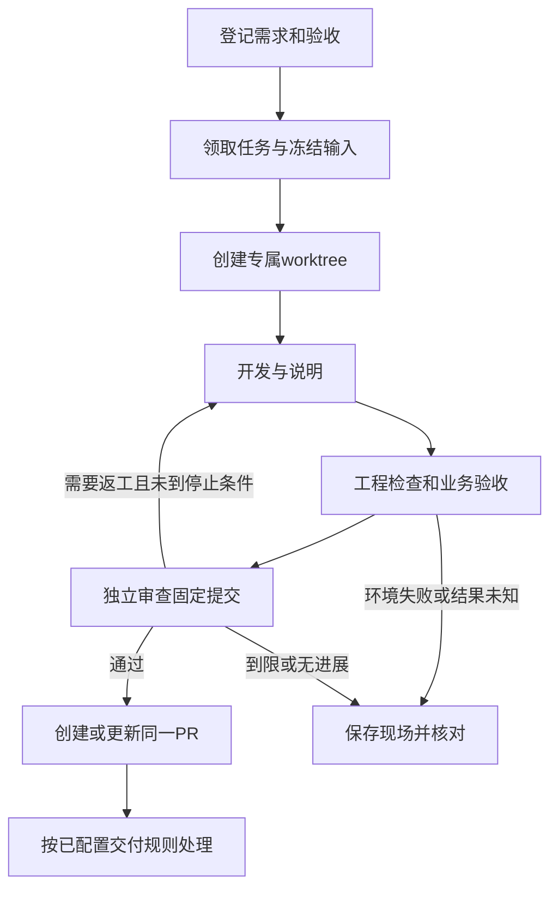

<!--
[INPUT]: 用户确认的Magpie开发方式、现有dev:repair与真实业务评估入口。
[OUTPUT]: 开发侧任务到PR的职责、版本、失败接续和验收设计；尚未实施。
[POS]: 第22组开发自动化合同，整体进度归03。
[PROTOCOL]: 一旦本文件变化，必须同步更新Header，并上浮检查所属目录.folder.md。
-->

# Magpie参考与开发自动化设计

状态：2026-10-20仅文档。固定版本见[总览](./README.md#4-固定参考)，阶段和进度见[03](./03-实施步骤与验收.md)。

## 1. 复用对象

Magpie可参考的公开构件包括`AGENTS.md`、`LESSONS.md`、`docs/code-standards.md`、子系统文档和`.github/workflows/`。重点迁用真实运行路径核对、工作目录隔离、能证伪的测试、固定提交审查、UI证据和复盘反馈。

公开文档与工作流不足以确认存在可直接复用的完整需求领取/编码/审查调度器。BOAI需补开发控制器；Magpie产品本身的模型路由不等于这个控制器。2026-10-13调研中的四个workflow为当时快照，当前目录与脚本以固定新版本重新核对。

| 上游入口 | BOAI适配 |
| --- | --- |
| `AGENTS.md`与子系统导航 | 在BOAI原AGENTS中增加简短路由，详细合同归`ai-docs`，保留BOAI现行产品规则 |
| `docs/code-standards.md` | 将适用规则写入本组与原专题；Go、Wails及专属命令换成当前真实可用入口 |
| `LESSONS.md` | 复盘记录归`ai-docs`，关联任务、提交和实际失败；重复经验经审阅后进入稳定规则 |
| `test.yml` | 复用触发、并发和结果门槛思路；实际检查沿Vitest、TypeScript、Electron与BOAI业务runner |
| `ui-preview.yml`及配套脚本 | 参考固定PR版本、隔离执行和可视报告；生成截图与判定功能正确分别留证 |

## 2. 任务输入与唯一所有者

开发任务至少包含：稳定taskId、需求原文、验收条目、来源Issue/本地请求、基线提交与工作树hash、修改范围、参考版本、开发执行器、测试计划、模型配置、尝试上限、停止条件和产物目录。

这些字段是待实施合同，不是现有API。初版使用版本化任务文件与现有脚本，按实际恢复需求落盘，不预建产品后台或新开发平台。

| 对象 | 唯一负责方 |
| --- | --- |
| 任务状态、领取、租约和尝试编号 | 开发控制器 |
| 文件修改与说明 | 开发执行器，在任务专属worktree中工作 |
| 测试执行、原始结果与版本关联 | 测试runner；开发执行器不能自行签发通过 |
| 代码审查与业务评分 | 独立审查会话/评分器，角色和模型明确记录 |
| PR、head/base及检查结论 | 仓库适配器，绑定明确提交 |
| BOAI员工、聊天、Run与权限 | 原产品服务；开发控制器不另建产品状态 |

## 3. 开发与返工流程

首次串通使用一个明确的真实修复，验证从任务到PR的全过程；随后支持UI Plugin新功能开发，完整目标不止固定测试修复。

- `dev:repair`用于已存在的限定文件和固定检查；当前源码选择要求输入存在，不能直接宣称支持任意新文件/功能开发。
- 新功能任务需补文件新增/删除、依赖变更、目录地图与文档同步、构建和交互验证。开发者可修改任务相关测试，但不能自行降低既定验收或重写评分标准。
- 修复应有能暴露原缺陷的行为测试；可执行时对旧实现做失败核对。编译错误、skip、错误环境和另一条未实际使用路径不能充当证据。
- 定向检查后按风险运行必要全量检查；正式基准、长期稳定性和UI人工评价独立报告。
- 审查固定候选提交及其与base的集成结果。head或base变化后使相关结论失效，重新测试/审查；不只绑定旧PR head。

## 4. 并发、停止与恢复

一个任务一个worktree，禁止共享暂存区。认领须有机器可校验的唯一键和租约；Issue留言仅为展示，不能承担互斥。桌面GUI与高负载全套测试需要资源锁，避免并行测试互相拖垮。

任务持久记录准备、开发、测试、审查、PR待核对和终态。重启先核对进程、文件、远程PR与回执；已完成操作不重放。远程写入结果未知时，先按任务/分支/提交只读查找，禁止盲目重复建PR或合并。

开发侧按任务登记尝试、模型请求/费用上限及总时长；到限、无收益、权限缺失、输入变化、测试环境失效或用户停止时保留补丁和失败原因。开发限额不改变产品原生员工无BOAI预算的合同。

## 5. PR、合并与规则反馈

第一版交付可审查PR：具体问题、结果行为、来源与适配、固定head/base、运行检查、完整失败和未验证范围。初期合并由用户或既有交付规则处理，后续再将自动合并/发布条件程序化；本次文档不创建PR、配置凭据或启用远程写入。

测试执行权限与PR/合并/发布权限分开；处理外部PR时隔离其代码执行与写权限。审查者能读取完整日志、输入和产物，不能只有开发者摘要。失败可自动整理为候选任务，合并相同根因，并保留原失败链接。

复盘从实际返工、漏测和误判出发。规则修改单独可审阅，不因一次失败把具体样例写成全局限制；规则更改后检查对正确行为和验证成本的影响。

## 6. 实施落点与验收

| 现有位置 | 后续工作 |
| --- | --- |
| `scripts/iterate-agent.mjs`、`tests/evaluation/repair*.ts` | 复用隔离、补丁与进程工具；保留工程修复定位 |
| `scripts/evaluation-experiment.mjs`、`tests/evaluation/` | 复用真实业务runner、judge和比较，不另造业务分数 |
| `.github/workflows/tests.yml` | 按02拆执行层；PR/任务适配另行实施并加入所属目录地图 |
| `AGENTS.md`、`ai-docs/spec/` | 路由到当前合同，开发说明进入`ai-docs` |

验收至少覆盖：同任务并发领取、两worktree隔离、新功能增加文件、旧实现失败/新实现通过、head/base变更重测、审查驳回返工、到限退出、runner故障、重复事件、未知PR写入核对和重启接续。实际进度只记到03，当前均未执行。
