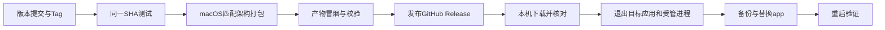

<!--
[OUTPUT]: release:check只读核对稳定版本/buildVersion、同SHA main及最新完整验证；只提供前检，Tag/打包/发布/安装仍未实施。
[INPUT]: 用户当前macOS无Apple开发者签名、本机开发自用，要求先将Tag/Release/桌面升级落实为文档。
[OUTPUT]: 本机自用发布路线、electron-builder v26候选配置、自动Tag接续、产物演练与本机升级回滚；发布独立于开发画板，尚未实施。
[POS]: 第22组macOS个人发布与升级合同，实施实际进度统一归03第5节。
[PROTOCOL]: 一旦本文件变化，必须同步更新Header，并上浮检查所属目录.folder.md。
-->

# macOS本机发布与升级方案

日期：2026-10-20。用户明确当前使用macOS，没有Apple开发者签名，长期通过本机源码开发并自用；最初批次仅落实文档；现有只读前检见第9节，完整发布/升级仍待实现。**尚未创建Tag、发布Release、构建安装包、接入更新器或替换任何本机应用。**

## 1. 结论与推荐路线

Git Tag、GitHub Release与安装包构建可以先自动化；它们不要求Apple开发者证书。Electron在macOS上的标准`autoUpdater`基于Squirrel.Mac，要求应用签名并校验更新签名，因此当前不能把“生成Release安装包”称为已实现应用内静默更新。[Electron官方要求](https://www.electronjs.org/docs/latest/api/auto-updater#macos)

本机自用的推荐路线分两条：

| 通道 | 更新方式 | 目标 |
| --- | --- | --- |
| 源码开发版 | 使用明确源码版本、安装锁定依赖、构建并重启`pnpm dev` | 保持当前开发习惯，开发窗口不运行安装包更新器 |
| 本机安装版 | 固定版本提交 → Tag → CI验证/打包 → GitHub Release → 本机独立升级命令/脚本 → 退出并替换.app → 重开核对 | 获得可追溯安装包与可恢复的自用升级流程，无需先购买Developer ID证书 |

本机升级脚本是待开发功能，属于独立安装流程，不调用Squirrel.Mac来绕过签名要求。用户以后取得适合分发的签名与公证配置时，再接标准`electron-updater`路线。



这条路线保留未来应用内“检查更新/打开下载”的接入位置；完全无人值守安装不是本轮已验证能力。未公证下载在目标Mac上的首次打开、系统确认与权限提示需要实际验收。

## 2. 当前仓库事实

| 项目 | 本次静态核对 |
| --- | --- |
| 构建器 | `electron-builder`、`app-builder-lib`均为`26.15.3`；Electron为`39.2.7` |
| 架构 | 本次本机Node进程为`arm64`；原生助手与依赖仍需随目标包验证，不由此推断支持x64/universal |
| 标识与名称 | `build.appId=com.boai.agent`，productName与Main的app名称为`BoAI Agent` |
| 版本 | `package.json.version=0.2.2`，`build.buildVersion=0.2.3`；正式发布前建立明确规则，不能直接按现有字段各自推断同一版本 |
| 打包命令 | `dist:mac`是`pnpm build && electron-builder --mac dmg`，CLI明确只选择DMG |
| 产物目录 | `build.directories.output=release`；保留现有files、asarUnpack、原生文件及协议配置 |
| 更新器 | package依赖未接`electron-updater`，Main未发现`autoUpdater/checkForUpdates/quitAndInstall`接线 |
| CI | 现有Offline tests针对PR、main/master push和手动触发；没有本轮拟定的Tag发布工作流 |
| 数据 | `src/main/main.ts`设置app名称，支持`BOAI_DATA_DIR`覆盖userData，业务数据位于userData下`v2` |

这些是本次读源码与安装依赖类型得到的事实，不是运行通过或发布成绩。后续统一修改时重新核对实际版本和工作树，不覆盖其他开发中的依赖/构建变更。

## 3. 无Developer ID证书的构建配置

区分三个概念：完全不签名、无证书的ad-hoc签名、Apple开发者证书签名。个人构建可评估显式ad-hoc签名；它不提供Apple开发者身份或公证，也不能作为标准跨版本自动更新的可用保证。

下面是针对**当前v26.15.3**的待实施配置片段，合并到原`build`配置，不能替换整个build对象而丢掉现有文件/原生资源/协议项：

```json
{
  "mac": {
    "category": "public.app-category.productivity",
    "target": ["dmg", "zip"],
    "identity": "-",
    "hardenedRuntime": false,
    "notarize": false
  }
}
```

本机安装依赖的`out/options/macOptions.d.ts`已核对：`identity: null`跳过签名，`identity: "-"`显式ad-hoc；没有自动发现证书时并不保证自动退回ad-hoc。ad-hoc配合默认hardened runtime会涉及library validation，个人配置先显式关闭hardened runtime，正式签名/公证路线再单独设置entitlements。[v26 macOS配置](https://www.electron.build/v26/docs/mac/)

当前`dist:mac`的`--mac dmg`会继续限制目标，实施时需同时更新命令或建立独立个人发布配置。候选构建命令为：

```bash
pnpm build
pnpm exec electron-builder --mac dmg zip --arm64 --publish never
```

命令只描述待实现构建，不包含发布和安装；本轮未执行。初版只构建实际需要的arm64，配匹配架构的macOS runner。安装原生依赖、Rust/Swift等助手构建前提按`scripts/build.mjs`及其子脚本补齐；`npmRebuild: false`意味着不能假定打包阶段会修好错误架构的原生模块。

CI不配置`CSC_LINK`、`CSC_KEY_PASSWORD`或Apple公证凭据，使用上述显式个人配置；未来签名路线另设配置，避免把个人构建开关带入正式分发。不能用关闭全局Gatekeeper作为流水线步骤；对自己信任的下载应用按系统流程处理首次允许打开。[Apple说明](https://support.apple.com/en-us/102445)

## 4. 版本、Tag与Release门槛

1. 选定待发布提交；版本更新单独形成可追溯提交，`vX.Y.Z`必须与该提交的`package.json.version`一致。buildVersion建立单调且可解释的规则，初版可与发布版本一致，后续无需强制两者永远相同。
2. Tag固定到该提交并推送后，发布流程检出Tag的确切SHA。本机创建未推送的Tag不会触发远程Actions；由Actions自动创建Tag时，按下述编排显式接续，不能假定所有Tag推送都会触发另一个工作流。
3. 对同一SHA运行必需检查，或验证可复用的同版本检查身份。不能仅因为另一个main提交绿过就发布。现有测试workflow不监听Tag，实施时补可复用验证入口或在Tag流程中显式执行。
4. 在匹配架构的macOS runner构建、解包并执行产物冒烟；核对版本、原生模块、窗口、运行服务、文件与CLI入口及退出。源码`pnpm dev`通过不能代替产物通过。
5. 校验成功后发布固定版本资产与说明。初次可先形成draft，所有必需资产和结果齐备后再转正式Release；正式可下载集合不暴露半成品。
6. 同一Tag重复触发先核对已有Release、资产和hash，不静默覆盖不同内容。失败保留结果；取消/未知发布先查询远程状态，不重复创建或重发同一副作用。

自动创建Tag纳入实施范围：发布入口接受明确的版本与目标SHA，版本提交先进入仓库并满足既定交付条件，入口校验版本后创建或核对同名Tag。初版可手动启动这个入口，由程序完成后续发布；以后版本PR合并可调用同一入口，不默认每次普通提交都发一个版本。

如果入口使用`GITHUB_TOKEN`创建并推送Tag，该push不会自动启动另一个Tag workflow。推荐在同一发布编排中通过后续job或`workflow_call`接续测试、构建和发布；若采用显式`workflow_dispatch`，必须传递并再次核对版本与SHA。用户本地推送Tag也进入同一套校验逻辑。不要把“Tag已创建但发布没有运行”当作完成。[GitHub工作流触发规则](https://docs.github.com/en/actions/how-tos/write-workflows/choose-when-workflows-run/trigger-a-workflow)

拟新增工作流的触发片段如下，不是已存在或可以独立运行的完整workflow：

```yaml
on:
  push:
    tags: ['v*']
  workflow_dispatch:
```

全局权限只读；只有创建Tag及发布资产的job按需设置`contents: write`并使用该次`GITHUB_TOKEN`，显式dispatch时另外核对所需权限。测试与构建保持只读；版本更新不形成提交循环，不把发布权限给执行外部PR代码的job。

发布前与实际本机升级分别验收：候选资产可先留在Actions产物或draft中，用隔离安装目录/数据完成启动、旧版升级和失败恢复演练，核对hash后发布同一份资产，不重新打包替换已验字节。正式Release存在后，本机升级入口再下载、校验并更新实际目标，记录个人数据与权限结果。首次发行没有历史正式包时，如实标记该场景未覆盖，可用明确标识的测试旧包验证机制；不能宣称已验证真实历史版本升级。发布成功与个人安装成功各自有终态，避免将“先从正式Release升级成功”设为该Release的发布前置条件。

| Release资产 | 用途 |
| --- | --- |
| 带版本/架构的DMG | 手工安装与留档 |
| 带版本/架构的ZIP | 本机升级工具读取完整.app；未来标准更新路线也需要ZIP |
| `SHA256SUMS` | 下载字节完整性核对；校验和不等于Apple代码签名，也不独立证明来源可信 |
| 版本说明/机器可读manifest | commit、appId、版本/buildVersion、OS/arch、资产名/大小/hash、数据兼容范围及检查结果 |

当前个人升级流程不依赖`latest-mac.yml`。以后接标准更新器时，再按其schema生成元数据、blockmap与发布配置，不能手工造一个latest文件就宣称自动更新已可用。[electron-builder v26更新文档](https://www.electron.build/v26/docs/features/auto-update/)

## 5. 本机安装与升级合同

推荐使用用户可写的固定安装位置，例如`~/Applications/BoAI Agent.app`，首次安装明确目标；若用户已有其他位置，按实际目标处理，不自动切换。CI只产出Release，本机独立安装器负责替换，不由远程runner直接改正在使用的个人Mac。

| 步骤 | 必需行为 |
| --- | --- |
| 检查 | 读取当前实际.app身份和版本，检测开发/安装版及受管runtime是否共用数据；选定明确Release版本/架构 |
| 下载 | 从配置的可信仓库取资产，暂存到独立目录，校验大小/hash与manifest；私有仓库使用本机已授权`gh`或合适凭据渠道，不把个人PAT打进App |
| 预检 | 检查解包路径、appId、版本、架构、原生文件与签名形态；错误或不完整内容禁止覆盖安装目标 |
| 等待退出 | 检查在途工作，通知用户保存；按原退出协议排空目标App的runtime、CLI连接、浏览器及受管子进程，等待实际退出；不误杀其他开发窗口和用户外部CLI |
| 备份 | 保存应用旧副本和必要一致性数据备份；若复用运行中应用的备份接口，在排空阶段先按原流程取得快照，退出后核对；离线备份须确认无写入并采用一致性方案，不能把运行中的SQLite主文件简单复制当完整备份 |
| 替换 | 在同一卷暂存并按确定步骤交换.app，记录安装事务；失败恢复原.app；不在正在运行的bundle内逐文件覆盖 |
| 重开 | 验证新版本启动、模型连接/凭据可读、会话/文件存在、CLI安装状态和运行服务；成功后才标记升级完成 |
| 核对/回滚 | 失联或中断读取原安装事务和实际文件身份，确认新旧版本位置；不重复覆盖或直接宣称成功 |

目标App涉及TCC/钥匙串等权限时，稳定appId和安装位置有助于保持身份，但未签名/ad-hoc升级的权限保持必须实测；不能保证每次更新都零提示。

## 6. 开发版、数据与回滚

`pnpm dev`仍沿源码构建与重启，禁止执行安装版更新器。以后应用内更新入口至少由`app.isPackaged`和明确发布通道门控，开发窗口不给安装流程签发替换目标。

当前开发/安装版均使用同一app名称，默认userData可能相同。实施时先检测并登记实际`BOAI_DATA_DIR`、userData与运行owner；测试使用独立profile。不得为了隔离而静默迁移现有个人数据；若开发版与安装版仍共用数据，升级/备份前必须确认所有相关写入owner已退出，无法确认时停止并提供核对入口。

只替换.app不主动删除userData中的`v2`、会话、员工、模型配置和文件。每次版本登记数据库schema与迁移方向；旧.app回滚不等于数据库可回滚，只有兼容旧schema或按受支持流程恢复成套备份后才能启动旧版。模型密钥解密、技能/插件路径和CLI启动器需与实际数据一起验收。

已安装CLI沿原`CliInstaller`的版本/所有权/回执规则更新，不额外覆盖用户同名命令。旧版副本与升级日志的清理由确认成功后的独立步骤处理，未知结果不清理唯一可恢复副本。

## 7. 未来标准自动更新路线

取得适合分发的Developer ID签名配置后，可补签名与公证、ZIP/DMG和发布provider、`electron-updater` Main事件及UI入口。macOS原生更新校验签名关系，证书/Team身份与版本通道需要保持兼容。[签名配置](https://www.electron.build/v26/docs/features/code-signing/)、[macOS更新签名关系](https://www.electron.build/docs/features/key-rotation/)

从个人ad-hoc版转正式签名版时，先计划一次明确的下载安装/替换与数据验证，不能假设旧个人版会通过尚未接入的更新器自动跨到正式版。签名/公证、GitHub Release与应用升级是三个独立检查环节。

## 8. 实施落点与验收

| 位置 | 后续修改 |
| --- | --- |
| `package.json`与必要锁文件 | 版本规则、个人构建配置、DMG/ZIP命令；正式路线需要时才增加更新依赖 |
| `.github/workflows/` | Tag校验、同SHA测试、匹配架构构建、产物冒烟和发布job；新文件需更新目录地图 |
| `scripts/` | 独立的本机安装/升级入口与事务恢复；本文件所述入口均尚未存在 |
| `src/main/`及原退出/CLI服务 | 复用实际退出、数据身份和启动核对；未来标准更新器单独接线 |
| 本组02/03 | 更新测试分类与真实发布/升级结果，状态只有03维护 |

| 编号 | 验收 |
| --- | --- |
| RL01 | 自动创建或接收Tag后发布确实接续；Tag、package版本、buildVersion、SHA和产物一致；错误Tag/错误dispatch输入/未通过同SHA检查拒绝发布 |
| RL02 | arm64打包产物在实际目标Mac启动，所有原生助手/模块与退出有效 |
| RL03 | 无Developer ID时按个人配置构建；ad-hoc、公证和标准更新的能力分别呈现 |
| RL04 | ZIP/DMG及manifest齐备，错架构、错appId、损坏字节和不完整下载不覆盖目标 |
| RL05 | 有在途工作或共享数据owner未退出时不替换；不误杀其他实例/外部程序 |
| RL06 | 发布前隔离升级/回滚演练与发布后实际本机升级分别留证；实际升级保留会话、文件、员工、密钥可读和CLI配置，数据迁移/旧版回滚规则可验证 |
| RL07 | 下载失败、交换.app中断、启动失败、发布/安装结果未知均能核对恢复 |
| RL08 | 同Tag重复事件和安装重试不重复发布/替换；成功前不清理唯一旧副本 |
| RL09 | 开发模式不检查或安装桌面更新；开发和安装版profile冲突明确处理 |
| RL10 | 下载后的系统允许打开、权限变化与目标Mac实际体验单独留证，不拿CI可启动代替 |

以上均为后续验收清单，目前未执行。本路线可在S2准备构建/环境，在S6完成发布与升级闭环，不要求先完成Codex开发画板联动才能验证个人Release；开发画板不随BOAI安装包分发。当前实际进度见[03第5节](./03-实施步骤与验收.md#5-唯一实际进度)。


## 9. 当前只读发布前检入口

`pnpm release:check --version X.Y.Z --sha 完整SHA`先核对本地干净源码、package.version及buildVersion，再只读查询6owen/boai-agent的远程main和相同SHA的最新main推送验证，要求固定Offline tests及唯一成功Required checks。候选采集或PR绿不能代替main验证；读完同时核对run详情和最后一次最新列表的id/SHA/attempt/成功终态，再核对main和原package字节，变化即拒绝。成功记录只保存在.local/release-checks，不是可长期复用的发布许可；后续写入入口须在副作用前重新核验。

当前版本0.2.2/buildVersion0.2.3不一致，完整main验证也未通过，前检应拒绝。该入口不改版本、不创建Tag、不构建/上传/安装。自动Tag接续、ad-hoc产物/冒烟、安装事务和回滚仍按上文继续实现，实际验证唯一归03。
