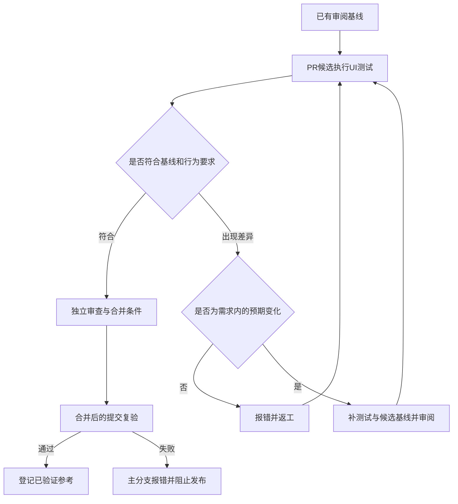

<!--
[OUTPUT]: 2026-10-28自动PR采集、Agent差异审阅、线上选择更新与最新只读复验；ui:deliver接续，取消强制本地人工确认，实际归22组06 §21。
[OUTPUT]: 首轮线上更新与独立复验成功但PR待批准；§20.1修正为Agent批准当前PR检查，移除重复dispatch。
[OUTPUT]: PR42官方40485363446完整26场通过，用户确认后审阅接受新增六图；原20图字节不变，普通当前提交门禁独立。
[OUTPUT]: 2026-10-27最终流程归§20：本地效果确认，Agent驱动线上构建、基准提交与只读复验；§19部分规则已被替代。
[OUTPUT]: 2026-10-27有意UI改动先向用户展示预览并确认具体效果/基准范围，再候选与PR；worktree独立node_modules复用pnpm store，BOAI_DEV_PORT支持按需独立预览。
[OUTPUT]: 本人菜单增加明暗两场至26场；旧候选因新增用户需求取消，新SHA待采集。
[OUTPUT]: 追加定时任务历史/管理明暗四场至24场；原20场门槛保持，新增候选及审阅待执行。
[OUTPUT]: 2026-10-27官方候选40472649141全部20场通过且PNG逐字节不变；仅晋升voice-settings-dark的已审阅渐变校准与来源，普通新head CI另验。
[OUTPUT]: 2026-10-27 PR40仅文档运行40470324383的语音暗色渐变8149原始像素均仅差1/255；沿已有0.005颜色校准，异常像素仍0、无mask，需官方候选审阅晋升。
[OUTPUT]: 2026-10-27计划增加语音设置明暗两场与两级依赖缓存；20场完整门禁及原像素条件保持，实际云端验证待本批。
[OUTPUT]: 2026-10-27有意UI变更在Ready前完成官方候选、差异审阅和受影响基线提交；当前完整CI通过后正常合并，不用force或放宽标准。
[OUTPUT]: 2026-10-27官方候选计划仅完整采集一次，同批PNG离线生成旧/新/diff；普通CI严格比较保持。
[OUTPUT]: 2026-10-27普通UI分两台macOS各9项并行；Required checks重算完整合同并逐片复核原件，候选保持全量。
[OUTPUT]: 2026-10-26UI夹具预备数据后单次真实启动、退出清理仍受理及原始阶段计时；全部18项和像素/原件门禁保持。
[OUTPUT]: 2026-10-26复核预期改版流程：报告区分视觉差异待审阅与执行失败；原Required checks保持，候选接受不等于设计认可，生效须新提交与新运行。
[OUTPUT]: 产品Draft可暂缓UI但Required checks明确失败；Ready/ci:full及CI机制变更保持原全18与原件门槛，标签不单独创建运行、必需检查固定名称。
[OUTPUT]: 纯开发Markdown允许02 §10文档资格，始终运行Required checks独立重算；任何产品/UI/基准/配置变更仍全18及原件门禁，不授文档分项产品资格。
[OUTPUT]: UI原件沿监督入口实际执行墙钟窗口核末场，窗口及原目录/proof字节绑定；原1ms余量、像素/环境/18身份保持，旧缺窗口不授新资格。
[OUTPUT]: 无窗口云端实证ready后484ms才更新workArea，预检须采样/事件连续稳定并有界失败；共享桌面锁覆盖guard退出，像素/主屏条件保持。
[OUTPUT]: 主屏681/684跨API失败后改Electron同API独立预检，截图仍核实际page窗口；Required checks独立重核全18原报告/原件，待云端实测。
[OUTPUT]: 2026-10-21自动CI迁回GitHub Actions；截图核实际page的原生窗口、主屏工作区及所有屏尺寸/缩放；独立云端v3完整候选仍需审阅后只读复验。
[OUTPUT]: 环境v3补实际显示器逻辑/工作区尺寸、缩放和主屏身份，逐次截图核窗口归属；屏幕变化沿完整独立迁移，不改阈值。
[OUTPUT]: 用户改本地CI后保持全部18本机UI只读及原像素合同；本地状态门禁见02 §9，实际保护仍待切换。
[OUTPUT]: 当前核心合同18项（原16及快捷键明暗两项）；只更新相关四项后本机18只读通过，CI增量待同SHA官方候选。
[OUTPUT]: CI完整捕获后同环境仅接受相关case，逐case绑定官方来源，未选择项保留并核验；初始/环境迁移仍须全量。
[OUTPUT]: 本地candidate/accept仅操作本机档案；CI读取需绑定来源，官方进口接受与原检查共用基线锁。
[OUTPUT]: 本机/CI分别固定环境档案；独立受信采集只产候选，官方run/artifact核验后显式接受，普通CI仍只读。
[INPUT]: 用户明确参考Magpie建立UI基线，后续PR合并持续比较，新增功能扩充基准，破坏原有UI时报错。
[OUTPUT]: 行为/布局/视觉与受控晋升；Public后main强制Required checks及最新base，完整CI/发布仍待验，进度归03 §5.1。
[POS]: 第22组UI回归专项合同；与05开发画板分工，唯一实际进度归03。
[PROTOCOL]: 一旦本文件变化，必须同步更新Header，并上浮检查所属目录.folder.md。
-->

# UI回归基准与PR门禁

日期：2026-10-20。用户明确：先建立UI测试基准，后续新PR持续对比；新增功能补测试并更新对应基准，意外破坏已有UI则报错。本文件落实该规则。后续已在独立worktree接线并采集本地开发基线；实际结果及剩余门槛归03 §5.1。

## 1. 要实现的行为

UI test检查BOAI软件实际渲染的界面和用户操作。05中的Excalidraw是开发设计资料；不能拿手绘草图直接充当产品像素基线，也不能因设计稿存在就判定产品实现正确。

| 情况 | 预期处理 |
| --- | --- |
| 没有预期UI变化的PR | 运行已登记UI集合，与已接受基线比较；原交互、布局或视觉断言破坏则失败 |
| 新增功能/页面/状态 | 增加对应场景、交互断言及视觉基线；原有场景继续检查，不整体覆盖旧基线 |
| 有意修改已有界面 | 说明需求和影响范围，提供旧图、新图、差异图及行为变化；经独立审阅后更新受影响条目 |
| 意外布局/样式/交互退化 | CI报错并阻止合并；修复代码后重测，不自动接受当前截图 |
| 缺少基线、测试未执行或结果不完整 | 标为缺失/错误并阻止放行，不能当作首次自动学习后的通过 |
| PR已合并 | 对合并后的确切提交再次运行UI回归；失败保留红色状态并阻止该提交发布，不自动重建基线 |

合并前拦截和合并后复验都需要实现；只在合并后发现问题无法阻止有问题的PR进入主分支。仓库必需检查/合并规则与CI一起配置，不能只生成报告而没有实际阻断。

## 2. Magpie参考与BOAI现状

[既有调研第15节](../../2026-10-13-Magpie-AI开发自动化调研.md#15-ui-测试专项确实有断言回归主要在真实前端与模拟-api-之间)记录了Magpie真实前端的DOM、布局和交互断言。历史固定版本`2d721f7f3db9759e295da1aae8735ac538b993b4`的`mobile-web.test.cjs`读取`BASE_REF`前端资源，与当前资源使用同组数据渲染并比较像素；有容差、局部兼容排除和特定页面略过。它与仅生成截图的UI preview是不同的检查。[固定上游源码](https://github.com/yetone/magpie/blob/2d721f7f3db9759e295da1aae8735ac538b993b4/internal/gui/tests/mobile-web.test.cjs)

这里迁用“保留已有界面约束、比较实际差异”的机制；不把历史代表测试解释成Magpie所有页面或当前main完整保证，也不假定上游已经实现本文全部基线审阅规则。正式复用仍按本组固定来源逐文件核对。

本轮静态核对BOAI的`playwright.config.ts`及`tests/e2e`：已有`playwright-bdd`、串行Electron场景、行为断言和`page.screenshot()`留证；未检索到`toHaveScreenshot`、`toMatchSnapshot`或专门的snapshot更新配置。这只说明已检查范围内尚无该视觉门槛，不是本轮运行成绩。

后续沿原BDD feature/steps/support与Electron fixture扩充，不建立另一套平行桌面测试入口。可使用Playwright截图断言；单独调用`screenshot()`保存图片不能代替比较断言。[Playwright视觉比较](https://playwright.dev/docs/test-snapshots)

## 3. 基准包括什么

| 类型 | 保护的内容 | 例子 |
| --- | --- | --- |
| 交互/行为 | 控件操作、状态与真实结果 | 打开设置、编辑保存、切换标签、关闭重开、发送消息 |
| 布局 | 可见性、尺寸、位置、滚动与遮挡 | 窄窗口无横向溢出，输入区不被遮挡，右侧面板宽度和滚动保持 |
| 视觉 | 固定状态下的实际像素 | 明暗主题、弹窗打开、列表有数据、选中/禁用等状态与已接受截图比较 |

首批从现有主要页面和真实UI故障选取场景，至少登记主聊天/输入区、员工配置、设置弹窗、资源列表、右侧详情及文件预览等适用范围，具体caseId在S2建立。空列表和有数据状态分别选择，不能只测空壳页面。

视觉门槛使用固定测试数据与离线协议，真实模型输出质量沿02及第15组另测。图片通过不能替代按钮行为和保存结果；行为通过也不能掩盖布局退化。

每项基线绑定caseId、页面状态、源码/基线版本、测试数据hash、OS/架构、Electron/Playwright及字体版本、窗口尺寸/缩放、主题/语言、容差与遮罩配置。固定时间、随机内容和动画条件，等待字体/图标与业务状态就绪；正常短暂加载不被截成基线。

同一候选与基线使用相同渲染环境。系统、字体或执行器升级改变比较条件时单独审阅迁移，不混入功能收益。[Playwright环境说明](https://playwright.dev/docs/test-snapshots)

## 4. 基线存储与更新

BOAI首版采用受版本管理的期望截图和测试合同，具体目录在实施时按原测试布局确定，例如`tests/e2e`下专用基线目录；不把期望文件放进每次清空的`.features-gen`或临时报告目录。`ai-docs`记录规则、设计与审阅结论，测试资源归测试目录。

创建首批基线时，先验证现有交互/布局要求，再生成截图并审阅，不能直接把当前所有界面包括已知缺陷都认证为正确。已知问题明确列出并保留检查；未验范围不记为通过。

更新规则：

1. 新功能在同一PR中补新增场景、期望行为及候选截图；已有功能无预期变化的基线保持。
2. 修改旧界面时列出受影响caseId和原因；新增/删除测试、基线、遮罩或容差也算验证合同变化，必须进入审阅。
3. 保留针对旧基线得到的差异报告，再生成候选基线；审阅者能看到旧期望、实际截图、差异及关联需求，不能只看已更新后全绿的结果。
4. 确认预期变更后，仅接受对应条目。开发者/修复循环不能通过整批重录、删除旧用例、扩大遮罩或放宽容差消除失败。
5. 候选基线与源码、测试及必要说明一起合并；主分支复验通过后，登记该版本为已验证参考。失败候选不能替换“最后验证通过”的基线记录。

常规CI只读基线，显式禁止生成/更新期望截图；Playwright实现时核对安装版本并设置`updateSnapshots: 'none'`或等效检查。单独的候选生成入口只产出待审阅内容，不直接提交到主分支。缺少新功能基线时先报错，再通过明确更新流程补齐。[Playwright更新配置](https://playwright.dev/docs/api/class-testconfig#test-config-update-snapshots)

容差在同版本重复渲染后确定并冻结，按实际BOAI环境验证，不照搬Magpie像素数。动态区域优先固定数据；确需遮罩时逐项登记，并用行为/布局断言保护该区域，不屏蔽整个发生回归的页面。

## 5. PR与主分支的执行顺序



- PR创建/更新：冻结base/head及测试计划，执行已有核心UI集合和新增场景，提供固定名称的必需检查。基线变更的审阅结论须绑定具体候选，不能由候选自己提交一个“已批准”字段代替。
- base/head或测试/基线变化：重新核对相关结论，按02的汇总规则处理失败、取消和缺报告。
- 每个PR合并后的主分支提交：对该确切版本运行同一套必需检查，用已审阅的期望截图比较实际渲染。PR阶段通过不代替集成后检查。
- 发布：04的同SHA门槛包含该版本UI回归结果；合并后失败的提交不能发包。

版本化期望截图即使与源码在同一commit，也必须是事先审阅的固定文件，CI不能现拍现当期望。若以后采用Magpie式双源码渲染，还须固定独立的基准SHA；合并后不能把`origin/main`解析成当前候选再自比较。

纯文档PR可按02的影响分析输出明确不适用结论；代码、样式、共享组件、字体/图标/主题、依赖和测试配置变化都纳入UI影响判断。已登记的核心回归集合不能只因为当前需求声称“不是UI改动”就略过。

## 6. 失败报告与验收

视觉失败输出期望图、实际图和差异图；行为/布局失败输出实际断言、页面状态及必要截图。报告包含caseId、base/head或合并SHA、基线ID、环境和失败原因。测试进程非零退出，Actions汇总失败；这属于开发CI报告，不新增产品错误页面。

经过审阅的最小基线图片是长期测试输入，可以随测试版本管理；运行产生的截图、trace和数据库沿实际保留策略管理，不把所有原件都提交Git。不会恢复此前用户要求删除的测试附件。

| 编号 | 验收 |
| --- | --- |
| UR01 | 初始场景与基线可重复运行，已知缺陷、未覆盖与环境波动如实记录 |
| UR02 | 人为引入布局错位或样式退化会产生真实差异、失败退出及必需检查失败 |
| UR03 | 外观相同但按钮不生效/保存错误仍由行为断言检出 |
| UR04 | 新功能补场景与基线，旧场景继续保护；缺基线不静默通过 |
| UR05 | 有意改版保留旧/新/diff和需求，审阅后仅更新相关条目 |
| UR06 | 常规CI与自动修复不能自动覆写基线或通过删测试/放宽阈值获得成功 |
| UR07 | 每次PR及合并后提交均按计划检查；base/head变化使旧结论失效，主分支失败阻止发布 |
| UR08 | 基线身份/环境不匹配、自比较、缺报告、取消及必需项未运行均不能通过 |

以上均待实施，实际结果统一登记03。S2建立首批UI基线和检查门槛，S3自动开发遵守基线更新规则，后续所有功能迭代持续使用；S6补齐周期执行和发布衔接。

## 7. 当前开发入口（2026-10-20实施中）

- `pnpm test:ui`：构建当前工作树，运行全部登记18项UI BDD（原16项及快捷键明暗两项）；基线只读，输出独立`.local/ui-runs/<runId>`报告。
- `pnpm test:ui:candidate --cases CASE_ID --output NEW_DIR`：先保留旧比较报告，再采集独立候选；已有基线不变。首次没有基线时旧比较为`not-run`，不能称比较通过。
- `pnpm test:ui:accept --candidate DIR --cases CASE_ID --reason '具体理由'`：核对候选完整通过、源码/环境及图片hash，只复制明确选中的条目。这是本地开发操作，不代表独立审阅完成；CI禁止候选/接受入口。
- 本地故障演练：`node scripts/ui-regression.mjs check --cases chat-light --fault layout`，或`--cases settings-light --fault behavior`；预期非零，报告记录故障，不修改生产源码。`--fault environment`验证环境错配拒绝。

当前基线覆盖聊天/空白单聊/窄窗、通讯录行内配置、外观、资源搜索、右侧文件筛选及Markdown预览，分别有明暗主题。明确保护每位普通员工的唯一主单聊；空态使用另一员工，重复进入保留原ID/标题，不能为了测试另建同员工多单聊。

环境登记macOS major、arm64、Electron/Playwright、实际中文/Geist字体hash、中文locale、时区及CSS视口。固定历史与资源不访问个人配置；按字体/有限动画完成及真实编辑器/发送按钮状态取图。初始校准对settings-light和resources-dark记录0.005颜色阈值（分别为渐变控件5像素、搜索框区域的1/255通道舍入差），所有case最大异常像素0、无mask；其余14项颜色阈值0。合同变化会拒绝旧基线，不能静默放宽。

本地报告含真实结果、源码hash、环境及Playwright旧/新/diff；运行中源码变化、缺报告/场景、skip、重试或中断不能通过。Actions已配置PR和main/master push、固定`Required checks`汇总。Public后已通过GitHub API设置并回读main保护：要求GitHub Actions的`Required checks`成功、分支跟上最新main，管理员同样受约束，禁止强推和删除。远程完整通过、实际合并及发布闭环仍未验收；配置成功不冒充完整CI成功。

完整`pnpm build`登记输入及产物字节身份；只读UI检查开始和结束均核对，源码、技能源或dist字节变化会使结论失效。UI资源由SQLite事务互斥，持有进程死亡后由操作系统释放，不根据过期锁文件或PID猜测抢占。


## 8. 明确渲染环境档案与CI候选进口

此前相同major/单字体hash不足以复现两台Mac的渲染；实际字体来源实验及失败保留在03。现增加`local-macos-arm64`（原根目录）和`github-macos15-arm64`（同名子目录）两份显式环境档案，原16场/行为/布局/颜色阈值/最大异常像素/无mask合同共用不变。普通CI必须明确CI档案，缺失、错环境、缺场或字节损坏均失败，无本机PNG回退。新环境指纹包括完整macOS版本/build、三个权重默认及匹配字体的文件hash/家族/版本、系统语言/locale和原Electron/Playwright/Geist等。当前旧manifest没有新profile/指纹，不能静默升级为通过，须重新完整采集审阅。

`ui-baseline-candidate.yml`为独立受信采集通道，无contents写权限、不提供Required checks、不复制到已接受基线。普通PR/自动修复/测试workflow不能使用采集入口。GitHub要求workflow_dispatch定义先存在默认分支，因此首次提供仅`infra/ui-environment-profiles`明确push的引导触发；它也只产隔离artifact，不能使原PR门禁通过。[GitHub官方触发规则](https://docs.github.com/en/actions/how-tos/write-workflows/choose-when-workflows-run/trigger-a-workflow)支持此引导原因。进入默认分支后使用手动dispatch，普通main push仍走只读门禁。

采集全部登记场景，先保留旧比较结果；CI档案尚无manifest时比较明确为not-run，行为/布局必须仍逐项通过，才能输出完整候选。无旧CI图的初始采集不得冒充旧图比较通过，需对全部新图独立审阅。新强指纹的本机首次迁移也需全场审阅，不能覆盖旧失败记录。

```bash
node scripts/ui-ci-baseline.mjs import --run RUN_ID --output .local/新候选目录
node scripts/ui-ci-baseline.mjs accept --run 同一RUN_ID --candidate .local/已审阅目录 --cases 明确接受ID逗号列表 --reason '逐项审阅结论与需求原因'
```

进口只接受同仓库/同干净源码SHA的成功独立采集，核对官方artifact唯一身份、来源、未过期状态及SHA256。实际archive先验路径/重复/链接/体积，再解压，核对全部case合同/PNG/hash、实际一次通过报告和构建输入。接受时重新向GitHub核对并下载同一原artifact，与已审阅目录全部字节对照，检查现有CI基线未移动后才复制CI档案；不以本机构建产物冒充CI产物，也不改本机PNG。审阅笔记应放候选目录之外，保持原件。接受、提交后还需再次只读CI比较，完整Required checks及合并SHA验证独立成立；任何候选成功不提供发布资格。

同环境需求内改版可只接受已审阅的相关case；仍须官方完整捕获全部登记场景。未选择项保留原PNG、合同、源码、时间与官方来源，且接受前逐项核对它们的旧PNG/hash/来源/当前合同；有缺失或合同变化必须明确纳入接受列表，不能由未选择掩盖。初始档案或环境指纹变化必须接受全部登记case。新增case可在同环境单独接受，旧项继续受保护。每个被接受case绑定自己的官方provenance；旧manifest整体provenance作为原条目兼容来源，不能用新run替旧条目改写来源。

首次官方下载、逐图接受及本机/CI16项只读复验已在独立分支完成，实际记录归03；main合并、完整门禁和新增功能视觉验收仍未完成。

本地`candidate/accept`入口只允许本机档案；明确传CI档案也会在采集前拒绝，CI晋升统一经官方进口。CI读取要求case自己的完整provenance（旧条目可沿整体记录），其源码commit必须一致。CI进口接受与原UI检查/本地接受持同一路径锁，覆盖重新下载、旧基线核验、PNG及manifest写入，避免一轮检查读到旧hash却比较新PNG，或多个接受交错。


## 9. 用户改用本地CI

2026-10-21用户明确Actions额度耗尽，CI改在本机：全部18项继续用明确local-macos-arm64档案，云端档案/原失败保留，普通比较不更新PNG。02 §9的本地入口及原件封存替代自动云端执行；本地结果回传BOAI local CI。旧app15368 Required checks仍是历史已设置状态，实际切换和完整本地结果只能以03为准，不把接线当成功。

### 实际显示器与环境v3

2026-10-21实际环境变化显示：系统/字体/GPU指纹相同不足以证明像素条件相同。原b06原生capture记录为1920x1080、workArea1920x971、scaleFactor1；当前为1512x982、workArea1512x859、scaleFactor2。旧b06与新f9的聊天明暗实际截图在当前环境逐字节一致，但均不匹配旧基准；不能将此作为新产品回归，也不能自动补绿。

环境v3由锁定Electron可执行文件的独立无窗口入口在app.whenReady后读取screen，记录全部显示器逻辑尺寸、scaleFactor及主屏标志，并记录主屏工作区尺寸，不存设备ID/序列号。入口使用独立临时userData/sessionData、原生guard和有限期限，不加载产品；核实际Electron版本/路径及完整退出。CoreText继续只读核字体。AppKit与Electron在主/副屏工作区存在差异，显示字段统一用与截图相同的Electron API；副屏仍只核尺寸/缩放。实际截图page通过原生窗口handle固定，必须位于主屏并核当前显示器配置和主屏工作区。显示器或工作区变化须完整采集/独立审阅全部case，旧图、新图和原始差异保留，比较阈值、异常像素和mask不变。环境v2缺少显示器字段不自动升级。云端旧档案仍为历史来源；Actions已按用户最新要求启用，未重新采集并审阅前不能假定旧档案可用于v3。

> 当前执行端更新：2026-10-21自动CI迁回GitHub Actions；截图核实际page的原生窗口、主屏工作区及所有屏尺寸/缩放；独立云端v3完整候选仍需审阅后只读复验。

UI job通过后由record-ui登记summary、compare/summary、原始Playwright报告SHA及全部逐场景原件proof。Required checks必须重新读取全18个正常一次通过的原始结果、唯一实际环境附件及FeatureReview的截图/逐启动trace，沿既有verifyDesktopEvidence核对场景/时段/路径/字节。全运行墙钟结束必须来自监督入口实际记录的execution-window.json，不能用report.stats.startTime加单调duration推导；核原目录/起止/本场至下一场边界，窗口字节SHA纳入原件proof。缺失/不完整窗口及后改拒绝，不增加时间容差，也不影响已接受PNG/像素合同。缺失、跳过、重试、环境不符、清理错误或改字节均失败；UI job本身也必须成功。汇总成功或候选成功均不能替代此门槛。

预检在默认共享桌面锁内运行，screen的display-metrics-changed事件及每100ms采样任一变化均重置稳定窗口，连续1秒稳定才登记；总计10秒仍变化即失败，外层guard期限30秒。无窗口诊断已实证ready后的异步workArea更新，不用固定684、容差或单纯固定sleep代替就绪。预检实际退出后释放锁；Playwright再沿原globalSetup取同一锁。截图阶段仍精确核当前page窗口/主屏/显示配置，预检稳定不免除后续核验。


## 10. 非产品开发文档范围

02 §10定义的完整Markdown白名单差异只执行Ubuntu文档检查，不启动macOS产品或上传大体积截图/trace。Required checks仍必需且always运行，重新计算真实Git范围和提交身份，要求范围job成功且两个产品job明确skipped；输出必须写明product tests were not run。整workflow不能用paths-ignore或提交消息跳过，否则可能留下Pending必需检查。

混入一项代码/测试/基准PNG或JSON/依赖/CI配置/未知路径就保留原完整门槛，手动执行也始终完整。文档轻量不改变全18合同、阈值/mask、基准接受或UI原件协议；不冒充历史完整失败的修复，也不授发布/安装资格。当前实现及实际云端结果唯一归03。

## 11. Draft开发期间的验证时机

按02 §11，未改CI机制且无`ci:full`的产品草稿可以暂缓工程/T1/UI；范围检查仅验证完整差异和Git格式，Required checks必须明确失败并标记尚未执行产品测试。转Ready、带`ci:full`的新提交或手动执行时运行当前完整UI合同和原件门禁，新的有效PR运行取消旧运行；main已启动验证保留到结束。CI机制改动即使Draft也完整验证，标签增删不单独创建运行，必需检查保持固定名称和always执行。

暂缓不取得合并资格，不减少一项用例、业务断言、像素标准或基准来源核验。所有产品正式合并仍要求当前源码/最新base的完整实际通过。专项诊断仅给当前问题反馈，不能替代本门槛。

## 12. 预期UI变化的审阅与生效（2026-10-26）

用户希望允许主动改版，同时拦住AI扩大修改范围及较差实现。复核结论：保留现有只读比较与独立候选接受，补齐交付流程和反馈；不把“预期变化”标签、PR说明或模型评分当成合并资格。

### 最小实施范围

1. 普通CI继续执行全部登记场景，原行为、布局、像素、来源及Required checks核验保持。增加轻量审阅附件和Actions摘要，展示具体场景及旧图/新图/diff；完整Playwright报告和trace仍在原附件。
2. 只有正常一次执行、错误仅为截图像素差异且三张原图齐全的场景，报告才归为“视觉差异，待审阅”。环境错配、缺基线、行为/布局失败、缺失/重复/跳过/重试、进程异常及材料不完整保持失败。待审阅也不能合并，报告命令成功仅表示报告生成成功。
3. 独立候选报告展示采集结果及逐场景差异，仍需原import/accept流程核对官方来源、明确case与原因，再提交并重新进行全量只读比较。报告无接受按钮，不写基线或回传通过状态。
4. 开发Agent交付UI功能时，在PR说明需求、预计影响的场景、实际差异和新场景覆盖。预期改版主动准备候选，逐项审阅后接受受影响项；范围外差异须修复或解释审阅，不能仅扩大声明范围来豁免。
5. 审阅必须看真实旧/新/diff及原需求；材料hash验证只证明图片来源一致，不能证明审阅已发生或设计质量合格。实现者的说明不能代替独立审阅；审阅可以由独立开发Agent协助，重大设计取舍由用户判断。当前不新增模型调用、评分门槛或GitHub审批身份系统，不宣称已实现机械强制的独立审批。

当前18项不含专门的工作区首页/终端场景。报告完整不代表功能覆盖完整，新增UI按实际需求补行为/状态场景和基线；本批CI反馈修改不代替这些产品专项。主观审美和未登记状态不能由像素一致性证明。

### 生效顺序

- 本地修改只存在于独立worktree，尚不影响GitHub。
- 将改动提交并推送到PR后，新触发的PR运行才验证该版本；沿当前pull_request配置测试合成提交，不能用旧运行成绩代替。
- 合入main后，后续分支应同步main并触发新运行。手动候选入口沿已有workflow_dispatch，新增默认入口需先进入默认分支。
- 对旧run执行Re-run仍使用原事件的SHA/ref，不能用它验证后来修改的脚本。
- PR #28已有截图差异仍须按原独立候选流程更新两项设置基线；报告改善不使旧失败自动变绿。自动合并只有在当前必需检查实际通过后执行。
- 本轮用户另行明确授权强制合并PR #28并交付新CI；该单次合并例外不等于基线接受或云端测试通过，也不改变后续默认门禁。实际执行与剩余归03。

官方依据：[Playwright视觉比较](https://playwright.dev/docs/test-snapshots)、[Chromatic审阅与接受变化](https://www.chromatic.com/docs/quickstart/#4-review-changes)、[GitHub触发事件](https://docs.github.com/en/actions/reference/workflows-and-actions/events-that-trigger-workflows)、[重跑原SHA/ref](https://docs.github.com/en/actions/how-tos/manage-workflow-runs/re-run-workflows-and-jobs)。上述最小实现是BOAI适配决定；实际验证与剩余归03。

## 13. UI执行性能与阶段计时（2026-10-26）

- UI回归可在本场独立profile使用原bootstrap、saveConnection/saveAgent/createConversation事务准备配置和同一固定历史；准备服务实际排空并释放owner后才启动Electron。配置保留版本校验，模型入口明确拒绝调用；不引入产品测试RPC或复用前场活动数据。
- 专门的重启/恢复BDD保持原生命周期；UI18项仍逐场运行真实Electron，执行原行为/布局/截图、来源和原件核验。仅把用于准备数据的额外桌面启动移出UI场景。
- 主进程退出时仍受理captureDesktopActivity的stop清理，原完整输入校验保持；其他宿主业务拒绝。正常stopped后依然核对实际exit，保留原8秒/4秒兜底，不靠缩短期限或强杀实现提速。
- 轻量审阅报告从本次原Playwright四步结果统计准备、交互/布局、截图、其他（含fixture收尾）耗时；缺步骤、负值或不一致时不补零。统计不含排队/依赖/构建，与合并资格判定分离。
- 先核对上述修复的真实云端时间，再决定独立macOS runner分片；当前保持单worker以免桌面焦点互扰，不减少场景或放宽基线。实际验证、旧失败和生效状态见03末段。

- 普通比较的旧图附件可指向同提交checkout内已登记的case/profile基线，需固定路径、PNG类型、非符号链接及manifest hash一致；不从任意报告路径读取仓库外文件。原图/差异图仍限定本批目录，报告缺材料不会当成预期改版。

## 14. 普通UI两台runner并行（2026-10-27）

- 普通比较按版本化合同顺序交错分为固定两片，每片9项，各使用独立macOS runner及原单worker，不共享桌面、profile或产物。18项断言、零重试、原像素阈值及trace均保留。
- 每片登记完整合同hash、片号和实际场景；Required checks独立重算两片，拒绝缺片、重复片、旧合同、不同SHA/源码/构建输入/环境，分别重读原始报告和所有截图/trace。两片齐全通过才给合并资格。
- 自动比较不采集/接受基线。手动候选继续完整18项比较加采集，不能与普通提交耗时混算。
- 本地只验证分片、汇总拒绝条件和报告；真实耗时以新提交Actions测量，尚未验证或合入main。

## 15. 官方候选去除重复桌面执行（2026-10-27）

- 官方candidate-ci仅完整执行一次原18项行为、布局和截图采集，再使用本批实际PNG与已接受基线生成原始RGBA差异；不先启动另一轮只作诊断的普通比较。
- candidate.json明确记录comparison为not-run，compare摘要说明未执行普通比较，不伪造通过。候选成功仍只表示采集成功；不能提供Required checks或自动接受资格。
- 版本化合同、实际环境、构建身份、全18项单次成功、官方artifact来源/hash、独立重下、逐图审阅和显式接受均保留。接受后新提交必须通过普通只读CI。
- 普通check仍执行原像素阈值比较；本机candidate行为保持。此改动不减少任何独立场景，也不增加重试。预期减少18次重复启动和一套完整报告附件；实际耗时以新官方候选运行记录。

## 16. 有意UI更新的交付流程（2026-10-27）

- 用户确认：新功能需要合理修改页面；按“功能改动 → 采集候选 → 审阅差异 → 受影响的新基线随PR提交 → 完整CI通过 → 正常合并”完成，不以强制合并作为常规做法。
- 功能分支先集中提交并push；无PR的普通分支不触发常规CI。对当前干净SHA派发官方UI baseline candidate，完成后沿ui-ci-baseline.mjs import导入，逐组查看旧图、新图、diff并核对需求。实现差或意外变化先修产品，不能凭“新功能”声明自动批准。
- 沿原accept入口明确run、candidate目录、case和reason，只接受受影响的PNG和manifest；其他场景保留。接受之后的源码提交必须再次通过普通只读CI；候选采集成功不是比较通过或合并资格。
- UI功能转Ready前，Agent主动完成候选采集、审阅与基线提交；当前完整CI通过后才取得可合并资格。已有Draft可保留“视觉变化待审阅”，补完再Ready；只有草稿/git cp快照授权时仍不自动扩大等待或合并。普通CI绝不自动接受新图，像素/行为/布局门禁保持。
- 新增页面和交互应补对应的行为、布局及必要视觉覆盖，并列明未覆盖状态。#36原18项中的四图只覆盖设置导航及快捷键第五行，不能替代独立语音页全部状态和真实设备验收。
- 本例：#36的40447079774构建成功、14场通过、4场截图变化；同SHA官方候选40447090366采集18场通过。审阅后仅接受settings/shortcuts明暗四项，其他14项PNG及manifest保持，随后对001b684c执行正常只读CI。不是删除检查或把所有差异自动设为预期。

## 17. UI依赖安装缓存与语音页覆盖（2026-10-27）

- 原#37运行40462510986完整18项通过、5分09秒；该合同没有语音配置页，因此不能证明本次布局质量。新规范已被原Agent在创建PR前读取，问题是Draft例外及覆盖缺口，不是Skill未同步。
- 原安装日志命中342MiB pnpm仓库缓存，1223包复用、0下载；约22秒花在安装目录重建，setup-node另用约29秒（含恢复/解压）。共享setup-ui-dependencies优先恢复完整node_modules及Electron，仅精确命中才跳过安装；每次仍验证Electron实际版本。
- 完整安装key绑定OS/架构、实际Node版本、pnpm配置/版本、锁文件、全部workspace清单、npmrc、固定补丁及安装Action本身；禁止前缀匹配复用旧安装图。依赖变化正常安装，pnpm store只作内容寻址包缓存，可用旧仓库增量补齐。
- 只缓存根及apps/packages的node_modules，不缓存dist、源码、业务数据或测试结果。普通UI和候选不保存缓存；依赖输入变化由独立工作流同时预热，验证后保存，不构建产品或进入Required依赖，避免压缩/上传串行阻塞UI。
- UI合同由18扩至20，新增voice-settings-light/dark；原18项及其已接受基线保留。语音页新增真实导航、默认关闭/无录音、紧凑右对齐及32px控件、术语自动保存和快捷键跳转检查，沿原隔离profile/零重试/严格截图和逐片原件验证。
- 新两图必须走同SHA官方候选、旧/新/diff审阅与显式接受；在其基线缺失期间的Draft检查失败不能伪装成通过。实际冷/热缓存、20场采集/只读CI和未验边界继续按本节登记。

- 本地轻量核验：8文件170项CI/基线协议通过，BDD生成通过；原18项case合同hash不变。完整类型检查因当前本机设计站依赖缺失（react-router/fumadocs等）失败，未称全仓类型通过；未启动本机GUI/模型/产品构建。开始前main已另合#37/#38，本批独立分支基于5f1b0480，保留二者改动。

- 首轮0ba56049：普通40465487619与候选40465488040失败，新增语音两场查出麦克风选择器实际36px、授权32px，保留原32px断言，修正语音行局部control-height。普通shortcuts-light另有运行服务退出1，原失败保留并检查原件，不以候选成功替代。
- 首轮依赖明细：第一片约137秒，其中Node/pnpm准备约12秒、旧342MiB仓库恢复约27秒、安装约34秒、验证约3秒、首次完整安装缓存压缩/上传约57秒；第二片不保存约79秒。当前不能称提速；完整缓存535651954字节，后续相同依赖命中才判断收益。

- c0454286第二轮：完整缓存命中并跳过安装，普通两片各51秒、候选38秒，收益有限。独立候选40466400363及普通40466403843仍因Select实际36px失败；原shortcuts-light本轮通过，不撤销首轮服务退出记录。追到CSS层级：pages.css属于components，Select的36px在utilities，局部变量不能覆盖该工具类；改在VoiceSettingRow的同层utilities约束220px/32px，保留原断言并补宽度。
- 缓存设计修正：普通UI及候选只恢复/安装/验证，默认禁止保存；新增Prepare UI dependency cache，仅包清单/锁/配置/补丁/Action变化时独立预热，与UI并行。Required仍只依赖UI；普通源码和基线提交不触发额外预热，首次和依赖变化不再串行等待缓存压缩。首次main作用域仍需生成自身缓存，独立预热不会挡住UI。

- 修正版轻量核验：8文件171项协议检查通过；Tailwind实际生成的语音Select后代utility包含32px高度/220px宽度，同utilities层的后代选择器覆盖原h36/w-full；未启动本机GUI。

- 最终候选b3ab5765/40467444974：20场行为/布局和截图采集通过；审阅明暗原件确认220px/32px、授权同排居左、术语自动保存、无截断和瞬时提示。官方导入及独立重下载核验后，仅接受voice-settings-light/dark；原18项PNG及manifest条目保持。普通40467450600原18场通过，新语音场景只因尚无基准阻断；此处不冒充提交新基准后的CI通过。
- 用户再次明确收敛到三条：依赖缓存；UI改动审阅并更新受影响基准；没有UI改动直接自动合并。共享Skill已简化，日常git cp不再隐含Draft例外，每次交付重读；UI完成必要基准后同样设置自动合并，读回确认即结束，不继续等云端或扩展新测试。
- 缓存修正版预热40467450671独立成功（1分53秒），普通UI不等待其压缩上传；首次未命中依赖准备58/78秒，上一版命中51/51秒。实际收益有限，不承诺每次5分钟或秒级恢复；当前推送后的完整只读UI由GitHub执行并决定自动合并。

## 18. PR40语音暗色渐变校准（2026-10-27）

- 失败来源：run [40470324383](https://github.com/6owen/boai-agent/actions/runs/40470324383)，head `1f5edb6361524a2a9a93611c0cb3a522e40083ff`。相对main仅14个Markdown文件变化，19场通过，voice-settings-dark截图失败；依赖精确缓存已命中并跳过安装。
- 对官方 `ui-review-2` 的旧/新/diff逐图审阅并逐通道核对：8149个原始RGBA像素变化（Playwright计8126个），最大通道差为1/255，全部位于侧栏搜索框和术语文本框的渐变表面；布局、文字、控件和实际交互一致。不是新功能导致页面错位，也不据此自动接受任意UI变化。
- 该新增场景补用已有settings-light/settings-dark/resources-dark的0.005颜色校准；只改voice-settings-dark，其他19项合同不变。maxDiffPixels仍为0、无mask、零重试及全部行为/布局断言保持。旧合同来源不得手工改写，必须重采同SHA官方候选并仅晋升该场景。
- 校准含义遵循[Playwright官方视觉比较](https://playwright.dev/docs/test-snapshots)：颜色容差与允许异常像素数分别控制；本次针对已测得的1/255渐变差，不能用来接受移动、缺字、控件尺寸错误。实际离线比较与候选验证结果在本节追加，未完成前不宣称CI已通过。
- 离线原图核验使用锁定Playwright自身比较器，4项通过：原阈值重现失败、0.005接受本次1/255噪声、2/255灰度变化仍拒绝、整体横移1px仍拒绝。未启动浏览器或Electron，未改任何产品代码、缓存工作流或全局阈值；其他19个case合同hash逐项相同。8文件171项CI/来源/候选协议检查通过；官方候选及新head只读CI仍待云端。
- 官方候选 [40472649141](https://github.com/6owen/boai-agent/actions/runs/40472649141) 在b58e71f4完成全部20场；轻量报告与完整原件交叉核对，全部20张PNG逐字节等于原基准（原始diff均0）。语音暗色新图与旧图均为88da29a189592704ba54f400c99e590b0af956adf3c1fa98129a74e9a68e9c01，已实际审阅旧/新/diff。
- 沿原import及accept独立重下载/摘要校验，仅更新voice-settings-dark的manifest合同与来源；没有PNG变化，其余19个manifest条目不变。候选artifact 12718957644，archive SHA256 ae6becbf5517560d5cf41de3d77c1b9372601461abb68778e0be179b1dcd4329。提交后仍由普通只读CI决定自动合并，候选成功不冒充Required checks通过。

### 12.8 定时任务标签与执行记录覆盖（2026-10-27）

- 当前合同追加 schedules-light/dark 与 schedule-manager-light/dark，合计24场，两片各12场；原20场合同与基准保持。新增场景只预备本场暂停计划和结束历史，零模型调用，不给旧场景添加任务数据。
- 标签增删改、多选即时设置、拖拽归组、键盘排序、筛选Tab与减少动态效果沿原UI入口检查。新四图待同SHA官方候选、实际审阅及显式接受；缺新基线时不得通过。实际结果归第5组12 §29。

- 同轮用户补充本人菜单改版：追加 user-menu-light/dark，当前共26场，两片各13场；六个入口逐项核对，原20图及所有阈值保持。旧候选40478226683/普通40478228414在构建阶段因新增需求主动取消，不算通过或产品失败；以新SHA候选重新验收。
- 用户明确确认本批效果、六张基准和合并后，最终官方候选40485363446全部26场通过；import/accept双次官方原件核验并逐图审阅，仅接受新增六张PNG及来源，原20图逐字节一致且原始像素差异0。旧命名/异步检查失败、主动取消和完整来源见第5组12 §29；普通新提交CI仍需只读复验。

## 19. 先预览、用户确认，再更新UI基准（2026-10-27，流程后由§20修订）

- 用户重申：有意改UI不能直接拿旧基准报错，必须主动询问是否接受实际效果并更新受影响基准。原共享Skill只写Agent审阅，漏了用户确认；当前Actions在Draft opened/synchronize时也比较旧图，两者共同造成反复报红。PR42为Draft、未设置自动合并，但已同时运行候选与普通比较；新增6场不能凭原20场绿灯验收。
- 新流程：功能worktree实现并提供可运行预览或实际截图，列出具体变化/受影响case，等待用户对本批效果和基准范围的明确确认。用户只要求开发不等于已接受实际画面。确认前不采集/接受基准、不Ready/自动合并；新任务不提前创建PR，显式要求先保存PR才使用Draft并说明旧基准差异。已有PR在确认前不推新UI改动。
- 确认后推功能分支，通过现有workflow_dispatch指定分支采集官方候选，无需先创建PR。Agent审阅旧/新/diff，只晋升用户确认范围内的基准，随后创建/更新Ready PR并按现行Required checks自动合并。普通CI仍只读，工作流缓存/阈值/原断言不改；已有PR候选推送期间的暂时旧图差异需明确告知。
- 每次开始及交付前重新fetch/read origin/main共享Skill，避免旧worktree和旧Session继续执行过时规则。本分支修订和最新用户指令也必须核对。规则未合入/未同步前不能声称其他Session已采用。
- main与功能worktree使用同一pnpm store、独立node_modules，首次需要运行时用pnpm install --frozen-lockfile --prefer-offline复用已有包；不直接链接main整个依赖目录。使用BOAI_DATA_DIR隔离预览资料；新增BOAI_DEV_PORT支持指定空闲端口或0动态分配，默认5187和原BDD端口规则保持。普通预览不等于完整GUI/业务验收。
- 本轮仅开发流程和启动参数变化，没有产品页面/截图变化，不需要采集或更换基准。已用真实Vite无产品配置同时分配两个不同端口，源码语法通过；未启动个人应用或实际Electron预览。
- 当前工作tree实际解除自身node_modules软链接后正常安装：pnpm10.13.1共1226包、reused1223/downloaded0，17.9秒完成；main及本worktree的安装清单storeDir均为/Users/wangwenbo/Library/pnpm/store/v10/v3/v10，main依赖目录未删除。该结果证明包缓存复用，不宣称每个worktree零额外磁盘占用。
- 启动入口轻量检查：未设置端口保持默认配置，指定端口/0正确传给Vite，BDD端口优先，空值/负数/65536/非数字在构建前拒绝，共8种情况通过；未启动Electron或产品构建。
- PR42当前候选40479030099另外有实际执行失败：4个定时任务场景等待checkbox“标签 日常”均30秒超时，其余22场通过。此类失败不能靠更新截图解决，需要功能或测试定位修正；本轮不改该任务产品源码、不晋升其基准，也不冒称已修复该PR。

## 20. 本地确认效果，基准在线更新（2026-10-27，人工前置已由§21替代）

- 用户最终澄清：本地dev只是确认功能页面是不是自己想要的，目前先人工确认以验证后续流程，未来可授权Agent判断。不是本地跑正式基准，也不要求用户审查case或处理测试命令。§19的确认前禁止普通push、要求用户确认技术范围及本地接受方式由本节替代；自行commit/push仍可用，未确认UI的PR不自动合并。
- Agent必须接续：确认效果→推源码→原候选工作流在线build/采集→核对官方旧/新/diff→调用main上的ui-baseline-update.yml→在线提交受影响PNG/manifest到同一功能分支→显式派发原tests.yml只读验证→Ready PR当前SHA自动合并。普通依赖缓存、构建和测试合同不改；线上更新复用已完成的候选，不重复build/采集。
- 更新入口输入成功候选run、确认SHA、明确case和原因；执行main受信脚本，功能分支仅作只读源码/合同，不执行其脚本或安装其依赖。原官方artifact摘要、源码/构建/显示环境、全场景行为成功及原始差异核验共用现有逻辑。通过Git API只提交选中基准，以确认SHA为父提交，非快进拒绝，禁止写main。
- GitHub token提交后显式workflow_dispatch触发普通UI检查，不假定push会自动启动。原只读Required checks仍决定合并，候选/更新成功不能冒充通过；派发失败报失败并由Agent补派。新入口必须合入main后才可运行。
- 当前本节描述实现与合同；真实新功能的完整闭环还需用户确认具体效果、成功官方候选、线上更新及新SHA复验，不能把协议fixture回归称为真实产品验收。
- 本轮本地验证：9个基础设施文件177项通过，最终派发失败回执调整后6项入口回归再次通过；TypeScript无输出错误，actionlint 1.7.12检查新工作流通过，语法/diff检查通过。未在本地构建产品、启动Electron或生成新基准；真实云端更新首轮仍待具体UI确认和成功候选。

### 20.1 首轮实际接续与PR批准修正

- 官方候选40517660052全26场通过。23图字节相同，schedule-manager-dark仅16个边缘像素各差1/255，经原Playwright比较器原阈值/零差异额度验证通过，保留原基准。整合聊天滚动后仅user-menu明暗两图需晋升。
- 线上更新40519462671成功提交301c2b14，实际仅两PNG/manifest变化，其他24场图片及记录不变；未上传本地dev图片。独立复验40519674960全绿，但机器人提交产生的PR运行40519684594为action_required，GitHub仍阻止合并。
- 因此线上更新只负责提交基准；Agent必须接续：没有PR则由Agent创建，有PR则核对同仓库/当前SHA/tests.yml并通过Actions approve API批准它的运行，再开启自动合并。不让用户重复确认技术步骤，不再用独立dispatch产生重复CI。新提交的PR门禁仍需通过，原比较规则及失败记录保留。

## 21. 自动采集、Agent审阅与可接续交付（2026-10-28）

用户要求修正流程本身，不处理PR48的失败或合并。此前普通push先对旧图判失败、候选又依赖用户本地确认，导致Agent可停在Draft/旧图失败处；Skill文字无法让CI自行转入候选。现改为实际工作流分阶段，并取消强制人工本地确认。

### 当前合同

1. 同仓库PR的源码head自动全场采集，feature head与GitHub合成merge SHA分别记录。采集仍执行全部行为/布局断言，缺控件/布局/超时为失败，不允许换图掩盖。
2. 用锁文件Playwright真实PNG比较器和原合同阈值分类，保留原始RGBA old/new/diff。缺基准/合同变化/环境迁移需审阅；原件篡改与执行失败直接失败。环境迁移单独解释，不能当作普通UI变更悄悄接受。
3. 纯视觉变化由独立 `Required checks` Check Run 表示 `in_progress`，调度job叫 `UI delivery gate`，避免skipped/neutral被当作通过。待审阅不占runner、不伪造失败或成功。检查绑定本次run/attempt及PR head；最终原件独立核验实际merge SHA。
4. `pnpm ui:deliver start`创建Draft，普通push触发采集；`pnpm ui:deliver`接续当前PR和head，下载/校验官方候选并列出变化。Agent查看图片并按需求判断；无需用户先打开dev。只有疑义设计差异才询问。
5. `pnpm ui:deliver review --cases ... --reason ...`必须精确选择所有实际变化，main受信更新入口重验官方run/artifact/source/build/environment及材料，只提交所选PNG与manifest。普通CI始终只读。本地接续记录含head/run/attempt；提交网络回执未知时禁止自动重复写入。
6. 纯基准提交直接转只读两片；无视觉变化的候选同一workflow自动转只读两片。最终success必须由原 `ci-result gate-shards`独立核验全部场景及原件。候选/更新通过不授资格。新源码则重新采集，旧审阅失效。
7. 接续入口仅快进已登记的基准提交；并发源码推送需正常同步重新审阅。机器人push触发的当前PR action_required由Agent核实后批准，不另dispatch替代。当前只读复验过后Ready/正常自动合并；`--no-auto-merge`持久保留用户的禁止合并边界。

### 验证和生效

实现位于独立 `fix/ui-delivery-flow` worktree。26场合同、PNG、mask、阈值、产品UI和原ci-result验证器未修改；PR48保持原状。流程的本地协议/真实PNG/工作流静态检查和云端运行结果在本节追加；未实际完成云端接续前不宣称已端到端上线。main未合入前其他worktree仍须明确同步本批流程。

本地验证：14个定向文件共257项通过（含原件/范围/缓存/显示稳定性及真实CLI接续），类型检查、修改脚本ESLint、actionlint 1.7.12和diff检查通过。测试文件不在现有ESLint匹配范围，使用Vitest/TypeScript核验。未在本机运行Electron UI测试。云端结果继续记录，未把本地协议测试当作远端端到端证明。

首轮云端运行40619848626的阶段规划和自动采集已启动。发现将自定义Required发到合成merge提交时，`gh pr checks --required`不报告该项；修正为按GitHub PR呈现发布到feature head，同时保留原gate对实际merge SHA的严格核验。新增新head保留no-auto-merge偏好和双SHA映射回归；旧运行保留，修订后新提交重新验证。
