<!--
[INPUT]: 用户明确参考Magpie建立UI基线，后续PR合并持续比较，新增功能扩充基准，破坏原有UI时报错。
[OUTPUT]: 行为/布局/视觉与受控晋升；Public后main强制Required checks及最新base，完整CI/发布仍待验，进度归03 §5.1。
[POS]: 第22组UI回归专项合同；与05开发画板分工，唯一实际进度归03。
[PROTOCOL]: 一旦本文件变化，必须同步更新Header，并上浮检查所属目录.folder.md。
-->

# UI回归基准与PR门禁

日期：2026-10-20。用户明确：先建立UI测试基准，后续新PR持续对比；新增功能补测试并更新对应基准，意外破坏已有UI则报错。本文件落实该规则。后续已在独立worktree接线并采集本地开发基线；实际结果及剩余门槛归03 §5.1。

## 1. 要实现的行为

UI test检查BOAI软件实际渲染的界面和用户操作。05中的Excalidraw是开发设计资料；不能拿手绘草图直接充当产品像素基线，也不能因设计稿存在就判定产品实现正确。

| 情况 | 预期处理 |
| --- | --- |
| 没有预期UI变化的PR | 运行已登记UI集合，与已接受基线比较；原交互、布局或视觉断言破坏则失败 |
| 新增功能/页面/状态 | 增加对应场景、交互断言及视觉基线；原有场景继续检查，不整体覆盖旧基线 |
| 有意修改已有界面 | 说明需求和影响范围，提供旧图、新图、差异图及行为变化；经独立审阅后更新受影响条目 |
| 意外布局/样式/交互退化 | CI报错并阻止合并；修复代码后重测，不自动接受当前截图 |
| 缺少基线、测试未执行或结果不完整 | 标为缺失/错误并阻止放行，不能当作首次自动学习后的通过 |
| PR已合并 | 对合并后的确切提交再次运行UI回归；失败保留红色状态并阻止该提交发布，不自动重建基线 |

合并前拦截和合并后复验都需要实现；只在合并后发现问题无法阻止有问题的PR进入主分支。仓库必需检查/合并规则与CI一起配置，不能只生成报告而没有实际阻断。

## 2. Magpie参考与BOAI现状

[既有调研第15节](../../2026-10-13-Magpie-AI开发自动化调研.md#15-ui-测试专项确实有断言回归主要在真实前端与模拟-api-之间)记录了Magpie真实前端的DOM、布局和交互断言。历史固定版本`2d721f7f3db9759e295da1aae8735ac538b993b4`的`mobile-web.test.cjs`读取`BASE_REF`前端资源，与当前资源使用同组数据渲染并比较像素；有容差、局部兼容排除和特定页面略过。它与仅生成截图的UI preview是不同的检查。[固定上游源码](https://github.com/yetone/magpie/blob/2d721f7f3db9759e295da1aae8735ac538b993b4/internal/gui/tests/mobile-web.test.cjs)

这里迁用“保留已有界面约束、比较实际差异”的机制；不把历史代表测试解释成Magpie所有页面或当前main完整保证，也不假定上游已经实现本文全部基线审阅规则。正式复用仍按本组固定来源逐文件核对。

本轮静态核对BOAI的`playwright.config.ts`及`tests/e2e`：已有`playwright-bdd`、串行Electron场景、行为断言和`page.screenshot()`留证；未检索到`toHaveScreenshot`、`toMatchSnapshot`或专门的snapshot更新配置。这只说明已检查范围内尚无该视觉门槛，不是本轮运行成绩。

后续沿原BDD feature/steps/support与Electron fixture扩充，不建立另一套平行桌面测试入口。可使用Playwright截图断言；单独调用`screenshot()`保存图片不能代替比较断言。[Playwright视觉比较](https://playwright.dev/docs/test-snapshots)

## 3. 基准包括什么

| 类型 | 保护的内容 | 例子 |
| --- | --- | --- |
| 交互/行为 | 控件操作、状态与真实结果 | 打开设置、编辑保存、切换标签、关闭重开、发送消息 |
| 布局 | 可见性、尺寸、位置、滚动与遮挡 | 窄窗口无横向溢出，输入区不被遮挡，右侧面板宽度和滚动保持 |
| 视觉 | 固定状态下的实际像素 | 明暗主题、弹窗打开、列表有数据、选中/禁用等状态与已接受截图比较 |

首批从现有主要页面和真实UI故障选取场景，至少登记主聊天/输入区、员工配置、设置弹窗、资源列表、右侧详情及文件预览等适用范围，具体caseId在S2建立。空列表和有数据状态分别选择，不能只测空壳页面。

视觉门槛使用固定测试数据与离线协议，真实模型输出质量沿02及第15组另测。图片通过不能替代按钮行为和保存结果；行为通过也不能掩盖布局退化。

每项基线绑定caseId、页面状态、源码/基线版本、测试数据hash、OS/架构、Electron/Playwright及字体版本、窗口尺寸/缩放、主题/语言、容差与遮罩配置。固定时间、随机内容和动画条件，等待字体/图标与业务状态就绪；正常短暂加载不被截成基线。

同一候选与基线使用相同渲染环境。系统、字体或执行器升级改变比较条件时单独审阅迁移，不混入功能收益。[Playwright环境说明](https://playwright.dev/docs/test-snapshots)

## 4. 基线存储与更新

BOAI首版采用受版本管理的期望截图和测试合同，具体目录在实施时按原测试布局确定，例如`tests/e2e`下专用基线目录；不把期望文件放进每次清空的`.features-gen`或临时报告目录。`ai-docs`记录规则、设计与审阅结论，测试资源归测试目录。

创建首批基线时，先验证现有交互/布局要求，再生成截图并审阅，不能直接把当前所有界面包括已知缺陷都认证为正确。已知问题明确列出并保留检查；未验范围不记为通过。

更新规则：

1. 新功能在同一PR中补新增场景、期望行为及候选截图；已有功能无预期变化的基线保持。
2. 修改旧界面时列出受影响caseId和原因；新增/删除测试、基线、遮罩或容差也算验证合同变化，必须进入审阅。
3. 保留针对旧基线得到的差异报告，再生成候选基线；审阅者能看到旧期望、实际截图、差异及关联需求，不能只看已更新后全绿的结果。
4. 确认预期变更后，仅接受对应条目。开发者/修复循环不能通过整批重录、删除旧用例、扩大遮罩或放宽容差消除失败。
5. 候选基线与源码、测试及必要说明一起合并；主分支复验通过后，登记该版本为已验证参考。失败候选不能替换“最后验证通过”的基线记录。

常规CI只读基线，显式禁止生成/更新期望截图；Playwright实现时核对安装版本并设置`updateSnapshots: 'none'`或等效检查。单独的候选生成入口只产出待审阅内容，不直接提交到主分支。缺少新功能基线时先报错，再通过明确更新流程补齐。[Playwright更新配置](https://playwright.dev/docs/api/class-testconfig#test-config-update-snapshots)

容差在同版本重复渲染后确定并冻结，按实际BOAI环境验证，不照搬Magpie像素数。动态区域优先固定数据；确需遮罩时逐项登记，并用行为/布局断言保护该区域，不屏蔽整个发生回归的页面。

## 5. PR与主分支的执行顺序

```mermaid
flowchart TD
  A[已有审阅基线] --> B[PR候选执行UI测试]
  B --> C{是否符合基线和行为要求}
  C -->|符合| D[独立审查与合并条件]
  C -->|出现差异| E{是否为需求内的预期变化}
  E -->|否| F[报错并返工]
  F --> B
  E -->|是| G[补测试与候选基线并审阅]
  G --> B
  D --> H[合并后的提交复验]
  H -->|通过| I[登记已验证参考]
  H -->|失败| J[主分支报错并阻止发布]
```

- PR创建/更新：冻结base/head及测试计划，执行已有核心UI集合和新增场景，提供固定名称的必需检查。基线变更的审阅结论须绑定具体候选，不能由候选自己提交一个“已批准”字段代替。
- base/head或测试/基线变化：重新核对相关结论，按02的汇总规则处理失败、取消和缺报告。
- 每个PR合并后的主分支提交：对该确切版本运行同一套必需检查，用已审阅的期望截图比较实际渲染。PR阶段通过不代替集成后检查。
- 发布：04的同SHA门槛包含该版本UI回归结果；合并后失败的提交不能发包。

版本化期望截图即使与源码在同一commit，也必须是事先审阅的固定文件，CI不能现拍现当期望。若以后采用Magpie式双源码渲染，还须固定独立的基准SHA；合并后不能把`origin/main`解析成当前候选再自比较。

纯文档PR可按02的影响分析输出明确不适用结论；代码、样式、共享组件、字体/图标/主题、依赖和测试配置变化都纳入UI影响判断。已登记的核心回归集合不能只因为当前需求声称“不是UI改动”就略过。

## 6. 失败报告与验收

视觉失败输出期望图、实际图和差异图；行为/布局失败输出实际断言、页面状态及必要截图。报告包含caseId、base/head或合并SHA、基线ID、环境和失败原因。测试进程非零退出，Actions汇总失败；这属于开发CI报告，不新增产品错误页面。

经过审阅的最小基线图片是长期测试输入，可以随测试版本管理；运行产生的截图、trace和数据库沿实际保留策略管理，不把所有原件都提交Git。不会恢复此前用户要求删除的测试附件。

| 编号 | 验收 |
| --- | --- |
| UR01 | 初始场景与基线可重复运行，已知缺陷、未覆盖与环境波动如实记录 |
| UR02 | 人为引入布局错位或样式退化会产生真实差异、失败退出及必需检查失败 |
| UR03 | 外观相同但按钮不生效/保存错误仍由行为断言检出 |
| UR04 | 新功能补场景与基线，旧场景继续保护；缺基线不静默通过 |
| UR05 | 有意改版保留旧/新/diff和需求，审阅后仅更新相关条目 |
| UR06 | 常规CI与自动修复不能自动覆写基线或通过删测试/放宽阈值获得成功 |
| UR07 | 每次PR及合并后提交均按计划检查；base/head变化使旧结论失效，主分支失败阻止发布 |
| UR08 | 基线身份/环境不匹配、自比较、缺报告、取消及必需项未运行均不能通过 |

以上均待实施，实际结果统一登记03。S2建立首批UI基线和检查门槛，S3自动开发遵守基线更新规则，后续所有功能迭代持续使用；S6补齐周期执行和发布衔接。

## 7. 当前开发入口（2026-10-20实施中）

- `pnpm test:ui`：构建当前工作树，运行全部16项UI BDD；基线只读，输出独立`.local/ui-runs/<runId>`报告。
- `pnpm test:ui:candidate --cases CASE_ID --output NEW_DIR`：先保留旧比较报告，再采集独立候选；已有基线不变。首次没有基线时旧比较为`not-run`，不能称比较通过。
- `pnpm test:ui:accept --candidate DIR --cases CASE_ID --reason '具体理由'`：核对候选完整通过、源码/环境及图片hash，只复制明确选中的条目。这是本地开发操作，不代表独立审阅完成；CI禁止候选/接受入口。
- 本地故障演练：`node scripts/ui-regression.mjs check --cases chat-light --fault layout`，或`--cases settings-light --fault behavior`；预期非零，报告记录故障，不修改生产源码。`--fault environment`验证环境错配拒绝。

当前基线覆盖聊天/空白单聊/窄窗、通讯录行内配置、外观、资源搜索、右侧文件筛选及Markdown预览，分别有明暗主题。明确保护每位普通员工的唯一主单聊；空态使用另一员工，重复进入保留原ID/标题，不能为了测试另建同员工多单聊。

环境登记macOS major、arm64、Electron/Playwright、实际中文/Geist字体hash、中文locale、时区及CSS视口。固定历史与资源不访问个人配置；按字体/有限动画完成及真实编辑器/发送按钮状态取图。初始校准对settings-light和resources-dark记录0.005颜色阈值（分别为渐变控件5像素、搜索框区域的1/255通道舍入差），所有case最大异常像素0、无mask；其余14项颜色阈值0。合同变化会拒绝旧基线，不能静默放宽。

本地报告含真实结果、源码hash、环境及Playwright旧/新/diff；运行中源码变化、缺报告/场景、skip、重试或中断不能通过。Actions已配置PR和main/master push、固定`Required checks`汇总。Public后已通过GitHub API设置并回读main保护：要求GitHub Actions的`Required checks`成功、分支跟上最新main，管理员同样受约束，禁止强推和删除。远程完整通过、实际合并及发布闭环仍未验收；配置成功不冒充完整CI成功。

完整`pnpm build`登记输入及产物字节身份；只读UI检查开始和结束均核对，源码、技能源或dist字节变化会使结论失效。UI资源由SQLite事务互斥，持有进程死亡后由操作系统释放，不根据过期锁文件或PID猜测抢占。
