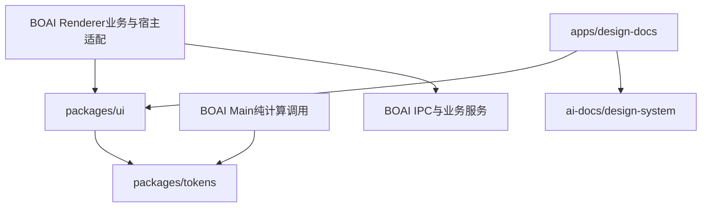

<!--
[INPUT]: Raft参考、BOAI现有组件/排版/主题边界，以及先同仓共用再独立项目的目标。
[OUTPUT]: 两包一站的建议架构、依赖方向、分发合同、开源源码归属与渐进迁移边界。
[POS]: 第23组架构建议；事实归01，实施与实际进度归03。
[PROTOCOL]: 一旦本文件变化，必须同步更新Header，并上浮检查所属目录.folder.md。
-->
# 包结构与独立开源方案

## 1. 推荐路线与备选

推荐：**同仓提取和接入 → 独立可用的包与网站 → 按发布目标整体拆出独立仓库。** 本文是后续实施建议；本轮不创建这些目录、注册包或部署网站。

| 方案 | 优点 | 成本 | 建议 |
| --- | --- | --- | --- |
| 在BOAI仓库内建`packages`及`apps/design-docs` | 一次修改可同时验证桌面与官网，容易发现隐藏耦合 | 桌面与设计系统共用Git历史和仓库治理 | 作为首轮开发方式 |
| 直接新建`boai-design`仓库，BOAI安装发布版本 | 从第一天拥有独立议题、版本和贡献边界 | 提取尚未稳定时频繁跨仓发包/联调 | 若首次开发就必须接收外部贡献，可在DS0选择此路线 |
| 将整个设计系统放到`apps/boai-design`并让桌面引用其中组件 | 看似只新增一个目录 | 产品反向依赖网站、无法独立发布组件 | 不采用 |
| 两仓各保留一份UI并定期手工同步 | 短期启动方便 | 修复、样式和类型持续分叉 | 不采用 |

这里“独立项目”分为三件事：网站独立部署、包独立版本、Git仓库独立维护。前两项在同仓也能成立；第三项需要明确迁出及唯一源码归属。只建立`apps`目录不代表已完成独立开源。

## 2. 当前仓库的建议目录

```text
boai-agent/
├── src/                         # 现有桌面应用，首轮保留
│   ├── main/                    # 窗口/IPC/偏好持久化
│   ├── renderer/                # 业务页面、store、宿主适配
│   ├── runtime/                 # Agent与业务服务
│   ├── cli/
│   └── shared/                  # 跨进程业务合同
├── packages/
│   ├── tokens/                  # 建议包名 @boai/tokens
│   │   └── src/                 # 纯TS定义/解析，生成CSS与可选JSON
│   └── ui/                      # 建议包名 @boai/ui
│       └── src/
│           ├── components/      # 基础控件
│           ├── patterns/        # 已脱离业务的呈现组合，按需提取
│           ├── icons/           # 控件需要的本地图标
│           └── styles/          # 组件皮肤及Tailwind集成
├── apps/
│   └── design-docs/             # React文档站、示例、导航与搜索
├── ai-docs/
│   ├── design-system/           # 后续公开指南内容，站点只读取此白名单
│   └── spec/23.BOAI设计系统/     # 本轮调研/迁移计划，不直接发布
├── tests/                       # 原产品验收保持，包可有自身定向测试
├── scripts/                     # 保留原开发和构建入口
├── pnpm-workspace.yaml
└── package.json                 # 保留 private: true 与桌面运行入口
```

初期两个包足够。tokens单独成包的理由是BOAI主进程也使用排版定义和纯计算，不能为此依赖React组件及CSS副作用；这与Raft把基础数据和UI放在一个包内不同。暂不单设`theme`、`icons`、`utils`、`hooks`、`config`等包，出现实际独立消费者和独立发布需求后再拆。

`src/shared`并不全部等于公共库；IPC、员工、会话、文件授权和运行协议留在应用。`apps/desktop`可作为以后整个仓库重组的目标，但必须独立核对Electron入口、三HTML入口、资源复制、CLI、测试路径、打包与升级，不能附带到首次组件提取中。

当前`pnpm-workspace.yaml`已有`.`、原生依赖构建白名单、`patchedDependencies`和`overrides`。实施时增补`apps/*`、`packages/*`，不能用一个新的空workspace配置覆盖这些策略。仓库内部依赖明确使用`workspace:*`；pnpm发布时会转换为真实版本依赖，外部用户不需要本仓库。依据：[pnpm 10 workspace文档](https://pnpm.io/10.x/workspaces)。

## 3. 依赖方向与归属

以下箭头表示“依赖/消费”。



公共包禁止导入`src/main`、`src/runtime`、BOAI业务store、桌面客户端、IPC类型或应用根路径别名。站点不能直接导入`src/renderer/components/ui`来绕开公共包，也不能复制其实现作为“示例”。

| 层 | 包含 | 不包含 |
| --- | --- | --- |
| tokens | 语义颜色、字体/字号角色、行高、圆角、尺寸、阴影、动效值与纯解析 | 插件启停、背景asset、用户偏好落盘、应用图标选择、Electron缩放 |
| ui基础层 | Button、Input、Card、Dialog、Select、Tabs、Skeleton、Sonner呈现等 | API调用、业务权限、工作状态机、员工身份查询 |
| ui呈现组合 | 完成解耦的列表行、空态、面板标题、消息/附件外壳、受控Composer外壳 | 自动发送消息、创建Run、读取文件、保存草稿、业务恢复策略 |
| renderer适配 | 业务数据映射为props、回调接原服务、主题偏好预览与保存 | 第二份公共组件实现或第二套视觉token |
| design-docs | 文档、交互示例、安装代码、主题预览、搜索与公开索引 | BOAI个人数据、真实员工配置、模型密钥、Electron启动 |

复用判断依据是“在没有BOAI服务的普通React页面里，是否可通过明确props与回调完成展示和交互”，而不是文件是否恰好位于`ui/`或`common/`。

## 4. token、主题和样式的合同

### 4.1 保留一个定义来源

迁移现有`typography.ts`的定义、默认值和纯计算到tokens包；旧路径可以暂时re-export，禁止保留两份手写定义。颜色和Soft视觉常量按同样方式迁移，已有变量名先兼容，避免首次提取同时重命名所有页面。

推荐初期以类型化TS为编辑源，生成默认`foundation.css`与文档使用的token数据；未来需要设计工具对接时再提供DTCG格式导出。生成产物不可手改，构建检查源与产物一致。不得在公共组件或官网散写一套固定字号；字号调整仍走UI/正文/代码三类角色和既有边界。

`foundation.css`必须包含未运行BOAI初始化代码时也完整可用的默认值与浅深色方案。仅导出变量，不能设置宿主`html/body`布局、全局字体、scrollbar、outline或Preflight。纯HTML演示可选择使用它，React不是前置条件。

### 4.2 应用与公共包各自负责什么

- BOAI Main继续拥有偏好持久化和版本核对；Renderer继续预览及消费原快照。
- tokens只提供数据和纯解析；ui至多提供受控主题容器/适配方法，不读桌面store、不自动保存用户设置。
- 网站自己管理浏览器预览状态；不导入BOAI外观store来获得主题。
- BOAI主题插件把结果映射为同一组CSS变量。插件注册、停用回退、图片资产协议与使用引用均留在应用。
- 并排浅深色示例必须隔离主题和Portal，避免Popover/Dialog挂到body后丢失预览主题；可通过主题化Portal容器或隔离示例文档实现。整个页面主题与单个示例主题分别验证。
- 普通浏览器消费先作为首发目标。`document.body`、cookie和全局快捷键须改为显式可控、正确清理的行为；SSR/Next.js支持只有通过对应验证后才能列为支持。

### 4.3 首发样式分发策略

首发沿当前技术栈：React 19与Tailwind CSS 4集成。建议公开入口如下，具体文件名由DS0冻结：

| 入口 | 用途 |
| --- | --- |
| `@boai/tokens` | 类型化定义与纯计算；Node侧不附带DOM/CSS导入 |
| `@boai/tokens/foundation.css` | 默认语义变量、明暗主题，无全局reset |
| `@boai/ui` | 稳定React组件导出；实验组件不得混入稳定入口 |
| `@boai/ui/styles.css` | tokens、Soft组件皮肤和必要Tailwind主题映射 |
| `@boai/ui/fonts.css` | 可选字体入口；默认系统回退，分发字体时保留来源/许可 |

消费方在应用CSS中加载一次Tailwind，再加载ui样式。Tailwind默认不会扫描`node_modules`；应提供明确`@source`接入说明，并保证发布的JS保留可扫描的完整类名。本地workspace与独立安装两种情况都必须验证，路径以消费方CSS所在位置计算，不能照抄仓库内路径。[Tailwind官方说明](https://tailwindcss.com/docs/detecting-classes-in-source-files)支持显式登记依赖源码。

首发需要的内部图标随包提供本地可渲染资源或构建产物，不能要求用户拥有BOAI的Tailwind图标插件配置，不能运行时请求远程图标。沿用现有图标体系，不为对齐Raft而整体换成Lucide。

完整预编译CSS、免Tailwind消费可后续增加；本轮不同时维护两套样式分发方案。`styles.css`的兼容版本和必要配置必须写在安装文档，不能只写`import Button`就宣称开箱可用。

### 4.4 提取时同时发现的质量边界

`global.css`与`skin.css`里的全局/业务选择器不能整体发布。先分离基础皮肤，保持桌面级联顺序、窗口拖动和应用布局由原入口负责。包的CSS副作用须在`package.json.sideEffects`明确保留，避免消费者tree-shaking删除样式；JS导入不应无意加载全部重型预览依赖。

公共组件应提供可见键盘焦点、真实disabled/ARIA语义、正确焦点返回和reduced-motion表现。不能将原全局outline清除规则当作公共库约定。发现差异要区分“提取回归”和“设计修正”：前者修复实现，后者先记录并走UI候选审阅，不静默更新桌面基线。

## 5. 组件提取顺序

| 批次 | 候选 | 主要工作 |
| --- | --- | --- |
| 首个纵向闭环 | tokens、Button、Input、Card、Skeleton | 桌面与官网同时消费，验证字号/主题/样式扫描及默认值 |
| 基础交互 | Dialog、Popover、Select、Tabs、Tooltip、Sonner、Checkbox、Switch、Separator | 图标、Portal、焦点、禁用、主题继承及别名清理 |
| 通用布局与呈现 | 经过归属审查的列表行、空态、面板、消息与附件外壳 | 只接收展示数据/回调，不复制业务类型与状态机 |
| 后续按需 | CodeBlock、Typeset、Selection Actions、编辑器与复杂预览 | 先处理文件限制、依赖体积、来源许可和副作用 |

首发不以搬走全部`ui/`为完成标准。复杂编辑器、文件预览、执行流、员工配置和整个聊天面板可以继续留在应用；稳定的公共控件先被真实复用更有价值。

迁移某个组件时，旧路径可用短期re-export保持调用方稳定；同一组件只能有一个实现。迁移清单记录旧路径、包导出、桌面调用点、官网示例、测试、兼容转发是否仍存在，最后再统一清理转发。

## 6. 设计网站的首发内容与实现

网站建议沿现有Vite＋React构建，Markdown内容与显式登记的React示例结合。首发以静态输出部署为目标，路由直接访问与刷新可用；搜索索引在构建时生成，不需要登录、数据库或后端。若后续选择专门文档框架，先验证能直接渲染BOAI组件及主题，不为展示站迁移整个产品框架。

| 页面组 | 首发需要解释的内容 |
| --- | --- |
| 开始使用 | 设计系统用途、安装、版本要求、样式/字体接入、最小示例 |
| 设计原则 | 中性Soft表面、紧凑信息层级、统一分割线、动作就近、稳定加载骨架 |
| 基础 | 颜色、排版、圆角、阴影、尺寸、图标、明暗主题、动效与可访问性 |
| 组件 | 何时使用、实际import、参数、状态矩阵、交互示例、已知限制 |
| 模式 | 列表与详情、设置Card、表单保存/草稿保护、Sonner与恢复、消息/附件呈现 |
| 维护 | 变更记录、弃用与升级、贡献说明、来源与许可 |

每个首发组件必须有真实运行的预览、源码、浅深色、禁用/加载/长文本及键盘状态。字号控件调用同一排版解析；主题选择不复制token数值。包含中文和英文长文本示例；网站窄屏可读不等于BOAI桌面已新增手机支持。

首发文档与示例取自同一受控内容清单，生成页面、搜索、`llms.txt`、组件JSON索引与Markdown输出，组件标明稳定/实验/废弃。该公开组件索引与根目录shadcn的`components.json`职责不同，不能覆盖后者。运行示例由显式组件映射提供，不执行任意外部Markdown脚本。

网站只发布`ai-docs/design-system`及登记示例，不扫描整个`ai-docs`。本次迁移计划、历史报告、测试原件及运行数据不作为网站内容。Storybook可以以后用于开发审阅，但不同时引入第二套必须手工同步的文档体系。

## 7. 独立仓库与发布

### 7.1 同仓阶段

根应用保持`private: true`。tokens和ui各自拥有`name`、`exports`、类型声明、`files`白名单与版本；React/React DOM为peer依赖，不能打包第二份React。网站独立构建，桌面包仍只包含原应用所需产物。根`pnpm dev`保持桌面入口，新增`pnpm dev:design`；需要包watch时由这些入口编排，不要求用户额外手动启动三条命令。

正式发布前必须用打出的npm tarball在仓库外的最小消费者安装验证。workspace运行成功不能证明发布包有CSS、图标、字体、类型和完整依赖。这里的npm包验证与Electron安装包是不同任务，不要求日常开发打DMG。

### 7.2 拆出独立项目的目标

独立仓库的建议结构：

```text
boai-design/
├── packages/tokens/
├── packages/ui/
├── apps/design-docs/
├── design/                 # 从公开指南源一次性迁入，更新构建路径
└── 包管理、CI、贡献和许可文件
```

这是另一仓库的拟定结构，不是现在在BOAI根目录新增`design/`的授权。当前仓库的文档仍遵循`ai-docs/`约定。

切换时先给旧仓库相关路径建立可追溯的迁出版本；新仓库完成包构建、发布和官网验证后，BOAI切换为精确发布版本。验证消费者后移除旧实现或只保留兼容转发，并将设计系统修改入口指向新仓库。**切换完成后，新仓库是唯一源码来源，BOAI只提交版本升级，不双向同步两份源码。**

若长期选择同仓，则当前仓库继续为唯一来源；不要再建一个可手工修改的“镜像项目”。单向只读镜像只有确有展示需要时另行设计，不作为默认维护模式。

### 7.3 版本、部署和开源准备

- 设计系统版本与BOAI桌面版本分离。初期tokens/ui采用协调发布批次，变更记录说明视觉、API、依赖和迁移影响，BOAI锁定经验证的版本；网站显示对应包版本。
- 维护者、npm scope、官网域名、托管商与许可证在正式发布阶段确定。MIT可作为自有代码的候选，但不是本轮已作出的授权决定。
- 对第三方源码、字体、图标、插画和品牌分别核对来源并保留必要声明。已有来源未知的资产不纳入首发；不凭仓库公开推断全部资产可再分发。
- 公开网站、npm包和桌面三种交付分别验收：网站成功不代表包可安装，包发布成功不代表桌面已完成升级。
- 首轮无需Turborepo/Nx、自建组件安装CLI、组件市场或shadcn registry。先完成版本化包与真实消费；以后需要复制式分发时再生成registry，源实现仍唯一。

## 8. 与现有CI和开发规范的关系

本轮仅文档，允许本地执行Header、链接及Git差异轻量校验，不启动产品测试/构建。后续动到workspace、依赖、CSS、组件、构建或CI都属于产品变更，按当时有效的`boai-dev-workflow`及GitHub Actions执行完整门禁。

设计系统可增加独立的包/网站检查，但不能用这些结果替代BOAI原有Required checks、T1、UI基线或绕过main保护。新增包后，原只扫描`src/renderer`的类型/UI/字号检查必须显式覆盖共享包；CI范围需沿依赖传播，tokens/ui变更必须验证桌面消费者。不会自动恢复本机CI服务。

当前分析基线main的工作流尚未包含主工作区`ci/development-docs-gate`分支的文档分流增量；未来提交前应以当时合入后的实际工作流重新核对。本轮无PR，不能声明文档云端或产品云端通过。
